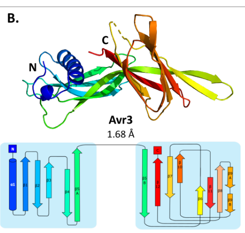

## Question

# Gene Research for Functional Annotation

## ⚠️ CRITICAL: Gene/Protein Identification Context

**BEFORE YOU BEGIN RESEARCH:** You MUST verify you are researching the CORRECT gene/protein. Gene symbols can be ambiguous, especially for less well-characterized genes from non-model organisms.

### Target Gene/Protein Identity (from UniProt):
- **UniProt Accession:** Q709D8
- **Protein Description:** SubName: Full=Secreted in xylem 1 {ECO:0000313|EMBL:ACY39281.1, ECO:0000313|EMBL:CAE55870.1};
- **Gene Information:** Name=six1 {ECO:0000313|EMBL:CAE55870.1}; Synonyms=SIX1 {ECO:0000313|EMBL:ACY39281.1};
- **Organism (full):** Fusarium oxysporum f. sp. lycopersici.
- **Protein Family:** Not specified in UniProt
- **Key Domains:** Not specified in UniProt

### MANDATORY VERIFICATION STEPS:

1. **Check if the gene symbol "six1" matches the protein description above**
2. **Verify the organism is correct:** Fusarium oxysporum f. sp. lycopersici.
3. **Check if protein family/domains align with what you find in literature**
4. **If you find literature for a DIFFERENT gene with the same or similar symbol, STOP**

### If Gene Symbol is Ambiguous or You Cannot Find Relevant Literature:

**DO NOT PROCEED WITH RESEARCH ON A DIFFERENT GENE.** Instead:
- State clearly: "The gene symbol 'six1' is ambiguous or literature is limited for this specific protein"
- Explain what you found (e.g., "Found extensive literature on a different gene with the same symbol in a different organism")
- Describe the protein based ONLY on the UniProt information provided above
- Suggest that the protein function can be inferred from domain/family information

### Research Target:

Please provide a comprehensive research report on the gene **six1** (gene ID: SIX1, UniProt: Q709D8) in FUSOX.

The research report should be a detailed narrative explaining the function, biological processes, and localization of the gene product. Citations should be given for all claims.

You should prioritize authoritative reviews and primary scientific literature when conducting research. You can supplement
this with annotations you find in gene/protein databases, but these can be outdated or inaccurate.

We are specifically interested in the primary function of the gene - for enzymes, what reaction is catalyzed, and what is the substrate specificity? For transporters, what is the substrate? For structural proteins or adapters, what is the broader structural role? For signaling molecules, what is the role in the pathway.

We are interested in where in or outside the cell the gene product carries out its function.

We are also interested in the signaling or biochemical pathways in which the gene functions. We are less interested in broad pleiotropic effects, except where these elucidate the precise role.

Include evidence where possible. We are interested in both experimental evidence as well as inference from structure, evolution, or bioinformatic analysis. Precise studies should be prioritized over high-throughput, where available.

## Output

Question: You are an expert researcher providing comprehensive, well-cited information.

Provide detailed information focusing on:
1. Key concepts and definitions with current understanding
2. Recent developments and latest research (prioritize 2023-2024 sources)
3. Current applications and real-world implementations
4. Expert opinions and analysis from authoritative sources
5. Relevant statistics and data from recent studies

Format as a comprehensive research report with proper citations. Include URLs and publication dates where available.
Always prioritize recent, authoritative sources and provide specific citations for all major claims.

# Gene Research for Functional Annotation

## ⚠️ CRITICAL: Gene/Protein Identification Context

**BEFORE YOU BEGIN RESEARCH:** You MUST verify you are researching the CORRECT gene/protein. Gene symbols can be ambiguous, especially for less well-characterized genes from non-model organisms.

### Target Gene/Protein Identity (from UniProt):
- **UniProt Accession:** Q709D8
- **Protein Description:** SubName: Full=Secreted in xylem 1 {ECO:0000313|EMBL:ACY39281.1, ECO:0000313|EMBL:CAE55870.1};
- **Gene Information:** Name=six1 {ECO:0000313|EMBL:CAE55870.1}; Synonyms=SIX1 {ECO:0000313|EMBL:ACY39281.1};
- **Organism (full):** Fusarium oxysporum f. sp. lycopersici.
- **Protein Family:** Not specified in UniProt
- **Key Domains:** Not specified in UniProt

### MANDATORY VERIFICATION STEPS:

1. **Check if the gene symbol "six1" matches the protein description above**
2. **Verify the organism is correct:** Fusarium oxysporum f. sp. lycopersici.
3. **Check if protein family/domains align with what you find in literature**
4. **If you find literature for a DIFFERENT gene with the same or similar symbol, STOP**

### If Gene Symbol is Ambiguous or You Cannot Find Relevant Literature:

**DO NOT PROCEED WITH RESEARCH ON A DIFFERENT GENE.** Instead:
- State clearly: "The gene symbol 'six1' is ambiguous or literature is limited for this specific protein"
- Explain what you found (e.g., "Found extensive literature on a different gene with the same symbol in a different organism")
- Describe the protein based ONLY on the UniProt information provided above
- Suggest that the protein function can be inferred from domain/family information

### Research Target:

Please provide a comprehensive research report on the gene **six1** (gene ID: SIX1, UniProt: Q709D8) in FUSOX.

The research report should be a detailed narrative explaining the function, biological processes, and localization of the gene product. Citations should be given for all claims.

You should prioritize authoritative reviews and primary scientific literature when conducting research. You can supplement
this with annotations you find in gene/protein databases, but these can be outdated or inaccurate.

We are specifically interested in the primary function of the gene - for enzymes, what reaction is catalyzed, and what is the substrate specificity? For transporters, what is the substrate? For structural proteins or adapters, what is the broader structural role? For signaling molecules, what is the role in the pathway.

We are interested in where in or outside the cell the gene product carries out its function.

We are also interested in the signaling or biochemical pathways in which the gene functions. We are less interested in broad pleiotropic effects, except where these elucidate the precise role.

Include evidence where possible. We are interested in both experimental evidence as well as inference from structure, evolution, or bioinformatic analysis. Precise studies should be prioritized over high-throughput, where available.

# Functional annotation report: *Fusarium oxysporum* f. sp. *lycopersici* SIX1/Avr3

## Identity and principal conclusion

**The research target is the fungal protein specified by the user as UniProt Q709D8, “Secreted in xylem 1,” encoded by *six1* in the tomato-wilt pathogen *F. oxysporum* f. sp. *lycopersici* (Fol).** Fol-specific primary literature identifies **SIX1 as Avr3**: an infection-associated, secreted effector that contributes to full virulence on susceptible tomato but elicits resistance in tomato carrying the **I-3** gene. It is neither the human SIX1 transcription factor nor automatically functionally equivalent to SIX1 homologues in other *Fusarium* formae speciales. The reviewed papers establish the Fol SIX1/Avr3 identity by name and biological system, but do not explicitly cross-reference Q709D8; one computational paper instead specifies UniProt **Q709E2** for its Fol SIX1 sequence. Those accession numbers should not be presumed sequence-identical without checking their database records. (yu2024thestructuralrepertoire pages 1-2, simbaqueba2018evidenceforhorizontal pages 18-21, rep2004asmallcysteine‐rich pages 1-2, rathore2024insilicoidentification pages 3-4)

**Recommended primary-function annotation:** *Secreted fungal virulence effector and I-3-recognized avirulence determinant involved in tomato root/vascular infection.* There is **no experimentally established catalytic reaction, substrate specificity, transport substrate, or validated direct virulence target** for Fol Six1. Here, “effector” denotes a pathogen-secreted protein that changes the outcome of infection; “avirulence determinant” denotes the same protein when its presence allows a resistant host to detect the pathogen. (simbaqueba2018evidenceforhorizontal pages 10-14, catanzariti2015thetomatoi3 pages 1-2, sain2015theroleof pages 5-7)

The evidence hierarchy, including important negative findings, is summarized below.

| Feature | Direct finding | Inference / qualification | Strongest primary source |
|---|---|---|---|
| Target identity | The **user-supplied UniProt Q709D8** is annotated as *Fusarium oxysporum* f. sp. *lycopersici* (Fol) **SIX1**, “Secreted in xylem 1.” Fol-specific literature equates **SIX1 with Avr3** and describes a 284-aa precursor. This is unrelated to animal/human **SIX1** transcription factors and must not be conflated with SIX1 homologues from other *F. oxysporum* formae speciales. | The reviewed papers establish **Fol SIX1 = Avr3**, but do not explicitly cite Q709D8. Rathore et al. instead used **UniProt Q709E2**; without sequence-level database reconciliation, Q709E2 and Q709D8 should **not** be asserted to be equivalent accessions. | Rep et al., 2004, https://doi.org/10.1111/j.1365-2958.2004.04177.x; Yu et al., 2024, https://doi.org/10.7554/eLife.89280 (rep2004asmallcysteine‐rich pages 1-2, yu2024thestructuralrepertoire pages 2-3, rathore2024insilicoidentification pages 1-3) |
| Secretion and site of action | A **12-kDa cysteine-rich species (p12)** corresponding to the central region of the 32-kDa SIX1 precursor was recovered from xylem sap of Fol-infected tomato and identified by mass spectrometry. In 2024 LC–MS proteomics, SIX1/Avr3 was again detected in resistant tomato xylem sap; in the **I-3 line it appeared in only 1 of 5 replicates**, whereas it was a differentially accumulating protein in I-1, I-2, and I-7 lines. | The best-supported functional compartment is the **extracellular xylem/apoplast** during root and vascular colonization. The low detection frequency in I-3 plants may reflect restriction of fungal biomass or colonization, not absence of secretion. No convincing evidence places Fol Six1 inside tomato cells. | Rep et al., 2004, https://doi.org/10.1111/j.1365-2958.2004.04177.x; Šimkovicová et al., 2024, https://doi.org/10.3389/fpls.2024.1384431 (rep2004asmallcysteine‐rich pages 1-2, rep2004asmallcysteine‐rich pages 2-3, simkovicova2024tomatorgenemediatedresistance pages 4-5) |
| Virulence on susceptible tomato | Rep et al. initially found that SIX1 deletion did **not abolish pathogenicity** under a high-inoculum root-dip assay, while preliminary evidence suggested a requirement for full virulence under less favorable conditions. Later assays showed that **Fol-ΔSIX1 caused reduced disease** on susceptible tomato and that reintroduction of Fol SIX1 restored disease symptoms. | SIX1 is best annotated as a **quantitative virulence effector required for full disease severity**, not an indispensable pathogenicity gene. Homologues from cape-gooseberry-infecting strains failed to restore Fol virulence despite expression in roots, indicating host-adapted functional specificity. | Rep et al., 2004, https://doi.org/10.1111/j.1365-2958.2004.04177.x; Simbaqueba et al., 2018, https://doi.org/10.1111/mpp.12700 (rep2004asmallcysteine‐rich pages 6-7, simbaqueba2018evidenceforhorizontal pages 10-14) |
| I-3-dependent avirulence | In the original genetic study, **three independent targeted SIX1-deletion mutants** became virulent on I-3 tomato. Reintroduction of SIX1 into one knockout restored avirulence fully in **4 of 5** transformants and partially in the fifth. I-3 was subsequently cloned as a plasma-membrane **S-receptor-like kinase**, and its transgenic expression conferred Avr3-dependent resistance. | SIX1 is therefore also **AVR3**, an avirulence determinant necessary for I-3-mediated immunity. The genetics establish functional recognition but do **not** prove direct physical binding between Six1 and I-3. | Rep et al., 2004, https://doi.org/10.1111/j.1365-2958.2004.04177.x; Catanzariti et al., 2015, https://doi.org/10.1111/nph.13348 (rep2004asmallcysteine‐rich pages 4-6, rep2004asmallcysteine‐rich pages 3-4, catanzariti2015thetomatoi3 pages 1-2) |
| Protein architecture | The precursor contains **284 amino acids**, an N-terminal secretion signal, a pro-domain, and a processed cysteine-rich region. X-ray crystallography of Avr3 residues 22–284 resolved the structure at **1.68 Å** and revealed the new **FOLD (Fol dual-domain)** architecture: an N-terminal α-helix/five-β-strand domain and a C-terminal eight-stranded β-sandwich, stabilized by disulfide bonds. | SIX1 has no conventional sequence-defined catalytic domain. It is a structural member of the FOLD effector class, not an enzyme family. Electron density was continuous mainly from residue 96, although portions of the pro-domain remained associated; precursor processing and the exact active extracellular species remain incompletely resolved. | Yu et al., 2024, published 27 February 2024, https://doi.org/10.7554/eLife.89280 (yu2024thestructuralrepertoire pages 1-2, yu2024thestructuralrepertoire pages 2-3, yu2024thestructuralrepertoire pages 3-5, yu2024thestructuralrepertoire media b23338cf) |
| Infection-induced regulation | SIX1 transcript abundance was very low in axenic culture but strongly induced by living tomato-cell coculture. SIX1 expression was absent in **sge1** mutants and restored by SGE1 complementation. Promoter deletions showed that the upstream mimp was dispensable, whereas a region containing conserved **TCGGCA motifs** was required for infection-associated expression and I-3 avirulence. | SIX1 belongs to an **Sge1-dependent parasitic-growth/effector-expression program** activated by host-associated conditions. Whether Sge1 binds the SIX1 promoter directly or regulates it through intermediate factors remains unresolved. | Michielse et al., 2009, https://doi.org/10.1371/journal.ppat.1000637; Schmidt et al., 2013, https://doi.org/10.1186/1471-2164-14-119 (michielse2009thenuclearprotein pages 6-9, schmidt2013mitesinthe pages 10-11) |
| Biochemical mechanism and pathway | SIX1 deletion alters the tomato xylem proteome: the ΔAVR3 comparison yielded **37 differentially accumulated plant proteins**, and 24 proteins were shared among AVR3, AVR2, SIX5, and SIX6 knockout responses. Interaction screens have reported small heat-shock proteins as candidates, but no validated molecular target or reaction has been established. | **No enzyme activity, catalytic reaction, substrate specificity, transporter substrate, or confirmed host binding partner is known.** The most defensible primary function is extracellular effector-mediated promotion of vascular colonization/full virulence, counterbalanced by I-3-triggered immunity. Shared PR-protein accumulation is a defense correlate and must not be labeled a Six1-specific pathway. | Gawehns et al., 2015, https://doi.org/10.3389/fpls.2015.00967; de Sain & Rep, 2015, https://doi.org/10.3390/ijms161023970 (gawehns2015theeffectorrepertoire pages 6-8, sain2015theroleof pages 5-7) |

*Table: Evidence matrix for the user-supplied Fol SIX1/Avr3 accession Q709D8, separating direct experimental findings from inference and unresolved accession or mechanistic questions.*

## Where Six1 acts and how it is produced

Rep and colleagues identified a **12-kDa cysteine-rich protein in xylem sap** of infected tomato by mass spectrometry and traced its peptides to the central portion of the fungal *SIX1* translation product. The Fol007 sequence encodes a **284-amino-acid, approximately 32-kDa precursor** with an N-terminal signal peptide predicted to direct entry into the secretory pathway; the sap-associated 12-kDa species is much smaller than the predicted signal-peptide-cleaved precursor. Thus **tomato xylem sap—the extracellular vascular compartment—is directly demonstrated**, whereas the precise processing steps and all extracellular molecular species have not been completely established. Transcription in infected roots establishes expression during root infection, not a measured concentration of Six1 protein in a particular root cell compartment. (rep2004asmallcysteine‐rich pages 1-2, rep2004asmallcysteine‐rich pages 2-3)

A 2024 mass-spectrometry study independently detected Fol SIX1/Avr3 in sap from infected resistant tomato lines. SIX1 was differentially abundant relative to mock controls in **I-1, I-2 and I-7 lines**, but was detected in only **one of five I-3 samples**; differences in fungal colonization or biomass could explain this contrast. Accordingly, absence of a reliable SIX1 signal from I-3 sap does **not** imply that Fol cannot secrete it in an I-3 plant. The extracellular xylem/apoplast is the best-supported site relevant to I-3 perception; uptake of **Fol Six1 specifically** into host cytoplasm has not been demonstrated. (simkovicova2024tomatorgenemediatedresistance pages 4-5, simkovicova2024tomatorgenemediatedresistance pages 5-7)

Expression is coupled to the fungal infection program. In a primary coculture experiment, Fol *SIX1* transcripts were low in axenic medium, rose strongly upon incubation with living tomato cells, disappeared in **sge1** mutants and returned after **SGE1** complementation. Promoter-deletion experiments further showed that removal of an upstream miniature Impala element (*mimp*) did not prevent infection-associated expression, whereas removal of a region containing conserved **TCGGCA** motifs reduced expression and abolished I-3-dependent avirulence in the tested transformants. These experiments establish regulatory dependence, **not** direct binding of Sge1 to the *SIX1* promoter. (schmidt2013mitesinthe pages 10-11, michielse2009thenuclearprotein pages 6-9)

## Precisely established biological role

**Virulence on susceptible hosts.** Fol lacking *SIX1* causes less disease on susceptible tomato than wild-type Fol in subsequent pathogenicity assays; reintroducing **Fol** *SIX1* restores disease symptoms. The careful distinction is *full virulence*, not an absolute requirement for infection. In the original 2004 high-inoculum, root-dip seedling assay, deletion mutants remained pathogenic and the authors described evidence for a full-virulence requirement under less favorable conditions as preliminary. Later knockout/complementation work supports a quantitative disease-promoting role, while the host process through which Six1 promotes infection remains unknown. (rep2004asmallcysteine‐rich pages 6-7, simbaqueba2018evidenceforhorizontal pages 10-14)

**Avirulence in I-3 tomato.** The original Fol study generated **three independent targeted *six1* knockouts** that caused disease on an otherwise resistant I-3 line. Restoring *SIX1* to a knockout fully restored avirulence in **four of five** transformants and partially restored it in the fifth. A spontaneous resistance-breaking mutant also lacked *SIX1*, but had lost at least **12 kb** including neighboring genes; the targeted deletions and complementation make the attribution to *SIX1* substantially more secure than the spontaneous mutant alone. The experiments establish that Six1 is **necessary for this I-3-dependent resistance phenotype**, not that the effector binds I-3 directly. (rep2004asmallcysteine‐rich pages 4-6, rep2004asmallcysteine‐rich pages 3-4)

**Host recognition pathway.** Map-based cloning and transgenic complementation established that tomato **I-3 encodes an S-receptor-like kinase**, with an extracellular domain, a membrane-spanning region and an intracellular kinase domain, capable of conferring **Avr3-dependent** resistance. Recognition initiates effector-triggered immunity and limits Fol proliferation and spread after vascular entry; it need not completely prevent initial root invasion. Crucially, a biochemical Six1–I-3 binding interface or a Six1-specific signaling intermediate has **not** been demonstrated. (catanzariti2015thetomatoi3 pages 1-2, yu2024thestructuralrepertoire pages 2-3, yu2024thestructuralrepertoire pages 16-17)

Comparative genetics helps separate the effector’s two roles. Two SIX1 homologues from the cape-gooseberry-infecting forma specialis, **Foph SIX1a and SIX1b**, were expressed after introduction into Fol lacking *SIX1*, yet **neither restored full virulence on susceptible tomato**. SIX1b—but not SIX1a—restored resistance in I-3 tomato. The authors therefore concluded that the feature detected by I-3 is separable from the property required to restore Fol’s disease-promoting activity. Across homologues, their proposed recognition-related **V130–T184 hypervariable region** contained **26 of 42 analyzed noncysteine positions** showing diversifying selection; assigning individual recognition or virulence residues remains a hypothesis, not an experimentally mapped interface. These are **comparisons involving homologues**, not evidence that Q709D8 itself is a cape-gooseberry protein. (simbaqueba2018evidenceforhorizontal pages 10-14, simbaqueba2018evidenceforhorizontal pages 14-18, simbaqueba2018evidenceforhorizontal pages 18-21)

The relevant immune pathway has an additional complication: a **different Fol effector, Avr1/SIX4**, functionally suppresses I-3-mediated resistance. Deleting *AVR1* or introducing it into other Fol strains changed resistance outcomes in infection experiments. A proposal that Avr1 competitively blocks Avr3 recognition is **speculative**; an early in-vitro experiment did not demonstrate an Avr1–Avr3 pull-down interaction. Neither this suppression nor known intracellular mechanisms of **Avr2/SIX3** should be assigned as Six1’s own biochemical activity. (houterman2008suppressionofplant pages 2-3, houterman2008suppressionofplant pages 3-4, yu2024thestructuralrepertoire pages 16-17)

## Structural and biochemical understanding: the major 2024 advance

Yu and colleagues solved the Fol Avr3/SIX1 structure by X-ray crystallography at **1.68 Å resolution** and defined it, with Avr1/SIX4, as a founding member of the **Fol dual-domain (FOLD) effector class**. The crystallization construct comprised Avr3 **residues 22–284**; interpretable continuous density of its main folded portion began near residue **96**, and part of its putative prodomain was also visible. The N-terminal folded domain contains an α-helix and five β-strands, while the C-terminal domain forms a β-sandwich; conserved cysteines and disulfide connections stabilize the architecture. Avr1 and Avr3 share only **19.5% amino-acid sequence identity** yet have similar two-domain folds. This experimentally established **structural class** resolves an important gap left by sequence-only annotation, but it is **not** evidence of enzymatic activity. Yu and colleagues explicitly state that the mode of **Avr3** recognition by I-3 had not been described; their receptor-interface experiments instead concern **Avr1** and its different tomato receptor, I. (yu2024thestructuralrepertoire pages 2-3, yu2024thestructuralrepertoire pages 3-5, yu2024thestructuralrepertoire pages 16-17)

**Visual evidence:** the cropped **Figure 1B and 1E** of Yu and colleagues show the Avr3 two-domain structure and its comparison with Avr1, respectively. The figure supports the shared structural fold; it does not identify Six1’s host target or demonstrate an Avr3–I-3 complex. (yu2024thestructuralrepertoire media b23338cf, yu2024thestructuralrepertoire media 9874e0ba)

This structural result is particularly relevant when interpreting claims of a putative *SIX1 inhibitor*. Rathore and colleagues screened **16,824 compounds computationally** against a **modeled** SIX1 protein and highlighted 4-[[2-(3-methoxyphenoxy)acetyl]amino]benzamide, reporting an approximately **−8.5 kcal/mol calculated docking/binding score**. Their accessible study describes modeling, docking and simulation—not measured protein binding, enzyme inhibition, suppression of fungal virulence or protection of tomato plants. Its methods also specify **Q709E2**, rather than the user-supplied Q709D8. Consequently this is a **candidate for experimental evaluation**, not an implemented SIX1-targeted treatment or a basis for annotating a catalytic pocket; additionally, a later experimental Avr3 structure is available for evaluating structural-model assumptions. (rathore2024insilicoidentification pages 1-3, rathore2024insilicoidentification pages 4-5, rathore2024insilicoidentification pages 6-8, yu2024thestructuralrepertoire pages 2-3)

## Host responses, applications and boundaries of inference

In a comparison of infected-tomato xylem proteomes, deleting **AVR3/SIX1** changed the abundance of **37 plant proteins** relative to infection with wild-type Fol, versus **209** in the AVR2-knockout comparison and **zero** in the SIX2-knockout comparison under the study’s threshold. **Twenty-four** host proteins were differentially abundant across four virulence-effector knockouts, including AVR3. These measurements show a SIX1-dependent **system-level consequence** in the extracellular vascular environment; because many changes may follow altered disease severity or fungal biomass, they do **not** identify a directly bound host substrate. A 2024 study of resistance lines additionally found **four shared xylem defense-associated proteins**—PR-5x, PR-P2 and two endo-1,3-β-D-glucosidases—but this is a response shared among distinct resistance genotypes, **not** a specifically demonstrated downstream biochemical pathway of Six1. (gawehns2015theeffectorrepertoire pages 6-8, simkovicova2024tomatorgenemediatedresistance pages 5-7)

The established real-world use of *SIX1* knowledge is in **pathogen profiling and resistance-informed breeding**, not a SIX1-specific chemical intervention. In a **270-isolate** survey, a panel including **SIX1, SIX2, SIX3 and SIX5** supported Fol identification; **SIX4** presence and **SIX3** polymorphisms were used to differentiate the principal race genotypes. *SIX1* alone is **not a reliable race-3 marker**: Fol isolates of different races can retain it, and Avr1 can alter the phenotype associated with I-3 recognition. I-3 resistance has been incorporated into tomato breeding and experimentally validated by transgenic complementation; the 2024 xylem study further documents that resistant plants can limit disease despite detectable vascular colonization. These applications require appropriate pathogen-genotype and host-phenotype checks rather than assuming that a SIX1-positive PCR result guarantees resistance. (lievens2009effectorgenescreening pages 1-2, lievens2009effectorgenescreening pages 10-11, houterman2008suppressionofplant pages 2-3, catanzariti2015thetomatoi3 pages 1-2, simkovicova2024tomatorgenemediatedresistance pages 4-5)

**Bottom line and outstanding question.** Fol Six1/Avr3 is best understood as a **secreted, disulfide-stabilized FOLD effector operating in the tomato extracellular root–vascular environment**: it helps produce full disease severity in susceptible plants, whereas an I-3-bearing host mounts resistance when it detects its presence. Its **direct host binding partner, precise disease-promoting biochemical mechanism, natural processing pattern and physical mode of I-3 recognition remain unresolved**. For the exact user-specified protein, accession-level sequence reconciliation is also needed before transferring residue-specific predictions made for Q709E2 or another isolate without qualification. (rep2004asmallcysteine‐rich pages 1-2, simbaqueba2018evidenceforhorizontal pages 10-14, yu2024thestructuralrepertoire pages 2-3, yu2024thestructuralrepertoire pages 16-17, rathore2024insilicoidentification pages 1-3)

### Principal sources and publication dates

- **Rep et al., 2004**, *Molecular Microbiology*, “A small, cysteine-rich protein secreted by *Fusarium oxysporum* during colonization of xylem vessels is required for I-3-mediated resistance in tomato.” https://doi.org/10.1111/j.1365-2958.2004.04177.x. (rep2004asmallcysteine‐rich pages 1-2)
- **Michielse et al., October 2009**, *PLoS Pathogens*, “The nuclear protein Sge1 of *Fusarium oxysporum* is required for parasitic growth.” https://doi.org/10.1371/journal.ppat.1000637. (michielse2009thenuclearprotein pages 6-9)
- **Lievens et al., 2009**, *FEMS Microbiology Letters*, effector-gene screening and Fol race identification. https://doi.org/10.1111/j.1574-6968.2009.01783.x. (lievens2009effectorgenescreening pages 1-2)
- **Catanzariti et al., 2015**, *New Phytologist*, cloning and functional confirmation of tomato I-3. https://doi.org/10.1111/nph.13348. (catanzariti2015thetomatoi3 pages 1-2)
- **Gawehns et al., November 2015**, *Frontiers in Plant Science*, effector-knockout comparisons of tomato xylem proteomes. https://doi.org/10.3389/fpls.2015.00967. (gawehns2015theeffectorrepertoire pages 1-2, gawehns2015theeffectorrepertoire pages 6-8)
- **Simbaqueba et al., 2018**, *Molecular Plant Pathology*, SIX1-homologue complementation separating recognition from virulence. https://doi.org/10.1111/mpp.12700. (simbaqueba2018evidenceforhorizontal pages 10-14)
- **Yu et al., version of record 27 February 2024**, *eLife*, crystal structures and the FOLD effector class. https://doi.org/10.7554/eLife.89280; retrieved reviewed-version DOI: https://doi.org/10.7554/elife.89280.2. (yu2024thestructuralrepertoire pages 1-2, yu2024thestructuralrepertoire pages 2-3)
- **Šimkovicová et al., May 2024**, *Frontiers in Plant Science*, resistance-line xylem proteomics and fungal-effector detection. https://doi.org/10.3389/fpls.2024.1384431. (simkovicova2024tomatorgenemediatedresistance pages 4-5, simkovicova2024tomatorgenemediatedresistance pages 5-7)

References

1. (yu2024thestructuralrepertoire pages 1-2): Daniel S. Yu, Megan A. Outram, Ashley Smith, Carl L. McCombe, Pravin B. Khambalkar, Sharmin A. Rima, Xizhe Sun, Lisong Ma, Daniel J. Ericsson, David A. Jones, and Simon J. Williams. The structural repertoire of fusarium oxysporum f. sp. lycopersici effectors revealed by experimental and computational studies. ArXiv, Jan 2024. URL: https://doi.org/10.7554/elife.89280.2, doi:10.7554/elife.89280.2. This article has 87 citations.

2. (simbaqueba2018evidenceforhorizontal pages 18-21): Jaime Simbaqueba, Ann‐Maree Catanzariti, Carolina González, and David A. Jones. Evidence for horizontal gene transfer and separation of effector recognition from effector function revealed by analysis of effector genes shared between cape gooseberry- and tomato-infecting formae speciales of fusarium oxysporum. Molecular plant pathology, 19 10:2302-2318, Sep 2018. URL: https://doi.org/10.1111/mpp.12700, doi:10.1111/mpp.12700. This article has 63 citations and is from a peer-reviewed journal.

3. (rep2004asmallcysteine‐rich pages 1-2): M. Rep, H. Charlotte van der Does, M. Meijer, R. van Wijk, P. Houterman, H. Dekker, C. D. de Koster, and B. Cornelissen. A small, cysteine‐rich protein secreted by fusarium oxysporum during colonization of xylem vessels is required for i‐3‐mediated resistance in tomato. Molecular Microbiology, Sep 2004. URL: https://doi.org/10.1111/j.1365-2958.2004.04177.x, doi:10.1111/j.1365-2958.2004.04177.x. This article has 544 citations and is from a domain leading peer-reviewed journal.

4. (rathore2024insilicoidentification pages 3-4): Anuranjan Singh Rathore, Krishna Kant Gupta, Jeyabharathy Chandrasekaran, and Sam Aldrin Chandran. In silico identification of a promising inhibitor of fusarium oxysporum f. sp. lycopersici, secreted in xylem 1 protein. Molecular Diversity, pages 1-15, Feb 2024. URL: https://doi.org/10.1007/s11030-023-10613-x, doi:10.1007/s11030-023-10613-x. This article has 7 citations and is from a peer-reviewed journal.

5. (simbaqueba2018evidenceforhorizontal pages 10-14): Jaime Simbaqueba, Ann‐Maree Catanzariti, Carolina González, and David A. Jones. Evidence for horizontal gene transfer and separation of effector recognition from effector function revealed by analysis of effector genes shared between cape gooseberry- and tomato-infecting formae speciales of fusarium oxysporum. Molecular plant pathology, 19 10:2302-2318, Sep 2018. URL: https://doi.org/10.1111/mpp.12700, doi:10.1111/mpp.12700. This article has 63 citations and is from a peer-reviewed journal.

6. (catanzariti2015thetomatoi3 pages 1-2): Ann‐Maree Catanzariti, Ginny T. T. Lim, and David A. Jones. The tomato i-3 gene: a novel gene for resistance to fusarium wilt disease. The New phytologist, 207 1:106-18, Jul 2015. URL: https://doi.org/10.1111/nph.13348, doi:10.1111/nph.13348. This article has 259 citations.

7. (sain2015theroleof pages 5-7): Mara De Sain and Martijn Rep. The role of pathogen-secreted proteins in fungal vascular wilt diseases. International Journal of Molecular Sciences, 16:23970-23993, Oct 2015. URL: https://doi.org/10.3390/ijms161023970, doi:10.3390/ijms161023970. This article has 177 citations.

8. (yu2024thestructuralrepertoire pages 2-3): Daniel S. Yu, Megan A. Outram, Ashley Smith, Carl L. McCombe, Pravin B. Khambalkar, Sharmin A. Rima, Xizhe Sun, Lisong Ma, Daniel J. Ericsson, David A. Jones, and Simon J. Williams. The structural repertoire of fusarium oxysporum f. sp. lycopersici effectors revealed by experimental and computational studies. ArXiv, Jan 2024. URL: https://doi.org/10.7554/elife.89280.2, doi:10.7554/elife.89280.2. This article has 87 citations.

9. (rathore2024insilicoidentification pages 1-3): Anuranjan Singh Rathore, Krishna Kant Gupta, Jeyabharathy Chandrasekaran, and Sam Aldrin Chandran. In silico identification of a promising inhibitor of fusarium oxysporum f. sp. lycopersici, secreted in xylem 1 protein. Molecular Diversity, pages 1-15, Feb 2024. URL: https://doi.org/10.1007/s11030-023-10613-x, doi:10.1007/s11030-023-10613-x. This article has 7 citations and is from a peer-reviewed journal.

10. (rep2004asmallcysteine‐rich pages 2-3): M. Rep, H. Charlotte van der Does, M. Meijer, R. van Wijk, P. Houterman, H. Dekker, C. D. de Koster, and B. Cornelissen. A small, cysteine‐rich protein secreted by fusarium oxysporum during colonization of xylem vessels is required for i‐3‐mediated resistance in tomato. Molecular Microbiology, Sep 2004. URL: https://doi.org/10.1111/j.1365-2958.2004.04177.x, doi:10.1111/j.1365-2958.2004.04177.x. This article has 544 citations and is from a domain leading peer-reviewed journal.

11. (simkovicova2024tomatorgenemediatedresistance pages 4-5): Margarita Šimkovicová, Gertjan Kramer, Martijn Rep, and Frank L. W. Takken. Tomato r-gene-mediated resistance against fusarium wilt originates in roots and extends to shoots via xylem to limit pathogen colonization. Frontiers in Plant Science, May 2024. URL: https://doi.org/10.3389/fpls.2024.1384431, doi:10.3389/fpls.2024.1384431. This article has 37 citations.

12. (rep2004asmallcysteine‐rich pages 6-7): M. Rep, H. Charlotte van der Does, M. Meijer, R. van Wijk, P. Houterman, H. Dekker, C. D. de Koster, and B. Cornelissen. A small, cysteine‐rich protein secreted by fusarium oxysporum during colonization of xylem vessels is required for i‐3‐mediated resistance in tomato. Molecular Microbiology, Sep 2004. URL: https://doi.org/10.1111/j.1365-2958.2004.04177.x, doi:10.1111/j.1365-2958.2004.04177.x. This article has 544 citations and is from a domain leading peer-reviewed journal.

13. (rep2004asmallcysteine‐rich pages 4-6): M. Rep, H. Charlotte van der Does, M. Meijer, R. van Wijk, P. Houterman, H. Dekker, C. D. de Koster, and B. Cornelissen. A small, cysteine‐rich protein secreted by fusarium oxysporum during colonization of xylem vessels is required for i‐3‐mediated resistance in tomato. Molecular Microbiology, Sep 2004. URL: https://doi.org/10.1111/j.1365-2958.2004.04177.x, doi:10.1111/j.1365-2958.2004.04177.x. This article has 544 citations and is from a domain leading peer-reviewed journal.

14. (rep2004asmallcysteine‐rich pages 3-4): M. Rep, H. Charlotte van der Does, M. Meijer, R. van Wijk, P. Houterman, H. Dekker, C. D. de Koster, and B. Cornelissen. A small, cysteine‐rich protein secreted by fusarium oxysporum during colonization of xylem vessels is required for i‐3‐mediated resistance in tomato. Molecular Microbiology, Sep 2004. URL: https://doi.org/10.1111/j.1365-2958.2004.04177.x, doi:10.1111/j.1365-2958.2004.04177.x. This article has 544 citations and is from a domain leading peer-reviewed journal.

15. (yu2024thestructuralrepertoire pages 3-5): Daniel S. Yu, Megan A. Outram, Ashley Smith, Carl L. McCombe, Pravin B. Khambalkar, Sharmin A. Rima, Xizhe Sun, Lisong Ma, Daniel J. Ericsson, David A. Jones, and Simon J. Williams. The structural repertoire of fusarium oxysporum f. sp. lycopersici effectors revealed by experimental and computational studies. ArXiv, Jan 2024. URL: https://doi.org/10.7554/elife.89280.2, doi:10.7554/elife.89280.2. This article has 87 citations.

16. (yu2024thestructuralrepertoire media b23338cf): Daniel S. Yu, Megan A. Outram, Ashley Smith, Carl L. McCombe, Pravin B. Khambalkar, Sharmin A. Rima, Xizhe Sun, Lisong Ma, Daniel J. Ericsson, David A. Jones, and Simon J. Williams. The structural repertoire of fusarium oxysporum f. sp. lycopersici effectors revealed by experimental and computational studies. ArXiv, Jan 2024. URL: https://doi.org/10.7554/elife.89280.2, doi:10.7554/elife.89280.2. This article has 87 citations.

17. (michielse2009thenuclearprotein pages 6-9): Caroline B. Michielse, Ringo van Wijk, Linda Reijnen, Erik M. M. Manders, Sonja Boas, Chantal Olivain, Claude Alabouvette, and Martijn Rep. The nuclear protein sge1 of fusarium oxysporum is required for parasitic growth. PLoS Pathogens, 5:e1000637, Oct 2009. URL: https://doi.org/10.1371/journal.ppat.1000637, doi:10.1371/journal.ppat.1000637. This article has 207 citations and is from a highest quality peer-reviewed journal.

18. (schmidt2013mitesinthe pages 10-11): Sarah M Schmidt, Petra M Houterman, Ines Schreiver, Lisong Ma, Stefan Amyotte, Biju Chellappan, Sjef Boeren, Frank L W Takken, and Martijn Rep. Mites in the promoters of effector genes allow prediction of novel virulence genes in fusarium oxysporum. BMC Genomics, 14:119-119, Feb 2013. URL: https://doi.org/10.1186/1471-2164-14-119, doi:10.1186/1471-2164-14-119. This article has 277 citations and is from a peer-reviewed journal.

19. (gawehns2015theeffectorrepertoire pages 6-8): Fleur Gawehns, Lisong Ma, Oskar Bruning, Petra M. Houterman, Sjef Boeren, Ben J. C. Cornelissen, Martijn Rep, and Frank L. W. Takken. The effector repertoire of fusarium oxysporum determines the tomato xylem proteome composition following infection. Frontiers in Plant Science, Nov 2015. URL: https://doi.org/10.3389/fpls.2015.00967, doi:10.3389/fpls.2015.00967. This article has 101 citations.

20. (simkovicova2024tomatorgenemediatedresistance pages 5-7): Margarita Šimkovicová, Gertjan Kramer, Martijn Rep, and Frank L. W. Takken. Tomato r-gene-mediated resistance against fusarium wilt originates in roots and extends to shoots via xylem to limit pathogen colonization. Frontiers in Plant Science, May 2024. URL: https://doi.org/10.3389/fpls.2024.1384431, doi:10.3389/fpls.2024.1384431. This article has 37 citations.

21. (yu2024thestructuralrepertoire pages 16-17): Daniel S. Yu, Megan A. Outram, Ashley Smith, Carl L. McCombe, Pravin B. Khambalkar, Sharmin A. Rima, Xizhe Sun, Lisong Ma, Daniel J. Ericsson, David A. Jones, and Simon J. Williams. The structural repertoire of fusarium oxysporum f. sp. lycopersici effectors revealed by experimental and computational studies. ArXiv, Jan 2024. URL: https://doi.org/10.7554/elife.89280.2, doi:10.7554/elife.89280.2. This article has 87 citations.

22. (simbaqueba2018evidenceforhorizontal pages 14-18): Jaime Simbaqueba, Ann‐Maree Catanzariti, Carolina González, and David A. Jones. Evidence for horizontal gene transfer and separation of effector recognition from effector function revealed by analysis of effector genes shared between cape gooseberry- and tomato-infecting formae speciales of fusarium oxysporum. Molecular plant pathology, 19 10:2302-2318, Sep 2018. URL: https://doi.org/10.1111/mpp.12700, doi:10.1111/mpp.12700. This article has 63 citations and is from a peer-reviewed journal.

23. (houterman2008suppressionofplant pages 2-3): Petra M. Houterman, Ben J. C. Cornelissen, and Martijn Rep. Suppression of plant resistance gene-based immunity by a fungal effector. PLoS Pathogens, 4:e1000061, May 2008. URL: https://doi.org/10.1371/journal.ppat.1000061, doi:10.1371/journal.ppat.1000061. This article has 467 citations and is from a highest quality peer-reviewed journal.

24. (houterman2008suppressionofplant pages 3-4): Petra M. Houterman, Ben J. C. Cornelissen, and Martijn Rep. Suppression of plant resistance gene-based immunity by a fungal effector. PLoS Pathogens, 4:e1000061, May 2008. URL: https://doi.org/10.1371/journal.ppat.1000061, doi:10.1371/journal.ppat.1000061. This article has 467 citations and is from a highest quality peer-reviewed journal.

25. (yu2024thestructuralrepertoire media 9874e0ba): Daniel S. Yu, Megan A. Outram, Ashley Smith, Carl L. McCombe, Pravin B. Khambalkar, Sharmin A. Rima, Xizhe Sun, Lisong Ma, Daniel J. Ericsson, David A. Jones, and Simon J. Williams. The structural repertoire of fusarium oxysporum f. sp. lycopersici effectors revealed by experimental and computational studies. ArXiv, Jan 2024. URL: https://doi.org/10.7554/elife.89280.2, doi:10.7554/elife.89280.2. This article has 87 citations.

26. (rathore2024insilicoidentification pages 4-5): Anuranjan Singh Rathore, Krishna Kant Gupta, Jeyabharathy Chandrasekaran, and Sam Aldrin Chandran. In silico identification of a promising inhibitor of fusarium oxysporum f. sp. lycopersici, secreted in xylem 1 protein. Molecular Diversity, pages 1-15, Feb 2024. URL: https://doi.org/10.1007/s11030-023-10613-x, doi:10.1007/s11030-023-10613-x. This article has 7 citations and is from a peer-reviewed journal.

27. (rathore2024insilicoidentification pages 6-8): Anuranjan Singh Rathore, Krishna Kant Gupta, Jeyabharathy Chandrasekaran, and Sam Aldrin Chandran. In silico identification of a promising inhibitor of fusarium oxysporum f. sp. lycopersici, secreted in xylem 1 protein. Molecular Diversity, pages 1-15, Feb 2024. URL: https://doi.org/10.1007/s11030-023-10613-x, doi:10.1007/s11030-023-10613-x. This article has 7 citations and is from a peer-reviewed journal.

28. (lievens2009effectorgenescreening pages 1-2): Bart Lievens, Petra M. Houterman, and Martijn Rep. Effector gene screening allows unambiguous identification of fusarium oxysporum f. sp. lycopersici races and discrimination from other formae speciales. FEMS microbiology letters, 300 2:201-15, Nov 2009. URL: https://doi.org/10.1111/j.1574-6968.2009.01783.x, doi:10.1111/j.1574-6968.2009.01783.x. This article has 290 citations and is from a peer-reviewed journal.

29. (lievens2009effectorgenescreening pages 10-11): Bart Lievens, Petra M. Houterman, and Martijn Rep. Effector gene screening allows unambiguous identification of fusarium oxysporum f. sp. lycopersici races and discrimination from other formae speciales. FEMS microbiology letters, 300 2:201-15, Nov 2009. URL: https://doi.org/10.1111/j.1574-6968.2009.01783.x, doi:10.1111/j.1574-6968.2009.01783.x. This article has 290 citations and is from a peer-reviewed journal.

30. (gawehns2015theeffectorrepertoire pages 1-2): Fleur Gawehns, Lisong Ma, Oskar Bruning, Petra M. Houterman, Sjef Boeren, Ben J. C. Cornelissen, Martijn Rep, and Frank L. W. Takken. The effector repertoire of fusarium oxysporum determines the tomato xylem proteome composition following infection. Frontiers in Plant Science, Nov 2015. URL: https://doi.org/10.3389/fpls.2015.00967, doi:10.3389/fpls.2015.00967. This article has 101 citations.

## Artifacts

- [Edison artifact artifact-00](SIX1-deep-research-falcon_artifacts/artifact-00.md)

## Citations

1. michielse2009thenuclearprotein pages 6-9
2. lievens2009effectorgenescreening pages 1-2
3. simbaqueba2018evidenceforhorizontal pages 10-14
4. yu2024thestructuralrepertoire pages 1-2
5. simbaqueba2018evidenceforhorizontal pages 18-21
6. rathore2024insilicoidentification pages 3-4
7. sain2015theroleof pages 5-7
8. yu2024thestructuralrepertoire pages 2-3
9. rathore2024insilicoidentification pages 1-3
10. simkovicova2024tomatorgenemediatedresistance pages 4-5
11. yu2024thestructuralrepertoire pages 3-5
12. schmidt2013mitesinthe pages 10-11
13. gawehns2015theeffectorrepertoire pages 6-8
14. simkovicova2024tomatorgenemediatedresistance pages 5-7
15. yu2024thestructuralrepertoire pages 16-17
16. simbaqueba2018evidenceforhorizontal pages 14-18
17. houterman2008suppressionofplant pages 2-3
18. houterman2008suppressionofplant pages 3-4
19. rathore2024insilicoidentification pages 4-5
20. rathore2024insilicoidentification pages 6-8
21. lievens2009effectorgenescreening pages 10-11
22. gawehns2015theeffectorrepertoire pages 1-2
23. [2-(3-methoxyphenoxy)acetyl
24. https://doi.org/10.1111/j.1365-2958.2004.04177.x;
25. https://doi.org/10.7554/eLife.89280
26. https://doi.org/10.3389/fpls.2024.1384431
27. https://doi.org/10.1111/mpp.12700
28. https://doi.org/10.1111/nph.13348
29. https://doi.org/10.1371/journal.ppat.1000637;
30. https://doi.org/10.1186/1471-2164-14-119
31. https://doi.org/10.3389/fpls.2015.00967;
32. https://doi.org/10.3390/ijms161023970
33. https://doi.org/10.1111/j.1365-2958.2004.04177.x.
34. https://doi.org/10.1371/journal.ppat.1000637.
35. https://doi.org/10.1111/j.1574-6968.2009.01783.x.
36. https://doi.org/10.1111/nph.13348.
37. https://doi.org/10.3389/fpls.2015.00967.
38. https://doi.org/10.1111/mpp.12700.
39. https://doi.org/10.7554/eLife.89280;
40. https://doi.org/10.7554/elife.89280.2.
41. https://doi.org/10.3389/fpls.2024.1384431.
42. https://doi.org/10.7554/elife.89280.2,
43. https://doi.org/10.1111/mpp.12700,
44. https://doi.org/10.1111/j.1365-2958.2004.04177.x,
45. https://doi.org/10.1007/s11030-023-10613-x,
46. https://doi.org/10.1111/nph.13348,
47. https://doi.org/10.3390/ijms161023970,
48. https://doi.org/10.3389/fpls.2024.1384431,
49. https://doi.org/10.1371/journal.ppat.1000637,
50. https://doi.org/10.1186/1471-2164-14-119,
51. https://doi.org/10.3389/fpls.2015.00967,
52. https://doi.org/10.1371/journal.ppat.1000061,
53. https://doi.org/10.1111/j.1574-6968.2009.01783.x,