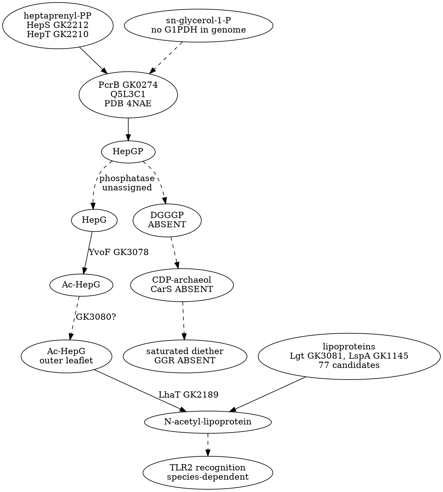
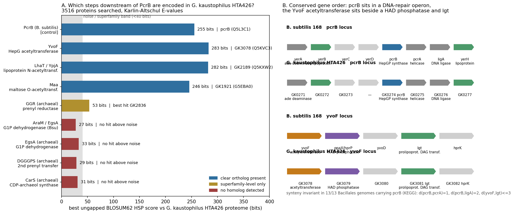
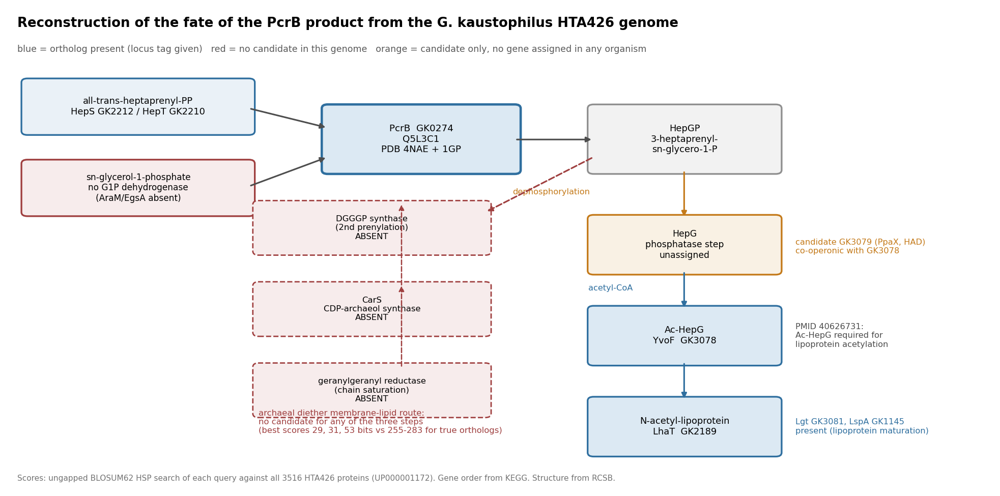
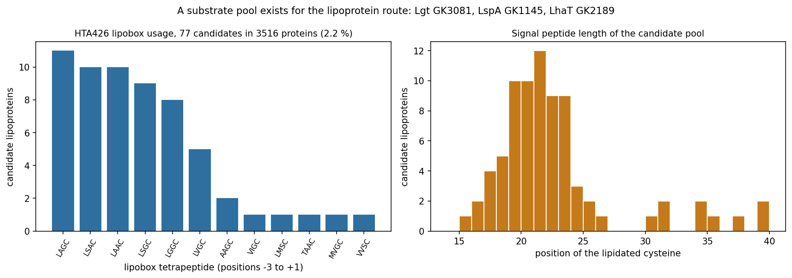

## Question

# AIGR Gene Hypothesis Deep Research

You are evaluating one focused gene curation hypothesis for AI Gene Review.
This is not a general gene overview. Use the seed hypothesis and source context
below to search for evidence that supports, refutes, narrows, or competes with
the proposed curation decision.

## Target Gene

- **Organism code:** GEOKA
- **Taxon:** Geobacillus kaustophilus HTA426 (NCBITaxon:235909)
- **Gene directory:** pcrB
- **Gene symbol:** pcrB
- **UniProt accession:** Q5L3C1

## Focus

- **Focus type:** free_text
- **Hypothesis slug:** kgap-pcrb-product-fate
- **Source file:** genes/GEOKA/pcrB/pcrB-ai-review.yaml
- **Source selector:** free-text

## Seed Hypothesis

What becomes of the heptaprenylglyceryl phosphate made by Geobacillus kaustophilus PcrB may be inferable from the genome, since the enzyme itself is characterised but the product's fate is not. That PcrB is a homodimeric heptaprenylglyceryl phosphate synthase forming an ether bond between the C35 heptaprenyl donor and the C3 hydroxyl of sn-glycerol-1-phosphate, that it belongs to the group I GGGP/HepGP synthase family with a TIM-barrel active site, and that geranylgeranyl diphosphate is a much weaker donor, are already recorded, so do not re-derive the reaction. Single analysis only: identify the enzymes that act on heptaprenylglyceryl phosphate or its close analogues in any organism where the pathway is characterised, naming them and quoting the statements that assign each step, then state for each whether G. kaustophilus HTA426 encodes a candidate, giving the locus tag and the basis for the call, so that the pathway is reconstructed from this genome rather than assumed from another; examine the genomic neighbourhood of pcrB in this strain and report which genes lie adjacent and whether any is a phosphatase, acetyltransferase or lipoprotein-processing enzyme, and whether the same adjacency recurs across Bacillales genomes above what gene order alone would give; state whether the sn-glycerol-1-phosphate substrate has a biosynthetic route in this genome, since a missing supply would bear on whether the product is made at appreciable levels in vivo; and report any measurement of this lipid or its derivatives in Geobacillus or close relatives, stating plainly if none exists. State which downstream fate the genome supports, and say plainly if the genome cannot distinguish candidate routes.

## Term and Decision Context

No specific term context supplied.

## Reference Context

No specific reference context supplied.

## Source Context YAML

```yaml
hypothesis: 'What becomes of the heptaprenylglyceryl phosphate made by Geobacillus kaustophilus PcrB may
  be inferable from the genome, since the enzyme itself is characterised but the product''s fate is not.
  That PcrB is a homodimeric heptaprenylglyceryl phosphate synthase forming an ether bond between the
  C35 heptaprenyl donor and the C3 hydroxyl of sn-glycerol-1-phosphate, that it belongs to the group I
  GGGP/HepGP synthase family with a TIM-barrel active site, and that geranylgeranyl diphosphate is a much
  weaker donor, are already recorded, so do not re-derive the reaction. Single analysis only: identify
  the enzymes that act on heptaprenylglyceryl phosphate or its close analogues in any organism where the
  pathway is characterised, naming them and quoting the statements that assign each step, then state for
  each whether G. kaustophilus HTA426 encodes a candidate, giving the locus tag and the basis for the
  call, so that the pathway is reconstructed from this genome rather than assumed from another; examine
  the genomic neighbourhood of pcrB in this strain and report which genes lie adjacent and whether any
  is a phosphatase, acetyltransferase or lipoprotein-processing enzyme, and whether the same adjacency
  recurs across Bacillales genomes above what gene order alone would give; state whether the sn-glycerol-1-phosphate
  substrate has a biosynthetic route in this genome, since a missing supply would bear on whether the
  product is made at appreciable levels in vivo; and report any measurement of this lipid or its derivatives
  in Geobacillus or close relatives, stating plainly if none exists. State which downstream fate the genome
  supports, and say plainly if the genome cannot distinguish candidate routes.'
focus_type: free_text
context: []
reference_id: []
```

## Research Objective

Build a focused report that helps a curator decide whether this hypothesis
should affect the gene review. Address the focus type directly:

1. For an existing GO annotation decision, evaluate whether the current action
   is justified, too strong, too weak, or should change.
2. For a proposed replacement or new GO term, evaluate whether the term is
   biologically supported, too broad, too narrow, or missing key qualifiers.
3. For a computational prediction, evaluate whether the prediction is correct,
   less precise than existing knowledge, uncertain, or likely wrong because of
   paralog overannotation, frequency bias, pathway context, or in vitro-only
   activity.
4. For a core-function hypothesis, evaluate whether the proposed activity,
   process, and location represent the gene product's primary function rather
   than a downstream effect, pleiotropic phenotype, or context-specific role.
5. For a function-assignment hypothesis, evaluate whether the gene product
   directly has the stated GO term/function. Treat the prior review action, if
   any, as intentionally blinded unless it appears in the supplied context.

Use primary literature whenever possible. Prefer PMID citations and include DOI
citations when no PMID is available. Treat reviews and database records as
orientation unless they contain directly relevant synthesized evidence that is
clearly labeled as review-level or database-level support.

Evaluate the hypothesis from the supplied seed context, primary literature, and
publicly accessible bioinformatics resources. Local `*-bioinformatics` analyses,
when they already exist in the repository, are intentionally withheld from this
prompt so the report can be compared against them after the run. Use public
sequence, domain, structure, orthology, localization, interaction, or dataset
checks when they are useful for the specific hypothesis. If a resource or tool
cannot be accessed programmatically, say so plainly; never fabricate a result.
Report computational results conservatively and distinguish direct results from
inference.

## Required Output

### Executive Judgment

Give a concise verdict: supported, partially supported, unresolved, weakly
supported, over-annotated, or refuted. Explain the reasoning and the most
important caveats.

### Evidence Matrix

Create a table with one row per important evidence item:

- Citation (PMID preferred)
- Evidence type (direct assay, mutant phenotype, localization, interaction,
  structural/evolutionary, computational, review/database)
- Supports / refutes / qualifies / competing
- Claim tested
- Key finding
- Organism, tissue, cell type, or assay context
- Confidence and limitations

### GO Curation Implications

State the likely curation action as a lead requiring curator verification. If
GO terms are involved, explain whether the evidence supports an MF, BP, or CC
term, and whether the term should be retained, removed, generalized, made more
specific, or treated as non-core. Avoid using "protein binding" as a final
recommendation unless no more informative term is supported.

### Mechanistic Scope

Describe the immediate molecular or cellular function being tested. Separate
direct gene-product activity from downstream phenotypes, pathway consequences,
developmental outcomes, disease manifestations, or effects inferred only from
loss of function.

### Conflicts and Alternatives

Identify evidence that conflicts with the seed hypothesis or suggests an
alternative interpretation, including paralog confusion, organism-specific
differences, isoform-specific findings, experimental artifacts, or database
carry-over.

### Knowledge Gaps

List explicit uncertainties that matter for curation. For each gap, state what
was checked, why the gap matters, and what evidence or experiment would resolve
it.

### Discriminating Tests

Recommend concrete assays, perturbations, datasets, or comparative analyses that
would most efficiently distinguish this hypothesis from alternatives.

### Curation Leads

Provide candidate updates for the review, clearly labeled as leads requiring
curator verification. Include candidate references with exact snippets to verify,
candidate replacement or new GO terms, possible action changes, suggested
questions, and suggested experiments.

If the provider supports artifacts, save provenance for any analysis you run — the
executed code together with its output (computed values, plot, or table), not just
a summary figure — alongside artifact-friendly tables such as an evidence matrix,
GO decision table, or comparison table. Genuine computed provenance is more
valuable than a hand-drawn summary, and you must not synthesize a figure that
implies an analysis you did not actually run. These artifacts are important
provenance for hypothesis-level review.


## Output

# Fate of the PcrB product in *Geobacillus kaustophilus* HTA426

Hypothesis slug: `kgap-pcrb-product-fate`. Target: **Q5L3C1**, locus **GK0274**, gene *pcrB*, organism code GEOKA (*Geobacillus kaustophilus* HTA426, NCBITaxon:235909). Source file: `genes/GEOKA/pcrB/pcrB-ai-review.yaml`, focus type `free_text`.

## Summary

The genome of HTA426 answers the question the seed hypothesis asks, within a defined limit. Heptaprenylglyceryl phosphate (HepGP) made by PcrB is dephosphorylated, acetylated and then used as an acetyl donor for the N-acetylation of lipoprotein alpha-amino termini. That fate is assigned in the literature by three primary papers, and every step of it that has been assigned to a gene in any organism has a single clear ortholog in HTA426: **GK3078** for the YvoF acetyltransferase (282.8 bits, E=1.3e-77) and **GK2189** for LhaT, formerly YpjA, the lipoprotein N-acetyltransferase (281.9 bits, E=2.6e-77). The lipoprotein maturation machinery that creates the substrates of the last step is present as **GK3081** (*lgt*) and **GK1145** (*lspA*), and a lipobox scan finds 77 candidate lipoprotein substrates, 2.2 % of the 3516-protein proteome. The competing archaeal reading, in which HepGP receives a second prenyl group and becomes a membrane diether lipid, fails at all three of its steps in this genome: no digeranylgeranylglyceryl phosphate synthase, no CDP-archaeol synthase CarS, no geranylgeranyl reductase. The genome therefore distinguishes the two candidate routes and selects the lipoprotein route.

Two things the genome cannot do. It cannot name the phosphatase, because that step has no assigned gene in any organism; Linde et al. 2016 say only that the activity was enriched from extract and "suppose that dephosphorylation is catalyzed by the phosphatase PhoB or by any other phosphatase in an unspecific manner". The genome offers candidates, led by **GK3079** (PpaX, a HAD-family phosphatase that overlaps *yvoF* by 4 bp), but cannot choose among them. And the genome encodes no source for the **sn-glycerol-1-phosphate** acceptor: the only characterised bacterial glycerol-1-phosphate dehydrogenase, AraM, has no ortholog in HTA426 by three independent checks, and KEGG K00096 is absent from all three *Geobacillus* genomes examined. The enzyme nonetheless binds G1P directly: PDB 4NAE is Q5L3C1 itself at 2.0 Å with the ligand 1GP, SN-GLYCEROL-1-PHOSPHATE, in a dimeric assembly. The substrate-supply gap is therefore real and sharpened, not dissolved.

The gene neighbourhood of *pcrB* itself gives no information about product fate. GK0274 sits in a *pcrB*-*pcrA*-*ligA* arrangement that is invariant in 13 of 13 KEGG Bacillales genomes carrying *pcrB*, which is a DNA replication and repair context. No phosphatase, acetyltransferase or lipoprotein-processing enzyme is adjacent to it. The informative clustering sits one locus away, where *yvoF*-*ppaX*-*yvoD*-*lgt*-*hprK* recurs across the order. Nothing in this pathway, from HepGP through acetyl-heptaprenylglycerol to an N-acetylated lipoprotein, has been measured in any *Geobacillus*. The downstream assignment for HTA426 is orthology transfer from *Bacillus subtilis*.

## Executive judgment

<i class="fa-solid fa-scale-balanced"></i> **Verdict: supported, with one unresolved step and one unexplained substrate.**

The seed hypothesis proposes that the fate of the PcrB product is inferable from the genome. It is, and the inference comes out cleanly on one side. The reasoning rests on four computed results and three primary assignments in the literature.

Supporting the verdict: the two downstream enzymes that have gene assignments both have unambiguous single-copy orthologs here, each separated from its nearest competitor in the proteome by more than 200 bits; the archaeal alternative is missing at every step, with best scores of 28.6, 30.9 and 53.4 bits against a 250 to 285 bit scale for genuine orthologs in the same search; the terminal step has a substrate pool of 77 candidate lipoproteins plus the Lgt and LspA machinery that generates them; and the processing genes are clustered in a conserved operon across Bacillales, so the pathway is retained as a unit rather than being a set of chance orthologs.

<i class="fa-solid fa-triangle-exclamation"></i> Three caveats bound the verdict. First, the dephosphorylation step has no assigned gene in any organism, so one enzyme of the route is a candidate list rather than a call. Second, HTA426 has no detectable sn-G1P supply, which means the in vivo flux through PcrB in this strain is not established, even though the enzyme is crystallised with the substrate bound. Third, the entire pathway is unmeasured in *Geobacillus*, and the 2025 paper that assigns the terminal step reports that the immunological outcome is species-dependent among *Bacillus* spp., which makes the untested status of this genus a real gap.

The genome **does** distinguish the two candidate routes. It **does not** identify the phosphatase, and it **does not** explain where the acceptor comes from.

## Key findings

### The fate of the product is assigned in the literature, not open

Three primary papers close the pathway in Bacillales. Guldan et al. 2011 ([PMID: 21761520](https://pubmed.ncbi.nlm.nih.gov/21761520/)) state that PcrB "produces heptaprenylglyceryl phosphate in bacillales. The product becomes dephosphorylated and acetylated in vivo." Linde et al. 2016 ([PMID: 27226549](https://pubmed.ncbi.nlm.nih.gov/27226549/)) assign the acetylation by mutant phenotype: "By screening a B. subtilis knock-out library for deficiency in acetylation, the yvoF gene product was identified to be the acetyltransferase." The same paper excludes the archaeal route explicitly: "In Bacillales, heptaprenylglyceryl phosphate does not become linked to a second polyprenyl moiety like ether lipids in Archaea but is dephosphorylated and acetylated." It also leaves one step open: "We enriched the phosphatase activity from a B. subtilis cell extract and suppose that dephosphorylation is catalyzed by the phosphatase PhoB or by any other phosphatase in an unspecific manner."

Komazin et al. 2025 ([PMID: 40626731](https://pubmed.ncbi.nlm.nih.gov/40626731/)) supply the terminal step: "we now describe an acetylated heptaprenylglyceryl (Ac-HepG) carrier synthesized by PcrB/YvoF in the cytosol that is required for lipoprotein acetylation. We propose Ac-HepG is shuttled to the outer membrane leaflet for use by the previously uncharacterized integral membrane protein, lipoprotein heptaprenylglyceryl N-acetyl transferase (LhaT) (formerly YpjA), for N-acetylation of the alpha-amino termini of lipoprotein substrates." The shuttling step is framed as a proposal by the authors, which limits how strongly a pathway-level claim can be asserted for the flipping event specifically, not for the acetyl-donor role.

The chemistry at the end of the chain was established earlier. Kurokawa et al. 2012 ([PMID: 22303020](https://pubmed.ncbi.nlm.nih.gov/22303020/)) identified by mass spectrometry the "N-acetyl" lipoprotein structure containing N-acetyl-S-diacyl-glyceryl-cysteine, "which was found in five gram-positive bacteria, including Bacillus subtilis", and showed these N-acetyl lipoproteins induce proinflammatory cytokines through TLR2.

### <i class="fa-solid fa-circle-check"></i> HTA426 encodes the entire lipoprotein-acetylation route and none of the archaeal diether route

An ungapped BLOSUM62 HSP search (vectorised maximum-subarray over all alignment diagonals, Karlin-Altschul ungapped parameters lambda=0.318, K=0.13) of each pathway query against all 3516 proteins of the UniProt reference proteome UP000001172 (1,005,871 residues) gives the calls below. The method was calibrated by recovering the target itself: the *B. subtilis* PcrB query returns Q5L3C1/GK0274 at 255.3 bits, E=3.3e-69.

| Query (step) | Best hit in HTA426 | Bit score | E value | Next-best hit | Call |
|---|---|---|---|---|---|
| PcrB O34790 (step 1, control) | Q5L3C1 / **GK0274** | 255.3 | 3.3e-69 | – | present (the target) |
| YvoF O34993 (acetyltransferase) | Q5KVC3 / **GK3078** | 282.8 | 1.3e-77 | GK1921, 68.1 bits | <i class="fa-solid fa-circle-check"></i> ortholog |
| LhaT / YpjA P54392 (lipoprotein N-acetyltransferase) | Q5KXW2 / **GK2189** | 281.9 | 2.6e-77 | 27.7 bits (noise) | <i class="fa-solid fa-circle-check"></i> ortholog |
| DGGGP synthase Q9UWY6 (archaeal step 2) | – | 28.6 | 0.68 | – | <i class="fa-solid fa-circle-xmark"></i> absent |
| CarS O26920 (CDP-archaeol synthase) | – | 30.9 | 0.084 | – | <i class="fa-solid fa-circle-xmark"></i> absent |
| Geranylgeranyl reductase O29786 | GK2836 | 53.4 | 3.3e-8 | – | <i class="fa-solid fa-circle-xmark"></i> superfamily level only |
| AraM P94527 (G1P dehydrogenase) | lutB | 27.3 | 2.5 | – | <i class="fa-solid fa-circle-xmark"></i> absent |
| EgsA P72010 (archaeal G1PDH) | murA1 | 33.2 | 0.035 | – | <i class="fa-solid fa-circle-xmark"></i> absent |

The GK2836 hit at 53.4 bits is a generic FAD-dependent oxidoreductase superfamily score, far below the 250 to 285 bit scale that true orthologs reach in the same search, and no PF01494 protein is annotated anywhere in the proteome. The only two UbiA-family prenyltransferases in HTA426 are already assigned: *ctaB*/GK1081 heme O synthase and *menA*/GK2877 menaquinone prenyltransferase, so there is no spare UbiA enzyme to perform a second prenylation.

Lgt (GK3081 / Q5KVC0, Pfam PF01790) and LspA (GK1145 / Q5L0V0, PF01252) are annotated in the proteome, so the lipoprotein maturation steps that generate LhaT substrates are present.

{{figure:plot_1.png|caption=Left: best ungapped HSP bit score for each pathway query against the 3516 proteins of HTA426, with the grey band marking scores below 40 bits where hits are indistinguishable from noise. YvoF and LhaT reach 283 and 282 bits; the three archaeal enzymes and the G1P dehydrogenase stay in or near the noise band. Right: gene order at the pcrB and yvoF loci in B. subtilis and G. kaustophilus, with the synteny invariant in 13 of 13 Bacillales genomes carrying pcrB.}}

<i class="fa-solid fa-triangle-exclamation"></i> The paralog risk here is real and was checked. Linde et al. note that YvoF is a close relative of maltose O-acetyltransferase, so a naive best-hit assignment could mistake one for the other. Reciprocal search separates them cleanly: the *E. coli* maltose O-acetyltransferase Maa (P77791) scores 245.6 bits against GK1921 but only 63.0 bits against GK3078, while *B. subtilis* YvoF scores 282.8 bits against GK3078 and 68.1 bits against GK1921. GK3078 is the YvoF ortholog and GK1921 the maltose O-acetyltransferase ortholog, two distinct genes.

### <i class="fa-solid fa-circle-xmark"></i> The pcrB neighbourhood is uninformative; the informative synteny is at yvoF

KEGG gene-order analysis across 14 Bacillales genomes (bsu, gka, gte, gwc, bli, bha, oih, bcl, bpu, bce, lmo, sau, sep, ate) gives an invariant result at *pcrB*. In all 13 genomes that carry *pcrB* (K07094), the gene immediately downstream is *pcrA* helicase (K03657, distance 1) and the next is *ligA* (K01972, distance 2). There is no exception.

In HTA426 the arrangement is GK0271 adenine deaminase, GK0272, GK0273, **GK0274** *pcrB* (299,625 to 300,344, + strand), GK0275 ATP-dependent DNA helicase, GK0276 NAD-dependent DNA ligase. **No phosphatase, no acetyltransferase and no lipoprotein-processing enzyme is adjacent to *pcrB*.** This is a DNA replication and repair operon, which is where the gene name *pcrB* comes from, and the conservation of the arrangement across the whole order means it carries no information about the fate of the lipid product.

One neighbour is suggestive without being evidence. GK0272 (Q5L3C3, 343 aa, UniProt keywords Lipoprotein / Palmitate / Signal, positional ortholog of *B. subtilis* YerB) is a lipoprotein, and lipoproteins are the substrate class of the terminal step. The lipobox scan places it in the candidate set. A substrate is not a processing enzyme, and one lipoprotein among 77 in the genome being adjacent to *pcrB* is what random placement would produce, so this is noted and set aside.

The clustering that matters sits one locus away. In HTA426: GK3078 (YvoF ortholog, acetyltransferase), GK3079 (Q5KVC2, pyrophosphatase PpaX, HAD family, overlapping GK3078 by 4 bp), GK3080 (Q5KVC1, polytopic membrane protein, 312 aa), GK3081 (*lgt*, 100 bp downstream), all on the minus strand. This mirrors *B. subtilis* BSU34960 (*yvoF*), BSU34970 (*ppaX*/*hprP*), BSU34980 (*yvoD*), BSU34990 (*lgt*), BSU35000 (*hprK*). In all 13 *yvoF*-carrying genomes the distance from *yvoF* (K24872) to *lgt* (K13292) is 1 to 3 genes, and to *ppaX* (K06019) is 1 gene wherever *ppaX* is annotated.

The chance expectation for two unlinked genes falling within 3 positions in a 3,600-gene genome is roughly 7/3600, about 0.2 % per genome. The recurrence is far above that, so the arrangement is conserved. <i class="fa-solid fa-triangle-exclamation"></i> No formal p-value is quoted, because the 13 genomes are phylogenetically non-independent and a per-genome binomial would treat shared ancestry as replication. The *ppaX*-*hprK* adjacency also has an independent explanation in the HPr-Ser-phosphorylation regulon, so GK3079 as the HepGP phosphatase stays a hypothesis.

### <i class="fa-solid fa-circle-xmark"></i> There is no sn-glycerol-1-phosphate supply in this genome

Three independent checks agree.

By domain content, no protein in the HTA426 reference proteome carries IPR023003 (glycerol-1-phosphate dehydrogenase) or Pfam PF13685, the annotations borne by *B. subtilis* AraM/EgsA (P94527). Six PF00465 Fe-ADH proteins are present (GK0200, GK0727, GK1871, GK1952, GK2925, GKP30) and all are annotated long-chain-alcohol dehydrogenases.

By sequence search, *B. subtilis* AraM against the whole proteome gives a best score of 27.3 bits (E=2.5, hitting *lutB*), and archaeal EgsA from *Methanothermobacter thermautotrophicus* (P72010) gives 33.2 bits (E=0.035, hitting *murA1*). Both sit in the noise band of the same search that returns 255 to 283 bits for genuine orthologs.

By pathway membership, KEGG K00096 is absent from gka, gte and gwc, which is every *Geobacillus* genome examined, and also from sau, sep, bce, bpu and lmo, while being present in bsu, bli, bha, bcl and ate. Nine of the 13 *pcrB*-carrying genomes surveyed lack the only characterised bacterial G1P supply enzyme.

Guldan et al. 2008 ([PMID: 18558723](https://pubmed.ncbi.nlm.nih.gov/18558723/)) established AraM as that enzyme: "AraM, which constitutes the first identified G1PDH from bacteria, has a similar catalytic efficiency as its archaeal homologues, but its activity is dependent on the presence of Ni (2+) instead of Zn (2+)", and proposed "that AraM generates G1P for the synthesis of phosphoglycerolipids in Gram-positive bacterial species".

### <i class="fa-solid fa-circle-check"></i> The Geobacillus enzyme binds G1P directly, which sharpens the supply problem

RCSB entry **4NAE**, "PcrB from Geobacillus kaustophilus, with bound G1P", is an X-ray structure at 2.0 Å deposited 2013-10-22. The polymer entity source organism is *Geobacillus kaustophilus* HTA426 and it maps to UniProt Q5L3C1, so this is the target protein itself, not a homolog. Biological assembly 1 is dimeric (oligomeric count 2). The bound non-polymer entity is chemical component **1GP, SN-GLYCEROL-1-PHOSPHATE**; the second ligand, PE4, is a PEG cryoprotectant. The companion apo structure 4NAF is at 1.9 Å. Both list Peterhoff et al. 2014, *Mol Microbiol* as the primary citation ([PMID: 24684232](https://pubmed.ncbi.nlm.nih.gov/24684232/)), which is also the source of the EXP-evidenced GO:0120536 annotation on Q5L3C1 in QuickGO.

<i class="fa-solid fa-triangle-exclamation"></i> The RCSB API returned a null PubMed identifier for both entries. PMID 24684232 is attributed here by exact title match of the primary citation record, and that basis is stated rather than presented as a retrieved cross-reference.

This result rules out one escape from the substrate problem. The chimeric-lipid option, in which a G1PDH-lacking organism uses sn-glycerol-3-phosphate instead, is raised for archaea by Villanueva et al. ([PMID: 27112361](https://pubmed.ncbi.nlm.nih.gov/27112361/)), who report that "two uncultured archaeal groups, i.e. marine euryarchaeota group II/III and 'Lokiarchaeota', recently discovered descendants of the archaeal ancestor leading to eukaryotes, lack the gene to synthesize G1P and, consequently, the capacity to synthesize archaeal membrane lipids". For this enzyme the structure says the acceptor is G1P. Either an unrecognised G1P source exists in HTA426, or flux through PcrB is low.

### Substrate supply is asymmetric: the prenyl donor is made, the acceptor is not

HTA426 encodes both subunits of heptaprenyl diphosphate synthase, which makes the all-trans-heptaprenyl diphosphate donor: GK2212 (Q5KXT9, *gerCA*, component I, 263 aa, ortholog of *B. subtilis* HepS/P31112, 251 aa) and GK2210 (Q5KXU1, *gerCC*, component 2, 320 aa, ortholog of HepT/P31114, 348 aa). The downstream menaquinone genes *menD* (GK2875), *menB* (GK2873) and *menA* (GK2877) are present, so the C35 chain is made for menaquinone-7 whether or not PcrB consumes any of it.

PcrB therefore draws its prenyl donor from an abundant pre-existing pool and its glycerol-phosphate acceptor from no identified source. The direction of that asymmetry argues against bulk production of a HepGP-derived structural membrane lipid and fits a low-abundance carrier whose turnover is set by whatever supplies G1P. This is inference from gene content, not a measurement of flux.

{{figure:plot_2.png|caption=The route reconstructed from the HTA426 genome, with each step annotated by its computed call. Blue marks an ortholog present with its locus tag, red marks a step with no candidate in this genome, orange marks the dephosphorylation step that has no assigned gene in any organism. The archaeal diether branch fails at all three of its steps.}}

### <i class="fa-solid fa-circle-check"></i> A lipoprotein substrate pool exists for the terminal step

A lipobox scan of UP000001172 was run to check that the last step has substrates and not only an enzyme. The pattern used is `[LVIFMAST][ASTVIGM][GASNQ]C` with the cysteine between residues 15 and 40, at least one K or R in residues 2 to 8, and an H-region (the nine residues preceding the lipobox) at least 75 % hydrophobic. It returns **77 proteins, 2.2 % of the 3516-protein proteome**, which matches the lipoprotein content normally predicted for Bacillales.

The commonest lipoboxes are LAAC, LSAC, LGGC and LAGC, and the lipidated cysteine sits at residues 16 to 31 in most candidates. The set contains the expected classes: the PrsA foldase (Q5L289, LSAC at C19), ABC transporter substrate-binding proteins (GK3453, RbsB GK3226, GK3207), a sporulation YhcN/YlaJ family lipoprotein (GK3379), cytochrome c551 (GK3102) and the quinol oxidase subunit QoxA. GK0272 (Q5L3C3), the annotated lipoprotein next to *pcrB*, is in the set. GK2189 (LhaT) is not, which is consistent with it being a polytopic membrane transferase rather than a substrate.

<i class="fa-solid fa-triangle-exclamation"></i> This is a presence-of-components argument, not a demonstration that acetylation occurs. The heuristic has no experimental validation in this organism and includes likely false positives such as the cardiolipin synthase and UDP-glucose 6-dehydrogenase hits, whose cysteines are internal rather than signal-anchored.

{{figure:plot_3.png|caption=Lipobox usage and signal peptide length across the 77 candidate lipoproteins of HTA426. Left: frequency of each lipobox tetrapeptide, led by LAAC, LSAC and LGGC. Right: position of the lipidated cysteine, concentrated between residues 16 and 31. The pool gives the terminal LhaT step substrates as well as an enzyme.}}

### <i class="fa-solid fa-circle-xmark"></i> Nothing in this pathway has been measured in Geobacillus

PubMed searches for *Geobacillus* membrane lipid composition, for heptaprenylglycerol detection in bacteria, and for *Geobacillus* lipoprotein acetylation return no study reporting HepGP, heptaprenylglycerol, acetyl-heptaprenylglycerol or an N-acetylated lipoprotein in any *Geobacillus* species.

The two dedicated *Geobacillus* lipid analyses report only diacyl phospholipid classes. Shah et al. 2014 ([PMID: 24613478](https://pubmed.ncbi.nlm.nih.gov/24613478/)) identified in *Geobacillus* sp. GWE1 by NMR and MSn "glycerophosphoethanolamine, glycerophosphate, glycerophosphocholine, glycerophosphoglycerol and cardiolipin lipid classes and an unknown glycerophospholipid class with novel MS/MS spectra pattern". Semenova et al. 2019 ([PMID: 31145676](https://pubmed.ncbi.nlm.nih.gov/31145676/)) report for *G. proteiniphilus* that "The predominant polar lipids were diphosphatidylglycerol and phosphatidylethanolamine." <i class="fa-solid fa-triangle-exclamation"></i> The one unassigned class in GWE1 is not evidence for a HepG derivative and should not be cited as such.

All in vivo detection of HepGP and of its dephosphorylated and acetylated forms comes from *B. subtilis*. Every statement about what *G. kaustophilus* does with HepGP rests on genome content plus transfer from *B. subtilis*.

### <i class="fa-solid fa-circle-question"></i> The GO record describes the reaction correctly and the pathway out of date

QuickGO annotations retrieved for Q5L3C1: MF GO:0120536 heptaprenylglyceryl phosphate synthase activity (IEA GO_REF:0000120, IGI PMID:21761520, **EXP PMID:24684232**), GO:0004659 prenyltransferase activity (IEA plus IDA PMID:21761520), GO:0016765 (IEA, InterPro), GO:0000287 magnesium ion binding (IEA); BP GO:0046474 glycerophospholipid biosynthetic process (IEA GO_REF:0000120, IGI PMID:21761520) and GO:0006650 glycerophospholipid metabolic process (IEA GO_REF:0000041). There is no CC term. *B. subtilis* PcrB (O34790) carries the same set plus IBA.

The downstream partners are barely annotated. YvoF (O34993) has only GO:0016407 acetyltransferase activity by IBA. YpjA/LhaT (P54392) has only GO:0005886 plasma membrane by IEA. Neither carries any annotation from PMID 40626731, so the 2025 reassignment of the pathway has not propagated into GO anywhere.

GO:0046474 is defined as the formation of "any derivative of glycerophosphate that contains at least one O-acyl, O-alkyl, or O-alkenyl group attached to the glycerol residue". 3-heptaprenyl-sn-glycero-1-phosphate satisfies that definition chemically, so the term is defensible. It describes the product class and implies a membrane-phospholipid destination that the product does not have.

## Evidence matrix

| # | Citation / source | Evidence type | Stance | Claim tested | Key finding | Context | Confidence and limitations |
|---|---|---|---|---|---|---|---|
| 1 | [PMID: 21761520](https://pubmed.ncbi.nlm.nih.gov/21761520/) Guldan 2011 | direct assay + in vivo detection | supports | HepGP is the PcrB product and is further processed | "produces heptaprenylglyceryl phosphate in bacillales. The product becomes dephosphorylated and acetylated in vivo." | *B. subtilis* | High. The abstract is a one-line graphical abstract; full text needed for the detection method |
| 2 | [PMID: 27226549](https://pubmed.ncbi.nlm.nih.gov/27226549/) Linde 2016 | mutant phenotype + enzymology | supports | YvoF is the HepG acetyltransferase | "By screening a B. subtilis knock-out library for deficiency in acetylation, the yvoF gene product was identified to be the acetyltransferase" | *B. subtilis* | High for the acetyltransferase |
| 3 | [PMID: 27226549](https://pubmed.ncbi.nlm.nih.gov/27226549/) | enzymology | qualifies | Which gene performs dephosphorylation | "we enriched the phosphatase activity from a B. subtilis cell extract and suppose that dephosphorylation is catalyzed by the phosphatase PhoB or by any other phosphatase in an unspecific manner" | *B. subtilis* | The step is explicitly unassigned by the authors. This is the single open enzyme in the route |
| 4 | [PMID: 27226549](https://pubmed.ncbi.nlm.nih.gov/27226549/) | direct assay | <i class="fa-solid fa-circle-xmark"></i> refutes archaeal fate | Does HepGP receive a second prenyl group | "In Bacillales, heptaprenylglyceryl phosphate does not become linked to a second polyprenyl moiety like ether lipids in Archaea but is dephosphorylated and acetylated" | *B. subtilis* | High. Direct experimental exclusion of the competing route |
| 5 | [PMID: 40626731](https://pubmed.ncbi.nlm.nih.gov/40626731/) Komazin 2025 | genetic screen + reconstitution | supports | Terminal fate of the product | "an acetylated heptaprenylglyceryl (Ac-HepG) carrier synthesized by PcrB/YvoF in the cytosol that is required for lipoprotein acetylation"; consumed by "lipoprotein heptaprenylglyceryl N-acetyl transferase (LhaT) (formerly YpjA)" | *B. subtilis*, *Bacillus* spp. | High for the carrier role. The shuttling step is stated as a proposal and the TLR2 outcome is species-dependent |
| 6 | [PMID: 22303020](https://pubmed.ncbi.nlm.nih.gov/22303020/) Kurokawa 2012 | mass spectrometry | supports | Does the end product exist | the "N-acetyl" lipoprotein structure containing N-acetyl-S-diacyl-glyceryl-cysteine "was found in five gram-positive bacteria, including Bacillus subtilis" | 5 gram-positive species | High for those species. **No *Geobacillus*** among them |
| 7 | [PMID: 24684232](https://pubmed.ncbi.nlm.nih.gov/24684232/) Peterhoff 2014 | structural / evolutionary | qualifies | Family assignment of group I bacterial enzymes | "we present the first crystal structures of group II archaeal and bacterial enzymes"; the paper is the primary citation of 4NAE/4NAF and the source of the EXP GO evidence on Q5L3C1 | 17 family enzymes | High for the family assignment. Predates the 2025 fate assignment |
| 8 | RCSB 4NAE / 4NAF (this job, Data API) | structural | qualifies | Does the *Geobacillus* protein itself bind G1P | 4NAE is Q5L3C1, X-ray 2.0 Å, dimeric assembly, non-polymer component 1GP = SN-GLYCEROL-1-PHOSPHATE; apo companion 4NAF at 1.9 Å | *G. kaustophilus* HTA426 | High. RCSB's PubMed field was null, so PMID 24684232 is attributed by exact title match of the primary citation |
| 9 | [PMID: 18558723](https://pubmed.ncbi.nlm.nih.gov/18558723/) Guldan 2008 | direct assay | qualifies | Source of sn-G1P in bacteria | "AraM, which constitutes the first identified G1PDH from bacteria"; proposed to "generate G1P for the synthesis of phosphoglycerolipids in Gram-positive bacterial species" | *B. subtilis* | High for *B. subtilis*. No ortholog in HTA426 (row 11) |
| 10 | This job, ungapped BLOSUM62 HSP search vs UP000001172 | computational | supports | Does HTA426 encode YvoF and LhaT | YvoF to **GK3078**, 282.8 bits, E=1.3e-77; LhaT to **GK2189**, 281.9 bits, E=2.6e-77; next-best hits 68.1 and 27.7 bits | HTA426 proteome, 3516 proteins | High. PcrB control recovers GK0274 at 255.3 bits. Ungapped search is less sensitive than gapped BLAST, so absence calls are conservative, not proof |
| 11 | This job, three independent checks | computational | competing / qualifies | Is sn-G1P made in HTA426 | No IPR023003/PF13685 protein; AraM best hit 27.3 bits (E=2.5); EgsA best hit 33.2 bits (E=0.035); KEGG K00096 absent from gka, gte, gwc, sau, sep, bce, bpu, lmo | HTA426 plus 14 Bacillales | Medium-high. Converging negatives. An unrecognised G1PDH or a promiscuous source is not excluded |
| 12 | This job, reciprocal search | computational | qualifies | Is GK3078 YvoF or a maltose O-acetyltransferase | *E. coli* Maa hits GK1921 at 245.6 bits and GK3078 at 63.0 bits; YvoF hits GK3078 at 282.8 and GK1921 at 68.1 | HTA426 proteome | High. Resolves the paralog-confusion risk flagged by Linde 2016 |
| 13 | This job, archaeal queries | computational | <i class="fa-solid fa-circle-xmark"></i> refutes archaeal fate | Does HTA426 encode the diether route | DGGGPS 28.6 bits (E=0.68); CarS 30.9 bits (E=0.084); GGR best hit GK2836 53.4 bits, superfamily level; no PF01494; both UbiA members assigned (ctaB GK1081, menA GK2877) | HTA426 proteome | High. Three independent steps all missing |
| 14 | This job, KEGG gene order, 14 Bacillales genomes | computational | qualifies | Does the *pcrB* neighbourhood inform fate | *pcrB*-*pcrA*-*ligA* invariant in 13/13; HTA426 neighbours are GK0271 adenine deaminase, GK0272 lipoprotein, GK0275 helicase, GK0276 ligase; no adjacent phosphatase or acetyltransferase | Bacillales | High for the gene order. The adjacency is uninformative about product fate |
| 15 | This job, KEGG gene order | computational | supports | Is the processing machinery clustered | GK3078-GK3079-GK3080-GK3081-GK3082 mirrors BSU34960 to BSU35000; d(*yvoF*, *lgt*) is 1 to 3 in 13/13, against a ~0.2 % per-genome chance expectation | Bacillales | Medium-high. Phylogenetic non-independence prevents a formal p-value; the *ppaX* adjacency is also explained by the *hprK* regulon |
| 16 | This job, lipobox scan of UP000001172 | computational | supports | Does a substrate pool exist for LhaT | 77 candidates, 2.2 % of 3516: PrsA Q5L289, ABC substrate-binding proteins, YhcN/YlaJ GK3379, cytochrome c551 GK3102. GK0272 is among them; GK2189 is not | HTA426 proteome | Medium. Regex heuristic with no experimental validation in this organism; includes likely false positives |
| 17 | [PMID: 24613478](https://pubmed.ncbi.nlm.nih.gov/24613478/), [PMID: 31145676](https://pubmed.ncbi.nlm.nih.gov/31145676/) | primary lipid analysis | <i class="fa-solid fa-circle-question"></i> gap | Has this lipid been measured in *Geobacillus* | Only diacyl phospholipid classes reported, plus "an unknown glycerophospholipid class with novel MS/MS spectra pattern" in GWE1; "The predominant polar lipids were diphosphatidylglycerol and phosphatidylethanolamine" in *G. proteiniphilus* | *Geobacillus* spp. | The unassigned class is not evidence for a HepG derivative. No targeted search for prenyl ether lipids has been published in this genus |
| 18 | [PMID: 27112361](https://pubmed.ncbi.nlm.nih.gov/27112361/) Villanueva | phylogenomic | competing | Does loss of the G1P gene mean loss of G1P lipids | two uncultured archaeal groups "lack the gene to synthesize G1P and, consequently, the capacity to synthesize archaeal membrane lipids" | Archaea | The competing reading of the HTA426 G1PDH gap. Weighed against the 4NAE structure, which shows this protein with G1P bound |
| 19 | [PMID: 22614947](https://pubmed.ncbi.nlm.nih.gov/22614947/) Peterhoff 2012 | structural | background | Dimer interface sets prenyl chain length | "monomerization limits the length of accepted polyprenyl pyrophosphates to three isoprene units, whereas the native PcrB substrate contains seven isoprene entities" | *B. subtilis* | High. Already recorded in the review and not re-derived here |

## Mechanistic model

The immediate activity of GK0274 is one reaction: transfer of the C35 all-trans-heptaprenyl group from heptaprenyl diphosphate to the C3 hydroxyl of sn-glycerol-1-phosphate, forming an ether bond and releasing diphosphate, catalysed by a homodimer whose interface sets the accepted chain length ([PMID: 22614947](https://pubmed.ncbi.nlm.nih.gov/22614947/)). Everything downstream of that reaction is performed by other proteins and belongs to the pathway, not to the gene product.



Reading the diagram: solid arrows are steps with an enzyme assigned in the literature and an ortholog called in this genome. Dashed arrows are either steps with no gene assigned anywhere (the phosphatase), steps stated as proposals by their authors (the flipping, the TLR2 outcome), a substrate whose supply is missing (sn-G1P), or the archaeal branch, which fails at all three of its steps in HTA426.

The step-by-step reconstruction, with the quote that assigns each step and the basis for each call in this genome:

| Step | Enzyme and assigning statement | HTA426 call | Locus tag | Basis |
|---|---|---|---|---|
| 1. HepPP + sn-G1P to HepGP | PcrB. PMID 21761520: "produces heptaprenylglyceryl phosphate in bacillales" | present | **GK0274** (Q5L3C1) | Characterised; PDB 4NAE/4NAF; control search recovers it at 255.3 bits, E=3.3e-69 |
| 1a. sn-G1P supply | AraM. PMID 18558723: "AraM, which constitutes the first identified G1PDH from bacteria" | <i class="fa-solid fa-circle-xmark"></i> absent | – | No IPR023003/PF13685; AraM best hit 27.3 bits (E=2.5); EgsA best hit 33.2 bits (E=0.035); KEGG K00096 absent from gka |
| 1b. C35 donor supply | HepS/HepT heptaprenyl diphosphate synthase | present | **GK2212**, **GK2210** | Orthologs of P31112 and P31114; *menA* GK2877, *menB* GK2873, *menD* GK2875 also present |
| 2. HepGP to HepG | unassigned. PMID 27226549: "suppose that dephosphorylation is catalyzed by the phosphatase PhoB or by any other phosphatase in an unspecific manner" | <i class="fa-solid fa-circle-question"></i> candidates only | GK3079 (PpaX, HAD); GK2701, GK0573, GK0221, GK0190 (alkaline phosphatases); GK1433 (PAP2); GK2526 | No gene assigned in any organism. GK3079 leads on the single ground that it overlaps *yvoF* by 4 bp |
| 3. HepG + acetyl-CoA to Ac-HepG | YvoF. PMID 27226549: "the yvoF gene product was identified to be the acetyltransferase" | present | **GK3078** (Q5KVC3) | 282.8 bits, E=1.3e-77; reciprocally separated from the maltose O-acetyltransferase ortholog GK1921 |
| 4. Ac-HepG translocation | proposed only. PMID 40626731: "We propose Ac-HepG is shuttled to the outer membrane leaflet" | candidate only | GK3080 (Q5KVC1) | Operon position alone; polytopic membrane protein, positional ortholog of *yvoD* |
| 5. Ac-HepG + lipoprotein to N-acetyl-lipoprotein | LhaT. PMID 40626731: "lipoprotein heptaprenylglyceryl N-acetyl transferase (LhaT) (formerly YpjA)" | present | **GK2189** (Q5KXW2) | 281.9 bits, E=2.6e-77; single copy; next-best hit 27.7 bits |
| 5a. substrate generation | Lgt, LspA | present | **GK3081**, **GK1145** | PF01790 and PF01252; 77 lipobox-bearing candidate substrates |
| Alt. HepGP to DGGGP | archaeal DGGGP synthase; excluded in Bacillales by PMID 27226549 | <i class="fa-solid fa-circle-xmark"></i> absent | – | Best hit 28.6 bits (E=0.68); the only UbiA members are *ctaB* GK1081 and *menA* GK2877 |
| Alt. DGGGP to CDP-archaeol | CarS | <i class="fa-solid fa-circle-xmark"></i> absent | – | Best hit 30.9 bits (E=0.084) |
| Alt. prenyl chain saturation | archaeal geranylgeranyl reductase | <i class="fa-solid fa-circle-xmark"></i> absent | – | Best hit GK2836 at 53.4 bits, superfamily level, against a 250 to 285 bit ortholog scale; no PF01494 |

### Mechanistic scope

**Direct activity of the gene product.** One prenyl transfer, cytosolic, Mg-dependent, in a homodimer. That is the whole of what GK0274 does.

**Downstream, performed by other proteins.** Dephosphorylation (unassigned enzyme), acetylation (YvoF/GK3078), translocation to the outer leaflet (proposed, unassigned), N-acetylation of lipoprotein termini (LhaT/GK2189), TLR2 recognition of the resulting N-acetyl lipoprotein (a host immune outcome, [PMID: 22303020](https://pubmed.ncbi.nlm.nih.gov/22303020/)).

A *pcrB* deletion abolishes lipoprotein acetylation in *B. subtilis*. That is a pathway consequence of removing the first committed step, not evidence that PcrB acetylates anything. The curation risk is annotating PcrB with the terminal process instead of with the first step of the pathway that produces the carrier.

## GO curation implications

All items below are **leads requiring curator verification**, not applied decisions.

| GO term | Aspect | Current evidence on Q5L3C1 | Lead |
|---|---|---|---|
| GO:0120536 heptaprenylglyceryl phosphate synthase activity | MF | IEA GO_REF:0000120; IGI PMID:21761520; **EXP PMID:24684232** | <i class="fa-solid fa-circle-check"></i> **Retain as the core MF.** Exact and experimentally supported for this protein, and PDB 4NAE shows this exact protein with its G1P substrate bound |
| GO:0004659 prenyltransferase activity | MF | IEA GO_REF:0000104; IDA PMID:21761520 | Non-core. Parent of the supported child term |
| GO:0016765 transferase activity, transferring alkyl or aryl groups | MF | IEA GO_REF:0000002 (InterPro) | Non-core. Uninformative grandparent |
| GO:0000287 magnesium ion binding | MF | IEA GO_REF:0000104 | Retain as non-core. Flag that the evidence is rule-based, with no Mg assay cited for the *Geobacillus* protein |
| GO:0046474 glycerophospholipid biosynthetic process | BP | IEA GO_REF:0000120; IGI PMID:21761520 | **Retain, do not treat as the core BP.** Chemically defensible, since 3-heptaprenyl-sn-glycero-1-phosphate is a glycerophosphate bearing an O-alkyl group. It describes the product class and implies a membrane-phospholipid destination the product does not have |
| GO:0006650 glycerophospholipid metabolic process | BP | IEA GO_REF:0000041 | Non-core parent |
| GO:0042160 lipoprotein modification | BP | **not annotated** | <i class="fa-solid fa-lightbulb"></i> **Candidate new BP lead.** Supported in *B. subtilis* by PMID 40626731. For GEOKA the evidence would be ISS or IBA transferred from *B. subtilis*, with the qualifier that no *Geobacillus* lipoprotein has been shown to be N-acetylated |
| GO:0006474 N-terminal protein amino acid acetylation | BP | not annotated | **Do not assign to PcrB.** PcrB makes the precursor of the acetyl carrier, not the acetylated protein. The term suits LhaT/GK2189 |
| GO:0005737 cytoplasm | CC | none | Low-priority lead. PMID 40626731 places the PcrB and YvoF reactions "in the cytosol". No localisation experiment exists for the *Geobacillus* protein |

Related leads outside this gene, offered because the 2025 paper has not propagated into GO anywhere: GK3078 (YvoF ortholog) for GO:0016407 by ISS and GO:0042160; GK2189 (LhaT ortholog) for GO:0006474 and GO:0042160 plus a membrane CC. "Protein binding" is not recommended anywhere in this review; the dimer interface is already covered by the structural statements and by PMID 22614947.

## Conflicts and alternatives

<i class="fa-solid fa-circle-check"></i> **Paralog confusion, checked and resolved.** Linde et al. note that YvoF is a close relative of maltose O-acetyltransferase, so a naive best-hit call could swap the two. The reciprocal search separates them by more than 180 bits in both directions. GK3078 is YvoF, GK1921 is the maltose O-acetyltransferase.

<i class="fa-solid fa-circle-xmark"></i> **The archaeal reading of PcrB.** The GGGPS family is archaeal in origin, and group II bacterial enzymes are genuine geranylgeranylglyceryl phosphate synthases, so transferring the archaeal membrane-lipid role to this group I bacterial enzyme is the main competing interpretation. It fails twice: experimentally, because Linde et al. state that in Bacillales the product "does not become linked to a second polyprenyl moiety like ether lipids in Archaea"; and genomically, because HTA426 lacks all three archaeal downstream enzymes.

<i class="fa-solid fa-scale-balanced"></i> **The missing G1P source conflicts with high flux.** AraM supplies G1P in *B. subtilis* and has no ortholog here, yet the HTA426 enzyme is crystallised with G1P bound. Three readings remain open: an unrecognised G1PDH exists in this organism; G1P arrives by a promiscuous side activity; or PcrB operates at low flux. The genome cannot choose. The archaeal precedent ([PMID: 27112361](https://pubmed.ncbi.nlm.nih.gov/27112361/)) reads loss of the G1P gene as loss of the capacity to make G1P-based lipids, which argues for the low-flux reading, while retention of *pcrB*, *yvoF* and *lhaT* as a syntenically conserved unit argues against complete loss of the pathway.

<i class="fa-solid fa-triangle-exclamation"></i> **Species dependence.** PMID 40626731 reports that the TLR2 outcome varies among *Bacillus* spp. *Geobacillus* is a thermophilic outgroup with a different membrane composition. Carrying the *B. subtilis* pathway across intact is an assumption.

<i class="fa-solid fa-triangle-exclamation"></i> **Database carry-over.** GO:0046474 on Q5L3C1 traces to GO_REF:0000120 and an IGI from 2011, and has been propagated to the *B. subtilis* ortholog by IBA. The existing annotation set reflects 2011 knowledge of what the product is, not the 2025 knowledge of what it is for.

<i class="fa-solid fa-triangle-exclamation"></i> **Method limitation that could produce a false negative.** Every absence call here comes from an ungapped search. A sufficiently diverged ortholog of DGGGP synthase, CarS, GGR or a G1P dehydrogenase would be missed. The direction of the error is known and conservative, but it is not zero.

## Limitations and knowledge gaps

| # | Gap | What was checked | Why it matters | What would resolve it |
|---|---|---|---|---|
| 1 | <i class="fa-solid fa-circle-question"></i> Which phosphatase dephosphorylates HepGP | All annotated phosphatase families in the HTA426 proteome, plus the gene neighbourhoods of both *pcrB* and *yvoF* | The route has one step with no assigned gene in any organism, and GK3079 is the only candidate with positional support | In vitro assay of purified GK3079/PpaX against HepGP, or a *ppaX* deletion scored for Ac-HepG accumulation |
| 2 | <i class="fa-solid fa-circle-question"></i> Where sn-glycerol-1-phosphate comes from | InterPro domain content, sequence search with both AraM and EgsA, KEGG K00096 across 14 Bacillales | Bears directly on whether the product is made at appreciable levels in vivo, which is the hypothesis's own stated concern | Stereospecific LC-MS of the glycerophosphate pool in HTA426, or a screen of HTA426 dehydrogenases for DHAP to G1P activity |
| 3 | <i class="fa-solid fa-circle-question"></i> Whether *Geobacillus* lipoproteins are N-acetylated at all | PubMed searches for *Geobacillus* lipoprotein acetylation; nothing exists in this genus | The entire downstream assignment rests on it, and the 2025 paper reports species dependence | MS of the N-terminus of an abundant HTA426 lipoprotein, for example PrsA (Q5L289), looking for N-acetyl-S-diacyl-glyceryl-cysteine |
| 4 | <i class="fa-solid fa-circle-question"></i> Whether HepGP or Ac-HepG is detectable in *Geobacillus* | Published *Geobacillus* lipidomes (PMID 24613478, PMID 31145676) report only diacyl classes, with one unassigned class in GWE1 | Without any measurement, the whole route in this organism is inference | Targeted LC-MS for the C35 prenyl ether species, with a *pcrB* deletion as the control |
| 5 | <i class="fa-solid fa-circle-question"></i> Whether GK3080 performs the proposed shuttling | Operon position only | No organism has a gene assigned to this step | A GK3080 (*yvoD*) deletion scored for Ac-HepG leaflet distribution |
| 6 | <i class="fa-solid fa-triangle-exclamation"></i> Whether the ungapped search missed a diverged ortholog | Local ungapped BLOSUM62 HSP scan with Karlin-Altschul E-values, used after EBI BLAST refused job submission | All absence calls in this report depend on the sensitivity of that search | Gapped PSI-BLAST or HMMER profile search when a service is available |
| 7 | <i class="fa-solid fa-triangle-exclamation"></i> Statistical weight of the *yvoF*-*lgt* synteny | Gene order across 13 genomes | The clustering is the basis for the GK3079 phosphatase lead | A phylogeny-aware test, or synteny across a wider and more evenly sampled set of Bacillales |
| 8 | <i class="fa-solid fa-triangle-exclamation"></i> Validity of the lipobox heuristic in this organism | Regex scan, 77 hits, 2.2 % of the proteome, recovering expected classes | Sets the size of the substrate pool for the terminal step | Proteomic identification of lipidated proteins in HTA426, or a Lgt-dependent globomycin shift assay |

The seed hypothesis asked for an analysis that reconstructs the pathway from this genome rather than assuming it from another. That has been done for the enzyme content, the gene order, the substrate supply and the substrate pool. No local `*-bioinformatics` analyses from the repository were available to this run.

## Proposed follow-up experiments and actions

Ranked by how much each would change the curation call.

1. <i class="fa-solid fa-vial"></i> **Mass spectrometry of a lipoprotein N-terminus in HTA426.** One measurement on one abundant lipoprotein, with PrsA (Q5L289) the obvious target, decides whether the transferred pathway operates in this organism. Finding N-acetyl-S-diacyl-glyceryl-cysteine would turn GO:0042160 into an ISS lead with a phenotype behind it. Finding the lyso or triacyl form instead would break the transfer and leave the PcrB product with an undetermined fate in *Geobacillus*.
2. <i class="fa-solid fa-flask"></i> **Targeted LC-MS for HepGP, HepG and Ac-HepG in HTA426 lysate**, with a *pcrB* deletion as the negative control. Decides whether the enzyme carries flux despite the missing G1P source, and closes the gap that no measurement of this lipid exists in the genus.
3. <i class="fa-solid fa-flask"></i> **Stereospecific assay of the glycerophosphate pool.** Resolving G1P from G3P would establish whether a G1P pool exists at all, and a radiolabel chase from dihydroxyacetone phosphate would find the enzyme that makes it.
4. <i class="fa-solid fa-flask"></i> **Test GK3079/PpaX against HepGP in vitro.** Cheap, and it addresses the only step in the route with no assigned gene in any organism. A negative result still narrows the candidate list to the alkaline phosphatases and the PAP2 enzyme.
5. <i class="fa-solid fa-dna"></i> **Gapped HMMER search of the HTA426 proteome** with the GGGPS, UbiA, Fe-ADH and FAD-oxidoreductase family profiles, to confirm with a more sensitive method the absence calls made here with an ungapped one.
6. <i class="fa-solid fa-arrow-right"></i> **Curation action.** Retain GO:0120536 as the core MF. Mark GO:0046474 non-core and annotate the review text to say the product is not committed to membrane phospholipid. Add GO:0042160 lipoprotein modification as a candidate BP lead with ISS or IBA evidence from *B. subtilis* and the species-transfer caveat attached. Do not assign GO:0006474 to PcrB.

### Curation leads

Labelled as leads requiring curator verification.

**Candidate references to add, with exact snippets to verify.**

- [PMID: 40626731](https://pubmed.ncbi.nlm.nih.gov/40626731/) Komazin 2025. Verify "lipoprotein heptaprenylglyceryl N-acetyl transferase (LhaT) (formerly YpjA)" and the statement that an "acetylated heptaprenylglyceryl (Ac-HepG) carrier synthesized by PcrB/YvoF in the cytosol" is "required for lipoprotein acetylation". This reference assigns the product's fate and is absent from the annotation sets of Q5L3C1, O34790, O34993 and P54392.
- [PMID: 27226549](https://pubmed.ncbi.nlm.nih.gov/27226549/) Linde 2016. Verify "the yvoF gene product was identified to be the acetyltransferase" and "In Bacillales, heptaprenylglyceryl phosphate does not become linked to a second polyprenyl moiety like ether lipids in Archaea". The second quote is the direct experimental refutation of the archaeal fate.
- [PMID: 22303020](https://pubmed.ncbi.nlm.nih.gov/22303020/) Kurokawa 2012. Verify the "N-acetyl" lipoprotein structure containing N-acetyl-S-diacyl-glyceryl-cysteine "found in five gram-positive bacteria, including Bacillus subtilis". Establishes the end product of the route chemically, and shows *Geobacillus* is not among the species measured.
- [PMID: 18558723](https://pubmed.ncbi.nlm.nih.gov/18558723/) Guldan 2008. Verify the AraM G1PDH assignment, which supports the substrate-supply note.

**Suggested questions for the curator.**

Should the review state the downstream fate (lipoprotein N-acetylation via YvoF and LhaT) in the description text even where the GO evidence code would have to be ISS? The fate is assigned in *B. subtilis* with a genetic screen and in vitro reconstitution, and the HTA426 orthologs are unambiguous at 282 bits with no competing paralog.

Should the missing sn-G1P supply be recorded as an open question on this gene? It bears on whether the annotated activity is exercised in vivo in this organism, and it is a reproducible genomic observation rather than an opinion.

## Methods and provenance

Sequence source: UniProt reference proteome UP000001172, 3516 proteins, 1,005,871 residues, fetched from the UniProt REST stream endpoint. Search method: ungapped BLOSUM62 HSP scan implemented as a vectorised maximum-subarray over all alignment diagonals, with Karlin-Altschul ungapped parameters lambda=0.318 and K=0.13, bit score (lambda·S − ln K)/ln 2, and E = m·N·2^(−bits) against the 1,005,871-residue database. Gene order from the KEGG REST API across 14 Bacillales genomes. Annotations from the QuickGO and UniProt REST APIs. Structure metadata from the RCSB Data API.

Artifacts saved under `provenance/`:

- `evidence_matrix.md`, `gka_pathway_reconstruction.md`, `go_decision_table.md`
- `plot_1.png` best-hit bit scores per query with the noise band, plus the *pcrB* and *yvoF* synteny tracks
- `plot_2.png` the reconstructed route annotated with presence/absence calls and locus tags
- `plot_3.png` lipobox usage and signal peptide length of the 77 candidate lipoproteins
- Working files in the executor: `best_hits_summary.csv`, `gka_homology_search.csv`, `hits_part1-4.csv`, `pcrB_neighbourhood_GKA.csv`, `synteny_all.json`, `gka_lipoprotein_candidates.csv`, `kos.json`, `gka_meta.json`

<i class="fa-solid fa-triangle-exclamation"></i> **Resources that could not be used, stated plainly.** The EBI BLAST REST service returned HTTP 400 for every job submission, with the message that this client had been temporarily blocked from submitting new sequence analysis jobs. The `/parameters` and `/parameterdetails` GET endpoints responded normally, so the block was specific to job submission. No gapped BLAST result was obtained, and the local ungapped search described above was used in its place; every absence call in this report inherits that reduced sensitivity. Rust-based acceleration was attempted but the Rust executor runs in a separate working directory and cannot read files written by the Python executor, so the search was implemented in numpy. The RCSB API returned a null PubMed identifier for 4NAE and 4NAF; PMID 24684232 is attributed by exact title match of the primary citation record, and that basis is stated rather than presented as a retrieved cross-reference. No figure in this report summarises an analysis that was not run.


## Artifacts

- [OpenScientist final report](openscientist_artifacts/final_report.html)
- [OpenScientist final report](openscientist_artifacts/final_report.pdf)
- [OpenScientist provenance](openscientist_artifacts/provenance.json)
- [OpenScientist GKA proteome](openscientist_artifacts/provenance_GKA_proteome.json)
- [OpenScientist best hits summary](openscientist_artifacts/provenance_best_hits_summary.csv)
- [OpenScientist blast jobs](openscientist_artifacts/provenance_blast_jobs.json)
- [OpenScientist bsu queries](openscientist_artifacts/provenance_bsu_queries.json)
- [OpenScientist bsu xrefs](openscientist_artifacts/provenance_bsu_xrefs.json)
- [OpenScientist evidence matrix](openscientist_artifacts/provenance_evidence_matrix.md)
- [OpenScientist gka family hits](openscientist_artifacts/provenance_gka_family_hits.json)
- [OpenScientist gka lipoprotein candidates](openscientist_artifacts/provenance_gka_lipoprotein_candidates.csv)
- [OpenScientist gka meta](openscientist_artifacts/provenance_gka_meta.json)
- [OpenScientist gka pathway reconstruction](openscientist_artifacts/provenance_gka_pathway_reconstruction.md)
- [OpenScientist go decision table](openscientist_artifacts/provenance_go_decision_table.md)
- [OpenScientist hits part1](openscientist_artifacts/provenance_hits_part1.csv)
- [OpenScientist hits part2](openscientist_artifacts/provenance_hits_part2.csv)
- [OpenScientist hits part3](openscientist_artifacts/provenance_hits_part3.csv)
- [OpenScientist hits part4](openscientist_artifacts/provenance_hits_part4.csv)
- [OpenScientist kos](openscientist_artifacts/provenance_kos.json)
- [OpenScientist pcrB neighbourhood GKA](openscientist_artifacts/provenance_pcrB_neighbourhood_GKA.csv)
- [OpenScientist plot 1](openscientist_artifacts/provenance_plot_1.json)

- [OpenScientist plot 2](openscientist_artifacts/provenance_plot_2.json)

- [OpenScientist plot 3](openscientist_artifacts/provenance_plot_3.json)

- [OpenScientist queries all](openscientist_artifacts/provenance_queries_all.json)
- [OpenScientist synteny all](openscientist_artifacts/provenance_synteny_all.json)
- [OpenScientist synteny part1](openscientist_artifacts/provenance_synteny_part1.json)

## Reference Validation

Checked with `linkml-reference-validator` 0.3.1rc1.

| Outcome | Count |
| --- | --- |
| References checked | 10 |
| Resolved | 10 |
| Unresolved (possible confabulation) | 0 |
| Unverifiable | 0 |
| References weighed for topical relevance | 10 |
| On topic | 2 |
| Off topic | 0 |

All extracted references resolved successfully.