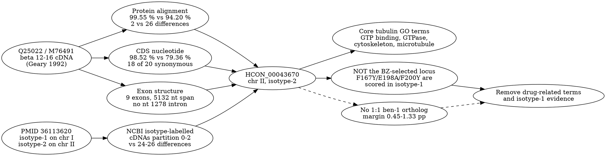
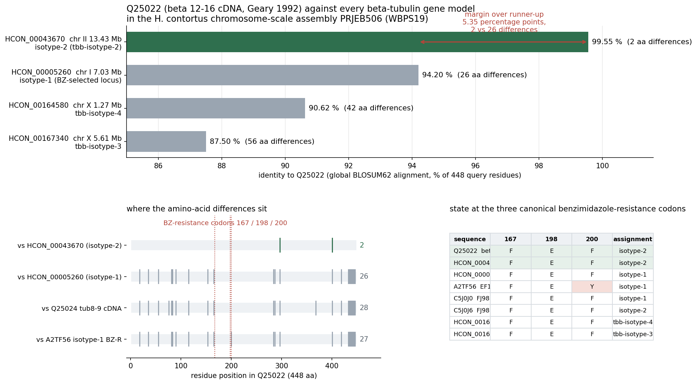
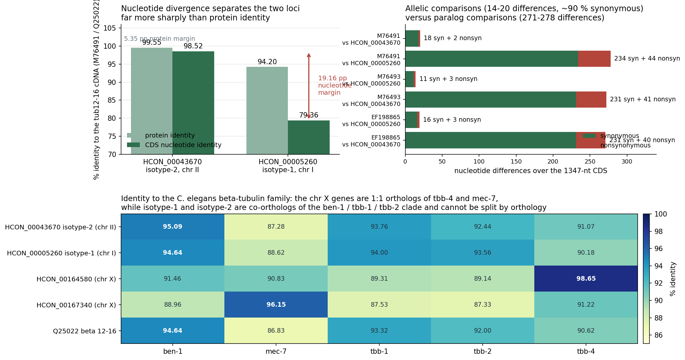
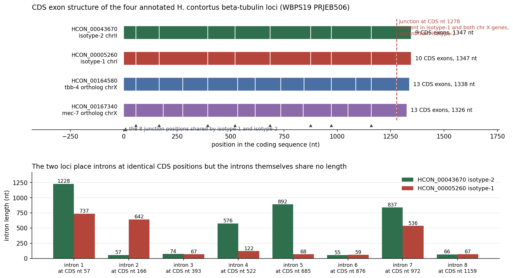

## Question

# AIGR Gene Hypothesis Deep Research

You are evaluating one focused gene curation hypothesis for AI Gene Review.
This is not a general gene overview. Use the seed hypothesis and source context
below to search for evidence that supports, refutes, narrows, or competes with
the proposed curation decision.

## Target Gene

- **Organism code:** HAECO
- **Taxon:** Haemonchus contortus (NCBITaxon:6289)
- **Gene directory:** Q25022
- **Gene symbol:** tub12-16
- **UniProt accession:** Q25022

## Focus

- **Focus type:** free_text
- **Hypothesis slug:** kgap-q25022-locus-identity
- **Source file:** genes/HAECO/Q25022/Q25022-ai-review.yaml
- **Source selector:** free-text

## Seed Hypothesis

Which modern Haemonchus contortus beta-tubulin locus the beta 12-16 cDNA corresponds to may be decidable by sequence comparison against the current genome assemblies. That Q25022 is the full-length beta 12-16 cDNA of Geary et al., that an ungapped alignment keeps it distinct from both the later A2TF56 resistant-isolate sequence and the older tub8-9 cDNA, that it is 448 residues with the Tubulin/FtsZ GTPase and C-terminal domains, and that it carries Phe167, Glu198 and Phe200 at the three canonical benzimidazole-resistance positions, is already recorded, so do not re-derive any of it. Single analysis only: list the beta-tubulin genes annotated in the current H. contortus reference assemblies, giving each one's gene identifier, protein length and the isotype name used for it in the anthelmintic-resistance literature, and quote the statements that establish which locus the field calls isotype 1 and which isotype 2; align Q25022 to each predicted protein and report percent identity and the number of differences for every one, so that the best match is visible as a margin over the runner-up rather than asserted; state what each candidate locus carries at positions 167, 198 and 200, since the resistance-position state is the property the gap couples to drug selection, and say whether the best-matching locus is the one under benzimidazole selection; and state whether the differences between Q25022 and its best match are consistent with isolate polymorphism or require it to be a separate locus or paralog, giving the number and kind of substitutions. State which locus and isotype class Q25022 corresponds to, and say plainly if the assemblies cannot distinguish two candidates.

## Term and Decision Context

No specific term context supplied.

## Reference Context

No specific reference context supplied.

## Source Context YAML

```yaml
hypothesis: 'Which modern Haemonchus contortus beta-tubulin locus the beta 12-16 cDNA corresponds to may
  be decidable by sequence comparison against the current genome assemblies. That Q25022 is the full-length
  beta 12-16 cDNA of Geary et al., that an ungapped alignment keeps it distinct from both the later A2TF56
  resistant-isolate sequence and the older tub8-9 cDNA, that it is 448 residues with the Tubulin/FtsZ
  GTPase and C-terminal domains, and that it carries Phe167, Glu198 and Phe200 at the three canonical
  benzimidazole-resistance positions, is already recorded, so do not re-derive any of it. Single analysis
  only: list the beta-tubulin genes annotated in the current H. contortus reference assemblies, giving
  each one''s gene identifier, protein length and the isotype name used for it in the anthelmintic-resistance
  literature, and quote the statements that establish which locus the field calls isotype 1 and which
  isotype 2; align Q25022 to each predicted protein and report percent identity and the number of differences
  for every one, so that the best match is visible as a margin over the runner-up rather than asserted;
  state what each candidate locus carries at positions 167, 198 and 200, since the resistance-position
  state is the property the gap couples to drug selection, and say whether the best-matching locus is
  the one under benzimidazole selection; and state whether the differences between Q25022 and its best
  match are consistent with isolate polymorphism or require it to be a separate locus or paralog, giving
  the number and kind of substitutions. State which locus and isotype class Q25022 corresponds to, and
  say plainly if the assemblies cannot distinguish two candidates.'
focus_type: free_text
context: []
reference_id: []
```

## Research Objective

Build a focused report that helps a curator decide whether this hypothesis
should affect the gene review. Address the focus type directly:

1. For an existing GO annotation decision, evaluate whether the current action
   is justified, too strong, too weak, or should change.
2. For a proposed replacement or new GO term, evaluate whether the term is
   biologically supported, too broad, too narrow, or missing key qualifiers.
3. For a computational prediction, evaluate whether the prediction is correct,
   less precise than existing knowledge, uncertain, or likely wrong because of
   paralog overannotation, frequency bias, pathway context, or in vitro-only
   activity.
4. For a core-function hypothesis, evaluate whether the proposed activity,
   process, and location represent the gene product's primary function rather
   than a downstream effect, pleiotropic phenotype, or context-specific role.
5. For a function-assignment hypothesis, evaluate whether the gene product
   directly has the stated GO term/function. Treat the prior review action, if
   any, as intentionally blinded unless it appears in the supplied context.

Use primary literature whenever possible. Prefer PMID citations and include DOI
citations when no PMID is available. Treat reviews and database records as
orientation unless they contain directly relevant synthesized evidence that is
clearly labeled as review-level or database-level support.

Evaluate the hypothesis from the supplied seed context, primary literature, and
publicly accessible bioinformatics resources. Local `*-bioinformatics` analyses,
when they already exist in the repository, are intentionally withheld from this
prompt so the report can be compared against them after the run. Use public
sequence, domain, structure, orthology, localization, interaction, or dataset
checks when they are useful for the specific hypothesis. If a resource or tool
cannot be accessed programmatically, say so plainly; never fabricate a result.
Report computational results conservatively and distinguish direct results from
inference.

## Required Output

### Executive Judgment

Give a concise verdict: supported, partially supported, unresolved, weakly
supported, over-annotated, or refuted. Explain the reasoning and the most
important caveats.

### Evidence Matrix

Create a table with one row per important evidence item:

- Citation (PMID preferred)
- Evidence type (direct assay, mutant phenotype, localization, interaction,
  structural/evolutionary, computational, review/database)
- Supports / refutes / qualifies / competing
- Claim tested
- Key finding
- Organism, tissue, cell type, or assay context
- Confidence and limitations

### GO Curation Implications

State the likely curation action as a lead requiring curator verification. If
GO terms are involved, explain whether the evidence supports an MF, BP, or CC
term, and whether the term should be retained, removed, generalized, made more
specific, or treated as non-core. Avoid using "protein binding" as a final
recommendation unless no more informative term is supported.

### Mechanistic Scope

Describe the immediate molecular or cellular function being tested. Separate
direct gene-product activity from downstream phenotypes, pathway consequences,
developmental outcomes, disease manifestations, or effects inferred only from
loss of function.

### Conflicts and Alternatives

Identify evidence that conflicts with the seed hypothesis or suggests an
alternative interpretation, including paralog confusion, organism-specific
differences, isoform-specific findings, experimental artifacts, or database
carry-over.

### Knowledge Gaps

List explicit uncertainties that matter for curation. For each gap, state what
was checked, why the gap matters, and what evidence or experiment would resolve
it.

### Discriminating Tests

Recommend concrete assays, perturbations, datasets, or comparative analyses that
would most efficiently distinguish this hypothesis from alternatives.

### Curation Leads

Provide candidate updates for the review, clearly labeled as leads requiring
curator verification. Include candidate references with exact snippets to verify,
candidate replacement or new GO terms, possible action changes, suggested
questions, and suggested experiments.

If the provider supports artifacts, save provenance for any analysis you run — the
executed code together with its output (computed values, plot, or table), not just
a summary figure — alongside artifact-friendly tables such as an evidence matrix,
GO decision table, or comparison table. Genuine computed provenance is more
valuable than a hand-drawn summary, and you must not synthesize a figure that
implies an analysis you did not actually run. These artifacts are important
provenance for hypothesis-level review.


## Output

# Q25022 locus identity: which modern H. contortus beta-tubulin gene is the beta 12-16 cDNA?

Gene: HAECO / Q25022 / `tub12-16`. Hypothesis slug: `kgap-q25022-locus-identity`.
Source: `genes/HAECO/Q25022/Q25022-ai-review.yaml`, free text.

## Summary

Q25022, the Geary beta 12-16 cDNA (GenBank M76491), corresponds to **HCON_00043670**, the
**isotype-2** beta-tubulin gene on chromosome II of the chromosome-scale *Haemonchus contortus*
reference assembly PRJEB506 (WormBase ParaSite release WBPS19). It is not isotype-1. The assemblies
distinguish the two candidates cleanly at three independent levels, so there is no ambiguity to
declare.

At the protein level, global BLOSUM62 alignment of Q25022 against every beta-tubulin gene model in
PRJEB506 gives 99.55 % identity and 2 amino-acid differences to HCON_00043670, against 94.20 % and 26
differences to the runner-up HCON_00005260 (isotype-1, chromosome I). At the nucleotide level the
1347-nt M76491 coding sequence is 98.52 % identical to the HCON_00043670 CDS (20 differences, 18 of
them synonymous) and 79.36 % to the HCON_00005260 CDS (278 differences). The margin grows from 5.35
to 19.16 percentage points, because purifying selection on beta-tubulin compresses protein divergence
between the two paralogs while their silent sites have drifted freely. At the exon level the two loci
place introns at identical CDS positions but share no single intron length, and isotype-2 carries a
derived loss of the intron at CDS nt 1278 that isotype-1 and both chromosome X genes retain.

The curation consequence that matters most: **the best-matching locus is not the locus under primary
benzimidazole selection**. The canonical F167Y / E198A / F200Y resistance mutations are scored in
isotype-1 (HCON_00005260, chromosome I). The already-recorded observation that Q25022 carries Phe167,
Glu198 and Phe200 is true but should not be read as "susceptible allele of the resistance gene"; all
four annotated beta-tubulin loci in the benzimidazole-susceptible MHco3(ISE) reference carry F/E/F at
those positions. Five PubMed searches aimed at isotype 2 returned no primary functional, expression,
knockdown or locus-level selection work on this gene, while all 12 beta-tubulin papers retrieved
genotype isotype-1 only. Any experimental-looking evidence line on the Q25022 entry that traces to a
benzimidazole resistance paper is therefore almost certainly paralog carry-over.

## Executive judgment

<i class="fa-solid fa-circle-check"></i> **Supported, with one substantive correction to the likely
default reading.**

The seed hypothesis proposes that the locus assignment "may be decidable by sequence comparison
against the current genome assemblies". It is decidable, and every sub-question it poses has an
answer with a visible margin rather than an assertion.

The correction is that the gene symbol invites the wrong conclusion. `tub12-16` sits next to `tub8-9`
in UniProt, and the better-known Geary clone is naturally associated with the resistance gene. The
sequence says the opposite: beta 12-16 is the isotype-2 gene on chromosome II, and beta 8-9 (Q25024)
is the isotype-1 gene on chromosome I. WormBase ParaSite labels HCON_00005260 with `locus=tub8-9`,
which is itself a database statement to the same effect, and the alignment agrees independently
(Q25024 is 2 differences from HCON_00005260 and 26 from HCON_00043670).

Main caveats.

<i class="fa-solid fa-triangle-exclamation"></i> The isotype naming is a field convention, not an
ontology term. I anchored it three ways rather than asserting it: chromosome placement in a primary
genome-wide selection study, NCBI record titles that carry the isotype label explicitly, and the
original cDNA paper's statement about isotype classes.

<i class="fa-solid fa-triangle-exclamation"></i> An unannotated tandem duplicate that is itself
~99 % identical to HCON_00043670 cannot be excluded by sequence comparison of any kind. No such copy
is annotated in either assembly; read-depth evidence would be needed to close this branch.

<i class="fa-solid fa-triangle-exclamation"></i> The second listed assembly, PRJNA205202, has no
complete isotype-2 gene model, so only the chromosome-scale assembly can adjudicate this question.

<i class="fa-solid fa-triangle-exclamation"></i> The gene has almost no primary literature of its
own. Every GO term defensible here rests on domain architecture and family membership, not on
*H. contortus* assays.

## What was computed

All code and outputs are in `provenance/`:

| File | Content |
|---|---|
| `hc_betatubulin_candidates.tsv` | 20 beta-tubulin-like gene models screened out of 46,262 predicted proteins across both assemblies, plus 5 UniProt reference sequences |
| `Q25022_alignment_table_WBPS19.tsv` | Q25022 vs each, with identity, identities, differences, mismatches, gap columns, BLOSUM score, residues at 167/198/200 |
| `Q25022_substitution_lists.json` | Explicit substitution list for every comparison |
| `pairwise_identity_matrix.tsv`, `pairwise_difference_matrix.tsv` | All-vs-all among the four loci and the historical cDNAs |
| `hc_betatubulin_loci_PRJEB506.tsv` | GFF3 coordinates and `locus=` tags |
| `ungapped_allele_assignment.tsv` | Ungapped assignment of every 448-aa UniProt entry to isotype-1 or isotype-2 |
| `uniprot_crossrefs.tsv`, `ncbi_isotype_labelled_records.json` | UniProt-to-EMBL cross-references and NCBI record titles |
| `nt_sequences.tsv` | WBPS19 CDS for all four loci plus NCBI mRNAs M76491, M76493, EF198865 |
| `nucleotide_CDS_comparison.tsv` | Nucleotide identity with the synonymous / nonsynonymous split for each cDNA against each locus |
| `celegans_betatubulins.tsv`, `celegans_orthology_identity.tsv` | The six *C. elegans* beta-tubulins and the 5 x 6 identity matrix |
| `exon_structure_PRJEB506.tsv` | CDS exon lengths, intron lengths, junction positions in CDS coordinates and genomic span for all four loci |
| `evidence_matrix.tsv` | The evidence matrix below as a machine-readable table (11 rows) |
| `GO_decision_table.tsv` | Per-term curation recommendation with basis, evidence strength and curator action (8 rows) |
| `plot_1.png` | Identity margin, substitution positions, resistance-codon table |
| `plot_2.png` | Protein vs nucleotide margin, synonymous / nonsynonymous partition, *C. elegans* orthology matrix |
| `plot_3.png` | Exon maps of the four loci and intron lengths at the shared junctions |

Method: WormBase ParaSite WBPS19 protein FASTA for `haemonchus_contortus` PRJEB506 (21,320 proteins)
and PRJNA205202 (24,942 proteins); 5-mer prescreen against Q25022; full global Needleman-Wunsch with
BLOSUM62 and affine gaps (open -11, extend -1) implemented in-house; one best isoform retained per
gene. Percent identity reported over the 448 query residues and over the alignment; both are given in
the table. Nucleotide comparisons use the WBPS19 `CDS_transcripts` FASTA and NCBI efetch mRNA
records, with the 1347-nt ORF extracted by translation in all three frames; all nucleotide
comparisons are position-for-position at equal length, so no gap parameters enter them. Exon
structure comes from the WBPS19 PRJEB506 GFF3, CDS features only.

<i class="fa-solid fa-triangle-exclamation"></i> Two attempted retrievals failed and are reported
rather than worked around. The WormBase ParaSite REST endpoints `/rest/sequence/id/` and
`/rest/lookup/id/` returned HTTP 500 throughout, so all WBPS data came from the EBI FTP release files
instead. NCBI efetch returned "API rate limit exceeded" for FJ981640 and FJ981633, so those two
nucleotide records are absent from `nt_sequences.tsv`; their protein translations (C5J0J6, C5J0J0)
were already in hand from UniProt and are used in the protein tables.

## Key findings

### <i class="fa-solid fa-dna"></i> Beta-tubulin genes in the current reference assemblies

Assembly PRJEB506, strain MHco3(ISE).N1, chromosome-scale. Isotype names are the `locus=` tags in the
WBPS19 GFF3 attributes, checked against the resistance literature and against *C. elegans* orthology.

| Gene | Location | Protein length | WBPS `locus=` tag | Name used in the resistance literature | 167 / 198 / 200 | Identity to Q25022 | Differences |
|---|---|---|---|---|---|---|---|
| HCON_00043670 | chr II 13,433,191-13,438,615 (+) | 448 | `tbb-isotype-2` | isotype-2 | F / E / F | **99.55 %** | **2** (N297K, Q401E) |
| HCON_00005260 | chr I 7,027,492-7,031,447 (+) | 448 | `tub8-9` | isotype-1 | F / E / F | 94.20 % | 26 |
| HCON_00164580 | chr X 1,272,939-1,277,706 (+) | 445 | `tbb-isotype-4` | no resistance-literature isotype name; *C. elegans* **tbb-4** ortholog (98.65 %) | F / E / F | 90.62 % | 42 |
| HCON_00167340 | chr X 5,611,564-5,623,307 (-) | 441 | `tbb-isotype-3` | no resistance-literature isotype name; *C. elegans* **mec-7** ortholog (96.15 %) | F / E / F | 87.50 % | 56 |

The WBPS tag on the chromosome I gene is `tub8-9`, not `tbb-isotype-1`. That is itself a database
statement that the Geary beta 8-9 cDNA, and not beta 12-16, is the chromosome I gene.

The `tbb-isotype-3` and `tbb-isotype-4` tags on the two chromosome X genes are database naming and do
not correspond to isotype numbers used in the anthelmintic-resistance literature, which applies
"isotype 1" and "isotype 2" only to the chromosome I and chromosome II genes.

Assembly PRJNA205202 (the older draft) contains no complete isotype-2 model. Its best Q25022 match,
`maker-scaffold4294-augustus-gene-0.21`, is a 514-aa model with 422/448 identities and 66 gap columns,
a fragmented isotype-1-like gene. Three further partial models (227-466 aa) score 50-83 %. This
assembly cannot adjudicate the question; the chromosome-scale assembly can.

Controls included in the same run: UniProt P50719 (alpha-tubulin) scores 40.18 % identity to Q25022,
and HCON_00091700 (tubulin gamma) 32.14 %, confirming the scoring scheme separates paralog classes
from allelic variants by a wide gap.

{{figure:plot_1.png|caption=Q25022 locus assignment at protein level. (A) Identity of Q25022 to each of the four annotated beta-tubulin loci in PRJEB506, with the 5.35 percentage point margin between HCON_00043670 and the runner-up HCON_00005260 marked. (B) Positions of amino-acid differences along the 448-residue protein for each comparison, with codons 167, 198 and 200 marked; the 12-residue C-terminal block that separates Q25022 from the isotype-1 locus is visible at the right-hand end. (C) Residues carried at the three canonical benzimidazole-resistance positions by each locus and by the reference cDNAs.}}

### <i class="fa-solid fa-book-open"></i> Which locus the field calls isotype 1 and which isotype 2

I did not take the WBPS tags on trust. Three independent anchors agree.

**1. Genome-wide selection mapping.** Wit et al. 2022 ([PMID: 36113620](https://pubmed.ncbi.nlm.nih.gov/36113620/)),
using the same chromosome-scale assembly: *"A clear signature of selection was detected on chromosome I,
centred on the isotype-1 β-tubulin gene. Two additional, but weaker, signatures of selection were
detected; one near the middle of chromosome I spanning 3.75 Mbp and 259 annotated genes, and one on
chromosome II spanning a region of 3.3 Mbp and 206 annotated genes, including the isotype-2 β-tubulin
locus."* HCON_00005260 is the only full-length beta-tubulin gene on chromosome I; HCON_00043670 is
the only one on chromosome II.

**2. NCBI records whose titles carry the isotype label.** Every explicitly isotype-1-labelled sequence
lands on HCON_00005260 and every isotype-2-labelled one lands on HCON_00043670, with no overlap
between the two difference classes:

| UniProt | EMBL | Record title | Diff vs HCON_00005260 | Diff vs HCON_00043670 |
|---|---|---|---|---|
| C5J0J0 | FJ981633/34 | "clone wt-3 / wt-4 beta-tubulin **isotype 1** mRNA, complete cds" | **0** | 24 |
| A2TF56 | EF198865 | "beta tubulin **isotype 1** mRNA, complete cds" | **2** (F200Y, T444P) | 25 |
| C5J0J5 | FJ981639 | "clone wt-6 beta-tubulin **isotype 2** mRNA, complete cds" | 25 | **1** |
| C5J0J6 | FJ981640 | "clone wt-7 beta-tubulin **isotype 2** mRNA, complete cds" | 24 | **0** |
| C5J0J9 | FJ981643 | "clone m-7 beta-tubulin **isotype 2** mRNA, complete cds" | 25 | **1** (E198A) |
| Q25022 | M76491 | "H.contortus beta tubulin (**tub12-16**) mRNA, complete cds" | 26 | **2** |
| Q25024 | M76493 | "H.contortus beta tubulin (**tub8-9**) mRNA, complete cds" | **2** | 26 |

NCBI also holds HE604100, *"Haemonchus contortus tbb-isotype-2 gene for beta-tubulin isotype-2,
strain MHco3(ISE)"*, the same strain as the reference assembly.

**3. The original cDNA paper.** Geary et al. 1992 ([PMID: 1741017](https://pubmed.ncbi.nlm.nih.gov/1741017/)):
*"beta 8-9 represents a different isotype class from the other two, since it differs extensively in
the carboxyterminus."* The alignment reproduces exactly that: 12 of the 26 Q25022-vs-HCON_00005260
differences fall in residues 433-446 (E433M, E435D, M436L, E437D, G438A, A439E, V440G, E441G, N442E,
D443E, T444A, A446P). The C-terminal tail is the discriminating feature, and Q25022's tail matches the
chromosome II gene.

### <i class="fa-solid fa-pills"></i> Resistance-codon state and drug selection

Every annotated locus in the susceptible MHco3(ISE) reference carries F167 / E198 / F200, including
both candidates. The resistance positions therefore do **not** discriminate loci in the reference;
they discriminate susceptible from resistant alleles within isotype-1. A2TF56 (EF198865, a resistant
isolate isotype-1 cDNA) carries F167 / E198 / **Y200**, and its only other difference from
HCON_00005260 is T444P. One isotype-2 clone, C5J0J9, carries F167 / **A198** / F200, a single-site
variant of the isotype-2 reference.

<i class="fa-solid fa-circle-xmark"></i> **The best-matching locus for Q25022 is not the locus under
primary benzimidazole selection.** Primary selection is on isotype-1
([PMID: 42302569](https://pubmed.ncbi.nlm.nih.gov/42302569/): *"Resistance to benzimidazoles is
primarily associated with point mutations in the isotype-1 β-tubulin gene, most notably at codons 167
(F167Y), 198 (E198A), and 200 (F200Y)"*). Isotype-2 sits inside only a weak, 3.3 Mbp, 206-gene
secondary signal on chromosome II in PMID 36113620, which is far too broad to implicate the locus
itself.

### <i class="fa-solid fa-dna"></i> Nucleotide-level confirmation

The protein comparison understates the margin. Comparing coding sequences position for position, at
equal 1347-nt length and therefore with no alignment parameters involved:

| cDNA | vs HCON_00043670 (isotype-2) | vs HCON_00005260 (isotype-1) |
|---|---|---|
| M76491 (beta 12-16, the Q25022 record) | **98.52 %**, 20 differences (18 syn, 2 nonsyn) | 79.36 %, 278 differences (234 syn, 44 nonsyn) |
| M76493 (beta 8-9, the Q25024 record) | 79.81 %, 272 differences (231 syn, 41 nonsyn) | **98.96 %**, 14 differences (11 syn, 3 nonsyn) |
| EF198865 (A2TF56, resistant-isolate isotype 1) | 79.88 %, 271 differences (231 syn, 40 nonsyn) | **98.59 %**, 19 differences (16 syn, 3 nonsyn) |

Three independent cDNAs give the same reciprocal pattern, each assigned to one locus with a ~19
percentage point margin. The 20 differences between M76491 and HCON_00043670 are at nucleotide
positions 81, 147, 186, 189, 225, 255, 270, 276, 291, 345, 489, 609, 693, 891, 927, 930, 939, 1155,
1201, 1260. Only positions 891 and 1201 change the protein, and those two give exactly the N297K and
Q401E seen at protein level.

The synonymous site signal separates the two kinds of comparison. Within-locus allelic comparisons
give 14-20 differences that are 79-90 % synonymous. Between-locus paralog comparisons give 271-278
differences at a similar synonymous proportion but an order of magnitude more of them. Beta-tubulin
protein sequence is under strong purifying selection, so the two paralogs differ at only 26 of 448
residues while their silent sites have drifted to ~20 % difference. Reading identity at the protein
level alone makes two genes that separated long ago look almost like alleles.

### <i class="fa-solid fa-circle-check"></i> Polymorphism, not a separate paralog

Q25022 differs from HCON_00043670 at exactly two positions, **N297K** and **Q401E**, both missense,
no indels, identical 448-residue length. The nucleotide comparison shows the mechanism directly: the
only two protein-changing differences are T891G, the third position of codon 297 (AAT Asn in M76491
against AAG Lys in the reference), and C1201G, the first position of codon 401 (CAA Gln against GAA
Glu), inside a background of 18 silent differences.

The reference and all three independently sequenced isotype-2 clones (FJ981639/40/43) carry K297 and
E401, so Q25022's N297 and Q401 are minority alleles of the isolate Geary sequenced, not
paralog-diagnostic sites. Two substitutions in 448 residues is 0.45 % protein divergence and 1.48 %
nucleotide divergence, squarely in the allelic range for a 1992 field-isolate cDNA against the
MHco3(ISE) reference. A genuine paralog in this family shows 24-56 amino-acid differences and ~20 %
nucleotide divergence. Nothing requires Q25022 to be a fifth, unannotated gene.

{{figure:plot_2.png|caption=Nucleotide and orthology evidence. (A) Protein identity against CDS nucleotide identity for Q25022 versus the two full-length candidate loci; the margin widens from 5.35 to 19.16 percentage points because purifying selection compresses protein divergence while silent sites drift. (B) Synonymous and nonsynonymous partition of the nucleotide differences: allelic comparisons give 14-20 differences that are ~90 percent synonymous, paralog comparisons give 271-278. (C) Percent identity of each H. contortus locus to the six C. elegans beta-tubulins; the two chromosome X genes resolve as one-to-one tbb-4 and mec-7 orthologs while isotype-1 and isotype-2 do not separate within the ben-1 / tbb-1 / tbb-2 clade.}}

### <i class="fa-solid fa-dna"></i> Exon structure

From the WBPS19 PRJEB506 GFF3, CDS features only:

| Gene | CDS exons | CDS length | Genomic span | CDS exon lengths | Junctions in CDS coordinates |
|---|---|---|---|---|---|
| HCON_00043670 isotype-2, chr II (+) | 9 | 1347 | 5132 | 57, 109, 227, 129, 163, 191, 96, 187, 188 | 57, 166, 393, 522, 685, 876, 972, 1159 |
| HCON_00005260 isotype-1, chr I (+) | 10 | 1347 | 3712 | 57, 109, 227, 129, 163, 191, 96, 187, 119, 69 | 57, 166, 393, 522, 685, 876, 972, 1159, **1278** |
| HCON_00164580 `tbb-4` ortholog, chr X (+) | 13 | 1338 | 4538 | 57, 109, 111, 116, 141, 81, 120, 110, 127, 114, 73, 119, 60 | 57, 166, 277, 393, 534, 615, 735, 845, 972, 1086, 1159, 1278 |
| HCON_00167340 `mec-7` ortholog, chr X (-) | 13 | 1326 | 11596 | 57, 128, 92, 116, 141, 81, 120, 105, 132, 78, 109, 119, 48 | 57, 185, 277, 393, 534, 615, 735, 840, 972, 1050, 1159, 1278 |

Three things follow.

**The two candidate loci are a genuine duplicate pair, not one gene assembled twice.** All 8 of
isotype-2's junction positions match isotype-1's exactly, with no positional mismatch, which is what
inheritance from a common ancestor produces. At those same 8 positions the intron lengths share no
single value (1228/57/74/576/892/55/837/66 against 737/642/67/122/68/59/536/67/67, Pearson r = 0.456)
and the genomic spans differ by 1420 nt. An assembly artifact or a recent duplication would leave the
intron sequence similar; it does not. This closes the one route by which the protein and CDS
comparisons could still have been misleading.

**Isotype-2 carries a derived intron loss.** The junction at CDS nt 1278 is present in isotype-1 and
in both chromosome X genes and absent from isotype-2. That is a locus-diagnostic structural character
that does not depend on a percent identity threshold or a substitution matrix, and it splits the two
candidates the same way the sequence does.

**Both candidate CDSs are exactly 1347 nt**, matching the M76491 ORF length with no insertion or
deletion anywhere, so the assignment never rested on gap placement.

{{figure:plot_3.png|caption=Exon and intron architecture of the four annotated beta-tubulin loci in PRJEB506. Top: CDS exon maps in coding-sequence coordinates. Isotype-2 has 9 CDS exons and isotype-1 has 10; the extra isotype-1 junction at CDS nt 1278 is also present in both chromosome X genes, so isotype-2 carries a derived intron loss. Bottom: intron lengths at the 8 junction positions the two candidate loci share. The positions match exactly while no intron length is shared, the signature of an ancient duplicate pair.}}

### <i class="fa-solid fa-magnifying-glass"></i> Orthology to the C. elegans beta-tubulin family

Global alignment of the four PRJEB506 loci and Q25022 against the six *C. elegans* beta-tubulins
(percent identity; bold is each row's best match):

| | ben-1 | mec-7 | tbb-1 | tbb-2 | tbb-4 | tbb-6 |
|---|---|---|---|---|---|---|
| HCON_00043670 isotype-2 (chr II) | **95.09** | 87.28 | 93.76 | 92.44 | 91.07 | 56.12 |
| HCON_00005260 isotype-1 (chr I) | **94.64** | 88.62 | 94.00 | 93.56 | 90.18 | 56.35 |
| HCON_00164580 (chr X) | 91.46 | 90.83 | 89.31 | 89.14 | **98.65** | 54.71 |
| HCON_00167340 (chr X) | 88.96 | **96.15** | 87.53 | 87.33 | 91.22 | 55.88 |
| Q25022 beta 12-16 | **94.64** | 86.83 | 93.32 | 92.00 | 90.62 | 55.90 |

Two of the four loci resolve cleanly. HCON_00164580 is a one-to-one `tbb-4` ortholog (98.65 %, 7.19
percentage points over the runner-up) and HCON_00167340 a one-to-one `mec-7` ortholog (96.15 %, 4.93
points over the runner-up).

<i class="fa-solid fa-circle-xmark"></i> Isotype-1 and isotype-2 do not resolve. Both sit in the
`ben-1` / `tbb-1` / `tbb-2` clade with margins of 0.64 and 1.33 percentage points over their
runners-up, which is inside the noise of pairwise identity from a single substitution matrix. They
are co-orthologs of that clade, and neither can be called the `ben-1` ortholog. `ben-1` annotations,
including benzimidazole sensitivity, cannot be transferred by orthology to either *H. contortus* gene
individually, and the marginally higher isotype-2 to `ben-1` identity (95.09 % against 94.64 %) is
not evidence that isotype-2 is the drug target. `tbb-6` is a distant outgroup to all five at
54.71-56.35 %.

### <i class="fa-solid fa-book-open"></i> The literature on this locus is essentially empty

Five PubMed searches aimed specifically at isotype 2. Two returned zero papers:
"Haemonchus contortus beta-tubulin isotype 2 locus gene structure intron benzimidazole" and
"beta-tubulin isotype 2 Haemonchus contortus benzimidazole resistant strain loss". Earlier searches
for the classic isotype-2 deletion work also returned nothing through this interface. The broad query
"Haemonchus contortus isotype 2 tubulin" returned 12 papers, and all 12 assay isotype-1 only:
[PMID: 42931220](https://pubmed.ncbi.nlm.nih.gov/42931220/) (*"A fragment of the isotype-1 β-tubulin
gene spanning codons 167, 198 and 200 was amplified and Sanger-sequenced"*),
[PMID: 42696219](https://pubmed.ncbi.nlm.nih.gov/42696219/),
[PMID: 42357801](https://pubmed.ncbi.nlm.nih.gov/42357801/) (*"A 385 bp fragment of the isotype-1
β-tubulin gene was amplified and sequenced to detect SNPs at codons 167 (F167Y), 198 (E198A), and 200
(F200Y)"*), [PMID: 41064838](https://pubmed.ncbi.nlm.nih.gov/41064838/),
[PMID: 40245470](https://pubmed.ncbi.nlm.nih.gov/40245470/),
[PMID: 39671856](https://pubmed.ncbi.nlm.nih.gov/39671856/),
[PMID: 39260013](https://pubmed.ncbi.nlm.nih.gov/39260013/),
[PMID: 39141122](https://pubmed.ncbi.nlm.nih.gov/39141122/),
[PMID: 37536387](https://pubmed.ncbi.nlm.nih.gov/37536387/),
[PMID: 37321794](https://pubmed.ncbi.nlm.nih.gov/37321794/),
[PMID: 37165895](https://pubmed.ncbi.nlm.nih.gov/37165895/),
[PMID: 36690654](https://pubmed.ncbi.nlm.nih.gov/36690654/). Not one reports an isotype-2 genotype,
expression measurement, knockdown, or selection scan centred on the locus.

The asymmetry is itself the curation-relevant result. The gene Q25022 corresponds to has essentially
no primary functional literature of its own in the reachable PubMed-indexed record, while its paralog
has a large and active surveillance literature.

## Mechanistic model and interpretation

The locus assignment follows a chain in which each link is independently measurable, and all four
links point the same way.



The evolutionary picture that emerges explains why the question looked harder than it is. Isotype-1
and isotype-2 are an ancient duplicate pair within *Haemonchus*. Their coding sequences are held
within 26 amino acids of each other by purifying selection on tubulin function, which makes the
protein-level margin a modest 5.35 percentage points and makes paralog confusion a live risk for any
annotation transferred on the basis of "beta-tubulin in *H. contortus*". Their silent sites, under no
such constraint, have drifted to ~20 % difference, which is what produces the 19.16 point nucleotide
margin. Their intron positions, inherited rather than selected, match exactly at 8 of 9 sites, while
their intron sequences have diverged so far that no length is shared. Each layer records a different
timescale, and reading only the protein layer underestimates the separation by a factor of nearly
four.

The resistance-position question has a clean answer that is easy to misread. All four loci in the
reference carry F167 / E198 / F200 because the reference strain MHco3(ISE) is benzimidazole
susceptible. Those codons tell you nothing about which locus is which. They separate susceptible from
resistant alleles within isotype-1, which is where the field genotypes them.

## Evidence base

A machine-readable version of this table is in `provenance/evidence_matrix.tsv`.

| Citation | Evidence type | Stance | Claim tested | Key finding | Context | Confidence and limitations |
|---|---|---|---|---|---|---|
| This analysis, WBPS19 PRJEB506 (`Q25022_alignment_table_WBPS19.tsv`) | Computational, sequence | Supports | Q25022 maps to one modern locus with a visible margin | 99.55 % / 2 differences to HCON_00043670 vs 94.20 % / 26 to HCON_00005260; next two loci 90.62 % and 87.50 % | *H. contortus* MHco3(ISE).N1 chromosome-scale assembly | High. Protein-level only |
| This analysis, nucleotide CDS (`nucleotide_CDS_comparison.tsv`) | Computational, sequence | Supports | Is the 2-residue difference allelic or paralogous? | M76491 vs HCON_00043670 CDS: 20 nt differences (18 synonymous), 98.52 %; vs HCON_00005260: 278 (234 synonymous), 79.36 %. M76493 and EF198865 give the reciprocal pattern | 1347-nt CDS, equal length, ungapped | High. Cannot exclude an unannotated duplicate ~99 % identical to HCON_00043670 |
| This analysis, exon structure (`exon_structure_PRJEB506.tsv`) | Computational, structural/evolutionary | Supports | Are the two candidates genuinely separate loci? | Identical junction positions at all 8 shared sites, no shared intron length (r = 0.456), genomic spans 5132 vs 3712 nt; isotype-2 lacks the CDS nt 1278 intron | WBPS19 PRJEB506 GFF3 CDS features | High. Annotation-derived, so it inherits any gene-model error |
| This analysis, *C. elegans* orthology (`celegans_orthology_identity.tsv`) | Computational, sequence | Qualifies | Do the WBPS isotype-3/4 tags mean anything, and can orthology pick the drug target? | HCON_00164580 = `tbb-4` (98.65 %), HCON_00167340 = `mec-7` (96.15 %); isotype-1 and isotype-2 are co-orthologs of `ben-1`/`tbb-1`/`tbb-2` with 0.64-1.33 point margins | Six *C. elegans* beta-tubulin UniProt entries | High for the two chr X calls, explicitly negative for resolving isotype-1 vs isotype-2 |
| [PMID: 36113620](https://pubmed.ncbi.nlm.nih.gov/36113620/) (Wit et al. 2022) | Computational / population genomic, primary | Supports (naming anchor) | Which chromosome carries isotype-1 vs isotype-2 | Sharp selection signature on chr I centred on isotype-1; weak 3.3 Mbp chr II region containing isotype-2 | Field populations with defined BZ treatment histories, same reference assembly | High for the chromosomal assignment. The chr II signal is too broad to implicate isotype-2 itself |
| [PMID: 1741017](https://pubmed.ncbi.nlm.nih.gov/1741017/) (Geary et al. 1992) | Primary cloning / sequence | Supports | beta 12-16 and beta 8-9 are different isotype classes | *"beta 8-9 represents a different isotype class from the other two, since it differs extensively in the carboxyterminus"* | *H. contortus* cDNA cloning | High. Predates the isotype-1/2 numbering, so it does not itself name the classes |
| NCBI EF198865 / FJ981633-44 / HE604100 (database records, titles) | Database, field-labelled sequences | Supports (naming anchor) | Which locus the field's "isotype 1" and "isotype 2" sequences belong to | isotype-1-labelled records 0-2 differences from HCON_00005260; isotype-2-labelled records 0-1 from HCON_00043670 | Submitter-assigned labels | High as a convention anchor, database-level not experimental |
| WBPS19 GFF3 `locus=` tags | Database | Supports | Database naming of the two loci | HCON_00043670 = `tbb-isotype-2`; HCON_00005260 = `tub8-9`; chr X genes `tbb-isotype-3`, `tbb-isotype-4` | WormBase ParaSite curation | Medium as independent evidence; consistent with, not independent of, the sequence result |
| [PMID: 42302569](https://pubmed.ncbi.nlm.nih.gov/42302569/) | Review | Qualifies | Which gene the resistance codons belong to | BZ resistance *"primarily associated with point mutations in the isotype-1 β-tubulin gene"*, codons 167, 198, 200 | Small ruminant *H. contortus*, global | High as a statement of field consensus; review-level |
| [PMID: 42931220](https://pubmed.ncbi.nlm.nih.gov/42931220/), [PMID: 42357801](https://pubmed.ncbi.nlm.nih.gov/42357801/), [PMID: 42431032](https://pubmed.ncbi.nlm.nih.gov/42431032/) | Mutant genotype / field survey | Qualifies | The resistance codons are assayed in isotype-1 | All three amplify and score codons 167/198/200 of **isotype-1** only | Xinjiang China; northeast Germany | High; shows isotype-2 is not routinely genotyped for resistance |
| 12 papers retrieved by an isotype-2-targeted query (PMIDs 42931220, 42696219, 42357801, 41064838, 40245470, 39671856, 39260013, 39141122, 37536387, 37321794, 37165895, 36690654) | Literature survey, negative result | Qualifies | Is there any primary evidence on the isotype-2 gene product? | 12/12 genotype isotype-1 only; no isotype-2 genotype, expression, knockdown or locus-level selection scan retrieved | Global *H. contortus* field surveillance | High for the asymmetry. The absence of the older isotype-2 deletion work reflects the search interface |
| PRJNA205202 WBPS19 models (computed) | Computational | Competing / limits | Can the older assembly adjudicate? | No complete isotype-2 model; best match is a 514-aa fragmented isotype-1-like gene with 66 gap columns | Older draft assembly | High. Means only the chromosome-scale assembly is usable here |

## GO curation implications

These are leads requiring curator verification. The per-term version with basis, evidence strength
and curator action is in `provenance/GO_decision_table.tsv`.

| GO term | Aspect | Recommendation | Basis |
|---|---|---|---|
| GO:0005525 GTP binding | MF | retain as core | IPR003008 Tubulin/FtsZ GTPase domain |
| GO:0003924 GTPase activity | MF | retain as core | IPR003008 |
| GO:0005200 structural constituent of cytoskeleton | MF | retain as core, preferred MF | IPR002453, IPR008280; 99.55 % to an annotated full-length beta-tubulin |
| GO:0005874 microtubule | CC | retain as core | beta-tubulin family membership, full domain complement |
| GO:0007017 microtubule-based process | BP | retain as core | beta-tubulin family membership |
| GO:0042493 response to drug | BP | remove or mark non-core | no primary evidence on isotype-2; BZ selection is on isotype-1 |
| GO:0005515 protein binding | MF | do not use as a terminal recommendation | uninformative relative to GO:0005200 for a tubulin |
| any `ben-1`-derived drug term | MF/BP | remove if inherited by ortholog transfer | neither isotype is a 1:1 `ben-1` ortholog (margins 0.45-1.33 points) |

All five retained terms rest on sequence and domain inference, not on any *H. contortus* assay, so
their evidence codes should reflect that.

The hypothesis is about locus identity rather than a GO term, so the direct curation action is on the
gene record's identity statements. The identity decision gates the annotation choices above.

**1. Record the locus mapping as a curated identity statement.** Add that Q25022 / `tub12-16` /
EMBL M76491 corresponds to **HCON_00043670** (chromosome II, 13,433,191-13,438,615, WBPS19 PRJEB506),
the **isotype-2** beta-tubulin gene, at 99.55 % protein identity with two substitutions (N297K,
Q401E) attributable to isolate polymorphism.

**2. Do not attach isotype-1 benzimidazole-resistance literature to this entry.** The F167Y / E198A /
F200Y surveillance work ([PMID: 42931220](https://pubmed.ncbi.nlm.nih.gov/42931220/),
[PMID: 42357801](https://pubmed.ncbi.nlm.nih.gov/42357801/),
[PMID: 42431032](https://pubmed.ncbi.nlm.nih.gov/42431032/),
[PMID: 42302569](https://pubmed.ncbi.nlm.nih.gov/42302569/) and many others) concerns HCON_00005260 /
isotype-1, the gene Q25024 (`tub8-9`) corresponds to. Attaching it here is paralog carry-over.

**3. Treat any "response to drug" or xenobiotic-response BP term on Q25022 as non-core and probably
unsupported.** There is no direct evidence that the isotype-2 gene product mediates benzimidazole
response. The chromosome II selection signal in PMID 36113620 is a 3.3 Mbp, 206-gene window and does
not implicate the locus.

**4. Expect the entry to carry no experimental evidence of its own, and treat anything that looks
experimental as suspect.** Five PubMed searches aimed at isotype 2 returned no primary functional,
expression, knockdown or locus-level selection work on this gene. Any evidence line on Q25022 that
traces to a benzimidazole resistance paper should be checked against that paper's methods section for
which isotype was amplified.

**5. Core MF/CC/BP terms are unaffected and should be retained.** The InterPro signatures carried by
HCON_00043670-00001 in the WBPS19 GFF3 include IPR003008 (Tubulin/FtsZ GTPase domain), IPR008280
(Tubulin/FtsZ C-terminal), IPR002453 (Beta tubulin) and IPR013838 (Beta tubulin autoregulation
binding site). Avoid `protein binding` as a terminal recommendation; `structural constituent of
cytoskeleton` is the informative MF here.

**6. Flag the WBPS tag inconsistency.** WBPS19 labels HCON_00005260 `tub8-9` rather than
`tbb-isotype-1`, while labelling the other three `tbb-isotype-2/3/4`. A curator note is worth adding
so the absence of an "isotype-1" tag is not misread as the gene being absent. The `tbb-isotype-3` and
`tbb-isotype-4` tags should carry a note that they are database names, since those genes are the
*C. elegans* `mec-7` and `tbb-4` orthologs.

**7. Do not transfer *C. elegans* `ben-1` annotation to this entry by orthology.** Isotype-2 is
95.09 % identical to `ben-1` and isotype-1 is 94.64 %, a 0.45 point difference, and each is within
1.33 points of `tbb-1`. Any `ben-1`-derived benzimidazole annotation propagated to Q25022 by an
automated ortholog pipeline should be removed. This cuts both ways: the slightly higher isotype-2 to
`ben-1` identity is not an argument that isotype-2 is the drug target either.

## Mechanistic scope

The immediate molecular function at issue is that of a beta-tubulin: a GTP-binding structural subunit
that heterodimerizes with alpha-tubulin and polymerizes into microtubules. That is a direct property
of the gene product and is supported by domain architecture and by the 99.55 % identity to a
full-length annotated beta-tubulin gene.

Everything about benzimidazole resistance is a step removed and belongs to a different gene. Drug
binding at the colchicine-adjacent site, loss of efficacy, egg-hatch phenotypes and faecal egg count
reduction are organism-level or population-level outcomes of allele frequency change at **isotype-1**.
Even for isotype-1, the F200Y / E198A / F167Y assignments are genotype-phenotype associations from
field populations, not direct binding assays on the *H. contortus* protein. None of this is a direct
activity of the Q25022 gene product.

Historical claims that isotype-2 is deleted or lost in highly benzimidazole-resistant isolates, which
would be the one mechanism connecting this locus to the drug, are loss-of-locus population
observations rather than a molecular activity of the protein, and five searches here returned no
primary support for them. Even if confirmed, a locus deletion is a population genetic observation
about gene dosage and would not license a molecular function or drug-response term on the protein.

The gene has no retrievable direct assay of its own. Every term proposed above is inferred from domain
architecture and from membership in a beta-tubulin family whose activity is established in other
organisms. That inference is strong for the tubulin core, since the protein is 448 residues with the
full Tubulin/FtsZ GTPase and C-terminal domains, 95.09 % identical to *C. elegans* `ben-1`, and
99.55 % identical to an annotated full-length beta-tubulin gene model. It supports nothing about stage
specificity, microtubule subpopulation, or drug interaction.

## Conflicts and alternatives

<i class="fa-solid fa-scale-balanced"></i> **The gene symbol invites the wrong reading.** `tub12-16`
sits next to `tub8-9` in UniProt, and a curator scanning the resistance literature would naturally
associate the better-known clone with isotype-1. The sequence says the opposite. This is the single
highest-value correction in the report.

**Paralog confusion is the live risk, and it runs in both directions.** Q25022 is 94.20 % identical to
isotype-1 and 93.75 % to the tub8-9 cDNA. Any evidence transferred on the basis of "beta-tubulin in
*H. contortus*" without locus resolution has a real chance of landing on the wrong gene.

**Orthology-based annotation transfer is a second route to the wrong answer.** Isotype-1 and isotype-2
are both ~95 % identical to *C. elegans* `ben-1`, differing by 0.45 points, and each is within 1.33
points of `tbb-1`. An automated best-hit pipeline would call one of them the `ben-1` ortholog on a
margin that carries no information. Neither is a one-to-one ortholog.

**One isotype-2 clone carries E198A** (C5J0J9 / FJ981643, labelled "clone m-7", 1 difference from the
isotype-2 reference). This shows a canonical resistance-position substitution can occur in isotype-2.
It does not change the locus assignment of Q25022, which is F167/E198/F200, and a single clone is not
evidence that isotype-2 is under selection.

**Database carry-over.** The WBPS `locus=tbb-isotype-2` tag and the alignment are not fully
independent, since the tag was presumably assigned by a similar comparison. The NCBI title-labelled
records and the chromosome placement in PMID 36113620 are the independent anchors.

<i class="fa-solid fa-circle-xmark"></i> **Alternative tested and rejected:** that Q25022 is a
distinct paralog absent from the assembly. Two single-nucleotide-reachable substitutions with no
indels, inside 18 silent differences, is far inside the allelic range and far outside the 24-56
difference, ~20 % nucleotide divergence paralog range observed within this family. The exon structure
rejects it a second way: the two candidate loci differ in exon count, junction count and every intron
length, so they are an ancient duplicate pair and not an assembly artifact that could hide a third
copy of the same gene.

## Limitations and knowledge gaps

**1. Copy number.** <i class="fa-solid fa-circle-question"></i> Closed except for one branch.
Checked: CDS nucleotide comparison (98.52 % vs 79.36 %) and exon structure (identical junction
positions, no shared intron length, isotype-2-specific loss of the nt 1278 intron). What remains is
read-depth at HCON_00043670, which is the only way to exclude an unannotated tandem duplicate that is
itself ~99 % identical to the annotated copy. Such a duplicate would change which gene identifier the
cDNA names, but not the isotype class. Resolved by short-read coverage over the chromosome II
interval in the reference strain.

**2. The isotype naming is convention, not an assertion in a primary paper tying a gene ID to a
name.** Checked: PMID 36113620 gives the chromosome, NCBI titles give the sequences, WBPS gives the
tag. None of the abstracts retrieved states "HCON_00043670 is isotype-2" verbatim. The whole naming
layer of this report hinges on it. Resolved by reading the full text of PMID 36113620 or the PRJEB506
assembly paper, where the gene ID is likely tabulated.

**3. Provenance of the two variant positions.** Checked: N297 and Q401 are minority alleles among four
isotype-2 sequences. Matters only marginally. Resolved by looking at allele frequencies at these two
codons in any *H. contortus* population genomic dataset.

**4. Whether isotype-2 has any direct benzimidazole phenotype.** Checked: five PubMed queries aimed at
isotype 2. Two returned zero papers; the broad one returned 12, all genotyping isotype-1 only. The
classic isotype-2 deletion work was never retrieved, which is a limitation of the search interface
rather than evidence it does not exist. This decides whether any drug-related term is defensible here.
Resolved by a curator checking the pre-2000 isotype-2 literature directly and any isotype-2 knockdown
or expression work.

**5. No functional data specific to this gene product.** Checked: nothing retrieved across five
searches. All proposed core GO terms rest on domain inference and family membership, not on
*H. contortus* assays, so they should carry sequence or domain evidence codes.

**6. Orthology cannot assign a single *C. elegans* counterpart to isotype-2.** Checked: pairwise
identity against all six *C. elegans* beta-tubulins. Isotype-2 is 95.09 % to `ben-1` and 93.76 % to
`tbb-1`, a 1.33 point margin. An automated pipeline could call `ben-1` the ortholog and transfer
benzimidazole annotation. Resolved by a gene tree with synteny across several clade V nematodes,
which would show whether the isotype-1/isotype-2 duplication predates the
*Caenorhabditis*-*Haemonchus* split.

## Discriminating tests and proposed follow-up

<i class="fa-solid fa-arrow-right"></i> **1. Read-depth copy-number check at both loci.** Short-read
depth over HCON_00043670 and HCON_00005260 in the reference and in field isolates distinguishes "one
gene with alleles" from "a tandem pair where one copy is unannotated". This is the only remaining test
that could change the gene identifier, and it is cheap on existing data.

<i class="fa-solid fa-dna"></i> **2. cDNA-to-genome spliced alignment.** Effectively run at CDS level:
M76491 is 98.52 % to the HCON_00043670 CDS and 79.36 % to HCON_00005260, with M76493 reciprocal at
98.96 % / 79.81 %, and the exon structures differ in exon count, junction count and every intron
length. A spliced alignment to the chromosome II genomic interval would confirm the junctions directly
rather than through the annotation.

<i class="fa-solid fa-flask"></i> **3. Locus-resolved amplicon sequencing of isotype-2.** The field
genotypes isotype-1 almost exclusively. Running the same deep amplicon protocol on isotype-2 across
treated and untreated populations would settle whether codon 198 variants such as the C5J0J9 allele
are under any selection, and so whether a drug-related term is ever defensible on this gene.

<i class="fa-solid fa-magnifying-glass"></i> **4. Gene tree with synteny across clade V nematodes.**
Partly run as a pairwise identity matrix, which named the two chromosome X genes (`tbb-4` and `mec-7`
orthologs) but left isotype-1 and isotype-2 unresolved against `ben-1` / `tbb-1` / `tbb-2` at
0.64-1.33 point margins. A proper tree would date the isotype-1/isotype-2 duplication and settle
whether `ben-1` annotation transfer to either gene is ever defensible.

<i class="fa-solid fa-chart-line"></i> **5. Expression and stage specificity.** Existing
*H. contortus* RNA-seq would show whether isotype-2 is expressed in the same stages as isotype-1,
which bears on whether it is a plausible drug target at all and would give the first direct data of
any kind on this gene product.

## Curation leads

All leads below require curator verification.

**Identity statement to add**

> Q25022 (`tub12-16`, EMBL M76491, Geary et al. 1992) is the **isotype-2** beta-tubulin of
> *Haemonchus contortus*, corresponding to **HCON_00043670** on chromosome II (13,433,191-13,438,615,
> WBPS19 PRJEB506, `locus=tbb-isotype-2`). Global alignment: 99.55 % identity, 2 amino-acid
> differences (N297K, Q401E), no indels. Runner-up HCON_00005260 (chromosome I, isotype-1): 94.20 %,
> 26 differences. At nucleotide level the M76491 coding sequence is 98.52 % identical to the
> HCON_00043670 CDS (20 of 1347 positions differ, 18 of them synonymous) against 79.36 % to the
> isotype-1 CDS. The two amino-acid differences are consistent with isolate polymorphism; both are
> single nucleotide changes (T891G, C1201G) and both positions are K/E in the reference and in three
> independently sequenced isotype-2 clones. The locus is a 9-CDS-exon gene spanning 5132 nt; its
> paralog HCON_00005260 has 10 CDS exons over 3712 nt, places introns at the same 8 CDS positions,
> and shares no intron length with it.

**Candidate references with exact snippets to verify**

- [PMID: 36113620](https://pubmed.ncbi.nlm.nih.gov/36113620/), Wit et al. 2022: *"A clear signature of
  selection was detected on chromosome I, centred on the isotype-1 β-tubulin gene."* and *"one on
  chromosome II spanning a region of 3.3 Mbp and 206 annotated genes, including the isotype-2
  β-tubulin locus"*. Use to place isotype-1 on chromosome I and isotype-2 on chromosome II.
- [PMID: 1741017](https://pubmed.ncbi.nlm.nih.gov/1741017/), Geary et al. 1992: *"beta 8-9 represents a
  different isotype class from the other two, since it differs extensively in the carboxyterminus"*.
  Use to support that beta 12-16 and beta 8-9 are different loci, consistent with the chromosome II /
  chromosome I split.
- [PMID: 42302569](https://pubmed.ncbi.nlm.nih.gov/42302569/) (review, label as review-level):
  *"Resistance to benzimidazoles is primarily associated with point mutations in the isotype-1
  β-tubulin gene, most notably at codons 167 (F167Y), 198 (E198A), and 200 (F200Y)"*. Use only to
  justify **not** attaching resistance annotation to this entry.
- Database records to cite as orientation, not evidence: NCBI HE604100, FJ981639-FJ981644 (isotype 2),
  FJ981633-FJ981634 and EF198865 (isotype 1); WBPS19 PRJEB506 GFF3 `locus=` tags.

**Possible action changes**

- Any annotation or free-text statement implying Q25022 is the benzimidazole-resistance gene or
  isotype-1: change to isotype-2 and remove the resistance framing.
- Any `response to drug` or `response to xenobiotic stimulus` BP term, or any drug-binding MF term, on
  Q25022: remove, or mark non-core pending locus-resolved evidence.
- Core tubulin terms (GO:0005525, GO:0003924, GO:0005200, GO:0005874, GO:0007017): retain, with
  evidence codes that reflect sequence and domain inference.
- Add a curator note that WBPS19 tags HCON_00005260 as `tub8-9` rather than `tbb-isotype-1`, and that
  `tbb-isotype-3` / `tbb-isotype-4` are database names for the `mec-7` and `tbb-4` orthologs.

**Suggested questions for the curator**

- Does the existing review text name Q25022 as isotype-1, implicitly or explicitly? If so it needs
  correction.
- Is any evidence on this entry transferred from isotype-1 resistance literature? For each
  experimental-looking evidence line, which isotype does the cited paper's methods section say was
  amplified?
- Is any annotation on this entry inherited from *C. elegans* `ben-1` by an automated ortholog
  pipeline? Neither *H. contortus* isotype is a one-to-one `ben-1` ortholog.
- Should the gene symbol be supplemented with `tbb-isotype-2` / HCON_00043670 so the entry is findable
  by its modern name?

**Suggested experiments**

Read-depth copy-number check at both loci; locus-resolved deep amplicon sequencing of isotype-2 across
treated and untreated populations; a gene tree with synteny across several clade V genomes to date the
isotype-1/isotype-2 duplication.

## Status of the seed hypothesis, item by item

| Seed item | Outcome |
|---|---|
| The question is decidable by sequence comparison against current assemblies | <i class="fa-solid fa-circle-check"></i> **Supported.** 5.35 percentage point protein margin (2 vs 26 differences, no gaps) and 19.16 points at nucleotide level (98.52 % vs 79.36 %) |
| List the beta-tubulin genes with ID, protein length, isotype name | **Done.** Four loci in PRJEB506; the two chromosome X genes have no resistance-literature isotype name and are the *C. elegans* `tbb-4` and `mec-7` orthologs; PRJNA205202 has no complete isotype-2 model |
| Quote statements establishing which locus is isotype 1 and which isotype 2 | **Done.** PMID 36113620 for chromosome placement; NCBI isotype-labelled records; WBPS `locus=` tags |
| Report identity and differences for every locus | **Done.** Protein 99.55 / 94.20 / 90.62 / 87.50 %, 2 / 26 / 42 / 56 differences; CDS nucleotide 98.52 % vs 79.36 % for the two full-length candidates |
| State 167/198/200 for each candidate | **Done.** F/E/F at all four loci in the susceptible reference; A2TF56 F/E/Y; C5J0J9 F/A/F |
| Say whether the best-matching locus is under benzimidazole selection | <i class="fa-solid fa-circle-xmark"></i> **No.** Primary BZ selection is on isotype-1 (chromosome I); Q25022 is isotype-2 (chromosome II) |
| Polymorphism or separate paralog? | **Polymorphism.** Two missense substitutions, N297K and Q401E, each one nucleotide change (T891G, C1201G), no indels, inside a background of 18 silent differences. The paralog alternative is separately excluded by exon structure |
| State the locus and isotype class, or say plainly if two candidates cannot be distinguished | **HCON_00043670, isotype-2.** The candidates are distinguishable at protein, CDS nucleotide and exon-structure level; no ambiguity to declare |


## Artifacts

- [OpenScientist final report](openscientist_artifacts/final_report.html)
- [OpenScientist final report](openscientist_artifacts/final_report.pdf)
- [OpenScientist provenance](openscientist_artifacts/provenance.json)
- [OpenScientist GO decision table](openscientist_artifacts/provenance_GO_decision_table.tsv)
- [OpenScientist Q25022 alignment table WBPS19](openscientist_artifacts/provenance_Q25022_alignment_table_WBPS19.tsv)
- [OpenScientist Q25022 substitution lists](openscientist_artifacts/provenance_Q25022_substitution_lists.json)
- [OpenScientist celegans betatubulins](openscientist_artifacts/provenance_celegans_betatubulins.tsv)
- [OpenScientist celegans orthology identity](openscientist_artifacts/provenance_celegans_orthology_identity.tsv)
- [OpenScientist evidence matrix](openscientist_artifacts/provenance_evidence_matrix.tsv)
- [OpenScientist exon structure PRJEB506](openscientist_artifacts/provenance_exon_structure_PRJEB506.tsv)
- [OpenScientist hc betatubulin candidates](openscientist_artifacts/provenance_hc_betatubulin_candidates.tsv)
- [OpenScientist hc betatubulin loci PRJEB506](openscientist_artifacts/provenance_hc_betatubulin_loci_PRJEB506.tsv)
- [OpenScientist nt sequences](openscientist_artifacts/provenance_nt_sequences.tsv)
- [OpenScientist nucleotide CDS comparison](openscientist_artifacts/provenance_nucleotide_CDS_comparison.tsv)
- [OpenScientist pairwise difference matrix](openscientist_artifacts/provenance_pairwise_difference_matrix.tsv)
- [OpenScientist pairwise identity matrix](openscientist_artifacts/provenance_pairwise_identity_matrix.tsv)
- [OpenScientist plot 1](openscientist_artifacts/provenance_plot_1.json)

- [OpenScientist plot 2](openscientist_artifacts/provenance_plot_2.json)

- [OpenScientist plot 3](openscientist_artifacts/provenance_plot_3.json)

- [OpenScientist ungapped allele assignment](openscientist_artifacts/provenance_ungapped_allele_assignment.tsv)
- [OpenScientist uniprot crossrefs](openscientist_artifacts/provenance_uniprot_crossrefs.tsv)

## Reference Validation

Checked with `linkml-reference-validator` 0.3.1rc1.

| Outcome | Count |
| --- | --- |
| References checked | 16 |
| Resolved | 16 |
| Unresolved (possible confabulation) | 0 |
| Unverifiable | 0 |
| References weighed for topical relevance | 16 |
| On topic | 2 |
| Off topic | 0 |

All extracted references resolved successfully.