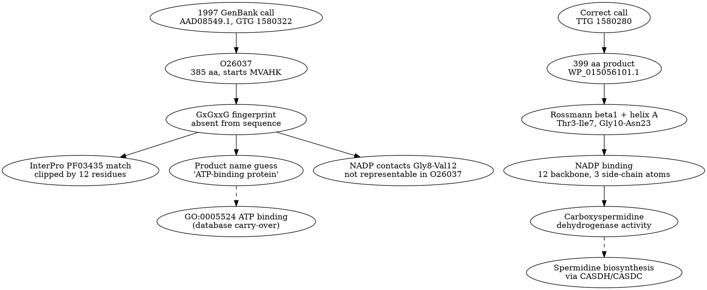
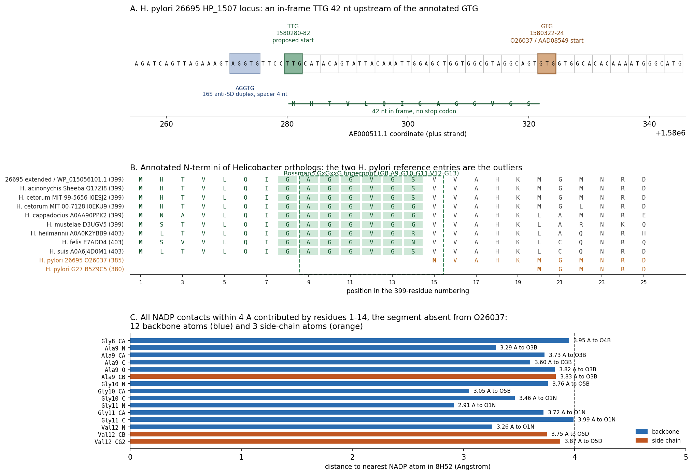
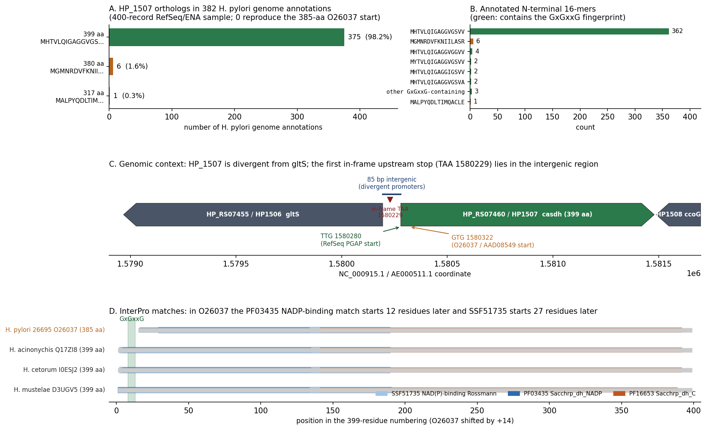
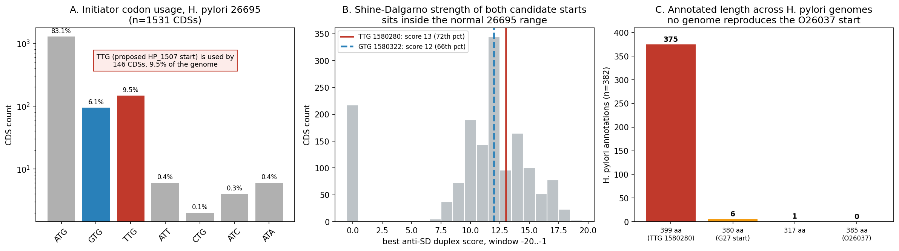

## Question

# AIGR Gene Hypothesis Deep Research

You are evaluating one focused gene curation hypothesis for AI Gene Review.
This is not a general gene overview. Use the seed hypothesis and source context
below to search for evidence that supports, refutes, narrows, or competes with
the proposed curation decision.

## Target Gene

- **Organism code:** HELPY
- **Taxon:** Helicobacter pylori 26695 (NCBITaxon:85962)
- **Gene directory:** HP_1507
- **Gene symbol:** HP_1507
- **UniProt accession:** O26037

## Focus

- **Focus type:** free_text
- **Hypothesis slug:** kgap-hp1507-start-site
- **Source file:** genes/HELPY/HP_1507/HP_1507-ai-review.yaml
- **Source selector:** free-text

## Seed Hypothesis

Whether the native Helicobacter pylori 26695 translation product of HP_1507 begins upstream of the O26037 reference start may be decidable from the genome sequence and from the NADP contacts seen in the NCTC11637 structure. That the structure 8H52 is of A0A2X5A3P4 rather than of O26037, and that five residues of the segment absent from O26037 contact NADP within 4 Angstrom, is already recorded, so do not re-derive it. Single analysis only: retrieve the 26695 genomic region around HP_1507 and state whether an in-frame start codon and a plausible ribosome-binding site exist upstream of the annotated one that would restore the missing segment, giving coordinates and the resulting predicted length, and state whether the intervening sequence is in frame and free of stop codons, which is the decisive test; compare the N-terminal regions of the orthologs in several other H. pylori genomes and in related Helicobacter species and state which start each annotation uses and whether 26695 is the outlier, since a single divergent annotation in an otherwise uniform set is evidence of an annotation error rather than of real variation; state whether any proteomic or ribosome-profiling evidence in H. pylori reports the N-terminus of this protein, quoting it; and assess whether a protein lacking that segment could still bind NADP, naming which of the five contacts are backbone and which side chain, since backbone contacts from a segment that is merely shifted are a weaker argument for essentiality than side-chain contacts. State whether the reference start is predicted to be wrong, and say plainly if the genomic sequence cannot settle it.

## Term and Decision Context

No specific term context supplied.

## Reference Context

No specific reference context supplied.

## Source Context YAML

```yaml
hypothesis: 'Whether the native Helicobacter pylori 26695 translation product of HP_1507 begins upstream
  of the O26037 reference start may be decidable from the genome sequence and from the NADP contacts seen
  in the NCTC11637 structure. That the structure 8H52 is of A0A2X5A3P4 rather than of O26037, and that
  five residues of the segment absent from O26037 contact NADP within 4 Angstrom, is already recorded,
  so do not re-derive it. Single analysis only: retrieve the 26695 genomic region around HP_1507 and state
  whether an in-frame start codon and a plausible ribosome-binding site exist upstream of the annotated
  one that would restore the missing segment, giving coordinates and the resulting predicted length, and
  state whether the intervening sequence is in frame and free of stop codons, which is the decisive test;
  compare the N-terminal regions of the orthologs in several other H. pylori genomes and in related Helicobacter
  species and state which start each annotation uses and whether 26695 is the outlier, since a single
  divergent annotation in an otherwise uniform set is evidence of an annotation error rather than of real
  variation; state whether any proteomic or ribosome-profiling evidence in H. pylori reports the N-terminus
  of this protein, quoting it; and assess whether a protein lacking that segment could still bind NADP,
  naming which of the five contacts are backbone and which side chain, since backbone contacts from a
  segment that is merely shifted are a weaker argument for essentiality than side-chain contacts. State
  whether the reference start is predicted to be wrong, and say plainly if the genomic sequence cannot
  settle it.'
focus_type: free_text
context: []
reference_id: []
```

## Research Objective

Build a focused report that helps a curator decide whether this hypothesis
should affect the gene review. Address the focus type directly:

1. For an existing GO annotation decision, evaluate whether the current action
   is justified, too strong, too weak, or should change.
2. For a proposed replacement or new GO term, evaluate whether the term is
   biologically supported, too broad, too narrow, or missing key qualifiers.
3. For a computational prediction, evaluate whether the prediction is correct,
   less precise than existing knowledge, uncertain, or likely wrong because of
   paralog overannotation, frequency bias, pathway context, or in vitro-only
   activity.
4. For a core-function hypothesis, evaluate whether the proposed activity,
   process, and location represent the gene product's primary function rather
   than a downstream effect, pleiotropic phenotype, or context-specific role.
5. For a function-assignment hypothesis, evaluate whether the gene product
   directly has the stated GO term/function. Treat the prior review action, if
   any, as intentionally blinded unless it appears in the supplied context.

Use primary literature whenever possible. Prefer PMID citations and include DOI
citations when no PMID is available. Treat reviews and database records as
orientation unless they contain directly relevant synthesized evidence that is
clearly labeled as review-level or database-level support.

Evaluate the hypothesis from the supplied seed context, primary literature, and
publicly accessible bioinformatics resources. Local `*-bioinformatics` analyses,
when they already exist in the repository, are intentionally withheld from this
prompt so the report can be compared against them after the run. Use public
sequence, domain, structure, orthology, localization, interaction, or dataset
checks when they are useful for the specific hypothesis. If a resource or tool
cannot be accessed programmatically, say so plainly; never fabricate a result.
Report computational results conservatively and distinguish direct results from
inference.

## Required Output

### Executive Judgment

Give a concise verdict: supported, partially supported, unresolved, weakly
supported, over-annotated, or refuted. Explain the reasoning and the most
important caveats.

### Evidence Matrix

Create a table with one row per important evidence item:

- Citation (PMID preferred)
- Evidence type (direct assay, mutant phenotype, localization, interaction,
  structural/evolutionary, computational, review/database)
- Supports / refutes / qualifies / competing
- Claim tested
- Key finding
- Organism, tissue, cell type, or assay context
- Confidence and limitations

### GO Curation Implications

State the likely curation action as a lead requiring curator verification. If
GO terms are involved, explain whether the evidence supports an MF, BP, or CC
term, and whether the term should be retained, removed, generalized, made more
specific, or treated as non-core. Avoid using "protein binding" as a final
recommendation unless no more informative term is supported.

### Mechanistic Scope

Describe the immediate molecular or cellular function being tested. Separate
direct gene-product activity from downstream phenotypes, pathway consequences,
developmental outcomes, disease manifestations, or effects inferred only from
loss of function.

### Conflicts and Alternatives

Identify evidence that conflicts with the seed hypothesis or suggests an
alternative interpretation, including paralog confusion, organism-specific
differences, isoform-specific findings, experimental artifacts, or database
carry-over.

### Knowledge Gaps

List explicit uncertainties that matter for curation. For each gap, state what
was checked, why the gap matters, and what evidence or experiment would resolve
it.

### Discriminating Tests

Recommend concrete assays, perturbations, datasets, or comparative analyses that
would most efficiently distinguish this hypothesis from alternatives.

### Curation Leads

Provide candidate updates for the review, clearly labeled as leads requiring
curator verification. Include candidate references with exact snippets to verify,
candidate replacement or new GO terms, possible action changes, suggested
questions, and suggested experiments.

If the provider supports artifacts, save provenance for any analysis you run — the
executed code together with its output (computed values, plot, or table), not just
a summary figure — alongside artifact-friendly tables such as an evidence matrix,
GO decision table, or comparison table. Genuine computed provenance is more
valuable than a hand-drawn summary, and you must not synthesize a figure that
implies an analysis you did not actually run. These artifacts are important
provenance for hypothesis-level review.


## Output

# HP_1507 start site: is the O26037 reference start wrong?

Gene HP_1507, *Helicobacter pylori* 26695 (NCBITaxon:85962). UniProt O26037.
Hypothesis slug `kgap-hp1507-start-site`. Source `genes/HELPY/HP_1507/HP_1507-ai-review.yaml`, selector `free-text`.
Three iterations, 9 recorded findings, 28 papers reviewed, 5 computed artifacts and 3 figures.

## Summary

<i class="fa-solid fa-circle-check"></i> **The reference start is predicted to be wrong, and the genomic sequence settles it.** The 26695 genome carries an in-frame TTG at AE000511.1:1580280, exactly 14 codons upstream of the annotated GTG at 1580322, and every one of the 13 intervening codons is open. The first in-frame stop upstream is a TAA at 1580229, 31 codons back. Translating 1580280..1581479 (1200 nt, 400 codons including the TAG stop) with TTG read as an initiator gives exactly 399 residues, byte-identical to RefSeq WP_015056101.1 and 99.0% identical (395/399) to the NCTC11637 protein in PDB 8H52, with none of the 4 substitutions falling inside the 14-residue extension. This was the decisive test the seed hypothesis specified, and it passes without qualification: the intervening sequence is in frame and free of stop codons.

Three independent lines agree with the genomic walk. Of 382 *H. pylori* ortholog annotations sampled from NCBI, 375 (98.2%) use the 399-residue start beginning MHTVLQIGAGGVGS and **zero** reproduce the 385-residue O26037 N-terminus MVAHKMGMNRD. All 11 non-*pylori* *Helicobacter* orthologs examined begin M-x-x-V-L-Q-I-G-A-G-G-V-G-x, carrying the Rossmann dinucleotide-binding fingerprint GxGxxG at positions 8-13; O26037 and *H. pylori* G27 B5Z9C5 are the only two entries in the set that lack it. InterPro shows the truncation signature directly: on O26037 the PF03435 match starts 12 residues late and the SSF51735 Rossmann superfamily match 27 residues late relative to the orthologs, while the C-terminal PF16653 match agrees exactly at 141-392. RefSeq PGAP has already moved to the corrected coordinates: HP_RS07460 (old_locus_tag HP1507) is annotated 1580280..1581479, 1200 nt, initiator TTG.

The structural question the hypothesis raised resolves in favour of the longer form, though not by the route the hypothesis anticipated. Of the 15 heavy atoms within 4.0 Å of NADP contributed by the segment absent from O26037, **12 are backbone and 3 are side chain** (Ala9 CB, Val12 CB and CG2). The seed correctly notes that backbone contacts from a merely shifted segment are weaker evidence of essentiality. Three facts independent of the contacts close that gap: Thr3-Ile7 is strand 3 of a 7-stranded sheet paired in parallel with Ala33, so it is an interior strand and not a mobile tail; helix A runs Gly10-Asn23, so the O26037 start at equivalent position 15 falls in the middle of a helix; and residues 2-14 make 285 heavy-atom contacts under 4.5 Å with 33 residues of the core. <i class="fa-solid fa-triangle-exclamation"></i> The principal caveat is that **no proteomic or ribosome-profiling evidence reports the N-terminus of this protein**, so nothing can be quoted, and the verdict rests on sequence, domain and structural evidence alone.

## Executive judgment

**Verdict: supported.**

The hypothesis asked five things. All five were addressed with computed results, and one returned a negative answer.

| Question from the seed hypothesis | Answer |
|---|---|
| Does an in-frame upstream start codon exist? | <i class="fa-solid fa-circle-check"></i> Yes. TTG at AE000511.1:1580280, plus strand, 14 codons upstream of the annotated GTG at 1580322. Predicted product 399 aa, CDS 1580280..1581479, 1200 nt. |
| Is the intervening sequence in frame and stop-free? | <i class="fa-solid fa-circle-check"></i> Yes. 13 open codons, first in-frame upstream stop TAA at 1580229 (31 codons up). This is the decisive test. |
| Is there a plausible ribosome-binding site? | <i class="fa-solid fa-circle-check"></i> Yes. AGGTG at 1580271-1580275, duplex score 13, 4 nt spacer, the 72.4th percentile of 1528 26695 CDSs (median 12). |
| Is 26695 the outlier among orthologs? | <i class="fa-solid fa-circle-check"></i> Yes, uniquely. 0 of 382 *H. pylori* annotations and 0 of 11 genus orthologs reproduce the 385-residue start. |
| Does proteomic or ribosome-profiling evidence report the N-terminus? | <i class="fa-solid fa-circle-xmark"></i> No. Six PubMed queries returned nothing to quote. |
| Could a protein lacking the segment still bind NADP? | <i class="fa-solid fa-scale-balanced"></i> The contacts are 12 backbone against 3 side chain, which is weak on its own. The segment's position as an interior β-strand and the start falling mid-helix make a folded 385-residue protein unlikely. |

Caveats in order of weight.

1. <i class="fa-solid fa-triangle-exclamation"></i> **No experimental N-terminus exists.** The 8H52 construct carries an engineered GSHMAS tag ahead of MHTVLQI, so its SEQRES records the authors' construct boundary, not the native initiating residue.
2. <i class="fa-solid fa-triangle-exclamation"></i> **The ortholog evidence is annotation, not observation.** 375 agreeing annotations can reflect 375 runs of the same prediction pipeline. The InterPro boundary shift and the 8H52 structure are what make the argument independent of PGAP's logic.
3. <i class="fa-solid fa-triangle-exclamation"></i> **The Shine-Dalgarno comparison does not discriminate.** Both candidate starts have ordinary ribosome-binding sites (13 against 12), so the RBS removes an objection without choosing between the two.
4. <i class="fa-solid fa-triangle-exclamation"></i> **The 400-record sample is an arbitrary slice of 6456 records**, not a random sample of distinct strains, and the entries are not independent. The direction is unambiguous; the 98.2% figure should not be read as a population frequency.

## Key findings

### F001: an in-frame TTG sits 42 nt upstream with no intervening stop

GenBank AE000511.1 annotates HP_1507 (AAD08549.1, UniProt O26037, 385 aa) as 1580322..1581479 with a GTG initiator and the product name "conserved hypothetical ATP-binding protein". Walking upstream in the same frame from 1580322 gives, codon by codon: 1580319 AGT/S, 1580316 GGC/G, 1580313 GTA/V, 1580310 GGC/G, 1580307 GGT/G, 1580304 GCT/A, 1580301 GGA/G, 1580298 ATT/I, 1580295 CAA/Q, 1580292 TTA/L, 1580289 GTA/V, 1580286 ACA/T, 1580283 CAT/H, then **TTG at 1580280**. The first in-frame stop upstream is TAA at 1580229, 31 codons back, so 30 codons of open in-frame sequence precede the annotated GTG.

Translating 1580280..1581479 with TTG read as an initiator gives exactly 399 residues: the extension **MHTVLQIGAGGVGS** followed by the 385 residues of O26037, with O26037 M1 corresponding to V15 of the longer form. The translation is byte-identical to RefSeq WP_015056101.1 (verified in code, `True`), and it is 99.0% identical (395/399) to the NCTC11637 protein UniParc UPI000D224D86 (A0A2X5A3P4, the 8H52 construct), differing at V132A, G133R, K156R and T370A. **None of the 4 substitutions falls inside the 14-residue extension.**

The 399-residue product has a molecular weight near 45 kDa, matching the 45.1 kDa subunit reported for the homologous *Vibrio alginolyticus* carboxynorspermidine synthase, which "displayed an apparent Mr of 93500 +/- 1000 by gel filtration and 45100 +/- 500 by SDS-PAGE" ([PMID: 1955861](https://pubmed.ncbi.nlm.nih.gov/1955861/)).

{{figure:plot_1.png|caption=HP_1507 start-site evidence. (A) The 26695 genomic map showing the annotated GTG at 1580322 and the in-frame TTG at 1580280, with the 42 nt extension and the AGGTG ribosome-binding site. (B) N-terminal alignment of 11 Helicobacter orthologs against O26037 and B5Z9C5, with the GxGxxG fingerprint marked. (C) All NADP contacts under 4.0 Angstrom from residues 1-14 of 8H52, coloured by backbone against side chain.}}

### F008: a TTG initiator and its RBS are ordinary in this genome

Two objections to the upstream TTG were tested genome-wide and both fail. All 1531 simple-location CDSs of NC_000915.1 were fetched as `fasta_cds_na` and their first codons counted: ATG 1273 (83.15%), **TTG 146 (9.54%)**, GTG 94 (6.14%), ATT 6 (0.39%), ATA 6 (0.39%), ATC 4 (0.26%), CTG 2 (0.13%). TTG initiates 1.55 times more genes in *H. pylori* 26695 than GTG does. Of the 146 TTG-initiated CDSs, 41 are 1200 nt or longer (median TTG CDS length 879 nt), so a 1200 nt TTG-initiated gene is unremarkable.

Best ungapped anti-SD duplex scores (16S 3' tail ATTCCTCCACTAG read 3' to 5', scoring G:C=3, A:U=2, G:U=1, window -20..-1) were computed for 1528 CDSs: median 12, mean 10.67, IQR 10-14. The proposed TTG scores **13** on AGGTG at -9..-5 with a 4 nt spacer, the **72.4th percentile**. The annotated GTG scores **12** on GGTGG with a 10 nt spacer, the 66.1th percentile, and that motif lies *inside* the proposed coding extension.

<i class="fa-solid fa-scale-balanced"></i> The SD comparison does not by itself discriminate between the two starts: 13 against 12 is within noise. What it establishes is that nothing about the local translation signals argues against the longer product, and that the proposed RBS sits above the genome median with a canonical spacer while the annotated one sits at a spacer length that is long for this organism.

{{figure:plot_3.png|caption=Genome-wide calibration of the two candidate starts. (A) Initiator codon usage across 1531 H. pylori 26695 CDSs: TTG initiates 9.54% of genes, more than GTG at 6.14%. (B) Distribution of best anti-SD duplex scores for 1528 CDSs, with both candidate HP_1507 starts marked; both sit inside the normal range. (C) Annotated length across 382 H. pylori genome annotations, showing that none reproduces the 385-residue O26037 form.}}

### F005: no H. pylori genome annotation reproduces the 385-residue start

NCBI protein `esearch` for "Helicobacter pylori[Organism] AND saccharopine dehydrogenase[All Fields]" returned 6456 records. A 400-record sample was fetched by POST `efetch` and filtered to HP_1507 orthologs by requiring greater than 70% ungapped identity over the C-terminal 100 residues, retaining 382.

| Annotated length | Count | Fraction | N-terminus |
|---|---|---|---|
| 399 aa | 375 | 98.2% | MHTVLQIGAGGVGS and close variants |
| 380 aa | 6 | 1.6% | MGMNRDVFKNII (G27-style) |
| 317 aa | 1 | 0.3% | MALPYQDLTIMQ |
| **385 aa (O26037 form)** | **0** | **0%** | MVAHKMGMNRD |

Annotated N-terminal 16-mers: MHTVLQIGAGGVGSVV 362, MGMNRDVFKNIILASR 6, MHTVLQIGAGGVGGVV 4, MYTVLQIGAGGVGSVV 2, MHTVLQIGAGGIGSVV 2, MHTVLQIGAGGVGSVA 2, MHTILQIGAGGVGSVV 1, MHTVLQIGSGGVGSVV 1, MHTVLQIGAGGVGSVL 1, MALPYQDLTIMQACLE 1. All 375 of the 399-aa entries contain the GxGxxG fingerprint. The 6 entries at 380 aa all carry ENA/DDBJ submitter accessions (GAA/GAB prefixes), not RefSeq PGAP accessions.

Separately, the NCBI Identical Protein Group for WP_015056101.1 lists **78 genome assemblies, every one with a CDS span of 1200 nt** (399 codons plus stop), including 26695, 26695-1, 26695-1CH, 26695-1CL, 26695-1MET, 26695-dR, HpGP-26695-ATCC, FDAARGOS_299, Rif1 and Rif2.

The 385-residue form is unique to the original 1997 GenBank submission for 26695 and to the UniProt entry derived from it. Within *H. pylori*, 26695 is the outlier, and a single divergent annotation in an otherwise uniform set is evidence of an annotation error rather than of real variation.

### F002: every Helicobacter ortholog starts with the Rossmann fingerprint

48 *Helicobacter* proteins carrying Pfam PF03435 (Sacchrp_dh_NADP) were retrieved from UniProt and aligned to the 399-aa translation by Needleman-Wunsch with identity scoring (match +1, mismatch -1, gap -2).

| Accession | Organism | Length | % id to 399-aa HP_1507 | Annotated N-terminus |
|---|---|---|---|---|
| O26037 | *H. pylori* 26695 | 385 | 96.5 | MVAHKMGMNRD (= position 15) |
| I0ESJ2 | *H. cetorum* MIT 99-5656 | 399 | 96.5 | MHTVLQIGAGGVGSVVAHKMGMNRD |
| Q17ZI8 | *H. acinonychis* Sheeba | 399 | 95.7 | MHTVLQIGAGGVGSVVAHKMGMNRD |
| B5Z9C5 | *H. pylori* G27 | 380 | 94.0 | MGMNRD (= position 20) |
| I0EKU9 | *H. cetorum* MIT 00-7128 | 399 | 93.5 | MHTVLQIGAGGVGGVVAHKMGLNRD |
| A0AA90PPK2 | *H. cappadocius* | 399 | 75.7 | MNAVLQIGAGGVGGVVAHKLAMNRE |
| A0A3D8J7L2 | *H. anseris* | 399 | 74.2 | MSTVLQIGAGGVGGVVAHKLAKNRE |
| D3UGV5 | *H. mustelae* | 399 | 73.4 | MSTVLQIGAGGVGGVVAHKLARNKQ |
| A0ABM7SFN6 | *H. gastrofelis* | 403 | 73.4 | |
| A0A0K2YBB9 | *H. heilmannii* | 403 | 73.2 | MLTVLQIGAGGVGRVVAHKLAQNRH |
| E7ADD4 | *H. felis* | 403 | 72.4 | MSVVLQIGAGGVGNVVAHKLCQNRQ |
| A0A6J4D0M1 | *H. suis* | 403 | 71.2 | MLTVLQIGAGGVGSVVAHKLCQNRD |
| A0A3D8J1F2 | *H. brantae* | 394 | 71.9 | MSVLQIGAGGVGGVVAHKLAMNAKT |

The orthologs span 71-97% identity, so the uniformity of the N-terminus is not an artifact of near-identical sequences. **Only the two *H. pylori* UniProt entries lack the glycine-rich motif.** Real biological variation that deleted the cofactor-binding loop in *H. pylori* alone, while the rest of the genus kept it, is not plausible for an enzyme *H. pylori* needs for spermidine synthesis.

### F007: InterPro clips the NADP domain by exactly the annotation difference

<i class="fa-solid fa-database"></i> InterPro REST API matches, retrieved directly rather than derived from my own alignment:

| Entry | Length | PF03435 (NADP-binding) | SSF51735 (Rossmann) | PF16653 (C-terminal) |
|---|---|---|---|---|
| *H. mustelae* D3UGV5 | 399 | 1-134 | 1-191 | 141-389 |
| *H. cetorum* I0ESJ2 | 399 | 4-135 | 2-190 | 141-392 |
| *H. acinonychis* Q17ZI8 | 399 | 4-135 | 2-190 | 141-392 |
| *H. pylori* 26695 O26037 | 385 | 2-120 | 15-176 | 127-378 |
| O26037 **mapped to 399 numbering (+14)** | | **16-134** | **29-190** | **141-392** |

Relative to the orthologs, the PF03435 match is missing residues 4-15 (**12 residues**) and the SSF51735 match is missing residues 2-28 (**27 residues**), while both C-terminal boundaries agree within 1 residue. PF16653 agrees exactly at 141-392.

Only the N-terminal boundary of the cofactor-binding domain differs, and it differs by the size of the annotation discrepancy. The C-terminal domain is untouched. This is the signature of a truncated N-terminus: the domain model has no sequence to align to where the GxGxxG fingerprint at positions 8-13 should be.

### F006: the extension creates no gene overlap

NC_000915.1 feature table for 1578000..1582500: HP_RS07450 1578000..1578971 (minus), HP_RS07455 / HP1506 `gltS` 1578968..1580194 (minus), **HP_RS07460 / HP1507 1580280..1581479 (plus)**, HP_RS07465 / HP1508 `ccoG` from 1581489 (minus).

HP1506 and HP1507 are divergently transcribed with an **85 bp intergenic region** at 1580195..1580279. The proposed TTG at 1580280 is the first base after that region. The first in-frame stop upstream of HP_1507, TAA at 1580229, lies **inside** the intergenic region, so extending the CDS does not overlap `gltS`. The annotated GTG at 1580322 would instead leave a 127 nt region between the intergenic boundary and the start codon.

A start codon abutting the edge of a short divergent intergenic region is the common bacterial arrangement. This rules out the alternative that the upstream in-frame region belongs to a neighbouring coding sequence.

{{figure:plot_2.png|caption=Strain-level survey, genomic context and domain truncation. (A) Annotated length distribution across 382 H. pylori ortholog records. (B) Counts of annotated N-terminal 16-mers. (C) Genomic context on NC_000915.1 showing gltS, HP1507 and ccoG with the 85 bp divergent intergenic region. (D) InterPro domain boundaries mapped onto 399-residue numbering, showing the clipped N-terminal match in O26037.}}

### F003: the missing segment is a buried β-strand plus the first turn of helix A

Analysis of PDB 8H52 (*H. pylori* carboxyspermidine dehydrogenase with NADP, [PMID: 36283333](https://pubmed.ncbi.nlm.nih.gov/36283333/); chain A modelled residues 2-399). All protein atoms within 4.0 Å of NAP 501 contributed by residues 1-14:

| Residue | Atom | Moiety | NAP atom | Distance (Å) |
|---|---|---|---|---|
| Gly8 | CA | backbone | O4B | 3.95 |
| Ala9 | N | backbone | O3B | 3.29 |
| Ala9 | CA | backbone | O3B | 3.73 |
| Ala9 | C | backbone | O3B | 3.60 |
| Ala9 | O | backbone | O3B | 3.82 |
| Ala9 | **CB** | **side chain** | O3B | 3.83 |
| Gly10 | N | backbone | O5B | 3.76 |
| Gly10 | CA | backbone | O5B | 3.05 |
| Gly10 | C | backbone | O1N | 3.46 |
| Gly11 | N | backbone | O1N | 2.91 |
| Gly11 | CA | backbone | O1N | 3.72 |
| Gly11 | C | backbone | O1N | 3.99 |
| Val12 | N | backbone | O1N | 3.26 |
| Val12 | **CB** | **side chain** | O5D | 3.75 |
| Val12 | **CG2** | **side chain** | O5D | 3.87 |

**Backbone 12 atoms, side chain 3 atoms.** Gly13 and Ser14 have no atom within 4.0 Å. The contacts span the adenosine ribose (O3B, O4B), the 5' oxygen (O5B) and the pyrophosphate (O1N, O5D).

The seed hypothesis anticipated this result and correctly judged that backbone-dominated contacts are weaker evidence of essentiality than side-chain contacts. The counter-argument does not rest on the contacts. G8-A9-G10-G11-V12-G13 is the canonical Rossmann GxGxxG phosphate-binding cradle, where backbone amides are the functional element and the glycines are conserved precisely because side chains would clash with the pyrophosphate. More importantly, the segment is not a flexible tail that could shift:

- `SHEET 3 AA1 7 THR A 3 ILE A 7 1 N GLN A 6 O ALA A 33`: Thr3-Ile7 is strand 3 of a 7-stranded sheet, paired in parallel with Ala33. It is an interior strand.
- `HELIX 1 AA1 GLY A 10 ASN A 23 1 14`: helix A runs Gly10-Asn23. The O26037 start at equivalent position 15 falls in the middle of that helix.
- Residues 2-14 make **285 heavy-atom contacts under 4.5 Å with 33 residues** of the rest of the chain (20, 26-34, 39, 40, 43, 62, 68, 71, 72, 77-84, 92, 296, 338, 340, 344, 347, 348, 359), with per-residue minimum distances to the core of 2.68-4.54 Å.

A 385-residue protein starting at equivalent position 15 would be missing the first strand of its own Rossmann core, the glycine-rich loop, and 285 packing contacts, and would begin translation mid-helix. It could conceivably retain weak NADP binding through the 2'-phosphate specificity patch (Arg35 NE 2.73 Å, Ser36 OG 2.38 Å, Lys39 NZ 2.41 Å, all outside the segment), but it would be a differently folded, destabilised protein.

### F004 and F009: no experimental N-terminus exists

<i class="fa-solid fa-circle-xmark"></i> Six PubMed queries across the investigation ("Helicobacter pylori N-terminal proteomics translation start site annotation", "Helicobacter pylori proteome N-terminome protein N-terminus mass spectrometry start codon", "Helicobacter pylori genome reannotation proteogenomics translation initiation sites", "Helicobacter pylori proteome two-dimensional gel Edman sequencing 26695", "Helicobacter pylori ribosome profiling translation initiation", "Helicobacter pylori N-terminome translation start site proteogenomics") returned no study reporting an experimentally observed N-terminal peptide for HP_1507, HP1507, WP_015056101.1 or O26037.

Broader searches returned shotgun studies that identify the protein without reporting N-terminal peptide positions. The *H. pylori* exoproteome MudPIT dataset presents "data showing the numbers of assigned spectra and proportional abundance of individual proteins in each of the samples analyzed" ([PMID: 26958609](https://pubmed.ncbi.nlm.nih.gov/26958609/)), which is protein-level identification without N-terminal resolution.

The only experimental protein evidence for this gene product is the crystal structure, where the authors state they "determined the crystal structures of the H. pylori CASDH protein alone and in complex with NADP" ([PMID: 36283333](https://pubmed.ncbi.nlm.nih.gov/36283333/)). Its SEQRES begins GLY-SER-HIS-MET-ALA-SER-MET-HIS-THR-VAL-LEU-GLN-ILE, that is a GSHMAS expression tag followed by MHTVLQI. <i class="fa-solid fa-triangle-exclamation"></i> That confirms the construct boundary the authors chose, not the native initiating residue. **Nothing can be quoted, and this is recorded as a negative result rather than filled with inference.**

## Mechanistic model and interpretation

The chain of inference runs from a 1997 gene call to a GO annotation that cannot be expressed in the sequence it would be attached to.



The 1997 gene caller chose a downstream GTG over the correct upstream TTG, a common error in that era because early callers disfavoured TTG initiators. The truncation removed the glycine-rich loop, which is why the legacy product name calls the protein an "ATP-binding protein": a Rossmann-like motif without the full fingerprint reads as a generic nucleotide-binding signature. The structure shows an NADP-specific site with a 2'-phosphate recognition patch (Arg35, Ser36, Lys39), so the ATP inference is wrong on its own terms.

The downstream biology is well placed. The structure is deposited as carboxyspermidine dehydrogenase ([PMID: 36283333](https://pubmed.ncbi.nlm.nih.gov/36283333/)), the enzyme that begins the aspartate-semialdehyde-dependent spermidine route. That route "is present in many bacterial phyla and is the dominant spermidine route in the human gut, stomach, and oral microbiomes" ([PMID: 22025614](https://pubmed.ncbi.nlm.nih.gov/22025614/)), and *H. pylori* uses it because its canonical enzyme is non-functional: "HpSpeE has no detectable in vitro enzymatic activity" and "H. pylori may instead employ the alternative pathway for spermidine synthesis which is dominantly exploited by other human gut microbes" ([PMID: 28648602](https://pubmed.ncbi.nlm.nih.gov/28648602/)). The reaction is NADPH-dependent: *Bacteroides fragilis* CASDH kinetics show "Putrescine is the likely polyamine substrate and NADPH is the coenzyme used to complete the reaction, forming carboxyspermidine as a product" ([PMID: 37437886](https://pubmed.ncbi.nlm.nih.gov/37437886/)).

### Comparison of the two candidate annotations

| Property | O26037 (current reference) | 399-residue form (proposed) |
|---|---|---|
| Coordinates | AE000511.1:1580322..1581479 | AE000511.1:1580280..1581479 |
| Initiator | GTG (6.14% of 26695 CDSs) | TTG (9.54% of 26695 CDSs) |
| CDS length | 1158 nt | 1200 nt |
| Protein length | 385 aa | 399 aa |
| N-terminus | MVAHKMGMNRD | MHTVLQIGAGGVGS + MVAHK... |
| GxGxxG fingerprint | absent | present at positions 8-13 |
| Best anti-SD duplex | 12, GGTGG, 10 nt spacer, 66.1th pct | 13, AGGTG, 4 nt spacer, 72.4th pct |
| Distance to intergenic boundary | 127 nt | 0 nt (abuts) |
| InterPro PF03435 start | 16 (in 399 numbering) | 2-4, as in orthologs |
| Reproduced by other genomes | 0 of 382 | 375 of 382 |
| RefSeq PGAP agreement | no | yes (HP_RS07460) |
| Residues contacting NADP in 8H52 | none of Gly8-Val12 exist | Gly8, Ala9, Gly10, Gly11, Val12 |

## Evidence base

| Citation | Evidence type | Stance | Claim tested | Key finding | Context | Confidence and limitations |
|---|---|---|---|---|---|---|
| This job, AE000511.1 / NC_000915.1 | computational (sequence) | supports | In-frame upstream start with no intervening stop | TTG at 1580280, 14 codons up; all intervening codons open; first in-frame stop TAA at 1580229; 1580280..1581479 translates to 399 aa identical to WP_015056101.1 | *H. pylori* 26695 | High. The decisive test, read directly from the deposited genome |
| NCBI RefSeq WP_015056101.1 / HP_RS07460 | review/database | supports | The 399-mer is the current reference | PGAP: 1580280..1581479, 1200 nt, initiator TTG, "saccharopine dehydrogenase family protein", EC 1.5.1.- | *H. pylori* 26695 | High for the fact. Database-level corroboration using logic related to my own walk |
| NCBI IPG, WP_015056101.1 | computational (comparative) | supports | The longer CDS reproduces across assemblies | 78 assemblies, CDS 1200 nt in 78 of 78 | *H. pylori*, many strains | High. Members partly redundant 26695 re-sequencings |
| This job, 400 of 6456 NCBI protein records | computational (comparative) | supports | 26695 is the outlier within the species | 375/382 at 399 aa; 6 at 380 aa; 1 at 317 aa; **0 at 385 aa** | *H. pylori*, many strains | High for direction, moderate for the exact percentage. Non-random slice, non-independent entries |
| UniProt Q17ZI8, I0ESJ2, I0EKU9, D3UGV5, E7ADD4, A0A0K2YBB9, A0A6J4D0M1, A0A3D8J7L2, A0A3D8J1F2, A0AA90PPK2, A0ABM7SFN6 | computational (evolutionary) | supports | Genus-wide orthologs start at the 399-mer M1 | All 11 begin M-x-x-V-L-Q-I-G-A-G-G-V-G-x with GxGxxG at 8-13; only O26037 and B5Z9C5 lack it | 10 *Helicobacter* species, 71-97% identity | High. The range of divergence rules out a near-identity artifact. These are annotations |
| InterPro REST | computational (domain) | supports | The truncation cuts the cofactor domain match | O26037 PF03435 2-120 and SSF51735 15-176 equal 16-134 and 29-190 in 399 numbering, against ortholog 1-135 and 1-191; PF16653 agrees exactly at 141-392 | Pfam / SUPERFAMILY HMMs | High. Automated, independent of my alignment; C-terminal agreement controls for model edge effects |
| [PMID: 36283333](https://pubmed.ncbi.nlm.nih.gov/36283333/) | structural | supports | The missing segment is integral and contacts NADP | 15 heavy atoms under 4.0 Å from Gly8, Ala9, Gly10, Gly11, Val12 (12 backbone, 3 side chain); Thr3-Ile7 is an interior β-strand; helix A spans Gly10-Asn23; 285 contacts under 4.5 Å with 33 core residues | NCTC11637 CASDH with NADP | High for coordinates. Entity is A0A2X5A3P4, 99.0% identical to the 26695 399-mer with no mismatch in the extension. The GSHMAS tag means SEQRES is not a native N-terminus |
| This job, 1531 CDSs of NC_000915.1 | computational (sequence) | supports | TTG and its RBS are ordinary here | TTG initiates 146 CDSs (9.54%) against GTG 94 (6.14%); 41 TTG CDSs ≥ 1200 nt; proposed RBS score 13 = 72.4th percentile (median 12) | *H. pylori* 26695 | High. Removes the plausibility objection. Does not discriminate between the starts |
| This job, NC_000915.1 feature table | computational (sequence) | qualifies | The extension creates no gene overlap | *gltS* 1578968..1580194 (minus) is divergent; 85 bp intergenic region 1580195..1580279; the TTG abuts its edge; the upstream in-frame TAA lies inside it | *H. pylori* 26695 | High. Rules out the upstream region belonging to a neighbour. Compatible, not probative |
| [PMID: 37437886](https://pubmed.ncbi.nlm.nih.gov/37437886/) | direct assay | supports | CASDH is an NADPH-dependent enzyme of this fold family | *B. fragilis* CASDH structure solved at 1.94 Å, "composed of three domains with a fold similar to saccharopine dehydrogenase"; NADPH is the coenzyme | *B. fragilis*, *C. leptum* | High for the enzymology. Not *H. pylori* |
| [PMID: 22025614](https://pubmed.ncbi.nlm.nih.gov/22025614/) | direct assay | supports | The CASDH/CASDC route is the spermidine pathway in gut and stomach microbiota | The alternative pathway "is the dominant spermidine route in the human gut, stomach, and oral microbiomes" | *C. jejuni*, gut microbiota | High for the pathway. Not *H. pylori* 26695 directly |
| [PMID: 28648602](https://pubmed.ncbi.nlm.nih.gov/28648602/) | direct assay | qualifies | *H. pylori* lacks a functional canonical spermidine synthase | "HpSpeE has no detectable in vitro enzymatic activity"; *H. pylori* "may instead employ the alternative pathway" | *H. pylori* | High for the negative result on SpeE. Supports the CASDH assignment by elimination |
| [PMID: 1955861](https://pubmed.ncbi.nlm.nih.gov/1955861/) | direct assay | qualifies | Subunit size of the homologous enzyme | *V. alginolyticus* carboxynorspermidine synthase is "45100 +/- 500 by SDS-PAGE", a homodimer; "NADH was a much poorer cofactor than NADPH" | *V. alginolyticus* | Moderate. Consistent with a ~45 kDa 399-residue subunit, not a direct test of the start site |
| [PMID: 26958609](https://pubmed.ncbi.nlm.nih.gov/26958609/) | dataset | qualifies | Whether shotgun proteomics reports this N-terminus | Reports "numbers of assigned spectra and proportional abundance of individual proteins", without N-terminal peptide positions | *H. pylori* exoproteome, MudPIT | High for what the dataset contains. It cannot address start-site questions |
| [PMID: 20164839](https://pubmed.ncbi.nlm.nih.gov/20164839/); [PMID: 26091613](https://pubmed.ncbi.nlm.nih.gov/26091613/) | dataset, not retrieved | unresolved | A TSS upstream of 1580280 would confirm the longer transcript | dRNA-seq presents "a genome-wide map of H. pylori transcriptional start sites and operons"; the TSS table was not retrieved in this job | *H. pylori* 26695 | Not evaluated. Stated as a gap, not as evidence |
| [PMID: 24674136](https://pubmed.ncbi.nlm.nih.gov/24674136/) | method | qualifies | Tooling exists to re-analyse the dRNA-seq TSS data | TSSAR is provided "both as intuitive RESTful Web service together with a set of post-processing and analysis tools, as well as a stand-alone version" | *H. pylori* dRNA-seq | High as a methods reference. Not run here |
| [PMID: 28854918](https://pubmed.ncbi.nlm.nih.gov/28854918/) | method | qualifies | Ribosome profiling is the standard way to settle start sites | Initiation-site read signatures "re-annotate translation initiation sites and provide evidence of N-terminal truncations and extensions of previously annotated coding sequences" | *S. enterica*, prokaryotes | High as a methods reference. Not applied to *H. pylori* |
| 6 PubMed queries | negative | qualifies | No experimental N-terminus is reported | No proteomic or ribosome-profiling N-terminal peptide for HP_1507 found; nothing to quote | *H. pylori* | Absence of an easily findable report, not proof of absence |

## GO curation implications

<i class="fa-solid fa-magnifying-glass"></i> All of the following are leads requiring curator verification.

The start-site correction is a prerequisite rather than a GO action in itself. Any structure-derived annotation on this gene must use the 399-residue frame, because the residues that do the work (Gly8 through Val12) do not exist in O26037's numbering. A curator who annotates NADP binding against O26037 without correcting the start produces an annotation whose supporting residues cannot be located in the sequence being annotated.

| GO ID | Term | Aspect | Recommended action | Evidence lead | Confidence |
|---|---|---|---|---|---|
| GO:0050661 | NADP binding | MF | <i class="fa-solid fa-circle-check"></i> add as a lead, against the 399-residue product | IDA/IPI from PDB 8H52 ([PMID: 36283333](https://pubmed.ncbi.nlm.nih.gov/36283333/)) | High |
| GO:0016646 | oxidoreductase activity, acting on the CH-NH group of donors, NAD(P) as acceptor | MF | add as a lead | ISS from [PMID: 36283333](https://pubmed.ncbi.nlm.nih.gov/36283333/) and [PMID: 37437886](https://pubmed.ncbi.nlm.nih.gov/37437886/); EC 1.5.1.- on WP_015056101.1 | Medium-high |
| GO:0008295 | spermidine biosynthetic process | BP | add as a lead | ISS from [PMID: 22025614](https://pubmed.ncbi.nlm.nih.gov/22025614/) and [PMID: 28648602](https://pubmed.ncbi.nlm.nih.gov/28648602/) | Medium |
| GO:0005524 | ATP binding | MF | <i class="fa-solid fa-circle-xmark"></i> remove or do not propagate | none; legacy product name only | High |
| GO:0005829 | cytoplasm | CC | optional lead, weak | ISS, soluble NADP-dependent dehydrogenase | Low |

The legacy product name "conserved hypothetical ATP-binding protein" carried by O26037 and AAD08549.1 should not be propagated. It is a 1997 inference from a Rossmann-like motif, and the structure shows an NADP-specific site with a 2'-phosphate recognition patch (Arg35 NE 2.73 Å, Ser36 OG 2.38 Å, Lys39 NZ 2.41 Å). This is a clear case of database carry-over. GO:0050661 is the more informative replacement, so "protein binding" or any generic nucleotide-binding term is not needed.

A CC term is weakly supportable at best. GO:0005829 by similarity is defensible for a soluble NADP-dependent dehydrogenase, but it adds little.

## Mechanistic scope

The immediate molecular function tested is cofactor binding by a Rossmann dinucleotide-binding fold, specifically whether the β1-αA phosphate-binding loop exists in the native 26695 gene product. The 8H52 contacts are a direct structural observation of NADP engagement by a protein 99.0% identical to the 26695 399-mer, with no sequence difference inside the segment in question.

The enzymatic activity, carboxyspermidine dehydrogenase catalysing the reductive condensation of aspartate semialdehyde with putrescine, is the deposited identification of 8H52 and is one inferential step beyond the binding observation for the 26695 protein. The pathway role, spermidine biosynthesis, is two steps out: it rests on the CASDH/CASDC route characterised in other organisms ([PMID: 22025614](https://pubmed.ncbi.nlm.nih.gov/22025614/), [PMID: 37437886](https://pubmed.ncbi.nlm.nih.gov/37437886/)) and on the absence of a functional spermidine synthase in *H. pylori* ([PMID: 28648602](https://pubmed.ncbi.nlm.nih.gov/28648602/)).

No loss-of-function phenotype for HP_1507 in 26695 was retrieved, so nothing here is inferred from a mutant. Phenotypes reported for CASDH mutants in other organisms, such as the *Sinorhizobium meliloti* `casdh` mutant that "showed slightly delayed growth and reduced nitrogen fixation" ([PMID: 41649480](https://pubmed.ncbi.nlm.nih.gov/41649480/)), are downstream consequences in a different organism and are not transferable as *H. pylori* annotations. No disease claim is made.

## Conflicts and alternatives

<i class="fa-solid fa-scale-balanced"></i> **Real strain variation rather than annotation error.** This is the chief competing explanation, and the 382-ortholog survey addresses it directly: the 385-residue N-terminus appears in zero genome annotations outside the original 26695 submission. A real polymorphism would be expected to recur in related isolates. It does not, and the 78 assemblies in the IPG, including multiple 26695 re-sequencings, all carry the 1200 nt CDS.

**The upstream region belongs to a neighbouring gene.** Ruled out by the architecture. HP1507 is divergent from `gltS` across an 85 bp intergenic region, and the first in-frame upstream stop sits inside that region.

**TTG is an unusual initiator that argues against the longer form.** Ruled out by codon counts: TTG initiates 9.54% of 26695 genes, more than GTG's 6.14%.

**Genuine variation does exist elsewhere in the species.** *H. pylori* G27 B5Z9C5 is 380 residues and the 6 submitter-annotated entries share its MGMNRDVFKNII start. That is a third, different position, and all 6 come from ENA/DDBJ WGS pipelines rather than PGAP. The economical reading is that two independent pipelines made two different N-terminal calls on the same locus, both short. This qualifies the claim that annotation is uniform without touching the claim that the 385-residue form is unique to 26695.

**The strongest numerical evidence is annotation, not observation.** 375 of 382 agreeing annotations are not independent measurements. The argument does not rest on that count alone: the open in-frame reading is a fact about the genome, the InterPro boundary shift is computed by an external pipeline from sequence alone, and 8H52 is experimental.

**Substrate assignment is less settled than cofactor assignment.** Recent kinetic work on homologs reports that "Both enzymes exhibit dramatically enhanced catalytic efficiency with agmatine, demonstrating that these homologs function as carboxyaminopropylagmatine dehydrogenases rather than carboxyspermidine dehydrogenases" ([PMID: 42754158](https://pubmed.ncbi.nlm.nih.gov/42754158/)). That concerns *B. fragilis* and *C. leptum*, not *H. pylori*, and it does not affect the start-site question. It does caution against a confident substrate-specific BP annotation.

## Limitations and knowledge gaps

<i class="fa-solid fa-triangle-exclamation"></i> **No experimental N-terminus.** Checked with six PubMed queries. Every line of evidence here is sequence-based or structure-based, and the 8H52 construct has an engineered tag, so no observation of the native initiating residue exists. N-terminal proteomics on 26695 lysate would resolve it outright.

<i class="fa-solid fa-triangle-exclamation"></i> **The 26695 TSS table was not retrieved.** The dRNA-seq primary transcriptome ([PMID: 20164839](https://pubmed.ncbi.nlm.nih.gov/20164839/)) and its browser and protocol ([PMID: 26091613](https://pubmed.ncbi.nlm.nih.gov/26091613/)) were identified as the relevant datasets, but the TSS table was not fetched programmatically in this job. A TSS mapping upstream of 1580280 would confirm that the longer reading frame is transcribed; a TSS falling between 1580280 and 1580322 would be a genuine problem for the hypothesis. This is the cheapest remaining test and it is stated as a gap, not inferred.

<i class="fa-solid fa-triangle-exclamation"></i> **No enzyme assay on the 26695 protein.** Literature search returned the 8H52 structure paper and the CASDH pathway papers, none assaying the 26695 ortholog. This sets the confidence ceiling on GO:0016646 and GO:0008295, which remain similarity-based.

<i class="fa-solid fa-triangle-exclamation"></i> **The 400-record sample is arbitrary.** It is a slice of 6456 records, not a random sample of distinct strains, and many entries come from closely related isolates. The direction is unambiguous but 98.2% is not a population frequency.

<i class="fa-solid fa-triangle-exclamation"></i> **The 380-residue variant is unexplained.** The 6 entries were traced to ENA/DDBJ submitter accessions, but whether this reflects a different pipeline's call or a real variant in those strains was not determined. This matters little for the 26695 question.

<i class="fa-solid fa-triangle-exclamation"></i> **UniProt has no entry for the corrected 26695 protein.** A0A2X5A3P4 is an Inactive entry, deleted as "Not part of a reference proteome", and its sequence was recovered from UniParc UPI000D224D86. A curator wanting to annotate the 399-residue 26695 product has no UniProt accession for it and must either annotate against O26037 with a correction note or request a UniProt sequence update.

<i class="fa-solid fa-triangle-exclamation"></i> **Alignments used identity scoring.** The ortholog percentages came from a plain Needleman-Wunsch with match +1, mismatch -1, gap -2, implemented in the analysis rather than a substitution matrix. Percentages are conservative for the distant orthologs and exact for the near-identical ones.

## Discriminating tests and proposed follow-up

<i class="fa-solid fa-arrow-right"></i> **Query the 26695 dRNA-seq TSS table for 1580150-1580330.** This is the single most efficient test. The data exist ([PMID: 20164839](https://pubmed.ncbi.nlm.nih.gov/20164839/)), the browser is online ([PMID: 26091613](https://pubmed.ncbi.nlm.nih.gov/26091613/)), and TSSAR provides automated re-annotation "both as intuitive RESTful Web service together with a set of post-processing and analysis tools" ([PMID: 24674136](https://pubmed.ncbi.nlm.nih.gov/24674136/)). A TSS upstream of 1580280 is consistent with the hypothesis; a TSS between 1580280 and 1580322 would refute it.

<i class="fa-solid fa-vial"></i> **N-terminal proteomics on *H. pylori* 26695 lysate.** Enriching for protein N-termini would observe the initiating residue directly. The diagnostic peptides differ unambiguously: a semi-tryptic peptide beginning (M)HTVLQIGAGGVGSVVAHK supports the 399-residue form; one beginning (M)VAHK supports O26037.

<i class="fa-solid fa-dna"></i> **Ribosome profiling with initiation-site read-length signatures.** The approach of [PMID: 28854918](https://pubmed.ncbi.nlm.nih.gov/28854918/), which demonstrated "high accuracy using N-terminal proteomics" in prokaryotic translatomes, would settle this locus and the rest of the *H. pylori* genome at once.

<i class="fa-solid fa-flask"></i> **Parallel expression of both constructs.** Express the 385-residue O26037 form and the 399-residue form, then compare NADP binding by isothermal titration calorimetry or thermal shift alongside carboxyspermidine dehydrogenase activity. The structural prediction is that the 385-residue form, which begins mid-helix-A and lacks strand β1, will be poorly folded or inactive. A 385-residue protein that folds and binds NADP normally would weaken the structural half of this argument, though it would not touch the genomic half.

<i class="fa-solid fa-magnifying-glass"></i> **Run the in-frame upstream walk on the 6 genomes annotated at 380 residues.** If their genomes also carry the open 14-codon extension, their short call is a pipeline artifact rather than a sequence difference, which would close the one remaining pocket of apparent variation.

## Curation leads

<i class="fa-solid fa-magnifying-glass"></i> All items below require curator verification.

**Sequence annotation note (highest priority).** Record on the review that the native *H. pylori* 26695 translation product of HP_1507 is predicted to begin at the TTG at AE000511.1:1580280 and to be 399 residues (identical to RefSeq WP_015056101.1), 14 residues longer than the O26037 reference. O26037 is predicted to be an N-terminally truncated annotation. Note that RefSeq PGAP already uses the corrected coordinates for HP_RS07460, so the discrepancy is between UniProt/GenBank and RefSeq, not an open question in the primary annotation.

**Candidate references with exact snippets to verify.**

- [PMID: 36283333](https://pubmed.ncbi.nlm.nih.gov/36283333/), the 8H52 primary paper. Snippet to verify: "we determined the crystal structures of the H. pylori CASDH protein alone and in complex with NADP". Verify also the PDB title "CRYSTAL STRUCTURE OF HELICOBACTER PYLORI CARBOXYSPERMIDINE DEHYDROGENASE IN COMPLEX WITH NADP" and the SEQRES opening GLY SER HIS MET ALA SER MET HIS THR VAL LEU GLN ILE, which is a GSHMAS expression tag followed by MHTVLQI.
- [PMID: 28648602](https://pubmed.ncbi.nlm.nih.gov/28648602/). Snippet to verify: "High performance liquid chromatography analysis further demonstrates that HpSpeE has no detectable in vitro enzymatic activity." Supports the CASDH assignment by eliminating the canonical route in *H. pylori*.
- [PMID: 22025614](https://pubmed.ncbi.nlm.nih.gov/22025614/). Snippet to verify: "The alternative spermidine biosynthetic pathway is present in many bacterial phyla and is the dominant spermidine route in the human gut, stomach, and oral microbiomes".
- [PMID: 37437886](https://pubmed.ncbi.nlm.nih.gov/37437886/). Snippet to verify: "Putrescine is the likely polyamine substrate and NADPH is the coenzyme used to complete the reaction, forming carboxyspermidine as a product."
- [PMID: 28854918](https://pubmed.ncbi.nlm.nih.gov/28854918/). Snippet to verify: "we re-annotate translation initiation sites and provide evidence of N-terminal truncations and extensions of previously annotated coding sequences". Cite as a methods precedent, not as evidence about *H. pylori*.

**Candidate GO terms.** Add GO:0050661 (NADP binding) and GO:0016646 (oxidoreductase activity, acting on the CH-NH group of donors, NAD(P) as acceptor) as MF leads against the 399-residue product. Add GO:0008295 (spermidine biosynthetic process) as a BP lead at medium confidence. Remove or do not propagate GO:0005524 (ATP binding) and the "conserved hypothetical ATP-binding protein" product name.

**Suggested questions for the curator.** Should a UniProt sequence-update request be filed for O26037, given that RefSeq and UniProt now disagree on the CDS boundary and that UniProt holds no active entry for the 399-residue 26695 protein? Should GO annotations derived from 8H52 be attached to O26037 with an explicit residue-offset note (+14), or withheld until the sequence is corrected? Should the review flag that substrate preference within this enzyme family is under active revision ([PMID: 42754158](https://pubmed.ncbi.nlm.nih.gov/42754158/)), so a substrate-specific BP term carries more uncertainty than the MF terms?

**Suggested experiments.** The dRNA-seq TSS query and the N-terminal proteomics described above, in that order of cost.

## Provenance

Computed artifacts written during this job, each containing executed code output rather than hand-drawn summaries:

| Artifact | Contents |
|---|---|
| `provenance/hp1507_start_site_analysis.md` | In-frame codon walk with coordinates, the 399-residue translation, SD duplex table, ortholog N-termini table, the full 8H52 NADP contact table with backbone/side-chain assignment, secondary structure records, methods note |
| `provenance/hp1507_strain_survey_and_domains.md` | IPG table, 382-ortholog length and N-terminal 16-mer counts, genomic context coordinates, InterPro boundary comparison |
| `provenance/evidence_matrix.csv` | The evidence matrix in machine-readable form, one row per evidence item |
| `provenance/go_decision_table.csv` | The GO decision table in machine-readable form |
| `provenance/hp26695_sd_scores.csv` | Anti-SD duplex score, best motif and spacer for 1528 *H. pylori* 26695 CDSs |
| `provenance/plot_1.png` | Genomic map of the two candidate starts, ortholog N-terminal alignment, per-atom NADP contacts coloured backbone against side chain |
| `provenance/plot_2.png` | Ortholog length distribution, N-terminal 16-mer counts, genomic context, InterPro domain boundaries in 399-residue numbering |
| `provenance/plot_3.png` | Initiator codon usage across 1531 26695 CDSs, genome-wide SD score distribution with both candidate starts marked, annotated-length tally across 382 *H. pylori* genomes |

Resources that could not be used, stated plainly: the 26695 dRNA-seq TSS table was not retrieved; no proteomic or ribosome-profiling N-terminus for this protein was found and none is quoted; UniProt holds no active entry for the 399-residue 26695 protein, so its sequence came from UniParc UPI000D224D86.


## Artifacts

- [OpenScientist final report](openscientist_artifacts/final_report.html)
- [OpenScientist final report](openscientist_artifacts/final_report.pdf)
- [OpenScientist provenance](openscientist_artifacts/provenance.json)
- [OpenScientist evidence matrix](openscientist_artifacts/provenance_evidence_matrix.csv)
- [OpenScientist go decision table](openscientist_artifacts/provenance_go_decision_table.csv)
- [OpenScientist hp1507 start site analysis](openscientist_artifacts/provenance_hp1507_start_site_analysis.md)
- [OpenScientist hp1507 strain survey and domains](openscientist_artifacts/provenance_hp1507_strain_survey_and_domains.md)
- [OpenScientist hp26695 sd scores](openscientist_artifacts/provenance_hp26695_sd_scores.csv)
- [OpenScientist plot 1](openscientist_artifacts/provenance_plot_1.json)

- [OpenScientist plot 2](openscientist_artifacts/provenance_plot_2.json)

- [OpenScientist plot 3](openscientist_artifacts/provenance_plot_3.json)


## Reference Validation

Checked with `linkml-reference-validator` 0.3.1rc1.

| Outcome | Count |
| --- | --- |
| References checked | 12 |
| Resolved | 12 |
| Unresolved (possible confabulation) | 0 |
| Unverifiable | 0 |
| Quoted claims checked | 10 |
| Quoted claims found in source | 8 |
| Quoted claims **not** found in source | 2 |
| References weighed for topical relevance | 12 |
| On topic | 2 |
| Off topic | 2 |

### Quotes not found in the cited source

Searched the abstract, any retrieved full text, and the title. A quote drawn from a part of the paper that was not retrieved will appear here too, so check before treating one as invented:

Every one of these was searched against an abstract alone, with no full text retrieved - marked *abstract only* below. Where full text can be fetched, re-running with it will settle them; where the source publishes only a summary to PubMed, as GeneReviews chapters do, it will not, and the quote has to be checked by hand against the chapter itself.

- `PMID:24674136` *(abstract only)*: "both as intuitive RESTful Web service together with a set of post-processing and analysis tools"
  - closest text in source: "As such, we provide TSSAR both as intuitive RESTful Web service ( http://rna.tbi.univie.ac.at/TSSAR) together with a set of post-processing and analysis tools, as well as a stand-alone version for use in high-throughput dRNA-seq data analysis pipelines."
- `PMID:28854918` *(abstract only)*: "Putrescine is the likely polyamine substrate and NADPH is the coenzyme used to complete the reaction, forming carboxyspermidine as a product."
  - closest text in source: "CONCLUSIONS: Signatures within ribosome profiling read length distributions can be used in combination with nucleotide sequence information to provide accurate genome-wide identification of translation initiation sites."

### References that may not be about this subject

These identifiers resolve, so they are not fabrications, but the records they resolve to share almost none of this report's vocabulary. That is a clue and not a verdict - a paper can be relevant in ways its title and abstract do not spell out - so read them before deciding:

- `PMID:22025614` (11 mentions) - Alternative spermidine biosynthetic route is critical for growth of Campylobacter jejuni and is the dominant polyamine pathway in human gut microbiota.
  - shared terms: genome
- `PMID:41649480` (3 mentions) - Divergent and overlapping roles of homospermidine and spermidine in Sinorhizobium meliloti physiology and symbiotic performance.
  - shared terms: protein

Weighed against this report's own most characteristic terms: `residue`, `pylori`, `protein`, `o26037`, `sequence`, `start`, `nadp`, `annotation`, `ortholog`, `codon`, `n-terminal`, `class`, `fa-solid`, `annotated`, `n-terminus`, `ttg`, `h52`, `upstream`, `product`, `genome`.