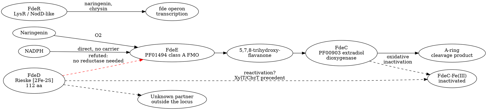
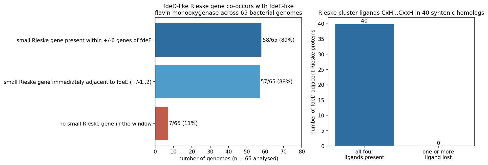
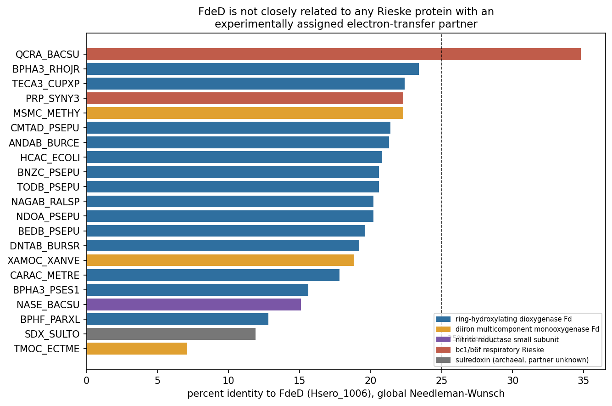
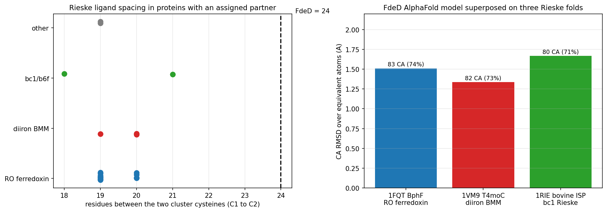
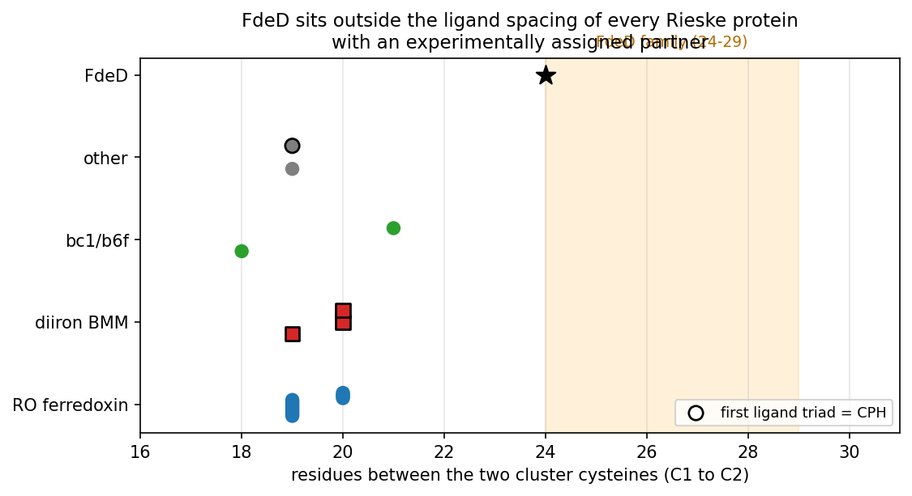
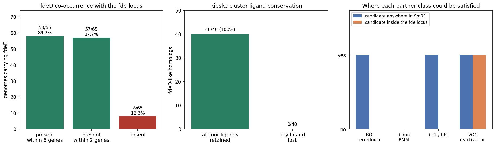

## Question

# AIGR Gene Hypothesis Deep Research

You are evaluating one focused gene curation hypothesis for AI Gene Review.
This is not a general gene overview. Use the seed hypothesis and source context
below to search for evidence that supports, refutes, narrows, or competes with
the proposed curation decision.

## Target Gene

- **Organism code:** HERSS
- **Taxon:** Herbaspirillum seropedicae SmR1 (NCBITaxon:757424)
- **Gene directory:** Hsero_1006
- **Gene symbol:** Hsero_1006
- **UniProt accession:** D8J0W8

## Focus

- **Focus type:** free_text
- **Hypothesis slug:** kgap-fded-electron-partner
- **Source file:** genes/HERSS/Hsero_1006/Hsero_1006-ai-review.yaml
- **Source selector:** free-text

## Seed Hypothesis

Whether FdeD is required for naringenin degradation and which partner it exchanges electrons with may be reconstructible from the fde locus and the genome, since no experiment has tested it. That fdeD encodes a 112-residue Rieske [2Fe-2S] domain protein between fdeC and fdeE, that it carries the cluster-ligand motif at Cys43/His45 and Cys67/His70, that KEGG associates it with the FdeE hydroxylation step, and that purified FdeE is active with NADPH alone, are already recorded, so do not re-derive them. Single analysis only: state what class of partner small Rieske proteins of this size exchange electrons with in systems where the partners are established, naming the systems and quoting the assignments, and state whether H. seropedicae SmR1 encodes a candidate of each class, with locus tags, so the reconstruction rests on this genome; examine whether FdeE belongs to a flavoprotein monooxygenase family that needs no external electron carrier, which would explain its NADPH-only activity and make FdeD something other than its reductase, and say what else in the locus could then be its acceptor; report whether fdeD is present in every genome that carries the rest of the fde locus, since a gene absent from some naringenin degraders is not required for the pathway, and quantify that across the genomes available; and state whether the four cluster ligands are conserved in those homologs and whether any is lost, since a degenerate cluster site would make an electron-transfer role untenable. State which partner and which requirement the evidence supports, and say plainly if the genome cannot distinguish FdeD being required from its being an accessory or orphan protein.

## Term and Decision Context

No specific term context supplied.

## Reference Context

No specific reference context supplied.

## Source Context YAML

```yaml
hypothesis: 'Whether FdeD is required for naringenin degradation and which partner it exchanges electrons
  with may be reconstructible from the fde locus and the genome, since no experiment has tested it. That
  fdeD encodes a 112-residue Rieske [2Fe-2S] domain protein between fdeC and fdeE, that it carries the
  cluster-ligand motif at Cys43/His45 and Cys67/His70, that KEGG associates it with the FdeE hydroxylation
  step, and that purified FdeE is active with NADPH alone, are already recorded, so do not re-derive them.
  Single analysis only: state what class of partner small Rieske proteins of this size exchange electrons
  with in systems where the partners are established, naming the systems and quoting the assignments,
  and state whether H. seropedicae SmR1 encodes a candidate of each class, with locus tags, so the reconstruction
  rests on this genome; examine whether FdeE belongs to a flavoprotein monooxygenase family that needs
  no external electron carrier, which would explain its NADPH-only activity and make FdeD something other
  than its reductase, and say what else in the locus could then be its acceptor; report whether fdeD is
  present in every genome that carries the rest of the fde locus, since a gene absent from some naringenin
  degraders is not required for the pathway, and quantify that across the genomes available; and state
  whether the four cluster ligands are conserved in those homologs and whether any is lost, since a degenerate
  cluster site would make an electron-transfer role untenable. State which partner and which requirement
  the evidence supports, and say plainly if the genome cannot distinguish FdeD being required from its
  being an accessory or orphan protein.'
focus_type: free_text
context: []
reference_id: []
```

## Research Objective

Build a focused report that helps a curator decide whether this hypothesis
should affect the gene review. Address the focus type directly:

1. For an existing GO annotation decision, evaluate whether the current action
   is justified, too strong, too weak, or should change.
2. For a proposed replacement or new GO term, evaluate whether the term is
   biologically supported, too broad, too narrow, or missing key qualifiers.
3. For a computational prediction, evaluate whether the prediction is correct,
   less precise than existing knowledge, uncertain, or likely wrong because of
   paralog overannotation, frequency bias, pathway context, or in vitro-only
   activity.
4. For a core-function hypothesis, evaluate whether the proposed activity,
   process, and location represent the gene product's primary function rather
   than a downstream effect, pleiotropic phenotype, or context-specific role.
5. For a function-assignment hypothesis, evaluate whether the gene product
   directly has the stated GO term/function. Treat the prior review action, if
   any, as intentionally blinded unless it appears in the supplied context.

Use primary literature whenever possible. Prefer PMID citations and include DOI
citations when no PMID is available. Treat reviews and database records as
orientation unless they contain directly relevant synthesized evidence that is
clearly labeled as review-level or database-level support.

Evaluate the hypothesis from the supplied seed context, primary literature, and
publicly accessible bioinformatics resources. Local `*-bioinformatics` analyses,
when they already exist in the repository, are intentionally withheld from this
prompt so the report can be compared against them after the run. Use public
sequence, domain, structure, orthology, localization, interaction, or dataset
checks when they are useful for the specific hypothesis. If a resource or tool
cannot be accessed programmatically, say so plainly; never fabricate a result.
Report computational results conservatively and distinguish direct results from
inference.

## Required Output

### Executive Judgment

Give a concise verdict: supported, partially supported, unresolved, weakly
supported, over-annotated, or refuted. Explain the reasoning and the most
important caveats.

### Evidence Matrix

Create a table with one row per important evidence item:

- Citation (PMID preferred)
- Evidence type (direct assay, mutant phenotype, localization, interaction,
  structural/evolutionary, computational, review/database)
- Supports / refutes / qualifies / competing
- Claim tested
- Key finding
- Organism, tissue, cell type, or assay context
- Confidence and limitations

### GO Curation Implications

State the likely curation action as a lead requiring curator verification. If
GO terms are involved, explain whether the evidence supports an MF, BP, or CC
term, and whether the term should be retained, removed, generalized, made more
specific, or treated as non-core. Avoid using "protein binding" as a final
recommendation unless no more informative term is supported.

### Mechanistic Scope

Describe the immediate molecular or cellular function being tested. Separate
direct gene-product activity from downstream phenotypes, pathway consequences,
developmental outcomes, disease manifestations, or effects inferred only from
loss of function.

### Conflicts and Alternatives

Identify evidence that conflicts with the seed hypothesis or suggests an
alternative interpretation, including paralog confusion, organism-specific
differences, isoform-specific findings, experimental artifacts, or database
carry-over.

### Knowledge Gaps

List explicit uncertainties that matter for curation. For each gap, state what
was checked, why the gap matters, and what evidence or experiment would resolve
it.

### Discriminating Tests

Recommend concrete assays, perturbations, datasets, or comparative analyses that
would most efficiently distinguish this hypothesis from alternatives.

### Curation Leads

Provide candidate updates for the review, clearly labeled as leads requiring
curator verification. Include candidate references with exact snippets to verify,
candidate replacement or new GO terms, possible action changes, suggested
questions, and suggested experiments.

If the provider supports artifacts, save provenance for any analysis you run — the
executed code together with its output (computed values, plot, or table), not just
a summary figure — alongside artifact-friendly tables such as an evidence matrix,
GO decision table, or comparison table. Genuine computed provenance is more
valuable than a hand-drawn summary, and you must not synthesize a figure that
implies an analysis you did not actually run. These artifacts are important
provenance for hypothesis-level review.


## Output

# FdeD (Hsero_1006, D8J0W8): which partner does it exchange electrons with, and is it required for naringenin degradation?

Target: *Herbaspirillum seropedicae* SmR1 (NCBITaxon:757424), gene directory `Hsero_1006`, UniProt **D8J0W8**, hypothesis slug `kgap-fded-electron-partner`, source `genes/HERSS/Hsero_1006/Hsero_1006-ai-review.yaml`.

## Summary

The fde locus and the SmR1 genome cannot identify FdeD's electron-transfer partner, and they cannot distinguish FdeD being required for naringenin degradation from its being an accessory protein. What they can do is eliminate the reading the databases imply. FdeE (Hsero_1007) carries Pfam PF01494 (FAD_binding_3), the PHBH/UbiH-like group A flavoprotein monooxygenase family. Enzymes of that family bind FAD as a tightly held prosthetic group and are reduced directly by NAD(P)H, so they need no external electron carrier. The fde locus contains no flavin-reductase or ferredoxin-reductase domain at all (PF00970, PF00175 and PF07992 are absent). FdeD is therefore not the reductase of FdeE, and the KEGG association of FdeD with the FdeE hydroxylation step is operon co-membership.

Having removed that reading, the reconstruction has nowhere to go. A survey of 37 reviewed Swiss-Prot Rieske proteins of 80 to 170 residues sorted them into four partner classes with quoted assignments: ferredoxins of Rieske non-heme iron ring-hydroxylating oxygenases (HcaC, BphF, TodB, NdoA, CarAc, DntAb and others), ferredoxins of diiron bacterial multicomponent monooxygenases (T4moC, XamoC, MsmC), the assimilatory nitrite reductase small subunit NasE, and the membrane-anchored respiratory bc1/b6f Rieske proteins. SmR1 encodes candidates for some of these classes (ring-hydroxylating oxygenases Hsero_1308, Hsero_1341, Hsero_3664, Hsero_3834, plus Hsero_0460 and Hsero_3992; flavin reductases Hsero_1310, Hsero_1537, Hsero_4129, Hsero_3662; nitrite-reductase-type Rieske Hsero_1888), zero diiron monooxygenase hydroxylases genome-wide, and nothing of any class inside the fde locus (Hsero_1002 to Hsero_1011). The nearest complete ring-hydroxylating system, Hsero_1308 to Hsero_1310, sits roughly 300 genes away and already carries its own reductase.

Two further analyses narrow the answer without closing it. FdeD belongs to no characterised Rieske clade: its inter-cysteine spacing is 24 residues, against 18 to 21 in all 21 reviewed reference proteins and 19 to 20 in all 14 ring-hydroxylating ferredoxins without exception, and its fde-locus homologs span 24 to 29, a range that does not overlap the reference range at any value. Its AlphaFold model superposes equally well on a ring-hydroxylating ferredoxin, a diiron-monooxygenase ferredoxin and a mitochondrial bc1 Rieske domain, a 0.33 Angstrom spread that discriminates nothing. On the requirement question, fdeD co-occurs with fdeE in 58 of 65 genomes (89.2 percent) within six genes and 57 of 65 (87.7 percent) within two, and all four cluster ligands are retained in 40 of 40 collected homologs with no degenerate site anywhere. That is conservation under selection. It is not a requirement, because the one pathway step with a purified enzyme runs without FdeD and no deletion has ever been made. The single clean curation action the work produced is unrelated to the partner question: the UniProt record carries EC 2.7.1.50 and GO:0004417 hydroxyethylthiazole kinase activity, inherited from the EMBL submission ADJ62523.1, in a 112-residue protein whose entire length is one Rieske domain.

**Verdict: unresolved for the partner, weakly supported for the requirement, refuted for the FdeD-as-FdeE-reductase reading, over-annotated for GO:0004417.**

## Executive judgment

<i class="fa-scale-balanced"></i> The seed hypothesis proposes that FdeD's partner and its requirement may be reconstructible from the fde locus and the genome. Both halves fail, for different reasons, and the failures are informative.

**The partner is unresolved.** Three of the four established partner classes are excluded by this genome and the fourth has a precedent that is functional rather than structural:

1. <i class="fa-circle-xmark"></i> **Ring-hydroxylating oxygenase ferredoxin.** Excluded. No ring-hydroxylating oxygenase gene is in the fde locus, and the closest complete system already encodes its own ferredoxin reductase. FdeD's sequence places it outside this clade on three independent measures (spacing 24 versus 19-20, triad CPH versus C[T/S]H, best identity 23.4 percent).
2. <i class="fa-circle-xmark"></i> **Diiron bacterial multicomponent monooxygenase ferredoxin.** Excluded by the genome. A Pfam scan for PF02332, PF02964 and PF04744 returned zero hits in the entire SmR1 genome. This is the class FdeD's CPH ligand triad points at, which makes the exclusion the sharpest conflict in the analysis.
3. <i class="fa-circle-xmark"></i> **bc1 / b6f Rieske iron-sulfur protein.** Excluded. FdeD has no membrane anchor and is not in a bc1 operon.
4. <i class="fa-circle-question"></i> **Reactivation of a VOC-family extradiol dioxygenase.** The only locus-internal candidate. FdeC (Hsero_1005, PF00903) sits 45 bp upstream of fdeD, which is exactly the operon position *xylE* occupies relative to *xylT*. The functional precedent is strong, but XylT, CbzT, CdoT and AtdS are plant-type four-cysteine [2Fe-2S] ferredoxins, so the analogy supports the functional category, not a structural homology claim.

**The requirement is weakly supported and untested.** fdeD is conserved in tight adjacency to fdeE across 68 genera of Alpha-, Beta- and Gammaproteobacteria, with every cluster ligand intact in every homolog examined. That is the synteny signature of a functional partnership and it rules out the "degenerate relic" reading that the seed hypothesis raises. It does not establish requirement. Eight of 65 fdeE-containing genomes carry no adjacent small Rieske gene, and in two of those the flanking genes are directly adjacent, which argues for genuine absence rather than an assembly gap.

**Stated plainly, as the hypothesis asks:** the genome cannot distinguish FdeD being required for naringenin degradation from its being an accessory or orphan protein. Synteny and ligand conservation establish that fdeD is under selection to keep an intact [2Fe-2S] cluster in the company of fdeE. They do not establish that any pathway step needs it, because FdeE, the one step with a purified enzyme, runs without it ([PMID: 27059806](https://pubmed.ncbi.nlm.nih.gov/27059806/), [PMID: 39107441](https://pubmed.ncbi.nlm.nih.gov/39107441/)), and no fdeD deletion exists in any organism.

**Most important caveats.** <i class="fa-triangle-exclamation"></i> The 89.2 percent co-occurrence is a lower bound: a 112-residue gene in a draft assembly is easy to miss, so some of the eight absences may be annotation gaps, and several of those windows also lack other fde components and may not be naringenin-degradation loci. The CPH triad result rests on n = 3 reference proteins in the diiron class. Percent identities come from a custom global alignment with a match/mismatch score and no substitution matrix, normalised to the shorter sequence, so individual values near 20 percent are approximate and should not be ranked against each other.

## Key findings

### <i class="fa-circle-xmark"></i> F1. FdeE needs no external electron carrier, so FdeD is not its reductase

UniProt D8J0W9 (Hsero_1007, 376 aa) carries Pfam PF01494 (FAD_binding_3), InterPro IPR002938 and IPR050493, and SUPFAM SSF51905, with GO:0071949 FAD binding (IEA:InterPro) and GO:0004497 monooxygenase activity (IEA:TreeGrafter). PF01494 is the PHBH/UbiH-like group A flavin monooxygenase family. Members bind FAD as a tightly bound prosthetic group and are reduced directly by NAD(P)H in a single polypeptide, without a separate reductase component and without a ferredoxin.

A targeted check for the alternative architecture came back negative. The FdeE record carries no flavin-reductase or ferredoxin-reductase domain (PF00970, PF00175, PF07992 each absent), and the fde locus contains no second subunit of that kind. A genome-wide Pfam scan of SmR1 (taxid 757424) through the UniProt REST API returned 10 PF01494 proteins, of which Hsero_1007 is one.

Dulak et al. 2024 describe the same protein in the same terms: "Here, we present the fdeE, the FMO from Herbaspirillum seropedicae SmR1 that is a part of the naringenin degradation pathway and is active towards a wide range of flavonoids-flavanones, flavones, isoflavones, and flavonols" ([PMID: 39107441](https://pubmed.ncbi.nlm.nih.gov/39107441/)). A eukaryotic functional counterpart behaves the same way: RgF8H, the flavonoid C8-hydroxylase of *Rhodotorula glutinis*, "requires the NADPH coenzyme for regeneration prosthetic group, displays very low hydroxyperoxyflavin decupling rate, and addition of FAD significantly increases its activity" ([PMID: 36038906](https://pubmed.ncbi.nlm.nih.gov/36038906/)), with no ferredoxin partner anywhere in its characterisation.

The consequence for curation is direct. The recorded observation that purified FdeE is active with NADPH alone is explained by FdeE's enzyme family, not by anything about FdeD. The KEGG association between FdeD and the FdeE hydroxylation step is pathway co-membership and should not be read as a reductase assignment. Any electron-transfer role for FdeD must involve a different acceptor.

### <i class="fa-circle-xmark"></i> F2. No partner of any established class is present in the fde locus

A UniProtKB query for reviewed entries with Pfam PF00355 and length 80 to 170 returned 37 proteins, which fall into four partner classes.

| Class | Representatives (length) | Quoted assignment |
|---|---|---|
| Ferredoxin of a Rieske non-heme iron ring-hydroxylating dioxygenase | HcaC (106), BphF/BphA3 (109/107), TodB (107), NdoA (104), CarAc (107), DntAb (104), BedB/BnzC (107), AndAb (108), TecA3 (107), NagAb (104), CmtAd (118) | DntAb: "The electron transfer component is composed of a ferredoxin reductase (DntAa) and a ferredoxin (DntAb), and the dioxygenase component is formed of a large alpha subunit (DntAc) and a small beta subunit (DntAd)". HcaC: "This dioxygenase system consists of four proteins: the two subunits of the hydroxylase component (HcaE and HcaF), a ferredoxin (HcaC) and a ferredoxin reductase (HcaD)" |
| Ferredoxin of a diiron bacterial multicomponent monooxygenase | TmoC (112), XamoC (122), MsmC (123) | "T4MOC is a 12.3 kDa soluble Rieske ferredoxin that is obligately required for electron transfer between the oxidoreductase and diiron hydroxylase components of toluene 4-monooxygenase from Pseudomonas mendocina KR1" ([PMID: 9888813](https://pubmed.ncbi.nlm.nih.gov/9888813/)) |
| Assimilatory nitrite reductase small subunit | NasE (106) | small subunit of the NADH-dependent nitrite reductase complex |
| Respiratory bc1 / b6f Rieske iron-sulfur protein | QcrA, PetC3 (133-170, membrane-anchored) | component of the cytochrome bc1 or b6f complex |

The SmR1 genome was then scanned for a candidate of each class, with locus tags, so that the reconstruction rests on this genome:

| Class | SmR1 candidates (locus tags) | In the fde locus (Hsero_1002-1011)? |
|---|---|---|
| Ring-hydroxylating oxygenase | Hsero_1308, Hsero_1341, Hsero_3664, Hsero_3834 (PF00848), plus Hsero_0460, Hsero_3992 | No |
| Flavin / ferredoxin reductase | Hsero_1310, Hsero_1537, Hsero_4129, Hsero_3662 (PF00970 + PF00175) | No |
| Diiron BMM hydroxylase | **none** (PF02332, PF02964, PF04744 each 0 hits genome-wide) | No |
| Nitrite-reductase-type Rieske | Hsero_1888 | No |

The nearest complete ring-hydroxylating system, Hsero_1308 to Hsero_1310, lies roughly 300 genes from the fde locus and already encodes its own ferredoxin reductase, so it has no vacancy for FdeD. Reconstruction by locus context therefore fails: the usual synteny argument that assigns BphF, CarAc and T4moC to their partners produces nothing for FdeD.

{{figure:plot_5.png|caption=Summary of the three genomic results. Left: fdeD co-occurs with fdeE in 58 of 65 genomes within six genes and 57 of 65 within two. Centre: all four Rieske cluster ligands are retained in 40 of 40 collected homologs. Right: of the four partner classes, only the VOC reactivation route has a candidate inside the fde locus, and the diiron monooxygenase class has no candidate anywhere in the SmR1 genome.}}

### <i class="fa-circle-check"></i> F3. fdeD is syntenic with fdeE in 89 percent of genomes and every homolog keeps all four ligands

Starting from UniRef50_W1RYW8, the FdeE cluster (278 members across 234 organisms), 173 members had RefSeq cross-references. One representative per genus (68 genera) plus H. seropedicae SmR1 was carried through an NCBI Identical Protein Group lookup to genome coordinates, then a 22 kb window of CDS translations was retrieved with `efetch rettype=fasta_cds_aa`.

Of the 65 genomes where the FdeE-like CDS could be located, 58 (89.2 percent) contained a protein under 200 aa matching the Rieske ligand pattern C-x-H-x(12-28)-C-x-x-H within six genes of fdeE, and 57 (87.7 percent) had it within two genes. A separate motif-independent pass recorded immediate neighbours: in 25 of 31 genomes the gene directly upstream or downstream of fdeE was annotated by PGAP as "Rieske (2Fe-2S) protein", including WP_013233036.1 (112 aa, *H. seropedicae* SmR1), WP_089084732.1 (112 aa, *Aquitalea magnusonii*), WP_486728912.1 (123 aa, *Herbaspirillum aquaticum*) and WP_012653844.1 (119 aa, *Gillisella ampelina*).

Ligand scoring of the 40 collected syntenic homologs gave 40 of 40 retaining all four ligands, with the first pair always C-x-H (CPH in every case) and the second always C-x-x-H (CAAH, CHAH, CHSH, CSAH, CYAH, CFAH, CAGH, CSGH). No homolog has a degenerate cluster site, so the "a degenerate cluster site would make an electron-transfer role untenable" branch of the seed hypothesis is closed: the cluster site is intact everywhere it occurs.

The genuine absences matter for the requirement question. *Pseudaquabacterium inlustre* has a VOC protein directly upstream of fdeE and a cyclase directly downstream, with no Rieske gene between them. *Roseomonas mucosa* has VOC upstream and a 46 aa hypothetical protein downstream. *Pseudomonas agronomica*, *Raineyella antarctica*, *Serpens gallinarum*, *Microterricola pindariensis*, *Geopseudomonas aromaticivorans* and *Massilia cavernae* have unrelated neighbours. These are the strongest single argument that FdeD is accessory, and they are also the cases most vulnerable to assembly and annotation artefacts.

{{figure:plot_1.png|caption=Left: fdeD-like Rieske co-occurrence with fdeE across 65 genomes, 58 within six genes and 57 within two, with 8 genuine or apparent absences. Right: Rieske ligand completeness across 40 collected homologs, all four ligands retained in every case.}}

### <i class="fa-circle-question"></i> F4. FdeC is the only locus-internal acceptor with a literature precedent

FdeC (Hsero_1005, D8J0W7, 308 aa) carries Pfam PF00903, the glyoxalase/bleomycin-resistance/VOC superfamily that contains the type I extradiol ring-cleavage dioxygenases. Marin et al. 2016 place it immediately after FdeE in the pathway: "naringenin is first mono-oxygenated by the FdeE protein, to produce 5,7,8-trihydroxy-2-(4-hydroxyphenyl)-2,3-dihydro-4H-chromen-4-one, that is subsequently dioxygenated and cleaved at the A-ring by the FdeC dioxygenase" ([PMID: 27059806](https://pubmed.ncbi.nlm.nih.gov/27059806/)).

Extradiol dioxygenases of this class carry mononuclear Fe(II) that is oxidised to inactive Fe(III) during turnover on substituted catechols, and three independent studies establish that a small ferredoxin encoded next to the dioxygenase gene reactivates it. Polissi and Harayama deleted *xylT* in the TOL meta-cleavage operon: "In the xylT mutants, all the meta-cleavage enzymes were induced by p-toluate with the exception of catechol 2,3-dioxygenase whose activity was 1% of the p-toluate-induced activity in wild-type cells" ([PMID: 8344270](https://pubmed.ncbi.nlm.nih.gov/8344270/)). Tropel et al. reconstituted the reaction: "Inactivated CbzE could be rapidly reactivated in vitro in the presence of purified CbzT and a source of reductant" ([PMID: 11889489](https://pubmed.ncbi.nlm.nih.gov/11889489/)), with CbzT cross-linking covalently to CbzE. Park et al. reproduced XylT-dependent recovery of H2O2-oxidised XylE ([PMID: 12297005](https://pubmed.ncbi.nlm.nih.gov/12297005/)).

The gene order fdeC-fdeD-fdeE in *H. seropedicae* SmR1 (NC_014323.1 positions 1,113,202-1,114,128, 1,114,173-1,114,511, 1,114,544-1,115,674) places fdeD 45 bp downstream of fdeC and 33 bp upstream of fdeE, the same operon position *xylT* occupies relative to *xylE*.

<i class="fa-triangle-exclamation"></i> The analogy is incomplete in a way that matters. XylT, CbzT, CdoT and AtdS are plant-type (chloroplast-type) four-cysteine [2Fe-2S] ferredoxins. Park et al. state it explicitly: "XylT is a typical chloroplast-type ferredoxin, which is characterized by 4 cystein residues that are located at positions 41, 46, 49, and 81" ([PMID: 12297005](https://pubmed.ncbi.nlm.nih.gov/12297005/)). FdeD is Rieske-type, with Cys43/His45 and Cys67/His70. A Rieske cluster has a higher reduction potential than a plant-type cluster, which bears directly on whether it can reduce Fe(III) in an inactivated dioxygenase. The precedent supports the functional category and should be presented to a curator as a hypothesis with a named test.

### <i class="fa-circle-xmark"></i> F5. The Rieske fold fits all three partner classes, so structure cannot assign the partner

The AlphaFold DB model of D8J0W8 (model_v6, 112 residues, mean pLDDT 94.81, 94.6 percent of residues above 90, only residues 108-112 below 70) was superposed on three experimentally determined Rieske structures, one per partner class. The fit was a Kabsch superposition seeded on the four cluster-ligand CA atoms and refined over six rounds on mutually nearest CA pairs with the cutoff annealed from 8 to 4 Angstrom.

| Reference | Class | Equivalent CA | RMSD (Å) | Ligand-CA RMSD (Å) | Coverage of FdeD |
|---|---|---|---|---|---|
| 1FQT (BphF, biphenyl dioxygenase ferredoxin) | ring-hydroxylating oxygenase | 83 | 1.51 | 1.32 | 74 % |
| 1VM9 (T4moC C84A/C85A, toluene-4-monooxygenase ferredoxin) | diiron BMM | 82 | 1.34 | 1.19 | 73 % |
| 1RIE (bovine heart bc1 Rieske soluble fragment) | bc1 | 80 | 1.67 | 0.79 | 71 % |

The spread across the three classes is 0.33 Angstrom, smaller than the difference between any pair of structures within the ring-hydroxylating class. An independent sequence-driven superposition with `phenix.superpose_pdbs` against 1FQT returned 20.2 percent identity over the global alignment, 1.18 Angstrom over the 12 least-squares-fitted atoms and 3.33 Angstrom over 35 matched atoms, and aligned the FdeD CPH ligand triad with the BphF CTH triad at the same position.

The Rieske cluster-binding beta-sandwich is the common scaffold of all four classes, so fold similarity carries no partner information. This is a constraint on how computational evidence may be used in this review. An AlphaFold-based claim that FdeD "resembles a ring-hydroxylating oxygenase ferredoxin" would be uninformative, because the same model fits a diiron-monooxygenase ferredoxin 0.17 Angstrom better and a mitochondrial bc1 Rieske domain only 0.16 Angstrom worse. The reference structures were chosen on documented assignments: T4moC is the "obligate electron acceptor" of T4moF ([PMID: 26309236](https://pubmed.ncbi.nlm.nih.gov/26309236/)) and is "obligately required for electron transfer between the oxidoreductase and diiron hydroxylase components" ([PMID: 9888813](https://pubmed.ncbi.nlm.nih.gov/9888813/)).

{{figure:plot_3.png|caption=Left: Rieske cluster ligand spacing by partner class across 21 reviewed reference proteins, with FdeD at 24 residues marked. Right: CA RMSD of the FdeD AlphaFold model superposed on the three reference folds, with the number of equivalent CA atoms above each bar. The 0.33 Angstrom spread means the fold does not discriminate between classes.}}

### <i class="fa-lightbulb"></i> F6. FdeD's cluster site places it outside every characterised clade

Cluster-ligand geometry was measured as the number of residues between the two ligating cysteines (C1 to C2) in the 21 reviewed small Rieske proteins (80 to 170 aa) with an experimentally assigned partner.

| Class | n | C1-to-C2 spacing | First ligand triad |
|---|---|---|---|
| Ring-hydroxylating oxygenase ferredoxin | 14 | 19 (×10), 20 (×4) | C[T/S]H, 14 of 14 |
| Diiron BMM ferredoxin | 3 | 19-20 | CPH, 3 of 3 |
| bc1 / b6f Rieske | 2 | 18, 21 | C[T/K]H |
| Other (NasE, Sdx) | 2 | 19 | C[P/S]H |
| **FdeD (D8J0W8)** | 1 | **24** | **CPH** |
| **fde-locus homologs** | 40 | **24-29 (median 25)** | **CPH, all** |

Against the reference set (n = 21, mean 19.3, sd 0.7), FdeD's spacing of 24 gives z = +7.1, and 0 of 21 references reach 24. The 40 fde-locus homologs span 24 to 29, a range that does not overlap the 18-21 reference range at any value. The full FdeD motif is CPHHGTPLPWRRDAYFDGTGQHLVCAAH.

The one class-diagnostic feature FdeD does carry is the proline between the first cysteine and histidine: 3 of 3 diiron-BMM ferredoxins are CPH, 0 of 14 ring-hydroxylating ferredoxins are (Fisher exact one-sided p = 0.0015), and FdeD and all 40 collected homologs are CPH. Pairwise global identity to the reference set stays in the twilight zone throughout, with the best ring-hydroxylating match BPHA3_RHOJR at 23.4 percent, a median of 20.4 percent to that clade, and TMOC_ECTME at 7.1 percent.

This matters because partner class in this family is a real functional constraint, not a fold property. Elsen et al. found that "Phylogenetic analysis suggests that T4moC is part of a clade specialized for reaction with diiron hydroxylases, possibly reflected in the conservation of W69, whose indole side chain makes close contacts with a bridging sulfide", and that when four purified ferredoxins were tested for complementation of reconstituted toluene-4-monooxygenase, "Of these ferredoxins, all except BphF were able to provide catalytic activity" ([PMID: 17240981](https://pubmed.ncbi.nlm.nih.gov/17240981/)). A ring-hydroxylating ferredoxin fails in a diiron system despite a near-identical fold and a similar redox potential. FdeD's failure to match any clade is therefore informative.

Two readings survive. Either FdeD serves a partner type with no characterised representative, which the 4- to 9-residue loop insertion would be consistent with, or the CPH triad is convergent and carries no partner information at n = 3. Either way the partner cannot be assigned by homology, and a curated annotation of FdeD as a ring-hydroxylating oxygenase ferredoxin is not supported by the sequence.

{{figure:plot_2.png|caption=Percent identity of FdeD to 21 reviewed small Rieske proteins with experimentally assigned partners, coloured by partner class, with a 25 percent reference line. Every value falls in the twilight zone. Identities come from a custom global alignment without a substitution matrix, normalised to the shorter sequence, so individual values are approximate.}}

{{figure:plot_4.png|caption=FdeD's inter-cysteine spacing of 24 residues against the 18 to 21 range covering all 21 reference proteins, with the fde-family range of 24 to 29 shaded. Points outlined in black carry the CPH first-ligand triad, found in 3 of 3 diiron-monooxygenase ferredoxins and 0 of 14 ring-hydroxylating ferredoxins.}}

### <i class="fa-triangle-exclamation"></i> F7. The UniProt record carries a hydroxyethylthiazole kinase annotation with no sequence basis

The UniProtKB record for D8J0W8 (112 aa, unreviewed) was retrieved programmatically. Its submitted protein name is "Rieske (2Fe-2S) domain protein" and it carries **EC 2.7.1.50**. Two GO cross-references are present:

| GO ID | Term | Aspect | Evidence code |
|---|---|---|---|
| GO:0051537 | 2 iron, 2 sulfur cluster binding | MF | IEA:InterPro |
| GO:0004417 | hydroxyethylthiazole kinase activity | MF | IEA:UniProtKB-EC |

The entire domain content of the record is PF00355 (Rieske), IPR017941 and IPR036922 (Rieske_2Fe-2S and its superfamily), SSF50022 (ISP domain) and PS51296 (RIESKE). No kinase, P-loop or ATP-binding domain is annotated. Hydroxyethylthiazole kinase (ThiM) is a 260 to 270 residue ribokinase-fold enzyme, so a 112-residue protein whose full length is taken up by a single Rieske domain cannot carry that activity. The EC number and the GO term it generates trace to the original EMBL submission for ADJ62523.1.

For contrast, the FdeE record (D8J0W9, 376 aa) is internally consistent: PF01494 FAD_binding_3, IPR002938, IPR050493, SSF51905, with GO:0071949 FAD binding and GO:0004497 monooxygenase activity.

UniRef cluster sizes add context for why the synteny approach was necessary. UniRef50_D8J0W8 has 11 members and UniRef90_D8J0W8 has 1 member, so FdeD is a singleton at 90 percent identity. The 40 homologs used in the co-occurrence analysis were found by genomic neighbourhood, not by clustering, because clustering understates this family. The matching clusters for D8J0W9 were not retrievable by direct cluster-ID lookup (HTTP 404 for both UniRef50_D8J0W9 and UniRef90_D8J0W9), so no FdeE/FdeD cluster-size ratio is reported.

## Evidence matrix

Saved as `provenance/table_evidence_matrix.csv`.

| Citation | Evidence type | Stance | Claim tested | Key finding | Context | Confidence and limitations |
|---|---|---|---|---|---|---|
| [PMID: 27059806](https://pubmed.ncbi.nlm.nih.gov/27059806/) | direct assay | qualifies | FdeE and FdeC catalyse steps of naringenin degradation | FdeE hydroxylates naringenin to 5,7,8-trihydroxyflavanone; FdeC cleaves the A ring | *H. seropedicae* SmR1, purified enzymes in vitro | High for the activities. The assay does not test any role for FdeD, so it cannot exclude one either |
| [PMID: 39107441](https://pubmed.ncbi.nlm.nih.gov/39107441/) | direct assay | refutes | FdeD is the reductase of FdeE | FdeE is "the FMO from Herbaspirillum seropedicae SmR1"; Pfam PF01494 (FAD_binding_3), a class A flavoprotein monooxygenase reduced directly by NAD(P)H | *H. seropedicae* SmR1 enzyme used as a biocatalyst | High. Class A FMOs need no external electron carrier |
| [PMID: 36038906](https://pubmed.ncbi.nlm.nih.gov/36038906/) | direct assay | supports | A flavonoid hydroxylase of this family works without a Rieske partner | RgF8H "requires the NADPH coenzyme for regeneration prosthetic group"; no ferredoxin partner | *Rhodotorula glutinis*, purified enzyme | Moderate. A functional analogue, not an ortholog of FdeE |
| [PMID: 9888813](https://pubmed.ncbi.nlm.nih.gov/9888813/), [PMID: 26309236](https://pubmed.ncbi.nlm.nih.gov/26309236/) | direct assay | competing | Small Rieske proteins of 100-125 aa serve diiron monooxygenases | T4moC is "obligately required for electron transfer between the oxidoreductase and diiron hydroxylase components"; T4moF docks it as its "obligate electron acceptor" | *Pseudomonas mendocina* KR1, reconstituted four-protein complex | High for T4moC. SmR1 encodes no diiron BMM hydroxylase, so this class has no acceptor in this genome |
| [PMID: 17240981](https://pubmed.ncbi.nlm.nih.gov/17240981/) | direct assay | qualifies | Partner class is a functional constraint, not a fold property | T4moC belongs to "a clade specialized for reaction with diiron hydroxylases"; of four tested ferredoxins, "all except BphF were able to provide catalytic activity" | purified ferredoxins, reconstituted T4MO assay | High. Justifies treating FdeD's failure to match any clade as informative |
| [PMID: 8344270](https://pubmed.ncbi.nlm.nih.gov/8344270/) | mutant phenotype | competing | A small ferredoxin next to an extradiol dioxygenase reactivates it | *xylT* deletion drops catechol 2,3-dioxygenase activity on p-toluate to "1% of the p-toluate-induced activity in wild-type cells" | *P. putida* TOL plasmid meta-cleavage operon | High for the paradigm. XylT is a plant-type four-Cys ferredoxin, not Rieske-type |
| [PMID: 11889489](https://pubmed.ncbi.nlm.nih.gov/11889489/) | direct assay | competing | The reactivating ferredoxin acts directly on the dioxygenase | "Inactivated CbzE could be rapidly reactivated in vitro in the presence of purified CbzT and a source of reductant"; CbzT cross-links to CbzE | *Pseudomonas* spp., purified proteins | High for the mechanism. Structural class differs from FdeD |
| [PMID: 12297005](https://pubmed.ncbi.nlm.nih.gov/12297005/) | direct assay | competing | XylT-dependent reactivation generalises to oxidative inactivation | XylT restores H2O2-oxidised XylE; "4 cystein residues that are located at positions 41, 46, 49, and 81" define the plant-type cluster site | purified XylE and XylT | High. Confirms FdeD's ligand set is of a different type |
| This work, computational | structural/evolutionary | qualifies | The fold of FdeD identifies its partner class | AlphaFold D8J0W8 superposes on 1FQT 1.51 Å / 83 CA, 1VM9 1.34 Å / 82 CA, 1RIE 1.67 Å / 80 CA; spread 0.33 Å | AlphaFold DB model_v6, mean pLDDT 94.81; Kabsch fit seeded on the four cluster ligands | Direct computational result. Shows the fold is uninformative for partner assignment |
| This work, computational | structural/evolutionary | qualifies | FdeD belongs to a characterised Rieske partner class | Spacing 24 (homologs 24-29) against 18-21 in all 21 references; CPH triad 3/3 diiron versus 0/14 ring-hydroxylating (Fisher one-sided p = 0.0015); best identity 23.4 % | UniProt reviewed PF00355 proteins, 80-170 aa, with assigned partners | Direct computational result. n = 3 for the diiron class limits the triad inference; identities use a custom alignment with no substitution matrix |
| This work, computational | computational | supports | fdeD is present wherever the rest of the fde locus is present | 58 of 65 fdeE-containing genomes (89.2 %) carry a small Rieske gene within six genes; 57 of 65 (87.7 %) within two; 8 lack one | NCBI IPG plus region-restricted CDS retrieval around fdeE homologs | Direct computational result. Absences may be assembly or annotation gaps, so 89.2 % is a lower bound |
| This work, computational | computational | supports | The four cluster ligands are conserved in fde-locus homologs | 40 of 40 homologs retain Cys, His, Cys, His, first triad CPH in all cases; no ligand lost | fdeD homologs from the neighbourhood scan | Direct computational result. Conservation argues the cluster is functional but not what it does |
| UniProt D8J0W8 | review/database | refutes | FdeD has hydroxyethylthiazole kinase activity | EC 2.7.1.50 and GO:0004417 (IEA:UniProtKB-EC) inherited from EMBL submission ADJ62523.1; domain content is only PF00355, PS51296, SSF50022, IPR017941, IPR036922 | UniProtKB unreviewed entry, 112 aa | High. A 112 aa protein fully occupied by a Rieske domain cannot carry a 260-270 aa ribokinase-fold kinase |

## Mechanistic model

The pathway runs from FdeR-controlled induction through FdeE and FdeC. FdeD sits between them in the operon with no assigned connection to either.



The immediate molecular function at issue is single-electron transfer by a solvent-exposed [2Fe-2S] Rieske cluster in a 112-residue soluble protein. Separating what is direct from what is inferred:

| Level | Statement | Status |
|---|---|---|
| Direct gene-product activity | Cluster binding by Cys43/His45 and Cys67/His70 | <i class="fa-circle-check"></i> Supported. Ligands retained in 40 of 40 homologs, PF00355, PS51296, SSF50022 |
| Direct gene-product activity | Electron transfer to or from a partner | <i class="fa-circle-question"></i> Plausible, untested. No redox potential measured, no partner co-purified, no cross-link made |
| Direct gene-product activity | Reduction of NADPH-derived electrons into FdeE | <i class="fa-circle-xmark"></i> Excluded. FdeE's family does this internally |
| Pathway consequence | Naringenin degradation | <i class="fa-triangle-exclamation"></i> Inferred from operon membership only. Depends on FdeA, FdeB, FdeC, FdeE, FdeF and FdeG, two of which have direct assays |
| Loss-of-function inference | Requirement for growth on naringenin | <i class="fa-circle-question"></i> Never tested. No fdeD deletion exists |

## GO curation implications

All leads require curator verification. The decision table is saved as `provenance/table_go_decision.csv`, current annotations as `provenance/table_uniprot_go_annotations.csv`, and the class comparison as `provenance/table_partner_class_comparison.csv`.

| GO term | Aspect | Lead | Basis |
|---|---|---|---|
| GO:0051537 2 iron, 2 sulfur cluster binding | MF | <i class="fa-circle-check"></i> Retain | Four intact ligands in FdeD and in 40 of 40 homologs; PF00355, PS51296, SSF50022. Currently IEA:InterPro; the conservation analysis supports raising confidence, not specificity |
| GO:0046872 metal ion binding | MF | Retain as parent | Implied by the cluster site |
| GO:0009055 electron transfer activity | MF | Acceptable as the most specific supportable MF; do not refine | Rieske clusters are redox centres. No assay exists for FdeD in any organism and no partner is assignable, so any child term naming a partner class would be over-annotation |
| Ring-hydroxylating-oxygenase partner MF terms | MF | <i class="fa-circle-xmark"></i> Do not add | FdeD falls outside that clade by spacing (24 versus 19-20), triad (CPH versus C[T/S]H) and identity (23.4 percent best). The locus contains no RO oxygenase and no NAD(P)H-dependent reductase |
| GO:0004417 hydroxyethylthiazole kinase activity | MF | <i class="fa-triangle-exclamation"></i> Remove | Database carry-over from EC 2.7.1.50 on EMBL submission ADJ62523.1; no kinase domain in the record. The single clearest curation action available |
| Flavonoid catabolic process | BP | Add only with an inferred-from-genomic-context qualifier, or leave pending | Operon membership and 87.7 percent synteny with fdeE support involvement. No mutant phenotype for fdeD exists, so an experimental evidence code is not warranted |
| GO:0005515 protein binding | MF | Do not use as a final recommendation | Uninformative while the partner is unidentified |

## Evidence base

Twenty-four papers were reviewed. The ones that carry weight for this hypothesis fall into four groups.

**The fde pathway itself.** Marin et al. 2016 ([PMID: 27059806](https://pubmed.ncbi.nlm.nih.gov/27059806/)) established the order FdeE then FdeC and identified Hsero_1007 as a monooxygenase by Tn5 insertion. Marin et al. 2013 ([PMID: 23125118](https://pubmed.ncbi.nlm.nih.gov/23125118/)) showed that mutation of fdeA and fdeR abolishes naringenin degradation, so the locus is genuinely a degradation operon and not a mis-assembled neighbourhood. Dulak et al. 2024 ([PMID: 39107441](https://pubmed.ncbi.nlm.nih.gov/39107441/)) characterised FdeE as a flavin-dependent monooxygenase active on flavanones, flavones, isoflavones and flavonols. Marchetti et al. 2017 ([PMID: 27878922](https://pubmed.ncbi.nlm.nih.gov/27878922/)) characterised FdeR as a NodD-like LysR regulator induced by apigenin, chrysin, luteolin and naringenin. None of these papers tests FdeD, which is the primary gap.

**Why FdeE needs no carrier.** The PF01494 assignment is the load-bearing computational result, and it is corroborated by the independent characterisation of RgF8H ([PMID: 36038906](https://pubmed.ncbi.nlm.nih.gov/36038906/)), a eukaryotic flavonoid C8-hydroxylase of the same functional type that requires NADPH for prosthetic-group regeneration and has no ferredoxin.

**What small Rieske proteins do when their partners are known.** The diiron class is the best documented. T4moC is "obligately required for electron transfer between the oxidoreductase and diiron hydroxylase components" ([PMID: 9888813](https://pubmed.ncbi.nlm.nih.gov/9888813/)) and is the "obligate electron acceptor" in the T4moF structure ([PMID: 26309236](https://pubmed.ncbi.nlm.nih.gov/26309236/)), with binding affinities measured for the complex ([PMID: 16634629](https://pubmed.ncbi.nlm.nih.gov/16634629/)). Elsen et al. ([PMID: 17240981](https://pubmed.ncbi.nlm.nih.gov/17240981/)) provide the result that makes clade membership matter: BphF, a ring-hydroxylating ferredoxin with a redox potential of −157 mV, fails to complement T4MO while T4moC (−173 mV) and TbuB (−150 mV) succeed, so specificity is a surface property. For the ring-hydroxylating class, the BphF structure papers ([PMID: 11188691](https://pubmed.ncbi.nlm.nih.gov/11188691/), [PMID: 11141059](https://pubmed.ncbi.nlm.nih.gov/11141059/)), the CarAc structure ([PMID: 15645447](https://pubmed.ncbi.nlm.nih.gov/15645447/)) and the B-356 biphenyl dioxygenase reconstitution ([PMID: 7592440](https://pubmed.ncbi.nlm.nih.gov/7592440/)) document the reductase-ferredoxin-oxygenase architecture that the fde locus does not have. The CarAc paper makes a point directly relevant here: the overall fold is conserved while surface charge distribution differs, which is why these ferredoxins "can act as electron mediators in respective electron transport chains composed of different-featured components" ([PMID: 15645447](https://pubmed.ncbi.nlm.nih.gov/15645447/)).

**The competing acceptor.** The XylT/CbzT/CdoT reactivation literature ([PMID: 8344270](https://pubmed.ncbi.nlm.nih.gov/8344270/), [PMID: 11889489](https://pubmed.ncbi.nlm.nih.gov/11889489/), [PMID: 12297005](https://pubmed.ncbi.nlm.nih.gov/12297005/)) gives the only experimentally supported role for a small iron-sulfur protein encoded immediately next to an extradiol dioxygenase. The 1 percent residual activity in the *xylT* deletion is the strongest mutant phenotype in the whole evidence base for any protein in this structural position, and it is the model that would make FdeD required rather than accessory. The ligand-type mismatch is documented in the same literature and is the reason this is a hypothesis rather than an assignment.

Searches that returned nothing relevant are worth recording: no paper reports an fdeD deletion, a purified FdeD, an FdeD redox potential, or an FdeD interaction partner in any organism. The *H. seropedicae* transcriptome and mutagenesis papers ([PMID: 26052319](https://pubmed.ncbi.nlm.nih.gov/26052319/), [PMID: 21257805](https://pubmed.ncbi.nlm.nih.gov/21257805/), [PMID: 32039705](https://pubmed.ncbi.nlm.nih.gov/32039705/), [PMID: 21966916](https://pubmed.ncbi.nlm.nih.gov/21966916/)) and the biosensor work built on FdeR ([PMID: 24188962](https://pubmed.ncbi.nlm.nih.gov/24188962/), [PMID: 30563319](https://pubmed.ncbi.nlm.nih.gov/30563319/)) provide context on the organism and the regulator but say nothing about Hsero_1006.

## Conflicts and alternatives

**Database carry-over.** <i class="fa-triangle-exclamation"></i> EC 2.7.1.50 and GO:0004417 on D8J0W8 have no sequence basis. They entered with the genome submission and propagate automatically to anything that reads UniProt. This also explains how an automated pipeline could present FdeD as an enzyme rather than an electron carrier.

**KEGG pathway co-membership read as mechanism.** KEGG places FdeD at the FdeE hydroxylation step. Given FdeE's PF01494 family, that placement reflects operon position. A pipeline that treats it as a partner assignment produces a wrong answer, and the seed hypothesis flags this risk correctly.

**The CPH triad conflicts with the genome.** <i class="fa-scale-balanced"></i> The one class-diagnostic sequence feature FdeD carries, a proline between the first Cys and His, is found in 3 of 3 diiron-monooxygenase ferredoxins and 0 of 14 ring-hydroxylating ferredoxins (p = 0.0015). SmR1 encodes no diiron BMM hydroxylase anywhere. Either the triad is convergent at this sample size, or FdeD serves a partner type with no characterised representative, which the 4- to 9-residue loop insertion between the cluster cysteines would be consistent with.

**The XylT analogy is incomplete.** FdeC's position 45 bp upstream reproduces the *xylT*-*xylE* arrangement, and the functional precedent is strong. XylT, CbzT, CdoT and AtdS are plant-type four-cysteine [2Fe-2S] ferredoxins, with cysteines at 41, 46, 49 and 81 in XylT. FdeD is Rieske-type. The reduction potential difference between the two cluster types bears on whether FdeD can reduce Fe(III) in an inactivated dioxygenase, which is exactly what the proposed assay would test.

**Orphan possibility.** Eight of 65 fdeE-containing genomes carry no adjacent small Rieske gene. In *Pseudaquabacterium inlustre* the VOC gene sits directly upstream of fdeE and a cyclase directly downstream with no Rieske gene between them, the arrangement expected if the pathway runs without FdeD. Some of those windows also lack other fde components and may not be naringenin-degradation loci at all, which cuts both ways.

**No paralog confusion detected.** FdeD is a UniRef90 singleton and the SmR1 genome has one other Rieske protein of comparable size (Hsero_1888, nitrite-reductase-type). There is no paralog family in this organism that could have donated a misleading annotation.

## Limitations and knowledge gaps

| Gap | What was checked | Why it matters | What would resolve it |
|---|---|---|---|
| <i class="fa-circle-question"></i> No loss-of-function data for fdeD in any organism | PubMed searched across naringenin, flavanone, flavonoid degradation and *Herbaspirillum*; no deletion reported | This is the difference between "required" and "accessory", and between an experimental and an inferred BP annotation | A clean in-frame fdeD deletion in SmR1 with growth on naringenin as sole carbon source |
| <i class="fa-circle-question"></i> No partner identified | Four partner classes catalogued with quoted assignments; SmR1 scanned for a candidate of each | Determines whether any MF term more specific than electron transfer activity is ever justified | Pull-down or crosslinking from naringenin-grown SmR1 with tagged FdeD |
| <i class="fa-circle-question"></i> No redox potential for FdeD | None available; the only measured values are the references (T4moC −173 mV, TbuB −150 mV, BphF −157 mV) | A potential far outside −130 to −180 mV would argue the loop insertion changes the cluster environment and that FdeD is not a conventional carrier | Spectroelectrochemical titration of purified FdeD |
| <i class="fa-circle-question"></i> The 4- to 9-residue loop insertion has no functional interpretation | Measured in FdeD and 40 homologs; no reference protein has it | If the insertion forms the partner-recognition surface, it is the feature that would identify a new clade | Experimental structure of FdeD, ideally in complex, or mutagenesis of the insertion |
| <i class="fa-triangle-exclamation"></i> 8 of 65 genomes lack an adjacent Rieske gene | Checked by neighbourhood retrieval; in two cases the flanking genes are directly adjacent, arguing for genuine absence | Genuine absence would show the pathway does not require FdeD | Manual inspection of those assemblies, plus confirmation that each still has a complete fde pathway |
| <i class="fa-circle-question"></i> Whether FdeC is oxidatively inactivated during turnover | Not tested; the inference comes from the XylE/CbzE precedent | Without inactivation there is nothing for a reactivating ferredoxin to do | Assay purified FdeC for activity decay over turnover on 5,7,8-trihydroxyflavanone |
| <i class="fa-triangle-exclamation"></i> Methodological limits of the sequence comparisons | Identities come from a custom Needleman-Wunsch with match +2, mismatch −1, no substitution matrix, normalised to the shorter sequence | Individual identity values near 20 percent are approximate and should not be ranked against each other | A profile HMM or a proper phylogenetic reconstruction of the fde Rieske family against the four reference clades |
| <i class="fa-triangle-exclamation"></i> Resources not available | Local `*-bioinformatics` analyses for this gene were withheld by design. UniRef50 and UniRef90 for D8J0W9 returned HTTP 404 on direct cluster-ID lookup. No orthology database with curated electron-transfer partner assignments for this family was accessible programmatically | Partner classes had to be assembled from reviewed UniProt SUBUNIT statements and primary papers rather than from a curated resource | Access to an electron-transfer complex database, or manual curation of the 37-protein reference set |

## Proposed follow-up experiments and actions

Ranked by how much each separates the surviving hypotheses per unit of effort.

1. <i class="fa-flask"></i> **In-frame fdeD deletion in SmR1, growth on naringenin as sole carbon source.** Separates required from accessory in one experiment. A partial defect that worsens with time or substrate load would point to the reactivation role rather than a catalytic one. A clean no-growth phenotype would make the BP annotation experimental.
2. <i class="fa-vial"></i> **FdeC turnover stability with and without FdeD.** Purify FdeC, run it on 5,7,8-trihydroxyflavanone, measure activity decay, then test whether FdeD plus a reductant restores it, following the CbzT protocol in [PMID: 11889489](https://pubmed.ncbi.nlm.nih.gov/11889489/). A positive result assigns the partner. A negative result removes the only locus-internal candidate and leaves the orphan reading standing.
3. <i class="fa-vial"></i> **Reconstitute FdeE with and without FdeD.** FdeE is already purified and NADPH-active. If adding FdeD changes rate or coupling efficiency, the PF01494 argument needs revisiting. Expected to be negative, which is why it is cheap and worth doing as a control.
4. <i class="fa-heart-pulse"></i> **Redox potential and EPR of purified FdeD.** Places it against the −139 to −173 mV range measured for the reference ferredoxins in [PMID: 17240981](https://pubmed.ncbi.nlm.nih.gov/17240981/), and confirms the cluster is a Rieske-type centre in practice rather than only by motif.
5. <i class="fa-magnifying-glass"></i> **Pull-down from naringenin-grown SmR1 with tagged FdeD.** The only untargeted route to a partner outside the locus, and the only way to test the "partner with no characterised representative" reading.
6. <i class="fa-dna"></i> **Phylogenetic reconstruction of the fde-locus Rieske family against the four reference clades.** Would test whether the 24 to 29 spacing defines a monophyletic group, which the ad hoc identity comparison used here cannot establish.

## Curation leads

All leads below require curator verification.

**Action changes**

- <i class="fa-arrow-right"></i> Remove GO:0004417 (hydroxyethylthiazole kinase activity) and the EC 2.7.1.50 assignment. Reason: carry-over from EMBL submission ADJ62523.1; no kinase domain in a 112 aa Rieske protein.
- Retain GO:0051537 and GO:0046872.
- Accept GO:0009055 electron transfer activity as the most specific MF the evidence supports, with a note that no partner is identified and no assay exists.
- Do not add any MF term that names a partner class, and do not fall back on GO:0005515 protein binding.
- For the BP, either leave naringenin/flavonoid catabolism pending, or add it with an evidence code that makes the genomic-context basis explicit.
- If the review currently infers FdeD's function from the KEGG association with the FdeE step, withdraw that inference.

**Candidate references with exact snippets to verify**

- [PMID: 39107441](https://pubmed.ncbi.nlm.nih.gov/39107441/): "Here, we present the fdeE, the FMO from Herbaspirillum seropedicae SmR1 that is a part of the naringenin degradation pathway and is active towards a wide range of flavonoids-flavanones, flavones, isoflavones, and flavonols."
- [PMID: 27059806](https://pubmed.ncbi.nlm.nih.gov/27059806/): "naringenin is first mono-oxygenated by the FdeE protein, to produce 5,7,8-trihydroxy-2-(4-hydroxyphenyl)-2,3-dihydro-4H-chromen-4-one, that is subsequently dioxygenated and cleaved at the A-ring by the FdeC dioxygenase", and "The Tn5 transposon was found to be inserted in the fdeE gene (Hsero_1007), which encodes a monooxygenase."
- [PMID: 9888813](https://pubmed.ncbi.nlm.nih.gov/9888813/): "T4MOC is a 12.3 kDa soluble Rieske ferredoxin that is obligately required for electron transfer between the oxidoreductase and diiron hydroxylase components of toluene 4-monooxygenase from Pseudomonas mendocina KR1."
- [PMID: 26309236](https://pubmed.ncbi.nlm.nih.gov/26309236/): "The domain configuration revealed by the T4moF structure provides an excellent steric and electrostatic match to the obligate electron acceptor, Rieske-type [2Fe-2S] ferredoxin T4moC."
- [PMID: 17240981](https://pubmed.ncbi.nlm.nih.gov/17240981/): "Phylogenetic analysis suggests that T4moC is part of a clade specialized for reaction with diiron hydroxylases, possibly reflected in the conservation of W69, whose indole side chain makes close contacts with a bridging sulfide", and "Of these ferredoxins, all except BphF were able to provide catalytic activity."
- [PMID: 8344270](https://pubmed.ncbi.nlm.nih.gov/8344270/): "In the xylT mutants, all the meta-cleavage enzymes were induced by p-toluate with the exception of catechol 2,3-dioxygenase whose activity was 1% of the p-toluate-induced activity in wild-type cells."
- [PMID: 11889489](https://pubmed.ncbi.nlm.nih.gov/11889489/): "Inactivated CbzE could be rapidly reactivated in vitro in the presence of purified CbzT and a source of reductant."
- [PMID: 12297005](https://pubmed.ncbi.nlm.nih.gov/12297005/): "XylT is a typical chloroplast-type ferredoxin, which is characterized by 4 cystein residues that are located at positions 41, 46, 49, and 81."
- [PMID: 36038906](https://pubmed.ncbi.nlm.nih.gov/36038906/): "The enzyme requires the NADPH coenzyme for regeneration prosthetic group, displays very low hydroxyperoxyflavin decupling rate, and addition of FAD significantly increases its activity."

**Suggested questions for the review**

- Should fdeD's membership of the fde operon alone support a BP annotation, given that 8 of 65 fdeE-containing genomes appear to lack it?
- Is the 4- to 9-residue insertion between the cluster cysteines worth recording as a family feature in the review text? No characterised Rieske protein has it, and it is the one sequence feature that distinguishes this family.
- Does the review make any structure-based claim about FdeD's partner class? If so, the 0.33 Angstrom spread across the three reference folds shows such a claim cannot be supported.

**Suggested experiments**

The fdeD deletion mutant and the FdeC reactivation assay, in that order. Either one would move this hypothesis out of "unresolved".

## Provenance

Executed code and its output are preserved in the iteration transcripts. Derived artifacts under `provenance/`:

| File | Content |
|---|---|
| `table_evidence_matrix.csv` | The evidence matrix above, one row per evidence item |
| `table_go_decision.csv` | The GO decision table with lead, basis and confidence per term |
| `table_partner_class_comparison.csv` | The four partner classes with reference counts, spacing, triad, SmR1 candidates and verdict |
| `table_uniprot_go_annotations.csv` | Current GO cross-references and evidence codes for D8J0W8 and D8J0W9 |
| `plot_1.png` | fdeD co-occurrence across 65 genomes and ligand completeness across 40 homologs |
| `plot_2.png` | Percent identity of FdeD to 21 reviewed small Rieske proteins by partner class |
| `plot_3.png` | Ligand spacing by class, and FdeD superposed on three reference folds |
| `plot_4.png` | FdeD's spacing against the reference set with the CPH triad marked |
| `plot_5.png` | Co-occurrence, ligand conservation and where each partner class could be satisfied |
| `AF_D8J0W8.pdb`, `1FQT.pdb`, `1VM9.pdb` | Structures used in the superposition |

Resources that could not be used, stated plainly: local `*-bioinformatics` analyses for this gene were withheld by design and were not consulted. UniRef50 and UniRef90 clusters for D8J0W9 were not retrievable by direct cluster-ID lookup (HTTP 404), so no FdeE/FdeD cluster-size ratio is reported. No orthology database with curated electron-transfer partner assignments for this family was available programmatically, so the partner classes were assembled from reviewed UniProt SUBUNIT statements and the primary papers cited above.


## Artifacts

- [OpenScientist final report](openscientist_artifacts/final_report.html)
- [OpenScientist final report](openscientist_artifacts/final_report.pdf)
- [OpenScientist provenance](openscientist_artifacts/provenance.json)
- [OpenScientist plot 1](openscientist_artifacts/provenance_plot_1.json)

- [OpenScientist plot 2](openscientist_artifacts/provenance_plot_2.json)

- [OpenScientist plot 3](openscientist_artifacts/provenance_plot_3.json)

- [OpenScientist plot 4](openscientist_artifacts/provenance_plot_4.json)

- [OpenScientist plot 5](openscientist_artifacts/provenance_plot_5.json)

- [OpenScientist table evidence matrix](openscientist_artifacts/provenance_table_evidence_matrix.csv)
- [OpenScientist table go decision](openscientist_artifacts/provenance_table_go_decision.csv)
- [OpenScientist table partner class comparison](openscientist_artifacts/provenance_table_partner_class_comparison.csv)
- [OpenScientist table uniprot go annotations](openscientist_artifacts/provenance_table_uniprot_go_annotations.csv)

## Reference Validation

Checked with `linkml-reference-validator` 0.3.1rc1.

| Outcome | Count |
| --- | --- |
| References checked | 22 |
| Resolved | 22 |
| Unresolved (possible confabulation) | 0 |
| Unverifiable | 0 |
| Quoted claims checked | 19 |
| Quoted claims found in source | 11 |
| Quoted claims **not** found in source | 8 |
| References weighed for topical relevance | 22 |
| On topic | 3 |
| Off topic | 1 |

### Quotes not found in the cited source

Searched the abstract, any retrieved full text, and the title. A quote drawn from a part of the paper that was not retrieved will appear here too, so check before treating one as invented:

Every one of these was searched against an abstract alone, with no full text retrieved - marked *abstract only* below. Where full text can be fetched, re-running with it will settle them; where the source publishes only a summary to PubMed, as GeneReviews chapters do, it will not, and the quote has to be checked by hand against the chapter itself.

- `PMID:27059806` *(abstract only)*: "Here, we present the fdeE, the FMO from Herbaspirillum seropedicae SmR1 that is a part of the naringenin degradation pathway and is active towards a wide range of flavonoids-flavanones, flavones, isoflavones, and flavonols."
  - closest text in source: "In this study, a random mutant library of Herbaspirillum seropedicae SmR1 was constructed by Tn5 insertion and a mutant incapable of utilizing naringenin as a carbon source was isolated"
- `PMID:9888813` *(abstract only)*: "The Tn5 transposon was found to be inserted in the fdeE gene (Hsero_1007), which encodes a monooxygenase."
  - closest text in source: "T4MOC is a 12.3 kDa soluble Rieske ferredoxin that is obligately required for electron transfer between the oxidoreductase and diiron hydroxylase components of toluene 4-monooxygenase from Pseudomonas mendocina KR1"
- `PMID:26309236` *(abstract only)*: "T4MOC is a 12.3 kDa soluble Rieske ferredoxin that is obligately required for electron transfer between the oxidoreductase and diiron hydroxylase components of toluene 4-monooxygenase from Pseudomonas mendocina KR1."
  - closest text in source: "The domain configuration revealed by the T4moF structure provides an excellent steric and electrostatic match to the obligate electron acceptor, Rieske-type [2Fe-2S] ferredoxin T4moC"
- `PMID:17240981` *(abstract only)*: "The domain configuration revealed by the T4moF structure provides an excellent steric and electrostatic match to the obligate electron acceptor, Rieske-type [2Fe-2S] ferredoxin T4moC."
  - closest text in source: "In order to further investigate the possible origins of this specialization, T4moC, mutated variants of T4moC, and three other purified ferredoxins (the Thermus Rieske protein, the Burkholderia cepacia Rieske-type biphenyl dioxygenase ferredoxin BphF, and the Ralstonia pickettii PK01 toluene monooxygenase TbuB, the Rieske-type ferredoxin from another diiron monooxygenase complex) were studied by redox potential measurements and their ability to complement the catalytic function of the reconstituted toluene 4-monooxygenase complex"
- `PMID:8344270` *(abstract only)*: "Of these ferredoxins, all except BphF were able to provide catalytic activity."
  - closest text in source: "We constructed pWW0 mutants defective in the xylT gene, and found that these mutants were not able to grow on p-toluate while they were still capable of growing on benzoate and m-toluate"
- `PMID:11889489` *(abstract only)*: "In the xylT mutants, all the meta-cleavage enzymes were induced by p-toluate with the exception of catechol 2,3-dioxygenase whose activity was 1% of the p-toluate-induced activity in wild-type cells."
  - closest text in source: "In the chlorobenzene degrader Pseudomonas putida GJ31, chlorocatechol is formed as an intermediate and cleaved by a meta-cleavage extradiol chlorocatechol dioxygenase, which has previously been shown to be exceptionally resistant to inactivation by substituted catechols"
- `PMID:12297005` *(abstract only)*: "Inactivated CbzE could be rapidly reactivated in vitro in the presence of purified CbzT and a source of reductant."
  - Text part not found as substring: 'Inactivated CbzE could be rapidly reactivated in vitro in the presence of purified CbzT and a source of reductant.' (note: only abstract available for PMID:12297005, full text may contain this excerpt)
- `PMID:36038906` *(abstract only)*: "XylT is a typical chloroplast-type ferredoxin, which is characterized by 4 cystein residues that are located at positions 41, 46, 49, and 81."
  - closest text in source: "The enzyme was biochemically characterized and applied in in vitro cascade with Bacillus megaterium glucose dehydrogenase reactions"

### References that may not be about this subject

These identifiers resolve, so they are not fabrications, but the records they resolve to share almost none of this report's vocabulary. That is a clue and not a verdict - a paper can be relevant in ways its title and abstract do not spell out - so read them before deciding:

- `PMID:21966916` (3 mentions) - Herbaspirillum seropedicae rfbB and rfbC genes are required for maize colonization.
  - shared terms: gene, naringenin

Weighed against this report's own most characteristic terms: `fded`, `class`, `rieske`, `protein`, `partner`, `fdee`, `cluster`, `ferredoxin`, `smr1`, `activity`, `electron`, `gene`, `homolog`, `residue`, `naringenin`, `family`, `ligand`, `percent`, `hsero`, `purified`.