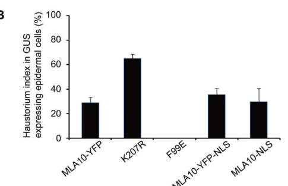

## Question

# Gene Research for Functional Annotation

## ⚠️ CRITICAL: Gene/Protein Identification Context

**BEFORE YOU BEGIN RESEARCH:** You MUST verify you are researching the CORRECT gene/protein. Gene symbols can be ambiguous, especially for less well-characterized genes from non-model organisms.

### Target Gene/Protein Identity (from UniProt):
- **UniProt Accession:** Q6WWJ4
- **Protein Description:** SubName: Full=MLA10 {ECO:0000313|EMBL:AAQ55541.1};
- **Gene Information:** Name=Mla10 {ECO:0000313|EMBL:AAQ55541.1};
- **Organism (full):** Hordeum vulgare (Barley).
- **Protein Family:** Belongs to the disease resistance NB-LRR family.
- **Key Domains:** Apaf_helical. (IPR042197); Disease_R_plants. (IPR044974); LRR_dom_sf. (IPR032675); LRR_R13L4/SHOC2-like. (IPR055414); NB-ARC. (IPR002182)

### MANDATORY VERIFICATION STEPS:

1. **Check if the gene symbol "Mla10" matches the protein description above**
2. **Verify the organism is correct:** Hordeum vulgare (Barley).
3. **Check if protein family/domains align with what you find in literature**
4. **If you find literature for a DIFFERENT gene with the same or similar symbol, STOP**

### If Gene Symbol is Ambiguous or You Cannot Find Relevant Literature:

**DO NOT PROCEED WITH RESEARCH ON A DIFFERENT GENE.** Instead:
- State clearly: "The gene symbol 'Mla10' is ambiguous or literature is limited for this specific protein"
- Explain what you found (e.g., "Found extensive literature on a different gene with the same symbol in a different organism")
- Describe the protein based ONLY on the UniProt information provided above
- Suggest that the protein function can be inferred from domain/family information

### Research Target:

Please provide a comprehensive research report on the gene **Mla10** (gene ID: MLA10, UniProt: Q6WWJ4) in HORVU.

The research report should be a detailed narrative explaining the function, biological processes, and localization of the gene product. Citations should be given for all claims.

You should prioritize authoritative reviews and primary scientific literature when conducting research. You can supplement
this with annotations you find in gene/protein databases, but these can be outdated or inaccurate.

We are specifically interested in the primary function of the gene - for enzymes, what reaction is catalyzed, and what is the substrate specificity? For transporters, what is the substrate? For structural proteins or adapters, what is the broader structural role? For signaling molecules, what is the role in the pathway.

We are interested in where in or outside the cell the gene product carries out its function.

We are also interested in the signaling or biochemical pathways in which the gene functions. We are less interested in broad pleiotropic effects, except where these elucidate the precise role.

Include evidence where possible. We are interested in both experimental evidence as well as inference from structure, evolution, or bioinformatic analysis. Precise studies should be prioritized over high-throughput, where available.

## Output

Question: You are an expert researcher providing comprehensive, well-cited information.

Provide detailed information focusing on:
1. Key concepts and definitions with current understanding
2. Recent developments and latest research (prioritize 2023-2024 sources)
3. Current applications and real-world implementations
4. Expert opinions and analysis from authoritative sources
5. Relevant statistics and data from recent studies

Format as a comprehensive research report with proper citations. Include URLs and publication dates where available.
Always prioritize recent, authoritative sources and provide specific citations for all major claims.

# Gene Research for Functional Annotation

## ⚠️ CRITICAL: Gene/Protein Identification Context

**BEFORE YOU BEGIN RESEARCH:** You MUST verify you are researching the CORRECT gene/protein. Gene symbols can be ambiguous, especially for less well-characterized genes from non-model organisms.

### Target Gene/Protein Identity (from UniProt):
- **UniProt Accession:** Q6WWJ4
- **Protein Description:** SubName: Full=MLA10 {ECO:0000313|EMBL:AAQ55541.1};
- **Gene Information:** Name=Mla10 {ECO:0000313|EMBL:AAQ55541.1};
- **Organism (full):** Hordeum vulgare (Barley).
- **Protein Family:** Belongs to the disease resistance NB-LRR family.
- **Key Domains:** Apaf_helical. (IPR042197); Disease_R_plants. (IPR044974); LRR_dom_sf. (IPR032675); LRR_R13L4/SHOC2-like. (IPR055414); NB-ARC. (IPR002182)

### MANDATORY VERIFICATION STEPS:

1. **Check if the gene symbol "Mla10" matches the protein description above**
2. **Verify the organism is correct:** Hordeum vulgare (Barley).
3. **Check if protein family/domains align with what you find in literature**
4. **If you find literature for a DIFFERENT gene with the same or similar symbol, STOP**

### If Gene Symbol is Ambiguous or You Cannot Find Relevant Literature:

**DO NOT PROCEED WITH RESEARCH ON A DIFFERENT GENE.** Instead:
- State clearly: "The gene symbol 'Mla10' is ambiguous or literature is limited for this specific protein"
- Explain what you found (e.g., "Found extensive literature on a different gene with the same symbol in a different organism")
- Describe the protein based ONLY on the UniProt information provided above
- Suggest that the protein function can be inferred from domain/family information

### Research Target:

Please provide a comprehensive research report on the gene **Mla10** (gene ID: MLA10, UniProt: Q6WWJ4) in HORVU.

The research report should be a detailed narrative explaining the function, biological processes, and localization of the gene product. Citations should be given for all claims.

You should prioritize authoritative reviews and primary scientific literature when conducting research. You can supplement
this with annotations you find in gene/protein databases, but these can be outdated or inaccurate.

We are specifically interested in the primary function of the gene - for enzymes, what reaction is catalyzed, and what is the substrate specificity? For transporters, what is the substrate? For structural proteins or adapters, what is the broader structural role? For signaling molecules, what is the role in the pathway.

We are interested in where in or outside the cell the gene product carries out its function.

We are also interested in the signaling or biochemical pathways in which the gene functions. We are less interested in broad pleiotropic effects, except where these elucidate the precise role.

Include evidence where possible. We are interested in both experimental evidence as well as inference from structure, evolution, or bioinformatic analysis. Precise studies should be prioritized over high-throughput, where available.

# Functional annotation of barley *Mla10* (MLA10; UniProt Q6WWJ4)

## Identity and principal function

The supplied UniProt record identifies **Q6WWJ4 as MLA10 from *Hordeum vulgare* (barley)**. Independent primary studies identify barley MLA10 as an intracellular **coiled-coil–NB-ARC–leucine-rich-repeat (CC-NLR) immune receptor** at *Mildew locus a*. This matches the supplied disease-resistance, NB-ARC, helical and LRR annotations; the publications examined did not independently print the accession Q6WWJ4. MLA10 must not be conflated with the distinct MLA22, MLA13 or MLA3 receptors. Its best-established function is **isolate-specific recognition of AVRA10**, an effector of the barley powdery mildew fungus *Blumeria graminis* f. sp. *hordei* (also called *Blumeria hordei*), followed by effector-triggered defense signaling. MLA10 is a **receptor and signaling protein, not a demonstrated enzyme or transporter**. (bauer2021theleucinerichrepeats pages 2-3, saur2019multiplepairsof pages 11-12, chang2013barleymlaimmune pages 1-2)

Its C-terminal LRR region is the principal experimentally mapped determinant of AVRA10 specificity; the central NB-ARC contains a functionally important nucleotide-binding P-loop, and the N-terminal CC domain participates in signaling and transcription-factor interactions. The P-loop mutant **K207R** impairs MLA10 activity, supporting a requirement for the nucleotide-binding machinery, but the cited work does not establish an MLA10-specific catalytic turnover rate or substrate specificity. Nor does an RNase-like *effector* fold make the MLA10 *receptor* an RNase. (bai2012structurefunctionanalysisof pages 6-8, bai2012structurefunctionanalysisof pages 1-2, bauer2021theleucinerichrepeats pages 13-16, bauer2021theleucinerichrepeats pages 9-11)

## Recognition mechanism and biological process

The experimentally supported pathway is **fungal AVRA10 perception → MLA10 activation → defense-gene regulation and inhibition of fungal establishment**, with a separable cell-death output. Saur and colleagues identified AVRA10 as an allele of the fungal candidate-secreted-effector gene **CSEP0141**. Matching MLA10–AVRA10 expression elicited cell death in *Nicotiana benthamiana*; corresponding barley-protoplast assays supported recognition, though their reporter effect was more modest. MLA22 instead responds to the related fungal allele AVRA22. Yeast interaction experiments, which contain no other plant proteins, and plant split-luciferase assays support a **direct receptor–effector association**; the MLA10–AVRA10 split-luciferase signal was approximately **3.5 times** that of tested nonrecognized effector variants. These assays establish specificity and association, not a purified-protein binding constant or an atomic MLA10–AVRA10 structure. The earlier proposed elicitor EKA_AVRA10 did **not** reproduce MLA10-dependent cell death in Saur and colleagues’ tests, making the validated CSEP0141 effector the appropriate basis for this annotation. (saur2019multiplepairsof pages 11-12, saur2019multiplepairsof pages 17-18, saur2019multiplepairsof pages 12-13, saur2019multiplepairsof pages 13-15)

LRR-swap experiments provide stronger mechanistic resolution. Exchanging the LRRs between MLA10 and MLA22 largely transferred their respective AVRA10/AVRA22 recognition preferences; the LRR regions differ at **58 amino-acid positions**. In barley protoplasts, **the chimeras**, not the wild-type receptors, reduced the cell-viability luciferase readout by approximately **80%** for MLA10 carrying the MLA22 LRR with AVRA22 and **40%** for MLA22 carrying the MLA10 LRR with AVRA10. Effector-swap experiments additionally implicated AVRA10 residues **D53, H64, F77 and W96** in MLA10-specific recognition. AVRA10 was predicted to have an RNase-like structural scaffold, but experimental assays found **no detectable RNase activity** for the tested effector; the fold prediction should not be mistaken for enzymatic activity or for a solved MLA10–AVRA10 complex. (bauer2021theleucinerichrepeats pages 19-21, bauer2021theleucinerichrepeats pages 9-11, bauer2021theleucinerichrepeats pages 13-16)

## Where MLA10 functions

Fluorescently tagged MLA10 occurs in **both the cytoplasm and nucleus of plant cells**; the studies place its relevant functions within barley leaf cells, particularly the epidermal cells challenged by powdery mildew, rather than in the extracellular space. Forced nuclear targeting retained resistance to an AVRA10-bearing fungus, while depletion of the nuclear pool compromised resistance. In one barley single-cell assay, the fungal **haustorium index**—the proportion of scored interactions in which the fungus established a haustorium—was approximately **29%** with MLA10-YFP, **35%** with nuclear-targeted MLA10-YFP-NLS, **30%** with MLA10-NLS and **65%** with the impaired K207R variant. A previously reported nuclear-export fusion had an index of approximately **52%**, similar to its empty-vector control. These observations support a **nuclear pool sufficient for MLA10-mediated resistance**; they do not pinpoint the compartment in which native AVRA10 first activates MLA10. (bai2012structurefunctionanalysisof pages 8-9, bai2012structurefunctionanalysisof pages 11-13, bai2012structurefunctionanalysisof media 417b22a6)

By contrast, nuclear targeting suppressed MLA10-induced cell death, whereas nuclear export enhanced it in transient-expression experiments; cytoplasmic-retention experiments further supported a cytoplasmic death-signaling output. Thus the authors’ interpretation is **compartment-dependent bifurcation: nuclear MLA10 promotes resistance signaling, whereas cytoplasmic MLA10 initiates or amplifies cell-death signaling**. Importantly, cell death is not synonymous with the resistance readout: a CC-domain **L18E** substitution reduced death signaling while full-length MLA10-L18E retained resistance. These conclusions are supported by manipulated localization and mixed barley/*Nicotiana* assays; they should not be recast as direct imaging of the precise activation site in naturally infected barley. (bai2012structurefunctionanalysisof pages 11-13, bai2012structurefunctionanalysisof pages 8-9)

## Downstream signaling and regulation

MLA10’s CC domain associates with barley **WRKY1 and WRKY2** transcription factors and with **MYB6**. MYB6 promotes defense-associated gene expression, while WRKY1 can associate with MYB6 and oppose its DNA binding. Chang and colleagues found that the MLA10 CC region disrupts the WRKY1–MYB6 interaction; an autoactive full-length MLA10 **D502V** variant strongly stimulated a MYB6-responsive reporter even when WRKY1 was present. Their model is that activated nuclear MLA10 **derepresses MYB6-dependent transcription**, linking effector recognition to resistance. The biochemical interactions and reporter effects were tested, whereas the exact sequence of all these events during native AVRA10 infection remains a mechanistic interpretation. MYB6 silencing also impaired MLA-associated resistance, although that particular numerical infection experiment used **MLA12**, not MLA10. (chang2013barleymlaimmune pages 3-5, chang2013barleymlaimmune pages 8-9, chang2013barleymlaimmune pages 1-2)

MLA10 signaling also depends on receptor state and cellular support proteins. Full-length P-loop **K207R** and mutations in conserved CC/NB-ARC motifs impaired experimental responses, while MHD-region substitutions were used to create autoactive receptors. In a heterologous cell-death assay, silencing **SGT1** eliminated MLA10-associated cell death, whereas silencing **RAR1** did not; separately, RAR1 was reported necessary for MLA10 disease resistance. Those output- and assay-specific findings are more informative than asserting a universal RAR1 requirement for every MLA10 activity. Small-RNA regulation is likewise allele-specific: overexpressed barley **miR9863** reduced MLA1-dependent resistance but did **not** detectably impair MLA10-dependent resistance or death under the tested conditions. In *Mla10* barley, the haustorium index remained approximately **6–7%** across the tested miR9863 constructs and control. (bai2012structurefunctionanalysisof pages 6-8, bai2012structurefunctionanalysisof pages 11-13, liu2014themir9863family pages 11-13)

The following table keeps the quantitative readouts and their experimental limits together. The plotted barley haustorium measurements were checked against the source figure; its nuclear-export value comes from an earlier experiment discussed in that paper, **not** from one of that figure’s plotted bars. (bai2012structurefunctionanalysisof pages 8-9, bai2012structurefunctionanalysisof media 417b22a6)

| Question | Strongest direct evidence | Important limit |
|---|---|---|
| Does MLA10 associate specifically with AVRA10? | **2019:** AVRA10–MLA10 produced **3.5-fold higher split-luciferase activity** than AVRA10-V/AVRA22-V or AVRA22 controls. Cognate association was also detected in yeast, where plant bridging proteins are absent. (saur2019multiplepairsof pages 12-13, saur2019multiplepairsof pages 13-15) | Split-LUC measures proximity or association rather than an equilibrium binding constant. Full-length proteins were not purified for an in-vitro binding assay. |
| Does the MLA10 LRR determine effector specificity? | **2021:** MLA10 and MLA22 LRRs differ at **58 amino acids**. In barley protoplasts, the **chimeric receptors** MLA10LRR22 with AVRA22 and MLA22LRR10 with AVRA10 reduced relative LUC activity by about **80%** and **40%**, respectively, consistent with transferred recognition specificity. (bauer2021theleucinerichrepeats pages 13-16) | These values concern **LRR-swap chimeras, not wild-type MLA10 or MLA22**. Reduced LUC is a proxy for cell death, not a direct fungal-growth measurement. |
| Where does MLA10 execute resistance and cell-death functions? | **2012:** In barley single-cell Bgh assays, haustorium indices were approximately **29%** for MLA10-YFP, **35%** for MLA10-YFP-NLS, **30%** for MLA10-NLS and **65%** for the inactive P-loop mutant K207R. A prior experiment reported approximately **52%** for nuclear-depleted MLA10-YFP-NES, similar to empty vector. Nuclear targeting retained resistance, whereas cytoplasmic enrichment enhanced cell death and nuclear targeting suppressed it. (bai2012structurefunctionanalysisof pages 8-9, bai2012structurefunctionanalysisof pages 11-13, bai2012structurefunctionanalysisof media 417b22a6) | NLS/NES tags and heterologous *Nicotiana benthamiana* cell-death assays may alter trafficking or activity. The evidence supports compartment-dependent output but does not establish where native MLA10 is first activated. |
| Does activated MLA10 regulate MYB6/WRKY1-dependent transcription? | **2013:** Autoactive MLA10(D502V) increased the MYB6 reporter to approximately **28 units** with MYB6 and approximately **24 units** with MYB6 plus WRKY1, supporting relief of WRKY1 repression. The MLA10 CC domain also disrupted the WRKY1–MYB6 complex in interaction assays. (chang2013barleymlaimmune pages 3-5, chang2013barleymlaimmune pages 8-9) | D502V is an artificial autoactive MHD mutant, and reporter assays used heterologous protoplast systems. The values do not directly quantify endogenous barley transcription after AVRA10 recognition. |
| Is MLA10 attenuated by miR9863? | **2014:** In Mla10 barley, MIR9863a/b/c left the Bgh haustorial index near the control at **about 6–7%**. By comparison, in Mla1 barley, MIR9863a or MIR9863b increased the index from **less than 3%** to approximately **22%** or **15%**, respectively. MLA10-triggered cell death was likewise unaffected. (liu2014themir9863family pages 11-13, liu2014themir9863family pages 1-2) | This demonstrates allele-specific non-targeting under the tested expression conditions, not that MLA10 lacks all post-transcriptional regulation or can never be affected by small RNAs. |

*Table: Direct experimental evidence for barley MLA10 recognition, domain specificity, compartment-dependent signaling, transcriptional output, and miRNA regulation. Chimeric-receptor results are explicitly distinguished from wild-type MLA10.*

## Recent research, practical relevance and remaining uncertainties

The **2023–2024 literature reinforces the importance of distinguishing *Mla* alleles**, rather than establishing a new MLA10-specific biochemical pathway. A 2023 study found that a virulent AVRA13 variant can bind **MLA13** yet prevent its activation; a 2024 study established **MLA3** recognition of the rice-blast effector Pwl2. Neither result demonstrates analogous AVRA10 interference or blast resistance for MLA10. Likewise, a 2021 transgenic study demonstrated wheat-stripe-rust resistance for **MLA8**, not MLA10. A 2025 cryo-EM study resolved an **MLA13–AVRA13** receptor–effector complex and suggested structural principles for this receptor family, but its stoichiometry, interface and any proposed channel mechanism cannot be assigned to MLA10 without MLA10-specific experiments. No solved MLA10–AVRA10 complex or demonstrated MLA10 ion-channel activity was established by the sources examined. (crean2023adominantnegativeavirulence pages 1-2, brabham2024barleymla3recognizes pages 1-2, bettgenhaeuser2021thebarleyimmune pages 5-6, lawson2025thebarleymla13avra13 pages 2-4, lawson2025thebarleymla13avra13 pages 5-6)

**Agricultural use is best framed as genotype- and pathogen-informed resistance selection.** *Mla* alleles have been incorporated into barley resistance germplasm, and the established MLA10–AVRA10 specificity offers a molecular basis for screening host alleles alongside fungal effector variants. However, resistance is **isolate-specific**: the AVRA10/AVRA22 locus has divergent pathogen haplotypes, and small effector changes can escape recognition. In the 2019 survey, **10 of 13** newly examined local fungal isolates had distinct virulence/avirulence profiles, illustrating why an MLA10 genotype alone cannot guarantee resistance across pathogen populations. The retrieved experiments support molecular recognition and controlled infection assays; they do **not** establish current field prevalence of effective MLA10 resistance, a yield benefit, or durability of a particular MLA10 cultivar. (saur2019multiplepairsof pages 17-18, saur2019multiplepairsof pages 3-4, bauer2021theleucinerichrepeats pages 23-25)

**Annotation conclusion.** MLA10 is a nucleocytoplasmic, AVRA10-specific barley CC-NLR whose LRR region governs fungal-effector discrimination, whose CC/NB-ARC regions support immune signaling, and whose nuclear activity is sufficient for experimentally measured powdery-mildew resistance. Cytoplasmic cell-death signaling is a distinct, experimentally separable output. The principal unresolved questions are the native site and structural sequence of receptor activation and the molecular nature of any MLA10 signaling assembly. (bai2012structurefunctionanalysisof pages 8-9, bai2012structurefunctionanalysisof pages 11-13, bauer2021theleucinerichrepeats pages 13-16, lawson2025thebarleymla13avra13 pages 2-4)

### Principal sources and publication dates

- Bai *et al.* **June 2012**, *PLOS Pathogens*: MLA10 localization, motif mutants, disease resistance and cell death. https://doi.org/10.1371/journal.ppat.1002752 (bai2012structurefunctionanalysisof pages 8-9, bai2012structurefunctionanalysisof pages 11-13)
- Chang *et al.* **March 2013**, *The Plant Cell*: MLA-associated WRKY1–MYB6 transcriptional mechanism. https://doi.org/10.1105/tpc.113.109942 (chang2013barleymlaimmune pages 3-5, chang2013barleymlaimmune pages 8-9)
- Liu *et al.* **December 2014**, *PLOS Genetics*: miR9863 regulation distinguishing MLA1 from MLA10. https://doi.org/10.1371/journal.pgen.1004755 (liu2014themir9863family pages 11-13)
- Saur *et al.* **February 2019**, *eLife*: identification of AVRA10 and matching MLA10 association. https://doi.org/10.7554/eLife.44471 (saur2019multiplepairsof pages 11-12, saur2019multiplepairsof pages 12-13)
- Bauer *et al.* **February 2021**, *PLOS Pathogens*: MLA10/MLA22 LRR swaps and effector-specificity determinants. https://doi.org/10.1371/journal.ppat.1009223 (bauer2021theleucinerichrepeats pages 19-21, bauer2021theleucinerichrepeats pages 13-16)
- Crean *et al.* **July 2023**, *Journal of Experimental Botany*: dominant-negative effector mechanism in **MLA13**, included only as context. https://doi.org/10.1093/jxb/erad285 (crean2023adominantnegativeavirulence pages 1-2)
- Brabham *et al.* **2024 volume; DOI article first retrieved as October 2023**, *The Plant Cell*: blast-effector recognition by **MLA3**, not MLA10. https://doi.org/10.1093/plcell/koad266 (brabham2024barleymla3recognizes pages 1-2)
- Lawson *et al.* **February 2025**, *The EMBO Journal*: structure of the **MLA13–AVRA13** complex, not MLA10–AVRA10. https://doi.org/10.1038/s44318-025-00373-9 (lawson2025thebarleymla13avra13 pages 2-4)

References

1. (bauer2021theleucinerichrepeats pages 2-3): Saskia Bauer, Dongli Yu, Aaron W. Lawson, Isabel M. L. Saur, Lamprinos Frantzeskakis, Barbara Kracher, Elke Logemann, Jijie Chai, Takaki Maekawa, and Paul Schulze-Lefert. The leucine-rich repeats in allelic barley mla immune receptors define specificity towards sequence-unrelated powdery mildew avirulence effectors with a predicted common rnase-like fold. PLOS Pathogens, 17:e1009223, Feb 2021. URL: https://doi.org/10.1371/journal.ppat.1009223, doi:10.1371/journal.ppat.1009223. This article has 85 citations and is from a highest quality peer-reviewed journal.

2. (saur2019multiplepairsof pages 11-12): Isabel ML Saur, Saskia Bauer, Barbara Kracher, Xunli Lu, Lamprinos Franzeskakis, Marion C Müller, Björn Sabelleck, Florian Kümmel, Ralph Panstruga, Takaki Maekawa, and Paul Schulze-Lefert. Multiple pairs of allelic mla immune receptor-powdery mildew avra effectors argue for a direct recognition mechanism. eLife, Feb 2019. URL: https://doi.org/10.7554/elife.44471, doi:10.7554/elife.44471. This article has 166 citations and is from a domain leading peer-reviewed journal.

3. (chang2013barleymlaimmune pages 1-2): Cheng Chang, Deshui Yu, Jian Jiao, Shaojuan Jing, Paul Schulze-Lefert, and Qian-Hua Shen. Barley mla immune receptors directly interfere with antagonistically acting transcription factors to initiate disease resistance signaling. The Plant Cell, 25:1158-1173, Mar 2013. URL: https://doi.org/10.1105/tpc.113.109942, doi:10.1105/tpc.113.109942. This article has 205 citations.

4. (bai2012structurefunctionanalysisof pages 6-8): Shiwei Bai, Jie Liu, Cheng Chang, Ling Zhang, Takaki Maekawa, Qiuyun Wang, Wenkai Xiao, Yule Liu, Jijie Chai, Frank L. W. Takken, Paul Schulze-Lefert, and Qian-Hua Shen. Structure-function analysis of barley nlr immune receptor mla10 reveals its cell compartment specific activity in cell death and disease resistance. PLoS Pathogens, 8:e1002752, Jun 2012. URL: https://doi.org/10.1371/journal.ppat.1002752, doi:10.1371/journal.ppat.1002752. This article has 315 citations and is from a highest quality peer-reviewed journal.

5. (bai2012structurefunctionanalysisof pages 1-2): Shiwei Bai, Jie Liu, Cheng Chang, Ling Zhang, Takaki Maekawa, Qiuyun Wang, Wenkai Xiao, Yule Liu, Jijie Chai, Frank L. W. Takken, Paul Schulze-Lefert, and Qian-Hua Shen. Structure-function analysis of barley nlr immune receptor mla10 reveals its cell compartment specific activity in cell death and disease resistance. PLoS Pathogens, 8:e1002752, Jun 2012. URL: https://doi.org/10.1371/journal.ppat.1002752, doi:10.1371/journal.ppat.1002752. This article has 315 citations and is from a highest quality peer-reviewed journal.

6. (bauer2021theleucinerichrepeats pages 13-16): Saskia Bauer, Dongli Yu, Aaron W. Lawson, Isabel M. L. Saur, Lamprinos Frantzeskakis, Barbara Kracher, Elke Logemann, Jijie Chai, Takaki Maekawa, and Paul Schulze-Lefert. The leucine-rich repeats in allelic barley mla immune receptors define specificity towards sequence-unrelated powdery mildew avirulence effectors with a predicted common rnase-like fold. PLOS Pathogens, 17:e1009223, Feb 2021. URL: https://doi.org/10.1371/journal.ppat.1009223, doi:10.1371/journal.ppat.1009223. This article has 85 citations and is from a highest quality peer-reviewed journal.

7. (bauer2021theleucinerichrepeats pages 9-11): Saskia Bauer, Dongli Yu, Aaron W. Lawson, Isabel M. L. Saur, Lamprinos Frantzeskakis, Barbara Kracher, Elke Logemann, Jijie Chai, Takaki Maekawa, and Paul Schulze-Lefert. The leucine-rich repeats in allelic barley mla immune receptors define specificity towards sequence-unrelated powdery mildew avirulence effectors with a predicted common rnase-like fold. PLOS Pathogens, 17:e1009223, Feb 2021. URL: https://doi.org/10.1371/journal.ppat.1009223, doi:10.1371/journal.ppat.1009223. This article has 85 citations and is from a highest quality peer-reviewed journal.

8. (saur2019multiplepairsof pages 17-18): Isabel ML Saur, Saskia Bauer, Barbara Kracher, Xunli Lu, Lamprinos Franzeskakis, Marion C Müller, Björn Sabelleck, Florian Kümmel, Ralph Panstruga, Takaki Maekawa, and Paul Schulze-Lefert. Multiple pairs of allelic mla immune receptor-powdery mildew avra effectors argue for a direct recognition mechanism. eLife, Feb 2019. URL: https://doi.org/10.7554/elife.44471, doi:10.7554/elife.44471. This article has 166 citations and is from a domain leading peer-reviewed journal.

9. (saur2019multiplepairsof pages 12-13): Isabel ML Saur, Saskia Bauer, Barbara Kracher, Xunli Lu, Lamprinos Franzeskakis, Marion C Müller, Björn Sabelleck, Florian Kümmel, Ralph Panstruga, Takaki Maekawa, and Paul Schulze-Lefert. Multiple pairs of allelic mla immune receptor-powdery mildew avra effectors argue for a direct recognition mechanism. eLife, Feb 2019. URL: https://doi.org/10.7554/elife.44471, doi:10.7554/elife.44471. This article has 166 citations and is from a domain leading peer-reviewed journal.

10. (saur2019multiplepairsof pages 13-15): Isabel ML Saur, Saskia Bauer, Barbara Kracher, Xunli Lu, Lamprinos Franzeskakis, Marion C Müller, Björn Sabelleck, Florian Kümmel, Ralph Panstruga, Takaki Maekawa, and Paul Schulze-Lefert. Multiple pairs of allelic mla immune receptor-powdery mildew avra effectors argue for a direct recognition mechanism. eLife, Feb 2019. URL: https://doi.org/10.7554/elife.44471, doi:10.7554/elife.44471. This article has 166 citations and is from a domain leading peer-reviewed journal.

11. (bauer2021theleucinerichrepeats pages 19-21): Saskia Bauer, Dongli Yu, Aaron W. Lawson, Isabel M. L. Saur, Lamprinos Frantzeskakis, Barbara Kracher, Elke Logemann, Jijie Chai, Takaki Maekawa, and Paul Schulze-Lefert. The leucine-rich repeats in allelic barley mla immune receptors define specificity towards sequence-unrelated powdery mildew avirulence effectors with a predicted common rnase-like fold. PLOS Pathogens, 17:e1009223, Feb 2021. URL: https://doi.org/10.1371/journal.ppat.1009223, doi:10.1371/journal.ppat.1009223. This article has 85 citations and is from a highest quality peer-reviewed journal.

12. (bai2012structurefunctionanalysisof pages 8-9): Shiwei Bai, Jie Liu, Cheng Chang, Ling Zhang, Takaki Maekawa, Qiuyun Wang, Wenkai Xiao, Yule Liu, Jijie Chai, Frank L. W. Takken, Paul Schulze-Lefert, and Qian-Hua Shen. Structure-function analysis of barley nlr immune receptor mla10 reveals its cell compartment specific activity in cell death and disease resistance. PLoS Pathogens, 8:e1002752, Jun 2012. URL: https://doi.org/10.1371/journal.ppat.1002752, doi:10.1371/journal.ppat.1002752. This article has 315 citations and is from a highest quality peer-reviewed journal.

13. (bai2012structurefunctionanalysisof pages 11-13): Shiwei Bai, Jie Liu, Cheng Chang, Ling Zhang, Takaki Maekawa, Qiuyun Wang, Wenkai Xiao, Yule Liu, Jijie Chai, Frank L. W. Takken, Paul Schulze-Lefert, and Qian-Hua Shen. Structure-function analysis of barley nlr immune receptor mla10 reveals its cell compartment specific activity in cell death and disease resistance. PLoS Pathogens, 8:e1002752, Jun 2012. URL: https://doi.org/10.1371/journal.ppat.1002752, doi:10.1371/journal.ppat.1002752. This article has 315 citations and is from a highest quality peer-reviewed journal.

14. (bai2012structurefunctionanalysisof media 417b22a6): Shiwei Bai, Jie Liu, Cheng Chang, Ling Zhang, Takaki Maekawa, Qiuyun Wang, Wenkai Xiao, Yule Liu, Jijie Chai, Frank L. W. Takken, Paul Schulze-Lefert, and Qian-Hua Shen. Structure-function analysis of barley nlr immune receptor mla10 reveals its cell compartment specific activity in cell death and disease resistance. PLoS Pathogens, 8:e1002752, Jun 2012. URL: https://doi.org/10.1371/journal.ppat.1002752, doi:10.1371/journal.ppat.1002752. This article has 315 citations and is from a highest quality peer-reviewed journal.

15. (chang2013barleymlaimmune pages 3-5): Cheng Chang, Deshui Yu, Jian Jiao, Shaojuan Jing, Paul Schulze-Lefert, and Qian-Hua Shen. Barley mla immune receptors directly interfere with antagonistically acting transcription factors to initiate disease resistance signaling. The Plant Cell, 25:1158-1173, Mar 2013. URL: https://doi.org/10.1105/tpc.113.109942, doi:10.1105/tpc.113.109942. This article has 205 citations.

16. (chang2013barleymlaimmune pages 8-9): Cheng Chang, Deshui Yu, Jian Jiao, Shaojuan Jing, Paul Schulze-Lefert, and Qian-Hua Shen. Barley mla immune receptors directly interfere with antagonistically acting transcription factors to initiate disease resistance signaling. The Plant Cell, 25:1158-1173, Mar 2013. URL: https://doi.org/10.1105/tpc.113.109942, doi:10.1105/tpc.113.109942. This article has 205 citations.

17. (liu2014themir9863family pages 11-13): Jie Liu, Xiliu Cheng, Da Liu, Weihui Xu, Roger Wise, and Qian-Hua Shen. The mir9863 family regulates distinct mla alleles in barley to attenuate nlr receptor-triggered disease resistance and cell-death signaling. PLoS Genetics, 10:e1004755, Dec 2014. URL: https://doi.org/10.1371/journal.pgen.1004755, doi:10.1371/journal.pgen.1004755. This article has 151 citations and is from a domain leading peer-reviewed journal.

18. (liu2014themir9863family pages 1-2): Jie Liu, Xiliu Cheng, Da Liu, Weihui Xu, Roger Wise, and Qian-Hua Shen. The mir9863 family regulates distinct mla alleles in barley to attenuate nlr receptor-triggered disease resistance and cell-death signaling. PLoS Genetics, 10:e1004755, Dec 2014. URL: https://doi.org/10.1371/journal.pgen.1004755, doi:10.1371/journal.pgen.1004755. This article has 151 citations and is from a domain leading peer-reviewed journal.

19. (crean2023adominantnegativeavirulence pages 1-2): Emma E Crean, Merle Bilstein-Schloemer, Takaki Maekawa, Paul Schulze-Lefert, and Isabel M L Saur. A dominant-negative avirulence effector of the barley powdery mildew fungus provides mechanistic insight into barley mla immune receptor activation. Journal of Experimental Botany, 74:5854-5869, Jul 2023. URL: https://doi.org/10.1093/jxb/erad285, doi:10.1093/jxb/erad285. This article has 10 citations and is from a domain leading peer-reviewed journal.

20. (brabham2024barleymla3recognizes pages 1-2): Helen J Brabham, Diana Gómez De La Cruz, Vincent Were, Motoki Shimizu, Hiromasa Saitoh, Inmaculada Hernández-Pinzón, Phon Green, Jennifer Lorang, Koki Fujisaki, Kazuhiro Sato, István Molnár, Hana Šimková, Jaroslav Doležel, James Russell, Jodie Taylor, Matthew Smoker, Yogesh Kumar Gupta, Tom Wolpert, Nicholas J Talbot, Ryohei Terauchi, and Matthew J Moscou. Barley mla3 recognizes the host-specificity effector pwl2 from magnaporthe oryzae. The Plant cell, 36:447-470, Oct 2024. URL: https://doi.org/10.1093/plcell/koad266, doi:10.1093/plcell/koad266. This article has 56 citations.

21. (bettgenhaeuser2021thebarleyimmune pages 5-6): Jan Bettgenhaeuser, Inmaculada Hernández-Pinzón, Andrew M Dawson, Matthew Gardiner, Phon Green, Jodie Taylor, Matthew Smoker, John N Ferguson, Peter Emmrich, Amelia Hubbard, Rosemary Bayles, Robbie Waugh, Brian J Steffenson, Brande BH Wulff, Antonín Dreiseitl, Eric R Ward, and Matthew J Moscou. The barley immune receptor mla recognizes multiple pathogens and contributes to host range dynamics. JournalArticle, Jan 2021. URL: https://doi.org/10.17863/cam.80898, doi:10.17863/cam.80898. This article has 75 citations.

22. (lawson2025thebarleymla13avra13 pages 2-4): Aaron W Lawson, Andrea Flores-Ibarra, Yu Cao, Chunpeng An, Ulla Neumann, Monika Gunkel, Isabel M L Saur, Jijie Chai, Elmar Behrmann, and Paul Schulze-Lefert. The barley mla13-avra13 heterodimer reveals principles for immunoreceptor recognition of rnase-like powdery mildew effectors. The EMBO Journal, Feb 2025. URL: https://doi.org/10.1038/s44318-025-00373-9, doi:10.1038/s44318-025-00373-9. This article has 32 citations.

23. (lawson2025thebarleymla13avra13 pages 5-6): Aaron W Lawson, Andrea Flores-Ibarra, Yu Cao, Chunpeng An, Ulla Neumann, Monika Gunkel, Isabel M L Saur, Jijie Chai, Elmar Behrmann, and Paul Schulze-Lefert. The barley mla13-avra13 heterodimer reveals principles for immunoreceptor recognition of rnase-like powdery mildew effectors. The EMBO Journal, Feb 2025. URL: https://doi.org/10.1038/s44318-025-00373-9, doi:10.1038/s44318-025-00373-9. This article has 32 citations.

24. (saur2019multiplepairsof pages 3-4): Isabel ML Saur, Saskia Bauer, Barbara Kracher, Xunli Lu, Lamprinos Franzeskakis, Marion C Müller, Björn Sabelleck, Florian Kümmel, Ralph Panstruga, Takaki Maekawa, and Paul Schulze-Lefert. Multiple pairs of allelic mla immune receptor-powdery mildew avra effectors argue for a direct recognition mechanism. eLife, Feb 2019. URL: https://doi.org/10.7554/elife.44471, doi:10.7554/elife.44471. This article has 166 citations and is from a domain leading peer-reviewed journal.

25. (bauer2021theleucinerichrepeats pages 23-25): Saskia Bauer, Dongli Yu, Aaron W. Lawson, Isabel M. L. Saur, Lamprinos Frantzeskakis, Barbara Kracher, Elke Logemann, Jijie Chai, Takaki Maekawa, and Paul Schulze-Lefert. The leucine-rich repeats in allelic barley mla immune receptors define specificity towards sequence-unrelated powdery mildew avirulence effectors with a predicted common rnase-like fold. PLOS Pathogens, 17:e1009223, Feb 2021. URL: https://doi.org/10.1371/journal.ppat.1009223, doi:10.1371/journal.ppat.1009223. This article has 85 citations and is from a highest quality peer-reviewed journal.

## Artifacts

- [Edison artifact artifact-00](MLA10-deep-research-falcon_artifacts/artifact-00.md)

## Citations

1. bauer2021theleucinerichrepeats pages 13-16
2. crean2023adominantnegativeavirulence pages 1-2
3. bauer2021theleucinerichrepeats pages 2-3
4. saur2019multiplepairsof pages 11-12
5. chang2013barleymlaimmune pages 1-2
6. bai2012structurefunctionanalysisof pages 6-8
7. bai2012structurefunctionanalysisof pages 1-2
8. bauer2021theleucinerichrepeats pages 9-11
9. saur2019multiplepairsof pages 17-18
10. saur2019multiplepairsof pages 12-13
11. saur2019multiplepairsof pages 13-15
12. bauer2021theleucinerichrepeats pages 19-21
13. bai2012structurefunctionanalysisof pages 8-9
14. bai2012structurefunctionanalysisof pages 11-13
15. chang2013barleymlaimmune pages 3-5
16. chang2013barleymlaimmune pages 8-9
17. bettgenhaeuser2021thebarleyimmune pages 5-6
18. saur2019multiplepairsof pages 3-4
19. bauer2021theleucinerichrepeats pages 23-25
20. https://doi.org/10.1371/journal.ppat.1002752
21. https://doi.org/10.1105/tpc.113.109942
22. https://doi.org/10.1371/journal.pgen.1004755
23. https://doi.org/10.7554/eLife.44471
24. https://doi.org/10.1371/journal.ppat.1009223
25. https://doi.org/10.1093/jxb/erad285
26. https://doi.org/10.1093/plcell/koad266
27. https://doi.org/10.1038/s44318-025-00373-9
28. https://doi.org/10.1371/journal.ppat.1009223,
29. https://doi.org/10.7554/elife.44471,
30. https://doi.org/10.1105/tpc.113.109942,
31. https://doi.org/10.1371/journal.ppat.1002752,
32. https://doi.org/10.1371/journal.pgen.1004755,
33. https://doi.org/10.1093/jxb/erad285,
34. https://doi.org/10.1093/plcell/koad266,
35. https://doi.org/10.17863/cam.80898,
36. https://doi.org/10.1038/s44318-025-00373-9,