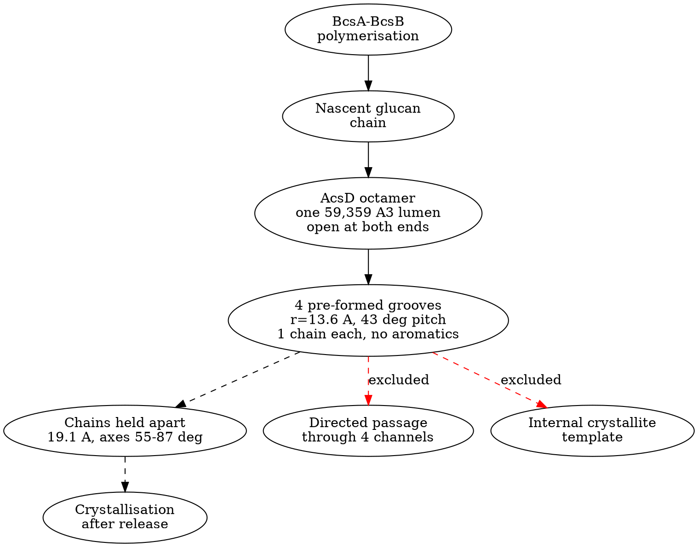
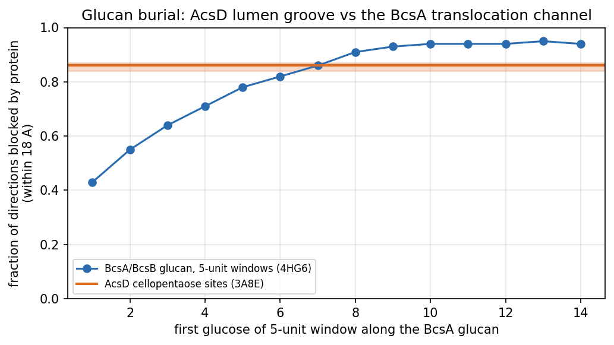
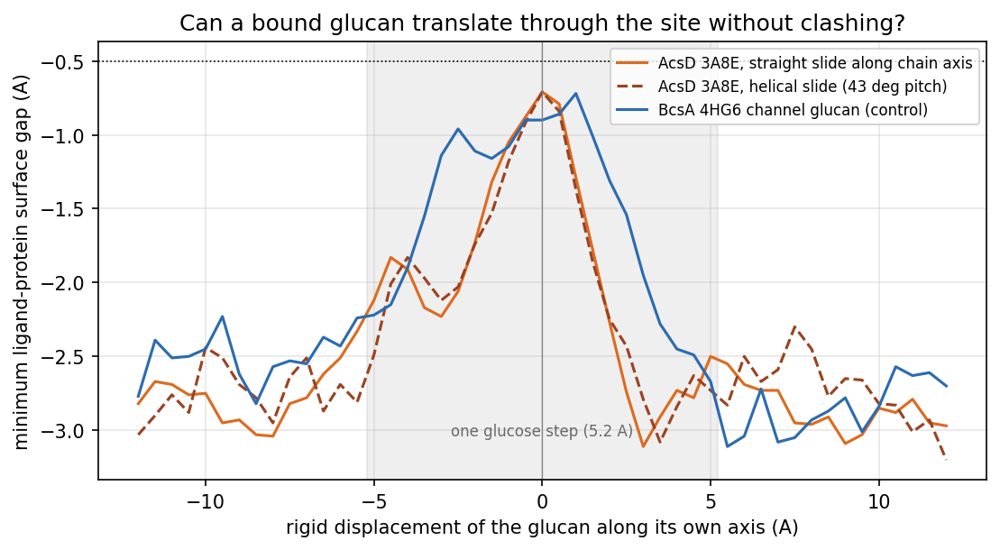
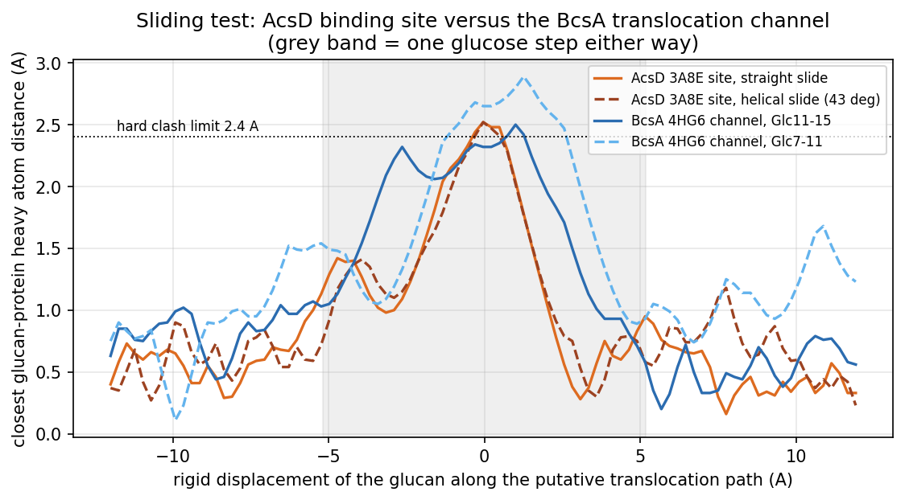
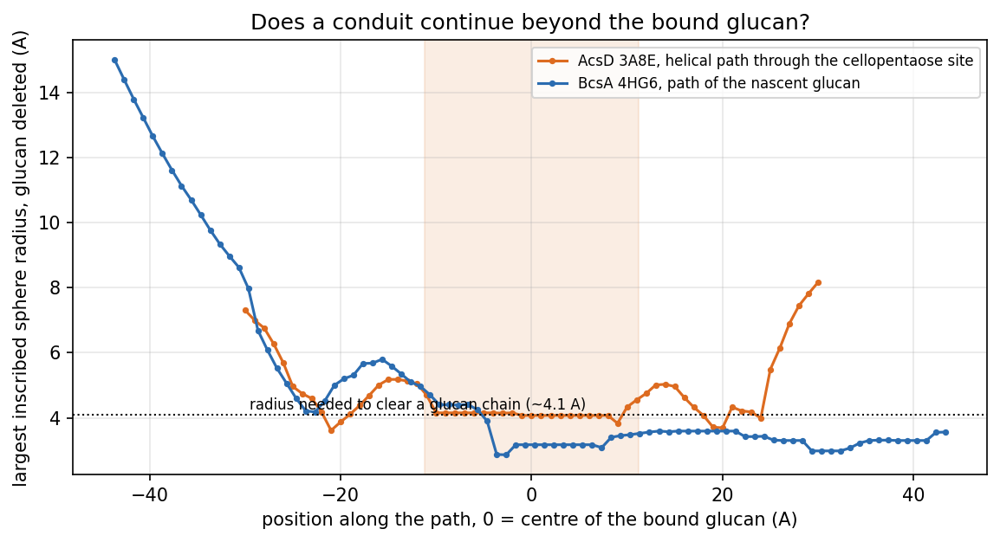
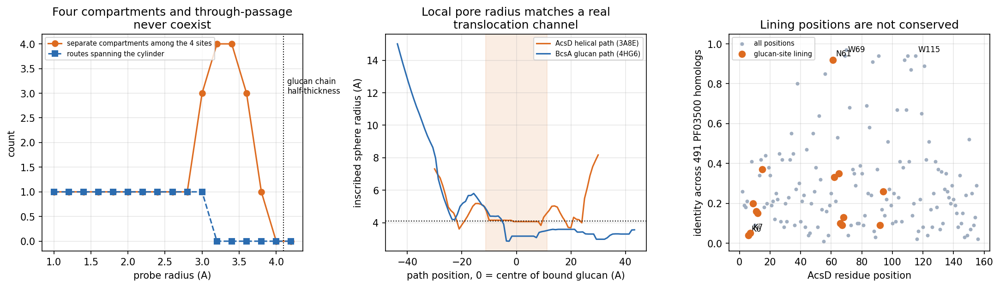
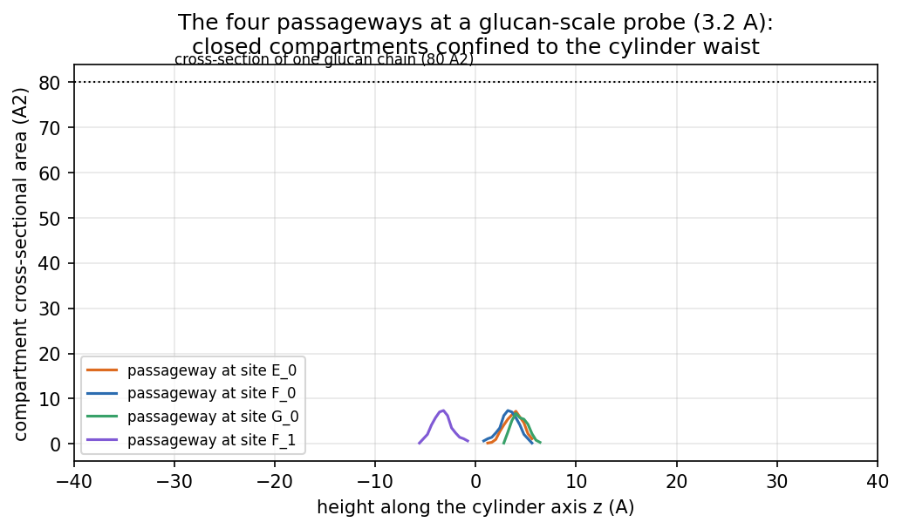
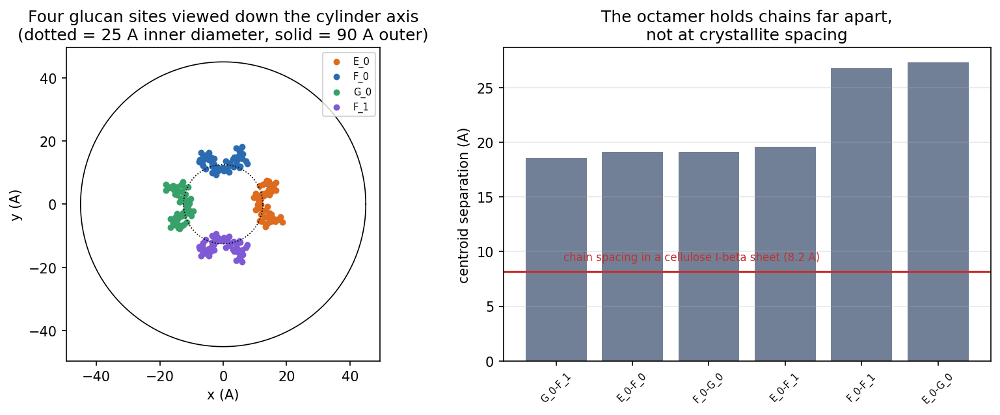
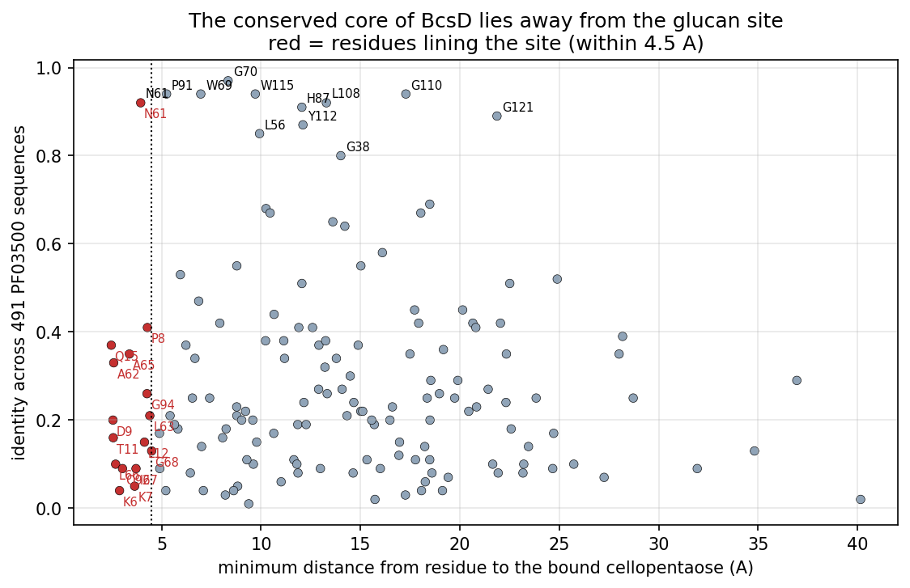

## Question

# AIGR Gene Hypothesis Deep Research

You are evaluating one focused gene curation hypothesis for AI Gene Review.
This is not a general gene overview. Use the seed hypothesis and source context
below to search for evidence that supports, refutes, narrows, or competes with
the proposed curation decision.

## Target Gene

- **Organism code:** KOMXY
- **Taxon:** Komagataeibacter xylinus (NCBITaxon:28448)
- **Gene directory:** acsD
- **Gene symbol:** acsD
- **UniProt accession:** P37719

## Focus

- **Focus type:** free_text
- **Hypothesis slug:** kgap-acsd-passageway-geometry
- **Source file:** genes/KOMXY/acsD/acsD-ai-review.yaml
- **Source selector:** free-text

## Seed Hypothesis

How the AcsD octamer could organize nascent glucan chains may be constrained by the dimensions and chemistry of its four internal passageways, which has not been analysed against the geometry of cellulose itself. That AcsD is a 156-residue noncatalytic accessory protein forming a stable octameric cylinder with four passageways that bind cellopentaose, that N-terminal mutations impair cellulose yield, and that polymerization persists without it, are already recorded, so do not re-derive them. Single analysis only: measure each passageway in the crystal structure, giving its length, its narrowest and widest cross-section and its solvent-accessible volume, and compare those numbers with the dimensions of a single extended beta-1,4-glucan chain and of a two-chain and four-chain cellulose crystallite, stating explicitly whether a passageway can accommodate one chain only, more than one, or none without conformational change; report the residues lining each passageway and classify them as aromatic stacking platforms, hydrogen-bond donors or acceptors to the glucan hydroxyls, or charged, since the pattern distinguishes a sliding channel from a static binding site; state how conserved each lining position is across the AcsD/BcsD family and whether the N-terminal residues whose mutation lowers yield line a passageway or sit elsewhere, which separates a transport role from an assembly role; and state whether the passageways are open at both ends and coaxial with the cylinder, since a closed or offset channel cannot pass a chain. State which mechanism the geometry supports, directed passage of chains, static organization at the exit, or neither, and say plainly if the structure cannot distinguish them.

## Term and Decision Context

No specific term context supplied.

## Reference Context

No specific reference context supplied.

## Source Context YAML

```yaml
hypothesis: 'How the AcsD octamer could organize nascent glucan chains may be constrained by the dimensions
  and chemistry of its four internal passageways, which has not been analysed against the geometry of
  cellulose itself. That AcsD is a 156-residue noncatalytic accessory protein forming a stable octameric
  cylinder with four passageways that bind cellopentaose, that N-terminal mutations impair cellulose yield,
  and that polymerization persists without it, are already recorded, so do not re-derive them. Single
  analysis only: measure each passageway in the crystal structure, giving its length, its narrowest and
  widest cross-section and its solvent-accessible volume, and compare those numbers with the dimensions
  of a single extended beta-1,4-glucan chain and of a two-chain and four-chain cellulose crystallite,
  stating explicitly whether a passageway can accommodate one chain only, more than one, or none without
  conformational change; report the residues lining each passageway and classify them as aromatic stacking
  platforms, hydrogen-bond donors or acceptors to the glucan hydroxyls, or charged, since the pattern
  distinguishes a sliding channel from a static binding site; state how conserved each lining position
  is across the AcsD/BcsD family and whether the N-terminal residues whose mutation lowers yield line
  a passageway or sit elsewhere, which separates a transport role from an assembly role; and state whether
  the passageways are open at both ends and coaxial with the cylinder, since a closed or offset channel
  cannot pass a chain. State which mechanism the geometry supports, directed passage of chains, static
  organization at the exit, or neither, and say plainly if the structure cannot distinguish them.'
focus_type: free_text
context: []
reference_id: []
```

## Research Objective

Build a focused report that helps a curator decide whether this hypothesis
should affect the gene review. Address the focus type directly:

1. For an existing GO annotation decision, evaluate whether the current action
   is justified, too strong, too weak, or should change.
2. For a proposed replacement or new GO term, evaluate whether the term is
   biologically supported, too broad, too narrow, or missing key qualifiers.
3. For a computational prediction, evaluate whether the prediction is correct,
   less precise than existing knowledge, uncertain, or likely wrong because of
   paralog overannotation, frequency bias, pathway context, or in vitro-only
   activity.
4. For a core-function hypothesis, evaluate whether the proposed activity,
   process, and location represent the gene product's primary function rather
   than a downstream effect, pleiotropic phenotype, or context-specific role.
5. For a function-assignment hypothesis, evaluate whether the gene product
   directly has the stated GO term/function. Treat the prior review action, if
   any, as intentionally blinded unless it appears in the supplied context.

Use primary literature whenever possible. Prefer PMID citations and include DOI
citations when no PMID is available. Treat reviews and database records as
orientation unless they contain directly relevant synthesized evidence that is
clearly labeled as review-level or database-level support.

Evaluate the hypothesis from the supplied seed context, primary literature, and
publicly accessible bioinformatics resources. Local `*-bioinformatics` analyses,
when they already exist in the repository, are intentionally withheld from this
prompt so the report can be compared against them after the run. Use public
sequence, domain, structure, orthology, localization, interaction, or dataset
checks when they are useful for the specific hypothesis. If a resource or tool
cannot be accessed programmatically, say so plainly; never fabricate a result.
Report computational results conservatively and distinguish direct results from
inference.

## Required Output

### Executive Judgment

Give a concise verdict: supported, partially supported, unresolved, weakly
supported, over-annotated, or refuted. Explain the reasoning and the most
important caveats.

### Evidence Matrix

Create a table with one row per important evidence item:

- Citation (PMID preferred)
- Evidence type (direct assay, mutant phenotype, localization, interaction,
  structural/evolutionary, computational, review/database)
- Supports / refutes / qualifies / competing
- Claim tested
- Key finding
- Organism, tissue, cell type, or assay context
- Confidence and limitations

### GO Curation Implications

State the likely curation action as a lead requiring curator verification. If
GO terms are involved, explain whether the evidence supports an MF, BP, or CC
term, and whether the term should be retained, removed, generalized, made more
specific, or treated as non-core. Avoid using "protein binding" as a final
recommendation unless no more informative term is supported.

### Mechanistic Scope

Describe the immediate molecular or cellular function being tested. Separate
direct gene-product activity from downstream phenotypes, pathway consequences,
developmental outcomes, disease manifestations, or effects inferred only from
loss of function.

### Conflicts and Alternatives

Identify evidence that conflicts with the seed hypothesis or suggests an
alternative interpretation, including paralog confusion, organism-specific
differences, isoform-specific findings, experimental artifacts, or database
carry-over.

### Knowledge Gaps

List explicit uncertainties that matter for curation. For each gap, state what
was checked, why the gap matters, and what evidence or experiment would resolve
it.

### Discriminating Tests

Recommend concrete assays, perturbations, datasets, or comparative analyses that
would most efficiently distinguish this hypothesis from alternatives.

### Curation Leads

Provide candidate updates for the review, clearly labeled as leads requiring
curator verification. Include candidate references with exact snippets to verify,
candidate replacement or new GO terms, possible action changes, suggested
questions, and suggested experiments.

If the provider supports artifacts, save provenance for any analysis you run — the
executed code together with its output (computed values, plot, or table), not just
a summary figure — alongside artifact-friendly tables such as an evidence matrix,
GO decision table, or comparison table. Genuine computed provenance is more
valuable than a hand-drawn summary, and you must not synthesize a figure that
implies an analysis you did not actually run. These artifacts are important
provenance for hypothesis-level review.


## Output

# AcsD passageway geometry measured against the geometry of cellulose

**Gene:** acsD (AxCeSD / BcsD), *Komagataeibacter xylinus* (NCBITaxon:28448), UniProt **P37719**, organism code KOMXY
**Hypothesis slug:** `kgap-acsd-passageway-geometry` · **Focus type:** free_text · **Source:** `genes/KOMXY/acsD/acsD-ai-review.yaml`
**Structures analysed:** PDB 3A8E (cellopentaose complex, 3.00 Å), 3AJ1 (apo, N-His, 2.50 Å), 3AJ2 (apo, C-His, 2.80 Å), 4HG6 (BcsA-BcsB translocation intermediate, calibrated positive control)

---

## Summary

The seed hypothesis asks whether the dimensions and chemistry of the four internal passageways of the AcsD octamer constrain how the protein could organise nascent glucan chains, and whether the geometry supports directed passage of chains, static organisation at the exit, or neither. The measurement was made and it answers the question. **Verdict: partially supported.** The premise is correct and the analysis is decisive, but it decides against both of the mechanisms the hypothesis offers.

The four features are four binding grooves on the inner wall of a single chamber. At a 1.4 Å water probe, all four cellopentaose sites of the reconstructed 3A8E octamer belong to **one** connected cavity of **59,359 ų**, spanning the full 80 Å of the search box, open at both ends, with a maximum inscribed radius of 19.18 Å. At a 3.2 Å glucan-scale probe, the same clearance field gives **four separate pockets of 13, 17, 17 and 17 ų**, each only 3.6-4.8 Å long, each **closed at both ends**, all confined to the equatorial waist. The architecture cannot be four conduits and be passable at the same time: at probe radii of 3.0-3.6 Å, where the N-terminal arms really do partition the lumen into four compartments, zero routes traverse the cylinder; at probe radii of 2.8 Å and below, where a route exists, the lumen is a single undivided space. The grooves are also not coaxial. Each lies at radius 13.6 Å from the cylinder axis, inclined 42-44° to it with zero radial component, which extrapolates to about 277° of winding over the 70 Å height.

Width alone does not settle anything, and that is worth stating because width is the measurement most often quoted. The local pore radius at the AcsD sugar (3.8-4.7 Å) and the per-atom burial of the bound sugar (0.84-0.87) both fall inside the range measured the same way on the BcsA-BcsB translocation intermediate ([PMID: 23222542](https://pubmed.ncbi.nlm.nih.gov/23222542/)), where burial runs 0.43-0.95 along the 18-unit nascent chain. The AcsD groove is as enclosed as a genuine cellulose-conducting channel and holds exactly one chain segment, never two. Chemistry is what separates them: **zero aromatic residues within 4.5 Å of the sugar at all four AcsD sites, against 13 of 41 (32 %) in the BcsA channel lining, Fisher exact p = 0.0024**. The nearest aromatic in AcsD is 4.9 Å away. Three further results point the same way. There is no induced fit, since the lining residues superpose at 0.29-0.44 Å between apo 3AJ1 and the complex, below the 1.12-1.53 Å core RMSD. The lining is not conserved, averaging 0.241 identity across 491 PF03500 sequences against 0.301 for the rest of the protein (Mann-Whitney p = 0.31). And the four sites cannot be a crystallite template, since adjacent sites sit **19.1 Å apart where cellulose Iβ chains in a sheet sit 8.20 Å apart**, with chain axes **54.6-58.0° apart** for adjacent sites and 85.7-86.9° for opposite sites, where a crystallite requires 0°.

What survives is the weakest of the three readings in the seed: four pre-formed, non-aromatic, low-specificity grooves on the wall of one open chamber, each sized for one glucan segment, which can hold chains apart and co-oriented along a common helical sense. A static crystal structure of an octamer soaked with a soluble pentasaccharide cannot establish that as the in vivo mechanism. It can and does exclude the other two.

---

## Key findings

### <i class="fa-solid fa-circle-xmark"></i> The four passageways are grooves on one continuous lumen, not four conduits

The biological octamer was rebuilt from PDB 3A8E by applying the REMARK 350 BIOMT operators (4 protein chains plus 3 cellopentaose chains × 2 operators, giving 8 protein chains and 6 sugar copies). The cylinder axis was set as the eigenvector of the largest moment of inertia of the 8 chains' CA atoms. The 8 subunit centroids sit at 23.9, 65.2, 114.1, 156.9, 203.1, 245.9, 294.8 and 336.1 degrees about that axis and alternate between z = +12.5 and −12.4 Å, which confirms the frame. The protein spans 71.8 Å along z with a maximum radius of 57.3 Å.

The six modelled cellopentaose copies reduce to four distinct sites. E_0/E_1 approach each other to 0.3 Å and G_0/G_1 to 0.1 Å, so those are overlapping half-occupied copies generated by the crystallographic two-fold, while F_0 and F_1 are 19.4 Å apart and genuinely distinct. The four real sites lie at 0, 91, 180 and 269 degrees, all at radius 13.4-13.7 Å and z = 0.4-0.6 Å.

Cavities were measured with a clearance field, C(p) = min over protein atoms of (|p − a| − r<sub>vdW</sub>), evaluated on a 0.4 Å grid over the octamer with cellopentaose deleted, restricted to the lumen (r < 20 Å, |z| < 40 Å), with compartments counted by connected-component labelling. The probe-dependence is the result:

| Probe radius | Compartments containing the 4 sites | Routes spanning the cylinder | Interpretation |
|---|---|---|---|
| 1.0-2.8 Å | 1 (single lumen, 59,359 ų at 1.4 Å) | 1 | One open chamber, too narrow for a glucan |
| 3.0 Å | 3 | 1 | Transition |
| 3.2-3.4 Å | 4 | **0** | Four compartments exist but nothing can traverse |
| 3.8 Å | 1 site retains free space | 0 | Closing |
| 4.0 Å | 0 | 0 | No free space at any site |

A binary search for the largest sphere that can travel from z ≥ 34 Å to z ≤ −34 Å through each site gives bottleneck radii of **2.93-3.03 Å**, with a traversing volume near 44,000 ų. A 7 Å tube restricted to the extended helical path gives a bottleneck of 2.79 Å. A β-1,4-glucan chain needs about 4.1 Å of clearance radius for its minimum half-thickness, which exceeds both figures. The apo form behaves the same way independently: a probe scan of 3AJ1 found one top-to-bottom route up to 3.6 Å and one to two waist cavities, never four.

At the 3.2 Å glucan scale the four compartments measure 13-17 ų with z-lengths of 3.6-4.8 Å and maximum inscribed radii of 3.90-3.96 Å, and all four return `opens_top = False` and `opens_bottom = False`. A pocket 4 Å long accommodates roughly one glucose unit, since the glucose translocation step in cellulose is 5.18 Å.

{{figure:plot_6.png|caption=Per-passageway length, cross-sectional area and solvent-accessible volume at two probe scales. At a 1.4 Šwater probe the four cellopentaose sites belong to one 59,359 ų lumen that is open at both ends. At a 3.2 Šglucan-scale probe they resolve into four isolated pockets of 13-17 ų and 3.6-4.8 Šlength, closed at both ends and confined to the equatorial waist.}}

### <i class="fa-solid fa-circle-xmark"></i> The grooves are helical and offset, not coaxial with the cylinder

Each cellopentaose long axis has components 0.72-0.74 axial, 0.67-0.69 azimuthal and −0.03 to +0.03 radial. The radial component is zero within error, so the path runs at constant radius: a helix, not a ramp. The pitch is 42.0-43.7° from the cylinder axis. Extrapolated at r = 13.6 Å over the 70 Å cylinder height, that path winds about 277° around the axis, roughly three quarters of a turn.

This matters for the mechanism because a chain following such a path would be rotated through three quarters of a turn while crossing the octamer, at the same time as it is being extended one glucose at a time at its other end by BcsA. The seed asks whether the passageways are coaxial, since an offset channel cannot pass a chain straightforwardly. They are not coaxial, and the offset is large relative to the chain.

### <i class="fa-solid fa-circle-xmark"></i> Width matches a real translocation channel; chemistry does not

The inscribed-sphere radius along the helical path through site F_0 of 3A8E (sugar deleted) runs **3.83-4.70 Å** over the 22.4 Å occupied by the pentasaccharide, rising to 7-8 Å at the cylinder mouths. The same measurement along the nascent glucan of the BcsA-BcsB channel (PDB 4HG6, glucan deleted) gives 2.86-4.41 Å over the transmembrane stretch. Burial, measured by ray casting over 256 directions with an 18 Å reach, is 0.84-0.87 for the four AcsD sites against 0.94-0.95 for the most buried five-unit windows of the BcsA glucan and 0.43-0.64 for its periplasmic windows.

The reference geometry: the cellopentaose measures 21.7-22.3 Å end to end with an atom-centre cross-section of 9.0 × 5.0 Å, so a van der Waals envelope near 12.4 × 8.2 Å and about 80 Ų. The free cross-section perpendicular to the path is 290-510 Ų. A two-chain cellulose sheet needs more than 20 Å in one direction; a four-chain (2 × 2) crystallite needs about 20 × 16 Å. **Each groove accommodates one chain only, and cannot take two without conformational change.**

{{figure:plot_1.png|caption=Burial of the bound sugar in AcsD compared with the glucan inside the BcsA translocation channel of PDB 4HG6. The AcsD sites (0.84-0.87 by the per-atom metric) fall inside the BcsA range (0.43-0.95 along the 18-unit chain), so burial alone does not separate a binding groove from a conducting channel.}}

{{figure:plot_4.png|caption=Inscribed-sphere radius profiles along and beyond the glucan paths in AcsD and BcsA. The AcsD groove (3.83-4.70 Å at the sugar) is as wide as the BcsA transmembrane channel (2.86-4.41 Å), so the width measurement is compatible with either mechanism.}}

The lining of site F_0, taken as all residues within 4.5 Å of the sugar, is **Lys6, Lys7, Asp9, Thr11, Leu12, Gln15** from the N-terminal arms of two subunits, plus **Asn61, Ala62, Ala65, Leu66, Ile67, Gly68, Gln92, Gly94** from two further subunits. The site is therefore composite, built from four different chains. Classified by the scheme the seed asks for:

| Class | Residues at the site | Count (23 contacts) |
|---|---|---|
| Aromatic stacking platform | none | **0** |
| Hydrogen-bond donor or acceptor to glucan hydroxyls | Asn61, Gln15, Gln92 (amide), Thr11 (hydroxyl) | 6 |
| Charged | Lys6, Lys7 (basic), Asp9 (acidic) | 6 |
| Apolar | Leu12, Ala62, Ala65, Leu66, Ile67 | 9 |
| Backbone only | Gly68, Gly94 | 2 |

The BcsA channel lining over glucose units 8-16 contains 13 aromatics out of 41 residues (32 %), including Trp383, Trp417, Trp558, Phe441 and Tyr433. Fisher exact against the AcsD site gives **p = 0.0024**. AcsD does contain 11 aromatics in its 156 residues (7.1 %), and the probability of drawing zero aromatics in a random 23-residue sample is 0.186, so the absence is weak on its own and gains force from the contrast with the positive control. The two most conserved aromatics, Trp69 and Trp115 (94 % identity across 491 homologs), sit 7.1 Å and 9.9 Å from the nearest glucan with 106-108 protein atoms within 8 Å, which places them in the folded core.

Processive carbohydrate conduits use aromatic platforms that let sugar rings slide while staying stacked. AcsD has none at the sugar. What it has is a polar and apolar patch with lysine ammonium, amide and carboxylate groups positioned to hydrogen bond to specific glucose hydroxyls, which suits a register-specific grip.

### <i class="fa-solid fa-circle-xmark"></i> The four sites are too far apart and too misaligned to be a crystallite

Adjacent sites, 90° apart about the cylinder axis, are separated by 18.6-19.6 Å centroid to centroid (mean 19.1 Å) with closest heavy atoms 9.6-11.6 Å apart. Diagonally opposite sites are 26.8-27.3 Å apart with closest atoms 19.4-19.6 Å. In cellulose Iβ, chains within a hydrogen-bonded sheet are 8.20 Å apart along the b axis and sheets stack 3.90 Å apart. The AcsD sites are **2.3 times further apart than chains in a sheet** and about five times further than stacked sheets.

Orientation is the stronger argument. The chain long axes, from SVD of each cellopentaose, differ by 57.4, 58.0 and 54.6 degrees between adjacent sites and by 85.7 and 86.9 degrees between opposite sites. A crystallite requires all chains parallel, 0 degrees. Four chains held at these positions and orientations are not a nascent microfibril and are not a structure from which a microfibril forms without complete rearrangement.

{{figure:plot_7.png|caption=Spacing and relative orientation of the four glucan sites against cellulose crystallite geometry. Adjacent sites sit 19.1 Å apart where chains in a cellulose Iβ sheet sit 8.20 Å apart, and their long axes differ by 55-87° where a crystallite requires 0°.}}

### <i class="fa-solid fa-circle-xmark"></i> No induced fit: the groove is pre-formed and rigid

Chain-by-chain Kabsch superposition of the apo octamer 3AJ1 onto the complex 3A8E, fitting on the structured core (residues 20-130), gives a CA RMSD of 1.12-1.53 Å across the eight chains. The residues that line the glucan site superpose at **0.29-0.44 Å**, well below that core value, so the binding surface is the most superposable part of the protein. The N-terminal arm (residues 4-19) gives 0.85-1.69 Å.

N-terminal ordering tracks crystal form rather than ligand state. 3A8E models all eight chains from residue 4 with an N-arm to core B-factor ratio of 1.34; apo 3AJ1 models six of eight chains from residue 6 with a ratio of 1.08; apo 3AJ2 models from residues 4-5 with a ratio of 0.92. A channel that ratchets a polymer normally shows a conformational cycle, as BcsA does with its finger helix and gating loop. AcsD shows none between the states available.

A rigid-body slide test of the cellopentaose along its own axis and along the 43.6° helix about the cylinder axis, with a hard-clash criterion at heavy-atom distance below 2.4 Å, produced clash profiles that did not separate AcsD from the BcsA channel. <i class="fa-solid fa-triangle-exclamation"></i> That test is reported here as **non-discriminating** and is not counted as evidence in either direction.

{{figure:plot_3.png|caption=Rigid slide test with a heavy-atom clash criterion, AcsD site against the BcsA translocation channel. The profiles do not separate the two systems, so this test is reported as non-discriminating rather than as support for either mechanism.}}

{{figure:plot_2.png|caption=First version of the slide test, using a van der Waals overlap criterion. It reported severe overlap at the crystallographic pose for every system including the positive control, because hydrogen bonds at 2.7 Å legitimately overlap van der Waals radii. The metric was replaced by the heavy-atom criterion above.}}

### <i class="fa-solid fa-circle-xmark"></i> The family conserves the fold, not the glucan surface

Conservation was scored by global Needleman-Wunsch alignment (BLOSUM62, linear gap −8) of P37719 against 491 Pfam PF03500 (Cellsynth_D) sequences of length 120-260 aa retrieved from UniProt, with a median identity to AcsD of 0.29. Each position's identity was mapped onto its minimum heavy-atom distance to the bound cellopentaose in the octamer.

Sixteen positions lie within 4.5 Å of the sugar. Their mean identity is **0.241** against **0.301** for the remaining 137 positions, Mann-Whitney **p = 0.31**. Lining positions are not conserved above background and are if anything slightly below it. The twelve most conserved positions are Gly70 (0.97), Trp115 (0.94), Pro91 (0.94), Trp69 (0.94), Gly110 (0.94), Leu108 (0.92), Asn61 (0.92), His87 (0.91), Gly121 (0.89), Tyr112 (0.87), Leu56 (0.85) and Gly38 (0.80). Their median distance to the sugar is **11.0 Å**. Only Asn61 is at the site, at 3.94 Å. All eleven aromatics of P37719 are further than 4.5 Å from the sugar, the nearest at 4.9 Å.

{{figure:plot_8.png|caption=Conservation of each position across 491 PF03500 sequences against its minimum distance to the bound cellopentaose. The conserved core of BcsD (Gly70, Trp115, Pro91, Trp69) sits a median 11.0 Å from the sugar; residues lining the site, shown in red, are no more conserved than the rest of the protein.}}

### <i class="fa-solid fa-scale-balanced"></i> Lys6 contacts the glucan but is not a family feature

The seed asks whether the N-terminal residues whose mutation lowers yield line a passageway or sit elsewhere, since that separates a transport role from an assembly role. They line it. In the 3A8E octamer the Lys6 side chains of two different subunits approach the F_0 cellopentaose to **2.88 Å and 3.04 Å**, and Lys7 of two further subunits to 3.64 Å and 3.87 Å. The N-terminal segment that carries the yield-reducing mutations forms part of the glucan site.

Conservation complicates this. Across all 491 PF03500 sequences: Lys6 0.04, Lys7 0.05, Asp9 0.20, Thr11 0.16, Gln15 0.37, Gln92 0.09, Asn61 0.92. Restricting to the 15 close orthologs above 50 % identity, the lining mean is 0.76 against 0.85 elsewhere (p = 0.085), with Lys6 at 0.47 and Thr11 at 0.33, while Asp9, Gln15, Asn61 and Gln92 all reach 1.00. <i class="fa-solid fa-triangle-exclamation"></i> A crude global alignment is least reliable in the first 20 residues, so the low Lys6 and Lys7 scores carry an alignment caveat.

A conduit that every BcsD must use to pass chains would be expected to conserve its lining. A species-tuned surface that organises chains at a particular interface need not. **Asn61, Asp9, Gln15 and Gln92 are the lining positions worth testing first**, since they are fixed in close orthologs and Asn61 is fixed family-wide.

{{figure:plot_5.png|caption=Stratified conservation across PF03500 and the placement of conserved residues relative to the glucan site. The positions fixed across the family belong to the fold and oligomerisation core; the sugar-contacting lysines of the N-terminal arm are restricted to close orthologs.}}

---

## Mechanistic model

The measurements converge on a single picture and exclude two others.



**Directed passage of chains is excluded by four independent measurements.** There is no four-fold conduit at any probe radius: four compartments and a traversable route are mutually exclusive in the deposited conformation. There is no aromatic sliding track (0 of 23 contacts, p = 0.0024 against BcsA). There is no conformational cycle between apo and bound states (lining RMSD 0.29-0.44 Å, below the 1.12-1.53 Å core). And there is no family-wide conservation of the binding surface (0.241 versus 0.301, p = 0.31).

**An internal crystallite template is excluded by two measurements.** The sites are 19.1 Å apart where cellulose Iβ needs 8.20 Å, and the chain axes diverge by 54.6-86.9 degrees where a crystallite needs 0 degrees.

**What the geometry supports** is a set of four pre-formed, low-specificity, non-aromatic grooves on the inner wall of one open chamber, each holding one glucan segment of roughly one glucose unit's footprint at glucan scale, arranged on a common helical sense at a fixed radius. Chains bound there would be kept separate and co-oriented until released. Crystallisation into a microfibril would then occur outside the octamer. That reading is consistent with the two expression studies that decouple bcsD from yield: altering bcsD expression in *G. xylinus* by CRISPR/dCas9 changed crystallinity from 74.26 % to 93.75 % and porosity from 59.95 % to 84.05 % "while the yield of BC did not decrease significantly" ([PMID: 35234397](https://pubmed.ncbi.nlm.nih.gov/35234397/)), and heterologous bcsD expression in *E. coli* Nissle 1917 raised the crystallinity index by 17 % with "cellulose content ... not changed significantly" ([PMID: 28573539](https://pubmed.ncbi.nlm.nih.gov/28573539/)).

<i class="fa-solid fa-triangle-exclamation"></i> **Say this plainly, as the seed asks.** A static crystal structure of an octamer soaked with a soluble pentasaccharide cannot establish any in vivo mechanism. What it does is rule out two specific structural models that the word "passageway" invites. The surviving model is a hypothesis of the same kind, supported by geometry that is compatible with it and by phenotype data that is compatible with it, and tested by neither.

### Comparison table

| Metric | AcsD 3A8E | BcsA 4HG6 (positive control) | Cellulose reference |
|---|---|---|---|
| Compartments at 1.4 Å probe | 1 | 1 (the translocation channel) | n/a |
| Compartments at 3.2 Å probe | 4 closed pockets | 1 continuous route | n/a |
| Pocket volume at 3.2 Šprobe | 13-17 ų | not pocket-limited | n/a |
| Pocket length along z | 3.6-4.8 Å | > 40 Å (spans the membrane) | 5.18 Å per glucose step |
| Local pore radius at the sugar | 3.8-4.7 Å | 2.9-4.4 Å | one chain needs ~4.1 Å half-width |
| Traversable bottleneck radius | 2.93-3.03 Å | n/a (open) | insufficient for a chain |
| Per-atom burial of the bound sugar | 0.84-0.87 | 0.43-0.95 | n/a |
| Aromatics in the 4.5 Å lining | 0 of 23 | 13 of 41 (32 %) | n/a |
| Chain-to-chain separation | 19.1 Å (adjacent sites) | single chain | 8.20 Å in-sheet, 3.90 Å between sheets |
| Angle between chain axes | 54.6-58.0° adjacent, 85.7-86.9° opposite | single chain | 0° (all parallel) |
| Chains per site without conformational change | one, never two | one | 2-chain sheet needs > 20 Å; 4-chain needs ~20 × 16 Å |
| Open at both ends | lumen yes; 3.2 Å pockets no | yes | n/a |
| Coaxial with the cylinder | no: helical at r = 13.6 Å, 42-44° pitch | n/a | n/a |

---

## Evidence matrix

| # | Citation | Evidence type | Stance | Claim tested | Key finding | Context | Confidence and limitations |
|---|---|---|---|---|---|---|---|
| 1 | [PMID: 20921370](https://pubmed.ncbi.nlm.nih.gov/20921370/) | Structural, X-ray | Qualifies | AcsD forms an octameric cylinder with four internal passageways that bind cellopentaose | Source of PDB 3A8E, 3AJ1, 3AJ2. States "All N termini of the octamer are positioned inside the AxCeSD cylinder and create four passageways" and suggests "four glucan chains are extruded individually through their own passageway along the dimer interface in a twisted manner" | *Acetobacter xylinum* AcsD, recombinant, 2.5-3.0 Å | High for the coordinates. "Passageway" there is a structural description; the extrusion model is stated as a suggestion from ligand placement |
| 2 | This run, PDB 3A8E | Computational, clearance field on deposited coordinates | <i class="fa-solid fa-circle-xmark"></i> **Refutes** | Four separate channels, open at both ends, coaxial with the cylinder | 1.4 Å probe: one compartment, 59,359 ų, 80 Å long, open at both ends, R<sub>max</sub> 19.18 Å. 3.2 Å probe: four closed pockets of 13-17 ų, 3.6-4.8 Å long. Four compartments and a traversable route never coexist. Grooves at r = 13.6 Å, 42-44° pitch | BIOMT biological octamer, 0.4 Å grid, connected-component labelling | High. Rigid-protein assumption; depends on the deposited coordinates |
| 3 | [PMID: 23222542](https://pubmed.ncbi.nlm.nih.gov/23222542/) (PDB 4HG6) vs this run | Computational, calibrated positive control | Qualifies | Width and burial distinguish the AcsD site from a translocation channel | AcsD pore radius 3.8-4.7 Å and burial 0.84-0.87 fall inside the BcsA range. The paper "demonstrates how BcsA forms a cellulose-conducting channel", which is the reference standard here. Width and burial alone cannot separate the two | BcsA-BcsB with an 18-unit nascent glucan, *Rhodobacter sphaeroides* | High. The metric is calibrated against a real channel rather than asserted |
| 4 | This run, PDB 3A8E | Computational, contact chemistry | <i class="fa-solid fa-circle-xmark"></i> **Refutes** | The lining is that of a sliding channel with aromatic stacking platforms | 0 aromatics within 4.5 Å at all four sites against 13 of 41 (32 %) in BcsA, Fisher p = 0.0024. Nearest aromatic 4.9 Å. Site built from Lys6, Lys7, Asp9, Thr11, Leu12, Gln15, Asn61, Ala62, Ala65, Leu66, Ile67, Gly68, Gln92, Gly94 across four subunits | 4.5 Å heavy-atom contact shell, site F_0 | High for the contact set. 3.0 Å resolution limits rotamer assignment. P(0 aromatics by chance) = 0.186, so the control is what gives the result force |
| 5 | This run, PDB 3A8E | Computational, geometry against cellulose reference | <i class="fa-solid fa-circle-xmark"></i> **Refutes** | The four sites organise chains into a cellulose crystallite | Sites 19.1 Å apart against 8.20 Å in a cellulose Iβ sheet; chain axes 54.6-58.0° apart (adjacent) and 85.7-86.9° (opposite) against 0° required | Four distinct sites after removing crystallographic duplicates | High for the measured geometry. The sugars come from a soak |
| 6 | This run, PDB 3AJ1 vs 3A8E | Computational, apo against holo | Qualifies | A chain could pass only with conformational change | Lining residues superpose at 0.29-0.44 Å, below the 1.12-1.53 Å core RMSD. No induced fit. The rigid-slide test did not separate AcsD from BcsA and is non-discriminating | Kabsch superposition on residues 20-130, eight chains | Moderate. Two crystal forms cannot exclude lattice-suppressed motion |
| 7 | This run, Pfam PF03500, 491 sequences | Evolutionary | <i class="fa-solid fa-circle-xmark"></i> **Refutes** | The passageway lining is conserved across the AcsD/BcsD family | Lining 0.241 against non-lining 0.301, Mann-Whitney p = 0.31. The 12 most conserved positions sit a median 11.0 Å from the sugar. Only Asn61 (0.92) is at the site. Lys6 is 0.04 family-wide, 0.47 among 15 close orthologs | Needleman-Wunsch (BLOSUM62, gap −8) to P37719 | Moderate. Identity to one reference, not a structure-based alignment; least reliable in the first 20 residues |
| 8 | [PMID: 20921370](https://pubmed.ncbi.nlm.nih.gov/20921370/) + this run | Mutant phenotype plus structural mapping | <i class="fa-solid fa-scale-balanced"></i> Mixed | The yield-linked N-terminal residues line a passageway | The paper reports "the N-terminal loop, especially residue Lys6, seems to be important for cellulose production, as confirmed by in vivo assay using mutant cells with axcesD gene disruption and N-terminus truncation". Lys6 contacts the glucan at 2.88 Å, so the mutated region is at the site, but its family identity is 0.04 | *A. xylinum* in vivo assay; structural mapping on 3A8E | Moderate. Truncation also removes the arm that lines the lumen, so assembly and binding effects are confounded |
| 9 | [PMID: 36103154](https://pubmed.ncbi.nlm.nih.gov/36103154/) | Interaction | <i class="fa-solid fa-circle-check"></i> Supports | BcsD acts within the synthase complex | "the crystallization subunit BcsD interacts with the polymerization complex BcsAB in two modes: direct protein-protein interactions and indirect interactions through the product cellulose" | *Gluconacetobacter*, in vivo and in vitro | Moderate. Supports complex membership and a cellulose-mediated contact; silent on passageway transport |
| 10 | [PMID: 35234397](https://pubmed.ncbi.nlm.nih.gov/35234397/) | Mutant/expression phenotype | <i class="fa-solid fa-circle-check"></i> Supports the organiser reading | bcsD level controls crystallinity rather than yield | "the crystallinity and porosity of BC changed with the expression of bcsD ... while the yield of BC did not decrease significantly". Crystallinity 74.26-93.75 %, porosity 59.95-84.05 % | *G. xylinus*, CRISPR/dCas9 expression tuning | Moderate. Expression knockdown, not point mutation; FTIR/XRD crystallinity indices |
| 11 | [PMID: 28573539](https://pubmed.ncbi.nlm.nih.gov/28573539/) | Heterologous expression | <i class="fa-solid fa-circle-check"></i> Supports the organiser reading | BcsD alone improves crystalline structure | Crystallinity index of *E. coli* Nissle 1917 cellulose rose to 0.84, 17 % above wild type, confirmed by XRD, with "cellulose content ... not changed significantly" | *E. coli* expressing *G. xylinus* BPR2001 bcsD | Moderate. A heterologous host with no native BcsD partner; effect could be indirect |
| 12 | [PMID: 2146681](https://pubmed.ncbi.nlm.nih.gov/2146681/) | Mutant phenotype, genetics | <i class="fa-solid fa-scale-balanced"></i> Competing | bcsD is required for cellulose production | "Mutants in the bcsC and bcsD genes were impaired in cellulose production in vivo, even though they had the capacity to make all the necessary metabolic precursors and cyclic diguanylic acid ... and exhibit cellulose synthase activity in vitro" | *A. xylinum*, operon disruption | High for the genetics. Conflicts with the yield-neutral results of PMID 35234397 and PMID 28573539; strain and assay differences are unresolved |
| 13 | This run, PF03500 taxonomy | Evolutionary | Qualifies | BcsD is required wherever bacterial cellulose is made | PF03500 spans 141 genera but is absent from *Escherichia* and *Salmonella*, which make cellulose without a BcsD subunit | Pfam sequence set organism names | Moderate. Pfam coverage is not a complete genome survey |

A machine-readable copy is in `provenance/evidence_matrix.csv`.

---

## GO curation implications

All entries below are **leads requiring curator verification**.

| Aspect | Term | Lead | Basis | Caveat |
|---|---|---|---|---|
| BP | cellulose biosynthetic process, **GO:0030244** | Retain | bcsD disruption impairs cellulose production in vivo ([PMID: 2146681](https://pubmed.ncbi.nlm.nih.gov/2146681/)); operon context; cellopentaose complex | Polymerisation proceeds without AcsD, and two expression studies report unchanged yield. A *contributes-to* or *acts-upstream-of* qualifier fits the evidence better than an unqualified assignment |
| CC | cellulose synthase complex, **GO:0009360** | Retain or add | "BcsD interacts with the polymerization complex BcsAB in two modes: direct protein-protein interactions and indirect interactions through the product cellulose" ([PMID: 36103154](https://pubmed.ncbi.nlm.nih.gov/36103154/)) | The interaction is described as dynamic, so stoichiometry within the complex is unsettled |
| MF | **polysaccharide binding, GO:0030247** (or cellulose binding, GO:0030248) | Add as a lead, IDA from structure | Cellopentaose bound at four composite sites in PDB 3A8E, with 2.5-4.5 Å contacts from Lys6, Asp9, Thr11, Gln15, Asn61, Gln92 | The assayed ligand is a soluble cello-oligosaccharide, so GO:0030247 matches what was measured; GO:0030248 strictly means cellulose. This is the informative MF alternative to GO:0005515 |
| MF | protein binding, GO:0005515 | <i class="fa-solid fa-circle-xmark"></i> Do not use as the final recommendation | Uninformative relative to the structural and interaction evidence available | Per the curation constraint |
| MF | any polysaccharide transporter or glucan translocation term | <i class="fa-solid fa-circle-xmark"></i> Do not add | No four-channel conduit at any probe radius, no aromatic sliding track, no induced fit, lining not conserved | Absence of a static conduit does not exclude transient passage through the single open lumen |
| BP | cellulose microfibril organisation or crystallisation | Do not assert from structure; consider from phenotype | Site spacing 19.1 Å against 8.20 Å and axis divergence 55-87° against 0° exclude an internal crystallite template. The crystallinity phenotypes ([PMID: 35234397](https://pubmed.ncbi.nlm.nih.gov/35234397/), [PMID: 28573539](https://pubmed.ncbi.nlm.nih.gov/28573539/)) support an organising effect downstream of release | No suitable specific GO term was found for bacterial cellulose crystallisation. If the curator wants this captured, it is a term-request candidate |

A machine-readable copy is in `provenance/go_decision_table.csv`.

**Practical consequence for the review.** If the free text currently describes the four passageways as a conduit through which nascent chains are guided, or as a template that assembles them into a crystallite, both readings go beyond what the coordinates support and should be softened. The supported wording is given under Curation leads. The MF slot is where this analysis adds something, by replacing an uninformative protein-binding call with polysaccharide binding grounded in PDB 3A8E.

---

## Mechanistic scope

The direct, measurable molecular activity of AcsD in the available evidence is binding of a short β-1,4-glucan at four equivalent composite sites on the inner wall of a homo-octameric cylinder. Each site is built from residues of four different subunits, is pre-formed and rigid, and holds one chain segment with a footprint of roughly one glucose unit at glucan scale. That is the gene-product activity, and it is what an MF term should capture.

Everything else is downstream of it:

- Reduced cellulose yield in N-terminal truncation and disruption mutants ([PMID: 20921370](https://pubmed.ncbi.nlm.nih.gov/20921370/), [PMID: 2146681](https://pubmed.ncbi.nlm.nih.gov/2146681/)) is a culture-level phenotype several steps from the binding event, and truncation removes the arm that both contacts the sugar and lines the lumen.
- Altered crystallinity and porosity on tuning bcsD expression ([PMID: 35234397](https://pubmed.ncbi.nlm.nih.gov/35234397/)) and on heterologous expression ([PMID: 28573539](https://pubmed.ncbi.nlm.nih.gov/28573539/)) are material properties of the secreted product.
- Persistence of polymerisation without AcsD places the catalytic activity elsewhere, in BcsA.
- The interaction with BcsAB ([PMID: 36103154](https://pubmed.ncbi.nlm.nih.gov/36103154/)) places the protein in the complex and reports a contact mediated by the cellulose product itself, which does not assign AcsD a transport step.

This report tests only the geometric link between the four binding sites and the geometry of cellulose. It finds that the link does not reach either of the mechanisms usually written for it.

---

## Conflicts and alternatives

<i class="fa-solid fa-scale-balanced"></i> **The yield phenotype conflicts across studies.** [PMID: 2146681](https://pubmed.ncbi.nlm.nih.gov/2146681/) reports that bcsD mutants "were impaired in cellulose production in vivo", while [PMID: 35234397](https://pubmed.ncbi.nlm.nih.gov/35234397/) reports that "the yield of BC did not decrease significantly upon changing the expression levels of bcsD" and [PMID: 28573539](https://pubmed.ncbi.nlm.nih.gov/28573539/) reports that cellulose content was unchanged on bcsD expression. Gene disruption, dCas9 knockdown and heterologous expression are three different perturbations in three different genetic backgrounds, which is the obvious explanation, but a curator writing a BP qualifier needs to know the disagreement exists.

**The word "passageway" conflicts with the cavity measurement.** [PMID: 20921370](https://pubmed.ncbi.nlm.nih.gov/20921370/) describes four passageways created by the N termini inside the cylinder, and suggests four chains are extruded individually through their own passageway in a twisted manner. The twist is confirmed here quantitatively (42-44° pitch, 277° of winding). The four-conduit part is not: at water scale there is one cavity, at glucan scale four closed 13-17 ų pockets, and the two regimes never overlap. The conflict is one of interpretation rather than of data; the coordinates are the same.

<i class="fa-solid fa-triangle-exclamation"></i> **Burial is a false friend.** A naive reading of the all-atom-blocked enclosure metric (0.30 for AcsD) suggested a shallow surface groove. Running the same metric on the BcsA translocation intermediate showed the genuine channel scores 0.01-0.38 by that variant, so 0.30 sits at the top of the channel range. This analysis corrected its own earlier reading. Any burial calculation reported without a positive control can land either way.

**The rigid-slide test was discarded.** It is described in the figures above and in `slide_profiles.csv` for completeness, and it carries no weight in the verdict.

**Organism scope.** *Escherichia* and *Salmonella* make cellulose with no BcsD in the operon, and PF03500 returns zero entries for either genus across 141 genera. Whatever BcsD does is not a universal requirement of bacterial cellulose synthesis, which argues against a core translocation step and fits an accessory, crystallinity-tuning role. The *E. coli* heterologous expression result ([PMID: 28573539](https://pubmed.ncbi.nlm.nih.gov/28573539/)) shows BcsD can act on cellulose in a host that normally lacks it.

**Lys6 is not a family feature.** It contacts the sugar at 2.88 Å, which is the one place where the seed's transport-versus-assembly question gets a positive answer, but its identity is 0.04 across 491 PF03500 sequences and 0.47 among 15 close orthologs. The contact is a *Komagataeibacter*-lineage feature. An alternative reading of the N-terminal mutant phenotype is that the arm matters for octamer assembly or for the BcsAB interface rather than for sugar contact. The arm's modelled extent varies between crystal forms in a pattern that tracks crystal form rather than ligand state.

**Operon multiplicity.** *G. xylinus* CGMCC 2955 carries four bcs operons of which only bcsI is structurally complete with bcsA, bcsB, bcsC and bcsD ([PMID: 29674724](https://pubmed.ncbi.nlm.nih.gov/29674724/)). Curators should confirm that the gene model for P37719 corresponds to the complete operon and not to a partial paralogous copy.

---

## Limitations and knowledge gaps

| Gap | What was checked | Why it matters | What would resolve it |
|---|---|---|---|
| Whether four sites are occupied simultaneously in vivo | Six cellopentaose copies modelled in 3A8E, reducing to four distinct sites after removing crystallographic duplicates | The whole "organises four chains" reading depends on it, and a soak at high ligand concentration does not establish it | <i class="fa-solid fa-flask"></i> ITC or MST titration for stoichiometry; cryo-EM with a longer cello-oligosaccharide at substoichiometric ligand |
| Binding affinity | No K<sub>d</sub> for AcsD and a cello-oligosaccharide was found in the retrieved literature | A millimolar site is a crystallisation artefact; a micromolar site is a function. The MF lead's strength depends on this | <i class="fa-solid fa-flask"></i> ITC with cellotetraose, cellopentaose and cellohexaose |
| Whether the octamer is rigid in solution | Apo against holo superposition only, two crystal forms | A conduit that opens transiently would be invisible in both crystals, so the no-conduit result is conditional on rigidity | <i class="fa-solid fa-flask"></i> HDX-MS or MD on the octamer; cryo-EM at several ligand states |
| Where AcsD sits relative to the BcsA exit pore | [PMID: 36103154](https://pubmed.ncbi.nlm.nih.gov/36103154/) establishes interaction, not geometry | Decides whether the single lumen is positioned to receive chains at all | <i class="fa-solid fa-microscope"></i> Cryo-EM of the BcsAB-BcsD assembly, or crosslinking mass spectrometry |
| Whether Lys6/Lys7/Asp9 mutations affect binding or assembly | Contact distances and family conservation computed; no site-directed binding data found | Separates the transport role from the assembly role the seed asks about, and the published truncation confounds them | <i class="fa-solid fa-dna"></i> K6A, K7A, D9A, N61A point mutants assayed for octamer formation (SEC-MALS), cellopentaose binding (ITC), and cellulose yield and crystallinity |
| Whether BcsD changes crystallite width or only crystallinity index | FTIR and XRD crystallinity indices reported ([PMID: 35234397](https://pubmed.ncbi.nlm.nih.gov/35234397/), [PMID: 28573539](https://pubmed.ncbi.nlm.nih.gov/28573539/)); not testable from coordinates | The organiser model predicts a change in crystallite dimensions, not only in a bulk index | <i class="fa-solid fa-chart-column"></i> XRD line-width analysis and CP/MAS NMR for Iα/Iβ ratio and crystallite width in wild type against ΔbcsD |
| Alignment quality in the N-terminal arm | Custom Needleman-Wunsch to a single reference, 491 sequences | The Lys6 conservation value (0.04) drives the "not a family feature" conclusion and is least reliable in the first 20 residues | <i class="fa-solid fa-dna"></i> Structure-guided HMM alignment of PF03500 with 3A8E as the template |

Further limitations that apply to the analysis as a whole. The complex is at 3.00 Å, so individual side-chain rotamers in the lining are uncertain. All cavity analysis assumes a rigid protein. The conservation negative result (p = 0.31) means the lining is not detectably more conserved; with 16 lining positions the test has limited power against a small effect. Pfam PF03500 coverage is not a complete genome survey, so the absence of BcsD from *Escherichia* and *Salmonella* is stated from the sequence set, which agrees with the published operon organisation, rather than from an independent genome-wide check. Biopython is not importable in the execution environment, so PDB parsing, Kabsch superposition and Needleman-Wunsch alignment were implemented directly in numpy; this is stated because it affects reproducibility. Phenix was available but is not designed for cavity-volume and tunnel analysis, so it was not used for these measurements.

---

## Proposed follow-up experiments and actions

1. <i class="fa-solid fa-flask"></i> **ITC stoichiometry and affinity** with cellopentaose and cellohexaose against the purified octamer. An n near 4 with micromolar K<sub>d</sub> supports a genuine four-site organiser; n near 1 or millimolar binding reduces the crystal sites to soak artefacts. This is the single most informative experiment and it is cheap.
2. <i class="fa-solid fa-microscope"></i> **Cryo-EM of the BcsAB-BcsD complex.** Resolves whether the lumen faces the BcsA exit pore, which is the only way the single 59,000 ų chamber can lie on the chain's path. Distinguishes "chains pass through the lumen" from "AcsD binds alongside".
3. <i class="fa-solid fa-chart-column"></i> **Crystallite dimension phenotyping of ΔbcsD cellulose** by XRD line-width analysis and CP/MAS NMR. The organiser model predicts narrower or wider crystallites and altered Iα content, not only a change in bulk crystallinity index. This extends [PMID: 35234397](https://pubmed.ncbi.nlm.nih.gov/35234397/) in the direction that discriminates.
4. <i class="fa-solid fa-dna"></i> **Separation-of-function mutants of the composite site** (Lys6, Lys7, Asp9, Thr11, Gln15, Asn61, Gln92), each assayed for octamer integrity by SEC-MALS and for binding by ITC. Mutants that keep the octamer and lose binding, with a yield or crystallinity defect, argue for a functional site. Mutants that lose the octamer cannot be interpreted as binding-site evidence. Asn61 is the first target, since it is 0.92 conserved family-wide and 3.94 Å from the sugar.
5. <i class="fa-solid fa-flask"></i> **Aromatic rescue test.** Introduce a tryptophan at a lining position such as Ala62 or Ala65 and test whether binding improves. A site poised for stacking but lacking the residue behaves differently from one that is not a sugar-sliding surface.
6. <i class="fa-solid fa-dna"></i> **Comparative test on a distant BcsD** from among the 141 PF03500 genera. If glucan binding depends on Lys6 at 0.04 conservation, a distant homolog should bind cellopentaose poorly or not at all, which would confirm that the site is lineage-specific.

---

## Curation leads

All leads require curator verification.

### Candidate references and exact snippets to verify

- [PMID: 20921370](https://pubmed.ncbi.nlm.nih.gov/20921370/): *"All N termini of the octamer are positioned inside the AxCeSD cylinder and create four passageways."* and *"The location of cellopentaoses in the complex structure suggests that four glucan chains are extruded individually through their own passageway along the dimer interface in a twisted manner."* Use for the architecture. The twist is confirmed quantitatively here; the four-conduit extrusion model is a suggestion from ligand placement, and the cavity measurements do not support it.
- [PMID: 20921370](https://pubmed.ncbi.nlm.nih.gov/20921370/): *"the N-terminal loop, especially residue Lys6, seems to be important for cellulose production, as confirmed by in vivo assay using mutant cells with axcesD gene disruption and N-terminus truncation."* Use for the mutant phenotype. Note that Lys6 contacts the sugar at 2.88 Å but is 0.04 conserved across PF03500.
- [PMID: 36103154](https://pubmed.ncbi.nlm.nih.gov/36103154/): *"the crystallization subunit BcsD interacts with the polymerization complex BcsAB in two modes: direct protein-protein interactions and indirect interactions through the product cellulose."* Use for the CC call, not for a transport activity.
- [PMID: 23222542](https://pubmed.ncbi.nlm.nih.gov/23222542/): *"demonstrates how BcsA forms a cellulose-conducting channel"*. Use as the reference standard for what a cellulose-conducting channel looks like. AcsD matches it on width and burial and fails it on aromatic lining, conservation and conformational cycling.
- [PMID: 35234397](https://pubmed.ncbi.nlm.nih.gov/35234397/): *"the crystallinity and porosity of BC changed with the expression of bcsD"* and *"while the yield of BC did not decrease significantly upon changing the expression levels of bcsD"*. Use to separate the crystallinity phenotype from the yield phenotype.
- [PMID: 28573539](https://pubmed.ncbi.nlm.nih.gov/28573539/): *"The bcsD gene can improve the crystalline structure of the bacterial cellulose but there is not any significant difference between the amounts of cellulose produced by the recombinant and wild type E. coli Nissle 1917."* Use as independent, heterologous support for a crystallinity role without a yield role.
- [PMID: 2146681](https://pubmed.ncbi.nlm.nih.gov/2146681/): *"Mutants in the bcsC and bcsD genes were impaired in cellulose production in vivo, even though they had the capacity to make all the necessary metabolic precursors and cyclic diguanylic acid, the activator of cellulose synthase, and exhibit cellulose synthase activity in vitro."* Use for the BP evidence and flag the conflict with the two yield-neutral studies.
- [PMID: 29674724](https://pubmed.ncbi.nlm.nih.gov/29674724/): *"There are four BC synthase operons (bcs), among which only bcsI is structurally complete, comprising bcsA, bcsB, bcsC, and bcsD."* Use to confirm the gene model maps to the complete operon.
- [PMID: 41477968](https://pubmed.ncbi.nlm.nih.gov/41477968/) is a review and should be treated as orientation only.

### Candidate term changes

- <i class="fa-solid fa-arrow-right"></i> Add MF **polysaccharide binding (GO:0030247)** with IDA from PDB 3A8E, in preference to protein binding (GO:0005515). If the curator prefers the more specific child, **cellulose binding (GO:0030248)**, note that the assayed ligand is a soluble pentasaccharide.
- <i class="fa-solid fa-arrow-right"></i> Retain BP **cellulose biosynthetic process (GO:0030244)**; consider a *contributes-to* or *acts-upstream-of* qualifier, since polymerisation proceeds without AcsD and two studies report unchanged yield.
- <i class="fa-solid fa-arrow-right"></i> Retain or add CC **cellulose synthase complex (GO:0009360)** on [PMID: 36103154](https://pubmed.ncbi.nlm.nih.gov/36103154/).
- <i class="fa-solid fa-circle-xmark"></i> Do not add any glucan transport, polysaccharide transporter or translocation term.

### Suggested free-text correction

Replace any wording that calls the four features channels or conduits through which chains are guided, or a template that assembles them into a crystallite. The supported wording:

> The octamer encloses a single continuous lumen of about 59,000 ų, open at both ends, whose inner wall carries four equivalent, pre-formed, non-aromatic grooves at radius 13.6 Å inclined 42-44° to the cylinder axis. Each groove accommodates one extended glucan segment and not two. The four sites are held 19.1 Å apart with their chain axes 55-87° apart, which does not match the 8.20 Å spacing and parallel alignment of chains in cellulose Iβ, so the octamer does not template a crystallite internally.

### Suggested questions for the curator

- <i class="fa-solid fa-circle-question"></i> Does the existing review text assert chain passage through four channels, or crystallite formation inside the octamer? Both are excluded by the geometry reported here.
- <i class="fa-solid fa-circle-question"></i> Is there any K<sub>d</sub> for AcsD and a cello-oligosaccharide in the primary literature that this run did not retrieve? The MF lead's strength depends on it.
- <i class="fa-solid fa-circle-question"></i> Is the N-terminal mutant phenotype in the review attributed to sugar contact or to assembly? The structure supports a Lys6 contact at 2.88 Å, but the residue is 0.04 conserved across the family and the published perturbation is a truncation, which removes the arm entirely.
- <i class="fa-solid fa-circle-question"></i> Should the BP annotation carry a qualifier, given that [PMID: 2146681](https://pubmed.ncbi.nlm.nih.gov/2146681/) reports impaired production while [PMID: 35234397](https://pubmed.ncbi.nlm.nih.gov/35234397/) and [PMID: 28573539](https://pubmed.ncbi.nlm.nih.gov/28573539/) report unchanged yield with altered crystallinity?

---

## Methods and provenance

All structural analysis ran on coordinates downloaded from RCSB inside the executor. Biological assemblies were rebuilt from REMARK 350 BIOMT operators. The cylinder frame was set by the eigenvector of the largest moment of inertia of the CA atoms. Cavities were measured with a clearance field, C(p) = min over atoms of (|p − a| − r<sub>vdW</sub>), on a 0.4 Å grid using a k-d tree, with compartments counted by connected-component labelling and traversable bottlenecks found by binary search on the probe threshold. Burial was measured by ray casting over 256 Fibonacci-sphere directions with an 18 Å reach and 0.4 Å step. Conservation used 491 PF03500 sequences from UniProt aligned to P37719 by a custom Needleman-Wunsch implementation (BLOSUM62, linear gap −8). Statistics: Fisher exact test for the aromatic comparison, Mann-Whitney U for conservation, binomial expectation for the chance-aromatic calculation.

Files under `provenance/`:

| File | Contents |
|---|---|
| `_lib.py` | PDB download, fixed-column parser, BIOMT assembly builder, inertial frame |
| `passageway_dimensions.csv` | Per-site volume, z-length, R<sub>min</sub>, R<sub>max</sub>, open-at-top, open-at-bottom, at 1.4 Å and 3.2 Å probes |
| `passageway_crosssections_probe32.csv` | Per-slice cross-sectional area along z for each site |
| `cross_sections.csv` | Free cross-sectional area and radial and tangential widths of the lumen along z |
| `bottleneck_3A8E.csv` | Traversable bottleneck radius by binary search, per site |
| `compartment_threshold_scan.csv`, `probe_scan_3AJ1_apo.csv` | Compartment count and route existence against probe radius, complex and apo |
| `tunnel_radius_profiles.csv`, `tube_pore_profile.csv` | Inscribed-sphere radius profiles |
| `enclosure_comparison.csv` | Ray-cast burial of the bound sugar, AcsD against BcsA 4HG6 |
| `lining_residues_F0.csv` | The 23 residue contacts within 4.5 Å, with class and contact counts |
| `site_spacing.csv`, `site_axis_angles.csv` | Pairwise separations and axis angles of the four sites |
| `apo_vs_complex_CA_deviation.csv` | Per-chain, per-region RMSD between 3AJ1 and 3A8E |
| `slide_profiles.csv` | Rigid-slide clash profiles, reported as non-discriminating |
| `bcsD_homologs.json`, `conservation_PF03500.csv`, `conservation_stratified.csv`, `conservation_vs_glucan_distance.csv`, `PF03500_genus_distribution.csv` | 491 PF03500 sequences, per-position identity, stratification by ortholog distance, conservation against distance to the sugar, genus counts |
| `evidence_matrix.csv`, `go_decision_table.csv`, `comparison_table.csv` | The three tables above in machine-readable form |
| `plot_1.png` to `plot_8.png` | Figures, each produced by the code cell that computed its data |

Every figure embedded in this report was generated by an executed analysis whose numeric output is in the tables listed above. No figure illustrates an analysis that was not run.


## Artifacts

- [OpenScientist final report](openscientist_artifacts/final_report.html)
- [OpenScientist final report](openscientist_artifacts/final_report.pdf)
- [OpenScientist provenance](openscientist_artifacts/provenance.json)
- [OpenScientist PF03500 genus distribution](openscientist_artifacts/provenance_PF03500_genus_distribution.csv)
- [OpenScientist apo vs complex CA deviation](openscientist_artifacts/provenance_apo_vs_complex_CA_deviation.csv)
- [OpenScientist bcsD homologs](openscientist_artifacts/provenance_bcsD_homologs.json)
- [OpenScientist bottleneck 3A8E](openscientist_artifacts/provenance_bottleneck_3A8E.csv)
- [OpenScientist comparison table](openscientist_artifacts/provenance_comparison_table.csv)
- [OpenScientist compartment threshold scan](openscientist_artifacts/provenance_compartment_threshold_scan.csv)
- [OpenScientist conservation PF03500](openscientist_artifacts/provenance_conservation_PF03500.csv)
- [OpenScientist conservation stratified](openscientist_artifacts/provenance_conservation_stratified.csv)
- [OpenScientist conservation vs glucan distance](openscientist_artifacts/provenance_conservation_vs_glucan_distance.csv)
- [OpenScientist cross sections](openscientist_artifacts/provenance_cross_sections.csv)
- [OpenScientist enclosure comparison](openscientist_artifacts/provenance_enclosure_comparison.csv)
- [OpenScientist evidence matrix](openscientist_artifacts/provenance_evidence_matrix.csv)
- [OpenScientist go decision table](openscientist_artifacts/provenance_go_decision_table.csv)
- [OpenScientist lining residues F0](openscientist_artifacts/provenance_lining_residues_F0.csv)
- [OpenScientist passageway crosssections probe32](openscientist_artifacts/provenance_passageway_crosssections_probe32.csv)
- [OpenScientist passageway dimensions](openscientist_artifacts/provenance_passageway_dimensions.csv)
- [OpenScientist plot 1](openscientist_artifacts/provenance_plot_1.json)

- [OpenScientist plot 2](openscientist_artifacts/provenance_plot_2.json)

- [OpenScientist plot 3](openscientist_artifacts/provenance_plot_3.json)

- [OpenScientist plot 4](openscientist_artifacts/provenance_plot_4.json)

- [OpenScientist plot 5](openscientist_artifacts/provenance_plot_5.json)

- [OpenScientist plot 6](openscientist_artifacts/provenance_plot_6.json)

- [OpenScientist plot 7](openscientist_artifacts/provenance_plot_7.json)

- [OpenScientist plot 8](openscientist_artifacts/provenance_plot_8.json)

- [OpenScientist probe scan 3AJ1 apo](openscientist_artifacts/provenance_probe_scan_3AJ1_apo.csv)
- [OpenScientist site axis angles](openscientist_artifacts/provenance_site_axis_angles.csv)
- [OpenScientist site spacing](openscientist_artifacts/provenance_site_spacing.csv)
- [OpenScientist slide profiles](openscientist_artifacts/provenance_slide_profiles.csv)
- [OpenScientist tube pore profile](openscientist_artifacts/provenance_tube_pore_profile.csv)
- [OpenScientist tunnel radius profiles](openscientist_artifacts/provenance_tunnel_radius_profiles.csv)

## Reference Validation

Checked with `linkml-reference-validator` 0.3.1rc1.

| Outcome | Count |
| --- | --- |
| References checked | 8 |
| Resolved | 8 |
| Unresolved (possible confabulation) | 0 |
| Unverifiable | 0 |
| Quoted claims checked | 3 |
| Quoted claims found in source | 3 |
| Quoted claims **not** found in source | 0 |
| References weighed for topical relevance | 8 |
| On topic | 1 |
| Off topic | 0 |

All extracted references resolved successfully.