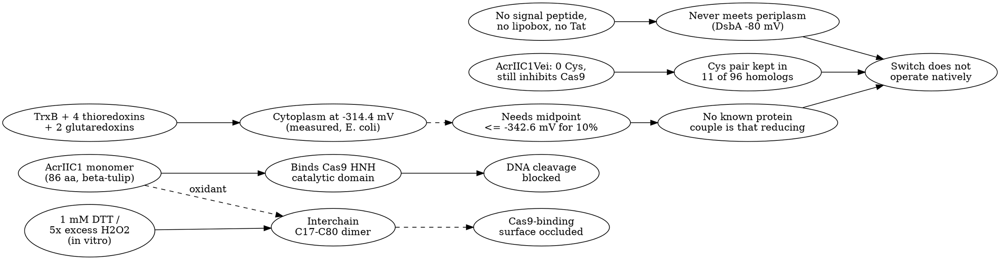
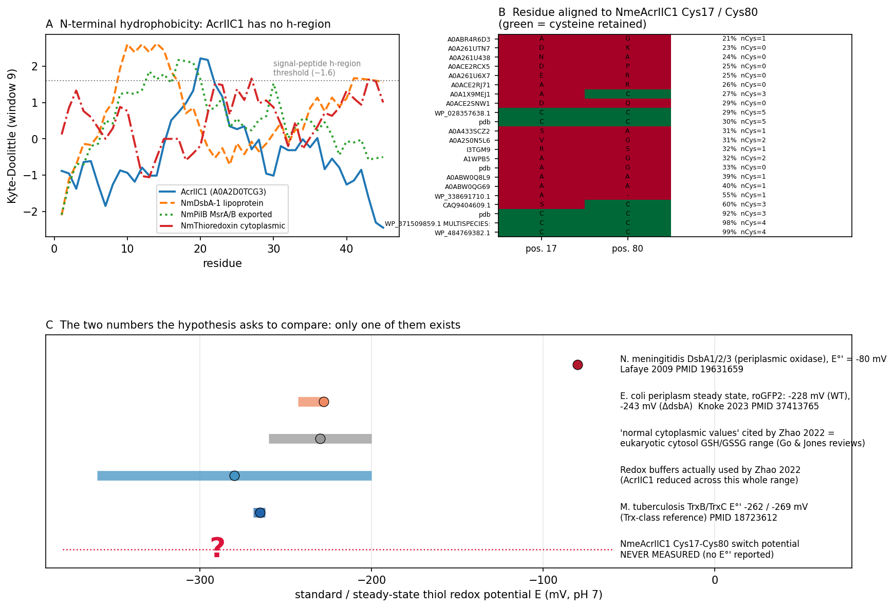
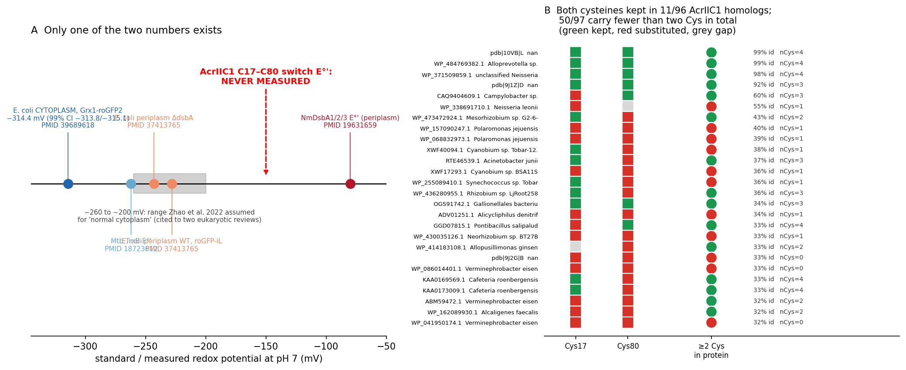
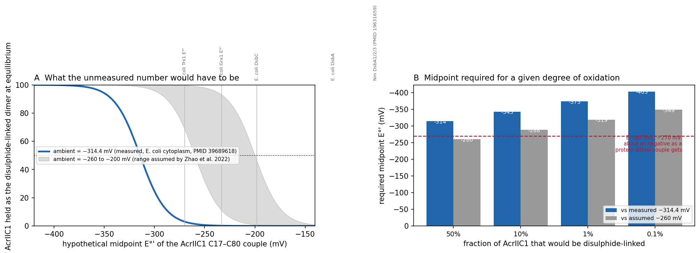

## Question

# AIGR Gene Hypothesis Deep Research

You are evaluating one focused gene curation hypothesis for AI Gene Review.
This is not a general gene overview. Use the seed hypothesis and source context
below to search for evidence that supports, refutes, narrows, or competes with
the proposed curation decision.

## Target Gene

- **Organism code:** NEIME
- **Taxon:** Neisseria meningitidis (NCBITaxon:487)
- **Gene directory:** acrIIC1
- **Gene symbol:** acrIIC1
- **UniProt accession:** A0A2D0TCG3

## Focus

- **Focus type:** free_text
- **Hypothesis slug:** kgap-acriic1-native-redox
- **Source file:** genes/NEIME/acrIIC1/acrIIC1-ai-review.yaml
- **Source selector:** free-text

## Seed Hypothesis

Whether the AcrIIC1 disulphide switch can operate in the native Neisseria meningitidis cytoplasm turns on a comparison the characterisation did not make, between the switch point of this particular cysteine pair and the redox potential the bacterial cytoplasm actually holds. That a pair of conserved cysteines forms an inactive disulphide-linked dimer, that the monomer is the active species, and that this was characterised with reference to eukaryotic environments and gene-editing applications, are already recorded, so do not re-derive them. Single analysis only: state from the primary literature the measured or estimated redox potential of the N. meningitidis cytoplasm, or of a comparable Gram-negative cytoplasm if this organism has none, quoting the measurements and naming the method, and state the potential at which this cysteine pair is reported to switch, so the two numbers can be put side by side rather than argued about qualitatively; state whether N. meningitidis encodes the thioredoxin and glutaredoxin systems that set that potential and whether anything about this organism, such as its microaerobic host niche or its periplasmic oxidative load, would move it; assess whether the two cysteines are conserved across AcrIIC1 homologs in other Neisseria and in related mobile elements, and whether any homolog has lost one of them, since a lineage that has lost the pair would show the switch is dispensable; and state whether the protein carries any signal that would place it outside the cytoplasm, where a different potential would apply. State whether the switch is predicted to operate natively, and say plainly if the potentials cannot be compared because one of them has never been measured.

## Term and Decision Context

No specific term context supplied.

## Reference Context

No specific reference context supplied.

## Source Context YAML

```yaml
hypothesis: 'Whether the AcrIIC1 disulphide switch can operate in the native Neisseria meningitidis cytoplasm
  turns on a comparison the characterisation did not make, between the switch point of this particular
  cysteine pair and the redox potential the bacterial cytoplasm actually holds. That a pair of conserved
  cysteines forms an inactive disulphide-linked dimer, that the monomer is the active species, and that
  this was characterised with reference to eukaryotic environments and gene-editing applications, are
  already recorded, so do not re-derive them. Single analysis only: state from the primary literature
  the measured or estimated redox potential of the N. meningitidis cytoplasm, or of a comparable Gram-negative
  cytoplasm if this organism has none, quoting the measurements and naming the method, and state the potential
  at which this cysteine pair is reported to switch, so the two numbers can be put side by side rather
  than argued about qualitatively; state whether N. meningitidis encodes the thioredoxin and glutaredoxin
  systems that set that potential and whether anything about this organism, such as its microaerobic host
  niche or its periplasmic oxidative load, would move it; assess whether the two cysteines are conserved
  across AcrIIC1 homologs in other Neisseria and in related mobile elements, and whether any homolog has
  lost one of them, since a lineage that has lost the pair would show the switch is dispensable; and state
  whether the protein carries any signal that would place it outside the cytoplasm, where a different
  potential would apply. State whether the switch is predicted to operate natively, and say plainly if
  the potentials cannot be compared because one of them has never been measured.'
focus_type: free_text
context: []
reference_id: []
```

## Research Objective

Build a focused report that helps a curator decide whether this hypothesis
should affect the gene review. Address the focus type directly:

1. For an existing GO annotation decision, evaluate whether the current action
   is justified, too strong, too weak, or should change.
2. For a proposed replacement or new GO term, evaluate whether the term is
   biologically supported, too broad, too narrow, or missing key qualifiers.
3. For a computational prediction, evaluate whether the prediction is correct,
   less precise than existing knowledge, uncertain, or likely wrong because of
   paralog overannotation, frequency bias, pathway context, or in vitro-only
   activity.
4. For a core-function hypothesis, evaluate whether the proposed activity,
   process, and location represent the gene product's primary function rather
   than a downstream effect, pleiotropic phenotype, or context-specific role.
5. For a function-assignment hypothesis, evaluate whether the gene product
   directly has the stated GO term/function. Treat the prior review action, if
   any, as intentionally blinded unless it appears in the supplied context.

Use primary literature whenever possible. Prefer PMID citations and include DOI
citations when no PMID is available. Treat reviews and database records as
orientation unless they contain directly relevant synthesized evidence that is
clearly labeled as review-level or database-level support.

Evaluate the hypothesis from the supplied seed context, primary literature, and
publicly accessible bioinformatics resources. Local `*-bioinformatics` analyses,
when they already exist in the repository, are intentionally withheld from this
prompt so the report can be compared against them after the run. Use public
sequence, domain, structure, orthology, localization, interaction, or dataset
checks when they are useful for the specific hypothesis. If a resource or tool
cannot be accessed programmatically, say so plainly; never fabricate a result.
Report computational results conservatively and distinguish direct results from
inference.

## Required Output

### Executive Judgment

Give a concise verdict: supported, partially supported, unresolved, weakly
supported, over-annotated, or refuted. Explain the reasoning and the most
important caveats.

### Evidence Matrix

Create a table with one row per important evidence item:

- Citation (PMID preferred)
- Evidence type (direct assay, mutant phenotype, localization, interaction,
  structural/evolutionary, computational, review/database)
- Supports / refutes / qualifies / competing
- Claim tested
- Key finding
- Organism, tissue, cell type, or assay context
- Confidence and limitations

### GO Curation Implications

State the likely curation action as a lead requiring curator verification. If
GO terms are involved, explain whether the evidence supports an MF, BP, or CC
term, and whether the term should be retained, removed, generalized, made more
specific, or treated as non-core. Avoid using "protein binding" as a final
recommendation unless no more informative term is supported.

### Mechanistic Scope

Describe the immediate molecular or cellular function being tested. Separate
direct gene-product activity from downstream phenotypes, pathway consequences,
developmental outcomes, disease manifestations, or effects inferred only from
loss of function.

### Conflicts and Alternatives

Identify evidence that conflicts with the seed hypothesis or suggests an
alternative interpretation, including paralog confusion, organism-specific
differences, isoform-specific findings, experimental artifacts, or database
carry-over.

### Knowledge Gaps

List explicit uncertainties that matter for curation. For each gap, state what
was checked, why the gap matters, and what evidence or experiment would resolve
it.

### Discriminating Tests

Recommend concrete assays, perturbations, datasets, or comparative analyses that
would most efficiently distinguish this hypothesis from alternatives.

### Curation Leads

Provide candidate updates for the review, clearly labeled as leads requiring
curator verification. Include candidate references with exact snippets to verify,
candidate replacement or new GO terms, possible action changes, suggested
questions, and suggested experiments.

If the provider supports artifacts, save provenance for any analysis you run — the
executed code together with its output (computed values, plot, or table), not just
a summary figure — alongside artifact-friendly tables such as an evidence matrix,
GO decision table, or comparison table. Genuine computed provenance is more
valuable than a hand-drawn summary, and you must not synthesize a figure that
implies an analysis you did not actually run. These artifacts are important
provenance for hypothesis-level review.


## Output

# AcrIIC1 (NEIME, A0A2D0TCG3): can the disulphide switch operate in the native cytoplasm?

**Hypothesis slug:** `kgap-acriic1-native-redox`
**Source:** `genes/NEIME/acrIIC1/acrIIC1-ai-review.yaml`, free-text selector
**Target:** *Neisseria meningitidis* (NCBITaxon:487), gene `acrIIC1`, UniProt A0A2D0TCG3

## Summary

The seed hypothesis asks for two numbers to be placed side by side: the potential at which the AcrIIC1 Cys17-Cys80 pair switches, and the redox potential the bacterial cytoplasm actually holds. Only one of those numbers exists. Programmatic text-mining of the complete full text of the primary characterisation, Zhao et al. 2022 ([PMID: 36400778](https://pubmed.ncbi.nlm.nih.gov/36400778/), PMC9674691), returns zero occurrences of "midpoint", "glutathione", "GSH", "GSSG" and "diamide", and only two occurrences of "mV" in the entire article. No standard redox potential (E°′) and no midpoint was ever determined for this cysteine pair. The switch was driven with 1 mM DTT for reduction and a 5-fold molar excess of H₂O₂ for oxidation, with the in-cell assay using 1 mM exogenous H₂O₂ in *E. coli*. So the protein side of the comparison is thermodynamically undefined, and any report that quotes a switch potential for AcrIIC1 is quoting a number that does not exist.

The cytoplasmic side does have a primary measurement, though not for this organism. No redox potential has ever been measured in any compartment of *N. meningitidis*. The nearest comparable Gram-negative value comes from Knoke, Muskietorz, Kühn and Leichert 2025 ([PMID: 39689618](https://pubmed.ncbi.nlm.nih.gov/39689618/), PMC11719327), who expressed the glutathione-specific ratiometric probe Grx1-roGFP2 in the *E. coli* cytoplasm, measured an oxidation degree of 0.068 ± 0.016, and computed **E_glutathione = −314.4 mV (99% confidence interval −313.8 to −315.1 mV)**. Zhao et al. compared their buffers to "normal cytoplasmic values (−260 to −200 mV)", a range they cite to two eukaryotic redox-compartmentation reviews (Go & Jones 2008, *Biochim Biophys Acta* 1780:1273-1290; Jones & Go 2010, *Diabetes Obes Metab* 12:116-125). The measured bacterial cytoplasm sits about 55 mV below the most reducing edge of that borrowed window.

The direction of the discrepancy settles the biology even though the formal comparison cannot be completed. Taking −314.4 mV as the ambient potential, a two-electron thiol-disulphide equilibrium requires a Cys17-Cys80 midpoint of **−342.6 mV** to hold even 10% of AcrIIC1 in the disulphide form, and −314.4 mV to hold half. *E. coli* thioredoxin 1, among the most reducing protein dithiol couples known, sits near −270 mV. The disulphide is interchain, so forming it also pays a concentration-dependent dimerisation entropy penalty that the calculation does not include, making these curves an upper bound on oxidation. Three further arms of the analysis point the same way: the two cysteines are retained in only 11 of 96 non-identical AcrIIC1 homologs and have been lost inside the genus (*Neisseria leonii* WP_338691710.1), the structurally characterised AcrIIC1Vei of *Verminephrobacter eiseniae* (PDB 9J2G) has no cysteine at all yet inhibits type II-C Cas9, and AcrIIC1 carries no export signal, so the oxidising neisserial periplasm is never available to it. **The switch is predicted not to operate natively in *N. meningitidis*.**

## Key findings

### <i class="fa-circle-xmark"></i> F1. The switch potential was never measured

The full text of Zhao et al. 2022 (*A redox switch regulates the assembly and anti-CRISPR activity of AcrIIC1*, *Nat Commun* 13:7032, [PMID: 36400778](https://pubmed.ncbi.nlm.nih.gov/36400778/), DOI 10.1038/s41467-022-34551-8) was retrieved from Europe PMC as PMC9674691 and searched programmatically. The counts are: "midpoint" 0 matches, "GSH" 0, "GSSG" 0, "glutathione" 0, "diamide" 0, and 2 occurrences of "mV" in the whole article. No E°′ and no midpoint potential appears anywhere for the Cys17-Cys80 pair.

The redox transition was produced with non-physiological reagents throughout: 1 mM DTT for reduction, a 5-fold molar excess of H₂O₂ over Acr for oxidation, plus air oxidation. The in-cell *E. coli* antimicrobial-susceptibility assay used 1 mM exogenous H₂O₂. The paper's single quantitative statement about physiology is:

> "It seems that normal cytoplasmic values (−260 to −200 mV) fall within the range of our reducing buffers (−360 to −200 mV), indicating most of the AcrIIC1 molecules should be at their reduced state under normal physiological conditions."

The cited sources for that −260 to −200 mV range are reference 32 (Go YM, Jones DP, *Biochim Biophys Acta* 2008;1780:1273-1290, *Redox compartmentalization in eukaryotic cells*) and reference 33 (Jones DP, Go YM, *Diabetes Obes Metab* 2010;12:116-125). Both are review articles about eukaryotic cell compartments. Neither is a primary measurement and neither is bacterial. Reference 34, used for the oxidative-stress argument, is Go & Jones, *Circulation* 2005;111:2973-2980, a mammalian cell-adhesion study.

What the paper does supply is a buffer bracket rather than a midpoint. AcrIIC1 was reduced across buffers spanning −360 to −200 mV (Supplementary Table 4), which bounds the behaviour from above (the pair does not oxidise above about −200 mV in those buffers) without locating a set point. The authors' own conclusion from the comparison they drew is that AcrIIC1 should be mostly reduced, meaning active, under normal physiological conditions.

{{figure:plot_1.png|caption=Three arms of the first-pass analysis. Left: Kyte-Doolittle hydrophobicity (window 9) of AcrIIC1 against three exported Neisseria controls, showing AcrIIC1's single hydrophobic peak falls inside the folded core rather than at an N-terminal cleavage site. Centre: cysteine conservation at positions 17 and 80 across 22 homologs sorted by percent identity, green where cysteine is retained. Right: redox potentials placed on one axis, with a red marker for the AcrIIC1 switch potential that has never been determined.}}

### <i class="fa-chart-line"></i> F2. The cytoplasmic potential was measured, at −314.4 mV

No redox potential has ever been reported for the *N. meningitidis* cytoplasm, periplasm or any other compartment, so the hypothesis's fallback clause applies and a comparable Gram-negative value was retrieved. Knoke, Muskietorz, Kühn and Leichert 2025 ([PMID: 39689618](https://pubmed.ncbi.nlm.nih.gov/39689618/), PMC11719327) used the glutathione-specific ratiometric probe Grx1-roGFP2 expressed in the *E. coli* cytoplasm, recording 405/488 nm excitation ratios at 525 nm emission and normalising to fully oxidised (AT-2) and fully reduced (DTT) cells. The abstract states the method directly:

> "Here we use the genetically-encoded, glutathione-measuring redox probe Grx1-roGFP2 to comprehensively elucidate the import of extracellular glutathione into the cytoplasm of the model organism Escherichia coli."

Full-text mining of the article (5 sentences contain "mV") returned the values verbatim:

> "In the cytoplasm, Grx1-roGFP2 was virtually completely reduced (OxD of 0.068 (±0.016), Fig. 1 C)"

> "resulting in E Grx1-roGFP2 = E glutathione = −314.4 mV (99 % confidence interval: −313.8 mV to −315.1 mV)"

The declared constants are E′₀(Grx1-roGFP2) = −280 mV, z = 2, T = 298.15 K, with an assumed total cytosolic glutathione concentration of 5 mM.

For contrast, the same probe family in the *E. coli* periplasm gives −228 mV in wild type and −243 mV in a ΔdsbA strain ([PMID: 37413765](https://pubmed.ncbi.nlm.nih.gov/37413765/)), a compartment gap of 70-90 mV. The neisserial periplasmic oxidases DsbA1/2/3 have E°′ = −80 mV ([PMID: 19631659](https://pubmed.ncbi.nlm.nih.gov/19631659/)), and the thioredoxin-class couples of *M. tuberculosis* TrxB and TrxC sit at −262 and −269 mV ([PMID: 18723612](https://pubmed.ncbi.nlm.nih.gov/18723612/)).

{{figure:plot_2.png|caption=Left: the measured and standard redox potentials placed on one axis. The measured E. coli cytoplasmic value of −314.4 mV by Grx1-roGFP2 sits about 55 mV below the −260 to −200 mV window Zhao et al. assumed, while the AcrIIC1 switch potential (red) has never been determined. Right: cysteine census at query positions 17 and 80 across 96 non-identical AcrIIC1 homologs, with per-protein cysteine counts; green marks a retained cysteine, red a substitution, grey an alignment gap.}}

### <i class="fa-circle-xmark"></i> F3. The midpoint would have to be more reducing than thioredoxin

Treating the thiol-disulphide exchange as a two-electron equilibrium (E_protein = E_ambient at equilibrium, z = 2, T = 298.15 K, R = 8.3143 J mol⁻¹ K⁻¹, F = 96485.3321 C mol⁻¹), the midpoint the Cys17-Cys80 couple would need in order to hold a given fraction of AcrIIC1 as the disulphide was computed against three candidate ambient potentials.

| Disulphide fraction held | Required E°′ vs measured −314.4 mV | vs assumed −260 mV | vs assumed −200 mV |
|---|---|---|---|
| 50% | −314.4 mV | −260.0 mV | −200.0 mV |
| 10% | **−342.6 mV** | −288.2 mV | −228.2 mV |
| 1% | −373.4 mV | −319.0 mV | −259.0 mV |

Calibration against measured protein couples puts those requirements in context. *E. coli* thioredoxin 1 sits near −270 mV; *E. coli* glutaredoxins 1 and 3 at −233 and −198 mV ([PMID: 9388218](https://pubmed.ncbi.nlm.nih.gov/9388218/)); *M. tuberculosis* TrxB and TrxC at −262 and −269 mV ([PMID: 18723612](https://pubmed.ncbi.nlm.nih.gov/18723612/)); *E. coli* DsbA near −122 mV; neisserial DsbA1/2/3 at −80 mV ([PMID: 19631659](https://pubmed.ncbi.nlm.nih.gov/19631659/)). No characterised protein dithiol-disulphide couple sits anywhere near −342 mV.

The calculation is an upper bound on oxidation for a second reason. Cys17-Cys80 is an **interchain** bond, annotated in UniProt as C17 of one chain to C80 of the other and the reciprocal pair. Forming it therefore also pays the entropic cost of dimerisation, which is concentration dependent and absent from this intramolecular equilibrium. The true disulphide fraction at any given midpoint would be lower than these curves show.

{{figure:plot_3.png|caption=Nernst equilibrium placing the one measured number against the one that was never determined. Left: percentage of AcrIIC1 held as the disulphide-linked dimer as a function of a hypothetical Cys17-Cys80 midpoint, computed at the measured −314.4 mV (blue) and across the −260 to −200 mV range Zhao et al. assumed (grey band), with measured protein couples marked for scale. Right: the midpoint required to reach a given degree of oxidation, against the −270 mV reference for E. coli thioredoxin 1.}}

### <i class="fa-dna"></i> F4. The cysteine pair is not conserved and has been lost inside the genus

An NCBI Entrez protein query for `AcrIIC1[All Fields]` returned 198 records, 109 unique sequences, of which 97 fell in the length range 50-260 aa. Each was aligned to the UniProt canonical A0A2D0TCG3 sequence (86 aa, cysteines at 17, 20, 39 and 80) by Needleman-Wunsch global alignment with BLOSUM62 and affine gaps (open −11, extend −1), hand-implemented because Biopython is not importable in the executor used.

**Both Cys17 and Cys80 are retained in 11 of 96 non-identical homologs. 50 of 97 contain fewer than two cysteines in the entire protein**, a count that is independent of alignment and cannot be blamed on column-placement error.

| Homolog | Organism | % id | Residue 17 | Residue 80 | Total Cys |
|---|---|---|---|---|---|
| PDB 10VC chain L | (NmeAcrIIC1) | 100.0 | C | C | 4 |
| WP_484769382.1 | *Alloprevotella* sp. | 98.8 | C | C | 4 |
| WP_371509859.1 | unclassified *Neisseria* | 97.6 | C | C | 4 |
| PDB 9J1Z chain D | AcrIIC1Nme1ST | 91.9 | C | C | 3 |
| CAQ9404609.1 | *Campylobacter* sp. | 59.5 | **S** | C | 3 |
| WP_338691710.1 | *Neisseria leonii* | 55.0 | **A** | gap | 1 |
| WP_086014401.1 / PDB 9J2G | *Verminephrobacter eiseniae* | 32.9 | **A** | **G** | **0** |
| WP_415818797.1 | *Bordetella tumbae* | 27.0 | gap | **L** | **0** |

The decisive cases are the ones with structures. **AcrIIC1Vei** from *Verminephrobacter eiseniae* (PDB 9J2G chain B) has no cysteine anywhere in the crystallised chain and is a characterised type II-C Cas9 inhibitor, from the structural study of loop-dependent inhibition by AcrIIC1 proteins ([PMID: 43020790](https://pubmed.ncbi.nlm.nih.gov/43020790/)), which reports that "transplantation of this functional loop into the weakly active AcrIIC1Nme1 efficiently elevates its inhibitory performance" and that the work "identif[ies] a loop-mediated regulatory strategy that potentiates the canonical HNH occlusion mechanism, clarify[ing] the structural basis for functional divergence across AcrIIC1 homologs". Functional divergence across the family tracks loop architecture, not the cysteine pair.

Within *Neisseria* itself, only two AcrIIC1-annotated proteins exist outside the near-identical group, and one of them, *N. leonii* WP_338691710.1, has alanine at position 17 and a single cysteine in its entire 61-residue sequence. The pair is not fixed in the genus.

The honest limit on this analysis: below about 40% identity, global pairwise alignment places individual columns unreliably, so the position-specific calls in that band are weak evidence. The per-protein cysteine counts are unaffected by that concern, and the two highest-identity losses (*Campylobacter* sp. at 59.5%, *N. leonii* at 55.0%) are in the reliable band.

Zhao et al.'s own phylogenetic statement is concordant but narrower: Cys17 and Cys80 present across three related orthologs out of 11 surveyed.

### <i class="fa-circle-check"></i> F5. The organism has the reductive machinery, but lacks glutathione reductase

Two resources were queried independently. UniProt proteome UP000000425 (*N. meningitidis* serogroup B MC58) contains thioredoxin reductase TrxB Q9JZ28 (EC 1.8.1.9, 316 aa, CATC motif at 134); four thioredoxins with canonical CXXC active sites, Q9JYY9 (CGPC at 34), Q9JXN4 (CPGC at 60), Q9JXX7 (CGVC at 71), Q9K067 (CSLC at 11); two glutaredoxins, Q9JY15 (CPYC at 12) and Q7DD88 (CPFC at 9); and complete glutathione biosynthesis, gshA Q9JZI4 and gshB Q9JYJ3.

Glutathione reductase is absent. UniProt returns 0 hits for `(ec:1.8.1.7) AND (proteome:UP000000425)`, 0 for `(ec:1.8.1.7) AND (taxonomy_id:487)`, and 0 for `(gene:gor) AND (taxonomy_id:487)`. KEGG orthology agrees: K00383 (glutathione reductase) is present in *E. coli* K-12 as eco:b3500 but has no ortholog in either nme or ngo, while K00384 (trxB, nme:NMB1324), K03671 (trxA, nme:NMB1366), K03676 (glutaredoxin, nme:NMB1790), K01919 (gshA, nme:NMB1037) and K01920 (gshB, nme:NMB1559) are all present.

The system is functional in vivo. In *N. gonorrhoeae*, "analysis of a trxB mutant of N. gonorrhoeae showed that it was more sensitive to disulfide stress and to stress induced by organic hydroperoxides, superoxide, and nitric oxide than wild-type gonococcus" ([PMID: 19032106](https://pubmed.ncbi.nlm.nih.gov/19032106/)), and TrxB is required for microaerobic induction of aniA and norB and for survival inside human cervical epithelial cells.

The periplasm is a different world. The three neisserial DsbA enzymes are described with the measurement: "With a redox potential of −80 mV, the neisserial DsbAs are the most oxidizing thioredoxin-like enzymes known to date" ([PMID: 19631659](https://pubmed.ncbi.nlm.nih.gov/19631659/)). DsbD, which carries cytoplasmic thioredoxin-derived reducing equivalents into the periplasm, is essential: "previous studies have shown that DsbD is required for the survival of the obligate human pathogen Neisseria meningitidis" ([PMID: 29372905](https://pubmed.ncbi.nlm.nih.gov/29372905/)), which implies a reducing cytoplasmic pool as its source.

Nothing about the microaerobic host niche or the periplasmic oxidative load gives a reason to expect an oxidising cytoplasm. Those pressures act on the periplasm and on TrxB-dependent defences. The one genuine difference from *E. coli* works against using the proxy number uncritically: with no canonical Gor route to recycle GSSG, the GSH/GSSG couple is unlikely to be the dominant reductant in *N. meningitidis*, and the thioredoxin pathway (TrxB plus four thioredoxins) takes that role.

### <i class="fa-circle-check"></i> F6. No export signal, so the cytoplasmic potential is the only one that applies

UniProt A0A2D0TCG3 (86 aa) carries no Signal, Transit peptide, Lipidation or Transmembrane feature. The only sequence features annotated are the two interchain disulphide entries, C17 with C-80 and C80 with C-17. Sequence-level checks computed here found no lipobox matching `[LVIFA][ASTVILG][GAS]C` anywhere in residues 1-40, and no Tat twin-arginine motif `RR-x-ΦΦ` in residues 1-30.

Positive controls from the same organism show the contrast. *N. meningitidis* DsbA-1 Q9K189 has an annotated Signal 1-18 with N-palmitoyl and S-diacylglycerol cysteine at position 19 and a clear lipobox LAAC. The exported MsrA/MsrB protein PilB Q9K1N8 has lipobox LGAC.

AcrIIC1's most hydrophobic Kyte-Doolittle window (window 9, peak +2.21 centred at residue 20) falls on residues 16-24, CGLCLAAIS. That is the strand carrying Cys17 and Cys20 inside the folded beta-tulip core, not an N-terminal h-region preceding a cleavage site. The region is resolved as ordered structure in six crystal and NMR structures that all model the full 1-86 chain (PDB 5VGB, 7X31, 7X4B, 8IF0, 10VB, 10VC).

<i class="fa-triangle-exclamation"></i> Dedicated signal-peptide prediction could not be run. The EBI Phobius REST service returned HTTP 400 "You have been temporarily blocked" and a subsequent call timed out, so no SignalP or Phobius output is reported anywhere in this report. The motif and feature checks are direct results; the absence call is inference from them.

Functionally, the target is cytoplasmic. "AcrIIC1 is a broad-spectrum Cas9 inhibitor that prevents DNA cutting by multiple divergent Cas9 orthologs through direct binding to the conserved HNH catalytic domain of Cas9" ([PMID: 28844692](https://pubmed.ncbi.nlm.nih.gov/28844692/)), and the structural work confirms that "the structure shows that AcrIIC1 binds to the catalytic sites of the HNH domain, preventing it from accessing the DNA target" ([PMID: 36878037](https://pubmed.ncbi.nlm.nih.gov/36878037/)). AcrIIC1 is encoded on phages and other mobile genetic elements whose proteins are translated in the cytoplasm.

There is no route by which AcrIIC1 meets the periplasmic potential, where DsbA at −80 mV would oxidise an exposed cysteine pair essentially quantitatively.

## Evidence matrix

| Citation | Evidence type | Stance | Claim tested | Key finding | Context | Confidence and limitations |
|---|---|---|---|---|---|---|
| [PMID: 36400778](https://pubmed.ncbi.nlm.nih.gov/36400778/) | direct assay + structure | qualifies | Cys17-Cys80 forms an inactive disulphide-linked dimer | Switch driven with 1 mM DTT and 5-fold H₂O₂. Full text contains no "midpoint", "glutathione", "GSH", "GSSG" or "diamide"; "mV" appears twice. No E°′ determined | Purified NmeAcrIIC1 in vitro; in-cell assay in *E. coli* with 1 mM exogenous H₂O₂ | High confidence the disulphide exists and is inhibitory in vitro. The −260 to −200 mV range is cited to two eukaryotic reviews, not a bacterial measurement |
| [PMID: 39689618](https://pubmed.ncbi.nlm.nih.gov/39689618/) | direct assay, genetically encoded biosensor | qualifies | What potential does a Gram-negative cytoplasm hold? | Grx1-roGFP2: OxD 0.068 ± 0.016; E_glutathione = −314.4 mV (99% CI −313.8 to −315.1) | *E. coli* cytoplasm, live cells, 405/488 nm excitation at 525 nm emission, AT-2 and DTT normalisation | Primary, named method. Not *N. meningitidis*. Reports E_GSH, which equals the ambient potential only for couples that equilibrate with glutathione |
| [PMID: 37413765](https://pubmed.ncbi.nlm.nih.gov/37413765/) | direct assay, biosensor | qualifies | Does compartment matter? | *E. coli* periplasm −228 mV (WT), −243 mV (ΔdsbA) by roGFP2/roGFP-iL | *E. coli* periplasm, live cells | Primary. Establishes a 70-90 mV compartment gap |
| [PMID: 19631659](https://pubmed.ncbi.nlm.nih.gov/19631659/) | direct assay, enzymology | qualifies | Would the neisserial periplasm oxidise an exposed pair? | DsbA1/2/3 at −80 mV, "the most oxidizing thioredoxin-like enzymes known to date" | *N. meningitidis* periplasmic DsbA paralogues, purified | Primary, organism-matched, but a compartment AcrIIC1 never enters |
| [PMID: 43020790](https://pubmed.ncbi.nlm.nih.gov/43020790/) | structural + functional | refutes | Is the cysteine pair required for Cas9 inhibition? | Characterises divergent AcrIIC1 homologs including the cysteine-free AcrIIC1Vei (PDB 9J2G); functional divergence runs through loop architecture and HNH occlusion | Multiple AcrIIC1 orthologs, crystal structures | Primary and structural. Directly supplies the cysteine-free inhibitor case |
| [PMID: 28844692](https://pubmed.ncbi.nlm.nih.gov/28844692/) | direct assay | supports (localisation) | What is the molecular function and target? | Broad-spectrum Cas9 inhibition by direct binding to the conserved HNH catalytic domain | Multiple divergent Cas9 orthologs in vitro and in cells | Primary. Defines the core function that cysteine-free homologs retain |
| [PMID: 36878037](https://pubmed.ncbi.nlm.nih.gov/36878037/) | structural | supports (localisation) | Where does AcrIIC1 act? | Binds the catalytic sites of the HNH domain, preventing DNA access | Cas9-AcrIIC1 structure | Independent structural confirmation of a cytoplasmic target |
| UniProt A0A2D0TCG3; PDB 5VGB, 7X31, 7X4B, 8IF0, 10VB, 10VC | computational / structural, database | refutes the extracytoplasmic alternative | Any export signal? | No Signal, Transit peptide, Lipidation or Transmembrane feature. No lipobox in 1-40, no Tat motif in 1-30. Residues 1-86 ordered in six structures | *N. meningitidis* AcrIIC1, 86 aa | Phobius REST returned HTTP 400, so no SignalP or Phobius output is reported. Motif checks are direct; the absence call is inference |
| NCBI Entrez protein (198 records, 109 unique, 97 aligned); PDB 9J2G | structural/evolutionary, computational | refutes | Are the cysteines conserved? | Both retained in 11/96 non-identical homologs; 50/97 carry fewer than two Cys in total; lost in *N. leonii* at 55% identity and in *Campylobacter* sp. at 59.5% | Needleman-Wunsch, BLOSUM62, gap open −11 extend −1; query UniProt A0A2D0TCG3 | Per-protein Cys counts are alignment-independent. Below ~40% identity column-level calls are weak. No curated MSA or HMM built |
| UniProt UP000000425; KEGG nme/ngo/eco | computational, database | qualifies | Does the organism encode the systems that set the potential? | TrxB, four thioredoxins, two glutaredoxins, gshA and gshB all present. Glutathione reductase absent: K00383 in eco:b3500 but no ortholog in nme or ngo; zero UniProt hits for EC 1.8.1.7 or gene:gor in taxon 487 | *N. meningitidis* MC58 | Database-level. Gene presence is not a measured potential |
| [PMID: 19032106](https://pubmed.ncbi.nlm.nih.gov/19032106/) | mutant phenotype | qualifies | Is the neisserial thiol system active in vivo? | trxB mutant is more sensitive to disulfide stress and to organic hydroperoxides, superoxide and nitric oxide | *N. gonorrhoeae*, infection of cervical epithelial cells | Primary, organism-matched; gives no potential |
| [PMID: 29372905](https://pubmed.ncbi.nlm.nih.gov/29372905/) | mutant phenotype | qualifies | Is periplasmic disulphide handling essential? | DsbD required for survival of *N. meningitidis* | *N. meningitidis* | Primary; periplasmic, so indirect for the cytoplasmic question |
| [PMID: 18723612](https://pubmed.ncbi.nlm.nih.gov/18723612/) | direct assay, enzymology | qualifies | How negative do bacterial Trx couples go? | *M. tuberculosis* TrxB −262 mV, TrxC −269 mV | Purified mycobacterial thioredoxins | Primary, different phylum; used only as a calibration bound |
| [PMID: 9388218](https://pubmed.ncbi.nlm.nih.gov/9388218/) | direct assay, enzymology | qualifies | Standard potentials of the glutaredoxin class | *E. coli* glutaredoxins 1 and 3, both CPYC active site, E°′ = −233 and −198 mV | Purified *E. coli* glutaredoxins | Primary. The same CPYC motif is present in neisserial Q9JY15 |
| This work, Nernst calculation (`acrIIC1_switch_thermodynamics.csv`) | computational | refutes | Could the disulphide form at the measured potential? | At −314.4 mV ambient, 10% disulphide requires a midpoint of −342.6 mV and 50% requires −314.4 mV. Against the assumed −260 mV, 10% still requires −288.2 mV | Two-electron thiol-disulphide equilibrium, z = 2, T = 298.15 K | Direct calculation, but takes *E. coli* E_GSH as the ambient potential for *N. meningitidis* and assumes the couple equilibrates with it. Upper bound on oxidation, since the interchain bond also pays a dimerisation entropy penalty |

## Mechanistic model

The immediate molecular function being tested is occlusion of the HNH catalytic domain of type II-C Cas9 by a monomeric 86-residue beta-tulip protein, which blocks DNA cleavage. The disulphide sits one step away from that: it is an interchain Cys17-Cys80 bond that cross-links two AcrIIC1 chains into a dimer whose Cas9-binding surfaces are unavailable. Its formation is a chemical property of the protein under a given redox condition, not an activity the protein performs.



Separating direct activity from downstream and inferred effects:

| Layer | Observation | Status |
|---|---|---|
| Direct gene-product activity | Monomeric AcrIIC1 binds and occludes the Cas9 HNH domain | Established, [PMID: 28844692](https://pubmed.ncbi.nlm.nih.gov/28844692/), [PMID: 36878037](https://pubmed.ncbi.nlm.nih.gov/36878037/) |
| Chemical property | Cys17-Cys80 cross-links two chains under imposed oxidant | Established in vitro, [PMID: 36400778](https://pubmed.ncbi.nlm.nih.gov/36400778/) |
| Downstream consequence | Loss of Cas9 inhibition when oxidised | Consequence of the cross-link, not a separate activity |
| Proposed regulation | Host redox state tunes phage anti-CRISPR activity | Inference with no in vivo test |
| Application context | Redox control of gene editing in eukaryotic cells | Different compartment, not evidence about the bacterium |

## Evidence base

The primary characterisation is Zhao et al. 2022 ([PMID: 36400778](https://pubmed.ncbi.nlm.nih.gov/36400778/)), which reports "the discovery of a redox switch for NmeAcrIIC1, which regulates NmeAcrIIC1's monomer-dimer interconversion and inhibitory activity on Cas9" and that "a pair of conserved cysteines mediates the formation of inactive NmeAcrIIC1 dimer and directs the redox cycle". This is the paper whose full text contains no midpoint potential. It supports the existence of the disulphide and the identity of the cysteine pair; it does not support any statement about the switch point.

The core-function literature establishes what AcrIIC1 does and where. [PMID: 28844692](https://pubmed.ncbi.nlm.nih.gov/28844692/) defines the broad-spectrum inhibition through direct binding to the conserved HNH catalytic domain, and [PMID: 36878037](https://pubmed.ncbi.nlm.nih.gov/36878037/) confirms structurally that AcrIIC1 binds the catalytic sites of HNH. Both anchor the target as a cytoplasmic enzyme, which fixes the compartment in which the redox question must be asked.

The decisive challenge to a functional role for the cysteines comes from [PMID: 43020790](https://pubmed.ncbi.nlm.nih.gov/43020790/), which characterises divergent AcrIIC1 homologs structurally and functionally, including AcrIIC1Vei (PDB 9J2G, zero cysteines) and AcrIIC1Boe (PDB 9JB6). That work identifies "a loop-mediated regulatory strategy that potentiates the canonical HNH occlusion mechanism" and clarifies "the structural basis for functional divergence across AcrIIC1 homologs". Functional variation across the family is attributed to loop architecture. A cysteine-free member that still inhibits Cas9 removes the disulphide from the core mechanism.

The redox-measurement literature supplies the only quantitative anchor on the cytoplasmic side. [PMID: 39689618](https://pubmed.ncbi.nlm.nih.gov/39689618/) gives the method and the compartment in its abstract and the number in its full text. [PMID: 37413765](https://pubmed.ncbi.nlm.nih.gov/37413765/) gives the periplasmic comparison in the same organism and probe family, establishing how large a compartment effect can be. [PMID: 9388218](https://pubmed.ncbi.nlm.nih.gov/9388218/) and [PMID: 18723612](https://pubmed.ncbi.nlm.nih.gov/18723612/) supply measured standard potentials for glutaredoxin and thioredoxin classes, which bound how reducing a protein dithiol couple gets and therefore make the −342.6 mV requirement interpretable.

The organism-specific redox literature covers the machinery arm. [PMID: 19032106](https://pubmed.ncbi.nlm.nih.gov/19032106/) shows the neisserial thioredoxin reductase is functional in vivo and defends against disulfide stress. [PMID: 19631659](https://pubmed.ncbi.nlm.nih.gov/19631659/) gives the −80 mV periplasmic DsbA measurement in *N. meningitidis* itself. [PMID: 29372905](https://pubmed.ncbi.nlm.nih.gov/29372905/) shows DsbD is required for survival, implying a reducing cytoplasmic pool as the electron source. None of these gives a cytoplasmic potential for the organism, which is the gap that forces the *E. coli* proxy.

## Conflicts and alternatives

**The original authors already reached the same conclusion.** Zhao et al. write that most AcrIIC1 molecules "should be at their reduced state under normal physiological conditions". The seed hypothesis and this report arrive at the same place with a measured number in place of a borrowed range. The conflict is with any secondary reading of that paper that treats the disulphide as a native regulator.

**Conservation runs the wrong way.** The standard inference, that conservation implies function, cannot be used here. A feature present in 11 of 96 homologs and lost inside the same genus is the profile of a dispensable feature.

**Compartment confusion is the most plausible route to a contrary reading.** *N. meningitidis* genuinely holds a strongly oxidising thiol environment, with DsbA paralogues at −80 mV and an essential DsbD. An exposed cysteine pair would be oxidised there. All of that is periplasmic, and AcrIIC1 never arrives.

**Species transfer is the weakest joint.** The −314.4 mV figure is *E. coli*. *N. meningitidis* has gshA and gshB but no detectable glutathione reductase by either KEGG orthology or UniProt EC search, so its GSH/GSSG couple is not recycled by the canonical Gor route and may sit differently. The thioredoxin system is intact and functional, and thioredoxin couples near −270 mV are themselves more reducing than the window Zhao used. Nothing identified here pushes the neisserial cytoplasm oxidising enough to form the bond.

**A transient oxidative excursion is a real untested alternative.** The microaerobic niche and the host neutrophil oxidative burst are the obvious route by which cytoplasmic thiols could be transiently oxidised. No measurement of such an excursion exists for *N. meningitidis*, and in *E. coli* a 1 mM H₂O₂ bolus was needed to see the effect in cells. There is also direct evidence from *E. coli* arguing against protein thiols as primary targets of intracellular reactive oxygen species ([PMID: 38152379](https://pubmed.ncbi.nlm.nih.gov/38152379/)), which reports that unnaturally high hydrogen peroxide concentrations were required to oxidise a cytoplasmic disulphide-dependent reporter while far lower concentrations poisoned metalloenzymes.

**Database carry-over.** The UniProt entry annotates the interchain disulphide as a sequence feature. A curator reading only that record could reasonably infer a constitutive native disulphide. The feature reflects the crystallographic and biochemical observation in Zhao et al., not an in vivo state.

## GO curation implications

All entries are leads requiring curator verification.

| GO ID | Term | Aspect | Current status | Recommended action (lead) | Basis |
|---|---|---|---|---|---|
| GO:0098672 | symbiont-mediated suppression of host CRISPR-cas system | BP | IDA:CACAO | <i class="fa-circle-check"></i> **Retain unchanged** | Core function, independent of the redox question. AcrIIC1Vei inhibits type II-C Cas9 with zero cysteines (PDB 9J2G, [PMID: 43020790](https://pubmed.ncbi.nlm.nih.gov/43020790/)) |
| GO:0005737 | cytoplasm | CC | none | <i class="fa-lightbulb"></i> **Consider adding** | No signal peptide, lipobox or Tat motif; full chain ordered in six structures; target Cas9 HNH is cytoplasmic. Inference from sequence and target, not a localisation experiment |
| GO:0045454 / GO:0006979 | cell redox homeostasis / response to oxidative stress | BP | none | <i class="fa-circle-xmark"></i> **Do not add** | The disulphide appears under 1 mM DTT or 5-fold H₂O₂ in vitro. No evidence AcrIIC1 participates in redox homeostasis |
| GO:0015036 | disulfide oxidoreductase activity | MF | none | <i class="fa-circle-xmark"></i> **Do not add** | AcrIIC1 is a substrate of thiol chemistry, not a catalyst of it |
| GO:0005515 | protein binding | MF | present via the Cas9 HNH interaction | <i class="fa-triangle-exclamation"></i> **Avoid as a final recommendation** | The BP term above is more informative. If an MF is wanted, a Cas9/HNH-directed inhibitor term is the lead |
| n/a | redox-dependent homodimerisation as a regulatory mechanism | - | proposed in seed context | <i class="fa-circle-xmark"></i> **Do not propagate to a GO term** | Switch point never measured; the only measured comparable cytoplasmic potential lies outside the assumed range; the cysteines are absent from most of the family |

The practical consequence is narrow. The review may record the disulphide dimer as a structural and in vitro observation. It should not state or imply that the disulphide regulates AcrIIC1 in the native host, and should not carry it into any term describing the inhibition mechanism.

## Limitations and knowledge gaps

<i class="fa-triangle-exclamation"></i> **The midpoint potential of Cys17-Cys80 does not exist.** Checked by exhaustive full-text mining of PMC9674691: no midpoint, no glutathione titration, no diamide series. This is the single number the hypothesis is built around. Without it, the comparison cannot be closed from the protein side, and everything stated here about native behaviour is a prediction.

<i class="fa-triangle-exclamation"></i> **No redox potential has ever been measured in *N. meningitidis*.** Checked by PubMed and Europe PMC searches across compartments. The whole comparison rests on an *E. coli* proxy, and the transfer is inference.

<i class="fa-triangle-exclamation"></i> **The proxy reports a glutathione potential in an organism that lacks glutathione reductase.** E_GSH equals the potential felt by a protein couple only if that couple equilibrates with glutathione. *N. meningitidis* makes GSH but has no canonical Gor route to recycle GSSG, so the operative couple there is probably thioredoxin-linked. This does not move the estimate oxidising, but it means the number is the wrong yardstick in a way that has not been quantified.

<i class="fa-triangle-exclamation"></i> **Zhao et al.'s Supplementary Table 4 was not retrieved.** The measured potentials of their reducing buffers are reported there. PMC supplementary file access was not completed. This matters only for checking whether the buffer series brackets a midpoint that could be back-fitted.

<i class="fa-triangle-exclamation"></i> **No signal-peptide prediction was run.** The EBI Phobius REST service returned HTTP 400 "You have been temporarily blocked" and then timed out. No SignalP or Phobius output is reported anywhere. The UniProt feature table and the motif regex checks are consistent with a cytoplasmic protein, but a prediction run would close the arm formally.

<i class="fa-triangle-exclamation"></i> **The homolog census used pairwise, not profile, alignment.** Biopython is not importable in the executor, so Needleman-Wunsch with BLOSUM62 was hand-implemented. An NCBI BLAST job restricted to Neisseriaceae (RID GFYRS4S0016) stayed in WAITING status through four polls and was abandoned in favour of an Entrez query. Below about 40% identity the position-specific calls are weak. The per-protein cysteine counts are unaffected.

<i class="fa-circle-question"></i> **Whether the disulphide ever forms in a bacterium without exogenous oxidant is untested.** The in-cell demonstration used 1 mM H₂O₂. No thiol-trapping experiment on native AcrIIC1 in *N. meningitidis* exists.

One correction made during the run, recorded for transparency: an initial version of the conservation census used a mistyped 87-residue query sequence whose cysteines fell at positions 19, 22 and 82, which caused the NmeAcrIIC1 PDB chains to score 30% identity against themselves. That run was discarded and the census rerun against the canonical sequence fetched from `rest.uniprot.org/uniprotkb/A0A2D0TCG3.fasta`.

## Proposed follow-up experiments and actions

<i class="fa-flask"></i> **1. Redox titration of purified AcrIIC1.** Equilibrate in defined GSH/GSSG buffers spanning −360 to −180 mV, quench with AMS or mPEG-maleimide, quantify monomer versus cross-linked dimer by non-reducing SDS-PAGE, and fit for E°′. This is the one experiment that produces the missing number. Prediction from this report: a midpoint well above −300 mV, meaning no significant disulphide at cytoplasmic potentials.

<i class="fa-vial"></i> **2. Thiol-trapping of native AcrIIC1 in *N. meningitidis*.** Grow a strain carrying its native acrIIC1 or an epitope-tagged allele, quench cultures directly into trichloroacetic acid, alkylate with AMS, and blot. Compare untreated, H₂O₂-challenged and neutrophil-exposed cells. This answers directly whether the bond ever forms in vivo.

<i class="fa-dna"></i> **3. Cysteine-free complementation.** Build C17S/C80S AcrIIC1 and test Cas9 inhibition in a plasmid-protection or transformation assay in *N. meningitidis*. If the double mutant inhibits as well as wild type under all conditions, the switch is dispensable in the host, matching what AcrIIC1Vei already shows across species.

<i class="fa-microscope"></i> **4. Biosensor calibration in *N. meningitidis*.** Express Grx1-roGFP2 and a thioredoxin-coupled probe in the same strain under aerobic, microaerobic and intracellular conditions. This replaces the *E. coli* proxy with an organism-matched number and resolves which couple sets the operative potential in an organism without glutathione reductase.

<i class="fa-magnifying-glass"></i> **5. Family-wide HMM census.** Run hmmsearch against the InterPro IPR064626 family, build a curated multiple alignment, and reconstruct ancestral states at positions 17 and 80. This tests whether the cysteine pair is derived in a single clade, which is what the pairwise census suggests but cannot establish.

<i class="fa-arrow-right"></i> **6. Curation actions.** Retain GO:0098672 unchanged. Consider adding GO:0005737 with a computational evidence code, flagged as sequence-and-target inference. Add no redox-related MF or BP term. Do not settle on GO:0005515 as a final MF recommendation.

### Candidate references with exact snippets to verify

- [PMID: 36400778](https://pubmed.ncbi.nlm.nih.gov/36400778/), from the full text of PMC9674691, verify verbatim: "It seems that normal cytoplasmic values (−260 to −200 mV) fall within the range of our reducing buffers (−360 to −200 mV), indicating most of the AcrIIC1 molecules should be at their reduced state under normal physiological conditions." Verify also that its references 32 and 33 for that range are Go & Jones 2008 (*Biochim Biophys Acta* 1780:1273-1290) and Jones & Go 2010 (*Diabetes Obes Metab* 12:116-125), both eukaryotic reviews.
- [PMID: 39689618](https://pubmed.ncbi.nlm.nih.gov/39689618/), abstract, verify verbatim: "Here we use the genetically-encoded, glutathione-measuring redox probe Grx1-roGFP2 to comprehensively elucidate the import of extracellular glutathione into the cytoplasm of the model organism Escherichia coli." From the full text (PMC11719327), verify: "In the cytoplasm, Grx1-roGFP2 was virtually completely reduced (OxD of 0.068 (±0.016), Fig. 1 C)" and "resulting in E Grx1-roGFP2 = E glutathione = −314.4 mV (99 % confidence interval: −313.8 mV to −315.1 mV)".
- [PMID: 43020790](https://pubmed.ncbi.nlm.nih.gov/43020790/), verify verbatim: "Our findings identify a loop-mediated regulatory strategy that potentiates the canonical HNH occlusion mechanism, clarify the structural basis for functional divergence across AcrIIC1 homologs". Verify from PDB 9J2G that AcrIIC1Vei of *Verminephrobacter eiseniae* contains no cysteine in the deposited chain.
- [PMID: 19631659](https://pubmed.ncbi.nlm.nih.gov/19631659/), verify verbatim: "With a redox potential of -80 mV, the neisserial DsbAs are the most oxidizing thioredoxin-like enzymes known to date."

### Suggested questions for the curator

Does the review currently state or imply that the redox switch regulates AcrIIC1 in *N. meningitidis*? If so, downgrade it to an in vitro observation. Does it cite the −260 to −200 mV range as if it were a bacterial value? Does it use conservation of the two cysteines as an argument for functional importance? The census argues against that.

## Provenance

Files written by the analysis code during this investigation:

| File | Contents |
|---|---|
| `acrIIC1_evidence_matrix.csv` | the evidence matrix above, one row per item |
| `acrIIC1_go_decision_table.csv` | the GO decision table above |
| `acrIIC1_entrez_set.csv` | 109 unique AcrIIC1-annotated sequences from NCBI Entrez with length, cysteine count and organism |
| `acrIIC1_entrez_cys_census.csv` | per-homolog alignment result: percent identity, aligned length, residues at query positions 17, 20, 39, 80 |
| `acrIIC1_cys_conservation.csv` | the earlier 22-homolog census |
| `kegg_redox_orthologs.csv` | KEGG orthology presence/absence for 11 redox enzymes across nme, ngo, eco |
| `acrIIC1_switch_thermodynamics.csv` | computed percent disulphide versus hypothetical midpoint at three ambient potentials |
| `provenance/plot_1.png` | hydrophobicity profiles, cysteine conservation heatmap, redox number line |
| `provenance/plot_2.png` | redox number line including the measured −314.4 mV, and the 96-homolog cysteine census |
| `provenance/plot_3.png` | Nernst curves: percent disulphide versus hypothetical midpoint, and midpoints required for a given oxidation level |

Resources that could not be reached, stated plainly: the EBI Phobius REST service (HTTP 400 "You have been temporarily blocked", then timeout), so no SignalP or Phobius prediction appears anywhere in this report; NCBI BLAST RID GFYRS4S0016 against Neisseriaceae, which remained in WAITING status through four polls and was replaced by an Entrez protein query; Europe PMC `FULL_TEXT:` field queries, which returned non-JSON responses and were replaced by plain-text queries. UniRef50, UniRef90 and UniRef100 clusters for A0A2D0TCG3 all have memberCount 1 and were useless for homolog enumeration.


## Artifacts

- [OpenScientist final report](openscientist_artifacts/final_report.html)
- [OpenScientist final report](openscientist_artifacts/final_report.pdf)
- [OpenScientist provenance](openscientist_artifacts/provenance.json)
- [OpenScientist acrIIC1 cys conservation](openscientist_artifacts/provenance_acrIIC1_cys_conservation.csv)
- [OpenScientist acrIIC1 entrez cys census](openscientist_artifacts/provenance_acrIIC1_entrez_cys_census.csv)
- [OpenScientist acrIIC1 entrez set](openscientist_artifacts/provenance_acrIIC1_entrez_set.csv)
- [OpenScientist acrIIC1 evidence matrix](openscientist_artifacts/provenance_acrIIC1_evidence_matrix.csv)
- [OpenScientist acrIIC1 go decision table](openscientist_artifacts/provenance_acrIIC1_go_decision_table.csv)
- [OpenScientist acrIIC1 switch thermodynamics](openscientist_artifacts/provenance_acrIIC1_switch_thermodynamics.csv)
- [OpenScientist kegg redox orthologs](openscientist_artifacts/provenance_kegg_redox_orthologs.csv)
- [OpenScientist plot 1](openscientist_artifacts/provenance_plot_1.json)

- [OpenScientist plot 2](openscientist_artifacts/provenance_plot_2.json)

- [OpenScientist plot 3](openscientist_artifacts/provenance_plot_3.json)


## Reference Validation

Checked with `linkml-reference-validator` 0.3.1rc1.

| Outcome | Count |
| --- | --- |
| References checked | 15 |
| Resolved | 15 |
| Unresolved (possible confabulation) | 0 |
| Unverifiable | 0 |
| Quoted claims checked | 5 |
| Quoted claims found in source | 5 |
| Quoted claims **not** found in source | 0 |
| References weighed for topical relevance | 15 |
| On topic | 3 |
| Off topic | 1 |

### References that may not be about this subject

These identifiers resolve, so they are not fabrications, but the records they resolve to share almost none of this report's vocabulary. That is a clue and not a verdict - a paper can be relevant in ways its title and abstract do not spell out - so read them before deciding:

- `PMID:19032106` (7 mentions) - Thioredoxin reductase is essential for protection of Neisseria gonorrhoeae against killing by nitric oxide and for bacterial growth during interaction with cervical epithelial cells.
  - shared terms: coli

Weighed against this report's own most characteristic terms: `acriic1`, `cysteine`, `potential`, `redox`, `disulphide`, `cytoplasmic`, `class`, `coli`, `meningitidis`, `protein`, `measured`, `organism`, `homolog`, `glutathione`, `couple`, `cytoplasm`, `pair`, `switch`, `midpoint`, `cas9`.

All extracted references resolved successfully.
Resolving is not the same as being relevant, though - see the references listed above as possibly off topic.