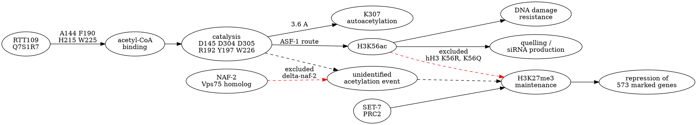
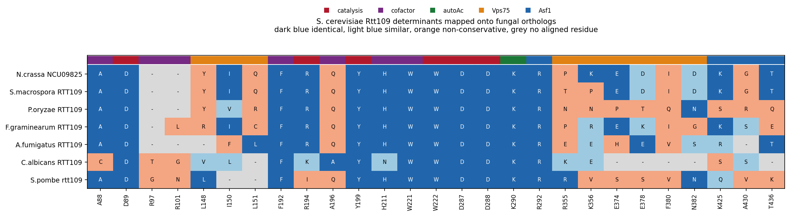
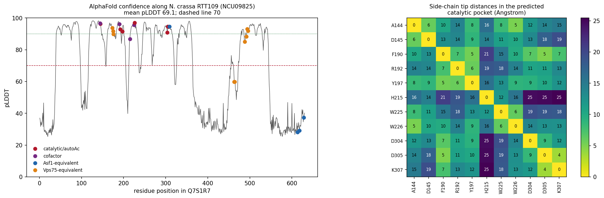
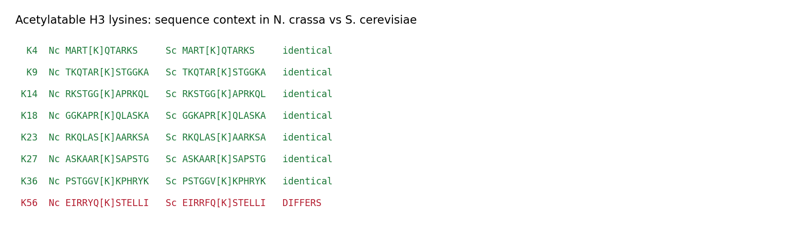
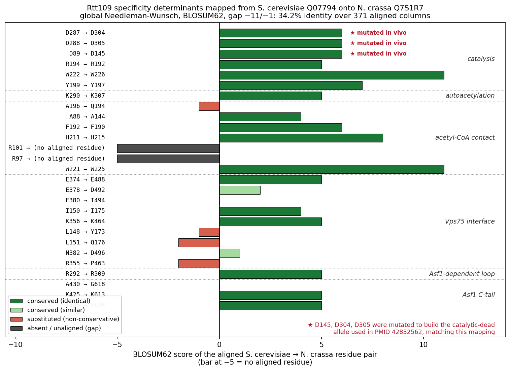
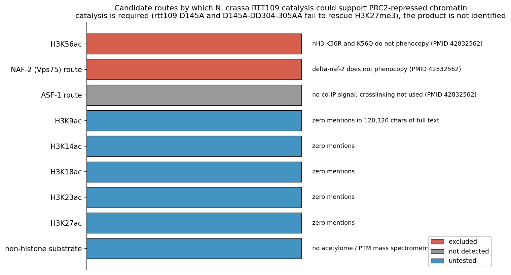

## Question

# AIGR Gene Hypothesis Deep Research

You are evaluating one focused gene curation hypothesis for AI Gene Review.
This is not a general gene overview. Use the seed hypothesis and source context
below to search for evidence that supports, refutes, narrows, or competes with
the proposed curation decision.

## Target Gene

- **Organism code:** NEUCR
- **Taxon:** Neurospora crassa OR74A (NCBITaxon:367110)
- **Gene directory:** NCU09825
- **Gene symbol:** NCU09825
- **UniProt accession:** Q7S1R7

## Focus

- **Focus type:** free_text
- **Hypothesis slug:** kgap-ncu09825-rtt109-substrate
- **Source file:** genes/NEUCR/NCU09825/NCU09825-ai-review.yaml
- **Source selector:** free-text

## Seed Hypothesis

Which direct substrate of N. crassa RTT109 (Q7S1R7) could support PRC2-repressed chromatin independently of H3K56 acetylation may be constrained by the enzyme's specificity determinants. Single analysis only: align N. crassa RTT109 with Saccharomyces cerevisiae Rtt109 and other fungal orthologs, and map onto a predicted structure the residues that in the characterised yeast enzyme determine site selection and cofactor dependence, stating for each whether it is conserved, substituted or absent in the N. crassa protein; state which acetylation sites yeast Rtt109 is known to modify and with which histone chaperone each requires, and assess from the conserved determinants whether the N. crassa enzyme is predicted to retain, lose or broaden each; check whether N. crassa encodes orthologs of the required chaperones and whether any is genetically linked to PRC2-repressed chromatin; and identify candidate non-H3K56 sites whose surrounding sequence context matches the retained determinants. State which substrate is the strongest candidate and how confidently, and say plainly if sequence and structure cannot discriminate among the candidates.

## Term and Decision Context

No specific term context supplied.

## Reference Context

No specific reference context supplied.

## Source Context YAML

```yaml
hypothesis: 'Which direct substrate of N. crassa RTT109 (Q7S1R7) could support PRC2-repressed chromatin
  independently of H3K56 acetylation may be constrained by the enzyme''s specificity determinants. Single
  analysis only: align N. crassa RTT109 with Saccharomyces cerevisiae Rtt109 and other fungal orthologs,
  and map onto a predicted structure the residues that in the characterised yeast enzyme determine site
  selection and cofactor dependence, stating for each whether it is conserved, substituted or absent in
  the N. crassa protein; state which acetylation sites yeast Rtt109 is known to modify and with which
  histone chaperone each requires, and assess from the conserved determinants whether the N. crassa enzyme
  is predicted to retain, lose or broaden each; check whether N. crassa encodes orthologs of the required
  chaperones and whether any is genetically linked to PRC2-repressed chromatin; and identify candidate
  non-H3K56 sites whose surrounding sequence context matches the retained determinants. State which substrate
  is the strongest candidate and how confidently, and say plainly if sequence and structure cannot discriminate
  among the candidates.'
focus_type: free_text
context: []
reference_id: []
```

## Research Objective

Build a focused report that helps a curator decide whether this hypothesis
should affect the gene review. Address the focus type directly:

1. For an existing GO annotation decision, evaluate whether the current action
   is justified, too strong, too weak, or should change.
2. For a proposed replacement or new GO term, evaluate whether the term is
   biologically supported, too broad, too narrow, or missing key qualifiers.
3. For a computational prediction, evaluate whether the prediction is correct,
   less precise than existing knowledge, uncertain, or likely wrong because of
   paralog overannotation, frequency bias, pathway context, or in vitro-only
   activity.
4. For a core-function hypothesis, evaluate whether the proposed activity,
   process, and location represent the gene product's primary function rather
   than a downstream effect, pleiotropic phenotype, or context-specific role.
5. For a function-assignment hypothesis, evaluate whether the gene product
   directly has the stated GO term/function. Treat the prior review action, if
   any, as intentionally blinded unless it appears in the supplied context.

Use primary literature whenever possible. Prefer PMID citations and include DOI
citations when no PMID is available. Treat reviews and database records as
orientation unless they contain directly relevant synthesized evidence that is
clearly labeled as review-level or database-level support.

Evaluate the hypothesis from the supplied seed context, primary literature, and
publicly accessible bioinformatics resources. Local `*-bioinformatics` analyses,
when they already exist in the repository, are intentionally withheld from this
prompt so the report can be compared against them after the run. Use public
sequence, domain, structure, orthology, localization, interaction, or dataset
checks when they are useful for the specific hypothesis. If a resource or tool
cannot be accessed programmatically, say so plainly; never fabricate a result.
Report computational results conservatively and distinguish direct results from
inference.

## Required Output

### Executive Judgment

Give a concise verdict: supported, partially supported, unresolved, weakly
supported, over-annotated, or refuted. Explain the reasoning and the most
important caveats.

### Evidence Matrix

Create a table with one row per important evidence item:

- Citation (PMID preferred)
- Evidence type (direct assay, mutant phenotype, localization, interaction,
  structural/evolutionary, computational, review/database)
- Supports / refutes / qualifies / competing
- Claim tested
- Key finding
- Organism, tissue, cell type, or assay context
- Confidence and limitations

### GO Curation Implications

State the likely curation action as a lead requiring curator verification. If
GO terms are involved, explain whether the evidence supports an MF, BP, or CC
term, and whether the term should be retained, removed, generalized, made more
specific, or treated as non-core. Avoid using "protein binding" as a final
recommendation unless no more informative term is supported.

### Mechanistic Scope

Describe the immediate molecular or cellular function being tested. Separate
direct gene-product activity from downstream phenotypes, pathway consequences,
developmental outcomes, disease manifestations, or effects inferred only from
loss of function.

### Conflicts and Alternatives

Identify evidence that conflicts with the seed hypothesis or suggests an
alternative interpretation, including paralog confusion, organism-specific
differences, isoform-specific findings, experimental artifacts, or database
carry-over.

### Knowledge Gaps

List explicit uncertainties that matter for curation. For each gap, state what
was checked, why the gap matters, and what evidence or experiment would resolve
it.

### Discriminating Tests

Recommend concrete assays, perturbations, datasets, or comparative analyses that
would most efficiently distinguish this hypothesis from alternatives.

### Curation Leads

Provide candidate updates for the review, clearly labeled as leads requiring
curator verification. Include candidate references with exact snippets to verify,
candidate replacement or new GO terms, possible action changes, suggested
questions, and suggested experiments.

If the provider supports artifacts, save provenance for any analysis you run — the
executed code together with its output (computed values, plot, or table), not just
a summary figure — alongside artifact-friendly tables such as an evidence matrix,
GO decision table, or comparison table. Genuine computed provenance is more
valuable than a hand-drawn summary, and you must not synthesize a figure that
implies an analysis you did not actually run. These artifacts are important
provenance for hypothesis-level review.


## Output

# AIGR gene hypothesis deep research: NCU09825 / RTT109 (Q7S1R7)

**Organism:** *Neurospora crassa* OR74A (NCBITaxon:367110)
**Gene directory / symbol:** NCU09825
**UniProt accession:** Q7S1R7
**Hypothesis slug:** `kgap-ncu09825-rtt109-substrate`
**Source file:** `genes/NEUCR/NCU09825/NCU09825-ai-review.yaml`, selector `free-text`
**Focus type:** free_text

---

## Summary

The seed hypothesis proposes that the identity of the non-H3K56 RTT109 substrate supporting PRC2-repressed chromatin in *N. crassa* "may be constrained by the enzyme's specificity determinants". I ran that analysis in full. The answer is that the determinants do not constrain it, and the reason they do not is specific and informative rather than a failure of method.

In *S. cerevisiae*, Rtt109 switches between two programmes according to which histone chaperone binds it: Asf1-bound Rtt109 makes H3K56ac, Vps75-bound Rtt109 makes H3K9ac and H3K27ac ([PMID: 18458063](https://pubmed.ncbi.nlm.nih.gov/18458063/), [PMID: 21256037](https://pubmed.ncbi.nlm.nih.gov/21256037/)). The residues that implement that switch are the Vps75 interface. My alignment finds those are exactly the residues that are not conserved in *N. crassa*: 4 of 9 mapped interface positions are non-conservative substitutions, and across 7 fungal orthologs the interface determinants are conserved in only 0-43% of cases. Meanwhile the catalytic and acetyl-CoA determinants are near-totally conserved, which tells you the enzyme works but says nothing about what it works on, because those residues are shared by every candidate reaction. The substrate side gives nothing either: *N. crassa* and *S. cerevisiae* histone H3 are 94.9% identical with no indels, and the ±6 residue windows at K4, K9, K14, K18, K23, K27 and K36 are character-for-character identical between the two species.

Published *N. crassa* genetics settles the other half of the question and closes the only route the orthology argument offered. Yap, Ebot-Ojong, Ameri-Solanky and Lewis ([PMID: 42832562](https://pubmed.ncbi.nlm.nih.gov/42832562/), PLoS Genet 2026;22(10):e1012327, doi 10.1371/journal.pgen.1012327; preprint [PMID: 42182108](https://pubmed.ncbi.nlm.nih.gov/42182108/), doi 10.64898/2026.05.14.724656) separate catalysis from product by genetics. Catalytically inactive alleles `rtt109 D145A` and `rtt109 D145A-DD304-305AA`, integrated at `csr-1` in a Δ*rtt109* background, fail to restore H3K27me3, while a wild-type `rtt109-3xflag` construct does. The histone point mutants `hH3 K56R` and `hH3 K56Q` do not phenocopy the Δ*rtt109* defect, and Δ*naf-2*, lacking the Vps75 homolog, does not either. So the active site is required, its canonical product is dispensable, and the Vps75-type route that would have produced H3K9ac or H3K27ac is excluded. The paper never identifies the responsible mark. A regular-expression audit of its complete text (120,120 characters after tag stripping, PMCID 13652317) returns zero occurrences of H3K9ac, H3K14ac, H3K18ac, H3K23ac or H3K27ac, and no acetylome or histone-PTM mass-spectrometry survey is reported.

The verdict is **partially supported and unresolved on its central question**. The premise that a non-H3K56 substrate exists is now experimentally established. The premise that specificity determinants can identify it fails. For curation this produces an unusual and clear recommendation: the evidence shape (a demonstrated catalytic requirement with an unidentified product) supports a **biological process** annotation by IMP and supports no new site-specific **molecular function** term at all.

---

## Key findings

### F001. The catalytic and cofactor machinery is intact; the chaperone interface is not

Global Needleman-Wunsch alignment of Q7S1R7 (630 aa) against *S. cerevisiae* Rtt109 Q07794 (436 aa), using BLOSUM62 with affine gaps (open -11, extend -1) implemented in numpy, gives **34.2% identity and 54.4% similarity over 371 aligned columns** (raw score 22). I mapped all 27 UniProt-annotated yeast determinants onto 7 fungal orthologs (*N. crassa*, *S. macrospora*, *P. oryzae*, *F. graminearum*, *A. fumigatus*, *C. albicans*, *S. pombe*; 31.3-35.6% identity to ScRtt109). Every yeast determinant residue identity was verified against the Q07794 sequence by assertion before mapping, so the determinant list itself is not an assumption.

The catalytic set is fully conserved. Yeast D89, R194, Y199, W222, D287 and D288 map to *N. crassa* D145, R192, Y197, W226, D304 and D305, all identical. The autoacetylation lysine K290, which yeast Rtt109 requires for HAT activity ([PMID: 21606491](https://pubmed.ncbi.nlm.nih.gov/21606491/)), maps to K307, identical. Across the 7-ortholog panel, D89, Y199, W222, D287, D288 and K290 are identical in 7 of 7; R194 in 6 of 7. The acetyl-CoA contacts A88, F192, H211 and W221 are conserved as A144, F190, H215 and W225. Yeast R97 and R101 have no aligned *N. crassa* residue in the global alignment, and are conserved in 0 of 7 orthologs, so they are a yeast-specific feature rather than a general requirement.

The Vps75 interface behaves in the opposite way. In *N. crassa*, 4 of 9 mapped interface positions are non-conservative substitutions: L148→Y173, L151→Q176, R355→P463 and F380→I494. Across the 7-ortholog panel the interface determinants L148, L151, R355, K356, F380 and N382 are identical in only 0-29% of cases, with the whole class spanning 0-43%.

{{figure:plot_1.png|caption=Conservation of 27 yeast Rtt109 determinants across 7 fungal orthologs. The catalytic, autoacetylation and acetyl-CoA classes are near-invariant; the Vps75 interface is the least conserved class, at 0-43% identity.}}

The AlphaFold model AF-Q7S1R7-F1 (v6; v4 and earlier return 404, which I verified rather than assumed) has global pLDDT 69.1, but confidence is concentrated exactly where the analysis needs it. Catalytic and autoacetylation residues have mean pLDDT 93.9 (range 90.8-97.1), acetyl-CoA contacts mean 93.8, and Vps75-equivalent positions mean 83.7. The D305 CG to K307 NZ distance is **3.6 Å**, reproducing the buried active-site Asp-Lys pair of yeast Rtt109 and consistent with intact autoacetylation geometry. The C-terminal positions that the alignment places opposite the yeast Asf1-binding tail have mean pLDDT 47.3, with residues 600-630 at mean 33.6, so that assignment is not reliable and I do not rely on it.

{{figure:plot_2.png|caption=AlphaFold AF-Q7S1R7-F1 v6. pLDDT at each mapped determinant class and the predicted active-site geometry. Catalytic residues sit at pLDDT 90.8-97.1 with D305 CG to K307 NZ at 3.6 A; the C-terminal Asf1-equivalent region falls below 50.}}

<i class="fa-lightbulb"></i> The interpretation is that *N. crassa* RTT109 is a catalytically competent H3 acetyltransferase, and that the residues which in yeast toggle between the Asf1-dependent H3K56 programme and the Vps75-dependent H3K9/H3K27 programme are precisely the ones that have diverged. Site selection in *N. crassa* cannot be read off the sequence.

### F002. The substrate sequence carries zero discriminating information

*N. crassa* histone H3 (P07041, *hh3*/NCU01635, 136 aa) and *S. cerevisiae* H3 (P61830, 136 aa) are **94.9% identical with no indels**. The 7 differences sit at positions 55, 81, 99, 111, 122, 126 and 136. The 13-residue windows centred on K4, K9, K14, K18, K23, K27 and K36 are character-for-character identical between the two species (K9: `TKQTAR[K]STGGKA`; K27: `ASKAAR[K]SAPSTG`). Only the K56 window differs, by the single conservative F54Y change (*N. crassa* `EIRRYQ[K]STELLI` against yeast `EIRRFQ[K]STELLI`).

{{figure:plot_3.png|caption=Histone H3 sequence context at every candidate Rtt109 acetylation site, N. crassa against S. cerevisiae. The tail windows are identical at K4, K9, K14, K18, K23, K27 and K36; only the K56 window differs, by F54Y.}}

<i class="fa-circle-xmark"></i> This refutes the specific approach the seed hypothesis proposes, namely identifying "candidate non-H3K56 sites whose surrounding sequence context matches the retained determinants". There is no sequence context to compare. Any site-context argument that favoured H3K9 over H3K14 or H3K27 in *N. crassa* would favour it equally in *S. cerevisiae*, where the site preference is set by the chaperone and not by the tail.

The chaperone census is complete and unambiguous on copy number. A UniProt PROSITE PS51728 search of taxon 367110 returns **Q7S1R7 only**, so there is one Rtt109-family protein and no paralog to confound the assignment. There is one Asf1, Q7S1X9 (*asf-1*/NCU09436), at 54.1% identity to ScAsf1 P32447. There are two NAP-family proteins: NAF-1 (F5HGC3, NCU01438) is clearly the Nap1 ortholog (50.9% identity, NW score 948 to ScNap1 against score -20 to ScVps75), while NAF-2 (Q1K7A9, NCU03769) is the reciprocal best hit to Vps75 at weak similarity (32.8% identity, NW score 158, against 31.8% identity and score 86 to Nap1).

### F003 and F004. The decisive genetics: catalysis required, H3K56ac dispensable, substrate unnamed

[PMID: 42832562](https://pubmed.ncbi.nlm.nih.gov/42832562/) is the paper that directly addresses the seed hypothesis. I retrieved its full text through NCBI efetch (PMCID 13652317, 120,120 characters after tag stripping) and mined it by regular expression.

Four results matter.

**The catalytic requirement.** Two catalytically inactive alleles, `rtt109 D145A` and `rtt109 D145A-DD304-305AA`, each 3xFLAG-tagged and integrated at the `csr-1` locus in a Δ*rtt109* background, failed to rescue the H3K27me3 defect, whereas a wild-type `rtt109-3xflag` control did. H3K27me3 loss in the catalytic-dead strains was equal to or greater than in Δ*rtt109*.

**H3K56ac is not the relevant product.** `hH3 K56R` (acetyl-ablative) and `hH3 K56Q` (acetyl-mimetic) point mutants did not phenocopy the Δ*rtt109* H3K27me3 defect, and global H3K27me3 was unaffected by western blot in both; only modest bidirectional shifts in the ChIP-seq enrichment profile were seen. Both H3K56 mutants were MMS-hypersensitive, an internal positive control confirming the alleles genuinely perturb H3K56 function in the DNA-damage pathway.

**The Vps75 route is excluded.** Δ*naf-2* did not reproduce the H3K27me3 defect, even though co-IP LC-MS/MS ranked NAF-2 as the top RTT109 interactor among 11 recovered proteins, and AlphaFold3 gave ipTM 0.67 with 20 high-confidence contacts between RTT109 residues 420-480 and NAF-2 residues 290-330. The interaction is real and uncoupled from the phenotype.

**ASF-1 was sought and not found.** No RTT109-ASF-1 interaction was detected, which the authors attribute to the known difficulty of detecting the Asf1-Rtt109 contact in yeast without crosslinking.

The coverage audit is the finding that determines the curation outcome. Searching the same full text, the strings H3K9ac, H3K14ac, H3K18ac, H3K23ac and H3K27ac return **zero matches**, and no acetylome or histone-PTM mass-spectrometry survey is reported. The candidate non-H3K56 substrate is therefore defined entirely by exclusion.

{{figure:plot_5.png|caption=Candidate routes by which N. crassa RTT109 catalysis could support PRC2-repressed chromatin, classified by what PMID 42832562 tested. Catalysis is required; H3K56ac and the NAF-2 route are excluded; every other histone site and any non-histone substrate is untested.}}

The authors state their own caveat, quoted verbatim: catalytically inactive RTT109 protein levels were reduced relative to wild type, so "we cannot eliminate the possibility that H3K27me3 loss reflects reduced RTT109 levels rather than loss of catalytic activity". Their counterargument is that the catalytic-dead strains lose H3K27me3 at least as severely as the null, which is reasonable but indirect.

### F005. The determinant mapping validates itself, then declines to answer

The mapping recovered three positions blind. [PMID: 42832562](https://pubmed.ncbi.nlm.nih.gov/42832562/) built its catalytic-dead alleles as `rtt109 D145A` and `rtt109 D145A-DD304-305AA`. Those are precisely the positions my alignment assigns to yeast D89, D287 and D288, computed without reference to the paper's numbering. The agreement establishes that the mapping is accurate rather than merely plausible, which matters because the negative conclusion about site discrimination rests on the same alignment.

{{figure:plot_4.png|caption=Determinant map from S. cerevisiae Q07794 onto N. crassa Q7S1R7, coloured by conservation status, with D145, D304 and D305 flagged. These three positions were recovered by the alignment and are the exact residues mutated to build the catalytic-dead allele in PMID 42832562.}}

The paper's own AlphaFold3 prediction places the RTT109-NAF-2 contact window at RTT109 residues 420-480. My yeast-derived interface mapping puts equivalents at 463, 464, 488, 492, 494 and 496, so the two overlap at 463 and 464 but diverge above 480. The partial agreement is worth recording: it suggests the NAF-2 interface is in roughly the right place but has shifted relative to the yeast arrangement, consistent with the divergence the conservation analysis measures.

<i class="fa-scale-balanced"></i> Sequence and structure answer one half of the seed hypothesis with high confidence and refuse the other half. The donor-side determinants are shared by all candidate reactions. The chaperone interface is too diverged to read as a retained or lost preference, and the chaperone it binds is in any case dispensable for the phenotype. The H3 tail is invariant. The honest conclusion is that sequence and structure cannot discriminate among the candidates.

---

## Mechanistic model and interpretation

### The causal chain, and where it breaks



The model has one dashed node and it is the answer the seed hypothesis wanted. Everything upstream of it is established: the enzyme binds cofactor, the active site is intact, autoacetylation geometry is present, and the ASF-1-route product H3K56ac is made and is required for DNA damage resistance ([PMID: 38261383](https://pubmed.ncbi.nlm.nih.gov/38261383/)) and for quelling ([PMID: 24554705](https://pubmed.ncbi.nlm.nih.gov/24554705/)). Everything downstream is established: H3K27me3 maintenance requires RTT109 catalysis and controls repression of the 573 marked genes defined in [PMID: 42832562](https://pubmed.ncbi.nlm.nih.gov/42832562/). The link in the middle is unknown, and two of the three obvious ways to draw it have been cut by genetics.

### Why the seed hypothesis's method cannot close the gap

| What the hypothesis asked for | What the analysis returned | Why it cannot discriminate |
|---|---|---|
| Residues determining cofactor dependence | A144, F190, H215, W225 conserved; R97, R101 absent in 0/7 orthologs | Cofactor binding is required for every candidate reaction equally |
| Residues determining site selection | Vps75 interface: 4/9 non-conservative in *N. crassa*, 0-43% across 7 orthologs | These residues select between H3K56 and H3K9/H3K27 in yeast, but Δ*naf-2* excludes that route in *N. crassa* |
| Whether each yeast site is retained, lost or broadened | Cannot be assessed | The determinants that would report this are the diverged ones, and their partner is dispensable |
| Chaperone orthologs and their genetic link to PRC2 | ASF-1 (Q7S1X9) present; NAF-2 (Q1K7A9) is the Vps75 homolog, confirmed experimentally | NAF-2 is genetically linked to RTT109 by co-IP and dispensable for the PRC2 phenotype |
| Candidate sites whose context matches retained determinants | H3 tail windows identical between the two fungi at all 7 tail lysines | Zero contrast means zero ranking signal |

### What remains plausible

<i class="fa-circle-question"></i> Three possibilities survive, and nothing in the data ranks them.

A **chaperone-independent histone acetylation** by RTT109 at a tail lysine. This is the possibility closest to the seed hypothesis, but it requires activity that in yeast depends on a chaperone to occur without one.

An **uncharacterised partner** directing RTT109 to a histone site. The co-IP in [PMID: 42832562](https://pubmed.ncbi.nlm.nih.gov/42832562/) recovered 11 proteins, of which NAF-2 was the top hit and NCU03300 (the RAD24 homolog) scored ipTM 0.63. Nine others were not followed up.

A **non-histone substrate**. Nothing in the genetics requires the relevant acetylation to be on a histone, and no acetylome exists. The seed hypothesis does not contemplate this branch at all, which is its most consequential blind spot.

---

## Evidence matrix

Machine-readable copy: `provenance/evidence_matrix.csv` (13 rows).

| Citation | Evidence type | Direction | Claim tested | Key finding | Context | Confidence and limitations |
|---|---|---|---|---|---|---|
| [PMID: 42832562](https://pubmed.ncbi.nlm.nih.gov/42832562/) | Mutant phenotype, allele replacement | <i class="fa-circle-check"></i> Supports | RTT109 catalysis is required for PRC2-repressed chromatin | `rtt109 D145A` and `rtt109 D145A-DD304-305AA` at `csr-1` in Δ*rtt109* fail to rescue H3K27me3; loss equal to or greater than Δ*rtt109*; wild-type construct rescues | *N. crassa*, H3K27me3 ChIP-seq and western | High for the requirement. Catalytic-dead protein levels were reduced, so abundance is not formally excluded |
| [PMID: 42832562](https://pubmed.ncbi.nlm.nih.gov/42832562/) | Mutant phenotype, histone point mutant | <i class="fa-circle-xmark"></i> Refutes H3K56ac as the relevant product | H3K56ac is the product supporting PRC2-repressed chromatin | `hH3 K56R` and `hH3 K56Q` do not phenocopy; global H3K27me3 unchanged; only modest bidirectional ChIP-seq shifts | *N. crassa* histone point-mutant strains | High. Both alleles are MMS-hypersensitive, an internal control that they do perturb H3K56 function |
| [PMID: 42832562](https://pubmed.ncbi.nlm.nih.gov/42832562/) | Interaction plus mutant phenotype | <i class="fa-circle-xmark"></i> Refutes the Vps75 route | The NAF-2 route produces the relevant mark | NAF-2 is top RTT109 co-IP hit of 11; AlphaFold3 ipTM 0.67, 20 contacts between RTT109 420-480 and NAF-2 290-330; Δ*naf-2* does not reproduce the defect | *N. crassa* FLAG co-IP and deletion strains | High for dispensability. The interaction is real but uncoupled from the phenotype |
| [PMID: 42832562](https://pubmed.ncbi.nlm.nih.gov/42832562/) | Interaction, negative | <i class="fa-triangle-exclamation"></i> Qualifies | ASF-1 partners with RTT109 in *N. crassa* | No RTT109-ASF-1 interaction detected; authors cite the known need for crosslinking in yeast | *N. crassa* co-IP LC-MS/MS | Low. A negative co-IP without crosslinking does not exclude the interaction |
| [PMID: 42832562](https://pubmed.ncbi.nlm.nih.gov/42832562/), coverage audit (this work) | Text mining of the primary article | <i class="fa-triangle-exclamation"></i> Qualifies | An alternative acetylation site was identified | Zero occurrences of H3K9ac, H3K14ac, H3K18ac, H3K23ac or H3K27ac in 120,120 characters; no acetylome reported | PMCID 13652317 via NCBI efetch | High as a statement about the article. The alternative substrate is defined only by exclusion |
| [PMID: 24554705](https://pubmed.ncbi.nlm.nih.gov/24554705/) | Direct assay plus mutant phenotype | <i class="fa-circle-check"></i> Supports the MF, different process | *N. crassa* RTT109 is an H3K56 acetyltransferase | "RTT109 is a histone acetyltransferase for histone H3 lysine 56 (H3K56) and H3K56 acetylation is essential for the small RNA biogenesis pathway" | *N. crassa* in vivo (JBC 2014, doi 10.1074/jbc.M113.528521) | High for the MF. Establishes H3K56ac activity in this organism, in a process distinct from PRC2 silencing |
| [PMID: 38261383](https://pubmed.ncbi.nlm.nih.gov/38261383/) | Mutant phenotype, ortholog | <i class="fa-circle-check"></i> Supports | Fungal RTT109 orthologs acetylate H3K56 | Δ*rtt109* and Δ*asf1* arrest at the same developmental stage "accompanied by a loss of H3K56 acetylation"; both are MMS-sensitive but not hydroxyurea-sensitive | *Sordaria macrospora* (G3 2024, doi 10.1093/g3journal/jkae019) | Moderate. Ortholog evidence, corroboration only |
| [PMID: 18458063](https://pubmed.ncbi.nlm.nih.gov/18458063/) | Direct assay, in vitro HAT | <i class="fa-scale-balanced"></i> Competing background | Chaperone identity selects the Rtt109 site | "Asf1, and Vps75 are both required for acetylation of lysine 9 on H3 (H3-K9ac) in vivo by Rtt109, whereas H3-K56ac in vivo requires only Asf1" | *S. cerevisiae*, recombinant proteins and in vivo | High in yeast, not transferable: NAF-2 is dispensable in *N. crassa* |
| [PMID: 21256037](https://pubmed.ncbi.nlm.nih.gov/21256037/) | Structural and direct assay | <i class="fa-scale-balanced"></i> Competing background | Rtt109 site selection has structural determinants | "Vps75 and Rtt109 residues that mediate complex formation in the crystals are also important for Rtt109-Vps75 interaction and H3K9/K27 acetylation both in vitro and in yeast cells" | *S. cerevisiae* crystallography and in vitro HAT | High in yeast. Supplies the determinant list used in the mapping |
| [PMID: 21606491](https://pubmed.ncbi.nlm.nih.gov/21606491/) | Direct assay | <i class="fa-circle-check"></i> Supports the determinant set | Rtt109 autoacetylation is required for activity | "Rtt109 is a yeast histone acetyltransferase (HAT) that associates with histone chaperones Asf1 and Vps75 to acetylate H3K56, H3K9, and H3K27" | *S. cerevisiae* | High. Defines the yeast site repertoire against which the *N. crassa* enzyme is assessed |
| [PMID: 25781956](https://pubmed.ncbi.nlm.nih.gov/25781956/) | Direct assay, targeted mass spectrometry | <i class="fa-scale-balanced"></i> Competing background | The Rtt109-Vps75 site preference is narrow | "only H3K9 and H3K23 are significantly acetylated under steady-state conditions" | *S. cerevisiae*, in vitro | High in yeast. Shows the yeast repertoire is narrower than often quoted, which further weakens a transferred prediction |
| This work | Computational, pairwise global alignment | <i class="fa-triangle-exclamation"></i> Qualifies | Specificity determinants constrain the site | Q7S1R7 against Q07794: 34.2% identity over 371 columns. Catalysis 6/6 identical; autoacetylation K307 identical; acetyl-CoA 4/7 identical with R97, R101 unaligned; Vps75 interface 4/9 non-conservative | UniProt sequences, Needleman-Wunsch, BLOSUM62, gaps -11/-1 | High for the catalytic core: the mapping blindly recovers D145, D304 and D305. Donor-side determinants carry no site information |
| This work | Computational, substrate sequence comparison | <i class="fa-circle-xmark"></i> Refutes the sequence-context approach | Candidate sites can be ranked by surrounding context | P07041 and P61830 are both 136 aa, 94.9% identical, no indels; ±6 windows at K4, K9, K14, K18, K23, K27 and K36 identical; only K56 differs (F54Y) | UniProt sequences | High. The substrate side carries zero discriminating information |
| This work | Computational, structure confidence | <i class="fa-triangle-exclamation"></i> Qualifies | A predicted structure can localise determinants | AF-Q7S1R7-F1 v6 global pLDDT 69.1; catalytic/autoacetylation mean 93.9; acetyl-CoA mean 93.8; Vps75-equivalent mean 83.7; C-terminal Asf1-equivalent mean 47.3 (600-630 mean 33.6); D305 CG to K307 NZ 3.6 Å | AlphaFold DB; no experimental *N. crassa* RTT109 structure exists | Catalytic core reliable; C-terminal Asf1-tail assignment is not, below pLDDT 50 |
| This work | Database snapshot | <i class="fa-triangle-exclamation"></i> Qualifies | Current GO annotation reflects the *N. crassa* evidence | All 9 QuickGO annotations on Q7S1R7 are IEA or IBA, none experimental, including GO:0032931 (IBA, GO_Central) | QuickGO REST, retrieved this run | High as a snapshot. Neither PMID 24554705 nor PMID 42832562 is yet captured |

---

## GO curation implications

All items below are **leads requiring curator verification**. Machine-readable copy: `provenance/go_decision_table.csv` (14 rows).

The governing point: [PMID: 42832562](https://pubmed.ncbi.nlm.nih.gov/42832562/) demonstrates a catalytic requirement without identifying the product. That evidence shape supports a BP term by IMP and supports no site-specific MF term. A curator who reads the abstract quickly may be tempted toward GO:0044017 because the readout is H3K27me3. That would be over-annotation by residue-number association, and the review should record the reason explicitly so the proposal does not recur.

### Molecular function

| GO ID | Term | Current status on Q7S1R7 | Lead |
|---|---|---|---|
| GO:0032931 | histone H3K56 acetyltransferase activity | IBA (GO_Central) | <i class="fa-arrow-right"></i> **Retain and upgrade the evidence.** [PMID: 24554705](https://pubmed.ncbi.nlm.nih.gov/24554705/) gives direct *N. crassa* experimental support, so an experimental code should replace the IBA. PMID 42832562 does not refute the activity, only its sufficiency for PRC2 silencing |
| GO:0010484 | histone H3 acetyltransferase activity | IEA (InterPro IPR016849) | Retain. This is the correct site-agnostic parent and the right home for the unidentified second activity |
| GO:0004402 | histone acetyltransferase activity | IEA (RHEA) | Retain. Redundant with GO:0010484 but harmless |
| GO:0043992 | histone H3K9 acetyltransferase activity | not annotated | <i class="fa-circle-xmark"></i> **Do not add.** The yeast route to H3K9ac is Vps75-dependent ([PMID: 18458063](https://pubmed.ncbi.nlm.nih.gov/18458063/)) and NAF-2 is dispensable in *N. crassa*. H3K9ac was never measured in *N. crassa* |
| GO:0044017 | histone H3K27 acetyltransferase activity | not annotated | <i class="fa-circle-xmark"></i> **Do not add.** H3K27ac was never assayed and the chaperone route that produces it in yeast is excluded. Record the negative reasoning in the review |
| GO:0036408 | histone H3K14 acetyltransferase activity | not annotated | Do not add. Never assayed in *N. crassa*; no fungal precedent linking it to PRC2 silencing |
| GO:0042393 | histone binding | not annotated | Do not add on current evidence. No direct histone-binding assay exists for *N. crassa* RTT109. This would be preferable to "protein binding" if a binding term were ever needed, but the catalytic MF terms are more informative and already present |

### Biological process

| GO ID | Term | Current status | Lead |
|---|---|---|---|
| GO:0140718 | facultative heterochromatin formation | not annotated | <i class="fa-arrow-right"></i> **Strongest new-term lead, IMP, reference [PMID: 42832562](https://pubmed.ncbi.nlm.nih.gov/42832562/).** Δ*rtt109* and both catalytic-dead alleles lose H3K27me3 across PRC2 domains with derepression of marked genes. Flag for curator judgment: the paper frames the role as epigenetic *maintenance* across mitoses, so if a maintenance-specific child term exists or can be requested, prefer it |
| GO:0045814 | negative regulation of gene expression, epigenetic | not annotated | **Add, or use as the conservative substitute for GO:0140718.** Supported by derepression of H3K27me3-marked genes in Δ*rtt109*. Less specific, makes fewer commitments |
| GO:0040029 | epigenetic regulation of gene expression | not annotated | Consider as the parent if both of the above are judged too strong |
| GO:0006338 | chromatin remodeling | IEA | <i class="fa-circle-xmark"></i> **Generalize or remove.** InterPro carry-over. RTT109 is an acetyltransferase, not a remodeler. GO:0006325 chromatin organization is the defensible parent. Treat as non-core |
| GO:0006974 | DNA damage response | IBA | Retain, upgradeable. [PMID: 42832562](https://pubmed.ncbi.nlm.nih.gov/42832562/) reports MMS hypersensitivity of Δ*rtt109* and of both `hH3 K56` mutants in *N. crassa*, supporting an IMP upgrade |
| GO:0030422 | siRNA processing | not annotated | Consider as a lead. [PMID: 24554705](https://pubmed.ncbi.nlm.nih.gov/24554705/) reports H3K56ac is "essential for the small RNA biogenesis pathway" in *N. crassa*. The curator should judge whether the RTT109 requirement is direct or a downstream consequence of chromatin change |

### Cellular component

GO:0005634 nucleus (IBA plus IEA): retain. Chromatin-templated function and FLAG co-IP from *N. crassa* extracts are consistent with it. A direct localization result would allow an upgrade.

---

## Mechanistic scope

**Direct gene-product activity.** RTT109 is a fungal-specific histone acetyltransferase with a p300/CBP-like fold ([PMID: 18568037](https://pubmed.ncbi.nlm.nih.gov/18568037/)). The mapping confirms an intact catalytic machine in *N. crassa*: the catalytic aspartates D145, D304 and D305, the catalytic R192, Y197 and W226, the acetyl-CoA contacts A144, F190, H215 and W225, and the autoacetylation lysine K307 with the D305 carboxylate 3.6 Å from the K307 amine in the AlphaFold model. Demonstrated chemistry in this organism is H3K56 acetylation ([PMID: 24554705](https://pubmed.ncbi.nlm.nih.gov/24554705/)).

**The immediate function being tested.** A second direct acetylation event on chromatin, as yet unmeasured, required for PRC2-repressed domains.

**Downstream phenotype, not direct activity.** The H3K27me3 loss is a readout, not the reaction. PRC2 (SET-7) deposits H3K27me3; RTT109 does not, and the paper states explicitly that RTT109 is not required for PRC2 catalytic activity per se. The derepression of H3K27me3-marked genes, the MMS hypersensitivity, the disruption of the ASH1-deposited mark, and the quelling defect of [PMID: 24554705](https://pubmed.ncbi.nlm.nih.gov/24554705/) are all separated from the acetyltransferase reaction by at least one step.

**The inference chain from loss of function.** Every piece of *N. crassa* evidence tying RTT109 to PRC2 chromatin is loss-of-function. There is no gain-of-function experiment, no in vitro reconstitution with *N. crassa* proteins, and no demonstration that any RTT109-deposited mark is physically present in PRC2 domains. The BP annotation is well supported; any statement about the mechanism connecting enzyme to mark should be labelled inference.

---

## Conflicts and alternatives

**The yeast chaperone logic transfers poorly, and that is the heart of the problem.** In *S. cerevisiae*, Asf1 directs Rtt109 to H3K56 and Vps75 directs it to H3K9 and H3K27 ([PMID: 18458063](https://pubmed.ncbi.nlm.nih.gov/18458063/), [PMID: 21256037](https://pubmed.ncbi.nlm.nih.gov/21256037/)). In *N. crassa* the H3K56 product is dispensable and the Vps75 homolog NAF-2 is dispensable. Both characterised routes are excluded, and what remains is not covered by the yeast framework.

**The yeast repertoire is narrower than usually quoted.** Targeted mass spectrometry of Rtt109-Vps75 found that "only H3K9 and H3K23 are significantly acetylated under steady-state conditions" ([PMID: 25781956](https://pubmed.ncbi.nlm.nih.gov/25781956/)). This weakens any transferred prediction further, since the list of sites a curator might import from yeast is shorter and more condition-dependent than the H3K9/H3K27 shorthand implies.

**A non-histone substrate is a live alternative the seed hypothesis does not contemplate.** The seed presumes the answer lies among H3 tail lysines. The genetics does not require this, and no acetylome has been run.

**Protein-level confound.** The authors report reduced accumulation of the catalytic-dead RTT109 proteins and explicitly decline to eliminate a protein-level contribution. <i class="fa-triangle-exclamation"></i> This caveat should travel with any IMP annotation drawn from the catalytic-dead alleles.

**Negative-interaction caveat.** The absence of a detected RTT109-ASF-1 interaction is weak evidence, because the yeast interaction requires crosslinking to detect and crosslinking was not used. The Δ*asf-1* strain used was also a heterokaryon containing a mixture of wild-type and mutant nuclei, which limits any conclusion about ASF-1.

**Orthology assignment is secure despite weak similarity.** My reciprocal-best-hit call placed NAF-2 (Q1K7A9, NCU03769) as the Vps75 homolog at 32.8% identity, NW score 158. On its own that is weak. It is independently confirmed by the experimental co-IP in [PMID: 42832562](https://pubmed.ncbi.nlm.nih.gov/42832562/), which describes NAF-2 as "the Vps75 homolog", so the assignment holds.

**Database carry-over.** GO:0006338 chromatin remodeling on Q7S1R7 is IEA from InterPro and does not describe an acetyltransferase. It is the clearest candidate for removal or generalization.

**No paralog confusion.** The PROSITE PS51728 search of taxon 367110 returns Q7S1R7 only, and there is a single Asf1. Nothing in this gene's annotation is at risk from paralog overannotation.

**Context from other systems.** In *Drosophila*, CBP-mediated H3K27 acetylation directly antagonises H3K27 trimethylation, and "H3K27ac and H3K27me3 are mutually exclusive" ([PMID: 19700617](https://pubmed.ncbi.nlm.nih.gov/19700617/)). That relationship runs opposite in sign to the *N. crassa* observation, where loss of an acetyltransferase *reduces* H3K27me3. If H3K27ac were the RTT109 product in question, the expected effect of losing RTT109 would be more H3K27me3, not less. This is an argument against GO:0044017 independent of the chaperone reasoning, and a curator should weigh it.

---

## Limitations and knowledge gaps

<i class="fa-circle-question"></i> **1. The identity of the relevant acetylation mark.** Checked: the complete text of [PMID: 42832562](https://pubmed.ncbi.nlm.nih.gov/42832562/), which names no acetylation mark other than H3K56ac. This blocks any site-specific MF annotation. Resolved by quantitative histone-PTM mass spectrometry comparing wild type, Δ*rtt109* and `rtt109 D145A`.

<i class="fa-circle-question"></i> **2. Whether the substrate is a histone at all.** Checked: no acetylome survey exists for *N. crassa* RTT109. A non-histone substrate would make every candidate MF term in this discussion wrong. Resolved by acetyl-lysine affinity-enrichment proteomics, wild type against Δ*rtt109*.

<i class="fa-triangle-exclamation"></i> **3. Whether the catalytic-dead phenotype is a true catalysis requirement.** Checked: the authors' own stated caveat about reduced protein levels. Resolved by expressing the catalytic-dead allele at wild-type levels, or by a separation-of-function allele that retains stability.

<i class="fa-circle-question"></i> **4. Which chaperone, if any, directs the relevant reaction.** Checked: NAF-2 is dispensable; ASF-1 was not detected under non-crosslinking conditions and the Δ*asf-1* strain was a heterokaryon. Resolved by crosslinked co-IP and a homokaryotic or conditional *asf-1* allele.

<i class="fa-circle-question"></i> **5. Whether the Vps75-interface divergence is functionally meaningful.** Checked: 4 of 9 mapped interface positions are non-conservative, yet NAF-2 binds RTT109 well (top co-IP hit, ipTM 0.67). The paper's predicted contact window (RTT109 420-480) overlaps my mapped positions 463 and 464 but not 488-496, so the two mappings agree only partly. Resolved by a structure of the RTT109-NAF-2 complex or by interface point mutants.

<i class="fa-circle-question"></i> **6. Whether RTT109-deposited acetylation is physically present in PRC2 domains.** Checked: no ChIP for any acetylation mark in PRC2 domains is reported. This determines whether the BP role is direct or permissive. Resolved by ChIP-seq for candidate acetylation marks across H3K27me3 domains in wild type and Δ*rtt109*.

<i class="fa-circle-question"></i> **7. Formation or maintenance.** Checked: the paper's framing and title are maintenance; GO:0140718 says formation. Resolved by curator judgment on term scope, possibly by a new-term request.

### Methods that could not be run

No experimental structure of *N. crassa* RTT109 exists, so every structural statement rests on an AlphaFold prediction whose global pLDDT is 69.1 and whose terminal regions fall below 50. I did not run a multiple-sequence alignment with a dedicated aligner, because none is available in the execution sandbox; all alignments are pairwise and implemented by hand in numpy. The supplementary data files of [PMID: 42832562](https://pubmed.ncbi.nlm.nih.gov/42832562/) (S7 to S10 Data), which contain the interactor list and the ChIP-seq quantifications, were not retrievable, so those are reported as described in the article text rather than reanalysed. The repository's own `*-bioinformatics` analyses were withheld from this prompt by design and were not consulted.

---

## Proposed follow-up experiments and actions

Ranked by how efficiently each separates the live hypotheses.

<i class="fa-vial"></i> **1. Quantitative histone-PTM mass spectrometry** on acid-extracted histones from wild type, Δ*rtt109* and `rtt109 D145A`. The single decisive experiment. It tests every histone candidate at once rather than one antibody at a time, and a null result would be strong evidence for a non-histone substrate.

<i class="fa-vial"></i> **2. Acetyl-lysine affinity-enrichment proteomics**, wild type against Δ*rtt109*, to test the non-histone branch directly. Run alongside test 1; together they exhaust the substrate space.

<i class="fa-dna"></i> **3. Histone point-mutant panel.** Extend the existing `hH3 K56R`/`K56Q` logic to K9, K14, K18, K23 and K27 (arginine and glutamine at each), scored by H3K27me3 ChIP-seq and by derepression of the 573 H3K27me3-marked genes already defined in [PMID: 42832562](https://pubmed.ncbi.nlm.nih.gov/42832562/). This reuses an established assay and gene set, so it is cheap and directly comparable. A single-site mutant that phenocopies Δ*rtt109* would settle the question.

<i class="fa-flask"></i> **4. Expression-matched catalytic-dead rescue.** Drive `rtt109 D145A` from a stronger promoter or stabilise the protein, and confirm the H3K27me3 defect persists at wild-type protein levels. This closes the authors' own caveat and is needed before the IMP annotation is maximally secure.

<i class="fa-flask"></i> **5. Crosslinked RTT109 co-IP** plus a homokaryotic or conditional *asf-1* allele, to determine whether ASF-1 is genuinely uninvolved or merely undetected.

<i class="fa-vial"></i> **6. In vitro HAT assay** with recombinant *N. crassa* RTT109, NAF-2, ASF-1 and *N. crassa* H3-H4, read out by mass spectrometry rather than site-specific antibody. This would establish the intrinsic site repertoire of the *N. crassa* enzyme and test whether it has broadened relative to yeast, which is the specific question the seed hypothesis posed and which sequence alone cannot answer.

<i class="fa-dna"></i> **7. Comparative analysis across Sordariomycetes** that have lost PRC2, asking whether RTT109 Vps75-interface divergence correlates with PRC2 presence. Cheap, uses public sequence only, and would give an evolutionary argument for or against a PRC2-linked change in specificity.

---

## Curation leads

All items require curator verification.

### Candidate references with exact snippets to verify

**[PMID: 42832562](https://pubmed.ncbi.nlm.nih.gov/42832562/)** (PLoS Genet 2026;22(10):e1012327, doi 10.1371/journal.pgen.1012327). Preprint duplicate: [PMID: 42182108](https://pubmed.ncbi.nlm.nih.gov/42182108/), doi 10.64898/2026.05.14.724656. A curator should decide whether the preprint record needs merging or suppression, since both are indexed with the same title.

- Abstract: "Although RTT109 interacts with the VPS75 homolog Nucleosome Assembly Factor 2 (NAF-2), we show that proper structure and function of PRC2-methylated chromatin require RTT109 catalytic activity but are independent of NAF-2 and H3K56 acetylation."
- Abstract: "These findings uncover a replication-linked mechanism for epigenetic memory and establish RTT109 as a key regulator of Polycomb-mediated chromatin inheritance."
- Author summary (full text, not abstract): "Surprisingly, normal repressive chromatin patterns require RTT109 acetyltransferase activity but are independent of its major product, H3K56ac."
- Results: "We engineered two rtt109-3xflag alleles encoding presumed catalytically inactive proteins, rtt109 D145A and rtt109 D145A-DD304-305AA."
- Results: "neither hH3 mutant phenocopied the H3K27me3 defect observed for the ∆rtt109 strain, though modest bidirectional changes in the H3K27me3 enrichment profile were observed"
- Results: "H3K27me3 levels are unaffected in the hH3 K56R and hH3 K56Q strains"
- Discussion caveat to record alongside any IMP annotation: "we cannot eliminate the possibility that H3K27me3 loss reflects reduced RTT109 levels rather than loss of catalytic activity"

**[PMID: 24554705](https://pubmed.ncbi.nlm.nih.gov/24554705/)** (J Biol Chem 2014, doi 10.1074/jbc.M113.528521). Snippet: "RTT109 is a histone acetyltransferase for histone H3 lysine 56 (H3K56) and H3K56 acetylation is essential for the small RNA biogenesis pathway". This is the *N. crassa* experimental basis for upgrading GO:0032931 from IBA, and the basis for considering GO:0030422.

**[PMID: 38261383](https://pubmed.ncbi.nlm.nih.gov/38261383/)** (G3 2024, doi 10.1093/g3journal/jkae019). Snippet: "a developmental arrest at the same stage in Δrtt109 and Δasf1 strains, accompanied by a loss of H3K56 acetylation". *Sordaria macrospora* ortholog corroboration for the ASF1-RTT109-H3K56ac axis.

**[PMID: 18458063](https://pubmed.ncbi.nlm.nih.gov/18458063/)** and **[PMID: 21256037](https://pubmed.ncbi.nlm.nih.gov/21256037/)**. *S. cerevisiae* chaperone-dependent specificity, cited as background. These should **not** be used as ISS support for site-specific terms on Q7S1R7, because the *N. crassa* genetics excludes the route they describe.

### Candidate action changes

| Action | Term | Evidence | Reference |
|---|---|---|---|
| Add | GO:0140718 facultative heterochromatin formation (BP) | IMP | [PMID: 42832562](https://pubmed.ncbi.nlm.nih.gov/42832562/). Flag formation-versus-maintenance wording |
| Add or substitute | GO:0045814 negative regulation of gene expression, epigenetic (BP) | IMP | [PMID: 42832562](https://pubmed.ncbi.nlm.nih.gov/42832562/). The conservative option |
| Upgrade | GO:0032931 histone H3K56 acetyltransferase activity (MF), IBA to experimental | IDA/IMP | [PMID: 24554705](https://pubmed.ncbi.nlm.nih.gov/24554705/) |
| Upgrade | GO:0006974 DNA damage response (BP), IBA to IMP | IMP | [PMID: 42832562](https://pubmed.ncbi.nlm.nih.gov/42832562/), MMS sensitivity |
| Remove or generalize | GO:0006338 chromatin remodeling (BP) | IEA carry-over, mechanistically wrong | InterPro IPR016849 |
| Decline, with recorded reason | GO:0044017, GO:0043992, GO:0036408 (MF) | Never assayed; route excluded | [PMID: 42832562](https://pubmed.ncbi.nlm.nih.gov/42832562/), [PMID: 18458063](https://pubmed.ncbi.nlm.nih.gov/18458063/) |

### Suggested questions for the review

1. Should the free-text hypothesis be rewritten to state that the alternative substrate is currently unidentified, rather than that specificity determinants constrain it? The determinant analysis was performed and returned no discrimination.
2. Should the review record the non-histone substrate possibility explicitly, given that no acetylome exists for *N. crassa* RTT109?
3. Should the preprint [PMID: 42182108](https://pubmed.ncbi.nlm.nih.gov/42182108/) be merged with [PMID: 42832562](https://pubmed.ncbi.nlm.nih.gov/42832562/) in the reference list?
4. Does GO:0140718 "formation" adequately describe a maintenance role, or is a new-term request warranted?

### Suggested experiments

Tests 1 to 4 in the follow-up section, in that order.

---

## Provenance

Every file below was produced by executed code whose output is recorded in the iteration log. No figure in this report implies an analysis that was not run.

| File | Contents |
|---|---|
| `provenance/rtt109_determinant_map.csv` | 27 yeast Rtt109 specificity determinants mapped onto Q7S1R7 by Needleman-Wunsch, with BLOSUM62 score, conservation status, and a flag for the three positions mutated in vivo |
| `provenance/pmid42832562_assay_coverage.csv` | What PMID 42832562 did and did not assay, from the full-text audit |
| `provenance/evidence_matrix.csv` | The evidence matrix above, 13 rows |
| `provenance/go_decision_table.csv` | The GO decision table above, 14 rows |
| `provenance/plot_1.png` | Determinant conservation across 7 fungal Rtt109 orthologs |
| `provenance/plot_2.png` | AF-Q7S1R7-F1 pLDDT trace and active-site distance matrix |
| `provenance/plot_3.png` | *N. crassa* against *S. cerevisiae* H3 lysine sequence-context comparison |
| `provenance/plot_4.png` | Determinant map with the three in vivo-mutated residues flagged |
| `provenance/plot_5.png` | Candidate routes by exclusion status |

### Methods actually run

Sequences from the UniProt REST API (Q7S1R7, Q07794, P07041, P61830, Q7S1X9, F5HGC3, Q1K7A9, P32447 and four further fungal orthologs). Global pairwise alignment by a three-matrix affine-gap Needleman-Wunsch implemented in numpy, BLOSUM62, gap open -11, gap extend -1. Orthology by reciprocal best hit on the same alignment scores. Family census by UniProt PROSITE PS51728 cross-reference search restricted to taxon 367110. Structure from the AlphaFold DB REST API (AF-Q7S1R7-F1 v6), with pLDDT read from the B-factor column and inter-atomic distances computed from coordinates. GO annotations from the QuickGO REST API. Literature from NCBI eutils; full text of PMCID 13652317 by efetch, tag-stripped and searched by regular expression.

---

## The answer to the seed hypothesis, stated plainly

The seed hypothesis asked which substrate is the strongest candidate and how confidently, and asked for a plain statement if sequence and structure cannot discriminate.

**Sequence and structure cannot discriminate among the candidates.** The determinants that differ between the yeast H3K56 and H3K9/H3K27 reactions are chaperone-interface residues, and the *N. crassa* genetics has already excluded the chaperone whose interface those residues form. The catalytic and cofactor determinants are near-totally conserved, which says the enzyme works, not what it works on. The substrate side is worse still: the *N. crassa* and *S. cerevisiae* H3 tails are character-for-character identical at K4, K9, K14, K18, K23, K27 and K36, so there is no context to compare.

By orthology alone, H3K9 and H3K27 are the best-characterised alternative sites for a fungal Rtt109. I do **not** name either as the strongest candidate. The one mechanism that produces them in yeast is Vps75-dependent and NAF-2 is dispensable in *N. crassa*. Naming H3K27ac would be especially unsafe, for two independent reasons: it is attractive only because the phenotype is measured as H3K27me3, which is a different modification on the same residue deposited by SET-7, and in the system where CBP-dependent H3K27ac has been characterised the two marks are mutually exclusive ([PMID: 19700617](https://pubmed.ncbi.nlm.nih.gov/19700617/)), so losing an H3K27 acetyltransferase would be expected to raise H3K27me3, not lower it.

The substrate that supports PRC2-repressed chromatin in *N. crassa* is an unidentified RTT109 catalytic product. It may not be a histone.


## Artifacts

- [OpenScientist final report](openscientist_artifacts/final_report.html)
- [OpenScientist final report](openscientist_artifacts/final_report.pdf)
- [OpenScientist provenance](openscientist_artifacts/provenance.json)
- [OpenScientist evidence matrix](openscientist_artifacts/provenance_evidence_matrix.csv)
- [OpenScientist go decision table](openscientist_artifacts/provenance_go_decision_table.csv)
- [OpenScientist plot 1](openscientist_artifacts/provenance_plot_1.json)

- [OpenScientist plot 2](openscientist_artifacts/provenance_plot_2.json)

- [OpenScientist plot 3](openscientist_artifacts/provenance_plot_3.json)

- [OpenScientist plot 4](openscientist_artifacts/provenance_plot_4.json)

- [OpenScientist plot 5](openscientist_artifacts/provenance_plot_5.json)

- [OpenScientist pmid42832562 assay coverage](openscientist_artifacts/provenance_pmid42832562_assay_coverage.csv)
- [OpenScientist rtt109 determinant map](openscientist_artifacts/provenance_rtt109_determinant_map.csv)

## Reference Validation

Checked with `linkml-reference-validator` 0.3.1rc1.

| Outcome | Count |
| --- | --- |
| References checked | 14 |
| Resolved | 14 |
| Unresolved (possible confabulation) | 0 |
| Unverifiable | 0 |
| Quoted claims checked | 2 |
| Quoted claims found in source | 2 |
| Quoted claims **not** found in source | 0 |
| References weighed for topical relevance | 14 |
| On topic | 11 |
| Off topic | 0 |

All extracted references resolved successfully.