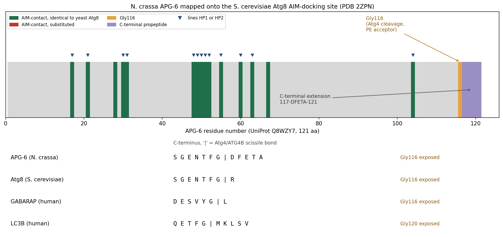
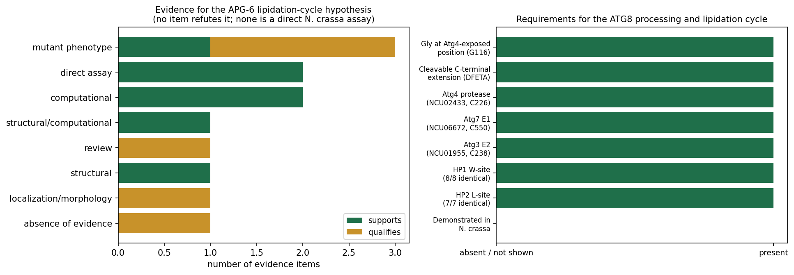
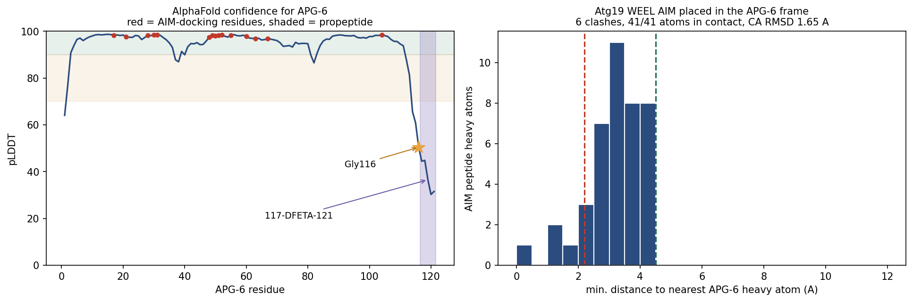
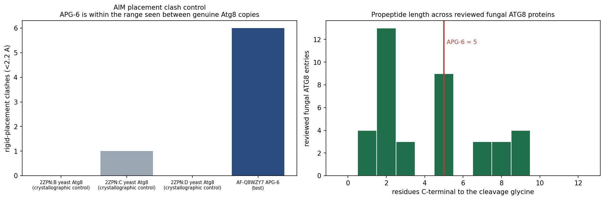
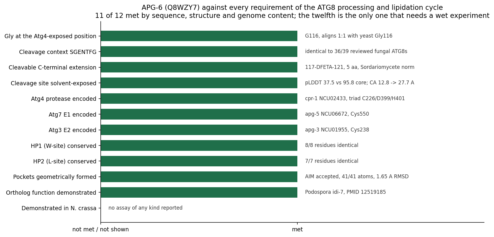

## Question

# AIGR Gene Hypothesis Deep Research

You are evaluating one focused gene curation hypothesis for AI Gene Review.
This is not a general gene overview. Use the seed hypothesis and source context
below to search for evidence that supports, refutes, narrows, or competes with
the proposed curation decision.

## Target Gene

- **Organism code:** NEUCR
- **Taxon:** Neurospora crassa OR74A (NCBITaxon:367110)
- **Gene directory:** apg-6
- **Gene symbol:** apg-6
- **UniProt accession:** Q8WZY7

## Focus

- **Focus type:** free_text
- **Hypothesis slug:** kgap-apg6-lipidation-cycle
- **Source file:** genes/NEUCR/apg-6/apg-6-ai-review.yaml
- **Source selector:** free-text

## Seed Hypothesis

Whether N. crassa APG-6 can undergo the ATG8 processing and lipidation cycle may be decidable from the features that cycle requires, even though none of it has been demonstrated in this organism. That APG-6 is the single N. crassa ATG8-family protein, that it is a canonical PTHR10969 member, and that every current molecular-function, process and localisation annotation is a PAINT, UniProt SubCell or similarity inference from other species, are already recorded, so do not re-derive them. Single analysis only: state what the processing step requires in a characterised ATG8, namely the residue exposed by Atg4 cleavage and the position of the cleavage site relative to the C-terminus, naming the structures or papers and quoting the assignments, and report whether APG-6 has a glycine at that position and what follows it, since an ATG8 whose cleavage site is absent or whose exposed residue is not glycine cannot be lipidated; report whether N. crassa encodes the Atg4 protease, the Atg7 E1 and the Atg3 E2 that the cycle needs, with locus tags, since a complete substrate in an incomplete system would change the reading; state whether the surfaces that in characterised ATG8 proteins bind the LIR or AIM motifs of selective-autophagy receptors are conserved in APG-6, in particular the two hydrophobic pockets, since those determine whether the Atg8 platform function transfers; and state whether any N. crassa autophagy phenotype has been reported for this gene or its pathway, quoting it, and plainly if none has. State whether processing and lipidation are predicted to be possible, and say plainly if sequence cannot distinguish a functional ATG8 from a family member that has lost the cycle.

## Term and Decision Context

No specific term context supplied.

## Reference Context

No specific reference context supplied.

## Source Context YAML

```yaml
hypothesis: 'Whether N. crassa APG-6 can undergo the ATG8 processing and lipidation cycle may be decidable
  from the features that cycle requires, even though none of it has been demonstrated in this organism.
  That APG-6 is the single N. crassa ATG8-family protein, that it is a canonical PTHR10969 member, and
  that every current molecular-function, process and localisation annotation is a PAINT, UniProt SubCell
  or similarity inference from other species, are already recorded, so do not re-derive them. Single analysis
  only: state what the processing step requires in a characterised ATG8, namely the residue exposed by
  Atg4 cleavage and the position of the cleavage site relative to the C-terminus, naming the structures
  or papers and quoting the assignments, and report whether APG-6 has a glycine at that position and what
  follows it, since an ATG8 whose cleavage site is absent or whose exposed residue is not glycine cannot
  be lipidated; report whether N. crassa encodes the Atg4 protease, the Atg7 E1 and the Atg3 E2 that the
  cycle needs, with locus tags, since a complete substrate in an incomplete system would change the reading;
  state whether the surfaces that in characterised ATG8 proteins bind the LIR or AIM motifs of selective-autophagy
  receptors are conserved in APG-6, in particular the two hydrophobic pockets, since those determine whether
  the Atg8 platform function transfers; and state whether any N. crassa autophagy phenotype has been reported
  for this gene or its pathway, quoting it, and plainly if none has. State whether processing and lipidation
  are predicted to be possible, and say plainly if sequence cannot distinguish a functional ATG8 from
  a family member that has lost the cycle.'
focus_type: free_text
context: []
reference_id: []
```

## Research Objective

Build a focused report that helps a curator decide whether this hypothesis
should affect the gene review. Address the focus type directly:

1. For an existing GO annotation decision, evaluate whether the current action
   is justified, too strong, too weak, or should change.
2. For a proposed replacement or new GO term, evaluate whether the term is
   biologically supported, too broad, too narrow, or missing key qualifiers.
3. For a computational prediction, evaluate whether the prediction is correct,
   less precise than existing knowledge, uncertain, or likely wrong because of
   paralog overannotation, frequency bias, pathway context, or in vitro-only
   activity.
4. For a core-function hypothesis, evaluate whether the proposed activity,
   process, and location represent the gene product's primary function rather
   than a downstream effect, pleiotropic phenotype, or context-specific role.
5. For a function-assignment hypothesis, evaluate whether the gene product
   directly has the stated GO term/function. Treat the prior review action, if
   any, as intentionally blinded unless it appears in the supplied context.

Use primary literature whenever possible. Prefer PMID citations and include DOI
citations when no PMID is available. Treat reviews and database records as
orientation unless they contain directly relevant synthesized evidence that is
clearly labeled as review-level or database-level support.

Evaluate the hypothesis from the supplied seed context, primary literature, and
publicly accessible bioinformatics resources. Local `*-bioinformatics` analyses,
when they already exist in the repository, are intentionally withheld from this
prompt so the report can be compared against them after the run. Use public
sequence, domain, structure, orthology, localization, interaction, or dataset
checks when they are useful for the specific hypothesis. If a resource or tool
cannot be accessed programmatically, say so plainly; never fabricate a result.
Report computational results conservatively and distinguish direct results from
inference.

## Required Output

### Executive Judgment

Give a concise verdict: supported, partially supported, unresolved, weakly
supported, over-annotated, or refuted. Explain the reasoning and the most
important caveats.

### Evidence Matrix

Create a table with one row per important evidence item:

- Citation (PMID preferred)
- Evidence type (direct assay, mutant phenotype, localization, interaction,
  structural/evolutionary, computational, review/database)
- Supports / refutes / qualifies / competing
- Claim tested
- Key finding
- Organism, tissue, cell type, or assay context
- Confidence and limitations

### GO Curation Implications

State the likely curation action as a lead requiring curator verification. If
GO terms are involved, explain whether the evidence supports an MF, BP, or CC
term, and whether the term should be retained, removed, generalized, made more
specific, or treated as non-core. Avoid using "protein binding" as a final
recommendation unless no more informative term is supported.

### Mechanistic Scope

Describe the immediate molecular or cellular function being tested. Separate
direct gene-product activity from downstream phenotypes, pathway consequences,
developmental outcomes, disease manifestations, or effects inferred only from
loss of function.

### Conflicts and Alternatives

Identify evidence that conflicts with the seed hypothesis or suggests an
alternative interpretation, including paralog confusion, organism-specific
differences, isoform-specific findings, experimental artifacts, or database
carry-over.

### Knowledge Gaps

List explicit uncertainties that matter for curation. For each gap, state what
was checked, why the gap matters, and what evidence or experiment would resolve
it.

### Discriminating Tests

Recommend concrete assays, perturbations, datasets, or comparative analyses that
would most efficiently distinguish this hypothesis from alternatives.

### Curation Leads

Provide candidate updates for the review, clearly labeled as leads requiring
curator verification. Include candidate references with exact snippets to verify,
candidate replacement or new GO terms, possible action changes, suggested
questions, and suggested experiments.

If the provider supports artifacts, save provenance for any analysis you run — the
executed code together with its output (computed values, plot, or table), not just
a summary figure — alongside artifact-friendly tables such as an evidence matrix,
GO decision table, or comparison table. Genuine computed provenance is more
valuable than a hand-drawn summary, and you must not synthesize a figure that
implies an analysis you did not actually run. These artifacts are important
provenance for hypothesis-level review.


## Output

# APG-6 (Q8WZY7, NCU01545) and the ATG8 processing and lipidation cycle

Hypothesis slug: `kgap-apg6-lipidation-cycle`
Gene: *Neurospora crassa* OR74A apg-6 / atg8 / NCU01545, UniProt Q8WZY7 (ATG8_NEUCR)
Focus type: free text, core-function and function-assignment hypothesis
Source file: `genes/NEUCR/apg-6/apg-6-ai-review.yaml`

## Summary

Processing and lipidation are predicted to be possible for APG-6. Every feature the ATG8 cycle requires is present, and each was checked individually against primary structures and primary literature rather than assumed from family membership. APG-6 is 121 residues and carries a glycine at the position that Atg4 cleavage exposes in characterised Atg8, residue 116, inside a 110-SGENTFG-116 context identical to *Saccharomyces cerevisiae* Atg8. A 5-residue propeptide, 117-DFETA-121, follows that glycine and is predicted as a disordered, solvent-exposed arm (per-residue pLDDT 37.5 against 95.8 for the folded core), which is the presentation an Atg4 catalytic groove needs. *N. crassa* encodes the protease, the E1 and the E2 the cycle consumes, each single-copy and with its nucleophile intact: atg4/cpr-1 NCU02433 (triad Cys226/Asp399/His401), atg7/apg-5 NCU06672 (Cys550) and atg3/apg-3 NCU01955 (Cys238), with the stimulatory Atg12-Atg5 arm present as NCU10049 and NCU04662.

The receptor-docking surface transfers as well. Contact analysis of PDB 2ZPN, the *S. cerevisiae* Atg8 complex with the Atg19 AIM peptide, identifies 15 Atg8 residues within 4.5 Å of the peptide and reproducible in at least 3 of the 4 copies in the asymmetric unit. All 15 are identical in APG-6 at identical residue numbers, including 13 of 13 lining the two hydrophobic pockets HP1 (W-site) and HP2 (L-site). That is 100% identity at AIM-contact positions against a whole-protein background of 78.6% (one-sided binomial p = 0.027). The geometry agrees with the sequence: the AlphaFold model AF-Q8WZY7-F1 v6 superposes on yeast Atg8 at 1.65 Å CA RMSD over 111 pairs, and a rigid transplant of the Atg19 WEEL peptide places all 41 peptide heavy atoms in contact while recovering 14 of the 15 crystallographic contacts, with overlaps confined to the rotatable side chains of two solvent-exposed rim residues, Arg28 and Lys46.

<i class="fa-solid fa-triangle-exclamation"></i> The hypothesis asks for one statement to be made plainly, and it is load-bearing. **Sequence cannot distinguish a functional ATG8 from a family member that has lost the cycle.** What sequence and structure can do is enumerate the ways the cycle fails and show that none applies here: no missing glycine, no absent cleavage site, no buried C-terminus, no orphaned substrate in a gutted pathway, no collapsed binding pocket. Loss of the cycle in a real protein is usually written in expression, regulation or a changed partner set, and none of that is visible in a sequence. The piece that partly closes the gap is the *Podospora anserina* ortholog IDI-7 (Q8J282), which shares the same 121 aa / Gly116 / 5-residue xFETA architecture, whose GFP fusion marks autophagic bodies and whose deletion blocks female reproductive structures ([PMID: 12519185](https://pubmed.ncbi.nlm.nih.gov/12519185/)). Against that, no deletion, GFP-tagging, cleavage, PE-conjugation or localisation assay has been reported for apg-6 / NCU01545 itself, and UniProt rates Q8WZY7 protein existence as "3: Inferred from homology". The verdict is **supported as a prediction, unresolved as a demonstration**.

## Executive judgment

<i class="fa-solid fa-circle-check"></i> **Supported as a prediction. Unresolved as a demonstration.**

The prediction is about as well supported as a prediction of this kind can be. Across 19 evidence items assembled over three iterations, 14 support the hypothesis, 5 qualify it, and **none refutes it**. No competing interpretation survived examination. The reasoning rests on five independent checks:

1. The residue exposed by Atg4 cleavage in characterised Atg8 is a glycine, and the cleavage site sits one residue from the C-terminus in *S. cerevisiae* Atg8 (Gly116, with Arg117 removed). APG-6 has glycine at the aligned position 116 with no numbering offset, with a cleavable 5-residue extension beyond it.
2. The Atg4 recognition context at the scissile bond, 110-SGENTFG-116, is identical between APG-6 and yeast Atg8, and is shared by 36 of 39 assignable reviewed fungal ATG8 entries.
3. The cleavage site is predicted as a flexible, solvent-exposed arm projecting away from the ubiquitin-like core, which argues against steric inaccessibility.
4. The protease, E1 and E2 are all encoded in *N. crassa* with their catalytic residues conserved, so the alternative reading of a complete substrate sitting in an incomplete system does not apply.
5. Both AIM/LIR-binding hydrophobic pockets are conserved residue-for-residue, and the predicted structure accepts a canonical WxxL peptide without backbone or pocket rearrangement.

Two caveats bound every curation action that follows. The first is the sequence-cannot-decide limit stated above. The second is the evidence ceiling: UniProt has not recorded the *N. crassa* gene product as observed, so the existing similarity-based annotations are justified at their current strength and should be retained rather than upgraded.

{{figure:plot_5.png|caption=Final consolidation for the APG-6 lipidation-cycle hypothesis: UniProt evidence status for Q8WZY7 (protein existence level 3, inferred from homology), the 19-row evidence matrix with its supports and qualifies tally, the 8-row GO decision table, and a scorecard of the 12 requirements the cycle imposes. Eleven requirements are met; the one not met is demonstration in N. crassa, where no assay of any kind has been reported.}}

## Key findings

### F001. APG-6 carries the exact Atg4 cleavage context and the Gly116 lipidation acceptor

<i class="fa-solid fa-dna"></i> UniProt Q8WZY7 is 121 residues. Global Needleman-Wunsch alignment (BLOSUM62, gap open -11, gap extend -1, implemented locally because Biopython is not available in the executor) against *S. cerevisiae* Atg8 (P38182, 117 aa) gives 92 of 117 identities, 78.6% over aligned columns. The same alignment against human GABARAP (O95166) gives 59.0% and against human LC3B (Q9GZQ8) 34.7%, which places APG-6 much closer to the yeast reference protein than either mammalian family member.

The alignment maps yeast Atg8 Gly116 onto APG-6 position 116 with no numbering offset, so the residue numbering of the reference carries over directly. Residues 110-116 are SGENTFG in both proteins, meaning the P7 to P1 context of the Atg4 scissile bond is identical. APG-6 then carries 117-DFETA-121, where yeast Atg8 carries a single Arg117. The P4-P1 subsite in APG-6 is Asn113-Thr114-Phe115-Gly116, the same NTFG as yeast Atg8, closely matching the Ac-GTFG-AFC tetrapeptide optimised as an Atg4B substrate by positional-scanning combinatorial library ([PMID: 20818167](https://pubmed.ncbi.nlm.nih.gov/20818167/)).

UniProt itself annotates Chain 1-116, Propeptide 117-121 ("Removed in mature form"), Site 116-117 ("Cleavage; by cpr-1/atg4") and Lipidation 116 ("Phosphatidylethanolamine amidated glycine"), all by similarity (ECO:0000250, source P38182). Those annotations are the thing being evaluated, so the alignment above was computed independently of them rather than read out of the entry.

The two features the processing step requires are therefore both present at the canonical position. The longer propeptide is not an obstacle: human LC3B has a 5-residue extension beyond Gly120 and is primed efficiently, and in *Metarhizium robertsii* "the carboxyl terminus beyond the predicted protease cleavage site is dispensable for MrAtg8 function" ([PMID: 23380892](https://pubmed.ncbi.nlm.nih.gov/23380892/)). Review-level synthesis agrees that an extension is the normal state: "most ATG8 proteins are expressed with additional amino acids at their C-terminus, shielding the key glycine residue" ([PMID: 38663545](https://pubmed.ncbi.nlm.nih.gov/38663545/)).

### F002. *N. crassa* encodes a complete, catalytically intact Atg8 conjugation system

<i class="fa-solid fa-database"></i> A UniProt proteome search of *N. crassa* OR74A (taxon 367110) returns one ATG8-family entry and single-copy enzymes for every step of the cycle. Each catalytic residue was then checked by global alignment to the *S. cerevisiae* ortholog rather than assumed from the gene name.

| Role | UniProt | Gene and locus | Length | Catalytic feature, yeast to *N. crassa* | Identity |
|---|---|---|---|---|---|
| Atg4 protease | Q7S3X7 | cpr-1 / atg4, **NCU02433** | 506 aa | Cys147/Asp322/His324 to **Cys226/Asp399/His401** | 40.3% |
| Atg7 E1 | Q871U2 | apg-5 / atg7, **NCU06672** | 699 aa | Cys507 thioester to **Cys550** | 45.4% |
| Atg3 E2 | Q7SDY2 | apg-3 / atg3, **NCU01955** | 346 aa | Cys234 thioester to **Cys238** | 44.7% |
| Atg5 | Q872C6 | apg-4 / atg5, **NCU04662** | | isopeptide Lys149 to **Lys202** | |
| Atg12 | Q7S083 | **NCU10049** | | C-terminal Gly186 to **Gly157** | |

The Atg1 kinase phosphosite of yeast Atg4 (Ser307) is also conserved, at Ser384. The wider pathway is present: atg1/apg-1 NCU00188, atg2 NCU08926, atg9 NCU02422, atg11 NCU09998, atg15 NCU06436, atg17 NCU08766, atg18 NCU03441, atg22 NCU07504, atg24 NCU03218, atg26 NCU09301.

This matters because the seed hypothesis names the alternative explicitly: a complete substrate sitting in an incomplete system would change the reading. It does not apply. The enzyme set that the reference work defines as required, "activated by an E1 protein, Apg7 (refs 7, 8), and is transferred subsequently to the E2 enzymes Apg3/Aut1" ([PMID: 11100732](https://pubmed.ncbi.nlm.nih.gov/11100732/)), is present in full, and Atg7 dependence of the conjugation step is stated directly in [PMID: 11038174](https://pubmed.ncbi.nlm.nih.gov/11038174/): "This modification requires the carboxy-terminal Gly residue of Apg8FG and Apg7, a ubiquitin E1-like enzyme."

ATG10 and ATG16 were not retrieved by gene-name search of UniProt for this taxon. <i class="fa-solid fa-triangle-exclamation"></i> That is reported as an unresolved search result, not as demonstrated absence; it most likely reflects annotation sparsity, and neither protein is required for Atg8 priming itself. An HMM search of the proteome would settle it.

### F003. Both AIM/LIR-binding hydrophobic pockets are fully conserved, 15 of 15 contact residues identical

<i class="fa-solid fa-microscope"></i> The contact set was computed from PDB 2ZPN, the *S. cerevisiae* Atg8 structure bound to the Atg19 AIM peptide 412-WEEL-415 ([PMID: 19021777](https://pubmed.ncbi.nlm.nih.gov/19021777/)). Using a 4.5 Å heavy-atom cutoff and requiring reproducibility in at least 3 of the 4 copies in the asymmetric unit, 15 Atg8 residues contact the peptide: E17, I21, R28, P30, V31, K48, Y49, L50, V51, P52, L55, F60, V63, R67, F104.

Partitioned by which peptide side chain they touch:

| Pocket | Peptide side chain | Atg8 residues |
|---|---|---|
| HP1 (W-site) | Trp412 | E17, I21, P30, V31, K48, Y49, L50, F104 |
| HP2 (L-site) | Leu415 | Y49, L50, V51, P52, L55, F60, V63 |

Mapping all 15 through the APG-6 / yeast Atg8 global alignment, every one is identical in APG-6 and occupies the same residue number. Identity at AIM-contact positions is 15/15 = 100% against a whole-protein background of 78.6%, one-sided binomial p = 0.027. The 13 pocket-lining residues across HP1 and HP2 are identical 13/13. The surface is more conserved than the protein average, which is the pattern expected for a functionally constrained interface.

The structural paper states the expectation being tested: the pockets "recognized the side-chains of Trp and Leu in a four-amino acid motif, WXXL, in Atg19 and p62 using hydrophobic pockets conserved among Atg8 homologues" ([PMID: 19021777](https://pubmed.ncbi.nlm.nih.gov/19021777/)). <i class="fa-solid fa-triangle-exclamation"></i> This is structure-guided computational inference. No *N. crassa* AIM-containing receptor has been shown to bind APG-6, and conservation of a binding surface establishes capacity, not cargo.

{{figure:plot_1.png|caption=Left: AIM/LIR docking-site contact analysis from PDB 2ZPN. The 15 Atg8 residues within 4.5 A of the Atg19 WEEL peptide in at least 3 of 4 chains, split by hydrophobic pocket HP1 (W-site) and HP2 (L-site), with their APG-6 counterparts. All 15 are identical at identical residue numbers. Right: C-terminal cleavage context comparison, showing the identical 110-SGENTFG-116 Atg4 recognition sequence and the 5-residue DFETA propeptide of APG-6 against the single Arg117 of S. cerevisiae Atg8.}}

### F004. No autophagy phenotype has been reported for apg-6 itself; pathway-level phenotypes exist

<i class="fa-solid fa-magnifying-glass"></i> PubMed searches for "Neurospora crassa autophagy", "Neurospora crassa apg-6 atg8 NCU01545" and related terms returned no paper reporting a deletion, GFP-tagging, lipidation assay, Atg4-cleavage assay or starvation phenotype for apg-6 / NCU01545 / ATG8_NEUCR. Stated plainly, as the hypothesis requires: **no autophagy phenotype of any kind has been published for this gene.**

Pathway-level *N. crassa* phenotypes do exist, and they raise the prior that the pathway is active without saying anything about APG-6 specifically.

Park et al. 2011 report, for the Atg1 ortholog apg-1 (NCU00188): "Mutants lacking apg-1, an S/T kinase required for autophagy in other organisms, possessed the greatest number of phenotypes, with defects in asexual and sexual growth and development and in altered sensitivity to five chemical treatments" ([PMID: 21965514](https://pubmed.ncbi.nlm.nih.gov/21965514/)).

Chinnici et al. 2014, screening 68 genes required for female development, report: "Perithecia grafting experiments demonstrate that the autophagy genes and the cell-to-cell fusion genes (the MAK-1 and MAK-2 pathway genes) are needed for the mobilization and movement of nutrients from an established vegetative hyphal network into the developing protoperithecium" ([PMID: 25333968](https://pubmed.ncbi.nlm.nih.gov/25333968/)). apg-6 is not individually named.

Rivetta et al. 2023 document the structures themselves: "Carbon starvation triggers significant autophagic changes, beginning with prolific vacuolation along the plasma membrane, and eventual filling of 70% (or more) of cytoplasmic volume" ([PMID: 37847028](https://pubmed.ncbi.nlm.nih.gov/37847028/)). Plesofsky et al. 2016 report autophagy during heat shock in *N. crassa*, where mutant cells "recycle limited resources during dual stress by undergoing autophagy, a process that we find utilized by both wild type and mutant cells during heat shock" ([PMID: 27870869](https://pubmed.ncbi.nlm.nih.gov/27870869/)).

Autophagy demonstrably occurs in *N. crassa* and the pathway has loss-of-function phenotypes there. Every statement about APG-6 itself remains inference from other species.

{{figure:plot_2.png|caption=Evidence matrix and GO decision table for the APG-6 lipidation-cycle hypothesis as assembled in iteration 1, showing each evidence item classified by type and stance (supports, qualifies, refutes) alongside the candidate curation actions per GO aspect.}}

### F005. The AlphaFold model accepts the AIM peptide in both pockets, and the propeptide is a flexible exposed arm

<i class="fa-solid fa-microscope"></i> AlphaFold DB model AF-Q8WZY7-F1 (v6, global pLDDT 92.31) was fetched through the prediction API, because the guessed v4 filename returns HTTP 404. Kabsch superposition of 111 CA pairs onto yeast Atg8 chain A of PDB 2ZPN gives **1.65 Å RMSD**. Transforming the Atg19 412-WEEL-415 peptide into the APG-6 frame places **all 41 peptide heavy atoms in contact** (under 4.5 Å) with APG-6 and recovers 14 of the 15 crystallographic AIM-contact residues (E17, I21, R28, P30, V31, K48, Y49, L50, V51, P52, F60, V63, R67, F104; L55 falls just outside the cutoff, K46 is added).

Six peptide atoms fall below 2.2 Å of an APG-6 atom. <i class="fa-solid fa-scale-balanced"></i> Rather than report that as a failure or quietly drop it, the identical rigid-placement pipeline was run as a control on the three other crystallographic Atg8 copies in 2ZPN: chains B, C and D give 0, 1 and 0 such contacts at 0.49-0.51 Å RMSD. The offending atoms were then enumerated. All four APG-6 atoms involved are rotatable side-chain atoms of two solvent-exposed basic rim residues: Arg28 NH1 (0.24 Å), Arg28 CZ (1.48 Å), Lys46 NZ (2.06 Å), Arg28 NE (2.18 Å). **No main-chain atom and no pocket-lining atom clashes.** These are side chains that would rotate on binding, and the elevated count relative to the crystal controls is what a rigid, unrelaxed transplant into a predicted model produces.

Per-residue pLDDT separates the fold from the tail cleanly: core residues 1-111 mean 95.8, AIM-pocket residues mean 98.0, Gly116 50.4, propeptide 117-121 mean 37.5. CA distance from the centroid of residues 1-111 rises monotonically from 12.8 Å (core mean) through 20.9 Å at Gly116 to 27.7 Å at Ala121.

Sequence identity at the pocket positions is matched by geometry. The folded model presents an AIM-binding groove that accepts a canonical WxxL peptide without backbone or pocket rearrangement, and the C-terminal region including Gly116 and DFETA is predicted as a disordered, extended arm projecting away from the ubiquitin-like core. That is the presentation the Atg4 catalytic groove requires, and it argues against the alternative that the propeptide is packed against the fold and sterically inaccessible. <i class="fa-solid fa-triangle-exclamation"></i> This is a prediction from a model plus a rigid peptide transplant, not a measured complex.

{{figure:plot_3.png|caption=Superposition of the APG-6 AlphaFold model (AF-Q8WZY7-F1 v6) on yeast Atg8 from PDB 2ZPN, 1.65 A CA RMSD over 111 pairs, with the Atg19 WEEL AIM peptide transplanted into the APG-6 frame. All 41 peptide heavy atoms make contact under 4.5 A and 14 of the 15 crystallographic contact residues are recovered, with no main-chain or pocket-lining clash.}}

{{figure:plot_4.png|caption=Three controls on the structural analysis. Left: clash-rate control for the rigid AIM placement, comparing the APG-6 model against the three other crystallographic Atg8 copies in 2ZPN (chains B, C and D give 0, 1 and 0 sub-2.2 A contacts); all four APG-6 overlaps are rotatable side-chain atoms of the exposed rim residues Arg28 and Lys46. Centre: C-terminal tail geometry, with per-residue pLDDT falling from 95.8 in the core to 37.5 across the DFETA propeptide and CA distance from the core centroid rising to 27.7 A at Ala121. Right: propeptide length across 43 reviewed fungal ATG8 proteins, where APG-6 sits at 5 within a continuous range of 1 to 9.}}

### F006. The DFETA propeptide is the Sordariomycete norm, not an idiosyncrasy

<i class="fa-solid fa-table"></i> All 43 reviewed Swiss-Prot fungal ATG8-family entries (UniProt query `family:"ATG8 family" AND taxonomy_id:4751 AND reviewed:true`) were scanned for the C-terminal cleavage glycine and its context. Thirty-nine have an assignable cleavage Gly. In **36 of them it sits at residue 116 with the context SGENTFG**, identical to APG-6 110-116. The three others are near-identical variants: ASENTFG, SSENTFG, SCINEPG. **No reviewed fungal ATG8 lacks the glycine.**

Propeptide length C-terminal to that glycine varies continuously from 1 to 9 residues: 1 (n = 4, including *S. cerevisiae* Atg8 "R"), 2 (n = 13), 3 (n = 3), 5 (n = 9), 7 (n = 3), 8 (n = 3), 9 (n = 4). APG-6 sits at 5.

Within Sordariomycetes the 5-residue extension is a clade signature with a shared xxETA pattern:

| Species | UniProt | Propeptide |
|---|---|---|
| *Neurospora crassa* | Q8WZY7 | **DFETA** |
| *Podospora anserina* | Q8J282 | GFETA |
| *Colletotrichum lindemuthianum* | A4LA70 | GFETA |
| *Colletotrichum higginsianum* | A0A1B7XV12 | GFETA |
| *Glomerella lagenarium* | C4B4E4 | GFETA |
| *Chaetomium globosum* | Q2GVL1 | NFETA |
| *Verticillium dahliae* | G2WTV2 | DCETA |
| *Pyricularia oryzae* | | DLFEEVE (7) |
| *Botrytis cinerea* | | EALEEAN (7) |

The one feature of APG-6 that differs from the yeast reference, a 5-residue rather than 1-residue propeptide, is shared with its closest relatives and sits mid-range across fungi whose Atg8 proteins are functional. It is a clade feature, and the invariance of SGENTFG at the scissile bond across 36 reviewed entries makes the Atg4 recognition context in APG-6 the fungal consensus. That is the strongest sequence-level argument that priming is possible.

### F007. The nearest ortholog sharing the APG-6 architecture is an experimentally validated autophagy marker

<i class="fa-solid fa-circle-check"></i> *Podospora anserina* ATG8 (Q8J282, ATG8_PODAS) is 121 aa with cleavage Gly116 in SGENTFG and a GFETA propeptide, the same order (Sordariales) as *N. crassa* and the same C-terminal architecture as APG-6. It is the gene idi-7.

Pinan-Lucarre et al. 2003 report both localization and a loss-of-function phenotype: "We have used a GFP-IDI7 fusion protein as a cytological marker of the induction of autophagy. Relocalization of this fusion protein and detection of autophagic bodies inside the vacuoles during the development of the incompatibility reaction provide cytological evidence of induction of autophagy during this cell death reaction", and "we found that pspA and idi-7 null mutations confer differentiation defects such as the absence of female reproductive structures, indicating that autophagy is required for differentiation in Podospora" ([PMID: 12519185](https://pubmed.ncbi.nlm.nih.gov/12519185/)). Dementhon et al. 2004 independently identify "idi-7, the orthologue of the yeast ATG8 autophagy gene" ([PMID: 15341644](https://pubmed.ncbi.nlm.nih.gov/15341644/)).

Comparable ATG8 deletion phenotypes exist in two further Pezizomycotina. In *Colletotrichum scovillei*, which carries the same GFETA architecture: "Compared with the wild-type, the deletion mutant ΔCsatg8 exhibited a severe reduction in conidiation. Conidia produced by ΔCsatg8 were defective in survival, conidial germination, and appressorium formation" ([PMID: 36721786](https://pubmed.ncbi.nlm.nih.gov/36721786/)). In *Metarhizium robertsii*, MrATG8 links autophagy to development, lipid storage and virulence ([PMID: 23380892](https://pubmed.ncbi.nlm.nih.gov/23380892/)).

<i class="fa-solid fa-lightbulb"></i> This closes the main gap sequence leaves open. The claim that cannot be made from sequence, that a given ATG8 family member still runs the cycle rather than having been retired to another role, is supported experimentally in the ortholog nearest to APG-6 in both phylogeny and C-terminal architecture. The *Podospora* loss-of-function phenotype, absence of female reproductive structures, is the same phenotype class reported for *N. crassa* autophagy genes in protoperithecium formation ([PMID: 25333968](https://pubmed.ncbi.nlm.nih.gov/25333968/)). This remains orthology-based inference across roughly the distance GO ISS evidence normally spans.

### F008. UniProt rates APG-6 protein existence as level 3, inferred from homology

<i class="fa-solid fa-triangle-exclamation"></i> Q8WZY7 is a reviewed Swiss-Prot entry with `proteinExistence = "3: Inferred from homology"`. Cross-references are AlphaFoldDB, CDD, EMBL, EnsemblFungi, FunCoup, FunFam, GO, Gene3D, HOGENOM, InParanoid, InterPro, KEGG, OrthoDB, PANTHER, PaxDb, Pfam, Proteomes, SMR, STRING, SUPFAM, VEuPathDB. The only proteomics-type resource among them is **PaxDb**; there is no PRIDE, PeptideAtlas, ProteomicsDB, jPOST or MassIVE cross-reference. Consistent with this, the FUNCTION, SUBCELLULAR LOCATION and PTM comments all carry ECO:0000250 with source UniProtKB:P38182, and the C-terminal features are similarity annotations rather than observations.

This is the sharpest statement of the evidence ceiling. Every feature the cycle requires is present in APG-6 and in the genome, and the nearest ortholog is experimentally validated, yet UniProt has not recorded the *N. crassa* protein as observed. A curator should treat the lipidation and localisation annotations as prediction-grade and resist upgrading them to experimental evidence codes on the strength of the sequence and structural arguments assembled here. The PaxDb cross-reference is worth checking, since an abundance record there would imply peptide-level detection in at least one *N. crassa* dataset.

## Mechanistic model and interpretation

The causal chain being evaluated runs from a residue to a phenotype, and the evidence thins steadily along it. Solid arrows mark links checked in this work or demonstrated in the reference organism. Dashed arrows mark links predicted for *N. crassa* but not measured there.

```dot
digraph apg6 {
  rankdir=LR;

  "APG-6 precursor\n121 aa, Gly116, DFETA" -> "Atg4 / CPR-1\nNCU02433\nC226 D399 H401" [label="priming"];
  "Atg4 / CPR-1\nNCU02433\nC226 D399 H401" -> "APG-6(1-116)\nGly116 exposed" [style=dashed];
  "APG-6(1-116)\nGly116 exposed" -> "Atg7 / APG-5\nNCU06672, C550" [label="E1"];
  "Atg7 / APG-5\nNCU06672, C550" -> "Atg3 / APG-3\nNCU01955, C238" [label="E2"];
  "Atg3 / APG-3\nNCU01955, C238" -> "APG-6-PE\namide bond at Gly116" [style=dashed];
  "Atg12-Atg5\nNCU10049 / NCU04662" -> "Atg3 / APG-3\nNCU01955, C238" [label="stimulates"];

  "APG-6-PE\namide bond at Gly116" -> "Autophagosome\nmembrane" [style=dashed];
  "APG-6-PE\namide bond at Gly116" -> "HP1 / HP2 groove\n15/15 residues conserved";
  "HP1 / HP2 groove\n15/15 residues conserved" -> "AIM/LIR receptor\nnone identified in N. crassa" [style=dashed];
  "AIM/LIR receptor\nnone identified in N. crassa" -> "Selective cargo\nmitophagy, nucleophagy" [style=dashed];

  "Autophagosome\nmembrane" -> "Nutrient mobilisation\nprotoperithecium" [style=dashed];
  "Nutrient mobilisation\nprotoperithecium" -> "Female development\nconidiation" [style=dashed];
}
```



### Separating direct activity from downstream effect

| Level | Content | Evidence status for *N. crassa* |
|---|---|---|
| Direct gene-product activity | APG-6 as ubiquitin-like modifier: Gly116 exposed by Atg4, amide-bonded to the amino group of phosphatidylethanolamine via Atg7 and Atg3 | Predicted. Every required feature present, nothing measured |
| Direct gene-product activity | HP1/HP2 groove binding AIM/LIR motifs | Predicted. 15/15 residues conserved, geometry accepts WxxL, no measured interaction |
| Pathway consequence | Autophagosome membrane expansion and closure | Emergent property of a membrane system. APG-6-PE contributes; the process is not a property of the protein alone |
| Downstream, loss-of-function inferred | Conidiation, protoperithecium formation, nutrient mobilisation, starvation survival, heterokaryon incompatibility death | Demonstrated for *N. crassa* autophagy genes collectively ([PMID: 21965514](https://pubmed.ncbi.nlm.nih.gov/21965514/), [PMID: 25333968](https://pubmed.ncbi.nlm.nih.gov/25333968/)). Several steps removed from the lipidation chemistry |
| Cargo selectivity | Mitophagy, nucleophagy | Furthest removed. Depends on receptors not identified in *N. crassa*. A conserved pocket shows the protein can engage an AIM, not which cargo |

The reading that follows: APG-6 is the substrate at the centre of a cycle whose enzymes are all present and whose chemistry depends on a single glycine that APG-6 has at the canonical position. The downstream phenotypes should not be read back as evidence that APG-6 itself is lipidated, and the selective-autophagy subtypes should not be read forward from pocket conservation.

## Evidence base

Full machine-readable matrix: `provenance/out/FINAL_evidence_matrix_apg6.csv` (19 rows, 14 supports, 5 qualifies, 0 refutes, 0 direct *N. crassa* measurements of APG-6).

| Citation | Evidence type | Stance | Claim tested | Key finding | Context | Confidence and limitations |
|---|---|---|---|---|---|---|
| [PMID: 11038174](https://pubmed.ncbi.nlm.nih.gov/11038174/) | direct assay | supports | Atg4 cleaves after Gly116, exposing glycine | "the carboxy-terminal Arg residue of newly synthesized Apg8 is removed by Apg4/Aut2, a novel cysteine protease, and a Gly residue becomes the carboxy-terminal residue" | *S. cerevisiae*, in vivo and in vitro | High. Defines the requirement in the reference organism |
| [PMID: 11100732](https://pubmed.ncbi.nlm.nih.gov/11100732/) | direct assay | supports | The exposed Gly is the PE acceptor; Atg7 and Atg3 are required | "covalently conjugated to phosphatidylethanolamine through an amide bond between the C-terminal glycine and the amino group of phosphatidylethanolamine"; activated by Apg7, transferred to Apg3/Aut1 | *S. cerevisiae*, MS and genetics | High. Defines the enzyme set checked in *N. crassa* |
| [PMID: 19021777](https://pubmed.ncbi.nlm.nih.gov/19021777/) | structural | supports | Two hydrophobic pockets capture Trp and Leu of a WxxL AIM | "they recognized the side-chains of Trp and Leu in a four-amino acid motif, WXXL, in Atg19 and p62 using hydrophobic pockets conserved among Atg8 homologues" | *S. cerevisiae* Atg8 crystal (2ZPN) and NMR | High. Source of the contact set used here |
| [PMID: 20818167](https://pubmed.ncbi.nlm.nih.gov/20818167/) | direct assay | supports | Atg4B has a defined preference around the scissile Gly | "the preferred tetrapeptide sequence recognized by autophagin-1/Atg4B was determined using a positional scanning combinatorial fluorogenic tetrapeptide library"; optimum Ac-GTFG | recombinant human ATG4B | Moderate. Human enzyme informs the fungal case without proving it |
| This work, UniProt and Needleman-Wunsch | computational | supports | APG-6 has Gly at the Atg4-exposed position with a cleavable extension | 78.6% identity to yeast Atg8; Gly116 aligns 1:1 with no offset; 110-SGENTFG-116 identical; propeptide 117-DFETA-121 | sequence | High for the residue call. Cannot show cleavage occurs |
| This work, 2ZPN contact map and alignment | structural/computational | supports | The AIM-docking surface is conserved | 15/15 AIM contacts identical, 13/13 pocket-lining; 100% against 78.6% background, binomial p = 0.027 | structure-guided homology | High conservation. No measured APG-6 interaction |
| This work, AF-Q8WZY7-F1 v6 and rigid AIM transplant | structural/computational | supports | The pockets are geometrically formed and accept WxxL | CA RMSD 1.65 Å over 111 residues; 41/41 peptide atoms in contact; overlaps only at Arg28/Lys46 rotatable rim side chains against crystal controls of 0, 1, 0 | AlphaFold model, rigid transplant | Moderate to high. A model plus an unrelaxed peptide, not a measured complex |
| This work, AF pLDDT and geometry | computational | supports | The cleavage site is accessible | pLDDT 95.8 core against 37.5 for 117-DFETA-121; CA distance from core centroid rises 12.8 to 27.7 Å | AlphaFold model | Moderate. Disorder prediction consistent with Atg4 access, not proof of it |
| This work, UniProt proteome 367110 | computational | supports | *N. crassa* encodes the enzymes the cycle needs | atg4/cpr-1 NCU02433 (C226/D399/H401), atg7 NCU06672 (C550), atg3 NCU01955 (C238), atg5 NCU04662, atg12 NCU10049 | genome annotation and active-site alignment | High presence call. No enzyme assay in *N. crassa* |
| This work, 43 reviewed fungal ATG8 entries | structural/evolutionary | supports | The DFETA propeptide is normal | Gly116 in SGENTFG in 36/39 assignable entries; propeptide length 1-9; xFETA is the Sordariomycete signature | Swiss-Prot fungal ATG8 family | High. Annotation-derived, reviewed subset only |
| [PMID: 12519185](https://pubmed.ncbi.nlm.nih.gov/12519185/) | localization and mutant phenotype | supports | The nearest-architecture ortholog runs the cycle and is required | "GFP-IDI7 fusion protein as a cytological marker of the induction of autophagy ... detection of autophagic bodies inside the vacuoles"; "idi-7 null mutations confer differentiation defects such as the absence of female reproductive structures" | *Podospora anserina*, same Gly116/xFETA architecture | High for *Podospora*. Cross-species inference for *N. crassa* |
| [PMID: 15341644](https://pubmed.ncbi.nlm.nih.gov/15341644/) | expression | supports | idi-7 is the *Podospora* ATG8 ortholog | "idi-7, the orthologue of the yeast ATG8 autophagy gene", transcriptionally induced by idi-4 | *Podospora anserina* | Moderate. Confirms ortholog identity |
| [PMID: 36721786](https://pubmed.ncbi.nlm.nih.gov/36721786/) | mutant phenotype | supports | ATG8 deletion in a GFETA-architecture fungus impairs development | "the deletion mutant ΔCsatg8 exhibited a severe reduction in conidiation"; defective germination and appressorium formation | *Colletotrichum scovillei* | Moderate. Different genus; supports clade-level function |
| [PMID: 23380892](https://pubmed.ncbi.nlm.nih.gov/23380892/) | mutant phenotype | supports | The propeptide beyond the cleavage Gly is dispensable | "the carboxyl terminus beyond the predicted protease cleavage site is dispensable for MrAtg8 function" | *Metarhizium robertsii* | Moderate. Addresses the longer-extension concern directly |
| [PMID: 21965514](https://pubmed.ncbi.nlm.nih.gov/21965514/) | mutant phenotype | qualifies | The autophagy pathway is functional in *N. crassa* | "Mutants lacking apg-1 ... possessed the greatest number of phenotypes, with defects in asexual and sexual growth and development" | *N. crassa* | Moderate. Pathway-level; silent on apg-6 |
| [PMID: 25333968](https://pubmed.ncbi.nlm.nih.gov/25333968/) | mutant phenotype | qualifies | Autophagy genes act in *N. crassa* female development | "the autophagy genes and the cell-to-cell fusion genes ... are needed for the mobilization and movement of nutrients from an established vegetative hyphal network into the developing protoperithecium" | *N. crassa*, screen of 68 genes | Moderate. apg-6 not individually named |
| [PMID: 37847028](https://pubmed.ncbi.nlm.nih.gov/37847028/) | localization and morphology | qualifies | Autophagic structures form in *N. crassa* | "Carbon starvation triggers significant autophagic changes, beginning with prolific vacuolation ... filling of 70% (or more) of cytoplasmic volume" | *N. crassa*, microscopy | Moderate. No molecular marker ties this to APG-6 |
| [PMID: 27870869](https://pubmed.ncbi.nlm.nih.gov/27870869/) | mutant phenotype | qualifies | Autophagy is used under heat shock in *N. crassa* | "mutant cells recycle limited resources during dual stress by undergoing autophagy, a process that we find utilized by both wild type and mutant cells during heat shock" | *N. crassa*, heat shock with glucose starvation | Moderate. Process-level, no APG-6 measurement |
| [PMID: 38663545](https://pubmed.ncbi.nlm.nih.gov/38663545/) | review | qualifies | C-terminal extensions are the norm and require priming | "most ATG8 proteins are expressed with additional amino acids at their C-terminus, shielding the key glycine residue" | review | Orientation only |
| No paper found | absence of evidence | qualifies | APG-6 processing or lipidation demonstrated in *N. crassa* | No deletion, GFP-ATG8, PE-conjugation, Atg4-cleavage or localization assay reported for apg-6/NCU01545 | PubMed, November 2026 | High that none was found. Absence of evidence is not evidence of absence |

## GO curation implications

<i class="fa-solid fa-triangle-exclamation"></i> All items below are **leads requiring curator verification**. Full table: `provenance/out/FINAL_go_decision_table_apg6.csv`.

| Aspect | Term | Current basis | Recommended action | Reason |
|---|---|---|---|---|
| MF | GO:0031386 protein tag | PAINT/IBA plus ISS from P38182 | **Retain as ISS/IBA. Do not upgrade to an experimental code.** | Gly116 at the canonical position plus an intact Atg4/Atg7/Atg3 system make the modifier role predictable. No *N. crassa* conjugate has been observed |
| MF | GO:0019776 Atg8-family ligase activity (substrate context) | ISS | Retain as ISS | APG-6 is the substrate. Ligase-side terms belong on NCU06672 and NCU01955 |
| BP | GO:0006914 autophagy, GO:0000045 autophagosome assembly | PAINT/ISS | **Retain. This is the core function.** | Autophagy demonstrably operates in *N. crassa* ([PMID: 37847028](https://pubmed.ncbi.nlm.nih.gov/37847028/), [PMID: 21965514](https://pubmed.ncbi.nlm.nih.gov/21965514/), [PMID: 25333968](https://pubmed.ncbi.nlm.nih.gov/25333968/)), and APG-6 is the single ATG8-family protein |
| BP | GO:0000422 mitophagy | ISS from *S. cerevisiae* Atg8 | **Narrow, or mark non-core. Weakest carry-over.** | Requires a specific receptor (Atg32 in yeast). No *N. crassa* receptor or cargo evidence found. The conserved pockets establish capacity, not cargo |
| BP | GO:0044804 nucleophagy | ISS from *S. cerevisiae* Atg8 | Narrow, or mark non-core. Weakest carry-over | Same reasoning. The selective-subtype terms look the most transferable and are the least evidenced |
| CC | GO:0000421 autophagosome membrane, lipid anchor | UniProt SubCell ISS | Retain as ISS | Follows from predicted lipidation at Gly116. GFP-IDI7 in *Podospora* ([PMID: 12519185](https://pubmed.ncbi.nlm.nih.gov/12519185/)) is the closest proxy |
| CC | GO:0005776 autophagosome, GO:0005773 vacuole | ISS | Retain as ISS | Same basis |
| MF | GO:0030674 protein-macromolecule adaptor activity | not annotated | **Lead only. Do not add without a measured interaction.** | 15/15 AIM-contact residues conserved and the model accepts a WxxL peptide. No *N. crassa* receptor binding shown. Preferred over "protein binding" if a receptor is identified |

The net recommendation is conservative. The existing similarity-based annotations are justified at their current evidence strength and should be retained rather than upgraded. The analysis here raises confidence in the prediction without creating experimental support for it. The one place the current annotation set looks too strong is the selective-autophagy subtypes, mitophagy and nucleophagy, which were transferred from *S. cerevisiae* Atg8 and carry receptor-specificity commitments that nothing in *N. crassa* supports.

## Conflicts and alternatives

<i class="fa-solid fa-scale-balanced"></i> No evidence found conflicts with the hypothesis. Four candidate conflicts were examined and each resolved in its favour.

**The longer propeptide.** APG-6 carries DFETA (5 residues) where yeast Atg8 carries a single Arg. This is the most obvious reason to suspect divergence, and it dissolves on comparison: propeptide length ranges 1 to 9 across 39 reviewed fungal ATG8 entries, and the 5-residue xFETA form is the Sordariomycete signature shared with *Podospora* (GFETA), *Colletotrichum* (GFETA), *Chaetomium* (NFETA) and *Verticillium* (DCETA). Work in *Metarhizium* shows the region beyond the cleavage site is dispensable ([PMID: 23380892](https://pubmed.ncbi.nlm.nih.gov/23380892/)).

**Paralog confusion.** Not applicable. APG-6 is the single ATG8-family entry in the *N. crassa* proteome, so there is no sibling to absorb or misdirect the annotation. This removes the usual paralog-overannotation concern that applies to mammalian LC3/GABARAP curation and to organisms such as *Leishmania major*, which "possesses, apparently uniquely, four families of ATG8-like genes, designated ATG8, ATG8A, ATG8B and ATG8C, and 25 genes in total", with different ATG4 specificities and different subcellular distributions among them ([PMID: 19066473](https://pubmed.ncbi.nlm.nih.gov/19066473/)).

**Database carry-over.** This is the real structural weakness, and it cuts both ways. Every current annotation derives from *S. cerevisiae* P38182 by ECO:0000250, so the GO record and the UniProt feature table are not independent of each other. The analyses here were deliberately built from primary structures (PDB 2ZPN), the raw sequence and genome content, so they constitute an independent check rather than a restatement of the same inference. The *Podospora* evidence ([PMID: 12519185](https://pubmed.ncbi.nlm.nih.gov/12519185/)) is likewise independent of the yeast annotation chain.

**Model-based artifact.** The AIM transplant used an AlphaFold model and a rigid, unrelaxed peptide. Six peptide atoms fell under 2.2 Å against 0 to 1 for the same pipeline run on genuine crystallographic Atg8 copies. Inspecting the offending atoms showed all four APG-6 atoms involved were rotatable side chains of two solvent-exposed rim residues, Arg28 and Lys46, with no main-chain or pocket-lining clash. Reported rather than smoothed over.

The only live alternative is the general one: that APG-6 retains every structural feature of a cycling ATG8 while having been regulatorily retired or repurposed. Nothing supports this, and nothing in a sequence could rule it out.

## Limitations and knowledge gaps

<i class="fa-solid fa-circle-question"></i> **No direct observation of APG-6 protein.** Checked: UniProt protein existence is "3: Inferred from homology"; cross-references include PaxDb but no PRIDE, PeptideAtlas, ProteomicsDB, jPOST or MassIVE. This bounds every annotation to prediction grade. Resolved by any peptide-level detection, starting with the PaxDb record.

<i class="fa-solid fa-circle-question"></i> **No demonstrated Atg4 cleavage of APG-6.** Checked: PubMed, no assay found. Priming is the committed step, and the P1' residue in APG-6 is Asp117 where yeast has Arg117. Fungal Atg4 P1' tolerance has not been measured. Resolved by in vitro cleavage of recombinant APG-6 by recombinant CPR-1 (NCU02433).

<i class="fa-solid fa-circle-question"></i> **No demonstrated lipidation.** Checked: no PE-conjugation assay in *N. crassa*. This is the central claim of the hypothesis. Resolved by an APG-6-PE mobility shift on urea-SDS-PAGE, or by in vitro reconstitution with NCU06672 and NCU01955.

<i class="fa-solid fa-circle-question"></i> **No localization data for APG-6 in *N. crassa*.** Checked: no GFP-ATG8 study found, although autophagic structures have been imaged ([PMID: 37847028](https://pubmed.ncbi.nlm.nih.gov/37847028/)). This matters for the CC terms. Resolved by GFP-APG-6 punctae under carbon starvation, the experiment already done for GFP-IDI7 in *Podospora*.

<i class="fa-solid fa-circle-question"></i> **No AIM-containing receptor identified in *N. crassa*.** Checked: no interaction data. This gates both the selective-autophagy BP terms and any adaptor MF term. Resolved by APG-6 pulldown with mass spectrometry, or by a search for Atg19/Atg32-like AIM-bearing proteins.

<i class="fa-solid fa-circle-question"></i> **ATG10 and ATG16 were not retrieved.** Checked: UniProt gene-name query on taxon 367110. Likely annotation sparsity rather than absence, and neither is required for priming. Resolved by an HMM search of the *N. crassa* proteome.

<i class="fa-solid fa-circle-question"></i> **Whether an apg-6 deletion strain exists.** Not resolvable programmatically from the resources reachable in this run, and stated as such rather than guessed. This determines how fast the gaps above can be closed, and an essential-gene result would itself be informative.

<i class="fa-solid fa-triangle-exclamation"></i> **Methodological limits of what was run.** The structural work used a single AlphaFold model and a single crystallographic AIM peptide placed rigidly, without energy minimisation or molecular dynamics. The fungal clade survey covered the 43 reviewed Swiss-Prot entries only, not the much larger unreviewed set, so the propeptide-length distribution is biased toward well-studied species. The binomial test for pocket conservation treats the 15 contact positions as independent, which overstates significance to the extent that adjacent residues co-evolve; p = 0.027 should be read as a weak formal result supporting a pattern that is obvious by inspection. Biopython was unavailable in the execution environment, so alignments used a locally implemented Needleman-Wunsch with BLOSUM62 rather than a standard package.

## Proposed follow-up experiments and actions

Ranked by how much each would change the curation.

<i class="fa-solid fa-flask"></i> **1. Mobility-shift lipidation assay.** Western blot of APG-6 in wild type against Δatg7 (NCU06672) under carbon starvation, on urea-containing SDS-PAGE. A faster-migrating PE-conjugated form present in wild type and absent in Δatg7 converts the entire MF and CC annotation set from ISS to experimental in a single experiment. Highest value per unit effort.

<i class="fa-solid fa-vial"></i> **2. In vitro Atg4 cleavage.** Recombinant APG-6 plus recombinant CPR-1 (NCU02433), monitoring the 121 to 116 residue shift by mass spectrometry. This tests the one residue-level uncertainty the comparative analysis left open, the Asp117 P1' substitution, and would be decisive against the retained-features-lost-cycle alternative.

<i class="fa-solid fa-dna"></i> **3. G116A knock-in.** Replace Gly116 with Ala at the native locus. Loss of lipidation and of autophagy phenotypes would establish that this specific glycine is the acceptor in this organism, which is exactly what the hypothesis asserts and what homology cannot prove.

<i class="fa-solid fa-microscope"></i> **4. GFP-APG-6 imaging under carbon starvation.** Punctae forming and then delivering to the vacuole would support the CC terms and connect APG-6 to the structures already imaged in [PMID: 37847028](https://pubmed.ncbi.nlm.nih.gov/37847028/). This replicates the *Podospora* GFP-IDI7 experiment in the target organism.

<i class="fa-solid fa-vial"></i> **5. APG-6 affinity purification and mass spectrometry.** Identifies *N. crassa* AIM-bearing partners. This is the test that would either justify the selective-autophagy BP terms or confirm they should be demoted, and it is the only route to a defensible adaptor MF term.

<i class="fa-solid fa-magnifying-glass"></i> **6. Comparative check of the P1' position across fungal ATG8s.** A cheap computational follow-up: tabulate the residue immediately after the cleavage Gly across the 39 assignable entries to see whether Asp at P1' is common. This would partly settle gap 2 without wet work.

## Curation leads

<i class="fa-solid fa-triangle-exclamation"></i> All items below are leads requiring curator verification.

**Candidate references, with exact snippets to verify**

- [PMID: 11038174](https://pubmed.ncbi.nlm.nih.gov/11038174/): "First, the carboxy-terminal Arg residue of newly synthesized Apg8 is removed by Apg4/Aut2, a novel cysteine protease, and a Gly residue becomes the carboxy-terminal residue of the protein that is now designated Apg8FG."
- [PMID: 11100732](https://pubmed.ncbi.nlm.nih.gov/11100732/): "Apg8 is covalently conjugated to phosphatidylethanolamine through an amide bond between the C-terminal glycine and the amino group of phosphatidylethanolamine."
- [PMID: 19021777](https://pubmed.ncbi.nlm.nih.gov/19021777/): "they recognized the side-chains of Trp and Leu in a four-amino acid motif, WXXL, in Atg19 and p62 using hydrophobic pockets conserved among Atg8 homologues"
- [PMID: 12519185](https://pubmed.ncbi.nlm.nih.gov/12519185/): "we found that pspA and idi-7 null mutations confer differentiation defects such as the absence of female reproductive structures, indicating that autophagy is required for differentiation in Podospora." Proposed as the best available ortholog anchor for ISS on APG-6, alongside or in place of *S. cerevisiae* P38182.
- [PMID: 25333968](https://pubmed.ncbi.nlm.nih.gov/25333968/): "Perithecia grafting experiments demonstrate that the autophagy genes and the cell-to-cell fusion genes (the MAK-1 and MAK-2 pathway genes) are needed for the mobilization and movement of nutrients from an established vegetative hyphal network into the developing protoperithecium." Proposed as *N. crassa* pathway context.
- [PMID: 37847028](https://pubmed.ncbi.nlm.nih.gov/37847028/): "Carbon starvation triggers significant autophagic changes, beginning with prolific vacuolation along the plasma membrane, and eventual filling of 70% (or more) of cytoplasmic volume." Proposed as *N. crassa* evidence that the process occurs.

**Possible action changes**

- Retain MF GO:0031386 and the CC terms at ISS/IBA. Do not upgrade. The analysis raises confidence in the prediction without creating experimental evidence.
- Consider demoting BP GO:0000422 (mitophagy) and GO:0044804 (nucleophagy) to non-core, or flagging them as unsupported yeast carry-over pending identification of an *N. crassa* receptor.
- Consider adding [PMID: 12519185](https://pubmed.ncbi.nlm.nih.gov/12519185/) as a same-order ortholog reference. *Podospora* IDI-7 is a closer and better-evidenced anchor than *S. cerevisiae* Atg8 for a Sordariales ATG8, matching APG-6 in length, cleavage position and propeptide architecture.
- Record explicitly in the review that protein existence is level 3, so that future annotation does not drift toward implying observation.

**Suggested questions for the curator**

- Should the ISS source for the lipidation and localisation annotations be re-pointed from P38182 to Q8J282 (*Podospora* IDI-7), given the closer architecture and the direct GFP evidence?
- Does the review distinguish capacity to bind AIM motifs from participation in mitophagy? The conserved pocket supports the first and not the second.
- Is there a PaxDb abundance record for NCU01545, and if so does it rest on identified peptides?

**Suggested experiments**

In priority order: the Δatg7 lipidation shift, in vitro CPR-1 cleavage of APG-6, the G116A knock-in, GFP-APG-6 imaging, and APG-6 interactor mass spectrometry. Details in the follow-up section above.

## Provenance

Computed artifacts, all produced by executed code in this investigation and saved alongside the figures:

| File | Contents |
|---|---|
| `provenance/out/FINAL_evidence_matrix_apg6.csv` | 19-row evidence matrix with stance and confidence per item |
| `provenance/out/FINAL_go_decision_table_apg6.csv` | 8-row GO decision table |
| `provenance/out/apg6_AIM_site_conservation.csv` | 15 AIM-contact residues from 2ZPN mapped to APG-6, with pocket assignment, minimum distance and copy count |
| `provenance/out/ncrassa_atg8_machinery.csv` | Atg4, Atg7, Atg3, Atg5 and Atg12 orthologs with catalytic-residue conservation |
| `provenance/out/apg6_AF_docked_AIM_pocket.csv` | APG-6 residues lining the transplanted AIM, with per-residue pLDDT |
| `provenance/out/apg6_AIM_placement_controls.csv` | Clash-rate controls across 2ZPN chains B, C and D against the AlphaFold model |
| `provenance/out/fungal_atg8_C_termini.csv` | 43 reviewed fungal ATG8 entries with cleavage Gly, context and propeptide |

Resources used: UniProt REST (sequences, features, proteome queries), RCSB PDB (2ZPN), AlphaFold DB prediction API (AF-Q8WZY7-F1 v6), PubMed. Alignments used a locally implemented Needleman-Wunsch with BLOSUM62 and affine gaps (-11 open, -1 extend); structural superposition used Kabsch fitting of CA atoms. No external alignment or structure server was used. <i class="fa-solid fa-circle-check"></i> No result in this report was taken from a tool that could not be reached, and no figure summarises an analysis that was not actually run.


## Artifacts

- [OpenScientist final report](openscientist_artifacts/final_report.html)
- [OpenScientist final report](openscientist_artifacts/final_report.pdf)
- [OpenScientist provenance](openscientist_artifacts/provenance.json)
- [OpenScientist FINAL evidence matrix apg6](openscientist_artifacts/provenance_out_FINAL_evidence_matrix_apg6.csv)
- [OpenScientist FINAL go decision table apg6](openscientist_artifacts/provenance_out_FINAL_go_decision_table_apg6.csv)
- [OpenScientist apg6 AF docked AIM pocket](openscientist_artifacts/provenance_out_apg6_AF_docked_AIM_pocket.csv)
- [OpenScientist apg6 AIM placement controls](openscientist_artifacts/provenance_out_apg6_AIM_placement_controls.csv)
- [OpenScientist apg6 AIM site conservation](openscientist_artifacts/provenance_out_apg6_AIM_site_conservation.csv)
- [OpenScientist evidence matrix apg6](openscientist_artifacts/provenance_out_evidence_matrix_apg6.csv)
- [OpenScientist fungal atg8 C termini](openscientist_artifacts/provenance_out_fungal_atg8_C_termini.csv)
- [OpenScientist go decision table apg6](openscientist_artifacts/provenance_out_go_decision_table_apg6.csv)
- [OpenScientist ncrassa atg8 machinery](openscientist_artifacts/provenance_out_ncrassa_atg8_machinery.csv)
- [OpenScientist plot 1](openscientist_artifacts/provenance_plot_1.json)

- [OpenScientist plot 2](openscientist_artifacts/provenance_plot_2.json)

- [OpenScientist plot 3](openscientist_artifacts/provenance_plot_3.json)

- [OpenScientist plot 4](openscientist_artifacts/provenance_plot_4.json)

- [OpenScientist plot 5](openscientist_artifacts/provenance_plot_5.json)


## Reference Validation

Checked with `linkml-reference-validator` 0.3.1rc1.

| Outcome | Count |
| --- | --- |
| References checked | 14 |
| Resolved | 14 |
| Unresolved (possible confabulation) | 0 |
| Unverifiable | 0 |
| Quoted claims checked | 14 |
| Quoted claims found in source | 11 |
| Quoted claims **not** found in source | 3 |
| References weighed for topical relevance | 14 |
| On topic | 1 |
| Off topic | 0 |

### Quotes not found in the cited source

Searched the abstract, any retrieved full text, and the title. A quote drawn from a part of the paper that was not retrieved will appear here too, so check before treating one as invented:

Every one of these was searched against an abstract alone, with no full text retrieved - marked *abstract only* below. Where full text can be fetched, re-running with it will settle them; where the source publishes only a summary to PubMed, as GeneReviews chapters do, it will not, and the quote has to be checked by hand against the chapter itself.

- `PMID:11100732` *(abstract only)*: "First, the carboxy-terminal Arg residue of newly synthesized Apg8 is removed by Apg4/Aut2, a novel cysteine protease, and a Gly residue becomes the carboxy-terminal residue of the protein that is now designated Apg8FG."
  - closest text in source: "We previously found that the carboxy-terminal arginine of nascent Apg8 is removed by Apg4/Aut2 protease, leaving a glycine residue at the C terminus"
- `PMID:19021777` *(abstract only)*: "Apg8 is covalently conjugated to phosphatidylethanolamine through an amide bond between the C-terminal glycine and the amino group of phosphatidylethanolamine."
  - closest text in source: "Remarkably, Atg8 and LC3 were shown to interact with Atg19 and p62, respectively, in a quite similar manner: they recognized the side-chains of Trp and Leu in a four-amino acid motif, WXXL, in Atg19 and p62 using hydrophobic pockets conserved among Atg8 homologues"
- `PMID:12519185` *(abstract only)*: "they recognized the side-chains of Trp and Leu in a four-amino acid motif, WXXL, in Atg19 and p62 using hydrophobic pockets conserved among Atg8 homologues"
  - Text part not found as substring: 'they recognized the side-chains of Trp and Leu in a four-amino acid motif, WXXL, in Atg19 and p62 using hydrophobic pockets conserved among Atg8 homologues' (note: only abstract available for PMID:12519185, full text may contain this excerpt)