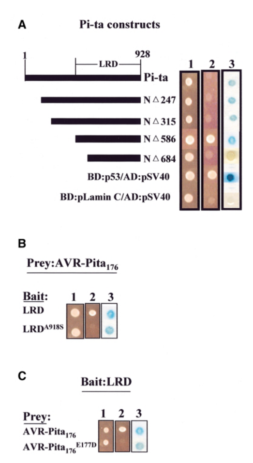

## Question

# Gene Research for Functional Annotation

## ⚠️ CRITICAL: Gene/Protein Identification Context

**BEFORE YOU BEGIN RESEARCH:** You MUST verify you are researching the CORRECT gene/protein. Gene symbols can be ambiguous, especially for less well-characterized genes from non-model organisms.

### Target Gene/Protein Identity (from UniProt):
- **UniProt Accession:** Q84UB1
- **Protein Description:** SubName: Full=Pi-ta protein {ECO:0000313|EMBL:AAO45178.1};
- **Gene Information:** Name=Pi-ta {ECO:0000313|EMBL:AAO45178.1};
- **Organism (full):** Oryza sativa subsp. japonica (Rice).
- **Protein Family:** Belongs to the disease resistance NB-LRR family.
- **Key Domains:** Apaf_helical. (IPR042197); Disease_R_plants. (IPR044974); LRR_dom_sf. (IPR032675); LRR_R13L4/SHOC2-like. (IPR055414); NB-ARC. (IPR002182)

### MANDATORY VERIFICATION STEPS:

1. **Check if the gene symbol "Pi-ta" matches the protein description above**
2. **Verify the organism is correct:** Oryza sativa subsp. japonica (Rice).
3. **Check if protein family/domains align with what you find in literature**
4. **If you find literature for a DIFFERENT gene with the same or similar symbol, STOP**

### If Gene Symbol is Ambiguous or You Cannot Find Relevant Literature:

**DO NOT PROCEED WITH RESEARCH ON A DIFFERENT GENE.** Instead:
- State clearly: "The gene symbol 'Pi-ta' is ambiguous or literature is limited for this specific protein"
- Explain what you found (e.g., "Found extensive literature on a different gene with the same symbol in a different organism")
- Describe the protein based ONLY on the UniProt information provided above
- Suggest that the protein function can be inferred from domain/family information

### Research Target:

Please provide a comprehensive research report on the gene **Pi-ta** (gene ID: Pi-ta, UniProt: Q84UB1) in ORYSJ.

The research report should be a detailed narrative explaining the function, biological processes, and localization of the gene product. Citations should be given for all claims.

You should prioritize authoritative reviews and primary scientific literature when conducting research. You can supplement
this with annotations you find in gene/protein databases, but these can be outdated or inaccurate.

We are specifically interested in the primary function of the gene - for enzymes, what reaction is catalyzed, and what is the substrate specificity? For transporters, what is the substrate? For structural proteins or adapters, what is the broader structural role? For signaling molecules, what is the role in the pathway.

We are interested in where in or outside the cell the gene product carries out its function.

We are also interested in the signaling or biochemical pathways in which the gene functions. We are less interested in broad pleiotropic effects, except where these elucidate the precise role.

Include evidence where possible. We are interested in both experimental evidence as well as inference from structure, evolution, or bioinformatic analysis. Precise studies should be prioritized over high-throughput, where available.

## Output

Question: You are an expert researcher providing comprehensive, well-cited information.

Provide detailed information focusing on:
1. Key concepts and definitions with current understanding
2. Recent developments and latest research (prioritize 2023-2024 sources)
3. Current applications and real-world implementations
4. Expert opinions and analysis from authoritative sources
5. Relevant statistics and data from recent studies

Format as a comprehensive research report with proper citations. Include URLs and publication dates where available.
Always prioritize recent, authoritative sources and provide specific citations for all major claims.

# Gene Research for Functional Annotation

## ⚠️ CRITICAL: Gene/Protein Identification Context

**BEFORE YOU BEGIN RESEARCH:** You MUST verify you are researching the CORRECT gene/protein. Gene symbols can be ambiguous, especially for less well-characterized genes from non-model organisms.

### Target Gene/Protein Identity (from UniProt):
- **UniProt Accession:** Q84UB1
- **Protein Description:** SubName: Full=Pi-ta protein {ECO:0000313|EMBL:AAO45178.1};
- **Gene Information:** Name=Pi-ta {ECO:0000313|EMBL:AAO45178.1};
- **Organism (full):** Oryza sativa subsp. japonica (Rice).
- **Protein Family:** Belongs to the disease resistance NB-LRR family.
- **Key Domains:** Apaf_helical. (IPR042197); Disease_R_plants. (IPR044974); LRR_dom_sf. (IPR032675); LRR_R13L4/SHOC2-like. (IPR055414); NB-ARC. (IPR002182)

### MANDATORY VERIFICATION STEPS:

1. **Check if the gene symbol "Pi-ta" matches the protein description above**
2. **Verify the organism is correct:** Oryza sativa subsp. japonica (Rice).
3. **Check if protein family/domains align with what you find in literature**
4. **If you find literature for a DIFFERENT gene with the same or similar symbol, STOP**

### If Gene Symbol is Ambiguous or You Cannot Find Relevant Literature:

**DO NOT PROCEED WITH RESEARCH ON A DIFFERENT GENE.** Instead:
- State clearly: "The gene symbol 'Pi-ta' is ambiguous or literature is limited for this specific protein"
- Explain what you found (e.g., "Found extensive literature on a different gene with the same symbol in a different organism")
- Describe the protein based ONLY on the UniProt information provided above
- Suggest that the protein function can be inferred from domain/family information

### Research Target:

Please provide a comprehensive research report on the gene **Pi-ta** (gene ID: Pi-ta, UniProt: Q84UB1) in ORYSJ.

The research report should be a detailed narrative explaining the function, biological processes, and localization of the gene product. Citations should be given for all claims.

You should prioritize authoritative reviews and primary scientific literature when conducting research. You can supplement
this with annotations you find in gene/protein databases, but these can be outdated or inaccurate.

We are specifically interested in the primary function of the gene - for enzymes, what reaction is catalyzed, and what is the substrate specificity? For transporters, what is the substrate? For structural proteins or adapters, what is the broader structural role? For signaling molecules, what is the role in the pathway.

We are interested in where in or outside the cell the gene product carries out its function.

We are also interested in the signaling or biochemical pathways in which the gene functions. We are less interested in broad pleiotropic effects, except where these elucidate the precise role.

Include evidence where possible. We are interested in both experimental evidence as well as inference from structure, evolution, or bioinformatic analysis. Precise studies should be prioritized over high-throughput, where available.

# Functional annotation report: rice Pi-ta (UniProt Q84UB1)

## Identity and principal conclusion

**The requested protein is Pi-ta from *Oryza sativa* subsp. *japonica* (ORYSJ), not the similarly named Pi-t receptor or the distinct rice protein PTR.** The supplied UniProt record identifies Q84UB1 as Pi-ta and assigns NB-ARC and leucine-rich-repeat (LRR) features. Published work identifies the corresponding rice NLR gene as **LOC_Os12g18360**; **PTR is LOC_Os12g18729**, a neighboring gene encoding a different, armadillo-repeat-containing resistance protein. The literature establishes the rice gene identity and NLR architecture, although the retrieved studies do not independently verify the accession-to-sequence mapping or the subspecies of every experimental line. (xiao2024theunconventionalresistance pages 2-3, xiao2024theunconventionalresistance pages 1-2)

**Recommended functional annotation:** Pi-ta is an *intracellular immune-receptor-like NB-ARC/LRR protein whose endogenous recognition specificity and precise contribution to blast resistance remain unresolved*. Historically, it was annotated as the receptor that directly recognizes the blast-fungus effector AVR-Pita. A locus-resolved 2024 study instead found that the tested AVR-Pita-specific resistance requires **PTR alleles, not Pi-ta**. This distinction is essential: evidence for PTR-mediated recognition must not be assigned to Q84UB1. (xiao2024theunconventionalresistance pages 7-8, xiao2024theunconventionalresistance pages 2-3, xiao2024theunconventionalresistance pages 1-2)

The primary-study comparisons underlying that assessment are summarized here.

| Proposition | Primary data | Warranted interpretation / limits |
|---|---|---|
| Historical model: Pi-ta (Q84UB1; LOC_Os12g18360) directly recognizes AVR-Pita | Jia et al. (2000) mapped interaction with mature AVR-Pita176 to the C-terminal leucine-rich domain of Pi-ta using yeast two-hybrid assays; far-western analysis supported direct in-vitro binding. Mutations altered interaction specificity. [DOI](https://doi.org/10.1093/emboj/19.15.4004) (liu2013recentprogressin pages 6-7, jia2000directinteractionof media ff5ce2d0, jia2000directinteractionof media bb645b18) | Supports physical association under yeast and in-vitro assay conditions, but not endogenous Pi-ta necessity during infection. Direct interaction in infected rice was not established, and Xiao et al. later failed to reproduce the yeast interaction. No Pi-ta cellular localization or ATPase activity was measured by these experiments. |
| Pi-ta can be required for isolate-specific resistance in Fuhui 2663 | He et al. (2022) mapped resistance to an approximately 80-kb chromosome-12 interval containing LOC_Os12g18360. Two CRISPR knockout lines of the Fuhui 2663 Pi-ta allele became susceptible to isolate KJ201; measured agronomic traits were not significantly altered. [DOI](https://doi.org/10.1038/s41598-022-19004-y) (he2022analysisofapplications pages 6-9, he2022analysisofa pages 8-9) | Provides genotype- and isolate-specific loss-of-function evidence for Pi-ta or a Pi-ta-dependent mechanism. Because Pi-ta lies in a tightly linked resistance region containing Ptr, the result should be reconciled with later locus-resolved studies and independently replicated. It does not establish AVR-Pita as the relevant KJ201 determinant or prove direct recognition. |
| PTR is a distinct resistance protein and must not be annotated as Pi-ta | Zhao et al. (2018) identified Ptr as LOC_Os12g18729, an atypical ARM-repeat protein near Pi-ta. A 2-bp deletion and 34 independent CRISPR Ptr knockouts caused susceptibility; mutant M2354 was susceptible to more than 300 isolates. [DOI](https://doi.org/10.1038/s41467-018-04369-4) (zhao2018thericeblast pages 8-9, zhao2018thericeblast pages 1-2) | Demonstrates a major resistance function for PTR, not for Q84UB1/LOC_Os12g18360. Earlier interpretation placed PTR downstream of or alongside Pi-ta; the 2024 evidence instead assigns AVR-Pita recognition directly to PTR alleles. |
| Cytoplasmic localization evidence applies to PTR, not Pi-ta | Zhao et al. (2018) reported that two PTR isoforms were mainly cytoplasmic using PTR:GFP-related experiments; altered PTR products showed differing cytoplasmic/nuclear distributions. [DOI](https://doi.org/10.1038/s41467-018-04369-4) (zhao2018thericeblast pages 1-2, zhao2018thericeblast pages 9-10) | This result cannot be transferred to Pi-ta. A direct, experimentally established subcellular localization for Q84UB1/LOC_Os12g18360 was not identified in the assessed literature; “intracellular/cytoplasmic receptor” remains an architectural inference or historical description. |
| In IR64 and K1, Pi-ta is dispensable whereas the corresponding Ptr allele is required | Xiao et al. (2024) tested four independent nlr pi-ta and four ptr mutant lines in IR64: nlr pi-ta mutants retained resistance to AVR-PitaO-137, whereas ptr mutants became susceptible. In K1, Pi-ta RNAi or knockout did not remove resistance, but PtrB disruption did. [DOI](https://doi.org/10.1038/s41477-024-01694-z) (xiao2024theunconventionalresistance pages 2-3, xiao2024theunconventionalresistance pages 7-8, xiao2024theunconventionalresistance pages 3-5) | Strong locus-resolved evidence that LOC_Os12g18360 is neither necessary nor sufficient for the tested historical Pi-ta/Pi-ta2 phenotypes. It assigns those phenotypes to PtrB and PtrA, respectively, but does not show that Pi-ta lacks every immune or physiological function. |
| PtrA is sufficient for AVR-Pita-dependent resistance without Pi-ta | Xiao et al. (2024) introduced PtrA into Nipponbare, which lacks functional Pi-ta/Pi-ta2 resistance; four independent transgenic lines became resistant specifically to an AVR-PitaO-137-expressing strain. [DOI](https://doi.org/10.1038/s41477-024-01694-z) (xiao2024theunconventionalresistance pages 2-3, xiao2024theunconventionalresistance pages 3-5) | Establishes sufficiency of PtrA in the tested background and supports a Pi-ta-independent mechanism. It does not establish direct AVR-Pita–PTR binding; the study did not detect such binding and allowed for additional host factors. |
| The 2022 and 2024 Pi-ta knockout results conflict | He et al. (2022) found that Pi-ta knockout abolished Fuhui 2663 resistance to KJ201, whereas Xiao et al. (2024) found that Pi-ta knockout did not affect AVR-Pita-triggered resistance in IR64 or K1 and that Ptr loss was causal. [He DOI](https://doi.org/10.1038/s41598-022-19004-y); [Xiao DOI](https://doi.org/10.1038/s41477-024-01694-z) (he2022analysisofapplications pages 6-9, he2022analysisofa pages 8-9, xiao2024theunconventionalresistance pages 2-3, xiao2024theunconventionalresistance pages 7-8) | The safest accession-level annotation is “NB-ARC/LRR immune-receptor-like protein of presently unresolved physiological specificity,” not a confirmed AVR-Pita receptor. Possible explanations include genetic-background or isolate specificity, dependence on linked genes, editing effects, or an uncharacterized Pi-ta role; these alternatives remain to be tested. |

*Table: Primary evidence distinguishes the Pi-ta NLR from the linked PTR resistance protein and highlights the unresolved conflict between 2022 and 2024 knockout studies. It also prevents PTR localization and AVR-Pita-recognition findings from being incorrectly assigned to Q84UB1.*

## Molecular role and biological process

Pi-ta belongs to the plant nucleotide-binding, LRR-containing receptor family. Its NB-ARC region, associated helical domains and LRR region support an **inferred role in intracellular immune signaling** during pathogen challenge. NB-ARC domains in this receptor class are associated with nucleotide-dependent conformational regulation; that family-level inference is **not evidence that Pi-ta itself has a measured ATP-hydrolysis rate, a known enzymatic substrate or a defined downstream signaling partner**. Pi-ta is not a demonstrated transporter or a conventional metabolic enzyme. The longer Pi-ta transcript also encodes a C-terminal thioredoxin-like integrated domain, whereas the shorter transcript lacks it; a biochemical function for that domain in Pi-ta has not been established. (xiao2024theunconventionalresistance pages 2-3, xiao2024theunconventionalresistance pages 1-2)

The historically proposed pathway was fungal **AVR-Pita → binding to the Pi-ta C-terminal LRR region → effector-triggered immunity and blast resistance**. Jia and colleagues reported that a processed AVR-Pita fragment, AVR-Pita176, interacted with Pi-ta-derived constructs in yeast two-hybrid experiments; their far-Western assays provided in-vitro binding evidence. The relevant original figures document those assays, but neither assay alone establishes that endogenous Pi-ta is required during infection of rice. AVR-Pita is the *fungal* secreted, metalloprotease-like effector—not a catalytic substrate established for the rice Pi-ta protein. [Jia *et al.*, **August 2000**, *EMBO Journal*, https://doi.org/10.1093/emboj/19.15.4004.] (liu2013recentprogressin pages 6-7, xiao2024theunconventionalresistance pages 6-7, jia2000directinteractionof media ff5ce2d0, jia2000directinteractionof media bb645b18)

**Current mechanistic revision.** Xiao and colleagues could not reproduce the reported AVR-Pita interaction with Pi-ta short/long constructs or their tested regions. More decisively, Pi-ta knockdown or knockout did not remove the tested AVR-Pita-dependent resistance, whereas disruption of the corresponding **Ptr** allele did. Their model attributes the historically named *Pi-ta* resistance specificity to **PtrB** and *Pi-ta2* specificity to **PtrA**, acting independently of the Pi-ta NLR. PtrA recognizes the tested AVR-Pita variants more broadly than PtrB; substitution of a critical effector tyrosine with cysteine at position 191/192 permits escape from PtrB recognition. Direct physical binding between AVR-Pita and PTR was not established either, leaving the immediate recognition mechanism and any intervening host factor open. [Xiao *et al.*, **June 2024**, *Nature Plants*, https://doi.org/10.1038/s41477-024-01694-z.] (xiao2024theunconventionalresistance pages 6-7, xiao2024theunconventionalresistance pages 7-8, xiao2024theunconventionalresistance pages 8-9)

The genetic evidence is unusually discriminating. In the Pi-ta2 background IR64, **four independent Pi-ta-mutant lines remained resistant**, whereas **four Ptr-mutant lines became susceptible** to the tested AVR-Pita-bearing strain. In the historically Pi-ta-resistant K1 background, Pi-ta reduction or disruption likewise retained resistance, while **PtrB** disruption removed it. Conversely, introducing **PtrA** into four independent Nipponbare lines conferred resistance specifically against an AVR-Pita-bearing strain. These results establish PTR necessity and, in the tested transgenic setting, sufficiency; they **do not establish that Pi-ta is biologically inert in all cultivars or against all pathogens**. [Xiao *et al.*, **2024**, https://doi.org/10.1038/s41477-024-01694-z.] (xiao2024theunconventionalresistance pages 2-3, xiao2024theunconventionalresistance pages 7-8, xiao2024theunconventionalresistance pages 3-5)

There is an important **unresolved contrary result**. He and colleagues mapped resistance of Fuhui 2663 to an approximately **80-kb chromosome-12 region** containing LOC_Os12g18360 and reported that knockout of its Pi-ta allele in **two lines** caused susceptibility to blast isolate KJ201. This provides evidence for a Pi-ta-dependent phenotype in that particular background and isolate, but the retrieved evidence does not establish that KJ201 resistance depends on AVR-Pita or resolve the discrepancy with the 2024 IR64/K1 experiments. Possible background-, isolate- or linked-locus effects should be investigated rather than assumed to explain it. [He *et al.*, **September 2022**, *Scientific Reports*, https://doi.org/10.1038/s41598-022-19004-y.] (he2022analysisofapplications pages 6-9, he2022analysisofa pages 8-9)

## Site of action and pathway limits

**Intracellular action is the defensible localization inference for Pi-ta; a specific Pi-ta compartment is not securely established by the retrieved experiments.** Jia and colleagues described Pi-ta as a *putative cytoplasmic receptor*, consistent with its NLR architecture and the proposed encounter with an effector inside the host cell. That description should not be upgraded to experimentally demonstrated, exclusive cytosolic localization of Q84UB1, nor to a claimed nuclear, membrane or extracellular location. [Jia *et al.*, **2000**, https://doi.org/10.1093/emboj/19.15.4004.] (liu2013recentprogressin pages 6-7, ragulakollu2025molecularbreedingapproaches pages 7-8)

Importantly, the report that **two isoforms are mainly cytoplasmic** concerns **PTR**, not Pi-ta: Zhao and colleagues measured PTR-related constructs while establishing PTR’s role in the chromosome-12 resistance region. The later 2024 work describes PTR as a membrane protein with a cytoplasmic armadillo-repeat region. Neither observation establishes the location of Pi-ta itself. [Zhao *et al.*, **May 2018**, *Nature Communications*, https://doi.org/10.1038/s41467-018-04369-4; Xiao *et al.*, **2024**, https://doi.org/10.1038/s41477-024-01694-z.] (zhao2018thericeblast pages 1-2, zhao2018thericeblast pages 9-10, xiao2024theunconventionalresistance pages 1-2)

Thus, Pi-ta has a credible **structural assignment to the intracellular NLR defense-signaling class**, but its own activating ligand, confirmed immediate signaling partners, nucleotide-cycle biochemistry, output mechanism and precise active compartment have not been established by the evidence reviewed here. In particular, the demonstrated AVR-Pita–PTR genetic pathway must not be presented as a proven Pi-ta signaling pathway. (xiao2024theunconventionalresistance pages 2-3, xiao2024theunconventionalresistance pages 7-8, xiao2024theunconventionalresistance pages 8-9)

## Recent research and applications

The 2024 reassessment substantially changes interpretation of older resistance-locus associations. Zhao and colleagues had already shown that PTR is independently important: a **two-base-pair Ptr deletion** truncated the protein in susceptible line M2354, and **34 independent Ptr knockout lines** lost resistance. Their earlier interpretation positioned PTR as required for resistance associated with Pi-ta/Pi-ta2; the 2024 experiments go further by testing whether the Pi-ta NLR itself is required for AVR-Pita detection. [Zhao *et al.*, **2018**, https://doi.org/10.1038/s41467-018-04369-4; Xiao *et al.*, **2024**, https://doi.org/10.1038/s41477-024-01694-z.] (zhao2018thericeblast pages 8-9, zhao2018thericeblast pages 1-2, xiao2024theunconventionalresistance pages 7-8)

The pathogen data illustrate why specificity and durability matter. In Xiao and colleagues’ collection, **36 of 44 isolates** yielded amplified AVR-Pita; **32** were sequenced and represented **11 protein variants**. All **36 AVR-Pita-amplifying isolates** were non-infectious on the tested Pi-ta2 line, consistent with broad recognition by its **PtrA** allele. These are isolate-collection observations, **not** a population-wide resistance rate or evidence that Pi-ta itself recognizes 36 isolates. [Xiao *et al.*, **2024**, https://doi.org/10.1038/s41477-024-01694-z.] (xiao2024theunconventionalresistance pages 3-5, xiao2024theunconventionalresistance pages 7-8)

For crop improvement, He and colleagues developed a **dCAPS marker** for the Fuhui 2663 Pi-ta-locus allele, differentiated by residue **918**, and found no significant difference in the measured agronomic traits between their edited and parental plants. More recently, a marker-assisted japonica breeding study selected **three improved Huruan1212 lines**: two carrying *Pigm* and one carrying *Pigm*, a *Pi-ta* marker and *badh2*. All three showed improved panicle-blast resistance relative to the recipient; because the combined line also carried *Pigm*, that experiment does **not isolate an independent protective effect of Q84UB1**. These are meaningful uses of resistance-associated germplasm and markers, but chromosome-12 linkage and the PTR results mean that a marker called “Pi-ta” cannot, by itself, identify the causal receptor. [He *et al.*, **2022**, https://doi.org/10.1038/s41598-022-19004-y; Ye *et al.*, **January 2025**, *Frontiers in Plant Science*, https://doi.org/10.3389/fpls.2024.1507827; Xiao *et al.*, **2024**, https://doi.org/10.1038/s41477-024-01694-z.] (he2022analysisofa pages 8-9, ye2025improvingpanicleblast pages 1-2, xiao2024theunconventionalresistance pages 7-8)

**Bottom line:** Q84UB1 can be confidently described by its supplied rice identity and NB-ARC/LRR immune-receptor architecture. Its assignment as the **direct AVR-Pita receptor is disputed by stronger recent locus-resolved genetics**, while the isolate-specific Pi-ta knockout result from 2022 prevents declaring that this NLR has no resistance function under any circumstances. A precise annotation should retain both the NLR inference and this experimentally unresolved physiological specificity. (xiao2024theunconventionalresistance pages 7-8, xiao2024theunconventionalresistance pages 2-3, he2022analysisofa pages 8-9)

References

1. (xiao2024theunconventionalresistance pages 2-3): Gui Xiao, Nutthalak Laksanavilat, Stella Cesari, Karine Lambou, Maël Baudin, Ahmad Jalilian, Mary Jeanie Telebanco-Yanoria, Veronique Chalvon, Isabelle Meusnier, Elisabeth Fournier, Didier Tharreau, Bo Zhou, Jun Wu, and Thomas Kroj. The unconventional resistance protein ptr recognizes the magnaporthe oryzae effector avr-pita in an allele-specific manner. Nature plants, 10:994-1004, Jun 2024. URL: https://doi.org/10.1038/s41477-024-01694-z, doi:10.1038/s41477-024-01694-z. This article has 38 citations and is from a highest quality peer-reviewed journal.

2. (xiao2024theunconventionalresistance pages 1-2): Gui Xiao, Nutthalak Laksanavilat, Stella Cesari, Karine Lambou, Maël Baudin, Ahmad Jalilian, Mary Jeanie Telebanco-Yanoria, Veronique Chalvon, Isabelle Meusnier, Elisabeth Fournier, Didier Tharreau, Bo Zhou, Jun Wu, and Thomas Kroj. The unconventional resistance protein ptr recognizes the magnaporthe oryzae effector avr-pita in an allele-specific manner. Nature plants, 10:994-1004, Jun 2024. URL: https://doi.org/10.1038/s41477-024-01694-z, doi:10.1038/s41477-024-01694-z. This article has 38 citations and is from a highest quality peer-reviewed journal.

3. (xiao2024theunconventionalresistance pages 7-8): Gui Xiao, Nutthalak Laksanavilat, Stella Cesari, Karine Lambou, Maël Baudin, Ahmad Jalilian, Mary Jeanie Telebanco-Yanoria, Veronique Chalvon, Isabelle Meusnier, Elisabeth Fournier, Didier Tharreau, Bo Zhou, Jun Wu, and Thomas Kroj. The unconventional resistance protein ptr recognizes the magnaporthe oryzae effector avr-pita in an allele-specific manner. Nature plants, 10:994-1004, Jun 2024. URL: https://doi.org/10.1038/s41477-024-01694-z, doi:10.1038/s41477-024-01694-z. This article has 38 citations and is from a highest quality peer-reviewed journal.

4. (liu2013recentprogressin pages 6-7): Wende Liu, Jinling Liu, Yuese Ning, Bo Ding, Xuli Wang, Zhilong Wang, and Guo-Liang Wang. Recent progress in understanding pamp- and effector-triggered immunity against the rice blast fungus magnaporthe oryzae. Molecular Plant, 6:605-620, May 2013. URL: https://doi.org/10.1093/mp/sst015, doi:10.1093/mp/sst015. This article has 237 citations and is from a highest quality peer-reviewed journal.

5. (jia2000directinteractionof media ff5ce2d0): Yulin Jia, Sean A. McAdams, Gregory T. Bryan, Howard P. Hershey, and Barbara Valent. Direct interaction of resistance gene and avirulence gene products confers rice blast resistance. The EMBO Journal, 19:4004-4014, Aug 2000. URL: https://doi.org/10.1093/emboj/19.15.4004, doi:10.1093/emboj/19.15.4004. This article has 1686 citations.

6. (jia2000directinteractionof media bb645b18): Yulin Jia, Sean A. McAdams, Gregory T. Bryan, Howard P. Hershey, and Barbara Valent. Direct interaction of resistance gene and avirulence gene products confers rice blast resistance. The EMBO Journal, 19:4004-4014, Aug 2000. URL: https://doi.org/10.1093/emboj/19.15.4004, doi:10.1093/emboj/19.15.4004. This article has 1686 citations.

7. (he2022analysisofapplications pages 6-9): Niqing He, Fenghuang Huang, Mingxiang Yu, Yebao Zhu, Qingshun Q. Li, and Dewei Yang. Analysis of applications of the rice blast disease-resistance pita-r gene and development of pita-r-dcaps marker for efficient marker-assisted selection. Jul 2022. URL: https://doi.org/10.21203/rs.3.rs-1848283/v1, doi:10.21203/rs.3.rs-1848283/v1.

8. (he2022analysisofa pages 8-9): Niqing He, Fenghuang Huang, Mingxiang Yu, Yebao Zhu, Qingshun Q. Li, and Dewei Yang. Analysis of a rice blast resistance gene pita-fuhui2663 and development of selection marker. Scientific Reports, Sep 2022. URL: https://doi.org/10.1038/s41598-022-19004-y, doi:10.1038/s41598-022-19004-y. This article has 21 citations and is from a peer-reviewed journal.

9. (zhao2018thericeblast pages 8-9): Haijun Zhao, Xueyan Wang, Yulin Jia, Bastian Minkenberg, Matthew Wheatley, Jiangbo Fan, Melissa H. Jia, Adam Famoso, Jeremy D. Edwards, Yeshi Wamishe, Barbara Valent, Guo-Liang Wang, and Yinong Yang. The rice blast resistance gene ptr encodes an atypical protein required for broad-spectrum disease resistance. Nature Communications, May 2018. URL: https://doi.org/10.1038/s41467-018-04369-4, doi:10.1038/s41467-018-04369-4. This article has 291 citations and is from a highest quality peer-reviewed journal.

10. (zhao2018thericeblast pages 1-2): Haijun Zhao, Xueyan Wang, Yulin Jia, Bastian Minkenberg, Matthew Wheatley, Jiangbo Fan, Melissa H. Jia, Adam Famoso, Jeremy D. Edwards, Yeshi Wamishe, Barbara Valent, Guo-Liang Wang, and Yinong Yang. The rice blast resistance gene ptr encodes an atypical protein required for broad-spectrum disease resistance. Nature Communications, May 2018. URL: https://doi.org/10.1038/s41467-018-04369-4, doi:10.1038/s41467-018-04369-4. This article has 291 citations and is from a highest quality peer-reviewed journal.

11. (zhao2018thericeblast pages 9-10): Haijun Zhao, Xueyan Wang, Yulin Jia, Bastian Minkenberg, Matthew Wheatley, Jiangbo Fan, Melissa H. Jia, Adam Famoso, Jeremy D. Edwards, Yeshi Wamishe, Barbara Valent, Guo-Liang Wang, and Yinong Yang. The rice blast resistance gene ptr encodes an atypical protein required for broad-spectrum disease resistance. Nature Communications, May 2018. URL: https://doi.org/10.1038/s41467-018-04369-4, doi:10.1038/s41467-018-04369-4. This article has 291 citations and is from a highest quality peer-reviewed journal.

12. (xiao2024theunconventionalresistance pages 3-5): Gui Xiao, Nutthalak Laksanavilat, Stella Cesari, Karine Lambou, Maël Baudin, Ahmad Jalilian, Mary Jeanie Telebanco-Yanoria, Veronique Chalvon, Isabelle Meusnier, Elisabeth Fournier, Didier Tharreau, Bo Zhou, Jun Wu, and Thomas Kroj. The unconventional resistance protein ptr recognizes the magnaporthe oryzae effector avr-pita in an allele-specific manner. Nature plants, 10:994-1004, Jun 2024. URL: https://doi.org/10.1038/s41477-024-01694-z, doi:10.1038/s41477-024-01694-z. This article has 38 citations and is from a highest quality peer-reviewed journal.

13. (xiao2024theunconventionalresistance pages 6-7): Gui Xiao, Nutthalak Laksanavilat, Stella Cesari, Karine Lambou, Maël Baudin, Ahmad Jalilian, Mary Jeanie Telebanco-Yanoria, Veronique Chalvon, Isabelle Meusnier, Elisabeth Fournier, Didier Tharreau, Bo Zhou, Jun Wu, and Thomas Kroj. The unconventional resistance protein ptr recognizes the magnaporthe oryzae effector avr-pita in an allele-specific manner. Nature plants, 10:994-1004, Jun 2024. URL: https://doi.org/10.1038/s41477-024-01694-z, doi:10.1038/s41477-024-01694-z. This article has 38 citations and is from a highest quality peer-reviewed journal.

14. (xiao2024theunconventionalresistance pages 8-9): Gui Xiao, Nutthalak Laksanavilat, Stella Cesari, Karine Lambou, Maël Baudin, Ahmad Jalilian, Mary Jeanie Telebanco-Yanoria, Veronique Chalvon, Isabelle Meusnier, Elisabeth Fournier, Didier Tharreau, Bo Zhou, Jun Wu, and Thomas Kroj. The unconventional resistance protein ptr recognizes the magnaporthe oryzae effector avr-pita in an allele-specific manner. Nature plants, 10:994-1004, Jun 2024. URL: https://doi.org/10.1038/s41477-024-01694-z, doi:10.1038/s41477-024-01694-z. This article has 38 citations and is from a highest quality peer-reviewed journal.

15. (ragulakollu2025molecularbreedingapproaches pages 7-8): Sravanthi Ragulakollu, Arul Loganathan, Manonmani Swaminatham, Gopalakrishnan Chellappan, Ravichandran Veeraswamy, and Ramalingam Jegadeesan. Molecular breeding approaches for sustainable rice blast management: recent advances and challenges. Frontiers in Plant Science, Sep 2025. URL: https://doi.org/10.3389/fpls.2025.1551018, doi:10.3389/fpls.2025.1551018. This article has 16 citations.

16. (ye2025improvingpanicleblast pages 1-2): Junhua Ye, Kai Wang, Yi Wang, Zhipeng Zhao, Ying Yan, Hang Yang, Lixia Zhang, Zejun Hu, Zhenying Shi, Dapeng Sun, Jianjiang Bai, Liming Cao, and Shujun Wu. Improving panicle blast resistance and fragrance in a high-quality japonica rice variety through breeding. Frontiers in Plant Science, Jan 2025. URL: https://doi.org/10.3389/fpls.2024.1507827, doi:10.3389/fpls.2024.1507827. This article has 6 citations.

## Artifacts

- [Edison artifact artifact-00](Pi-ta-deep-research-falcon_artifacts/artifact-00.md)

## Citations

1. xiao2024theunconventionalresistance pages 2-3
2. xiao2024theunconventionalresistance pages 1-2
3. xiao2024theunconventionalresistance pages 7-8
4. liu2013recentprogressin pages 6-7
5. he2022analysisofapplications pages 6-9
6. he2022analysisofa pages 8-9
7. zhao2018thericeblast pages 8-9
8. zhao2018thericeblast pages 1-2
9. zhao2018thericeblast pages 9-10
10. xiao2024theunconventionalresistance pages 3-5
11. xiao2024theunconventionalresistance pages 6-7
12. xiao2024theunconventionalresistance pages 8-9
13. ragulakollu2025molecularbreedingapproaches pages 7-8
14. ye2025improvingpanicleblast pages 1-2
15. DOI
16. He DOI
17. Xiao DOI
18. Jia *et al.*, **August 2000**, *EMBO Journal*, https://doi.org/10.1093/emboj/19.15.4004.
19. Xiao *et al.*, **June 2024**, *Nature Plants*, https://doi.org/10.1038/s41477-024-01694-z.
20. Xiao *et al.*, **2024**, https://doi.org/10.1038/s41477-024-01694-z.
21. He *et al.*, **September 2022**, *Scientific Reports*, https://doi.org/10.1038/s41598-022-19004-y.
22. Jia *et al.*, **2000**, https://doi.org/10.1093/emboj/19.15.4004.
23. Zhao *et al.*, **May 2018**, *Nature Communications*, https://doi.org/10.1038/s41467-018-04369-4; Xiao *et al.*, **2024**, https://doi.org/10.1038/s41477-024-01694-z.
24. Zhao *et al.*, **2018**, https://doi.org/10.1038/s41467-018-04369-4; Xiao *et al.*, **2024**, https://doi.org/10.1038/s41477-024-01694-z.
25. He *et al.*, **2022**, https://doi.org/10.1038/s41598-022-19004-y; Ye *et al.*, **January 2025**, *Frontiers in Plant Science*, https://doi.org/10.3389/fpls.2024.1507827; Xiao *et al.*, **2024**, https://doi.org/10.1038/s41477-024-01694-z.
26. https://doi.org/10.1093/emboj/19.15.4004
27. https://doi.org/10.1038/s41598-022-19004-y
28. https://doi.org/10.1038/s41467-018-04369-4
29. https://doi.org/10.1038/s41477-024-01694-z
30. https://doi.org/10.1093/emboj/19.15.4004.]
31. https://doi.org/10.1038/s41477-024-01694-z.]
32. https://doi.org/10.1038/s41598-022-19004-y.]
33. https://doi.org/10.1038/s41467-018-04369-4;
34. https://doi.org/10.1038/s41598-022-19004-y;
35. https://doi.org/10.3389/fpls.2024.1507827;
36. https://doi.org/10.1038/s41477-024-01694-z,
37. https://doi.org/10.1093/mp/sst015,
38. https://doi.org/10.1093/emboj/19.15.4004,
39. https://doi.org/10.21203/rs.3.rs-1848283/v1,
40. https://doi.org/10.1038/s41598-022-19004-y,
41. https://doi.org/10.1038/s41467-018-04369-4,
42. https://doi.org/10.3389/fpls.2025.1551018,
43. https://doi.org/10.3389/fpls.2024.1507827,