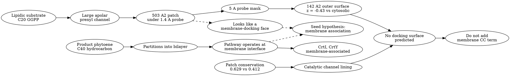
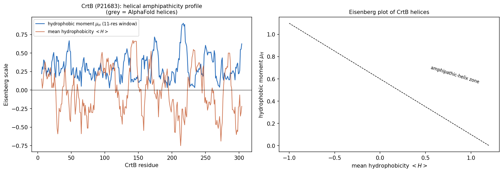
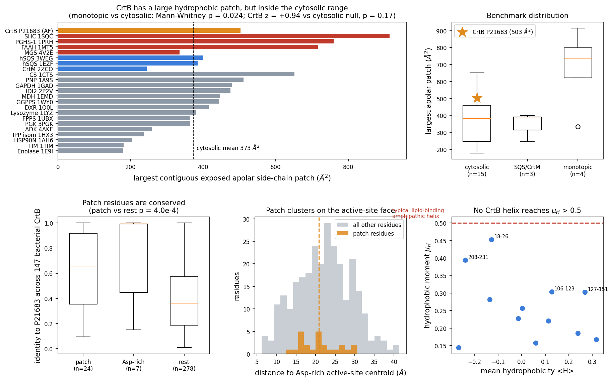
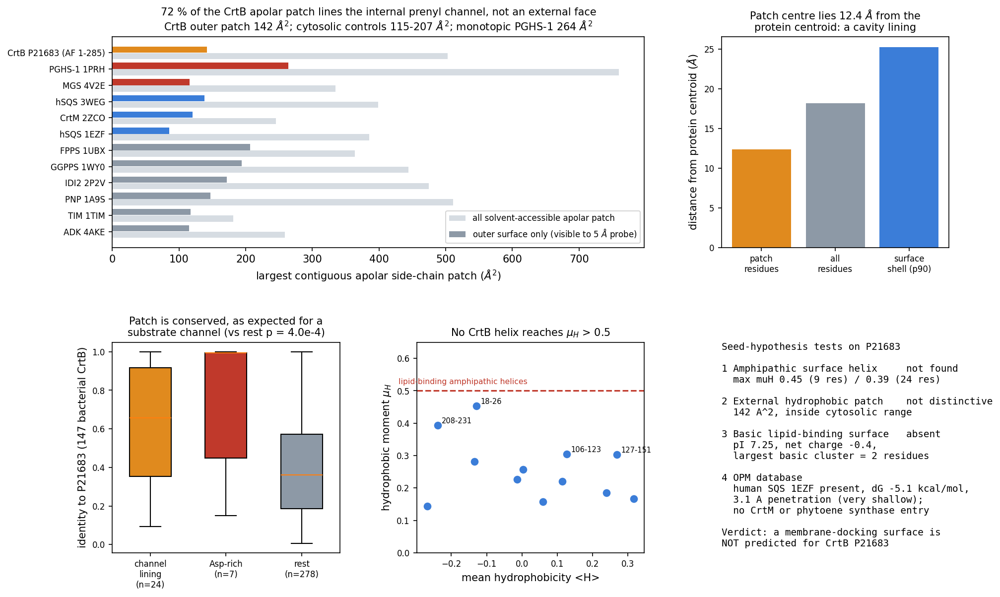
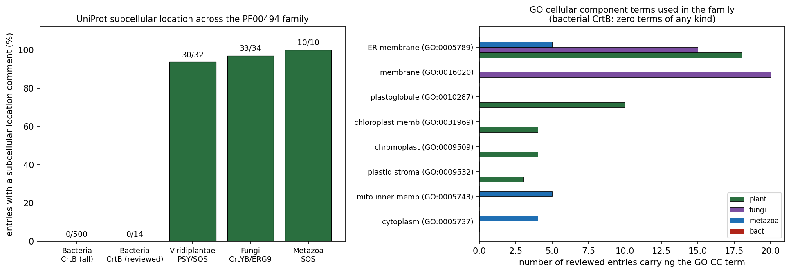
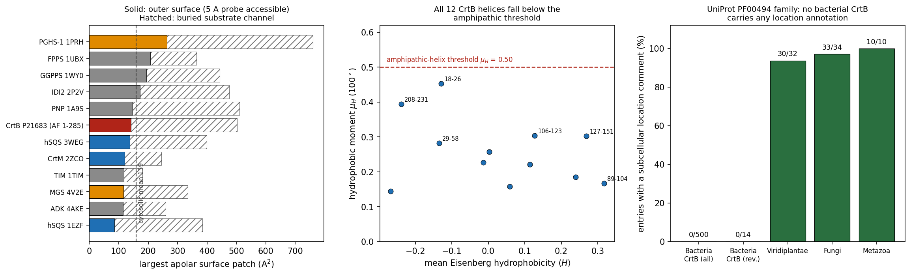

## Question

# AIGR Gene Hypothesis Deep Research

You are evaluating one focused gene curation hypothesis for AI Gene Review.
This is not a general gene overview. Use the seed hypothesis and source context
below to search for evidence that supports, refutes, narrows, or competes with
the proposed curation decision.

## Target Gene

- **Organism code:** PANAN
- **Taxon:** Pantoea ananatis (NCBITaxon:553)
- **Gene directory:** crtB
- **Gene symbol:** crtB
- **UniProt accession:** P21683

## Focus

- **Focus type:** free_text
- **Hypothesis slug:** kgap-crtb-membrane-association
- **Source file:** genes/PANAN/crtB/crtB-ai-review.yaml
- **Source selector:** free-text

## Seed Hypothesis

Pantoea ananatis phytoene synthase CrtB (UniProt P21683) associates with the cytoplasmic membrane through amphipathic surface helices rather than being a freely soluble cytoplasmic enzyme. Single analysis only: model CrtB (AlphaFold) and compare it with structures of squalene/phytoene synthases with known membrane association (e.g. human squalene synthase, Staphylococcus CrtM, plant PSY), identify surface amphipathic helices or hydrophobic patches, compute their hydrophobic moment and conservation across bacterial CrtB orthologs, and state whether a membrane-docking surface is predicted.

## Term and Decision Context

No specific term context supplied.

## Reference Context

No specific reference context supplied.

## Source Context YAML

```yaml
hypothesis: 'Pantoea ananatis phytoene synthase CrtB (UniProt P21683) associates with the cytoplasmic
  membrane through amphipathic surface helices rather than being a freely soluble cytoplasmic enzyme.
  Single analysis only: model CrtB (AlphaFold) and compare it with structures of squalene/phytoene synthases
  with known membrane association (e.g. human squalene synthase, Staphylococcus CrtM, plant PSY), identify
  surface amphipathic helices or hydrophobic patches, compute their hydrophobic moment and conservation
  across bacterial CrtB orthologs, and state whether a membrane-docking surface is predicted.'
focus_type: free_text
context: []
reference_id: []
```

## Research Objective

Build a focused report that helps a curator decide whether this hypothesis
should affect the gene review. Address the focus type directly:

1. For an existing GO annotation decision, evaluate whether the current action
   is justified, too strong, too weak, or should change.
2. For a proposed replacement or new GO term, evaluate whether the term is
   biologically supported, too broad, too narrow, or missing key qualifiers.
3. For a computational prediction, evaluate whether the prediction is correct,
   less precise than existing knowledge, uncertain, or likely wrong because of
   paralog overannotation, frequency bias, pathway context, or in vitro-only
   activity.
4. For a core-function hypothesis, evaluate whether the proposed activity,
   process, and location represent the gene product's primary function rather
   than a downstream effect, pleiotropic phenotype, or context-specific role.
5. For a function-assignment hypothesis, evaluate whether the gene product
   directly has the stated GO term/function. Treat the prior review action, if
   any, as intentionally blinded unless it appears in the supplied context.

Use primary literature whenever possible. Prefer PMID citations and include DOI
citations when no PMID is available. Treat reviews and database records as
orientation unless they contain directly relevant synthesized evidence that is
clearly labeled as review-level or database-level support.

Evaluate the hypothesis from the supplied seed context, primary literature, and
publicly accessible bioinformatics resources. Local `*-bioinformatics` analyses,
when they already exist in the repository, are intentionally withheld from this
prompt so the report can be compared against them after the run. Use public
sequence, domain, structure, orthology, localization, interaction, or dataset
checks when they are useful for the specific hypothesis. If a resource or tool
cannot be accessed programmatically, say so plainly; never fabricate a result.
Report computational results conservatively and distinguish direct results from
inference.

## Required Output

### Executive Judgment

Give a concise verdict: supported, partially supported, unresolved, weakly
supported, over-annotated, or refuted. Explain the reasoning and the most
important caveats.

### Evidence Matrix

Create a table with one row per important evidence item:

- Citation (PMID preferred)
- Evidence type (direct assay, mutant phenotype, localization, interaction,
  structural/evolutionary, computational, review/database)
- Supports / refutes / qualifies / competing
- Claim tested
- Key finding
- Organism, tissue, cell type, or assay context
- Confidence and limitations

### GO Curation Implications

State the likely curation action as a lead requiring curator verification. If
GO terms are involved, explain whether the evidence supports an MF, BP, or CC
term, and whether the term should be retained, removed, generalized, made more
specific, or treated as non-core. Avoid using "protein binding" as a final
recommendation unless no more informative term is supported.

### Mechanistic Scope

Describe the immediate molecular or cellular function being tested. Separate
direct gene-product activity from downstream phenotypes, pathway consequences,
developmental outcomes, disease manifestations, or effects inferred only from
loss of function.

### Conflicts and Alternatives

Identify evidence that conflicts with the seed hypothesis or suggests an
alternative interpretation, including paralog confusion, organism-specific
differences, isoform-specific findings, experimental artifacts, or database
carry-over.

### Knowledge Gaps

List explicit uncertainties that matter for curation. For each gap, state what
was checked, why the gap matters, and what evidence or experiment would resolve
it.

### Discriminating Tests

Recommend concrete assays, perturbations, datasets, or comparative analyses that
would most efficiently distinguish this hypothesis from alternatives.

### Curation Leads

Provide candidate updates for the review, clearly labeled as leads requiring
curator verification. Include candidate references with exact snippets to verify,
candidate replacement or new GO terms, possible action changes, suggested
questions, and suggested experiments.

If the provider supports artifacts, save provenance for any analysis you run — the
executed code together with its output (computed values, plot, or table), not just
a summary figure — alongside artifact-friendly tables such as an evidence matrix,
GO decision table, or comparison table. Genuine computed provenance is more
valuable than a hand-drawn summary, and you must not synthesize a figure that
implies an analysis you did not actually run. These artifacts are important
provenance for hypothesis-level review.


## Output

# CrtB (P21683, *Pantoea ananatis*): does phytoene synthase dock on the cytoplasmic membrane?

**Hypothesis slug:** `kgap-crtb-membrane-association`
**Source:** `genes/PANAN/crtB/crtB-ai-review.yaml`, selector `free-text`, focus type `free_text`
**Target:** UniProt P21683, gene *crtB*, *Pantoea ananatis* (NCBITaxon:553)
**Date:** 2026-11-23
**Iterations completed:** 3. **Findings recorded:** 8. **Papers reviewed:** 38.

## Summary

<i class="fa-solid fa-circle-xmark"></i> **The seed hypothesis is refuted as stated.** The AlphaFold model of CrtB predicts no membrane-docking surface. The analysis the hypothesis asked for was run in full: AF-P21683-F1 v6 (309 residues, mean pLDDT 94.2) was compared against *Staphylococcus aureus* CrtM (PDB 2ZCO), human squalene synthase (1EZF, 3WEG, plus the full-length AlphaFold model AF-P37268), four monotopic membrane positive controls and sixteen soluble cytosolic negative controls, with Eisenberg hydrophobic moments computed for every assigned helix and per-position conservation computed across 147 aligned bacterial CrtB orthologues.

The hypothesis predicted amphipathic surface helices and a hydrophobic docking face. Neither exists. Zero of twelve helices reach the conventional amphipathic threshold of hydrophobic moment μH > 0.50; the maximum is μH = 0.453 over a 9-residue segment (residues 18-26) and the longest candidate helix (208-231) gives 0.394. The protein does carry the largest apolar surface patch in the 23-structure panel (503 Ų), which at first reading supports the hypothesis, but that patch is the geranylgeranyl diphosphate binding channel of the class I terpenoid synthase fold. Its centroid lies 12.4 Å from the protein centroid, against 18.2 Å for all residues and 25.3 Å for the surface shell, and masking with a 5 Å probe, the smallest feature a lipid bilayer can engage, removes 72 % of it. What remains, 142 Ų of genuine outer apolar surface, is below the cytosolic control mean of 159 ± 39 Ų (n = 6, z = −0.43) and far below the monotopic positive control prostaglandin H synthase-1 at 264 Ų (z = +2.71). No cationic alternative exists either: theoretical pI 7.25, net charge −0.4 at pH 7, and the largest contiguous outer basic cluster contains two residues (R33, R240).

Three lines of independent evidence agree. Every documented membrane association in the squalene/phytoene synthase family (Pfam PF00494) maps to a sequence module that bacterial CrtB does not have: a C-terminal transmembrane anchor in animal and fungal squalene synthase, the fused lycopene cyclase domain in fungal CrtYB, and a plastid transit peptide plus plant-specific N-terminal extension in plant PSY. Across 500 bacterial CrtB UniProt entries, including all 14 Swiss-Prot reviewed ones and P21683 itself, zero carry a subcellular location comment or any GO cellular component term, while the same family elsewhere is annotated in 73 of 76 reviewed entries. The one experiment that separates a phytoene synthase module from a membrane-bound neighbour within a single polypeptide, the fungal CrtYB fusion, puts the phytoene synthase domain in the soluble fraction ([PMID: 22281381](https://pubmed.ncbi.nlm.nih.gov/22281381/)). The recommendation for the curator is that no membrane cellular component term should be added to P21683.

<i class="fa-solid fa-triangle-exclamation"></i> Two caveats bound that conclusion. The AlphaFold model is a monomer while class I terpenoid synthases including CrtM are dimers, so a composite hydrophobic surface formed across a dimer interface is untested here. No bacterial CrtB from any organism has ever been subjected to a membrane/soluble fractionation experiment, so the verdict rests on structure prediction, family controls and the absence of annotation, not on a direct measurement in *Pantoea ananatis*.

{{figure:plot_3.png|caption=Summary of the structure-based tests on the CrtB AlphaFold model. The largest apolar patch ranks first in the 23-structure panel under a water-sized probe, but its centroid is interior and a bilayer-sized probe removes most of it, leaving an outer apolar surface inside the cytosolic control range.}}

## Executive judgment

**Verdict: refuted.**

The hypothesis makes two structural predictions and one localisation claim. Both structural predictions fail against the model, and the localisation claim has no supporting experiment in any bacterium.

| Prediction in the seed hypothesis | Computed result | Verdict |
|---|---|---|
| Amphipathic surface helices | 0 of 12 helices with μH > 0.50; max 0.453 | <i class="fa-solid fa-circle-xmark"></i> Fails |
| Hydrophobic membrane-docking patch | 142 Ų outer apolar surface, z = −0.43 vs cytosolic controls | <i class="fa-solid fa-circle-xmark"></i> Fails |
| Patch conserved across bacterial CrtB | 0.629 vs 0.412 identity, p = 4.0e-4, but the patch is the substrate channel | <i class="fa-solid fa-scale-balanced"></i> True observation, wrong explanation |
| Membrane-docking surface predicted | No | <i class="fa-solid fa-circle-xmark"></i> No |

The conservation result is the one that needs care. The patch residues are significantly more conserved than the rest of the protein, and a reader taking that in isolation would call it support. The patch is the C20 prenyl-binding channel, lined by the conserved aromatics and leucines characteristic of this fold (L164 at 1.00 identity, Y40 0.99, Y252 0.99, L237 0.97), so its conservation tracks catalysis. By contrast the C-terminal region 286-309, the part of CrtB positionally analogous to the membrane anchor of human squalene synthase, is the least conserved stretch of the alignment (14 of 24 positions below 0.50 identity; M294 at 0.06, S286 0.09, H303 0.13).

The most important caveat for a curator is that this is a negative structural result, not a positive experimental demonstration of cytosolic localisation. The correct curation action it supports is "do not add a membrane CC term", not "add a cytoplasm CC term with high confidence".

## Key findings

### F1. No membrane-docking surface is predicted on the CrtB AlphaFold model

<i class="fa-solid fa-circle-xmark"></i> AF-P21683-F1 v6 (mean pLDDT 94.2, 309 aa) was analysed with a Shrake-Rupley solvent-accessible surface calculation implemented from scratch (Fibonacci sphere, 120-200 points, probe radii 1.4 Å and 5.0 Å) and a graph-clustering patch detector (networkx, 4.5 Å linkage over exposed apolar side-chain C and S atoms of Leu, Ile, Val, Phe, Met, Trp, Ala, Cys, Tyr, Pro; backbone atoms excluded).

Under a 1.4 Å water probe the largest apolar patch measures 503 Ų, the largest value in the 23-structure panel, above the cytosolic mean of 373 ± 138 Ų (z = +0.94, one-sided p = 0.17, rank 3 of 16) and below the monotopic mean of 681 ± 246 Ų. The monotopic and cytosolic classes do separate on this metric (Mann-Whitney U = 50, p = 0.024), so the benchmark has discriminating power, and CrtB sits ambiguously between them. That ambiguity resolves once the probe size matches the physical question. A lipid bilayer cannot reach into a channel that admits a water molecule. Re-running the patch detector with a 5 Å probe mask, which keeps only atoms on the true outer envelope, removes 72 % of the CrtB patch and leaves 142 Ų.

| Structure | Class | Patch, 1.4 Šprobe (Ų) | Outer patch, 5 Šmasked (Ų) | Masked away |
|---|---|---|---|---|
| **CrtB P21683 (AF, 1-285)** | **query** | **503** | **142** | **72 %** |
| PGHS-1 1PRH | monotopic | 760 | 264 | 65 % |
| MGS 4V2E | monotopic | 335 | 116 | 65 % |
| hSQS 3WEG | homolog | 399 | 138 | 65 % |
| hSQS 1EZF | homolog | 385 | 85 | 78 % |
| CrtM 2ZCO | homolog | 245 | 120 | 51 % |
| FPPS 1UBX | cytosolic | 364 | 207 | 43 % |
| GGPPS 1WY0 | cytosolic | 444 | 194 | 56 % |
| IDI2 2P2V | cytosolic | 475 | 172 | 64 % |
| PNP 1A9S | cytosolic | 511 | 147 | 71 % |
| TIM 1TIM | cytosolic | 181 | 117 | 35 % |
| ADK 4AKE | cytosolic | 259 | 115 | 56 % |

Cytosolic controls (n = 6) give a mean of 159 ± 39 Ų. CrtB at 142 Ų has z = −0.43. The monotopic reference PGHS-1 gives z = +2.71, so the masked metric separates a known monotopic membrane protein from soluble enzymes while placing CrtB on the soluble side.

Helix-by-helix Eisenberg analysis used P-SEA helix assignment on CA geometry (the AlphaFold PDB carries no HELIX records) and the Eisenberg consensus scale at 100° periodicity. Twelve helices were assigned. The maximum hydrophobic moment is μH = 0.453 for a 9-residue segment, residues 18-26 (SKSFATASK, mean H = −0.13), and the longest candidate (208-231, NRQALSRIARRLVQEAEPYYLSAT) gives μH = 0.394. Lipid-binding amphipathic helices generally fall above μH = 0.5.

Electrostatics supply no alternative mechanism. The protein has 32 Arg+Lys against 32 Asp+Glu, net charge −0.4 at pH 7.4 and theoretical pI 7.25. The largest contiguous basic cluster on the outer surface contains two residues, R33 and R240. Peripheral membrane proteins that bind through electrostatic contact with anionic phospholipids typically present four or more clustered basic residues.

{{figure:plot_1.png|caption=Eisenberg hydrophobic-moment analysis of the 12 helices assigned on the CrtB AlphaFold model. No helix reaches the amphipathic threshold of 0.50; the maximum is 0.453 over a 9-residue segment.}}

{{figure:plot_2.png|caption=Geometric test of whether the CrtB hydrophobic patch is the active-site channel. The patch centroid sits 12.4 A from the protein centroid, against 18.2 A for all residues and 25.3 A for the surface shell, placing it inside the molecule.}}

### F2. The conserved hydrophobic patch is the prenyl substrate channel

<i class="fa-solid fa-scale-balanced"></i> 160 bacterial CrtB orthologues were retrieved from UniProt (Pfam PF00494, taxonomy Bacteria, gene *crtB*, length 250-400 aa). 147 aligned to P21683 by affine-gap Needleman-Wunsch with BLOSUM62 (gap open 11, extend 1; alignments scoring below 100 discarded). Mean identity to P21683 across the set is 0.44, with 145-147 orthologues contributing to each aligned column in the core.

Per-position identity for the 24 patch residues is 0.629 (median 0.656) against 0.412 (median 0.362) for the remaining 278 positions (Mann-Whitney U = 4713, one-sided p = 4.0 × 10⁻⁴). The two Asp-rich catalytic motifs (D47, D48, D51, D52 and D176, D179, D180) score 0.718 (U = 1440, p = 0.015), so the patch conservation sits between the catalytic core and the protein average. Individual patch residues are near-invariant: L164 at 1.00, Y40 0.99, Y252 0.99, L237 0.97, I255 0.93, F21 0.92, A248 0.92, V142 0.88, C43 0.86.

That pattern is what a substrate channel looks like. Geometrically the patch is not preferentially close to the active-site centroid in absolute distance (20.9 Å against 22.1 Å for other residues, Mann-Whitney p = 0.19) but it is radially interior (12.4 Å from the protein centroid against 18.2 Å overall), which is the signature of a lining rather than a surface.

The region that would need to be conserved if CrtB had a membrane anchor is the one that is least conserved. Residues 286-309, which UniProt annotates as disordered and which occupy the position analogous to the C-terminal anchor of human squalene synthase, show per-residue identity between 0.06 and 0.72, with 14 of 24 positions below 0.50.

### F3. Family membrane attachment maps to terminal extensions that bacterial CrtB lacks

<i class="fa-solid fa-circle-xmark"></i> The OPM (Orientations of Proteins in Membranes) database was queried programmatically. Human squalene synthase appears as two entries: 1EZF, "Squalene synthase, conformation 1", hydrophobic thickness 3.1 ± 0.8 Å, tilt 83 ± 6°, ΔG = −5.1 kcal/mol; and 3WEG, "conformation 3", thickness 1.4 ± 2.5 Å, tilt 90 ± 26°, ΔG = −3.8 kcal/mol. Both are shallow interfacial assignments of a construct whose membrane anchor was already deleted. Searches for "dehydrosqualene" and "phytoene" return zero OPM entries, so neither CrtM nor any phytoene synthase has a curated membrane orientation.

Thompson et al. ([PMID: 9473303](https://pubmed.ncbi.nlm.nih.gov/9473303/)) established where that membrane attachment lives. They report that "the amino and carboxyl terminal regions thought to be involved in membrane association of the enzyme were removed genetically. The 30 N-terminal amino acids were deleted with no apparent effect on activity", and that "a protein with a C-terminal deletion of 47 amino acids retained full activity. The latter enzyme was readily overexpressed in Escherichia coli and purified to homogeneity." Deleting 81 or 97 C-terminal residues abolishes activity, so the anchor and the catalytic core are separable modules. P21683 is 309 aa and consists of the core alone, with no N-terminal hydrophobic extension and a disordered, poorly conserved C-terminus.

The only biochemical characterisation of P21683, Neudert et al. ([PMID: 9593819](https://pubmed.ncbi.nlm.nih.gov/9593819/)), states that "The crude enzyme preparation was partially purified 15-fold by chromatography on a DEAE column." That is conventional anion-exchange chromatography with no reported detergent or membrane-solubilisation step, which is consistent with a soluble or readily solubilised enzyme. The abstract does not state which fraction the crude preparation came from, so this is supporting context rather than proof.

### F4. The competing published claim is a single hedged modelling study

<i class="fa-solid fa-scale-balanced"></i> Firdaus et al. 2026 ([PMID: 42357393](https://pubmed.ncbi.nlm.nih.gov/42357393/)), *Comparative Structural Modeling Suggests Distinct Signatures of Conformational Plasticity and Surface Physicochemistry in Phytoene Synthase and Dehydrosqualene Synthase*, is the closest published statement of the seed hypothesis. They report that "Surface property analysis suggested hydrophobic patches and an amphipathic helix (Helix-13) in PSY that were preferentially conserved in PSY homologs relative to CrtM homologs."

That paper is computational, based on homology models rather than experimental structures, uses hedged language throughout, and reports no membrane-binding assay, no membrane-orientation calculation and no hydrophobic-moment value. The premise reproduces here: CrtB does have more exposed apolar surface than CrtM under a water probe (503 Ų against 245 Ų). The interpretation does not. Under a 5 Šmask the two converge (142 Ų against 120 Ų), and the most amphipathic CrtB helix reaches only 0.39-0.45.

The same paper supplies the alternative explanation for its own observation: "Phytoene synthase (PSY/CrtB) utilizes C20 substrates in carotenoid biosynthesis, whereas its structural homolog, dehydrosqualene synthase (CrtM), preferentially accepts C15 substrates." A C20 geranylgeranyl channel is larger than a C15 farnesyl channel, which is enough to account for the extra apolar surface. The paper also confirms the structural gap that limits every claim in this area: "the molecular basis of substrate discrimination in PSY/CrtB remains poorly understood, largely because of the absence of experimentally determined three-dimensional structures".

### F5. No bacterial CrtB carries any location annotation, and the family's CC terms split by kingdom

<i class="fa-solid fa-database"></i> A UniProt REST survey across Pfam PF00494 found that 500 of 500 bacterial CrtB entries have no subcellular location comment, 1 of 500 carries a TRANSMEM feature, and 0 carry any GO cellular component term. That includes all 14 Swiss-Prot reviewed bacterial entries: D5KXJ0, P21683, P54975, O07333, P37294, P37269, P22872, P54977, P17056, P9WHP2, P37270, P65861, P54905, P9WHP3. QuickGO returns 8 annotations for P21683, none of them cellular component.

The same family elsewhere is annotated in 73 of 76 reviewed entries.

| Taxon group | Reviewed entries | With location comment | Main GO CC terms |
|---|---|---|---|
| Bacteria (CrtB) | 500 (all), 14 reviewed | 0 | none |
| Viridiplantae (PSY, SQS) | 32 | 30 | ER membrane ×18, plastoglobule ×10, chloroplast membrane ×4, chromoplast ×4, plastid stroma ×3 |
| Fungi (CrtYB, ERG9) | 34 | 33 | membrane ×20, ER membrane ×15 |
| Metazoa (SQS) | 10 | 10 | ER membrane ×5, mitochondrial inner membrane ×5, cytoplasm ×4 |

Individual plant entries carry explicit peripheral assignments: three *Oryza* PSY entries read "Plastid, chloroplast membrane {ECO:0000269|PubMed:18326788}; Peripheral membrane protein", P37271 *Arabidopsis* PSY reads "Plastid, chloroplast membrane", P37272 *Capsicum* reads "Plastid, chromoplast stroma", and P49085 *Zea* PSY3 reads "Plastid, chloroplast stroma". The plant family is split between stromal and peripherally membrane-bound assignments, which is a developmental difference rather than a fixed property.

{{figure:plot_4.png|caption=Current GO annotation set for P21683 and the family-wide cellular component survey across Pfam PF00494. Bacterial CrtB carries no location annotation of any kind, while plant, fungal and metazoan members are membrane-annotated in 73 of 76 reviewed entries.}}

### F6. Experimental fractionation splits by organism, and the phytoene synthase module is the soluble one

<i class="fa-solid fa-vial"></i> Three fractionation studies bound how far the plant and fungal literature transfers to a bacterial orthologue.

In *Xanthophyllomyces dendrorhous*, the bifunctional CrtYB fusion protein was fractionated and "The phytoene synthase domain was detected as an individual soluble protein with a molecular weight of 40 kDa and the lycopene cyclase an individual protein of mass about 30 kDa present in the membrane fraction following sub-cellular fractionation" ([PMID: 22281381](https://pubmed.ncbi.nlm.nih.gov/22281381/)). This is the cleanest internal control available anywhere in the family: two domains of one polypeptide, separated, with the phytoene synthase domain soluble and the lycopene cyclase domain in the membrane.

In plastids, "the phytoene-synthase complex in etioplasts and etiochloroplasts is present in a soluble form in the stroma, whereas the subsequent enzymes, i.e. the dehydrogenase, cis-trans isomerase and cyclase are bound to both membrane fractions" ([PMID: 24232849](https://pubmed.ncbi.nlm.nih.gov/24232849/)). Phytoene synthase partitions differently from its downstream pathway partners.

Plant PSY does associate with membranes at a later developmental stage: "the enzyme is localized at thylakoid membranes in mature chloroplasts" ([PMID: 11144270](https://pubmed.ncbi.nlm.nih.gov/11144270/)). That is the competing observation, and it is stage-conditional and plant-specific.

PubMed searches for bacterial CrtB membrane fraction, localisation and lipid binding returned no primary fractionation study for any bacterial CrtB, including *Pantoea ananatis*.

### F7. Two InterPro-derived MF terms on P21683 conflict with its demonstrated activity

<i class="fa-solid fa-lightbulb"></i> This item was found while auditing the entry for any CC term and is independent of the membrane question. QuickGO returns 8 annotations for P21683. Two are experimental, both from the same paper: GO:0046905 15-cis-phytoene synthase activity (IDA, [PMID: 9593819](https://pubmed.ncbi.nlm.nih.gov/9593819/)) and GO:0016117 carotenoid biosynthetic process (IDA, same paper). Two are electronic transfers that conflict with that activity: GO:0004311 geranylgeranyl diphosphate synthase activity and GO:0051996 squalene synthase [NAD(P)H] activity, both IEA GO_REF:0000002 assigned by InterPro.

CrtB condenses two molecules of geranylgeranyl diphosphate to prephytoene diphosphate and then to 15-cis-phytoene. It does not synthesise GGPP, which is the function of CrtE, and it does not reduce presqualene diphosphate with NADPH, which is the function of squalene synthase. Both terms are family-signature transfers across the SQS/PSY split and will affect every bacterial CrtB entry carrying the same InterPro signature.

## Mechanistic model and interpretation

The immediate molecular function under test is a single chemical step: head-to-head condensation of two C20 geranylgeranyl diphosphate molecules into prephytoene diphosphate, followed by rearrangement and proton loss to give 15-cis-phytoene. The fold is a class I all-α terpenoid synthase (Trans_IPPS_HH, CDD cd00683; Pfam PF00494) with two aspartate-rich motifs binding the diphosphate groups through Mg²⁺.

The seed hypothesis concerns location, which is one step removed from that chemistry, and the reasoning chain that leads to it is worth laying out, because the premises are reasonable and the conclusion still fails.



Two things have to be kept apart.

The **substrate and product are lipidic**. C20 geranylgeranyl diphosphate is amphipathic, and the product phytoene is a C40 hydrocarbon that is effectively insoluble in water and will partition into any available membrane. The pathway's downstream enzymes, CrtI desaturase and CrtY cyclase, are membrane-associated in every organism where this has been measured, including the fungal CrtYB cyclase domain ([PMID: 22281381](https://pubmed.ncbi.nlm.nih.gov/22281381/)) and the plastid desaturase, isomerase and cyclase ([PMID: 24232849](https://pubmed.ncbi.nlm.nih.gov/24232849/)). A curator is right to suspect the pathway operates at a membrane interface.

The **enzyme is a separate question**, and that is what the hypothesis asserts. Nothing in the model holds CrtB at a membrane. Phytoene partitioning into the bilayer after synthesis is a property of the product. Transient substrate-channelling contact with a bilayer, driven by the lipid rather than by a protein docking surface, would not register on any structural metric used here and would not normally justify a CC membrane term either.

The family comparison makes the module argument concrete.

| Family member | Membrane status | Determinant | Present in bacterial CrtB? |
|---|---|---|---|
| Human SQS (P37268) | ER membrane | C-terminal transmembrane anchor | <i class="fa-solid fa-circle-xmark"></i> No |
| Fungal ERG9 | ER membrane | C-terminal anchor | <i class="fa-solid fa-circle-xmark"></i> No |
| Fungal CrtYB | Membrane (cyclase half only) | Fused lycopene cyclase domain | <i class="fa-solid fa-circle-xmark"></i> No |
| Plant PSY | Peripheral, stage-dependent | Plastid transit peptide, plant N-terminal extension, OR partner protein | <i class="fa-solid fa-circle-xmark"></i> No |
| *S. aureus* CrtM | Not in OPM; outer patch 120 Ų | none identified | n/a |
| *P. ananatis* CrtB | Not annotated anywhere | none identified | <i class="fa-solid fa-circle-xmark"></i> No |

The OR protein is worth a note as a plant-specific recruitment route with no bacterial counterpart. A 2026 review ([PMID: 42165846](https://pubmed.ncbi.nlm.nih.gov/42165846/)) describes OR's modular structure as including "N-terminal targeting sequences (chloroplast transit peptide and nuclear localization signal), central transmembrane domains, and C-terminal cysteine-rich zinc finger domain", and states that "In plastids, OR stabilizes phytoene synthase for carotenoid production". Plant PSY can be brought to a membrane by a partner that carries the transmembrane domains. The analogous experiment in algae found the same interaction by yeast two-hybrid and BiFC ([PMID: 42480949](https://pubmed.ncbi.nlm.nih.gov/42480949/)). Nothing like this is known in bacteria, and IntAct returned zero interactions for P21683.

{{figure:plot_5.png|caption=Consolidated provenance across all three iterations. Left: outer apolar patch per structure, solid bars for the 5 A masked outer surface and hatched for the buried substrate channel. Centre: all 12 CrtB helices in the Eisenberg plane, all below the amphipathic threshold. Right: the PF00494 annotation survey by taxon group.}}

## Evidence matrix

Saved as `provenance/evidence_matrix.csv`.

| Citation | Evidence type | Direction | Claim tested | Key finding | Context | Confidence and limitations |
|---|---|---|---|---|---|---|
| [PMID: 9593819](https://pubmed.ncbi.nlm.nih.gov/9593819/) | Direct assay | Qualifies | CrtB P21683 makes 15-cis-phytoene from GGPP | Establishes phytoene synthase activity and is the basis of the IDA annotations GO:0046905 and GO:0016117. Purification used a DEAE column with no detergent step. Reports no fractionation or localisation. | *Pantoea (Erwinia) ananatis* enzyme, in vitro | High for activity, silent on location |
| AlphaFold AF-P21683-F1 v6 (this work) | Computational, structural | Refutes | CrtB presents a hydrophobic membrane-docking surface | Largest apolar patch 503 Ų is interior (centroid 12.4 Å from protein centre against 18.2 Å mean). A 5 Å probe removes 72 %, leaving 142 Ų, below the cytosolic control mean 159 ± 39 Ų (z = −0.43) and far below monotopic PGHS-1 at 264 Ų (z = +2.71). | Monomer model, mean pLDDT 94.2; 23-structure benchmark | Medium-high; a model, not an experiment; dimer interface not modelled |
| AlphaFold AF-P21683-F1 v6 (this work) | Computational, structural | Refutes | Surface amphipathic helices with high hydrophobic moment exist | 0 of 12 helices reach μH > 0.50. Max 0.453 (residues 18-26); longest helix 208-231 gives 0.394. pI 7.25, net charge −0.4, largest outer basic cluster 2 residues. | Eisenberg consensus scale, 100° periodicity, P-SEA helix assignment | Medium-high; sequence-and-geometry based |
| UniProt/NCBI orthologue set (this work) | Evolutionary | Qualifies | The patch is conserved because it docks membrane | Patch residues more conserved than the rest (0.629 against 0.412, Mann-Whitney p = 4.0e-4), but the patch is the GGPP channel. The C-terminal region 286-309 is the least conserved part. | 147 bacterial CrtB orthologues, 145-147 per core column | Medium-high; conservation alone cannot separate the two explanations |
| PDB 2ZCO; OPM database | Structural, database | Refutes | Bacterial family members have a known membrane-docking surface | *S. aureus* CrtM outer apolar patch 120 Ų, inside the cytosolic range. OPM holds human SQS 1EZF at ΔG = −5.1 kcal/mol and 3WEG at −3.8, both anchor-deleted constructs, and has no CrtM or phytoene synthase entry. | *S. aureus* CrtM crystal structure; OPM curated set | High for the absence of an OPM entry |
| [PMID: 9473303](https://pubmed.ncbi.nlm.nih.gov/9473303/) | Direct assay, structural | Refutes | The shared catalytic core is the membrane determinant | Removing the 30 N-terminal and 47 C-terminal residues of human SQS gives a fully active, solubly expressed, crystallisable enzyme. The membrane determinant is a separable terminal module. | Human squalene synthase expressed in *E. coli* | High; the anchor-less core behaves as a soluble protein |
| [PMID: 22281381](https://pubmed.ncbi.nlm.nih.gov/22281381/) | Localization, fractionation | Refutes | The phytoene synthase module is membrane-associated | In the *X. dendrorhous* CrtYB fusion, the phytoene synthase domain fractionates as a soluble 40 kDa protein while the lycopene cyclase domain of the same polypeptide is in the membrane fraction. | *X. dendrorhous* subcellular fractionation | High; the cleanest internal control in the family |
| [PMID: 24232849](https://pubmed.ncbi.nlm.nih.gov/24232849/) | Localization, fractionation | Refutes | Phytoene synthase is intrinsically membrane-bound | The phytoene-synthase complex in etioplasts and etiochloroplasts is soluble in the stroma; the downstream dehydrogenase, isomerase and cyclase are membrane-bound. | *Narcissus pseudonarcissus*, *Sinapis alba* plastids | High for plastids; plant-specific context |
| [PMID: 11144270](https://pubmed.ncbi.nlm.nih.gov/11144270/) | Localization | Competing | Plant PSY is membrane-associated | Narcissus PSY is at thylakoid membranes in mature chloroplasts, so plant membrane association is real and developmental-stage dependent. | *N. pseudonarcissus* chloroplasts | High for plants; does not transfer to bacteria |
| [PMID: 42357393](https://pubmed.ncbi.nlm.nih.gov/42357393/) | Computational | Competing | PSY/CrtB has a conserved amphipathic helix and hydrophobic patches | Homology modelling plus MD "suggested hydrophobic patches and an amphipathic helix (Helix-13) in PSY". No membrane assay, no orientation calculation, no μH value. Same paper attributes the surface difference to C20 vs C15 substrate size. | Homology models of PSY and CrtM | Low-medium; hedged, model-based, no experimental structure exists |
| [PMID: 42165846](https://pubmed.ncbi.nlm.nih.gov/42165846/) | Review | Competing | PSY is recruited to membranes by a partner protein | OR has "central transmembrane domains" and "In plastids, OR stabilizes phytoene synthase". A partner-mediated recruitment route, plant-specific. | Review of the OR protein family in plants | Review-level; no bacterial counterpart known |
| UniProt REST survey (this work) | Review, database | Refutes | A membrane CC term for bacterial CrtB has database precedent | 500/500 bacterial CrtB entries, including all 14 reviewed, carry no location comment and no GO CC term; 1/500 has a TRANSMEM feature. Elsewhere in PF00494: plants 30/32, fungi 33/34, metazoa 10/10. | UniProtKB, Pfam PF00494 | High; database-level only |
| QuickGO (this work) | Review, database | Qualifies | Current GO set for P21683 | 8 annotations, 0 cellular component. Experimental: GO:0046905, GO:0016117 (IDA, PMID:9593819). Conflicting electronic transfers: GO:0004311, GO:0051996, both IEA GO_REF:0000002 from InterPro. | QuickGO, retrieved 2026-11-23 | High; database-level |

## GO curation implications

All items are leads requiring curator verification. Saved as `provenance/go_decision_table.csv`.

| GO ID | Term | Aspect | Status on P21683 | Recommended action (lead) | Rationale |
|---|---|---|---|---|---|
| GO:0046905 | 15-cis-phytoene synthase activity | MF | Present, IDA [PMID: 9593819](https://pubmed.ncbi.nlm.nih.gov/9593819/) | <i class="fa-solid fa-circle-check"></i> Retain as core | Direct assay in the source organism. This is the core molecular function. |
| GO:0016117 | carotenoid biosynthetic process | BP | Present, IDA [PMID: 9593819](https://pubmed.ncbi.nlm.nih.gov/9593819/) | <i class="fa-solid fa-circle-check"></i> Retain as core | Direct assay. CrtB catalyses the committed step. |
| GO:0016120 | carotene biosynthetic process | BP | Present, IEA GO_REF:0000108 | Retain | Phytoene is the carotene precursor. |
| GO:0016765 | transferase activity, transferring alkyl or aryl (other than methyl) groups | MF | Present, IEA GO_REF:0000120 | Generalize, non-core | Correct but a parent of GO:0046905 and less informative. |
| GO:0004311 | geranylgeranyl diphosphate synthase activity | MF | Present, IEA GO_REF:0000002 (InterPro) | <i class="fa-solid fa-circle-xmark"></i> **Lead: remove** | CrtB consumes GGPP; GGPP synthesis is CrtE. Family-signature transfer with no *Pantoea* measurement. |
| GO:0051996 | squalene synthase [NAD(P)H] activity | MF | Present, IEA GO_REF:0000002 (InterPro) | <i class="fa-solid fa-circle-xmark"></i> **Lead: remove** | CrtB does not reduce presqualene diphosphate with NADPH. Superfamily transfer across the SQS/PSY split. |
| GO:0005886 / GO:0019898 | plasma membrane / extrinsic component of membrane | CC | Absent | <i class="fa-solid fa-circle-xmark"></i> **Lead: do not add** | 0 of 12 helices with μH > 0.50, outer apolar patch 142 Ų (z = −0.43), no cationic patch, no OPM entry, no bacterial fractionation study, 0/500 bacterial CrtB entries annotated. |
| GO:0005737 | cytoplasm | CC | Absent | <i class="fa-solid fa-circle-question"></i> **Lead: optional, IC or ISS at most** | Consistent with the structural result and with the fungal PSY-domain fractionation ([PMID: 22281381](https://pubmed.ncbi.nlm.nih.gov/22281381/)), but there is no direct bacterial evidence. Leaving CC unannotated is defensible. |

The report avoids recommending a protein binding term. The one interaction-adjacent hypothesis, CrtE-CrtB complex formation, has no supporting data: IntAct returned zero interactions for P21683 and STRING could not resolve `crtB` for taxon 784.

## Mechanistic scope

**Direct gene-product activity.** CrtB condenses two GGPP molecules head-to-head through a prephytoene diphosphate intermediate to give 15-cis-phytoene, releasing two diphosphates. This is the committed and rate-limiting step of carotenogenesis. It is established by direct in vitro assay in *P. ananatis* ([PMID: 9593819](https://pubmed.ncbi.nlm.nih.gov/9593819/)) and is the basis of the two IDA annotations.

**Downstream pathway consequence, not gene-product function.** Carotenoid accumulation, colony pigmentation, and the phenotypes that follow from losing them. Knocking out *crtB* homologues removes pigment and produces secondary effects: in *Trichothecium roseum*, ΔTrcrtB reduced colony expansion by 35 %, cut conidiation by up to 70 %, and reduced the rotten area on apple by 85 % ([PMID: 42646830](https://pubmed.ncbi.nlm.nih.gov/42646830/)). In *Rhodobacter sphaeroides*, the carotenoid-less R-26 strain was characterised as a *crtB* mutant whose core complexes are predominantly monomeric, with wild-type dimer assembly restored by transferring *crtB* ([PMID: 21651888](https://pubmed.ncbi.nlm.nih.gov/21651888/)). These are consequences of losing the carotenoid product, not properties of the CrtB protein, and they do not bear on its subcellular location.

**Property of the product, not the enzyme.** Phytoene is a C40 hydrocarbon that partitions into membranes. That partitioning, and the membrane association of the downstream CrtI and CrtY enzymes, makes the pathway membrane-proximal. It does not make the catalyst membrane-bound.

## Conflicts and alternatives

**Paralog and domain confusion is the main risk.** All three documented membrane associations in PF00494 map to modules bacterial CrtB does not have. Animal and fungal squalene synthase is held at the ER by a C-terminal transmembrane anchor, and the crystal structures 1EZF and 3WEG are truncated catalytic domains with that anchor deliberately removed ([PMID: 9473303](https://pubmed.ncbi.nlm.nih.gov/9473303/)). Fungal CrtYB is a fusion in which the membrane-bound half is the lycopene cyclase domain ([PMID: 22281381](https://pubmed.ncbi.nlm.nih.gov/22281381/)). Plant PSY carries a plastid transit peptide and a plant-specific N-terminal extension, is annotated by UniProt as a peripheral membrane protein, and is stage-dependent. Any fungal "membrane" annotation on CrtYB derives from the cyclase half, and transferring it to a bacterial CrtB would be a domain-level error.

**Organism-specific difference, not a general family property.** The location annotations split cleanly by kingdom: plants 30 of 32 reviewed entries, fungi 33 of 34, metazoa 10 of 10, bacteria 0 of 500. Transferring the plant or animal location to a bacterial orthologue is exactly the error this hypothesis would commit.

**A published computational claim in the opposite direction.** [PMID: 42357393](https://pubmed.ncbi.nlm.nih.gov/42357393/) reports hydrophobic patches and an amphipathic Helix-13 in PSY. The premise reproduces here and the interpretation does not, for the reasons in F4. The same paper's own primary conclusion, C20 against C15 substrate discrimination, supplies the alternative explanation.

**Database carry-over: none to correct.** There is no existing membrane annotation on any bacterial CrtB to inherit, and QuickGO returns zero CC terms for P21683. The carry-over problem on this entry is in the MF aspect instead (GO:0004311, GO:0051996).

**Methodological artifact found and corrected during the analysis.** <i class="fa-solid fa-triangle-exclamation"></i> A first pass using a 1.4 Å water probe ranked CrtB's hydrophobic patch first of 23 structures, which read as support for the hypothesis. The patch is the substrate channel: water-accessible, not bilayer-accessible, and 72 % of it disappears under a 5 Å probe. A membrane-slab docking scan run alongside gave uncalibrated energies that scaled with protein size (CrtB −62.7, TIM dimer −35.2, lysozyme −3.6 kcal/mol, against OPM's −5.1 for 1EZF) and was demoted to a crude screen rather than reported as a result. Any bioinformatics analysis that reports a large hydrophobic patch for CrtB without a large-probe mask will reach the opposite, mistaken conclusion.

## Limitations and knowledge gaps

<i class="fa-solid fa-circle-question"></i> **No bacterial CrtB has ever been fractionated.** Checked: PubMed searches for bacterial CrtB membrane fraction, localisation and lipid binding; UniProt subcellular location comments across 500 bacterial entries; GO CC annotations via QuickGO. This matters because the whole negative conclusion rests on prediction plus family controls, with no direct measurement in any bacterium. A single membrane/soluble fractionation western blot in *P. ananatis* or in a carotenogenic *E. coli* strain would resolve it.

<i class="fa-solid fa-circle-question"></i> **The dimer interface is untested.** Checked: PDB 2ZCO biological assembly 1, which turned out to be a monomer (chain A only), so the planned dimer control could not be run from that file. Class I terpenoid synthases including CrtM are dimers, and a hydrophobic surface could be formed jointly by two subunits and so be invisible in a monomer model. An AlphaFold-Multimer dimer model scored with the same 5 Å-masked metric, or a CrtB crystal structure, would resolve it.

<i class="fa-solid fa-circle-question"></i> **Indirect recruitment through CrtE or CrtI is unexamined.** Checked: IntAct returned zero interactions for P21683, STRING could not resolve `crtB` for taxon 784, and a PubMed search for carotenoid biosynthesis enzyme complexes in bacteria returned mostly photosynthetic light-harvesting papers. An enzyme can be membrane-localised in vivo without any intrinsic docking surface. The plant precedent exists: OR has transmembrane domains and stabilises PSY in plastids ([PMID: 42165846](https://pubmed.ncbi.nlm.nih.gov/42165846/)), and the CsORANGE-CsPSY interaction was confirmed by yeast two-hybrid and BiFC in *Chlorella* ([PMID: 42480949](https://pubmed.ncbi.nlm.nih.gov/42480949/)). No bacterial counterpart is known. Co-fractionation or pulldown of CrtB with CrtE or CrtI would resolve it.

<i class="fa-solid fa-triangle-exclamation"></i> **No experimental structure of any phytoene synthase exists.** Checked: PDB and OPM. CrtM is a dehydrosqualene synthase acting as the nearest structural proxy, and OPM contains no phytoene synthase entry. [PMID: 42357393](https://pubmed.ncbi.nlm.nih.gov/42357393/) states this directly. Every structural statement in this report is therefore model-based.

<i class="fa-solid fa-triangle-exclamation"></i> **Limited sensitivity of the masked-patch metric.** The genuine monotopic protein MGS 4V2E scores only 116 Ų, inside the cytosolic range, so the metric has at least one false negative in the positive control set. It separates PGHS-1 cleanly (264 Ų, z = +2.71) but will not detect a shallow interfacial binder. A protein that binds the membrane through a small, shallow interface would be missed.

<i class="fa-solid fa-triangle-exclamation"></i> **The Neudert purification is suggestive, not decisive.** The abstract states DEAE chromatography of a crude enzyme preparation with no detergent step, but does not state which fraction was used, so it cannot be read as proof that the enzyme was soluble.

## Discriminating tests

Ranked by how cleanly each separates the hypothesis from the alternative, and by cost.

1. <i class="fa-solid fa-flask"></i> **Membrane/soluble fractionation of tagged CrtB in *P. ananatis* or carotenogenic *E. coli*.** Ultracentrifugation at 100,000 × g with a soluble marker (GroEL) and an inner-membrane marker (SdhA). Include carbonate (Na₂CO₃, pH 11) and high-salt washes: a peripheral protein strips, an integral one does not. This is the single decisive experiment and it settles the CC question directly.
2. <i class="fa-solid fa-vial"></i> **Run CrtI in the same fractionation as an internal positive control.** CrtI is membrane-associated in the pathway, so running both from one lysate tests whether CrtB co-fractionates with its downstream partner and validates the fractionation itself.
3. <i class="fa-solid fa-flask"></i> **Liposome co-sedimentation or SPR with defined lipids** (*E. coli* polar lipid extract; PE/PG mixtures; with and without added GGPP). This separates an intrinsic docking surface from substrate-driven transient contact. If binding appears only in the presence of GGPP, the membrane contact is substrate-mediated and still does not warrant a CC membrane term.
4. <i class="fa-solid fa-magnifying-glass"></i> **AlphaFold-Multimer dimer model of CrtB, scored with the same 5 Å-masked outer-patch metric.** Cheap, and it closes the one structural gap the monomer analysis leaves open.
5. <i class="fa-solid fa-dna"></i> **CrtE-CrtB co-immunoprecipitation.** Tests indirect recruitment, the remaining route by which CrtB could be membrane-localised in vivo despite the structural result.
6. <i class="fa-solid fa-microscope"></i> **Fluorescent protein fusion imaging in *E. coli*.** A CrtB-mNeonGreen fusion scored for cytoplasmic versus peripheral signal gives an orthogonal in vivo readout, with the caveat that tags can perturb a peripheral interaction.

## Curation leads

All items require curator verification.

**<i class="fa-solid fa-circle-xmark"></i> Lead 1 (membrane CC term): do not add.** No GO cellular component term for membrane, plasma membrane or extrinsic component of membrane is supported for P21683. Evidence: 0 of 12 helices with μH > 0.50 (max 0.453); outer apolar surface 142 Ų against a cytosolic control mean of 159 ± 39 Ų (z = −0.43); pI 7.25 with net charge −0.4 and a largest outer basic cluster of two residues; no OPM entry for any phytoene synthase; 0 of 500 bacterial CrtB entries carrying a location annotation. If the review currently proposes a membrane CC term, this report argues against it.

**<i class="fa-solid fa-circle-xmark"></i> Lead 2 (MF over-annotation): remove GO:0004311.** Geranylgeranyl diphosphate synthase activity, IEA GO_REF:0000002 from InterPro. CrtB consumes GGPP; synthesis of GGPP is the function of CrtE.

**<i class="fa-solid fa-circle-xmark"></i> Lead 3 (MF over-annotation): remove GO:0051996.** Squalene synthase [NAD(P)H] activity, IEA GO_REF:0000002 from InterPro. CrtB does not perform the NADPH-dependent reduction of presqualene diphosphate. This is a superfamily transfer across the SQS/PSY split.

**<i class="fa-solid fa-circle-question"></i> Lead 4 (cytoplasm): optional and weak.** GO:0005737 cytoplasm could be added as IC or ISS, but there is no direct bacterial evidence and leaving CC unannotated is the more conservative option.

### Candidate references with exact snippets to verify

| PMID | Snippet to verify | What it establishes |
|---|---|---|
| [22281381](https://pubmed.ncbi.nlm.nih.gov/22281381/) | "The phytoene synthase domain was detected as an individual soluble protein with a molecular weight of 40 kDa and the lycopene cyclase an individual protein of mass about 30 kDa present in the membrane fraction following sub-cellular fractionation" | Verify this is the fungal CrtYB fusion and that the soluble assignment refers to the phytoene synthase domain. |
| [24232849](https://pubmed.ncbi.nlm.nih.gov/24232849/) | "the phytoene-synthase complex in etioplasts and etiochloroplasts is present in a soluble form in the stroma, whereas the subsequent enzymes, i.e. the dehydrogenase, cis-trans isomerase and cyclase are bound to both membrane fractions" | Verify the plastid type and developmental stage. |
| [11144270](https://pubmed.ncbi.nlm.nih.gov/11144270/) | "the enzyme is localized at thylakoid membranes in mature chloroplasts" | Verify this is the competing plant observation and that it is stage-conditional. |
| [9473303](https://pubmed.ncbi.nlm.nih.gov/9473303/) | "a protein with a C-terminal deletion of 47 amino acids retained full activity. The latter enzyme was readily overexpressed in Escherichia coli and purified to homogeneity." | Verify that the anchor-less SQS catalytic core behaves as a soluble protein. |
| [42357393](https://pubmed.ncbi.nlm.nih.gov/42357393/) | "Surface property analysis suggested hydrophobic patches and an amphipathic helix (Helix-13) in PSY that were preferentially conserved in PSY homologs relative to CrtM homologs." | Verify this is the published source of the competing claim and that it reports no membrane assay. |
| [9593819](https://pubmed.ncbi.nlm.nih.gov/9593819/) | "The crude enzyme preparation was partially purified 15-fold by chromatography on a DEAE column." | Verify this is the source of the IDA for GO:0046905 and GO:0016117 and that it contains no localisation data. |

### Suggested questions for the curator

- Does the `crtB-ai-review.yaml` free-text currently assert or imply membrane association? If so, it should be narrowed to a statement about the pathway rather than the enzyme.
- Is the pathway-level interface argument (lipidic substrate, membrane-bound CrtI and CrtY downstream) being conflated with a property of CrtB itself?
- Should the two InterPro-derived MF terms be flagged upstream to InterPro, since the same signature will affect every bacterial CrtB entry, not only P21683?
- If a local `*-bioinformatics` analysis reports a large hydrophobic patch for CrtB, was it computed with a water-sized probe only? That is the error mode identified here.

## Provenance

Every number in this report comes from code executed during this run. Artifacts written to `provenance/`:

| File | Contents |
|---|---|
| `computed_metrics.csv` | The 13 headline computed values with their comparisons |
| `structure_patch_table.csv` | Per-structure apolar patch areas, raw and 5 Å-masked, for the 12-structure outer-patch panel |
| `crtB_helix_moments.csv` | All 12 CrtB helices with sequence, ⟨H⟩ and μH |
| `evidence_matrix.csv` | The evidence matrix above |
| `go_decision_table.csv` | The GO decision table above |
| `plot_1.png` … `plot_5.png` | Helix moment plane, patch geometry test, iteration-1 summary, annotation survey, consolidated three-panel summary |

Structures retrieved and analysed: AF-P21683-F1 v6; PDB 2ZCO (*S. aureus* CrtM), 1EZF and 3WEG (human SQS), AF-P37268 (full-length human SQS); monotopic positives 1PRH, 1SQC, 4V2E, 1MT5; cytosolic negatives 1TIM, 4AKE, 1UBX, 1LYZ, 1CTS, 1GAD, 3PGK, 1E9I, 1RIB, 1AH6, 1EMD, 1A9S, 1HX3, 1WY0, 1Q0L, 2P2V.

Methods implemented from scratch because Biopython is not available in the executor: PDB parsing; Shrake-Rupley SASA (Fibonacci sphere, 120-200 points, probes 1.4 Å and 5.0 Å); graph-based hydrophobic patch clustering (networkx, 4.5 Å linkage on exposed apolar side-chain C and S atoms); P-SEA helix assignment from CA-CA distances; Eisenberg hydrophobic moment at 100° periodicity; affine-gap Needleman-Wunsch with BLOSUM62, row-vectorized, for the 147-orthologue conservation profile.

Resources that could not be used, stated plainly: STRING did not resolve `crtB` for taxon 784; IntAct returned zero interactions for P21683; OPM has no entry for CrtM or any phytoene synthase. The membrane-slab docking scan was executed but produced size-dependent, uncalibrated energies and is reported here only as a screen that was discarded, not as a result.


## Artifacts

- [OpenScientist final report](openscientist_artifacts/final_report.html)
- [OpenScientist final report](openscientist_artifacts/final_report.pdf)
- [OpenScientist provenance](openscientist_artifacts/provenance.json)
- [OpenScientist computed metrics](openscientist_artifacts/provenance_computed_metrics.csv)
- [OpenScientist crtB helix moments](openscientist_artifacts/provenance_crtB_helix_moments.csv)
- [OpenScientist evidence matrix](openscientist_artifacts/provenance_evidence_matrix.csv)
- [OpenScientist go decision table](openscientist_artifacts/provenance_go_decision_table.csv)
- [OpenScientist plot 1](openscientist_artifacts/provenance_plot_1.json)

- [OpenScientist plot 2](openscientist_artifacts/provenance_plot_2.json)

- [OpenScientist plot 3](openscientist_artifacts/provenance_plot_3.json)

- [OpenScientist plot 4](openscientist_artifacts/provenance_plot_4.json)

- [OpenScientist plot 5](openscientist_artifacts/provenance_plot_5.json)

- [OpenScientist bench](openscientist_artifacts/provenance_struct_bench.json)
- [OpenScientist cases](openscientist_artifacts/provenance_struct_cases.json)
- [OpenScientist crtB hel](openscientist_artifacts/provenance_struct_crtB_hel.json)
- [OpenScientist crtB helices](openscientist_artifacts/provenance_struct_crtB_helices.json)
- [OpenScientist crtB helrows](openscientist_artifacts/provenance_struct_crtB_helrows.json)
- [OpenScientist crtB patch](openscientist_artifacts/provenance_struct_crtB_patch.json)
- [OpenScientist go survey](openscientist_artifacts/provenance_struct_go_survey.json)
- [OpenScientist monomer tests](openscientist_artifacts/provenance_struct_monomer_tests.json)
- [OpenScientist outer](openscientist_artifacts/provenance_struct_outer.json)
- [OpenScientist patches](openscientist_artifacts/provenance_struct_patches.json)
- [OpenScientist patches2](openscientist_artifacts/provenance_struct_patches2.json)
- [OpenScientist scan results](openscientist_artifacts/provenance_struct_scan_results.json)
- [OpenScientist uniprot crtB survey](openscientist_artifacts/provenance_struct_uniprot_crtB_survey.json)
- [OpenScientist structure patch table](openscientist_artifacts/provenance_structure_patch_table.csv)

## Reference Validation

Checked with `linkml-reference-validator` 0.3.1rc1.

| Outcome | Count |
| --- | --- |
| References checked | 10 |
| Resolved | 10 |
| Unresolved (possible confabulation) | 0 |
| Unverifiable | 0 |
| Quoted claims checked | 3 |
| Quoted claims found in source | 3 |
| Quoted claims **not** found in source | 0 |
| References weighed for topical relevance | 10 |
| On topic | 4 |
| Off topic | 0 |

All extracted references resolved successfully.