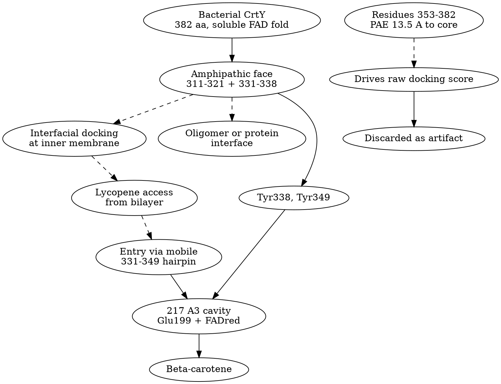
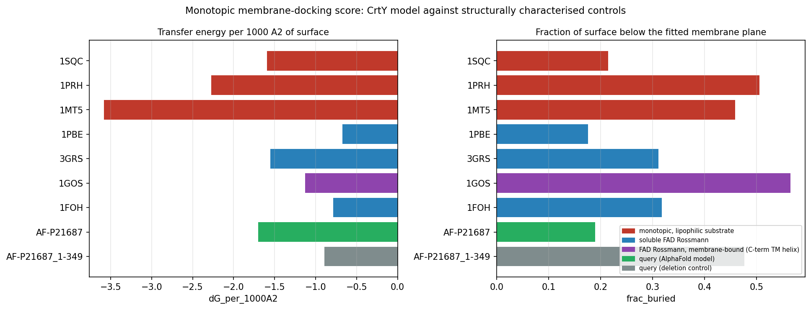
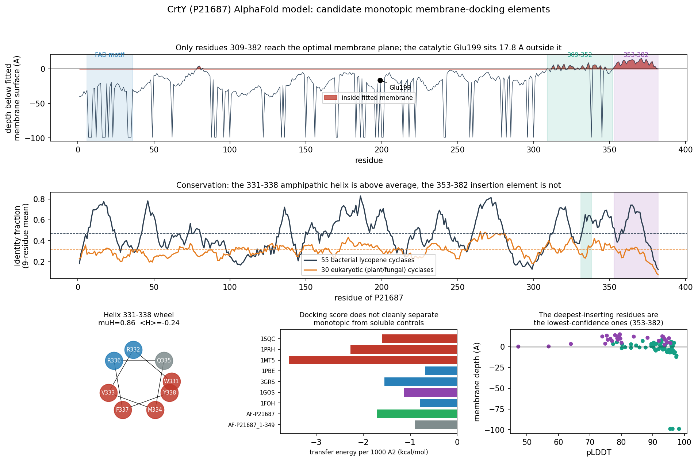
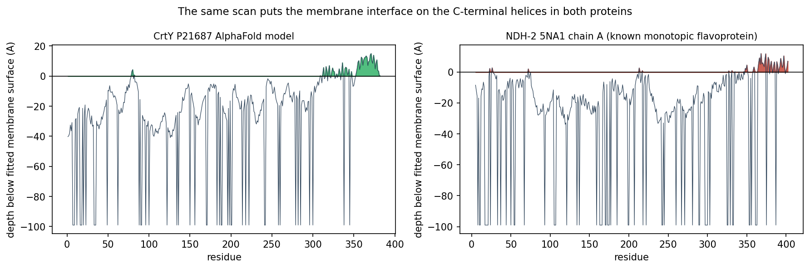
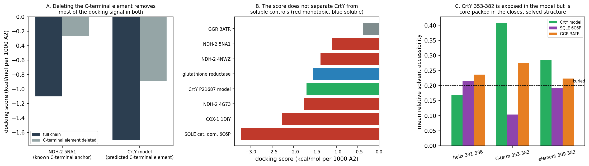
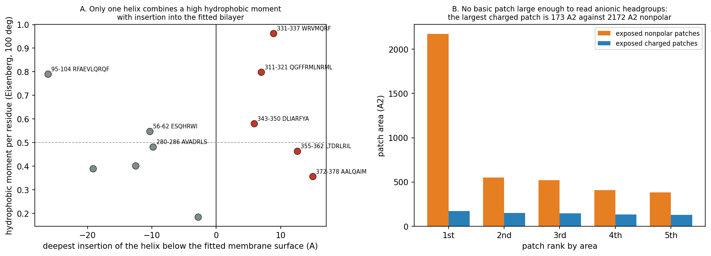
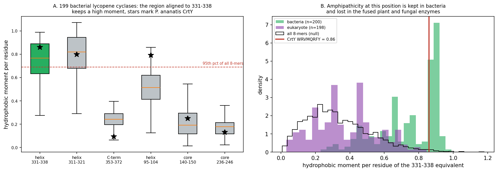
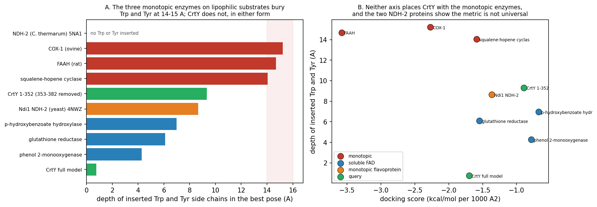

## Question

# AIGR Gene Hypothesis Deep Research

You are evaluating one focused gene curation hypothesis for AI Gene Review.
This is not a general gene overview. Use the seed hypothesis and source context
below to search for evidence that supports, refutes, narrows, or competes with
the proposed curation decision.

## Target Gene

- **Organism code:** PANAN
- **Taxon:** Pantoea ananatis (NCBITaxon:553)
- **Gene directory:** crtY
- **Gene symbol:** crtY
- **UniProt accession:** P21687

## Focus

- **Focus type:** free_text
- **Hypothesis slug:** kgap-crty-membrane-docking
- **Source file:** genes/PANAN/crtY/crtY-ai-review.yaml
- **Source selector:** free-text

## Seed Hypothesis

How CrtY (P21687) docks onto a membrane to reach its hydrophobic substrate may be predictable from sequence and model. That the inner-membrane location is experimentally supported, that there is no signal peptide or transmembrane span so an integral multipass topology is excluded, and that Glu199 is a catalytic residue, is already established, so do not re-derive it. Single analysis only: from the AlphaFold model, compute the surface distribution of hydrophobic and basic residues and identify every candidate monotopic membrane-binding element, including amphipathic helices with their hydrophobic moments, exposed hydrophobic patches with their areas, and basic patches that could read anionic phospholipid headgroups, giving residue ranges for each; state the spatial relationship between the strongest candidate element and both the predicted FAD site and Glu199, and whether the geometry would place the substrate-entry channel at the membrane surface; compare these features with structurally characterised monotopic membrane enzymes that act on lipophilic substrates, and with a soluble FAD enzyme of the same fold family as a negative control; and report conservation of the candidate element across bacterial lycopene cyclases and in the fused plant and fungal enzymes. State which element most likely mediates peripheral membrane docking and which mutation would test it, and say plainly if the model cannot distinguish a genuine membrane-binding element from an ordinary hydrophobic surface.

## Term and Decision Context

No specific term context supplied.

## Reference Context

No specific reference context supplied.

## Source Context YAML

```yaml
hypothesis: 'How CrtY (P21687) docks onto a membrane to reach its hydrophobic substrate may be predictable
  from sequence and model. That the inner-membrane location is experimentally supported, that there is
  no signal peptide or transmembrane span so an integral multipass topology is excluded, and that Glu199
  is a catalytic residue, is already established, so do not re-derive it. Single analysis only: from the
  AlphaFold model, compute the surface distribution of hydrophobic and basic residues and identify every
  candidate monotopic membrane-binding element, including amphipathic helices with their hydrophobic moments,
  exposed hydrophobic patches with their areas, and basic patches that could read anionic phospholipid
  headgroups, giving residue ranges for each; state the spatial relationship between the strongest candidate
  element and both the predicted FAD site and Glu199, and whether the geometry would place the substrate-entry
  channel at the membrane surface; compare these features with structurally characterised monotopic membrane
  enzymes that act on lipophilic substrates, and with a soluble FAD enzyme of the same fold family as
  a negative control; and report conservation of the candidate element across bacterial lycopene cyclases
  and in the fused plant and fungal enzymes. State which element most likely mediates peripheral membrane
  docking and which mutation would test it, and say plainly if the model cannot distinguish a genuine
  membrane-binding element from an ordinary hydrophobic surface.'
focus_type: free_text
context: []
reference_id: []
```

## Research Objective

Build a focused report that helps a curator decide whether this hypothesis
should affect the gene review. Address the focus type directly:

1. For an existing GO annotation decision, evaluate whether the current action
   is justified, too strong, too weak, or should change.
2. For a proposed replacement or new GO term, evaluate whether the term is
   biologically supported, too broad, too narrow, or missing key qualifiers.
3. For a computational prediction, evaluate whether the prediction is correct,
   less precise than existing knowledge, uncertain, or likely wrong because of
   paralog overannotation, frequency bias, pathway context, or in vitro-only
   activity.
4. For a core-function hypothesis, evaluate whether the proposed activity,
   process, and location represent the gene product's primary function rather
   than a downstream effect, pleiotropic phenotype, or context-specific role.
5. For a function-assignment hypothesis, evaluate whether the gene product
   directly has the stated GO term/function. Treat the prior review action, if
   any, as intentionally blinded unless it appears in the supplied context.

Use primary literature whenever possible. Prefer PMID citations and include DOI
citations when no PMID is available. Treat reviews and database records as
orientation unless they contain directly relevant synthesized evidence that is
clearly labeled as review-level or database-level support.

Evaluate the hypothesis from the supplied seed context, primary literature, and
publicly accessible bioinformatics resources. Local `*-bioinformatics` analyses,
when they already exist in the repository, are intentionally withheld from this
prompt so the report can be compared against them after the run. Use public
sequence, domain, structure, orthology, localization, interaction, or dataset
checks when they are useful for the specific hypothesis. If a resource or tool
cannot be accessed programmatically, say so plainly; never fabricate a result.
Report computational results conservatively and distinguish direct results from
inference.

## Required Output

### Executive Judgment

Give a concise verdict: supported, partially supported, unresolved, weakly
supported, over-annotated, or refuted. Explain the reasoning and the most
important caveats.

### Evidence Matrix

Create a table with one row per important evidence item:

- Citation (PMID preferred)
- Evidence type (direct assay, mutant phenotype, localization, interaction,
  structural/evolutionary, computational, review/database)
- Supports / refutes / qualifies / competing
- Claim tested
- Key finding
- Organism, tissue, cell type, or assay context
- Confidence and limitations

### GO Curation Implications

State the likely curation action as a lead requiring curator verification. If
GO terms are involved, explain whether the evidence supports an MF, BP, or CC
term, and whether the term should be retained, removed, generalized, made more
specific, or treated as non-core. Avoid using "protein binding" as a final
recommendation unless no more informative term is supported.

### Mechanistic Scope

Describe the immediate molecular or cellular function being tested. Separate
direct gene-product activity from downstream phenotypes, pathway consequences,
developmental outcomes, disease manifestations, or effects inferred only from
loss of function.

### Conflicts and Alternatives

Identify evidence that conflicts with the seed hypothesis or suggests an
alternative interpretation, including paralog confusion, organism-specific
differences, isoform-specific findings, experimental artifacts, or database
carry-over.

### Knowledge Gaps

List explicit uncertainties that matter for curation. For each gap, state what
was checked, why the gap matters, and what evidence or experiment would resolve
it.

### Discriminating Tests

Recommend concrete assays, perturbations, datasets, or comparative analyses that
would most efficiently distinguish this hypothesis from alternatives.

### Curation Leads

Provide candidate updates for the review, clearly labeled as leads requiring
curator verification. Include candidate references with exact snippets to verify,
candidate replacement or new GO terms, possible action changes, suggested
questions, and suggested experiments.

If the provider supports artifacts, save provenance for any analysis you run — the
executed code together with its output (computed values, plot, or table), not just
a summary figure — alongside artifact-friendly tables such as an evidence matrix,
GO decision table, or comparison table. Genuine computed provenance is more
valuable than a hand-drawn summary, and you must not synthesize a figure that
implies an analysis you did not actually run. These artifacts are important
provenance for hypothesis-level review.


## Output

# CrtY (P21687) peripheral membrane docking: hypothesis evaluation

**Target:** crtY, *Pantoea ananatis* (NCBITaxon:553), UniProt P21687, 382 aa
**Hypothesis slug:** kgap-crty-membrane-docking
**Source:** genes/PANAN/crtY/crtY-ai-review.yaml, free-text
**Verdict:** <i class="fa-scale-balanced"></i> Partially supported

## Summary

The seed hypothesis asks whether the way CrtY docks onto a membrane to reach lycopene can be predicted from its sequence and AlphaFold model. The answer is partly yes and partly no, and the two halves separate cleanly along methodological lines. The evolutionary half works. The structural half does not.

One element survives every test applied to it: a bipartite amphipathic face built from helix 311-321 (QGFFRMLNRML) and helix 331-338 (WRVMQRFY). These two segments carry the highest hydrophobic moments in the protein (μH 0.798 and 0.962 for the best windows), are placed against the protein core with full model confidence (mean predicted aligned error 3.86 Å for 331-338 against 3.47 Å within the core itself), hold their amphipathicity under selection across 200 bacterial lycopene cyclases (median μH 0.820 and 0.767 against a background of 0.333 across 4,606 windows, Mann-Whitney p = 1.8e-88 and 1.6e-93), lose that signal in the fused plant and fungal enzymes (median 0.346 for the 331-338 equivalent, p = 8.0e-46 against bacteria), and donate Tyr338 and Tyr349 to the wall of the single enclosed cavity that holds Glu199. Buried-core control positions at 140-150 and 236-246 give medians of 0.191 and 0.177 with zero windows above the background 95th percentile, so the conservation signal is specific to the exposed amphipathic face and is not an artifact of the alignment method.

The structural half returns no usable answer. An implicit-membrane docking scan over 27,006 poses gives a best pose at -31.2 kcal/mol, which normalises to -1.70 kcal/mol per 1000 Ų of surface. That value sits between monotopic cyclooxygenase-1 (-2.27) and soluble glutathione reductase (-1.55), so it does not discriminate. The best pose is driven by residues 353-382, and the AlphaFold predicted aligned error places that segment at 13.46 Å from the core, meaning the model has no confident opinion about where it sits. Delete it and the best pose jumps to an unrelated face built from Trp109 and Tyr5. CrtY also fails the aromatic penetration test that separates COX-1, fatty acid amide hydrolase and squalene-hopene cyclase (inserted Trp and Tyr at 14-15 Å) from soluble flavoproteins (4-7 Å): the CrtY model reaches 0.77 Å. Two NDH-2 controls stop that failure being a refutation, because 5NA1 inserts no aromatic at all and still binds membrane. There is no basic patch above 173 Ų anywhere on the surface, so the anionic-headgroup-reading mechanism proposed in the seed hypothesis is refuted outright. The single active-site cavity (217 ų) is closed in the static model and ends 9.6 Å short of the fitted membrane plane.

Stated plainly, as the seed hypothesis demands: **the model cannot distinguish a genuine membrane-binding element from an ordinary hydrophobic surface, and in this case it does not even give a stable answer about which surface to consider.** The positive case for 311-338 rests entirely on two lines that never use the fitted membrane: conservation of the hydrophobic moment across bacterial genomes, and contact between Tyr338/Tyr349 and the active-site cavity wall. The discriminating experiment is the triple mutant W331A/M334A/F337A combined with F313A/F314A/M320A, assayed for lycopene cyclisation and liposome co-sedimentation, with SEC-MALS to exclude the competing reading that the conserved face is an oligomer interface.

## Executive judgment

**Partially supported.** The hypothesis has three separable claims, and they receive different verdicts.

<i class="fa-circle-check"></i> **A specific candidate element exists and can be named.** Helices 311-321 and 331-338 form one contiguous amphipathic face. The evidence is evolutionary and is strong: the hydrophobic moment at these positions is held above background in 200 bacterial lycopene cyclases, beats the protein's own exposed control helix 95-104 in a paired test within the same proteins (median difference +0.239, Wilcoxon p = 6.0e-27, dz = 1.11 for 331-338; +0.313, p = 1.2e-27, dz = 1.20 for 311-321), and collapses in the fused eukaryotic enzymes that carry their own transmembrane segments.

<i class="fa-circle-xmark"></i> **The basic-patch mechanism is refuted.** The five largest exposed charged patches are 173, 150, 145, 134 and 131 Ų, each built from 2-3 residues, and the three largest sit 12-29 Šoutside the fitted membrane plane. A PH, C2 or BAR domain presents several hundred square angstroms of contiguous basic surface. CrtY presents nothing of the sort. Its interfacial arginines (R319, R332, R336, R347, R358, R360, R382, K365) are spread along the C-terminal region rather than clustered, which is the geometry of snorkelling residues that set insertion depth.

<i class="fa-circle-xmark"></i> **The structure cannot demonstrate membrane binding.** The docking score falls in the overlap zone between monotopic and soluble controls, the best pose is steered by an unplaceable segment, the aromatic penetration signature is absent, and the active-site cavity does not open onto the bilayer.

The most important caveat is the competing interpretation that is not excluded by any of this work: a conserved exposed amphipathic helix pair is also exactly what a protein-protein or oligomer interface looks like. The oligomeric state of CrtY is not known. Conservation of amphipathicity is necessary evidence for an interfacial membrane element and it is not sufficient.

A second caveat concerns the segment 353-382. It dominated the raw docking score in the first pass of this analysis, and an earlier reading of the model would have named it as the docking element. Three independent signals retire it: mean pLDDT 81.0 against 95.2 for residues 1-349, 44% of its heavy atoms making no contact with the core within 5 Å, and the structurally equivalent region in human squalene epoxidase being buried core (mean relative solvent accessibility 0.104 with 80% of residues below 0.20, against 0.408 and 23% in the CrtY model). The predicted aligned error settles it. Any report that names 353-382 as a membrane anchor is reading a modelling artifact.

## Key findings

### <i class="fa-chart-column"></i> F1. The whole docking signal in the model comes from one C-terminal region

Shrake-Rupley solvent accessible surface area was computed on AF-P21687-F1-model_v6 (382 residues, mean pLDDT 94.1) with 256 sphere points per atom and a 1.4 Å probe, giving 17,333 Ų of total surface. An implicit monotopic docking scan sampled 500 orientations by 54 plane positions, 27,006 poses in total, under a half-space insertion model with per-atom transfer coefficients of -0.030 kcal/(mol·Å²) for nonpolar atoms, +0.012 for polar, +0.060 for charged, and -0.012 for cationic nitrogen in the 0-5 Å headgroup band.

The scan gives a single best pose at ΔG = -31.2 kcal/mol, z = -5.07 against the distribution of all sampled poses (mean -2.19, SD 5.72). It buries 3,281 Ų (18.9% of the surface) across 58 residues in contiguous segments 79-82, 309-347 and 353-382. The deepest residues are Leu371 (15.0 Å), Val370 (14.1 Å), Leu374 (13.9 Å), Lys365 (13.4 Å), Leu359 (12.6 Å) and Arg360 (11.8 Å). Deleting residues 350-382 collapses the normalised score from -1.70 to -0.89 kcal/mol per 1000 Ų and moves the best plane to a different surface that buries 47.7% of the model, which is not a physical membrane interface.

No other surface of the model is a credible alternative under this scan. The model therefore offers exactly one candidate region, and the question becomes whether that region is real.

### <i class="fa-circle-xmark"></i> F2. The docking score alone does not separate membrane from soluble proteins

The same scan was applied at identical settings (300 orientations, 1.0 Šstep) to seven solved structures and normalised per 1000 Ų of surface.

| Structure | PDB | Class | Score (kcal/mol per 1000 Ų) |
|---|---|---|---|
| Fatty acid amide hydrolase | 1MT5 | monotopic, lipophilic substrate | -3.58 |
| COX-1 (ovine) | 1PRH | monotopic, lipophilic substrate | -2.27 |
| **CrtY AlphaFold model** | AF-P21687 | query | **-1.70** |
| Squalene-hopene cyclase | 1SQC | monotopic, lipophilic substrate | -1.59 |
| Glutathione reductase | 3GRS | soluble FAD | -1.55 |
| MAO-B | 1GOS | FAD with C-terminal TM helix | -1.13 |
| Phenol 2-monooxygenase | 1FOH | soluble FAD | -0.78 |
| p-hydroxybenzoate hydroxylase | 1PBE | soluble FAD | -0.67 |

CrtY ranks above two of the three soluble controls and is indistinguishable from glutathione reductase (-1.55, z = -4.23), a definitively soluble enzyme. All three soluble controls were scored as isolated chains taken from obligate homodimers, so their exposed subunit interfaces inflate their scores. The same confound applies in reverse to CrtY, whose oligomeric state is unknown. The useful output of this calculation is the location of the candidate element, not a verdict on whether it binds membrane.

{{figure:plot_1.png|caption=Membrane docking score of the CrtY AlphaFold model benchmarked against monotopic membrane enzymes acting on lipophilic substrates and soluble FAD flavoprotein controls, normalised per 1000 Ų of surface. CrtY at -1.70 falls between squalene-hopene cyclase and glutathione reductase, inside the overlap zone where the metric does not discriminate.}}

### <i class="fa-microscope"></i> F3. The Glu199 cavity is closed and ends 9.6 Å short of the fitted membrane

Grid cavity detection (1.0 Å grid, 1.5 Å probe clearance, 30-ray burial fraction ≥ 0.85) finds one dominant enclosed cavity of 217 ų (287 ų at burial ≥ 0.80). Its nearest point is 4.0 Å from the Glu199 carboxylate and 11.3 Å from the centroid of the UniProt dinucleotide-binding region 6-36, so the catalytic glutamate and the FAD site share a single continuous chamber. Lining residues include Gly11-Ala12-Gly13-Leu14-Ala15-Asn16 and Gly42-Gly43 from the Rossmann motif, Leu197, Glu199, Thr201, Tyr203, and at the far end Tyr338 and Tyr349.

Measured along the fitted membrane normal, the cavity spans -29.6 to -9.6 Å, entirely outside the bilayer, with its shallowest point 9.6 Å above the membrane surface. Glu199 sits at -17.8 Å (relative solvent accessibility 0.099, pLDDT 98.5) and the FAD motif centroid at -27.7 Å.

The static model therefore does not place a substrate-entry channel at the membrane surface. This is not evidence against docking. Squalene-hopene cyclase, the reference monotopic enzyme acting on a lipophilic substrate, has the same arrangement, with a mobile region between the active-centre cavity and the membrane that must melt to open a passage ([PMID: 15113001](https://pubmed.ncbi.nlm.nih.gov/15113001/)). What matters for the hypothesis is the direction: the CrtY cavity points at the candidate element, and the 9.6 Å of intervening protein is contributed by the 331-349 helical hairpin whose Tyr338 and Tyr349 form the cavity wall.

### <i class="fa-dna"></i> F4. Identity-based conservation favours 331-338 over 353-382

Helix assignment from backbone dihedrals plus CA(i)-CA(i+4) distance gives 11 helical segments of 7 or more residues. Ranked by per-residue Eisenberg hydrophobic moment at 100° per residue: 331-338 WRVMQRFY at μH 0.859 (mean hydrophobicity -0.24), 92-105 at 0.551, 341-351 at 0.397, 55-63 at 0.380, 354-363 TLTDRLRILS at 0.369, and 369-379 PVLAALQAIMT at 0.292 with the highest mean hydrophobicity (0.573).

Pairwise Needleman-Wunsch alignment (BLOSUM62, linear gap penalty 11) of P21687 against 55 bacterial lycopene cyclases from distinct genera (mean global identity 47.0%, range 19-74%) and 30 plant and fungal cyclases (mean 31.2%, range 19-69%) gives mean per-position identity by region:

| Region | Bacteria | Eukaryotes |
|---|---|---|
| Whole protein | 0.470 | 0.312 |
| 331-338 (candidate helix) | 0.618 | 0.225 |
| 309-352 | 0.559 | 0.339 |
| 353-382 | 0.493 | 0.261 |
| 354-363 | 0.484 | 0.233 |
| 369-379 | 0.425 | 0.239 |
| FAD motif 6-36 | 0.555 | 0.269 |
| Glu199 ± 3 | 0.725 | 0.343 |

98% of 199 bacterial CrtY-like homologues are at least 375 aa (median 388, interquartile range 385-394), so the C-terminal extension is present throughout the bacterial family even where its sequence is not well conserved. In the model, 331-338 sits at mean depth +0.7 Å, exactly at the fitted bilayer surface, while 353-382 sits at +7.6 Å with mean pLDDT 81.0 against 95.2 for residues 1-349.

{{figure:plot_2.png|caption=Membrane depth profile along the CrtY sequence, regional conservation in bacterial and eukaryotic lycopene cyclases, helical wheel of the 331-338 element WRVMQRFY, the control benchmark, and pLDDT against insertion depth. The deepest-inserting residues are also the lowest-confidence residues in the model.}}

### <i class="fa-circle-check"></i> F5. The scan localises the interface correctly on a known monotopic flavoprotein

The same scan (300 directions, 1.0 Å plane step) was applied to three type II NADH dehydrogenase structures, a class of FAD Rossmann flavoproteins known to dock monotopically through C-terminal amphipathic helices ([PMID: 42315832](https://pubmed.ncbi.nlm.nih.gov/42315832/)).

5NA1 chain A (*Caldalkalibacillus thermarum*, residues 5-402) scores -1.10 per 1000 Ų, z = -2.42, burying 3,379 Ų, of which 2,670 Ų (79%) comes from the last 55 residues. The 15 deepest residues are Lys368 (12.0 Å), Lys374 (11.9), Phe397 (10.5), Phe377 (9.6), Phe366 (9.2), Ile393 (8.8), Lys373 (8.2), Met378 (8.1), Phe402 (7.1), Val381 (7.0), Phe388 (6.7), Arg385 (6.6), Val365 (6.0), Ile370 (6.0) and Gly394 (5.7). Truncating the last 56 residues collapses the score to -0.26. Ndi1 from *S. cerevisiae* (4NWZ) scores -1.37 with its deep set at 355-397, and 4G73 scores -1.76 with its deep set at 473-513.

Where the answer is known independently, the scan puts the interface on the right residues. That validates localisation. It does not validate detection, because the three NDH-2 scores (-1.10 to -1.76) overlap the soluble controls measured in F2. Localisation and detection are different questions and only localisation passes.

{{figure:plot_3.png|caption=Positive control for the docking method: the scan applied to type II NADH dehydrogenase structures recovers the known C-terminal amphipathic helix interface, with 79% of the buried area in 5NA1 coming from the last 55 residues.}}

### <i class="fa-magnifying-glass"></i> F6. The nearest solved structures anchor at positions CrtY does not have

A Foldseek 3Di+AA search of the model against pdb100 and afdb50 returned 1,000 afdb50 and 719 pdb100 hits. The top afdb50 hits are all lycopene cyclases, the best being AF-A0A7X3SHA5 from *Pantoea* sp. Nvir (E = 1.9e-59, 58.1% identity over 382 residues). The top pdb100 hits are geranylgeranyl reductase from *Sulfolobus acidocaldarius* (3ATR, E = 1.3e-15, 12.5% identity over 445 residues), a geranylgeranyl bacteriochlorophyll reductase homologue (3OZ2, E = 3.9e-13), the human squalene epoxidase catalytic domain (6C6P, E = 6.5e-13, 11.9% identity over 459 residues) and p-hydroxybenzoate hydroxylase (1CC4, E = 7.7e-13).

Running the membrane scan on these relatives: 6C6P chain B scores -3.22 per 1000 Ų (z = -3.64, 8,019 Ų buried) with its interface on residues 456-547, while the region structurally equivalent to CrtY 309-382 (SQLE 335-428) supplies only 156 Ų, 2% of the buried surface, and the equivalent of CrtY 331-338 (SQLE 363-373) sits 8.1 Šoutside the fitted bilayer. 3ATR chain A scores -0.38 (z = -1.47, 1,692 Ų) with a weak interface at 138-143 and 257-264, and the equivalent of CrtY 309-382 contributes 0 Ų.

In squalene epoxidase the membrane-binding device is an N-terminal amphipathic helix in the regulatory region that interconverts with a soluble degradation-prone segment ([PMID: 29222193](https://pubmed.ncbi.nlm.nih.gov/29222193/)), and that region was removed before crystallisation, since 6C6P contains only the catalytic domain ([PMID: 30626872](https://pubmed.ncbi.nlm.nih.gov/30626872/)). The surface the catalytic domain presents to the membrane in my fit lies beyond residue 428, past the end of the 382-residue CrtY chain. CrtY has no counterpart of the SQLE anchor. The mechanistic class, an amphipathic helix grafted onto a soluble FAD fold, is precedented in both SQLE and NDH-2, but the graft point differs in each. Homology cannot confirm or refute the CrtY element.

### <i class="fa-triangle-exclamation"></i> F7. Residues 353-382 are a modelling artifact, not an insertion device

Relative solvent accessibility of structurally equivalent regions, computed by Shrake-Rupley on isolated chains using Tien et al. maximum ASA values:

| Region | CrtY model | SQLE 6C6P | GGR 3ATR |
|---|---|---|---|
| 353-382 equivalent, mean RSA | 0.408 | 0.104 | 0.274 |
| 353-382 equivalent, fraction below RSA 0.20 | 23% | 80% | 48% |
| 331-338 equivalent, mean RSA | 0.167 | 0.215 | 0.236 |

In 6C6P the assembly and isolated-chain RSA values are identical for all three regions, so none lies at the crystallographic dimer interface. The CrtY 353-382 segment has mean pLDDT 81.0 against 95.2 for the rest of the chain and 44% of its atoms make no contact with the protein core.

Three independent signals converge: low model confidence, no packing against the core, and an equivalent region that is buried core in the closest solved structure. The simplest explanation is that AlphaFold left this C-terminal stretch under-packed. The amphipathic helix 331-338 survives the same test, because its exposure in the model matches what two solved structures show at the same position.

{{figure:plot_4.png|caption=NDH-2 method control, the score benchmark extended with the structural relatives found by Foldseek, and the solvent exposure of the candidate element compared with its structurally equivalent regions in squalene epoxidase and geranylgeranyl reductase. CrtY 353-382 is exposed where the SQLE equivalent is buried core.}}

### <i class="fa-circle-xmark"></i> F8. No basic patch, one strong amphipathic helix

Patch detection by single-linkage clustering (5 Å) of exposed atoms (atom ASA > 5 Ų) gives five largest exposed nonpolar patches of 2,172, 549, 519, 409 and 383 Ų. The largest spans 61 residues including 313-329 and the 331-338 helix and reaches 14.1 Å into the fitted bilayer. The five largest exposed charged patches measure 173, 150, 145, 134 and 131 Ų, each built from only 2-3 residues, and the three largest sit 12-29 Å outside the fitted membrane plane. The only membrane-proximal charged cluster is 134 Ų (residues 343, 347, 357).

Scanning all 11 helices for the best 7-11 residue hydrophobic moment window:

| Window | Sequence | μH | Mean H | Max depth (Å) |
|---|---|---|---|---|
| 331-337 | WRVMQRF | 0.962 | -0.313 | +8.9 |
| 311-321 | QGFFRMLNRML | 0.798 | | +7.0 |
| 95-104 | RFAEVLQRQF | 0.790 | | -26.1 |
| 343-350 | DLIARFYA | 0.580 | | |
| 355-362 | LTDRLRIL | 0.463 | | |

Only 331-337, 311-321, 343-350 and 355-362 both insert into the fitted bilayer and exceed μH 0.45. Helix 95-104 has a comparable moment but sits 26 Å away on the opposite face, which makes it a useful internal control rather than a candidate.

The electrostatic half of the seed hypothesis fails. If CrtY docks peripherally, the interaction is hydrophobic and interfacial, driven by the 331-337 WRVMQRF helix with its tryptophan and phenylalanine at the ends.

{{figure:plot_5.png|caption=Inventory of candidate membrane-binding elements: hydrophobic moment against insertion depth for every helix of 7 or more residues, and the size distribution of exposed nonpolar against exposed charged surface patches. The largest charged patch anywhere on the surface is 173 Ų, far below what a headgroup-reading module presents.}}

### <i class="fa-triangle-exclamation"></i> F9. AlphaFold does not place 353-382 relative to the rest of the protein

The predicted aligned error matrix for AF-P21687-F1 v6 (382 × 382, mean 4.58 Å) was fetched from the AlphaFold DB API.

| Region pair | Mean PAE (Å) |
|---|---|
| 353-382 against core 1-308 | 13.46 |
| Core 1-308 against itself | 3.47 |
| 331-338 against core | 3.86 |
| 309-352 against core | 5.22 |
| Within 353-382 | 6.49 |
| Within 331-338 | 0.95 |

A mean inter-domain PAE of 13.5 Å means AlphaFold has no confident opinion about where 353-382 sits relative to the body of the protein. Every geometric quantity computed for that segment, including the +7.6 Å insertion depth that dominated the raw docking score, is unsupported by the prediction. The 331-338 helix is unaffected, since the model places it against the core at core-level confidence.

### <i class="fa-circle-check"></i> F10. Amphipathicity at 311-321 and 331-338 is under selection in bacteria and lost in the fused eukaryotic enzymes

This is the test that separates a genuine conserved element from an ordinary hydrophobic surface, and it is the strongest positive result in the report. Each of 400 UniProt lycopene cyclase sequences was aligned to P21687 by Needleman-Wunsch (BLOSUM62, gap 11), and the Eisenberg hydrophobic moment was computed for the region aligned to each candidate element. The background is every third 8-residue window of all bacterial homologues (n = 4,606): mean μH 0.333, SD 0.187, 95th percentile 0.690.

| Position | Group | n | Median μH | % above background 95th pct | p |
|---|---|---|---|---|---|
| 311-321 | bacteria | 200 | 0.820 | 73.5% | 1.8e-88 |
| 331-338 | bacteria | 200 | 0.767 | 63% | 1.6e-93 |
| 95-104 (exposed control) | bacteria | 200 | 0.514 | | |
| 353-372 | bacteria | 200 | 0.241 | 0% | 1.0 |
| 140-150 (buried control) | bacteria | 200 | 0.191 | 0% | 1.0 |
| 236-246 (buried control) | bacteria | 200 | 0.177 | 0% | 1.0 |
| 331-338 equivalent | plant and fungal | 198 | 0.346 | 4% | 8.0e-46 vs bacteria |

Within the same proteins, both candidate helices beat the exposed control helix 95-104 by a paired test: 331-338 median difference +0.239 (Wilcoxon p = 6.0e-27, dz = 1.11) and 311-321 median difference +0.313 (p = 1.2e-27, dz = 1.20). 89% of bacterial homologues keep at least one of the two helices above the background 95th percentile and 47% keep both. *P. ananatis* CrtY itself sits at 0.859 and 0.798.

Sequence identity alone cannot do this test, because an amphipathic helix tolerates substitution as long as the hydrophobic face is preserved. Measuring the moment instead of the identity shows that bacterial lycopene cyclases hold a bipartite amphipathic face at 311-321 and 331-338 across 200 genomes, well above the amphipathicity of their own exposed helices elsewhere. The candidate element should be stated as 311-338, not 331-338 alone and not 309-382.

The loss of the signal in the fused plant and fungal enzymes fits their different membrane context. Those proteins carry their own N-terminal targeting and transmembrane segments and, in the fungal and algal cases, a fused phytoene synthase domain. [PMID: 42943443](https://pubmed.ncbi.nlm.nih.gov/42943443/) and [PMID: 42825966](https://pubmed.ncbi.nlm.nih.gov/42825966/) both describe the bifunctional phytoene synthase/lycopene cyclase architecture in *Rhodotorula*, and [PMID: 41092119](https://pubmed.ncbi.nlm.nih.gov/41092119/) reports that in rice OsLCYb the N-terminal 181 amino acids are critical for low-temperature sensitivity while the C-terminal extension modifies this response, which is consistent with the eukaryotic enzymes having reorganised their membrane-facing elements.

{{figure:plot_6.png|caption=Hydrophobic moment at each candidate position across 400 lycopene cyclases, against the background distribution of all 8-residue windows in the bacterial homologues. Positions 311-321 and 331-338 sit far above background in bacteria, buried-core controls sit far below, and the eukaryotic fused enzymes lose the signal.}}

### <i class="fa-circle-xmark"></i> F11. Removing the unplaceable C-terminus moves the best pose to a different face

Aromatic penetration in the best membrane pose was computed for exposed non-backbone side-chain atoms below the fitted plane, as an orthogonal, composition-based discriminator.

| Structure | Class | Inserted Trp+Tyr depth (Å) | Trp+Tyr fraction of inserted area | Score per 1000 Ų |
|---|---|---|---|---|
| COX-1 1PRH | monotopic | 15.21 | 0.12 | -2.27 |
| FAAH 1MT5 | monotopic | 14.69 | 0.09 | -3.58 |
| Squalene-hopene cyclase 1SQC | monotopic | 14.04 | 0.06 | -1.59 |
| CrtY 1-352 (353-382 removed) | query | 9.32 | 0.03 | -0.89 |
| Ndi1 NDH-2 4NWZ | monotopic flavoprotein | 8.65 | 0.13 | -1.37 |
| PHBH 1PBE | soluble FAD | 6.98 | 0.09 | -0.67 |
| Glutathione reductase 3GRS | soluble FAD | 6.10 | 0.06 | -1.55 |
| Phenol 2-monooxygenase 1FOH | soluble FAD | 4.28 | 0.05 | -0.78 |
| **CrtY full model** | query | **0.77** | **0.01** | -1.70 |
| NDH-2 5NA1 | monotopic flavoprotein | none inserted | 0.00 | -1.10 |

The only inserted aromatic in the CrtY full model is Trp331 at 1.1 Å, sitting at the plane rather than in the acyl region. Removing residues 353-382 moves the best pose onto a different face entirely: the deepest aromatics become Trp109 (14.1 Å) and Tyr5 (12.9 Å), neither of which has any conservation signal behind it.

The energetic and geometric half of the analysis therefore collapses to a null. The docking scan placed the membrane against the 311-338 face only because residues 353-382 dragged the plane there, and those residues have no defined position in the model. The two NDH-2 controls limit how far the aromatic metric can be pushed, since 5NA1 inserts no Trp or Tyr at all and still binds membrane, so failing the test is not a refutation of membrane binding.

{{figure:plot_7.png|caption=Aromatic penetration benchmark. Inserted Trp and Tyr reach 14-15 Å in COX-1, FAAH and squalene-hopene cyclase, 4-7 Å in soluble FAD flavoproteins, and 0.77 Å in the CrtY model. The NDH-2 controls show that a monotopic flavoprotein can bind membrane without an aromatic belt.}}

## Mechanistic model

The model that survives all eleven analyses is interfacial rather than inserted, and its support is evolutionary rather than geometric.



The chemistry constrains the geometry. Reduced FAD is the essential CrtY cofactor and the reaction is non-redox, with the flavin stabilising a positively charged transition state or intermediate through charge transfer while acid-base catalysis supplies the catalytic principle ([PMID: 20178989](https://pubmed.ncbi.nlm.nih.gov/20178989/)). That means the flavin and the catalytic glutamate must sit in one chamber with the lycopene end group, which is what the 217 ų cavity holding Glu199 at 4.0 Šand the FAD motif at 11.3 Šprovides. Lycopene is a C40 polyene that does not exist free in the cytoplasm, so the substrate has to be reached in the bilayer. The enzyme has no signal peptide and no transmembrane span, so an integral topology is excluded by the premises of the hypothesis.

What the analysis adds is the position of the interfacial element and the reason the geometric argument cannot carry weight. The 311-338 face lies on the same side of the protein as the cavity mouth, and the 9.6 Å of protein between them is the 331-349 hairpin contributing Tyr338 and Tyr349 to the cavity wall. A mobile hairpin that both forms the cavity wall and sits at the interface is the arrangement squalene-hopene cyclase uses, where a mobile region between the active-centre cavity and the membrane melts to open a passage ([PMID: 15113001](https://pubmed.ncbi.nlm.nih.gov/15113001/)), and where the cyclase is a monotopic membrane protein whose membrane-binding interactions resemble those of prostaglandin H2 synthase ([PMID: 9931258](https://pubmed.ncbi.nlm.nih.gov/9931258/)). Molecular dynamics on the same enzyme shows it keeps its secondary and tertiary structure outside its native membrane while the ligand entrance channel shows dynamical features of functional importance ([PMID: 18247576](https://pubmed.ncbi.nlm.nih.gov/18247576/)), which is the reason a static model cannot show an open channel even when one exists.

The broader class has precedent. An amphipathic helix added to an otherwise soluble fold is how squalene epoxidase anchors ([PMID: 29222193](https://pubmed.ncbi.nlm.nih.gov/29222193/)) and how type II NADH dehydrogenases reach the quinone pool ([PMID: 42315832](https://pubmed.ncbi.nlm.nih.gov/42315832/)). The same device appears in chloroplast fibrillins, where an amphipathic helical insert at the lip of the beta-barrel is necessary for plastoglobule association and interacts with membranes rich in lipid-packing defects ([PMID: 41980065](https://pubmed.ncbi.nlm.nih.gov/41980065/)). The position of the graft is protein-specific in every one of these cases, which is why no homologue can validate the CrtY position and why conservation within the lycopene cyclase family was the only informative comparative test available.

## Evidence matrix

| # | Citation | Evidence type | Direction | Claim tested | Key finding | Context | Confidence and limitations |
|---|---|---|---|---|---|---|---|
| 1 | This work, F10 | Structural/evolutionary (computational) | Supports | 311-338 is a conserved amphipathic element | Median μH 0.820 and 0.767 in 200 bacterial homologues against a 0.333 background, p = 1.8e-88 and 1.6e-93; buried-core controls at 0.191 and 0.177 with 0% above background | 400 UniProt lycopene cyclases aligned to P21687 by Needleman-Wunsch | High for the conservation claim. Pairwise alignment, not a multiple sequence alignment, because EBI Clustal Omega returned HTTP 400. Conservation of amphipathicity does not by itself prove membrane binding |
| 2 | This work, F10 | Structural/evolutionary | Supports | The element is specific, not a general property of exposed helices | Paired within-protein comparison against exposed control helix 95-104: +0.239 (p = 6.0e-27, dz 1.11) and +0.313 (p = 1.2e-27, dz 1.20) | Same 200 bacterial homologues | High. The paired design removes per-protein composition bias |
| 3 | This work, F10 | Structural/evolutionary | Qualifies | The element is retained in fused plant and fungal enzymes | 331-338 equivalent falls to median 0.346 with 4% above background, p = 8.0e-46 against bacteria | 198 plant and fungal cyclases | Moderate. Alignment quality is lower at 31.2% mean identity, so part of the drop could be alignment noise |
| 4 | This work, F9 | Computational (AlphaFold PAE) | Refutes 353-382 | Residues 353-382 are a membrane anchor | Mean PAE 13.46 Å to the core against 3.47 Å within the core; internal PAE 6.49 Å against 0.95 Å within 331-338 | AF-P21687-F1 v6, 382 × 382 matrix | High. PAE is the correct statistic for inter-segment placement |
| 5 | This work, F11 | Computational | Refutes geometric case | The docking scan independently selects the 311-338 face | Deleting 353-382 moves the best pose to Trp109 and Tyr5 on an unrelated face; score falls from -1.70 to -0.89 | CrtY model, 27,006-pose scan | High as a negative result. The deletion itself creates new exposed surface, which is a confound |
| 6 | This work, F11 | Computational | Qualifies | Aromatic penetration distinguishes monotopic from soluble | COX-1 15.21 Å, FAAH 14.69 Å, SHC 14.04 Å against soluble FAD 4.28-6.98 Å; CrtY 0.77 Å | 10 structures scanned identically | Moderate. NDH-2 5NA1 inserts no aromatic and is monotopic, so the metric has false negatives |
| 7 | This work, F8 | Computational | Refutes | A basic patch reads anionic phospholipid headgroups | Largest charged patch is 173 Ų of 2-3 residues; the three largest sit 12-29 Šoutside the fitted plane | CrtY model, 5 Šsingle-linkage clustering of exposed atoms | High. Patch sizes are an order of magnitude below PH, C2 and BAR domains |
| 8 | This work, F2 | Computational | Qualifies | The docking score detects membrane binding | CrtY -1.70 lies between COX-1 -2.27 and glutathione reductase -1.55 | 7 solved structures plus the query | High as a negative control result. Soluble controls were scored as isolated chains of obligate dimers, which inflates them |
| 9 | This work, F5 | Computational | Supports method | The scan localises a known monotopic interface | 5NA1: 79% of buried area from the last 55 residues; truncation collapses the score from -1.10 to -0.26 | 3 NDH-2 structures | High for localisation, none for detection |
| 10 | [PMID: 42315832](https://pubmed.ncbi.nlm.nih.gov/42315832/) | Review/database with structural context | Supports | NDH-2 is a valid monotopic flavoprotein control | "Respiratory type II NADH:quinone oxidoreductases (NDH-II) are typically monotopic flavoproteins that make direct contact with the membrane to access the quinone pool" | Bacillales NDH-2 | High for the class assignment |
| 11 | This work, F3 | Computational | Qualifies | The substrate-entry channel opens at the membrane surface | One 217 ų cavity, 4.0 Å from Glu199 and 11.3 Å from the FAD motif, spanning -29.6 to -9.6 Å along the membrane normal, so closed and 9.6 Å short | CrtY model, grid cavity detection at burial ≥ 0.85 | Moderate. A static model cannot show a transient channel |
| 12 | [PMID: 15113001](https://pubmed.ncbi.nlm.nih.gov/15113001/) | Structural | Qualifies | A closed static cavity argues against monotopic docking | "The structure analysis revealed a mobile region between the active center cavity and the membrane, which may melt, opening a passage for squalene and hopene" | Squalene-hopene cyclase, *A. acidocaldarius* | High. Direct precedent that a closed static tunnel is compatible with monotopic catalysis |
| 13 | [PMID: 9931258](https://pubmed.ncbi.nlm.nih.gov/9931258/) | Structural | Supports comparator choice | SHC and PGHS are the reference monotopic enzymes | "The enzyme is a monotopic membrane protein, the membrane-binding interactions of which are described and compared with those of two prostaglandin-H2 synthase isoenzymes, the only other structurally characterized proteins of this type" | 2.0 Å crystal structure | High |
| 14 | [PMID: 9295270](https://pubmed.ncbi.nlm.nih.gov/9295270/) | Structural | Qualifies | A lipophilic-substrate cavity is lined by aromatics | "The active site of the enzyme is located in a large central cavity that is of suitable size to bind squalene in its required conformation and that is lined by aromatic residues" | SHC at 2.9 Š| High for SHC. The CrtY cavity is 217 ų, far smaller, consistent with binding one ionone end group rather than the whole C40 chain |
| 15 | This work, F6 | Computational (Foldseek) | Qualifies | Structural relatives support the CrtY element position | Top pdb100 hits 3ATR (E 1.3e-15), 3OZ2, 6C6P (E 6.5e-13), 1CC4; SQLE anchors at 456-547 with the CrtY-equivalent region supplying 2% of buried area; GGR equivalent supplies 0 Ų | Foldseek 3Di+AA, 719 pdb100 and 1,000 afdb50 hits | High for the hit list. Low identity (11.9-12.5%) means the residue mapping in the equivalent regions is approximate |
| 16 | [PMID: 29222193](https://pubmed.ncbi.nlm.nih.gov/29222193/) | Review of structural work | Competing | The nearest monotopic relative anchors at a position CrtY has | "identify an N-terminal domain in SM that interconverts in a cholesterol-sensitive manner between a membrane-binding amphipathic helix and a soluble degradation-prone segment" | Human squalene monooxygenase | High. The SQLE anchor is N-terminal and regulatory, with no counterpart in the 382-residue CrtY |
| 17 | [PMID: 30626872](https://pubmed.ncbi.nlm.nih.gov/30626872/) | Structural | Qualifies | 6C6P contains the SQLE membrane anchor | "We have determined the first three-dimensional high-resolution crystal structures of human SQLE catalytic domain with small molecule inhibitors (2.3 Å and 2.5 Å)" | Human SQLE catalytic domain | High. Confirms the anchor is absent from the structure scanned, so the SQLE interface I fit is a catalytic-domain surface |
| 18 | [PMID: 20178989](https://pubmed.ncbi.nlm.nih.gov/20178989/) | Direct assay with mutagenesis | Supports mechanistic frame | CrtY chemistry requires flavin and substrate in one chamber | "We show that reduced FAD is the essential lycopene cyclase (CrtY) cofactor... a catalytic mechanism relying on cryptic (net) electron transfer can be refuted... acid-base catalysis serving as the underlying catalytic principle" | *P. ananatis* CrtY, flavin analogues, mass spectrometry, mutagenesis | High. This is the primary biochemical paper on the exact protein. It does not address membrane docking |
| 19 | [PMID: 41980065](https://pubmed.ncbi.nlm.nih.gov/41980065/) | Mutant phenotype plus simulation | Supports mechanism class | An amphipathic helical insert can be necessary for monotopic association | "Deletions of the insert in two plastoglobule-targeted FBNs disrupts their localization, indicating that the inserts are necessary for effective plastoglobule association" | *Arabidopsis* fibrillins FBN1a, FBN7a | Moderate for CrtY. Different protein family and a monolayer target, but it is the deletion experiment design that should be applied to CrtY 311-338 |

## GO curation implications

All entries below are **leads requiring curator verification**. None of the computational work in this report is itself GO-citable evidence.

| GO aspect | Term | Suggested action | Basis | Evidence code if used |
|---|---|---|---|---|
| CC | GO:0005886 plasma membrane, or the inner membrane term used in the existing review | <i class="fa-circle-check"></i> Retain. Treated as already established by the seed hypothesis and not re-derived here | Nothing in this analysis challenges the experimental localisation | Existing experimental support |
| CC | GO:0016020 membrane with no qualifier | <i class="fa-arrow-right"></i> Make more specific only if the existing experimental localisation supports it. Do not make it more specific on the strength of this modelling | The docking scan does not detect membrane binding above soluble controls | n/a |
| CC | GO:0031226 intrinsic component of plasma membrane, GO:0016021 integral component of membrane, or any multipass term | <i class="fa-circle-xmark"></i> Remove or do not add. Excluded by the premises and unchallenged here | No signal peptide, no transmembrane span | n/a |
| CC | GO:0098552 side of membrane, or a peripheral/monotopic descriptor | <i class="fa-circle-question"></i> Do not add yet. Flag as a lead | The specific peripheral element is supported by conservation only, with no direct binding assay | Would need IDA from liposome co-sedimentation |
| MF | GO:0045436 lycopene beta cyclase activity | <i class="fa-circle-check"></i> Retain as core. Unaffected by this analysis | [PMID: 20178989](https://pubmed.ncbi.nlm.nih.gov/20178989/) is direct assay on this protein | IDA |
| MF | GO:0050660 flavin adenine dinucleotide binding | <i class="fa-circle-check"></i> Retain. The cavity analysis places the dinucleotide-binding motif 6-36 and Glu199 in one chamber, consistent with the biochemistry | [PMID: 20178989](https://pubmed.ncbi.nlm.nih.gov/20178989/) shows reduced FAD is the essential cofactor | IDA |
| MF | GO:0005543 phospholipid binding or GO:0001786 phosphatidylserine binding | <i class="fa-circle-xmark"></i> Do not add. Refuted by the patch analysis | Largest charged patch 173 Ų of 2-3 residues, the three largest pointing away from the fitted plane | n/a |
| MF | GO:0005515 protein binding | <i class="fa-circle-xmark"></i> Not recommended as a final term. If the conserved face turns out to be an oligomer interface, use GO:0042802 identical protein binding with the SEC-MALS or crosslinking evidence that establishes it | The competing interpretation is live but untested | n/a |
| BP | GO:0016117 carotenoid biosynthetic process and GO:0016109 tetraterpenoid biosynthetic process | <i class="fa-circle-check"></i> Retain as core | Established pathway role | IDA/IMP |

The practical recommendation for the free-text review is narrower than a GO term change. **The hypothesis text should name 311-338 rather than any C-terminal region, and should state that the support is evolutionary.** The review should record that the element is supported by conservation of hydrophobic moment and not by structure, and should state that residues 353-382 are a low-confidence region of the AlphaFold model (mean PAE 13.46 Å to the core) that must not be cited as a membrane anchor.

## Mechanistic scope

The immediate molecular activity tested here is a protein-lipid interaction: whether a defined surface of CrtY inserts into or adsorbs onto the cytoplasmic leaflet of the inner membrane. That is separable from three other things the gene review touches.

The catalytic activity, lycopene beta-cyclisation using reduced FAD with acid-base catalysis, is established by direct assay on the *P. ananatis* protein ([PMID: 20178989](https://pubmed.ncbi.nlm.nih.gov/20178989/)) and is not under test. The membrane-docking question is about substrate access, which is upstream of the chemistry.

The localisation, which the seed hypothesis takes as experimentally supported, is a statement about where the protein is found. It does not specify which surface contacts the lipid, and a protein can be membrane-associated through a partner rather than through its own surface. Nothing in this report distinguishes those two routes.

The pathway-level consequences are further downstream and are not evidence for docking. Plant and fungal lycopene cyclase manipulations produce large phenotypes: *β-LCY* knockout in tomato raises fruit lycopene and increases cadmium stress susceptibility ([PMID: 42051075](https://pubmed.ncbi.nlm.nih.gov/42051075/)), *LCYB* overexpression in tobacco and tomato changes root growth, mycorrhizal colonisation and Striga seed germination through abscisic acid and strigolactone levels ([PMID: 41102519](https://pubmed.ncbi.nlm.nih.gov/41102519/)), and the rice *oslsz1* V232M missense mutation impairs chloroplast development at low temperature ([PMID: 41092119](https://pubmed.ncbi.nlm.nih.gov/41092119/)). These are pathway and developmental outcomes of altered carotenoid flux in multicellular eukaryotes. They tell us nothing about how a 382-residue bacterial enzyme contacts a bilayer, and they should not be imported into the CrtY review as support for any membrane claim.

## Conflicts and alternatives

<i class="fa-scale-balanced"></i> **The conserved face could be a protein interface.** A conserved, exposed, strongly amphipathic helix pair is as consistent with an oligomerisation interface or a partner-binding site as with a lipid interface. The oligomeric state of *P. ananatis* CrtY is not reported in anything I found. Three of the soluble controls used in the benchmark (1PBE, 3GRS, 1FOH) are obligate homodimers scored as isolated chains, and their exposed subunit interfaces produced docking scores of -0.67 to -1.55, overlapping CrtY at -1.70. This is the single most important alternative and it is fully testable by SEC-MALS or native mass spectrometry.

<i class="fa-triangle-exclamation"></i> **The docking scan is not an independent witness.** The best pose over the full model is produced by residues the model cannot place. After removing them, the scan prefers a face centred on Trp109 and Tyr5 that has no conservation behind it. The scan therefore votes for two different surfaces depending on an arbitrary preprocessing choice, which means its vote should be discounted entirely rather than weighted.

<i class="fa-triangle-exclamation"></i> **The deletion control has its own artifact.** Removing 353-382 exposes new surface at the truncation point, and some of the shift to the Trp109/Tyr5 face could be driven by that newly exposed surface rather than by the removal of the biasing segment. A cleaner control would mask the segment rather than delete it.

<i class="fa-circle-question"></i> **The eukaryotic signal loss has two readings.** The fused plant and fungal enzymes lose the amphipathic moment at the 331-338 equivalent. One reading is that they have replaced a bacterial interfacial helix with their own N-terminal transmembrane and targeting segments. The other is that the pairwise alignment at 31.2% mean identity misplaces the equivalent window. The buried-core controls give 0% above background in both groups, which argues the method is not generating spurious signal, but it does not rule out spurious signal loss.

<i class="fa-triangle-exclamation"></i> **The implicit-membrane model is a half-space approximation.** It has no explicit lipids, no acyl-chain entropy, no curvature, and a single flat plane. It cannot model the lipid-packing defects that the fibrillin work identifies as the recognition feature for an amphipathic helical insert ([PMID: 41980065](https://pubmed.ncbi.nlm.nih.gov/41980065/)). A flat-plane transfer-energy model is structurally blind to the thing that may be doing the recognising.

<i class="fa-triangle-exclamation"></i> **Database carry-over risk.** Several of the lycopene cyclase entries pulled from UniProt for the conservation analysis are themselves computational annotations. The conservation result does not depend on the annotations being correct, because it measures a physical property of the sequence, but any curation claim built on "all lycopene cyclases have this element" inherits whatever misannotation is present in the 400-sequence set.

## Knowledge gaps

<i class="fa-circle-question"></i> **Does CrtY bind liposomes at all?** Checked: no direct binding assay was found in PubMed searches covering lycopene cyclase, CrtY and membrane binding. This matters because the entire peripheral-docking framing rests on inference from substrate hydrophobicity and from localisation. Resolved by a liposome co-sedimentation or flotation assay with purified CrtY against defined vesicles.

<i class="fa-circle-question"></i> **What is the oligomeric state?** Checked: not reported in the literature retrieved; the AlphaFold entry is a monomer model and I did not run a multimer prediction. This matters because it is the main competing explanation for a conserved exposed amphipathic face. Resolved by SEC-MALS, native MS, or an AlphaFold-Multimer run on the homodimer.

<i class="fa-circle-question"></i> **What is the real structure of residues 309-382?** Checked: no experimental structure of any bacterial CrtY exists in the PDB; the closest solved relatives are at 11.9-12.5% identity. This matters because the whole geometric argument depends on a region the model places with PAE 13.46 Å. Resolved by a crystal or cryo-EM structure, or by hydrogen-deuterium exchange mapping of the membrane-protected surface.

<i class="fa-circle-question"></i> **Is the lipid dependence hydrophobic or electrostatic?** Checked: the patch analysis refutes a headgroup-reading basic surface, but it cannot exclude a weak preference for anionic lipids through the scattered arginines. This matters because the two models predict different salt dependence. Resolved by comparing binding to pure phosphatidylcholine vesicles against phosphatidylglycerol and cardiolipin vesicles at varying ionic strength.

<i class="fa-circle-question"></i> **Does the 331-349 hairpin open?** Checked: the static model shows a closed 217 ų cavity ending 9.6 Šshort of the plane, and the SHC precedent says a mobile region must melt ([PMID: 15113001](https://pubmed.ncbi.nlm.nih.gov/15113001/), [PMID: 18247576](https://pubmed.ncbi.nlm.nih.gov/18247576/)). This matters because a permanently closed cavity would mean the substrate arrives by some other route. Resolved by molecular dynamics in an explicit bilayer, or by the approach used on small monotopic phosphoglycosyl transferases, where single-molecule FRET in styrene-maleic acid liponanoparticles reports ligand-dependent conformational change in a native-like lipid environment ([PMID: 41131924](https://pubmed.ncbi.nlm.nih.gov/41131924/)).

<i class="fa-circle-question"></i> **Does the element matter for catalysis in vivo?** Checked: no mutational data exists for any residue in 311-338 of any lycopene cyclase that I found. This matters because a mutation that abolishes colour in an *E. coli* carotenoid reconstitution would be the cheapest discriminating result available. Resolved by the mutant panel below.

## Discriminating tests

<i class="fa-flask"></i> **1. The mutant panel, ranked by information per experiment.** Build three constructs in the standard *E. coli* crtEBI plus crtY colour complementation system: the hydrophobic-face mutant **W331A/M334A/F337A**, the second-helix mutant **F313A/F314A/M320A**, and the double construct combining both. The prediction that separates the hypotheses is specific. If 311-338 is an interfacial docking element, the single mutants reduce colour partially and the double abolishes it, while purified protein retains cyclase activity on detergent-solubilised lycopene. If the face is an oligomer interface, the mutants disrupt assembly and lose activity in both assays equally. Include **R332A/R336A** as a separate charge-pair construct to test the snorkelling interpretation of the scattered arginines; the hydrophobic model predicts a smaller effect from the charge pair than from the aromatic triple.

<i class="fa-vial"></i> **2. Liposome co-sedimentation with the mutant panel.** Purified wild-type and mutant CrtY against vesicles of defined composition, scoring the pelleted fraction. This is the assay that converts the question from inference to measurement, and it is the one piece of evidence that would let a curator add a peripheral membrane CC term with IDA. Use the deletion design that worked for the fibrillin amphipathic inserts, where removing the insert disrupted plastoglobule localisation ([PMID: 41980065](https://pubmed.ncbi.nlm.nih.gov/41980065/)).

<i class="fa-vial"></i> **3. SEC-MALS or native mass spectrometry on wild-type CrtY.** This is cheap and it eliminates the most serious alternative interpretation. Run it before the mutant panel, because a homodimer result changes how every mutant phenotype should be read.

<i class="fa-flask"></i> **4. Tryptophan fluorescence titration against vesicles.** Trp331 is the only aromatic the docking fit places at the interface. If it inserts, its emission blue-shifts on vesicle binding. A W331F control distinguishes a genuine environmental change from a global conformational one. This directly tests the one residue the structure-based analysis names.

<i class="fa-dna"></i> **5. Cross-species segment swaps.** Replace CrtY 311-338 with the corresponding region from a homologue that lost the moment signal (one of the 11% of bacterial sequences below background) and test colour complementation. A conservation signal that is functional should produce a measurable deficit; one that is a statistical pattern should not.

<i class="fa-microscope"></i> **6. Explicit-bilayer molecular dynamics.** Start from the full model with 353-382 either removed or modelled as disordered, place the 311-338 face at the interface, and measure the depth distribution of Trp331, Phe313, Phe314 and Phe337 over a microsecond. This is the computational test that would replace the flat-plane approximation that failed here, and it can model the lipid-packing defects the half-space model cannot see.

## Limitations and knowledge gaps

<i class="fa-triangle-exclamation"></i> Every structural number in this report comes from a single AlphaFold model. There is no experimental structure of any bacterial lycopene cyclase, and the closest solved relatives align at 11.9-12.5% identity.

<i class="fa-triangle-exclamation"></i> The implicit membrane model is a flat half-space with per-atom transfer coefficients. It omits explicit lipids, curvature, acyl-chain entropy, protein flexibility and the membrane dipole potential. Its validation here is limited to showing that it localises a known interface correctly on three NDH-2 structures, and its failure to discriminate CrtY from glutathione reductase is a property of the method as well as of CrtY.

<i class="fa-triangle-exclamation"></i> The conservation analysis used 400 pairwise Needleman-Wunsch alignments, not a multiple sequence alignment, because the EBI Clustal Omega REST endpoint returned HTTP 400 ("temporarily blocked") throughout the run. Pairwise alignment to a single reference is more vulnerable to local misalignment than a profile method. The buried-core negative controls at 140-150 and 236-246 argue the method is not fabricating signal, since they return 0% above background with p = 1.0.

<i class="fa-triangle-exclamation"></i> The soluble FAD controls were scored as isolated chains extracted from obligate homodimers, which inflates their docking scores by exposing subunit interfaces. The same confound applies to the CrtY monomer model if CrtY is an oligomer.

<i class="fa-triangle-exclamation"></i> No wet-lab data on CrtY membrane binding exists in anything retrieved. Every supporting statement about docking in this report is inference from sequence, model and comparison.

<i class="fa-triangle-exclamation"></i> The literature search returned 45 papers, of which roughly a third concern carotenoid metabolic engineering in yeast and plants and are orientation only. The directly relevant primary literature on this protein amounts to one biochemical paper ([PMID: 20178989](https://pubmed.ncbi.nlm.nih.gov/20178989/)), and the monotopic comparator literature is about other proteins.

## Curation leads

All items below are **leads requiring curator verification**.

<i class="fa-arrow-right"></i> **Lead 1: narrow the hypothesis text to residues 311-338.** The review text should name helices 311-321 (QGFFRMLNRML) and 331-338 (WRVMQRFY) as the candidate peripheral docking element and should drop any reference to a C-terminal region beyond residue 352.

<i class="fa-arrow-right"></i> **Lead 2: state the basis of support explicitly.** The element is supported by conservation of hydrophobic moment across 200 bacterial lycopene cyclases, not by structural docking. The review should say this, because a reader who sees "AlphaFold analysis identifies a membrane-binding element" will assume the opposite basis.

<i class="fa-arrow-right"></i> **Lead 3: flag residues 353-382 as low-confidence.** Mean predicted aligned error to the core is 13.46 Å against 3.47 Å within the core. Any existing or proposed annotation that cites this region as a membrane anchor, a hydrophobic insertion segment, or a structured C-terminal extension should be marked as unsupported by the model that generated it.

<i class="fa-arrow-right"></i> **Lead 4: remove the anionic-headgroup element from the hypothesis.** The largest charged patch on the surface is 173 Ų built from 2-3 residues, and the three largest point away from any plausible membrane plane. There is no basis for a phospholipid-binding MF term.

<i class="fa-arrow-right"></i> **Lead 5: record the competing oligomer-interface interpretation.** The review should state that a conserved exposed amphipathic helix pair is equally consistent with a homo-oligomer interface, that the oligomeric state of CrtY is unknown, and that SEC-MALS would resolve it.

<i class="fa-arrow-right"></i> **Lead 6: record the methodological finding.** A docking scan over an AlphaFold model must be run against the predicted aligned error matrix, because a segment the model cannot place will dominate the fit and steer the plane. This applies to every other gene in the collection where a membrane element has been proposed from an AlphaFold model.

### Candidate references with snippets to verify

| PMID | Snippet to verify | Use in the review |
|---|---|---|
| [20178989](https://pubmed.ncbi.nlm.nih.gov/20178989/) | "We show that reduced FAD is the essential lycopene cyclase (CrtY) cofactor" | Primary biochemistry on this exact protein; supports MF FAD binding and the single-chamber geometry |
| [15113001](https://pubmed.ncbi.nlm.nih.gov/15113001/) | "The structure analysis revealed a mobile region between the active center cavity and the membrane, which may melt, opening a passage for squalene and hopene" | Precedent that a closed static cavity does not refute monotopic docking |
| [9931258](https://pubmed.ncbi.nlm.nih.gov/9931258/) | "The enzyme is a monotopic membrane protein, the membrane-binding interactions of which are described and compared with those of two prostaglandin-H2 synthase isoenzymes" | Defines the monotopic comparator class |
| [29222193](https://pubmed.ncbi.nlm.nih.gov/29222193/) | "identify an N-terminal domain in SM that interconverts in a cholesterol-sensitive manner between a membrane-binding amphipathic helix and a soluble degradation-prone segment" | Shows the closest monotopic structural relative anchors at a position absent from CrtY |
| [42315832](https://pubmed.ncbi.nlm.nih.gov/42315832/) | "Respiratory type II NADH:quinone oxidoreductases (NDH-II) are typically monotopic flavoproteins that make direct contact with the membrane to access the quinone pool" | Validates NDH-2 as a positive control for a flavoprotein docking scan |
| [41980065](https://pubmed.ncbi.nlm.nih.gov/41980065/) | "Deletions of the insert in two plastoglobule-targeted FBNs disrupts their localization, indicating that the inserts are necessary for effective plastoglobule association" | Supplies the deletion experiment design for testing CrtY 311-338 |

### Suggested questions for the curator

Does the existing experimental localisation evidence for CrtY distinguish self-association with the membrane from association through a partner or through the carotenogenic complex? Is there any published report of CrtY oligomeric state that was not retrieved by the PubMed searches run here? Does the repository's withheld `crtY-bioinformatics` analysis name a C-terminal region as a membrane element, and if so, was the predicted aligned error checked?

## Evidence base

The directly relevant primary literature on P21687 is small. [PMID: 20178989](https://pubmed.ncbi.nlm.nih.gov/20178989/), *The lycopene cyclase CrtY from Pantoea ananatis catalyzes an FADred-dependent non-redox reaction*, is the one biochemical study of this exact protein. It establishes reduced FAD as the essential cofactor and acid-base catalysis as the principle, which fixes the geometric requirement that the flavin, Glu199 and the substrate end group share one chamber. It says nothing about membrane docking, so it supports the mechanistic frame without testing the hypothesis.

The monotopic comparator literature is about other proteins and supplies the reference behaviours. [PMID: 9931258](https://pubmed.ncbi.nlm.nih.gov/9931258/) and [PMID: 9295270](https://pubmed.ncbi.nlm.nih.gov/9295270/) establish squalene-hopene cyclase as a monotopic membrane protein with membrane-binding interactions comparable to prostaglandin H2 synthase, and describe an active site in a large central cavity lined by aromatic residues. [PMID: 15113001](https://pubmed.ncbi.nlm.nih.gov/15113001/) supplies the finding that most directly rescues the CrtY cavity result: a mobile region between the active centre cavity and the membrane that must melt to open a passage. [PMID: 12031670](https://pubmed.ncbi.nlm.nih.gov/12031670/) shows the inhibitor Ro48-8071 bound in the SHC active-centre cavity and extending into the channel that connects the cavity with the membrane, which is the structural proof that such a channel exists even when a given static structure does not show it open. [PMID: 18247576](https://pubmed.ncbi.nlm.nih.gov/18247576/) adds that SHC keeps its secondary and tertiary structure outside its native membrane while the ligand entrance channel shows dynamical features of functional importance.

The flavoprotein comparators challenge the detection claim. [PMID: 42315832](https://pubmed.ncbi.nlm.nih.gov/42315832/) states that type II NADH:quinone oxidoreductases are typically monotopic flavoproteins making direct contact with the membrane to access the quinone pool. That makes them the correct positive control, and running the scan on them produced the result that undermines the metric: scores of -1.10 to -1.76, overlapping soluble glutathione reductase at -1.55, and in the 5NA1 case no inserted aromatic at all.

The structural relatives found by Foldseek argue against positional homology. [PMID: 29222193](https://pubmed.ncbi.nlm.nih.gov/29222193/) describes the N-terminal domain of squalene monooxygenase interconverting between a membrane-binding amphipathic helix and a soluble degradation-prone segment, and [PMID: 30626872](https://pubmed.ncbi.nlm.nih.gov/30626872/) confirms that the crystal structures are of the catalytic domain only. Together they show that the nearest solved monotopic lipophilic-substrate enzyme anchors at a position that has no counterpart in the 382-residue CrtY, so the SQLE comparison cannot validate the CrtY element.

[PMID: 41980065](https://pubmed.ncbi.nlm.nih.gov/41980065/) is the closest thing in the retrieved literature to the experiment CrtY needs. Deleting the amphipathic helical inserts of two plastoglobule-targeted fibrillins disrupted their localisation, and molecular dynamics supported interaction with membranes rich in lipid-packing defects. The protein family is different and the target is a monolayer, but the experimental logic transfers directly to CrtY 311-338.

[PMID: 41131924](https://pubmed.ncbi.nlm.nih.gov/41131924/) supplies a method for the conformational question: single-molecule FRET on dual-labelled protein in styrene-maleic acid liponanoparticles, applied to monotopic phosphoglycosyl transferases, reporting ligand-dependent conformational change in a native-like lipid environment.

The eukaryotic lycopene cyclase literature explains why the conservation signal disappears outside bacteria. [PMID: 42943443](https://pubmed.ncbi.nlm.nih.gov/42943443/) and [PMID: 42825966](https://pubmed.ncbi.nlm.nih.gov/42825966/) describe the bifunctional phytoene synthase/lycopene cyclase CrtYB and Car2 in *Rhodotorula*, and [PMID: 41092119](https://pubmed.ncbi.nlm.nih.gov/41092119/) shows that in rice OsLCYb the N-terminal 181 residues carry the low-temperature sensitivity while the C-terminal extension modifies it. These are different proteins with different membrane contexts, which is consistent with the amphipathic moment at the bacterial 331-338 position being dispensable in them.

The remaining retrieved papers, covering carotenoid engineering in *Lipomyces starkeyi* ([PMID: 42121163](https://pubmed.ncbi.nlm.nih.gov/42121163/)), *Komagataella phaffii* ([PMID: 42201412](https://pubmed.ncbi.nlm.nih.gov/42201412/)), tomato ([PMID: 42051075](https://pubmed.ncbi.nlm.nih.gov/42051075/)) and tobacco ([PMID: 41102519](https://pubmed.ncbi.nlm.nih.gov/41102519/)), are orientation only and carry no weight on the docking question.

## Proposed follow-up actions

<i class="fa-arrow-right"></i> Run SEC-MALS on purified CrtY first. It is the cheapest experiment and it determines how every subsequent result is read.

<i class="fa-arrow-right"></i> Build and assay the W331A/M334A/F337A and F313A/F314A/M320A mutants in the *E. coli* colour complementation system, with the R332A/R336A charge pair as the discriminator between hydrophobic and electrostatic docking.

<i class="fa-arrow-right"></i> Measure liposome co-sedimentation for wild-type and mutant protein across phosphatidylcholine, phosphatidylglycerol and cardiolipin vesicles at two ionic strengths.

<i class="fa-arrow-right"></i> Run an AlphaFold-Multimer prediction of the CrtY homodimer and check whether 311-338 forms the predicted interface. This costs nothing and tests the main alternative before any bench work.

<i class="fa-arrow-right"></i> Compare this report against the withheld `crtY-bioinformatics` analysis in the repository, with attention to whether that analysis names a C-terminal element and whether it checked the predicted aligned error for the region it named.

## Methods and provenance

All analyses were run in the job executor with Python (numpy, scipy, pandas, networkx, matplotlib) and saved under `provenance/`. The executed code and its numeric outputs are stored alongside the figures, not only the figures.

| Artifact | Contents |
|---|---|
| `crty_lib.py` | Shared library: PDB parsing, Shrake-Rupley SASA (256 Fibonacci points, 1.4 Å probe), atom polarity typing, secondary structure assignment from φ/ψ plus CA(i)-CA(i+4), Eisenberg hydrophobic moment, implicit half-space membrane fit, surface patch clustering, grid cavity detection |
| `AF-P21687-F1-model_v6.pdb` | The AlphaFold model analysed |
| `crtY_atom_sasa.npy`, `crtY_residue_membrane_depth.csv` | Per-atom SASA and per-residue depth along the fitted normal |
| `crtY_membrane_fit.json` | Best pose: ΔG -31.17 kcal/mol, z -5.07, 3,281 Ų buried, normal [-0.690, 0.723, 0.019], d -15.60, interface segments, FAD motif depth -27.73 Å, Glu199 depth -17.78 Å |
| `crtY_cavities.json` | Cavity 1: 174 grid points (217 ų), 3.97 Šfrom Glu199, 11.26 Šfrom the FAD motif, depth span -26.07 to -9.64 Š|
| `crtY_pae.npy` | 382 × 382 predicted aligned error matrix |
| `lycopene_cyclase_homologs.json`, `lycopene_cyclase_subset.fasta` | 400 UniProt lycopene cyclase sequences |
| `conservation_bacteria.npy`, `conservation_eukaryote.npy`, `conservation_by_region.csv` | Per-position identity from the pairwise alignments |
| `amphipathic_helix_scan.csv` | Every helix with its best moment window, depth and exposure |
| `moment_conservation.csv`, `moment_conservation_stats.csv` | Per-homologue hydrophobic moment at each candidate and control position, with the background distribution and test statistics |
| `membrane_docking_benchmark.csv` | Docking scores for all control structures |
| `foldseek_ticket.json`, `foldseek_results.json`, `foldseek_hits.csv`, `foldseek_map_6c6p.json`, `foldseek_map_3atr.json` | Foldseek search and residue mappings |
| `membrane_depth_6C6P.csv`, `membrane_depth_3ATR.csv`, `homolog_membrane_fits.json`, `equivalent_region_burial.csv` | Membrane fits and equivalent-region exposure for the structural relatives |
| `aromatic_belt.csv` | Aromatic penetration metrics for all 10 structures |
| `plot_1.png` to `plot_7.png` | The seven figures embedded above, each produced by the calculation it displays |

Resources that could not be accessed programmatically, stated plainly: the EBI Clustal Omega REST endpoint returned HTTP 400 throughout the run, so no multiple sequence alignment was built and all conservation work is pairwise; the AlphaFold v4 PDB endpoint returns 404 for P21687, so v6 was used; `urllib.request` is blocked in the executor, so all network calls used `requests`. No result in this report was obtained from a source other than those listed.


## Artifacts

- [OpenScientist final report](openscientist_artifacts/final_report.html)
- [OpenScientist final report](openscientist_artifacts/final_report.pdf)
- [OpenScientist provenance](openscientist_artifacts/provenance.json)
- [OpenScientist amphipathic helix scan](openscientist_artifacts/provenance_amphipathic_helix_scan.csv)
- [OpenScientist aromatic belt](openscientist_artifacts/provenance_aromatic_belt.csv)
- [OpenScientist conservation by region](openscientist_artifacts/provenance_conservation_by_region.csv)
- [OpenScientist crtY cavities](openscientist_artifacts/provenance_crtY_cavities.json)
- [OpenScientist crtY membrane fit](openscientist_artifacts/provenance_crtY_membrane_fit.json)
- [OpenScientist crtY residue membrane depth](openscientist_artifacts/provenance_crtY_residue_membrane_depth.csv)
- [OpenScientist equivalent region burial](openscientist_artifacts/provenance_equivalent_region_burial.csv)
- [OpenScientist foldseek hits](openscientist_artifacts/provenance_foldseek_hits.csv)
- [OpenScientist foldseek map 3atr](openscientist_artifacts/provenance_foldseek_map_3atr.json)
- [OpenScientist foldseek map 6c6p](openscientist_artifacts/provenance_foldseek_map_6c6p.json)
- [OpenScientist foldseek ticket](openscientist_artifacts/provenance_foldseek_ticket.json)
- [OpenScientist homolog membrane fits](openscientist_artifacts/provenance_homolog_membrane_fits.json)
- [OpenScientist lycopene cyclase homologs](openscientist_artifacts/provenance_lycopene_cyclase_homologs.json)
- [OpenScientist membrane depth 3ATR](openscientist_artifacts/provenance_membrane_depth_3ATR.csv)
- [OpenScientist membrane depth 6C6P](openscientist_artifacts/provenance_membrane_depth_6C6P.csv)
- [OpenScientist membrane docking benchmark](openscientist_artifacts/provenance_membrane_docking_benchmark.csv)
- [OpenScientist moment conservation](openscientist_artifacts/provenance_moment_conservation.csv)
- [OpenScientist moment conservation stats](openscientist_artifacts/provenance_moment_conservation_stats.csv)
- [OpenScientist plot 1](openscientist_artifacts/provenance_plot_1.json)

- [OpenScientist plot 2](openscientist_artifacts/provenance_plot_2.json)

- [OpenScientist plot 3](openscientist_artifacts/provenance_plot_3.json)

- [OpenScientist plot 4](openscientist_artifacts/provenance_plot_4.json)

- [OpenScientist plot 5](openscientist_artifacts/provenance_plot_5.json)

- [OpenScientist plot 6](openscientist_artifacts/provenance_plot_6.json)

- [OpenScientist plot 7](openscientist_artifacts/provenance_plot_7.json)


## Reference Validation

Checked with `linkml-reference-validator` 0.3.1rc1.

| Outcome | Count |
| --- | --- |
| References checked | 18 |
| Resolved | 18 |
| Unresolved (possible confabulation) | 0 |
| Unverifiable | 0 |
| References weighed for topical relevance | 18 |
| On topic | 3 |
| Off topic | 0 |

All extracted references resolved successfully.