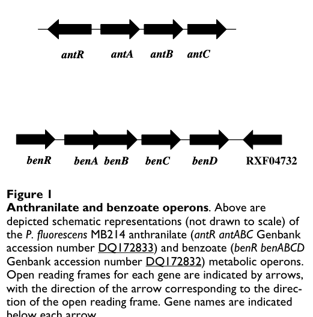

## Question

# Gene Research for Functional Annotation

## ⚠️ CRITICAL: Gene/Protein Identification Context

**BEFORE YOU BEGIN RESEARCH:** You MUST verify you are researching the CORRECT gene/protein. Gene symbols can be ambiguous, especially for less well-characterized genes from non-model organisms.

### Target Gene/Protein Identity (from UniProt):
- **UniProt Accession:** Q88I42
- **Protein Description:** SubName: Full=BenABC operon transcriptional activator {ECO:0000313|EMBL:AAN68767.1};
- **Gene Information:** Name=benR {ECO:0000313|EMBL:AAN68767.1}; OrderedLocusNames=PP_3159 {ECO:0000313|EMBL:AAN68767.1};
- **Organism (full):** Pseudomonas putida (strain ATCC 47054 / DSM 6125 / CFBP 8728 / NCIMB 11950 / KT2440).
- **Protein Family:** Not specified in UniProt
- **Key Domains:** AraC-bd_2. (IPR035418); AraC_XylS_family_regulators. (IPR050204); Homeodomain-like_sf. (IPR009057); HTH_AraC. (IPR018060); HTH_AraC-typ_CS. (IPR018062)

### MANDATORY VERIFICATION STEPS:

1. **Check if the gene symbol "benR" matches the protein description above**
2. **Verify the organism is correct:** Pseudomonas putida (strain ATCC 47054 / DSM 6125 / CFBP 8728 / NCIMB 11950 / KT2440).
3. **Check if protein family/domains align with what you find in literature**
4. **If you find literature for a DIFFERENT gene with the same or similar symbol, STOP**

### If Gene Symbol is Ambiguous or You Cannot Find Relevant Literature:

**DO NOT PROCEED WITH RESEARCH ON A DIFFERENT GENE.** Instead:
- State clearly: "The gene symbol 'benR' is ambiguous or literature is limited for this specific protein"
- Explain what you found (e.g., "Found extensive literature on a different gene with the same symbol in a different organism")
- Describe the protein based ONLY on the UniProt information provided above
- Suggest that the protein function can be inferred from domain/family information

### Research Target:

Please provide a comprehensive research report on the gene **benR** (gene ID: BenR, UniProt: Q88I42) in PSEPK.

The research report should be a detailed narrative explaining the function, biological processes, and localization of the gene product. Citations should be given for all claims.

You should prioritize authoritative reviews and primary scientific literature when conducting research. You can supplement
this with annotations you find in gene/protein databases, but these can be outdated or inaccurate.

We are specifically interested in the primary function of the gene - for enzymes, what reaction is catalyzed, and what is the substrate specificity? For transporters, what is the substrate? For structural proteins or adapters, what is the broader structural role? For signaling molecules, what is the role in the pathway.

We are interested in where in or outside the cell the gene product carries out its function.

We are also interested in the signaling or biochemical pathways in which the gene functions. We are less interested in broad pleiotropic effects, except where these elucidate the precise role.

Include evidence where possible. We are interested in both experimental evidence as well as inference from structure, evolution, or bioinformatic analysis. Precise studies should be prioritized over high-throughput, where available.

## Output

Question: You are an expert researcher providing comprehensive, well-cited information.

Provide detailed information focusing on:
1. Key concepts and definitions with current understanding
2. Recent developments and latest research (prioritize 2023-2024 sources)
3. Current applications and real-world implementations
4. Expert opinions and analysis from authoritative sources
5. Relevant statistics and data from recent studies

Format as a comprehensive research report with proper citations. Include URLs and publication dates where available.
Always prioritize recent, authoritative sources and provide specific citations for all major claims.

# Gene Research for Functional Annotation

## ⚠️ CRITICAL: Gene/Protein Identification Context

**BEFORE YOU BEGIN RESEARCH:** You MUST verify you are researching the CORRECT gene/protein. Gene symbols can be ambiguous, especially for less well-characterized genes from non-model organisms.

### Target Gene/Protein Identity (from UniProt):
- **UniProt Accession:** Q88I42
- **Protein Description:** SubName: Full=BenABC operon transcriptional activator {ECO:0000313|EMBL:AAN68767.1};
- **Gene Information:** Name=benR {ECO:0000313|EMBL:AAN68767.1}; OrderedLocusNames=PP_3159 {ECO:0000313|EMBL:AAN68767.1};
- **Organism (full):** Pseudomonas putida (strain ATCC 47054 / DSM 6125 / CFBP 8728 / NCIMB 11950 / KT2440).
- **Protein Family:** Not specified in UniProt
- **Key Domains:** AraC-bd_2. (IPR035418); AraC_XylS_family_regulators. (IPR050204); Homeodomain-like_sf. (IPR009057); HTH_AraC. (IPR018060); HTH_AraC-typ_CS. (IPR018062)

### MANDATORY VERIFICATION STEPS:

1. **Check if the gene symbol "benR" matches the protein description above**
2. **Verify the organism is correct:** Pseudomonas putida (strain ATCC 47054 / DSM 6125 / CFBP 8728 / NCIMB 11950 / KT2440).
3. **Check if protein family/domains align with what you find in literature**
4. **If you find literature for a DIFFERENT gene with the same or similar symbol, STOP**

### If Gene Symbol is Ambiguous or You Cannot Find Relevant Literature:

**DO NOT PROCEED WITH RESEARCH ON A DIFFERENT GENE.** Instead:
- State clearly: "The gene symbol 'benR' is ambiguous or literature is limited for this specific protein"
- Explain what you found (e.g., "Found extensive literature on a different gene with the same symbol in a different organism")
- Describe the protein based ONLY on the UniProt information provided above
- Suggest that the protein function can be inferred from domain/family information

### Research Target:

Please provide a comprehensive research report on the gene **benR** (gene ID: BenR, UniProt: Q88I42) in PSEPK.

The research report should be a detailed narrative explaining the function, biological processes, and localization of the gene product. Citations should be given for all claims.

You should prioritize authoritative reviews and primary scientific literature when conducting research. You can supplement
this with annotations you find in gene/protein databases, but these can be outdated or inaccurate.

We are specifically interested in the primary function of the gene - for enzymes, what reaction is catalyzed, and what is the substrate specificity? For transporters, what is the substrate? For structural proteins or adapters, what is the broader structural role? For signaling molecules, what is the role in the pathway.

We are interested in where in or outside the cell the gene product carries out its function.

We are also interested in the signaling or biochemical pathways in which the gene functions. We are less interested in broad pleiotropic effects, except where these elucidate the precise role.

Include evidence where possible. We are interested in both experimental evidence as well as inference from structure, evolution, or bioinformatic analysis. Precise studies should be prioritized over high-throughput, where available.

## Research report: **BenR (benR; PP_3159; UniProt Q88I42)** in *Pseudomonas putida* KT2440

### Executive summary (verified target identity)
BenR (UniProt **Q88I42**, gene **benR**, locus **PP_3159**) is a **chromosomally encoded AraC/XylS-family transcriptional activator** in *Pseudomonas putida* KT2440 that senses **benzoate** and activates transcription of the **benzoate oxidation (ben) operon** (classically *benA/benB/benC* ± *benD* and associated transport genes), thereby enabling conversion of benzoate to catechol and entry into downstream aromatic ring-cleavage metabolism. This BenR also exhibits **regulatory cross-talk** with the TOL plasmid **Pm** promoter (meta-cleavage pathway) and enforces **substrate prioritization** by repressing *pcaK* (4-hydroxybenzoate transporter) when benzoate is present. The BenR/BenR-responsive promoter module is also actively used as a **benzoate-inducible genetic sensor** in modern synthetic biology, with quantitative dynamic ranges reported in 2023 work. (cowles2000benraxyls pages 1-2, cowles2000benraxyls pages 3-4, cowles2000benraxyls pages 7-8, pearson2023characterizationanddiversification pages 5-8)

**Key primary sources used here (with URLs/publication dates):**
- Cowles et al., *Journal of Bacteriology* (Nov 2000): https://doi.org/10.1128/jb.182.22.6339-6346.2000 (cowles2000benraxyls pages 3-4)
- Pearson et al., *ACS Synthetic Biology* (Dec 2023): https://doi.org/10.1021/acssynbio.3c00441 (pearson2023characterizationanddiversification pages 5-8)

---

### 1) Key concepts & definitions (current understanding)

#### 1.1 What BenR is
**BenR is a transcriptional activator** that belongs to the **AraC/XylS family**, i.e., a class of bacterial regulators that typically have a **C-terminal DNA-binding region with helix–turn–helix (HTH) motifs** and an **N-terminal effector/ligand-responsive region**. Cowles et al. describe BenR as a **XylS homologue** and explicitly place it in the **AraC family**, noting the presence of the **AraC/XylS family C-terminal consensus** that includes **two HTH motifs**. (cowles2000benraxyls pages 7-8)

#### 1.2 What the ben operon does (metabolic function it controls)
The **ben genes encode the “entry” reactions** for benzoate catabolism: *benA/benB/benC* are assigned to a **benzoate 1,2-dioxygenase multicomponent system**, and *benD* is assigned to a **2-hydro-1,2-dihydroxybenzoate dehydrogenase (cis-diol dehydrogenase)**—together converting **benzoate → dihydrodiol intermediate → catechol**. (cowles2000benraxyls pages 5-6, cowles2000benraxyls pages 1-2)

#### 1.3 How AraC/XylS-family activation is conceptualized
In the AraC/XylS paradigm (best characterized for XylS), regulators activate transcription through binding to **direct-repeat DNA motifs** upstream of the regulated promoter; the recognition sequence is described as **TGCAN6GGNTA** (present as repeats), with activation occurring when regulator binding promotes productive RNA polymerase engagement. Cowles et al. state that the *benA* promoter contains a **direct repeat sequence** matching the previously defined XylS binding site and that BenR likely uses a similar mode of promoter recognition. (cowles2000benraxyls pages 1-2, cowles2000benraxyls pages 7-8)

---

### 2) Functional annotation of BenR in KT2440 (mechanism, targets, ligands)

#### 2.1 Primary function: benzoate-dependent activation of the ben promoter
**Genetic necessity:** A transposon insertion disrupting *benR* abolished growth on benzoate, consistent with BenR being required for induction of benzoate catabolic genes. (cowles2000benraxyls pages 3-4)

**Direct transcriptional activation evidence:** Using a **benA-lacZ** transcriptional fusion, Cowles et al. showed that **benzoate induces benA expression ~15-fold** in wild-type cells, whereas **benR mutants fail to induce**. (cowles2000benraxyls pages 3-4)

**Effector specificity at the entry step:** Cowles et al. report **catechol does not induce** the benA fusion, indicating BenR responds to the upstream substrate signal (benzoate), not the downstream intermediate catechol. (cowles2000benraxyls pages 3-4)

**Heterologous activation supports near-direct action:** Overexpression of BenR in *E. coli* increased benA-lacZ output by **~25-fold**, supporting BenR as a bona fide transcriptional activator of that promoter module. (cowles2000benraxyls pages 3-4)

#### 2.2 Ligand/effector spectrum
**Native/primary effector:** BenR is activated by **benzoate** (benzoic acid/benzoate). (cowles2000benraxyls pages 1-2, cowles2000benraxyls pages 7-8)

**Substituted aromatics:** In engineered reporter contexts, BenR also responds to **3-methylbenzoate** and **salicylate**, with sensor behavior depending on promoter architecture and BenR expression tuning. (pearson2023characterizationanddiversification pages 8-12)

**Pathway cross-regulation with substituted benzoates in vivo:** In KT2440, Cuevas (2007) reports strong **PbenA induction by 3-methylbenzoate** and highlights cross-talk with plasmid XylS that can further boost PbenA activity. (cuevas2007interaccionesmolecularesdel pages 144-144)

#### 2.3 Promoter/operator architecture and binding-site evidence
Cowles et al. report that the *benA* promoter contains a **direct repeat that matches the XylS binding site**, supporting a shared AraC/XylS-type cis-regulatory logic. (cowles2000benraxyls pages 1-2)

They further describe **putative BenR/XylS-type binding sites** in the promoter region that “match the experimentally determined XylS binding site almost exactly,” and note at least one site **overlaps the RNA polymerase binding site**, implying possible competition/occlusion effects in certain states. (cowles2000benraxyls pages 6-7)

#### 2.4 Cross-regulation with TOL plasmid meta-cleavage promoter Pm
BenR can activate the TOL plasmid **Pm** promoter (meta-cleavage pathway) even when the plasmid-encoded activator XylS is absent, providing an explanation for XylS-independent Pm activation by benzoate under some conditions. (cowles2000benraxyls pages 4-5, cowles2000benraxyls pages 6-7)

Quantitatively, Cowles et al. report that in a **Pm-lacZ** reporter system BenR produced **~13,000 Miller units**, increasing to **~17,000 Miller units** with added benzoate. (cowles2000benraxyls pages 4-5)

#### 2.5 Substrate prioritization (“hierarchy”) via repression of 4-HBA uptake
BenR is required for **benzoate-mediated repression** of *pcaK*, a **4-hydroxybenzoate (4-HBA) transporter**. In Cowles et al., *pcaK-lacZ* expression in cells grown on **benzoate + 4-HBA** was about **fivefold lower** than in 4-HBA alone, and this repression was lost in a **benR mutant**. (cowles2000benraxyls pages 5-6)

A consistent physiological readout is reduced substrate uptake: uptake of 4-HBA was ~**25 nmol·min⁻¹·mg⁻¹ protein** when cells were grown on 4-HBA alone, but wild-type cells grown on a mixture accumulated 4-HBA at about a **10-fold lower rate**, whereas the benR mutant maintained higher uptake. (cowles2000benraxyls pages 6-7)

Cowles et al. caution this regulation is likely **indirect**, because they did not find a recognizable BenR/XylS site in the *pcaK* promoter and could not reproduce repression in *E. coli*. (cowles2000benraxyls pages 7-8)

---

### 3) Cellular localization and where BenR acts
BenR functions as a **DNA-binding transcription factor** acting at **chromosomal promoter regions** (*PbenA* and related ben promoters). Its AraC/XylS-family architecture (C-terminal HTH motifs) supports a **cytosolic** regulatory protein that binds DNA in the nucleoid region; however, in the retrieved primary sources there is **no direct experimental subcellular localization measurement** (e.g., fractionation or microscopy), so localization remains **inferred** from function and domain architecture. (cowles2000benraxyls pages 7-8)

---

### 4) Recent developments (prioritizing 2023–2024) and latest research

#### 4.1 2023 quantitative characterization of BenR as an inducible sensor module (KT2440 + heterologous hosts)
Pearson et al. (Dec 2023) systematically characterized AraC/XylS-family regulators in *P. putida* KT2440 and built **promoter–reporter constructs** for BenR-associated promoter regions. In *P. putida*, a BenR-linked promoter (PPP_3161) showed **38 ± 5.2-fold induction** with **10 mM benzoate** (toxicity observed at 20 mM). (pearson2023characterizationanddiversification pages 5-8)

In engineered *E. coli*, BenR-based sensor plasmids showed fold-inductions tunable by expression architecture: **38 ± 3.9-fold**, **33 ± 6.2-fold**, or **8.7 ± 0.98-fold** depending on the constitutive promoter strength used to drive BenR (higher sensitivity often traded off with higher background). (pearson2023characterizationanddiversification pages 8-12)

This work represents a modern, high-throughput-guided approach to functional annotation/utility of AraC/XylS regulators in KT2440, including BenR. (pearson2023characterizationanddiversification pages 5-8)

#### 4.2 2024–2025 context: genetic sensors and AraC/XylS regulators in biosensing
A 2024 review on accelerating genetic sensor development emphasizes increasing capability to engineer and deploy biosensors, including deployment in non-model organisms such as *Pseudomonas* for environmental monitoring and bioproduction contexts. (dou2025detectionofenvironmental pages 7-10)

A 2025 review of transcription factor-based biosensors describes **BenR from *P. putida*** as a benzoate-responsive AraC/XylS-family TF that activates a PBen promoter, and summarizes a **cell-free** BenR biosensing workflow detecting benzoate with reported **fold-changes up to ~180** (and downstream detection of other analytes using added metabolic modules). While outside the user’s 2023–2024 priority window, it provides an authoritative overview of real-world biosensing usage. (dou2025detectionofenvironmental pages 7-10)

---

### 5) Current applications and real-world implementations

#### 5.1 Inducible gene expression in industrially relevant pseudomonads
BenR/Pben-like systems have been used as tightly controlled, inexpensive-inducer expression systems in pseudomonads (demonstrated in *Pseudomonas fluorescens* using its BenR homolog), including **shake-flask and 20 L fermentation** scales, supporting real-world bioprocess implementation of benzoate-inducible promoters. (retallack2006identificationofanthranilate pages 5-6)

#### 5.2 Environmental and analytical biosensing
Modern engineering repurposes BenR-promoter modules to build benzoate sensors with large dynamic ranges in living cells and in cell-free formats (e.g., benzoate detection in beverages). (pearson2023characterizationanddiversification pages 5-8, dou2025detectionofenvironmental pages 7-10)

---

### 6) Quantitative statistics and data (selected)
- **benA promoter induction by benzoate (native P. putida):** ~15-fold (benA-lacZ). (cowles2000benraxyls pages 3-4)
- **BenR heterologous activation (E. coli):** ~25-fold increase in benA-lacZ upon BenR overexpression. (cowles2000benraxyls pages 3-4)
- **Pm promoter activation (cross-talk):** ~13,000 Miller units without added benzoate; ~17,000 Miller units with benzoate (Pm-lacZ). (cowles2000benraxyls pages 4-5)
- **pcaK repression in benzoate+4-HBA vs 4-HBA alone:** ~5-fold lower; effect abolished in benR mutant. (cowles2000benraxyls pages 5-6)
- **4-HBA uptake rate:** ~25 nmol·min⁻¹·mg⁻¹ protein on 4-HBA alone; ~10-fold lower on benzoate+4-HBA in wild type. (cowles2000benraxyls pages 6-7)
- **2023 BenR-linked promoter induction in P. putida:** 38 ± 5.2-fold at 10 mM benzoate (PPP_3161). (pearson2023characterizationanddiversification pages 5-8)
- **2023 engineered E. coli BenR sensor induction:** 38 ± 3.9-fold; 33 ± 6.2-fold; or 8.7 ± 0.98-fold depending on design. (pearson2023characterizationanddiversification pages 8-12)

---

### 7) Expert interpretation and evidence limitations

1. **Primary functional role is regulatory (not enzymatic):** BenR does not catalyze a chemical reaction; it **controls expression** of the enzymatic benzoate oxidation pathway. (cowles2000benraxyls pages 3-4, cowles2000benraxyls pages 5-6)
2. **Localization is inferred:** The literature retrieved provides strong genetic and transcriptional evidence for function but lacks direct localization assays; “cytosolic/nucleoid-associated TF” is inferred from AraC/XylS architecture and mechanism. (cowles2000benraxyls pages 7-8)
3. **Binding-site mechanistic detail is partly inferential:** Direct repeats and XylS-like binding logic are well supported, but **BenR-specific biochemical binding constants (Kd) or DNase I footprints** were not captured in the retrieved excerpts; promoter-site mapping is largely via sequence similarity and genetic reporter behavior. (cowles2000benraxyls pages 6-7, cowles2000benraxyls pages 7-8)
4. **Do not conflate homologs:** Some visual/promoter mapping evidence comes from a **BenR homolog in P. fluorescens** used as comparative support; key KT2440 conclusions are anchored in Cowles et al. and Pearson et al. (retallack2006identificationofanthranilate pages 5-6, cowles2000benraxyls pages 3-4, pearson2023characterizationanddiversification pages 5-8)

---

### Evidence summary table
| Claim/Function | Evidence type (genetics, reporter assay, sequence analysis, review) | Key quantitative result | System/strain | Primary citation (authors, year, DOI/URL) | Notes/limitations |
|---|---|---|---|---|---|
| BenR is the chromosomal activator required for benzoate utilization and benA promoter induction | Genetics; reporter assay | benA-lacZ induced ~15-fold by benzoate in wild type; induction lost in benR mutant | *Pseudomonas putida* KT2440 / derivatives | Cowles, Nichols & Harwood, 2000, J. Bacteriol., https://doi.org/10.1128/jb.182.22.6339-6346.2000 (cowles2000benraxyls pages 3-4) | Strong functional evidence; measures promoter output rather than direct DNA binding |
| BenR directly or near-directly activates the ben promoter in a heterologous system | Reporter assay; heterologous expression | BenR overexpression in *E. coli* increased benA-lacZ expression ~25-fold | *E. coli* BL21(DE3) carrying BenR and benA-lacZ constructs | Cowles, Nichols & Harwood, 2000, J. Bacteriol., https://doi.org/10.1128/jb.182.22.6339-6346.2000 (cowles2000benraxyls pages 3-4) | Supports direct activation, but heterologous context may not fully reproduce native regulation |
| BenR belongs to the AraC/XylS family and is homologous to XylS | Sequence analysis; review | BenR shares ~62% identity to XylS; N-terminal region ~65% identity in reported comparisons | *P. putida* KT2440 and comparative analyses | Cowles, Nichols & Harwood, 2000, https://doi.org/10.1128/jb.182.22.6339-6346.2000; Ramos et al., 1990, https://doi.org/10.1093/nar/18.8.2149 (cowles2000benraxyls pages 1-2, cowles2000benraxyls pages 6-7, ramos1990afamilyof pages 1-2, ramos1990afamilyof pages 2-3) | Family assignment is robust, but no BenR structure is reported here |
| BenR controls the benABC/benABCD benzoate oxidation entry pathway | Genetics; sequence analysis | benA-benC are cotranscribed in benzoate-grown cells; benA/B/C assigned to benzoate 1,2-dioxygenase system and benD to cis-diol dehydrogenase | *P. putida* KT2440 | Cowles, Nichols & Harwood, 2000, https://doi.org/10.1128/jb.182.22.6339-6346.2000 (cowles2000benraxyls pages 4-5, cowles2000benraxyls pages 5-6) | Functional assignments are based on homology plus transcription data; enzyme assays for each subunit were not detailed in retrieved excerpts |
| Effector specificity is centered on benzoate; catechol is not the inducer | Reporter assay | Benzoate induces benA; catechol does not induce benA | *P. putida* KT2440 | Cowles, Nichols & Harwood, 2000, https://doi.org/10.1128/jb.182.22.6339-6346.2000 (cowles2000benraxyls pages 3-4) | Distinguishes substrate/product signaling at operon entry, but full ligand spectrum was not fully mapped in this paper |
| BenR cross-activates the TOL plasmid meta-cleavage promoter Pm | Reporter assay; genetics | In *E. coli*, BenR expression yielded Pm::lacZ activity up to ~17,000 Miller units with benzoate; in *P. putida*, TOL-encoded XylS partially complemented benR defects (~5-fold increase in benA-lacZ with benzoate) | *E. coli* CC118 and *P. putida* strains with/without pWW0 | Cowles, Nichols & Harwood, 2000, https://doi.org/10.1128/jb.182.22.6339-6346.2000 (cowles2000benraxyls pages 4-5) | Demonstrates regulatory overlap with XylS/Pm; overexpression may exaggerate physiological cross-talk |
| BenR contributes to pathway hierarchy by repressing 4-HBA uptake/transport gene expression in the presence of benzoate | Reporter assay; genetics | pcaK-driven expression in benzoate + 4-HBA was ~5-fold lower than in 4-HBA alone; repression abolished in benR mutant | *P. putida* KT2440 and benR mutant | Cowles, Nichols & Harwood, 2000, https://doi.org/10.1128/jb.182.22.6339-6346.2000 (cowles2000benraxyls pages 5-6, cowles2000benraxyls pages 6-7) | Likely indirect regulation; authors did not find a clear BenR/XylS site in the pcaK promoter |
| BenA promoter architecture is consistent with XylS-like binding by BenR | Sequence analysis; review | benA promoter contains direct repeats matching/closely matching the XylS binding site; XylS consensus described as repeat of TGCAN6GGNTA | *P. putida* promoter sequence comparisons | Cowles, Nichols & Harwood, 2000, https://doi.org/10.1128/jb.182.22.6339-6346.2000; Gerischer, 2002 (review) (cowles2000benraxyls pages 6-7, cowles2000benraxyls pages 7-8, cowles2000benraxyls pages 1-2, gerischer2002specificandglobal pages 3-5) | Strong cis-regulatory inference, but no BenR-specific DNase I footprinting or affinity constants were retrieved |
| BenR is a cytosolic DNA-binding transcription factor acting at chromosomal promoters | Sequence/domain inference; review | No signal peptide or membrane localization evidence reported; AraC/XylS family proteins carry C-terminal HTH DNA-binding motifs | Inference from family/domain architecture and regulatory role | Cowles, Nichols & Harwood, 2000, https://doi.org/10.1128/jb.182.22.6339-6346.2000; UniProt-aligned family context via reviews (cowles2000benraxyls pages 7-8, gerischer2002specificandglobal pages 3-5) | Subcellular localization is inferred rather than directly measured in the retrieved literature |
| Recent engineering work confirms PP_3159/BenR is a useful benzoate-responsive sensor module | Reporter assay; synthetic biology | In *P. putida*, promoter PPP_3161 showed 38 ± 5.2-fold induction at 10 mM benzoate; in *E. coli* single-plasmid variants, BenR systems showed 38 ± 3.9-fold, 33 ± 6.2-fold, or 8.7 ± 0.98-fold induction depending on expression tuning | *P. putida* KT2440 and engineered *E. coli* | Pearson et al., 2023, ACS Synth. Biol., https://doi.org/10.1021/acssynbio.3c00441 (pearson2023characterizationanddiversification pages 5-8, pearson2023characterizationanddiversification pages 8-12) | Valuable modern validation for biosensor use; promoter naming/length differs from older benA nomenclature and focuses on engineering performance rather than native physiology |
| BenR sensor specificity extends beyond benzoate to related aromatics in engineered assays | Reporter assay; synthetic biology | BenR responded to benzoate, 3-methylbenzoate, and salicylate; one report notes strong induction by 3-methylbenzoate/salicylate in certain constructs | Engineered *E. coli* single-plasmid/two-plasmid sensor systems | Pearson et al., 2023, ACS Synth. Biol., https://doi.org/10.1021/acssynbio.3c00441 (pearson2023characterizationanddiversification pages 8-12, pearson2023characterizationanddiversification pages 20-23) | Specificity depends on promoter architecture and regulator expression level; these results may not equal native KT2440 physiological specificity |
| Visual promoter-mapping and reporter data from a homologous pseudomonad support conserved BenR/Pben organization | Reporter assay; promoter mapping; comparative evidence | Homologous *Pseudomonas fluorescens* Pben system showed ~13-fold induction by 5 mM m-toluate and benR dependence of promoter activity | *P. fluorescens* benR/benABCD system | Retallack et al., 2006, Microb. Cell Fact., https://doi.org/10.1186/1475-2859-5-1 (retallack2006identificationofanthranilate pages 3-5, retallack2006identificationofanthranilate pages 2-3, retallack2006identificationofanthranilate pages 5-6, retallack2006identificationofanthranilate media 801e9bb0) | Useful comparative support only; not the target KT2440 protein and should not replace KT2440-specific evidence |

*Table: This table summarizes the main experimental and comparative evidence supporting functional annotation of BenR (Q88I42/PP_3159) in *Pseudomonas putida* KT2440. It highlights native regulatory function, pathway context, promoter architecture, cross-regulation, and recent engineering data while noting where conclusions are inferential or comparative.*

### Visual evidence (figures/tables)
Promoter/operon organization and induction curves for a homologous BenR/Pben system (useful as a mechanistic visual analogue) were retrieved from Retallack et al. 2006. (retallack2006identificationofanthranilate media 801e9bb0, retallack2006identificationofanthranilate media 02c7240e, retallack2006identificationofanthranilate media 4c23c1c3, retallack2006identificationofanthranilate media 3df97ea0, retallack2006identificationofanthranilate media 71701dfd, retallack2006identificationofanthranilate media 91ada4ae, retallack2006identificationofanthranilate media fec0aca9, retallack2006identificationofanthranilate media f82164eb)

References

1. (cowles2000benraxyls pages 1-2): Charles E. Cowles, Nancy N. Nichols, and Caroline S. Harwood. Benr, a xyls homologue, regulates three different pathways of aromatic acid degradation in pseudomonas putida. Journal of Bacteriology, 182:6339-6346, Nov 2000. URL: https://doi.org/10.1128/jb.182.22.6339-6346.2000, doi:10.1128/jb.182.22.6339-6346.2000. This article has 193 citations and is from a peer-reviewed journal.

2. (cowles2000benraxyls pages 3-4): Charles E. Cowles, Nancy N. Nichols, and Caroline S. Harwood. Benr, a xyls homologue, regulates three different pathways of aromatic acid degradation in pseudomonas putida. Journal of Bacteriology, 182:6339-6346, Nov 2000. URL: https://doi.org/10.1128/jb.182.22.6339-6346.2000, doi:10.1128/jb.182.22.6339-6346.2000. This article has 193 citations and is from a peer-reviewed journal.

3. (cowles2000benraxyls pages 7-8): Charles E. Cowles, Nancy N. Nichols, and Caroline S. Harwood. Benr, a xyls homologue, regulates three different pathways of aromatic acid degradation in pseudomonas putida. Journal of Bacteriology, 182:6339-6346, Nov 2000. URL: https://doi.org/10.1128/jb.182.22.6339-6346.2000, doi:10.1128/jb.182.22.6339-6346.2000. This article has 193 citations and is from a peer-reviewed journal.

4. (pearson2023characterizationanddiversification pages 5-8): Allison N. Pearson, Matthew R. Incha, Cindy N. Ho, Matthias Schmidt, Jacob B. Roberts, Alberto A. Nava, and Jay D. Keasling. Characterization and diversification of arac/xyls family regulators guided by transposon sequencing. ACS Synthetic Biology, 13:206-219, Dec 2023. URL: https://doi.org/10.1021/acssynbio.3c00441, doi:10.1021/acssynbio.3c00441. This article has 5 citations and is from a domain leading peer-reviewed journal.

5. (cowles2000benraxyls pages 5-6): Charles E. Cowles, Nancy N. Nichols, and Caroline S. Harwood. Benr, a xyls homologue, regulates three different pathways of aromatic acid degradation in pseudomonas putida. Journal of Bacteriology, 182:6339-6346, Nov 2000. URL: https://doi.org/10.1128/jb.182.22.6339-6346.2000, doi:10.1128/jb.182.22.6339-6346.2000. This article has 193 citations and is from a peer-reviewed journal.

6. (pearson2023characterizationanddiversification pages 8-12): Allison N. Pearson, Matthew R. Incha, Cindy N. Ho, Matthias Schmidt, Jacob B. Roberts, Alberto A. Nava, and Jay D. Keasling. Characterization and diversification of arac/xyls family regulators guided by transposon sequencing. ACS Synthetic Biology, 13:206-219, Dec 2023. URL: https://doi.org/10.1021/acssynbio.3c00441, doi:10.1021/acssynbio.3c00441. This article has 5 citations and is from a domain leading peer-reviewed journal.

7. (cuevas2007interaccionesmolecularesdel pages 144-144): P Domínguez Cuevas. Interacciones moleculares del regulador xyls y la arn polimerasa con el promotor pm del plásmido tol pww0 de pseudomonas putida. Unknown journal, 2007.

8. (cowles2000benraxyls pages 6-7): Charles E. Cowles, Nancy N. Nichols, and Caroline S. Harwood. Benr, a xyls homologue, regulates three different pathways of aromatic acid degradation in pseudomonas putida. Journal of Bacteriology, 182:6339-6346, Nov 2000. URL: https://doi.org/10.1128/jb.182.22.6339-6346.2000, doi:10.1128/jb.182.22.6339-6346.2000. This article has 193 citations and is from a peer-reviewed journal.

9. (cowles2000benraxyls pages 4-5): Charles E. Cowles, Nancy N. Nichols, and Caroline S. Harwood. Benr, a xyls homologue, regulates three different pathways of aromatic acid degradation in pseudomonas putida. Journal of Bacteriology, 182:6339-6346, Nov 2000. URL: https://doi.org/10.1128/jb.182.22.6339-6346.2000, doi:10.1128/jb.182.22.6339-6346.2000. This article has 193 citations and is from a peer-reviewed journal.

10. (dou2025detectionofenvironmental pages 7-10): Yuan Dou, Jianli Zhang, Xinyu Gong, Qi Gan, Shuo Yu, and Yajun Yan. Detection of environmental pollutants using transcription factor-based whole-cell biosensors. Biotechnology for the Environment, Dec 2025. URL: https://doi.org/10.1186/s44314-025-00032-7, doi:10.1186/s44314-025-00032-7. This article has 1 citations.

11. (retallack2006identificationofanthranilate pages 5-6): Diane M Retallack, Tracey C Thomas, Ying Shao, Keith L Haney, Sol M Resnick, Vincent D Lee, and Charles H Squires. Identification of anthranilate and benzoate metabolic operons of pseudomonas fluorescens and functional characterization of their promoter regions. Microbial Cell Factories, 5:1-1, Jan 2006. URL: https://doi.org/10.1186/1475-2859-5-1, doi:10.1186/1475-2859-5-1. This article has 45 citations and is from a peer-reviewed journal.

12. (ramos1990afamilyof pages 1-2): Juan L. Ramos, Fernando Rojo, Luming Zhou, and K. Timmis. A family of positive regulators related to the pseudomonas putida tol plasmid xyls and the escherichia coli arac activators. Nucleic acids research, 18 8:2149-52, Apr 1990. URL: https://doi.org/10.1093/nar/18.8.2149, doi:10.1093/nar/18.8.2149. This article has 109 citations and is from a highest quality peer-reviewed journal.

13. (ramos1990afamilyof pages 2-3): Juan L. Ramos, Fernando Rojo, Luming Zhou, and K. Timmis. A family of positive regulators related to the pseudomonas putida tol plasmid xyls and the escherichia coli arac activators. Nucleic acids research, 18 8:2149-52, Apr 1990. URL: https://doi.org/10.1093/nar/18.8.2149, doi:10.1093/nar/18.8.2149. This article has 109 citations and is from a highest quality peer-reviewed journal.

14. (gerischer2002specificandglobal pages 3-5): U Gerischer. Specific and global regulation of genes associated with the degradation of aromatic compounds in bacteria. Unknown journal, 2002.

15. (pearson2023characterizationanddiversification pages 20-23): Allison N. Pearson, Matthew R. Incha, Cindy N. Ho, Matthias Schmidt, Jacob B. Roberts, Alberto A. Nava, and Jay D. Keasling. Characterization and diversification of arac/xyls family regulators guided by transposon sequencing. ACS Synthetic Biology, 13:206-219, Dec 2023. URL: https://doi.org/10.1021/acssynbio.3c00441, doi:10.1021/acssynbio.3c00441. This article has 5 citations and is from a domain leading peer-reviewed journal.

16. (retallack2006identificationofanthranilate pages 3-5): Diane M Retallack, Tracey C Thomas, Ying Shao, Keith L Haney, Sol M Resnick, Vincent D Lee, and Charles H Squires. Identification of anthranilate and benzoate metabolic operons of pseudomonas fluorescens and functional characterization of their promoter regions. Microbial Cell Factories, 5:1-1, Jan 2006. URL: https://doi.org/10.1186/1475-2859-5-1, doi:10.1186/1475-2859-5-1. This article has 45 citations and is from a peer-reviewed journal.

17. (retallack2006identificationofanthranilate pages 2-3): Diane M Retallack, Tracey C Thomas, Ying Shao, Keith L Haney, Sol M Resnick, Vincent D Lee, and Charles H Squires. Identification of anthranilate and benzoate metabolic operons of pseudomonas fluorescens and functional characterization of their promoter regions. Microbial Cell Factories, 5:1-1, Jan 2006. URL: https://doi.org/10.1186/1475-2859-5-1, doi:10.1186/1475-2859-5-1. This article has 45 citations and is from a peer-reviewed journal.

18. (retallack2006identificationofanthranilate media 801e9bb0): Diane M Retallack, Tracey C Thomas, Ying Shao, Keith L Haney, Sol M Resnick, Vincent D Lee, and Charles H Squires. Identification of anthranilate and benzoate metabolic operons of pseudomonas fluorescens and functional characterization of their promoter regions. Microbial Cell Factories, 5:1-1, Jan 2006. URL: https://doi.org/10.1186/1475-2859-5-1, doi:10.1186/1475-2859-5-1. This article has 45 citations and is from a peer-reviewed journal.

19. (retallack2006identificationofanthranilate media 02c7240e): Diane M Retallack, Tracey C Thomas, Ying Shao, Keith L Haney, Sol M Resnick, Vincent D Lee, and Charles H Squires. Identification of anthranilate and benzoate metabolic operons of pseudomonas fluorescens and functional characterization of their promoter regions. Microbial Cell Factories, 5:1-1, Jan 2006. URL: https://doi.org/10.1186/1475-2859-5-1, doi:10.1186/1475-2859-5-1. This article has 45 citations and is from a peer-reviewed journal.

20. (retallack2006identificationofanthranilate media 4c23c1c3): Diane M Retallack, Tracey C Thomas, Ying Shao, Keith L Haney, Sol M Resnick, Vincent D Lee, and Charles H Squires. Identification of anthranilate and benzoate metabolic operons of pseudomonas fluorescens and functional characterization of their promoter regions. Microbial Cell Factories, 5:1-1, Jan 2006. URL: https://doi.org/10.1186/1475-2859-5-1, doi:10.1186/1475-2859-5-1. This article has 45 citations and is from a peer-reviewed journal.

21. (retallack2006identificationofanthranilate media 3df97ea0): Diane M Retallack, Tracey C Thomas, Ying Shao, Keith L Haney, Sol M Resnick, Vincent D Lee, and Charles H Squires. Identification of anthranilate and benzoate metabolic operons of pseudomonas fluorescens and functional characterization of their promoter regions. Microbial Cell Factories, 5:1-1, Jan 2006. URL: https://doi.org/10.1186/1475-2859-5-1, doi:10.1186/1475-2859-5-1. This article has 45 citations and is from a peer-reviewed journal.

22. (retallack2006identificationofanthranilate media 71701dfd): Diane M Retallack, Tracey C Thomas, Ying Shao, Keith L Haney, Sol M Resnick, Vincent D Lee, and Charles H Squires. Identification of anthranilate and benzoate metabolic operons of pseudomonas fluorescens and functional characterization of their promoter regions. Microbial Cell Factories, 5:1-1, Jan 2006. URL: https://doi.org/10.1186/1475-2859-5-1, doi:10.1186/1475-2859-5-1. This article has 45 citations and is from a peer-reviewed journal.

23. (retallack2006identificationofanthranilate media 91ada4ae): Diane M Retallack, Tracey C Thomas, Ying Shao, Keith L Haney, Sol M Resnick, Vincent D Lee, and Charles H Squires. Identification of anthranilate and benzoate metabolic operons of pseudomonas fluorescens and functional characterization of their promoter regions. Microbial Cell Factories, 5:1-1, Jan 2006. URL: https://doi.org/10.1186/1475-2859-5-1, doi:10.1186/1475-2859-5-1. This article has 45 citations and is from a peer-reviewed journal.

24. (retallack2006identificationofanthranilate media fec0aca9): Diane M Retallack, Tracey C Thomas, Ying Shao, Keith L Haney, Sol M Resnick, Vincent D Lee, and Charles H Squires. Identification of anthranilate and benzoate metabolic operons of pseudomonas fluorescens and functional characterization of their promoter regions. Microbial Cell Factories, 5:1-1, Jan 2006. URL: https://doi.org/10.1186/1475-2859-5-1, doi:10.1186/1475-2859-5-1. This article has 45 citations and is from a peer-reviewed journal.

25. (retallack2006identificationofanthranilate media f82164eb): Diane M Retallack, Tracey C Thomas, Ying Shao, Keith L Haney, Sol M Resnick, Vincent D Lee, and Charles H Squires. Identification of anthranilate and benzoate metabolic operons of pseudomonas fluorescens and functional characterization of their promoter regions. Microbial Cell Factories, 5:1-1, Jan 2006. URL: https://doi.org/10.1186/1475-2859-5-1, doi:10.1186/1475-2859-5-1. This article has 45 citations and is from a peer-reviewed journal.

## Artifacts

- [Edison artifact artifact-00](BenR-deep-research-falcon_artifacts/artifact-00.md)

## Citations

1. cowles2000benraxyls pages 3-4
2. pearson2023characterizationanddiversification pages 5-8
3. cowles2000benraxyls pages 7-8
4. pearson2023characterizationanddiversification pages 8-12
5. cuevas2007interaccionesmolecularesdel pages 144-144
6. cowles2000benraxyls pages 1-2
7. cowles2000benraxyls pages 6-7
8. cowles2000benraxyls pages 4-5
9. cowles2000benraxyls pages 5-6
10. dou2025detectionofenvironmental pages 7-10
11. retallack2006identificationofanthranilate pages 5-6
12. ramos1990afamilyof pages 1-2
13. ramos1990afamilyof pages 2-3
14. gerischer2002specificandglobal pages 3-5
15. pearson2023characterizationanddiversification pages 20-23
16. retallack2006identificationofanthranilate pages 3-5
17. retallack2006identificationofanthranilate pages 2-3
18. https://doi.org/10.1128/jb.182.22.6339-6346.2000
19. https://doi.org/10.1021/acssynbio.3c00441
20. https://doi.org/10.1128/jb.182.22.6339-6346.2000;
21. https://doi.org/10.1093/nar/18.8.2149
22. https://doi.org/10.1186/1475-2859-5-1
23. https://doi.org/10.1128/jb.182.22.6339-6346.2000,
24. https://doi.org/10.1021/acssynbio.3c00441,
25. https://doi.org/10.1186/s44314-025-00032-7,
26. https://doi.org/10.1186/1475-2859-5-1,
27. https://doi.org/10.1093/nar/18.8.2149,