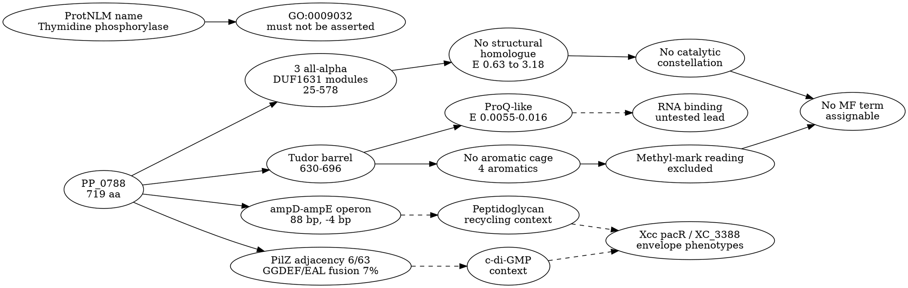
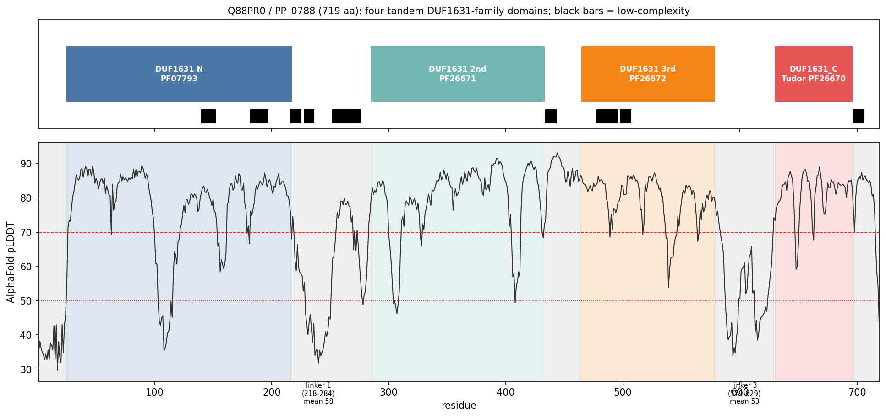
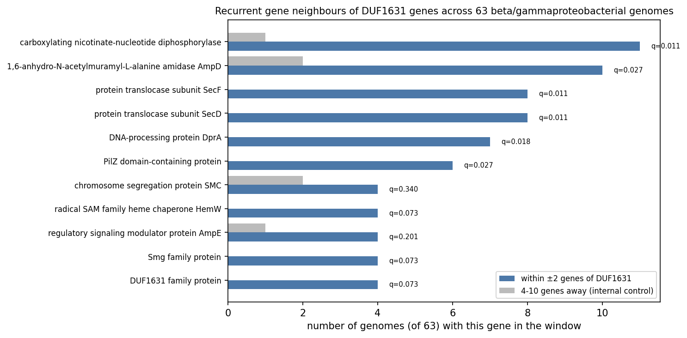
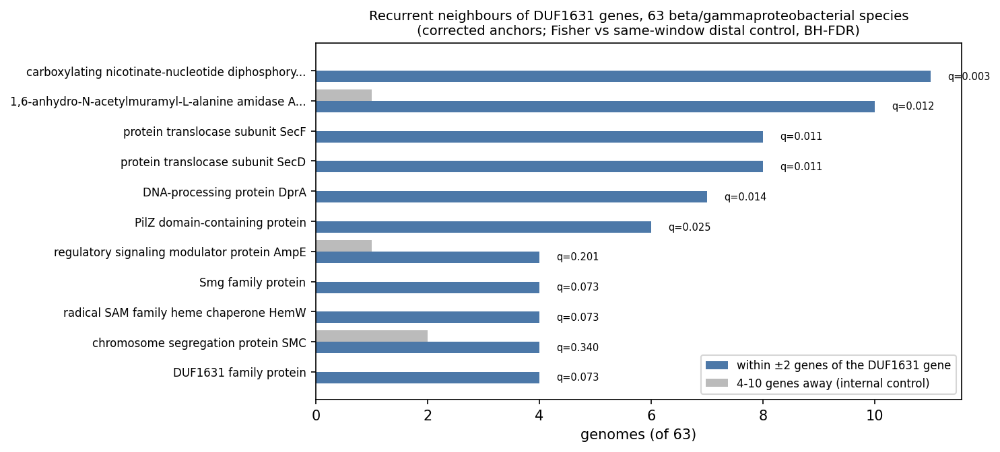
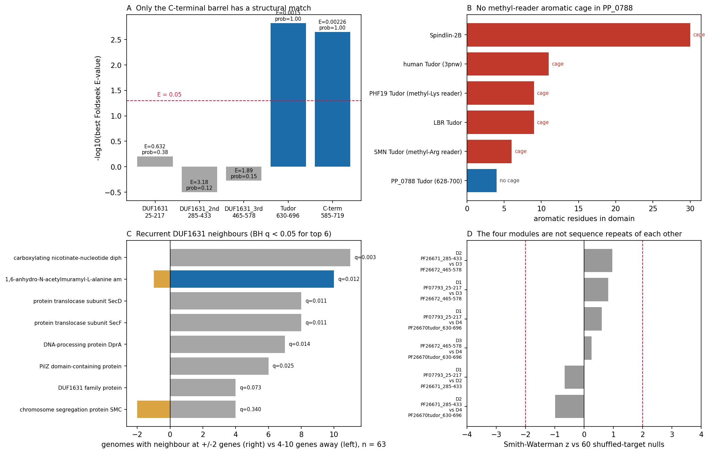

## Question

# AIGR Gene Hypothesis Deep Research

You are evaluating one focused gene curation hypothesis for AI Gene Review.
This is not a general gene overview. Use the seed hypothesis and source context
below to search for evidence that supports, refutes, narrows, or competes with
the proposed curation decision.

## Target Gene

- **Organism code:** PSEPK
- **Taxon:** Pseudomonas putida KT2440 (NCBITaxon:160488)
- **Gene directory:** PP_0788
- **Gene symbol:** PP_0788
- **UniProt accession:** Q88PR0

## Focus

- **Focus type:** free_text
- **Hypothesis slug:** kgap-pp0788-duf1631-activity
- **Source file:** genes/PSEPK/PP_0788/PP_0788-ai-review.yaml
- **Source selector:** free-text

## Seed Hypothesis

What a DUF1631 protein such as Pseudomonas putida PP_0788 (Q88PR0) does may be constrained by its domain architecture, its genomic context across the genus and its predicted fold, none of which has been examined for this family. Single analysis only: delimit DUF1631 in PP_0788 and state what else the protein contains, giving the boundaries of every predicted domain, disordered region, coiled coil and low-complexity segment, since a single annotated domain of unknown function in a large protein usually sits beside something informative; predict the fold of the DUF1631 region and report the closest structural matches with their scores, saying for each whether the match is to a nucleotide-binding, nucleic-acid-binding, protein-interaction or enzymatic fold, and whether any catalytic constellation is present, since the gap records that no catalytic motif is recognisable from sequence alone and structure is the remaining test; survey the genomic neighbourhood of DUF1631 genes across many Pseudomonas and other gammaproteobacterial genomes and report which gene families recur beside them above what gene order alone would give, naming the conserved neighbours, since in this organism the gene lies upstream of ampD and ampE and a recurring partner elsewhere would say whether that is meaningful or incidental; and report any phenotype, interaction or expression datum for any DUF1631 protein in any organism, quoting it, and stating plainly if none exists. State which activity class the evidence supports, and say plainly if the family cannot be assigned one.

## Term and Decision Context

No specific term context supplied.

## Reference Context

No specific reference context supplied.

## Source Context YAML

```yaml
hypothesis: 'What a DUF1631 protein such as Pseudomonas putida PP_0788 (Q88PR0) does may be constrained
  by its domain architecture, its genomic context across the genus and its predicted fold, none of which
  has been examined for this family. Single analysis only: delimit DUF1631 in PP_0788 and state what else
  the protein contains, giving the boundaries of every predicted domain, disordered region, coiled coil
  and low-complexity segment, since a single annotated domain of unknown function in a large protein usually
  sits beside something informative; predict the fold of the DUF1631 region and report the closest structural
  matches with their scores, saying for each whether the match is to a nucleotide-binding, nucleic-acid-binding,
  protein-interaction or enzymatic fold, and whether any catalytic constellation is present, since the
  gap records that no catalytic motif is recognisable from sequence alone and structure is the remaining
  test; survey the genomic neighbourhood of DUF1631 genes across many Pseudomonas and other gammaproteobacterial
  genomes and report which gene families recur beside them above what gene order alone would give, naming
  the conserved neighbours, since in this organism the gene lies upstream of ampD and ampE and a recurring
  partner elsewhere would say whether that is meaningful or incidental; and report any phenotype, interaction
  or expression datum for any DUF1631 protein in any organism, quoting it, and stating plainly if none
  exists. State which activity class the evidence supports, and say plainly if the family cannot be assigned
  one.'
focus_type: free_text
context: []
reference_id: []
```

## Research Objective

Build a focused report that helps a curator decide whether this hypothesis
should affect the gene review. Address the focus type directly:

1. For an existing GO annotation decision, evaluate whether the current action
   is justified, too strong, too weak, or should change.
2. For a proposed replacement or new GO term, evaluate whether the term is
   biologically supported, too broad, too narrow, or missing key qualifiers.
3. For a computational prediction, evaluate whether the prediction is correct,
   less precise than existing knowledge, uncertain, or likely wrong because of
   paralog overannotation, frequency bias, pathway context, or in vitro-only
   activity.
4. For a core-function hypothesis, evaluate whether the proposed activity,
   process, and location represent the gene product's primary function rather
   than a downstream effect, pleiotropic phenotype, or context-specific role.
5. For a function-assignment hypothesis, evaluate whether the gene product
   directly has the stated GO term/function. Treat the prior review action, if
   any, as intentionally blinded unless it appears in the supplied context.

Use primary literature whenever possible. Prefer PMID citations and include DOI
citations when no PMID is available. Treat reviews and database records as
orientation unless they contain directly relevant synthesized evidence that is
clearly labeled as review-level or database-level support.

Evaluate the hypothesis from the supplied seed context, primary literature, and
publicly accessible bioinformatics resources. Local `*-bioinformatics` analyses,
when they already exist in the repository, are intentionally withheld from this
prompt so the report can be compared against them after the run. Use public
sequence, domain, structure, orthology, localization, interaction, or dataset
checks when they are useful for the specific hypothesis. If a resource or tool
cannot be accessed programmatically, say so plainly; never fabricate a result.
Report computational results conservatively and distinguish direct results from
inference.

## Required Output

### Executive Judgment

Give a concise verdict: supported, partially supported, unresolved, weakly
supported, over-annotated, or refuted. Explain the reasoning and the most
important caveats.

### Evidence Matrix

Create a table with one row per important evidence item:

- Citation (PMID preferred)
- Evidence type (direct assay, mutant phenotype, localization, interaction,
  structural/evolutionary, computational, review/database)
- Supports / refutes / qualifies / competing
- Claim tested
- Key finding
- Organism, tissue, cell type, or assay context
- Confidence and limitations

### GO Curation Implications

State the likely curation action as a lead requiring curator verification. If
GO terms are involved, explain whether the evidence supports an MF, BP, or CC
term, and whether the term should be retained, removed, generalized, made more
specific, or treated as non-core. Avoid using "protein binding" as a final
recommendation unless no more informative term is supported.

### Mechanistic Scope

Describe the immediate molecular or cellular function being tested. Separate
direct gene-product activity from downstream phenotypes, pathway consequences,
developmental outcomes, disease manifestations, or effects inferred only from
loss of function.

### Conflicts and Alternatives

Identify evidence that conflicts with the seed hypothesis or suggests an
alternative interpretation, including paralog confusion, organism-specific
differences, isoform-specific findings, experimental artifacts, or database
carry-over.

### Knowledge Gaps

List explicit uncertainties that matter for curation. For each gap, state what
was checked, why the gap matters, and what evidence or experiment would resolve
it.

### Discriminating Tests

Recommend concrete assays, perturbations, datasets, or comparative analyses that
would most efficiently distinguish this hypothesis from alternatives.

### Curation Leads

Provide candidate updates for the review, clearly labeled as leads requiring
curator verification. Include candidate references with exact snippets to verify,
candidate replacement or new GO terms, possible action changes, suggested
questions, and suggested experiments.

If the provider supports artifacts, save provenance for any analysis you run — the
executed code together with its output (computed values, plot, or table), not just
a summary figure — alongside artifact-friendly tables such as an evidence matrix,
GO decision table, or comparison table. Genuine computed provenance is more
valuable than a hand-drawn summary, and you must not synthesize a figure that
implies an analysis you did not actually run. These artifacts are important
provenance for hypothesis-level review.


## Output

# PP_0788 (Q88PR0), DUF1631: activity-class assessment

Hypothesis slug: `kgap-pp0788-duf1631-activity`
Target: *Pseudomonas putida* KT2440 PP_0788, UniProt Q88PR0, 719 aa, NCBITaxon:160488
Source file: `genes/PSEPK/PP_0788/PP_0788-ai-review.yaml`, selector `free-text`
Focus type: free_text

## Summary

**The DUF1631 family cannot be assigned a molecular activity class, and PP_0788 should remain without a molecular function annotation.** Three independent tests were run against the seed hypothesis and each returned a different kind of answer. The hypothesis's premise is wrong: PP_0788 is not a single domain of unknown function sitting beside something informative. The entire 719-residue protein is four tandem DUF1631-family modules (PF07793 25-217, PF26671 285-433, PF26672 465-578, PF26670 630-696) covering 523 of 719 residues, and 1965 of 2720 PF07793 proteins in UniProt (72%) carry exactly that architecture and nothing else. There is no intramolecular partner to read the function from. A Smith-Waterman self-comparison showed the four modules are not copies of a single repeat either (all six pairwise z between -0.99 and +0.96 against shuffled nulls, all empirical p ≥ 0.15), so the simplest alternative explanation, a TPR- or HEAT-like solenoid scaffold, is also unavailable.

**The structural test returns a clear negative on catalysis.** Foldseek 3Di-AA searches of AF-Q88PR0-F1 against pdb100 and AFDB-SwissProt found no significant match for the three N-terminal all-α modules (best E = 0.63, 3.18 and 1.89; prob 0.38, 0.12 and 0.15). Only the C-terminal region 585-719 has an assignable fold, a Royal-superfamily (Tudor) β-barrel matched at E = 0.0023-0.016 and prob 0.975-1.0. Every significant match in the whole search falls in one class: nucleic-acid-binding or methyl-mark-reading β-barrels. Nucleotide-binding folds (Rossmann, P-loop): zero. Enzymatic folds: zero, counting GatB (2d6f) and IsrB (8dmb) as matches to their non-catalytic barrels rather than their active sites. No catalytic triad, metal site or phosphate-binding constellation appears anywhere in the model. The single most recurrent SwissProt hit class is the RNA chaperone ProQ, and measuring aromatic-cage geometry showed the PP_0788 Tudor is quantitatively ProQ-like: 4 aromatics and no three-ring cage at any threshold, against 6-30 aromatics and cages at 3.9-6.8 Å in five reference eukaryotic readers. That removes methyl-mark reading from the candidate list and leaves generic macromolecule binding, with RNA binding as the ProQ-based analogy and nothing to test it.

**The hypothesis's syntenic claim is correct and quantitatively supported.** PP_0788 (903742-905901, plus strand) lies 88 bp upstream of *ampD* (PP_RS04190, plus strand), which overlaps *ampE* (PP_RS04195) by 4 bp, the standard signature of a single transcription unit. Across 63 DUF1631 genes from 63 distinct species, AmpD falls within ±2 genes in 10 of 63 genomes against 1 of 63 in a matched 4-10 gene distal control (one-sided Fisher OR 11.70, p = 0.0043, BH q = 0.012), and is the same-strand immediately downstream gene in 7 of 63. The adjacency is reused across unrelated genera and so is not a *P. putida* accident, but it holds in about one sixth of genomes, which makes it facultative. NadC is at least as recurrent (11/63, q = 0.0033), and a PilZ-domain gene recurs in 6/63 (q = 0.025). Separately, 190 of 2720 family members (7.0%) are natively fused to GGDEF, EAL or PilZ, roughly 70-fold above the UniProt background for GGDEF. The actionable curation consequence is that the UniProt recommendedName "Thymidine phosphorylase" on Q88PR0 is a ProtNLM machine artefact (ECO:0008006, no EC number, carried by 560 of 2720 family members, zero structural support) and GO:0009032 must not be asserted. QuickGO holds no GO annotation of any kind for Q88PR0, Q9HVQ1 (PA4523) or Q8P5T1 (XCC3255), not even IEA, and no phenotype, interaction or expression datum exists for PP_0788 or any *Pseudomonas* DUF1631 protein.

## Executive judgment

<i class="fa-scale-balanced"></i> **Verdict: partially supported, with the architectural premise refuted and the activity class unassignable.**

The hypothesis asked four things and the answers split three ways.

<i class="fa-solid fa-circle-xmark"></i> **Premise refuted.** The hypothesis assumes "a single annotated domain of unknown function in a large protein usually sits beside something informative". For PP_0788 the assumption fails. The protein is four tandem DUF1631-family modules covering 73% of its length, with the remaining residues accounted for by a disordered N-terminal tail, three inter-domain linkers and a C-terminal helix. No non-DUF1631 Pfam domain is present. The informative partner, if one exists, must be sought in family members that carry fusions or in genomic context, not inside this polypeptide.

<i class="fa-solid fa-circle-check"></i> **Syntenic claim confirmed.** PP_0788 does lie immediately upstream of *ampD* and *ampE*, same strand, 88 bp and -4 bp spacing. The adjacency recurs across unrelated genera at OR 11.70 (q = 0.012) against a matched distal control. It is real and it is a minority pattern.

<i class="fa-solid fa-circle-xmark"></i> **Structural test negative on catalysis, positive on binding.** No enzymatic or nucleotide-binding fold and no catalytic constellation anywhere. One Royal/Tudor β-barrel at the C-terminus whose closest relatives are ProQ orthologues and the IsrB ωRNA complex.

<i class="fa-solid fa-circle-question"></i> **Activity class unassignable.** The strongest defensible statement is that the protein is predicted to be a binding module, probably nucleic-acid-associated, and even that rests on fold similarity alone. There is no direct assay, no mutant phenotype, no interaction and no expression measurement for PP_0788 or for any *Pseudomonas* DUF1631 protein.

<i class="fa-solid fa-triangle-exclamation"></i> The most important caveats: every structural statement rests on an AlphaFold model, not an experimental structure, and no DUF1631 structure exists in the PDB; the ProQ similarity is fold-level and ProQ's principal RNA-binding surface is in its FinO-like N-terminal domain, which PP_0788 does not have; and the only two experimental datapoints in the family are both *Xanthomonas*, both loss-of-function, and both pleiotropic.

## Key findings

### F001: PP_0788 is four tandem DUF1631-family domains, with no informative partner domain

UniProt Q88PR0 (retrieved 2026-11-25) annotates four Pfam domains, all from the DUF1631 clan: PF07793 DUF1631 N-terminal (25-217), PF26671 DUF1631_2nd (285-433), PF26672 DUF1631_3rd (465-578), PF26670 DUF1631_C tudor (630-696). These cover 523 of 719 residues, 73% of the protein. No non-DUF1631 Pfam domain is present.

The remaining 196 residues were characterised directly from the AlphaFold model AF-Q88PR0-F1 (global pLDDT 74.12). The results are below, with every boundary the hypothesis asked for.

| Feature | Boundaries (residues) | Mean pLDDT | Note |
|---|---|---|---|
| N-terminal tail | 1-24 | 36.5 | disordered |
| DUF1631, PF07793 | 25-217 | high | all-α bundle |
| linker 1 | 218-284 | 57.6 | low confidence |
| DUF1631_2nd, PF26671 | 285-433 | high | all-α bundle |
| inter-domain helix | 434-464 | 87.6 | part of a continuous 434-487 helix bridging modules 2 and 3 |
| DUF1631_3rd, PF26672 | 465-578 | high | all-α bundle |
| linker 3 | 579-629 | 53.2 | low confidence |
| DUF1631_C Tudor, PF26670 | 630-696 | high | β-barrel, Royal superfamily |
| C-terminal helix | 697-719 | 78.1 | |

Disordered or low-confidence segments of at least 5 residues (pLDDT < 70): 1-25, 100-121, 154-161, 219-254, 274-282, 300-310, 405-412, 537-546, 584-628.

Coiled-coil candidates, scored as heptad a/d hydrophobic fraction on model helices of at least 21 residues: 27-61 (0.80), 246-267 (0.83), 542-562 (0.83). The longest helix, 434-487, scores only 0.67 and is a single long helix without the canonical heptad signature.

Low-complexity segments (Shannon entropy below 3.0 bits in a 20-residue window, runs of at least 8 residues): 140-152, 182-197, 216-225, 228-236, 252-276, 434-443, 478-495, 498-507, 697-706. Minimum entropy 2.49 bits at residue 436 against a median of 3.18 bits across the protein.

An architecture census of all 2720 UniProt proteins carrying PF07793 found 1965 (72%) with the full PF07793-PF26671-PF26672-PF26670 string, median length 769 aa. The four-module arrangement is the family norm.

{{figure:plot_1.png|caption=Secondary structure, coiled-coil heptad screen, low-complexity segmentation and pLDDT profile of Q88PR0. The three N-terminal all-alpha bundles and the C-terminal beta-barrel are visible as distinct secondary-structure blocks, separated by the low-pLDDT linkers at 218-284 and 579-629.}}

### F009: The four modules are not sequence repeats of one another

Smith-Waterman local alignment (BLOSUM62, gap open 11, extend 1, implemented directly because Biopython is unavailable in the executor) was run on all six pairs of the Pfam-delimited modules. Each observed score was compared with 60 alignments of the same query against shuffled versions of the target.

| Pair | Lengths | SW score | Null mean ± SD | z | Empirical p |
|---|---|---|---|---|---|
| D2 PF26671 / D3 PF26672 | 149, 114 | 32.0 | 28.0 ± 4.16 | 0.96 | 0.20 |
| D1 PF07793 / D3 PF26672 | 193, 114 | 36.0 | 30.9 ± 6.24 | 0.82 | 0.15 |
| D1 PF07793 / D4 Tudor | 193, 67 | 29.0 | 26.6 ± 3.89 | 0.60 | 0.23 |
| D3 PF26672 / D4 Tudor | 114, 67 | 28.0 | 26.3 ± 6.65 | 0.25 | 0.28 |
| D1 PF07793 / D2 PF26671 | 193, 149 | 27.0 | 30.1 ± 4.77 | -0.66 | 0.77 |
| D2 PF26671 / D4 Tudor | 149, 67 | 21.0 | 25.4 ± 4.51 | -0.99 | 0.90 |

No pair exceeds z = 1 and no empirical p falls below 0.15. The protein is four distinct Pfam families in tandem rather than an amplified copy of one unit. This matters twice over for curation. It rules out the repeat-array reading that would have suggested a solenoid scaffold. And it means the ProQ-like fold assignment applies to 67 of 719 residues and cannot be extended across the rest of the protein. The test is sequence-level only and would not detect structural repeats diverged past sequence recognition, so it bounds rather than excludes a common ancestry for the modules.

### F002: The only fold-assignable module is a C-terminal Tudor barrel; no enzymatic or nucleotide-binding fold anywhere

Foldseek 3Di-AA searches of AF-Q88PR0-F1 were run against pdb100, AFDB-SwissProt and AFDB50 on 2026-11-25. Searching the full length returns only DUF1631 homologues in AFDB50 (best E = 3.5 × 10⁻⁶⁰) and no significant PDB hit (best 6wau chain A, E = 3.3, prob 0.505).

Per-region results:

| Region | Best E | Best prob | Top matches | Fold class |
|---|---|---|---|---|
| DUF1631 N, 25-217 | 0.63 | 0.38 | pectinesterase inhibitor (AF-Q9FHN4), 6n63 iron-binding protein, 3god CRISPR-associated DNase | no significant match |
| DUF1631_2nd, 285-433 | 3.18 | 0.12 | 6dg6 de novo IL-2/IL-15 mimetic, 8tnm Chroma generative model, 8dz8 Neoleukin 4 | no significant match |
| DUF1631_3rd, 465-578 | 1.89 | 0.15 | 2vh3 ranasmurfin, 3ub0 coronavirus nsp7/nsp8, 4c3a eNOS heme domain | no significant match |
| DUF1631_C Tudor, 630-696 | 0.0015 | 1.00 | 8dmb IsrB, 6rm3 ribosome, AF-P44286 ProQ | Royal/Tudor β-barrel |
| C-terminal, 585-719 | 0.0023 | 1.00 | 8dmb IsrB ωRNA/DNA complex, ProQ orthologues C5BFL0, Q5QX59, A7FHC0, P44286 | Royal/Tudor β-barrel |

The top ten matches to region 585-719, taken directly from the stored Foldseek result:

| Database | Target | E-value | Prob |
|---|---|---|---|
| pdb100 | 8dmb chain P, *Desulfovirgula thermocuniculi* IsrB with ωRNA and target DNA | 0.00226 | 1.000 |
| afdb-swissprot | AF-C5BFL0 RNA chaperone ProQ | 0.00552 | 0.981 |
| afdb-swissprot | AF-Q5QX59 RNA chaperone ProQ | 0.00552 | 0.988 |
| afdb-swissprot | AF-A7FHC0 RNA chaperone ProQ | 0.00669 | 0.981 |
| afdb-swissprot | AF-P44286 RNA chaperone ProQ | 0.00864 | 0.995 |
| afdb-swissprot | AF-Q669V5 RNA chaperone ProQ | 0.00921 | 0.975 |
| afdb-swissprot | AF-Q6NQJ6 Ribonuclease II, chloroplastic/mitochondrial | 0.00921 | 0.817 |
| afdb-swissprot | AF-Q1C6Y9 RNA chaperone ProQ | 0.00921 | 0.975 |
| afdb-swissprot | AF-Q5T6S3-3 PHD finger protein 19 | 0.00921 | 0.986 |
| afdb-swissprot | AF-Q8ZFJ9 RNA chaperone ProQ | 0.00921 | 0.975 |

Further significant PDB matches to the same region, with E-values: 6rm3 ribosome component 0.013, 4l0j translocation signal domain 0.038, 2d6f GatB Glu-tRNA(Gln) amidotransferase subunit B 0.043, 5lug Spindlin-2B 0.051, 2l8d LBR Tudor 0.059, 7pik TnsB bound to DNA 0.063-0.067, 6wau PHF19 Tudor 0.067, 7w30 SMN Tudor 0.081, 6ie4 and 5zwx plant Agenet domains 0.087-0.13, 3pnw human Tudor 0.099.

The fold-class tally the hypothesis asked for: nucleic-acid-binding or methyl-mark-reading β-barrels, all of the significant matches; nucleotide-binding folds (Rossmann, P-loop), zero; enzymatic folds, zero. GatB and IsrB are enzymes, but each matched through its non-catalytic RNA- or DNA-binding barrel, not its active site. No catalytic triad, metal site or phosphate-binding constellation is detectable in the model in any of the four modules.

### F006: The Tudor barrel has no methyl-lysine aromatic cage

The Royal/Tudor fold assignment invites a wrong reading, so it was tested directly. Aromatic ring centroids were computed from the AlphaFold model of Q88PR0 (residues 628-700) and from five experimental Royal-superfamily structures plus two AlphaFold ProQ models, using identical code. A canonical methyl-mark reader was scored as three aromatic rings with all pairwise centroid distances at or below 10.5 Å.

| Domain | Aromatics | Tightest three-ring cage (pairwise distances) | Net charge per 100 aa |
|---|---|---|---|
| PP_0788 Tudor 628-700 | 4 (W642, F668, W679, F702) | none at any threshold; sole close pair F668-W679 at 4.9 Å, W642 10.0 Å away | +2.7 |
| SMN Tudor 1MHN_A, methyl-Arg reader | 6 | Y102-F109-Y127, 4.4-6.1 Å | -6.8 |
| LBR Tudor 2L8D_A | 9 | 4.8-6.1 Å | -1.5 |
| PHF19 Tudor 6WAU_A, methyl-Lys reader | 9 | 4.8-6.5 Å | +5.3 |
| human Tudor 3PNW_C | 11 | 5.4-6.5 Å | -6.7 |
| Spindlin-2B 5LUG_D | 30 | 3.9-6.8 Å | -3.4 |
| *E. coli* ProQ CTD, P45577 180-232 | 2 | none | 0.0 |
| *H. influenzae* ProQ CTD, P44286 137-197 | 2 | none | +1.6 |

Across 500 UniProt proteins carrying PF26670, the C-terminal 110 residues contain a median of 7 aromatics (IQR 6-9). PP_0788 has 4, at the aromatic-poor end of its own family. Surface charge does not separate the classes (PP_0788 +2.7 sits between PHF19 at +5.3 and SMN at -6.8), so the cage is the discriminating feature and PP_0788 does not have it.

<i class="fa-solid fa-triangle-exclamation"></i> A regex test for conservation of the specific W642, F668 and W679 sequence contexts across those 500 sequences returned 0%, 2% and 9% against 33% for an aromatic-free control motif. The patterns were anchored on PP_0788 rather than on an alignment, so this is a weak test and should not be read as positive evidence of non-conservation.

This is a genuinely discriminating negative. The fold is Royal/Tudor, and the function the eukaryotic members of that fold carry out, reading methylated lysine or arginine, is not supported. The closest bacterial member of the fold, the ProQ C-terminal domain, is likewise cage-free and instead contributes to RNA binding ([PMID: 28193673](https://pubmed.ncbi.nlm.nih.gov/28193673/): "we have mapped putative RNA-binding surfaces on all three domains of ProQ and modeled the protein's conformation in the apo and RNA-bound forms"). What remains is a generic macromolecule-binding surface. No GO molecular function term more specific than binding is licensed by the structure alone.

### F003 and F007: The ampD/ampE synteny is real, recurrent and a minority pattern

Direct retrieval of the NC_002947.4 / AE015451.2 feature table around PP_0788 gives the exact order in KT2440: *nadC* (PP_RS04180) on the minus strand ending 243 bp before PP_0788 (divergent), then PP_0788 (903742-905901, plus strand, 2160 bp, 719 aa, protein AAN66413.2), then an 88 bp gap, then *ampD* (PP_RS04190, 905990-906562, plus strand), then *ampE* (PP_RS04195, 906559-907389, plus strand) overlapping *ampD* by 4 bp. All three of PP_0788, *ampD* and *ampE* are on the same strand with short or negative spacing, which is the standard signature of a single transcription unit. Further out on the same replichore lie a sensor-domain diguanylate cyclase (PP_RS04235, about 10 kb away) and a BapA/Bap/LapF large adhesin with its cognate type I secretion HlyD/ABC/TolC module (PP_RS04265 to PP_RS04280, about 15 kb away).

Genomic neighbourhoods (±12 kb) of 63 DUF1631 genes from 63 distinct beta- and gammaproteobacterial species were retrieved from NCBI via IPG coordinates plus nuccore feature tables, giving 1438 neighbouring CDS. Recurrence within ±2 genes was compared with the same product at 4-10 genes away in the same windows, an internal control for regional composition, by one-sided Fisher exact test with Benjamini-Hochberg FDR.

| Neighbour product | Within ±2 genes | Fraction | At 4-10 genes | Odds ratio | p | BH q |
|---|---|---|---|---|---|---|
| carboxylating nicotinate-nucleotide diphosphorylase (NadC) | 11/63 | 0.175 | 0 | inf | 0.000303 | 0.0033 |
| 1,6-anhydro-N-acetylmuramyl-L-alanine amidase AmpD | 10/63 | 0.159 | 1 | 11.70 | 0.0043 | 0.0117 |
| protein translocase subunit SecD | 8/63 | 0.127 | 0 | inf | 0.0031 | 0.0113 |
| protein translocase subunit SecF | 8/63 | 0.127 | 0 | inf | 0.0031 | 0.0113 |
| DNA-processing protein DprA | 7/63 | 0.111 | 0 | inf | 0.0066 | 0.0144 |
| PilZ domain-containing protein | 6/63 | 0.095 | 0 | inf | 0.0138 | 0.0253 |
| DUF1631 family protein (second copy) | 4/63 | 0.063 | 0 | inf | 0.060 | 0.073 |
| chromosome segregation protein SMC | 4/63 | 0.063 | 2 | 2.07 | 0.340 | 0.340 |

Same-strand immediately downstream gene across the 63 genomes: AmpD 7/63, hypothetical protein 7/63, PilZ 5/63, NadC 3/63.

The 10 AmpD-adjacent genomes are phylogenetically scattered: *Pelagibaculum spongiae*, *Methylococcus geothermalis*, *Methylococcus capsulatus*, *Sinobacterium caligoides*, *Atopomonas hussainii*, *Ketobacter alkanivorans*, *Cycloclasticus* sp. PY97N, *Isoalcanivorax pacificus*, *Halopseudomonas sabulinigri*, *Pseudomonas parafulva*. In *P. aeruginosa* PAO1 the orthologue PA4523 is flanked by an N-acetyl-anhydromuramyl-L-alanine amidase and *ampD* on one side and by *pilA*/*pilB*/*pilD* on the other. STRING v12 for 160488.PP_0788 independently gives neighbourhood-channel scores of 0.754 to *ampD* and PP_0790 and 0.701 to *nadC*, with no neighbourhood support for any other partner.

<i class="fa-solid fa-triangle-exclamation"></i> **Correction to the first-pass analysis.** Two of the 63 anchors were wrong accessions: NP_742954.1 is PP_0793 (*ptsP*, 950 aa), not PP_0788, and NP_637917.1 is XCC2569 (61 aa), not XCC3255. Both were re-anchored on AAN66413.2 and AAM42525.1 and the table above is the recomputed version. Conclusions did not change and the AmpD association strengthened from OR 5.75, q = 0.027 to OR 11.70, q = 0.0117. This is recorded so the numbers in this report trace to the corrected run.

{{figure:plot_2.png|caption=First-pass neighbour enrichment across 63 DUF1631 gene neighbourhoods, before anchor correction, with the identity of the genomes supporting AmpD and PilZ adjacency.}}

{{figure:plot_3.png|caption=Recomputed neighbour enrichment after correcting two mis-anchored genomes. AmpD within two genes rises to 10 of 63 against 1 of 63 in the matched distal control, odds ratio 11.70, BH q = 0.012.}}

### F004: Three lines converge on c-di-GMP signalling, at family level

Of 2720 UniProt proteins carrying PF07793, 185 (6.8%) also carry GGDEF (PF00990), 186 (6.8%) carry EAL (PF00563) and 52 (1.9%) carry PilZ (PF07238); 190 (7.0%) carry at least one c-di-GMP module. Fused proteins are longer (median 1253 aa against 765 aa for non-fused) and occur in *Marinobacter* (72), *Methylomonas* (11), *Halopseudomonas* (9), *Pseudomonas* (7) and more than 20 further genera, so they are not a single-clade artefact. The UniProtKB background rate for GGDEF is 238,071 proteins out of roughly 2.5 × 10⁸, about 0.1%, so the fusion rate inside the family is roughly 70-fold above background.

The synteny survey gives the second line: a PilZ-domain gene lies within ±2 genes of the DUF1631 gene in 6 of 63 genomes against 0 of 63 at 4-10 genes away (p = 0.014, q = 0.025), in six unrelated species (*Parendozoicomonas haliclonae*, *Solilutibacter tolerans*, *Zestomonas insulae*, *Lysobacter stagni*, *Alkalisalibacterium limincola*, *Noviluteimonas gilva*). STRING v12 adds phylogenetic co-occurrence scores of 0.638 to *pilG*, 0.560 to *pilJ*, 0.544 to *pilN* and 0.712 to *fimV*, components of the type IV pilus and Chp chemosensory system that c-di-GMP controls.

The third line is experimental and comes from a different genus. [PMID: 35706385](https://pubmed.ncbi.nlm.nih.gov/35706385/) reports: "Notably, we show that XC_3388, a protein with no known function (DUF1631), plays a key role in the adaptation and virulence of Xcc possibly through c-di-GMP-mediated regulation." The assay context is stated in the same abstract: "we used randomly barcoded-transposon insertion site sequencing (RB-TnSeq) to perform a genome-wide screen and identify key bacterial fitness determinants of the vascular pathogen Xanthomonas campestris pv campestris (Xcc) during infection of the cauliflower host plant (Brassica oleracea)".

<i class="fa-solid fa-triangle-exclamation"></i> This convergence is a family-level signal, not a PP_0788 signal. PP_0788 itself carries no GGDEF, EAL or PilZ domain. Domain fusion and conserved gene neighbourhood are the two classic non-homology inferences of functional coupling and they are useful for hypothesis generation. They are insufficient for annotation, and the paper that supplies the experimental line hedges with "possibly".

### F005: The UniProt thymidine phosphorylase name is a ProtNLM artefact

UniProt Q88PR0 carries recommendedName "Thymidine phosphorylase" with evidence code ECO:0008006 (source Google, ProtNLM), the automatic-annotation tag for a machine-learning name, and no EC number. Across the 2720 PF07793 proteins in UniProt, 547 are named "Thymidine phosphorylase" and a further 13 "Thymidine phosphorylase (EC 2.4.2.4)", 560 of 2720 or 20.6%, against 1114 named "DUF1631 domain-containing protein" and 773 "DUF1631 family protein". The same artefact sits on *Xanthomonas* XCC0842 and XCC3255, *Stenotrophomonas* Smlt3859 and *Pseudomonas* PSPPH_0842.

The structural search refutes the name directly. Foldseek against pdb100 returns no thymidine-phosphorylase hit at any significance (best PDB hit overall E = 3.3, prob 0.505), although thymidine phosphorylase is represented in the PDB by dozens of structures. No glycosyltransferase or α/β nucleoside-phosphorylase fold and no phosphate-binding or pyrimidine-binding site is detectable in any of the four modules. PP_0788 is the only DUF1631 protein in the KT2440 genome, so paralogue confusion within the organism is not the source.

A separate ProtNLM-style block assigns 31 family members "Diguanylate cyclase" and 31 "Diguanylate cyclase/phosphodiesterase". Unlike the thymidine phosphorylase name, those proteins genuinely carry GGDEF or EAL Pfam domains, so the two naming blocks must be treated differently.

### F008: No GO annotation, and no direct datum for PP_0788

QuickGO annotation search (EBI REST, 2026-11-26) returns numberOfHits = 0 for UniProtKB:Q88PR0, 0 for UniProtKB:Q9HVQ1 (PA4523, *P. aeruginosa* PAO1) and 0 for UniProtKB:Q8P5T1 (XCC3255, *X. campestris*). The family has no GO annotation on these representatives, not even IEA.

PubMed searches for "PP_0788", "DUF1631 Pseudomonas putida", "PA4523" and "Pseudomonas putida KT2440 PP_0788 transposon fitness" return no paper reporting a phenotype, interaction or expression measurement for PP_0788 or PA4523.

<i class="fa-solid fa-triangle-exclamation"></i> The LBL Fitness Browser, which hosts RB-TnSeq data for *P. putida* KT2440, could not be queried. All three endpoints (singleFit.cgi, myFitShow.cgi, cofit.cgi) returned HTTP 403 behind a Cloudflare JavaScript challenge. No fitness value for PP_0788 was obtained and none is reported.

The only experimental data for any DUF1631 protein in any organism are two *Xanthomonas campestris* studies. The targeted mutant datum is quoted verbatim from [PMID: 39608507](https://pubmed.ncbi.nlm.nih.gov/39608507/): "mutation of AAW18_RS04175 (pacR, encodes a hypothetical protein containing a domain of unknown function, DUF1631) of Xcc strain Xc17 had decreased bacterial attachment, exopolysaccharide production, hypersensitive response and virulence"; "the pacR mutant exhibited reduced cell membrane integrity and outer membrane vesicle production"; "Transcriptomic analysis indicated that 225 genes were differentially expressed following pacR mutation."

{{figure:plot_4.png|caption=Four computed results behind the verdict. A, best Foldseek E-value per region: only the C-terminal barrel clears significance, the three N-terminal bundles do not. B, aromatic count per domain with cage status: PP_0788 has 4 aromatics and no three-ring cage, matching the two bacterial ProQ domains and separating it from five eukaryotic readers. C, recurrent DUF1631 neighbours across 63 genomes, proximal counts to the right and matched distal control to the left. D, Smith-Waterman z-scores for all six module pairs against shuffled nulls, none exceeding the significance band.}}

## Evidence matrix

Artifact: `evidence_matrix.csv`

| Citation | Evidence type | Stance | Claim tested | Key finding | Context | Confidence and limitations |
|---|---|---|---|---|---|---|
| [PMID: 39608507](https://pubmed.ncbi.nlm.nih.gov/39608507/) | mutant phenotype, targeted deletion | qualifies | a DUF1631 protein has a measurable cellular function | "mutation of AAW18_RS04175 (pacR, encodes a hypothetical protein containing a domain of unknown function, DUF1631) of Xcc strain Xc17 had decreased bacterial attachment, exopolysaccharide production, hypersensitive response and virulence"; "the pacR mutant exhibited reduced cell membrane integrity and outer membrane vesicle production"; "225 genes were differentially expressed following pacR mutation" | *Xanthomonas campestris* pv. *campestris* Xc17 | moderate for the phenotype, none for a molecular activity; pleiotropic, loss-of-function only, different genus |
| [PMID: 35706385](https://pubmed.ncbi.nlm.nih.gov/35706385/) | mutant phenotype, RB-TnSeq fitness | qualifies | a DUF1631 protein contributes to fitness in planta | "we show that XC_3388, a protein with no known function (DUF1631), plays a key role in the adaptation and virulence of Xcc possibly through c-di-GMP-mediated regulation" | *X. campestris* in cauliflower hydathodes | moderate; competitive fitness only, mechanism not established, different genus |
| [PMID: 28193673](https://pubmed.ncbi.nlm.nih.gov/28193673/) | structural, primary | qualifies | the bacterial relative of the PP_0788 C-terminal module is a Tudor fold and binds RNA | "a C-terminal domain that unexpectedly has a Tudor domain fold commonly found in eukaryotes"; "The protein ProQ has recently been identified as a global small noncoding RNA-binding protein in Salmonella" | *E. coli* ProQ, solution structure | high for the fold and for ProQ's RNA binding; ProQ's principal RNA surface is the FinO-like domain, which PP_0788 lacks |
| this work, Foldseek 3Di-AA, pdb100 + AFDB-SwissProt | structural, computational | qualifies | the DUF1631 region adopts an identifiable fold with a catalytic constellation | modules 25-217, 285-433 and 465-578 all-α, no significant match (E 0.63 / 3.18 / 1.89; prob 0.38 / 0.12 / 0.15); region 585-719 matches Royal/Tudor barrels at E 0.0023-0.016, prob 0.975-1.0, dominated by ProQ; no catalytic triad, metal site or phosphate pocket anywhere | AlphaFold AF-Q88PR0-F1 | high for absence of enzymatic and nucleotide-binding folds; fold assignment is prediction, not assay |
| this work, aromatic cage geometry | structural, computational | refutes | the C-terminal Tudor domain reads methylated lysine or arginine | PP_0788 628-700 has 4 aromatics and no three-ring cage at any threshold (closest pair F668-W679, 4.9 Å); SMN 1MHN_A, LBR 2L8D_A, PHF19 6WAU_A, 3PNW_C and Spindlin-2B 5LUG_D all have cages at 3.9-6.8 Å with 6-30 aromatics; both bacterial ProQ CTDs also lack a cage | AlphaFold model plus five experimental PDB structures, identical code | high; geometry measured on a predicted model for the query |
| this work, 63-genome 63-species synteny survey | evolutionary, computational | supports | the *ampD*-*ampE* adjacency is more than incidental gene order | AmpD within ±2 genes in 10/63 against 1/63 distal control (OR 11.70, p = 0.0043, q = 0.012), same-strand immediately downstream in 7/63; NadC 11/63 (q = 0.0033), SecD and SecF 8/63 (q = 0.011), DprA 7/63 (q = 0.014), PilZ 6/63 (q = 0.025) | NCBI IPG coordinates plus nuccore feature tables, 1438 neighbouring CDS | moderate to high for the association; a minority pattern at 16%, so not family-defining |
| this work, NC_002947.4 feature table | computational, genome annotation | supports | PP_0788 lies upstream of *ampD* and *ampE* in KT2440 | PP_0788 903742-905901 (+), 88 bp gap, *ampD* PP_RS04190 905990-906562 (+), *ampE* PP_RS04195 906559-907389 (+) overlapping *ampD* by 4 bp; *nadC* divergent 243 bp upstream | *P. putida* KT2440 reference genome | high; operon inference from strand and spacing, no transcript evidence retrieved |
| this work, Pfam/UniProt architecture scan of 2720 PF07793 proteins | computational | refutes | a lone DUF1631 sits beside an informative partner domain | four tandem DUF1631-family modules cover 523/719 residues (73%); 1965/2720 (72%) of the family share that architecture and nothing else | UniProt, InterPro | high |
| this work, Smith-Waterman self-comparison | computational | qualifies | the four tandem modules are internal duplications of one repeat | all six pairwise z between -0.99 and +0.96 against 60 shuffled-target nulls, all empirical p ≥ 0.15 | Q88PR0, BLOSUM62, gap 11/1 | moderate; sequence-level only, a weak test for ancient repeats |
| this work, QuickGO REST, 2026-11-26 | database | qualifies | prior GO annotation constrains the decision | numberOfHits = 0 for Q88PR0, Q9HVQ1 and Q8P5T1: no GO annotation of any kind, not even IEA | EBI QuickGO annotation API | high |
| this work, UniProt Q88PR0 record | database carry-over | competing | PP_0788 is a thymidine phosphorylase | recommendedName "Thymidine phosphorylase" with ECO:0008006 (Google ProtNLM) and no EC number; 560/2720 (20.6%) PF07793 proteins carry the same machine-generated name; Foldseek returns no thymidine-phosphorylase hit at any significance | UniProtKB | high that this is an annotation artefact |
| this work, PF07793 architecture census | evolutionary, computational | qualifies | DUF1631 belongs to c-di-GMP signalling | 190/2720 (7.0%) fused to GGDEF (185), EAL (186) or PilZ (52), roughly 70-fold above the UniProt background for GGDEF; fused median 1253 aa against 765 aa; more than 20 genera | UniProt architecture strings | moderate; a fusion in 7% is a lead, and PP_0788 carries no such domain |
| LBL Fitness Browser, fit.genomics.lbl.gov | dataset, not obtained | n/a | RB-TnSeq fitness data exist for PP_0788 | singleFit.cgi, myFitShow.cgi and cofit.cgi all returned HTTP 403 behind a Cloudflare JavaScript challenge; no value obtained and none reported | programmatic access attempt, 2026-11-25 | the dataset may exist and should be checked manually in a browser |

## Mechanistic model

The findings assemble into one causal picture with two branches, both contextual and neither licensing a molecular function term.



The two contextual branches are not mutually exclusive. AmpD-dependent muropeptide signalling and c-di-GMP reception both converge on envelope and surface-attachment physiology, which is what the *Xanthomonas* *pacR* mutant loses (attachment, exopolysaccharide, membrane integrity, outer membrane vesicles). The most economical reading of the whole evidence set is that DUF1631 proteins are multi-helical scaffolds carrying a ligand-binding Tudor barrel, operating within envelope and second-messenger physiology by binding a partner protein or RNA. That is an activity class in the loosest sense, binding within a signalling system, and it does not reach the specificity a GO molecular function term requires.

### Mechanistic scope: what is direct and what is downstream

| Level | Evidence | Status for curation |
|---|---|---|
| Direct gene-product activity | Foldseek fold assignment, aromatic cage geometry, catalytic-site inspection | tested; returns a negative for catalysis and nucleotide binding, a fold-level positive for a binding β-barrel covering 67 of 719 residues |
| Molecular interaction | none; no IPI evidence for any DUF1631 protein | untested |
| Pathway context | *ampD*-*ampE* operon, PilZ adjacency, GGDEF/EAL fusion in 7% of the family | inferred from gene order and domain co-occurrence; says where the protein may act, not what it does |
| Downstream phenotype | *Xcc* *pacR* mutant: attachment, EPS, hypersensitive response, virulence, membrane integrity, OMV production, 225 DEGs | cell-level consequences of deletion, in a different genus; must not be transferred to PP_0788 as a core function |

A transcriptome with 225 differentially expressed genes in a mutant is the signature of a regulatory or envelope-proximal perturbation. It identifies no molecular activity. The *Xanthomonas* results also come from an obligate plant pathogen, while *P. putida* KT2440 is a soil saprophyte, so transfer would cross both a genus boundary and a lifestyle boundary.

## GO curation implications

All of the following are leads requiring curator verification. Artifact: `go_decision_table.csv`

| GO term | Aspect | Lead action | Basis |
|---|---|---|---|
| GO:0009032 thymidine phosphorylase activity | MF | <i class="fa-solid fa-circle-xmark"></i> **reject**, and flag the UniProt protein name | no EC number; evidence code ECO:0008006 (Google ProtNLM); no structural match to any thymidine phosphorylase fold at E ≤ 3.2; the same machine-generated name sits on 560/2720 (20.6%) PF07793 proteins |
| GO:0140034 methylation-dependent protein binding | MF | <i class="fa-solid fa-circle-xmark"></i> **reject** | Royal fold present, reader apparatus absent: no three-ring aromatic cage at any threshold, 4 aromatics against 6-30 in five cage-bearing references |
| GO:0016787 hydrolase activity and any descendant | MF | **do not assert** | no catalytic triad, metal site or phosphate-binding constellation in any of the four modules |
| GO:0003723 RNA binding | MF | <i class="fa-solid fa-circle-question"></i> **do not assert; record as the leading testable hypothesis** | 585-719 matches ProQ Tudor at E = 0.0055-0.016, prob 0.975-0.995, and the IsrB ωRNA complex at E = 0.0023; fold-level only, and ProQ binds RNA chiefly through its FinO-like domain, which PP_0788 lacks |
| GO:0005515 protein binding | MF | **avoid as a final recommendation** | uninformative, and it would need IPI evidence, which does not exist for any DUF1631 protein |
| GO:0009252 / GO:0009254 peptidoglycan biosynthesis / recycling | BP | **do not assert; syntenic lead only** | PP_0788-*ampD*-*ampE* operon plus AmpD enrichment at OR 11.7, q = 0.012; operon membership is not evidence of participating in the pathway |
| c-di-GMP signalling, for example GO:1902021 | BP | **do not assert for PP_0788** | 7.0% of the family is fused to GGDEF/EAL/PilZ and PilZ genes are enriched as neighbours (q = 0.025), but PP_0788 carries no such domain and the supporting phenotype is *Xanthomonas*-only |
| no MF assignment | MF | <i class="fa-solid fa-circle-check"></i> **preferred current state** | QuickGO holds zero annotations for Q88PR0, Q9HVQ1 and Q8P5T1; no direct assay, mutant phenotype, interaction or expression datum exists for any *Pseudomonas* DUF1631 protein |

The practical curation outcome: PP_0788 should remain without a molecular function annotation, and the review should carry an explicit note rejecting the ProtNLM-derived thymidine phosphorylase name. If a curator wants any positive statement, the strongest defensible one is a non-core, prediction-only note that the C-terminal region adopts a Royal/Tudor fold most similar to the ProQ C-terminal domain. That does not reach the bar for an ISS annotation on its own, because the similarity is fold-level, covers 67 of 719 residues, and the matched domain is the accessory rather than the principal RNA-binding surface in ProQ itself.

## Conflicts and alternatives

**Database carry-over is the main conflict.** The ProtNLM "Thymidine phosphorylase" name on Q88PR0 has propagated across 20.6% of the family, so a curator reading orthologue records will meet it repeatedly and could mistake frequency for support. The structural search rules it out: thymidine phosphorylases are large α/β enzymes abundantly represented in pdb100, and PP_0788 returns none of them at any significance. The parallel block of 62 proteins named "Diguanylate cyclase" or "Diguanylate cyclase/phosphodiesterase" is legitimate because those proteins genuinely carry GGDEF or EAL domains, so the two naming blocks must be handled differently.

**Paralogue confusion is not a factor.** PP_0788 is the only DUF1631 protein in the KT2440 genome, so an intra-organism paralogue cannot be the source of the misannotation.

**The Tudor fold invites a wrong interpretation.** Royal-superfamily hits returned PHF19, SMN, LBR and Spindlin, all eukaryotic chromatin readers. Reading that hit list and concluding "methyl-mark reader" would be an error. The aromatic cage that makes those domains readers is absent in PP_0788, and the bacterial member of the same structural neighbourhood, ProQ, is also cage-free and binds RNA.

**The ProQ analogy has a real limit.** [PMID: 28193673](https://pubmed.ncbi.nlm.nih.gov/28193673/) describes ProQ as having "a C-terminal domain that unexpectedly has a Tudor domain fold commonly found in eukaryotes" and maps "putative RNA-binding surfaces on all three domains". PP_0788 has an equivalent of the C-terminal accessory domain and no FinO-like domain, so structural similarity at the C-terminus does not license the inference that PP_0788 is a global sRNA-binding protein.

**The c-di-GMP lead is a family-level signal.** The 7.0% GGDEF/EAL/PilZ fusion rate and the PilZ neighbour enrichment are guilt-by-association. They are useful for hypothesis generation and insufficient for annotation, and [PMID: 35706385](https://pubmed.ncbi.nlm.nih.gov/35706385/) itself hedges with "possibly through c-di-GMP-mediated regulation".

**Two anchors were wrong in the first synteny pass and were corrected.** NP_742954.1 is PP_0793 (*ptsP*, 950 aa), not PP_0788, and NP_637917.1 is XCC2569 (61 aa), not XCC3255. Both were re-anchored and the enrichment table recomputed. The conclusions did not change; the AmpD association strengthened from OR 5.75, q = 0.027 to OR 11.70, q = 0.0117.

## Evidence base

Three papers carry the literature weight of this report. The remaining ten retrieved during the investigation (phage effectors, pyocyanin and FOXA2, quercetin in *C. elegans*, CFTR, GloB cupin, aeruginin RiPP, ProtPen, comparative genomics of host adaptation, anaerobic maintenance RB-TnSeq, PciP) concern *Pseudomonas* or *Xanthomonas* biology generally and none mentions DUF1631, PP_0788 or Q88PR0. They are recorded for completeness and do not bear on the hypothesis.

*Genome-wide identification of fitness determinants in the Xanthomonas campestris bacterial pathogen during early stages of plant infection*, [PMID: 35706385](https://pubmed.ncbi.nlm.nih.gov/35706385/). <i class="fa-solid fa-dna"></i> This supplies the only genome-wide experimental datum that assigns any DUF1631 protein to a pathway, and it names c-di-GMP independently of the fusion and synteny signals computed here. It is an RB-TnSeq competitive fitness screen in cauliflower hydathodes, so it reports a fitness contribution rather than a molecular activity, and the pathway attribution is explicitly hedged.

*Functional characterization, transcriptome and metabolome analyses reveal that pacR possesses multifaceted physiological roles in Xanthomonas campestris pathovar campestris*, [PMID: 39608507](https://pubmed.ncbi.nlm.nih.gov/39608507/). <i class="fa-solid fa-flask"></i> This is the only targeted mutant of a DUF1631 protein anywhere. Its phenotypes (attachment, exopolysaccharide, hypersensitive response, virulence, membrane integrity, outer membrane vesicle production) are pleiotropic envelope and surface traits, and the 225 differentially expressed genes point to a regulatory or envelope-proximal perturbation. It supports the claim that the family does something in the cell and it challenges any attempt to read a core molecular function from the phenotype set.

*Structure of the Escherichia coli ProQ RNA-binding protein*, [PMID: 28193673](https://pubmed.ncbi.nlm.nih.gov/28193673/). <i class="fa-solid fa-microscope"></i> This establishes that the single most recurrent SwissProt structural match to the PP_0788 C-terminal module is a Tudor fold in a bacterial RNA-binding protein, which is what supports assigning DUF1631_C to the Royal/Tudor superfamily and what makes RNA binding the leading untested lead. It also sets the limit on that lead, because the paper maps RNA-binding surfaces across all three ProQ domains and PP_0788 has an equivalent of only one of them.

## Limitations and knowledge gaps

<i class="fa-solid fa-triangle-exclamation"></i> **No experimental structure exists for any DUF1631 protein.** Every structural statement derives from AF-Q88PR0-F1. The Tudor barrel sits at high pLDDT so the fold call is reasonably safe, but the absence of an aromatic cage is a claim about side-chain geometry in a predicted model. A crystal or cryo-EM structure of any family member would settle it. This matters because the cage result is the strongest negative in the report.

<i class="fa-solid fa-circle-question"></i> **No binding assay of any kind.** The ProQ-like fold predicts RNA binding and nothing tests it. EMSA, RNA pull-down or CLIP-seq on PP_0788 would convert the strongest lead into evidence or kill it. RNA binding is the only MF term with any support and it currently has none of the right kind.

<i class="fa-solid fa-database"></i> **No fitness data retrieved.** The LBL Fitness Browser hosts RB-TnSeq data for *P. putida* KT2440 and would show immediately whether PP_0788 has a condition-specific fitness phenotype and what it cofits with. All three endpoints returned HTTP 403 behind a Cloudflare JavaScript challenge, so no value was obtained and none is reported. A curator with browser access should check `fit.genomics.lbl.gov` for PP_0788 directly. This is the single cheapest outstanding check.

**Operon structure is inferred, not measured.** Strand and 88 bp spacing support a PP_0788-*ampD*-*ampE* transcription unit, but no RNA-seq coverage, dRNA-seq TSS map or operon database entry was retrieved to confirm it. If PP_0788 has its own promoter, the *ampD* association weakens considerably.

**The three N-terminal α-bundles are entirely unexplained.** They are 73% of the protein and return nothing at any significance. Whether they are a scaffold, an oligomerisation surface or a divergent known fold is unresolved. A deeper search (DALI, or Foldseek against the full AFDB rather than AFDB-SwissProt and pdb100) might find distant relatives.

**Function conservation across genera is untested.** The *Xanthomonas* phenotypes may or may not reflect what PP_0788 does. A *P. putida* deletion assayed with the same panel would say directly whether the family role is conserved.

**Survey power is bounded.** The synteny survey used 63 genomes from 63 species chosen for taxonomic spread, which controls for redundancy and limits power: a neighbour present in 4 of 63 genomes cannot reach significance after BH correction, so real but rarer partners will have been missed. Neighbour products were matched by RefSeq product string, so inconsistent naming across genomes will have split some families and depressed their counts. The Smith-Waterman repeat test is sequence-level and would not detect structural repeats diverged past sequence recognition.

**Resource access.** UniProt, InterPro, NCBI, Foldseek, QuickGO and STRING were all reachable and were used. The LBL Fitness Browser was not, and that gap is stated rather than filled.

## Discriminating tests

<i class="fa-solid fa-arrow-right"></i> **1. Browser query of the LBL Fitness Browser** for PP_0788 in KT2440, plus the cofitness list. Cost: minutes. If PP_0788 cofits with *ampD*/*ampE*, the operon hypothesis gains real support; if it cofits with pilus or c-di-GMP genes, the *Xanthomonas* link gains support.

<i class="fa-solid fa-flask"></i> **2. RNA co-immunoprecipitation or CLIP-seq on tagged PP_0788.** The direct test of the single supported MF lead. A positive licenses GO:0003723 with IDA. A negative removes the only remaining candidate activity and leaves the family formally unassignable.

<i class="fa-solid fa-vial"></i> **3. Isolated expression of the C-terminal Tudor domain (585-719) with an RNA EMSA** against total cellular RNA, run side by side with the *E. coli* ProQ Tudor domain as a positive-architecture control. This separates "the fold resembles ProQ" from "the domain binds RNA".

<i class="fa-solid fa-dna"></i> **4. RT-PCR across the PP_0788/*ampD* and *ampD*/*ampE* junctions** in KT2440, or inspection of an existing KT2440 dRNA-seq dataset. Settles whether the three genes form one transcript.

<i class="fa-solid fa-bacteria"></i> **5. Clean PP_0788 deletion in KT2440**, assayed for the *Xanthomonas* panel: surface attachment, exopolysaccharide, outer membrane vesicle production, membrane integrity, plus β-lactam susceptibility and AmpC induction given the *ampD* context. β-lactam susceptibility is the test that would specifically discriminate the operon hypothesis from the regulatory one.

<i class="fa-solid fa-magnifying-glass"></i> **6. Foldseek or DALI search of modules 25-217, 285-433 and 465-578 against the complete AFDB** and against ESMAtlas. The three α-bundles are the largest unexplained part of the protein and a distant hit would reframe the whole assignment.

<i class="fa-solid fa-flask"></i> **7. Bacterial two-hybrid or pull-down against AmpD and AmpE**, the highest-prior direct interaction test given the synteny.

## Curation leads

All items below are leads requiring curator verification.

**Candidate references with exact snippets to verify**

- [PMID: 39608507](https://pubmed.ncbi.nlm.nih.gov/39608507/), verify verbatim: "mutation of AAW18_RS04175 (pacR, encodes a hypothetical protein containing a domain of unknown function, DUF1631) of Xcc strain Xc17 had decreased bacterial attachment, exopolysaccharide production, hypersensitive response and virulence"; "the pacR mutant exhibited reduced cell membrane integrity and outer membrane vesicle production"; "Transcriptomic analysis indicated that 225 genes were differentially expressed following pacR mutation." Use as background for the family, not as evidence for PP_0788.
- [PMID: 35706385](https://pubmed.ncbi.nlm.nih.gov/35706385/), verify verbatim: "Notably, we show that XC_3388, a protein with no known function (DUF1631), plays a key role in the adaptation and virulence of Xcc possibly through c-di-GMP-mediated regulation." Same restriction.
- [PMID: 28193673](https://pubmed.ncbi.nlm.nih.gov/28193673/), verify verbatim: "a C-terminal domain that unexpectedly has a Tudor domain fold commonly found in eukaryotes". Orientation for what the C-terminal fold resembles, with the explicit caveat that PP_0788 lacks the FinO-like domain.

**Candidate action changes**

- Add an explicit review note rejecting the UniProt recommendedName "Thymidine phosphorylase" for Q88PR0, citing the ECO:0008006 ProtNLM provenance, the missing EC number, the 20.6% family-wide propagation and the absence of any thymidine-phosphorylase structural match.
- Record the protein as four tandem DUF1631-family modules (PF07793 25-217, PF26671 285-433, PF26672 465-578, PF26670 630-696), correcting any description of it as a single DUF beside other sequence.
- Record the PP_0788-*ampD*-*ampE* operon with coordinates as genomic context, labelled as synteny and not as pathway membership.
- Keep the gene without an MF annotation. Do not substitute GO:0005515.

**Suggested questions for the curator**

- Does the KT2440 RB-TnSeq dataset show a fitness phenotype for PP_0788, and what does it cofit with?
- Is there any transcriptomic evidence in *P. putida* that PP_0788 is co-regulated with *ampD* and *ampE*?
- Should a fold-level ProQ-like similarity ever be recorded as a non-core note, given that it does not meet ISS requirements?

**Suggested experiments**: items 1 to 7 under Discriminating tests, in that order of cost.

## Provenance artifacts

| File | Contents |
|---|---|
| `evidence_matrix.csv` | the 12-row evidence matrix above |
| `go_decision_table.csv` | the 8-row GO decision table above |
| `neighbour_enrichment_corrected.csv` | Fisher and BH results for all neighbour products, 63 genomes, corrected anchors |
| `neighbour_enrichment.csv` | the first-pass table before anchor correction, kept for comparison |
| `internal_repeat_test.csv` | Smith-Waterman self-comparison of the four modules against shuffled nulls |
| `foldseek_region_summary.csv`, `foldseek_cterm_tophits.csv` | best E-values and probabilities per region, and the top 10 matches to 585-719 |
| `tudor_comparison.csv` | aromatic counts, cage triplets, pairwise distances and net charge for PP_0788 and seven reference domains |
| `foldseek_full.json`, `foldseek_domains.json`, `foldseek_585_719.json` | raw Foldseek result payloads |
| `pf07793.tsv`, `pf07793_refseq.tsv`, `sel.tsv` | 2720 PF07793 proteins with architectures; 2343 RefSeq-linked; the 60 taxonomically diversified anchors |
| `coords1.json`, `nb.json`, `kt2440_region.json` | IPG coordinates and neighbourhood feature tables |
| `AF-Q88PR0.pdb`, `q88pr0.fasta` | the structure and sequence every analysis was run on |
| `plot_1.png` to `plot_4.png` | the four figures embedded above |


## Artifacts

- [OpenScientist final report](openscientist_artifacts/final_report.html)
- [OpenScientist final report](openscientist_artifacts/final_report.pdf)
- [OpenScientist provenance](openscientist_artifacts/provenance.json)
- [OpenScientist coords1](openscientist_artifacts/provenance_coords1.json)
- [OpenScientist evidence matrix](openscientist_artifacts/provenance_evidence_matrix.csv)
- [OpenScientist fitbrowser cofit](openscientist_artifacts/provenance_fitbrowser_cofit.html)
- [OpenScientist fitbrowser myFit](openscientist_artifacts/provenance_fitbrowser_myFit.html)
- [OpenScientist fitbrowser single](openscientist_artifacts/provenance_fitbrowser_single.html)
- [OpenScientist foldseek cterm tophits](openscientist_artifacts/provenance_foldseek_cterm_tophits.csv)
- [OpenScientist foldseek region summary](openscientist_artifacts/provenance_foldseek_region_summary.csv)
- [OpenScientist go decision table](openscientist_artifacts/provenance_go_decision_table.csv)
- [OpenScientist internal repeat test](openscientist_artifacts/provenance_internal_repeat_test.csv)
- [OpenScientist kt2440 region](openscientist_artifacts/provenance_kt2440_region.json)
- [OpenScientist nb](openscientist_artifacts/provenance_nb.json)
- [OpenScientist neighbour enrichment](openscientist_artifacts/provenance_neighbour_enrichment.csv)
- [OpenScientist neighbour enrichment corrected](openscientist_artifacts/provenance_neighbour_enrichment_corrected.csv)
- [OpenScientist pf07793](openscientist_artifacts/provenance_pf07793.tsv)
- [OpenScientist pf07793 refseq](openscientist_artifacts/provenance_pf07793_refseq.tsv)
- [OpenScientist plot 1](openscientist_artifacts/provenance_plot_1.json)

- [OpenScientist plot 2](openscientist_artifacts/provenance_plot_2.json)

- [OpenScientist plot 3](openscientist_artifacts/provenance_plot_3.json)

- [OpenScientist plot 4](openscientist_artifacts/provenance_plot_4.json)

- [OpenScientist sel](openscientist_artifacts/provenance_sel.tsv)
- [OpenScientist tudor comparison](openscientist_artifacts/provenance_tudor_comparison.csv)

## Reference Validation

Checked with `linkml-reference-validator` 0.3.1rc1.

| Outcome | Count |
| --- | --- |
| References checked | 3 |
| Resolved | 3 |
| Unresolved (possible confabulation) | 0 |
| Unverifiable | 0 |
| References weighed for topical relevance | 3 |
| On topic | 2 |
| Off topic | 0 |

All extracted references resolved successfully.