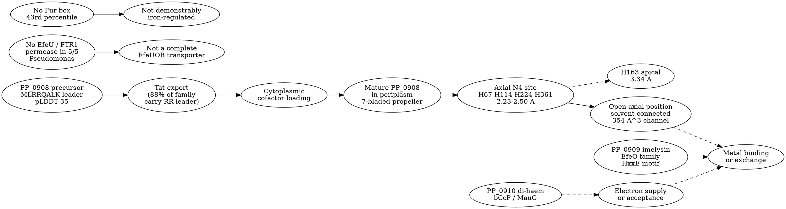
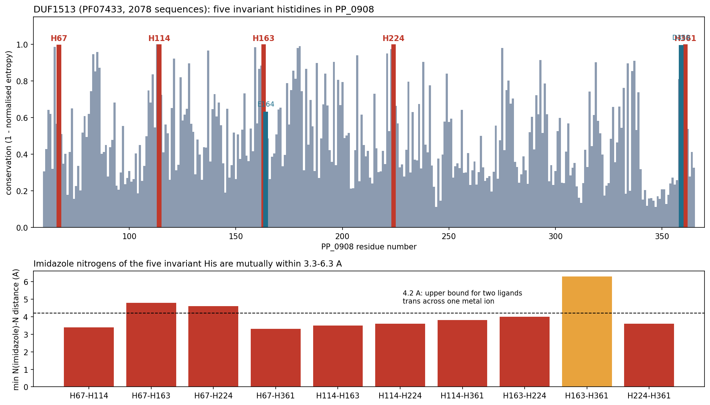
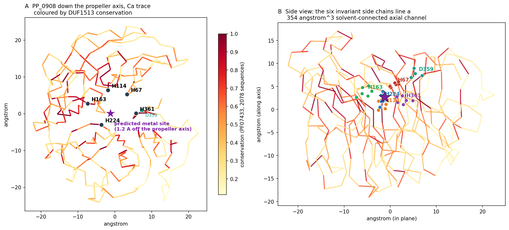
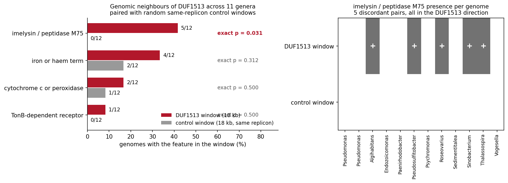
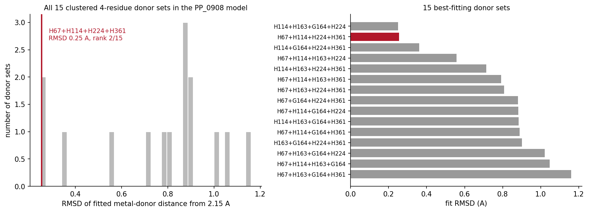
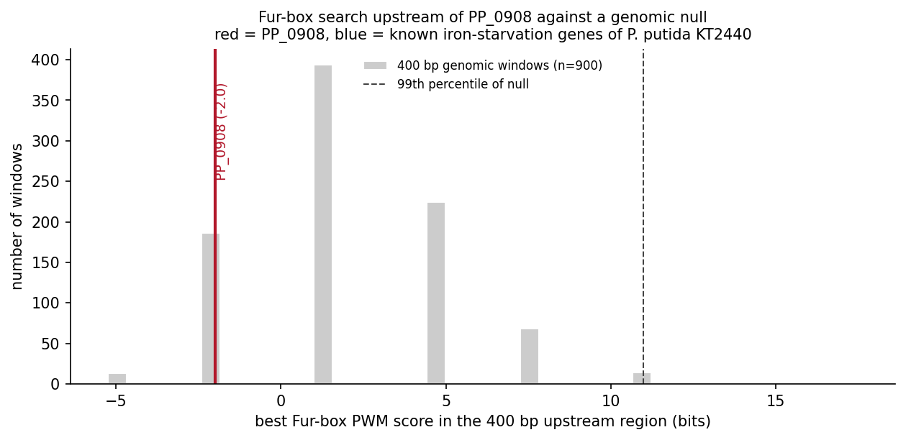

## Question

# AIGR Gene Hypothesis Deep Research

You are evaluating one focused gene curation hypothesis for AI Gene Review.
This is not a general gene overview. Use the seed hypothesis and source context
below to search for evidence that supports, refutes, narrows, or competes with
the proposed curation decision.

## Target Gene

- **Organism code:** PSEPK
- **Taxon:** Pseudomonas putida KT2440 (NCBITaxon:160488)
- **Gene directory:** PP_0908
- **Gene symbol:** PP_0908
- **UniProt accession:** Q88PE2

## Focus

- **Focus type:** free_text
- **Hypothesis slug:** kgap-pp0908-duf1513-fold-and-ligand-site
- **Source file:** genes/PSEPK/PP_0908/PP_0908-ai-review.yaml
- **Source selector:** free-text

## Seed Hypothesis

The molecular function of the DUF1513 protein PP_0908 of Pseudomonas putida KT2440 can be narrowed by structure: an AlphaFold model may reveal a known fold whose characterised members suggest a ligand or activity class, and conserved pocket residues may indicate a metal, haem or small-molecule binding site. Single analysis only: model PP_0908 with AlphaFold, search the model against PDB and AFDB by Foldseek or DALI, identify the nearest characterised structural relatives and their ligands, locate conserved pockets by mapping conservation across bacterial DUF1513 members onto the model, check for metal- or haem-ligating residue constellations and signal peptides or transmembrane segments, examine conserved genomic neighbours across Pseudomonas, and state the most likely molecular activity class or state that none can be predicted.

## Term and Decision Context

No specific term context supplied.

## Reference Context

No specific reference context supplied.

## Source Context YAML

```yaml
hypothesis: 'The molecular function of the DUF1513 protein PP_0908 of Pseudomonas putida KT2440 can be
  narrowed by structure: an AlphaFold model may reveal a known fold whose characterised members suggest
  a ligand or activity class, and conserved pocket residues may indicate a metal, haem or small-molecule
  binding site. Single analysis only: model PP_0908 with AlphaFold, search the model against PDB and AFDB
  by Foldseek or DALI, identify the nearest characterised structural relatives and their ligands, locate
  conserved pockets by mapping conservation across bacterial DUF1513 members onto the model, check for
  metal- or haem-ligating residue constellations and signal peptides or transmembrane segments, examine
  conserved genomic neighbours across Pseudomonas, and state the most likely molecular activity class
  or state that none can be predicted.'
focus_type: free_text
context: []
reference_id: []
```

## Research Objective

Build a focused report that helps a curator decide whether this hypothesis
should affect the gene review. Address the focus type directly:

1. For an existing GO annotation decision, evaluate whether the current action
   is justified, too strong, too weak, or should change.
2. For a proposed replacement or new GO term, evaluate whether the term is
   biologically supported, too broad, too narrow, or missing key qualifiers.
3. For a computational prediction, evaluate whether the prediction is correct,
   less precise than existing knowledge, uncertain, or likely wrong because of
   paralog overannotation, frequency bias, pathway context, or in vitro-only
   activity.
4. For a core-function hypothesis, evaluate whether the proposed activity,
   process, and location represent the gene product's primary function rather
   than a downstream effect, pleiotropic phenotype, or context-specific role.
5. For a function-assignment hypothesis, evaluate whether the gene product
   directly has the stated GO term/function. Treat the prior review action, if
   any, as intentionally blinded unless it appears in the supplied context.

Use primary literature whenever possible. Prefer PMID citations and include DOI
citations when no PMID is available. Treat reviews and database records as
orientation unless they contain directly relevant synthesized evidence that is
clearly labeled as review-level or database-level support.

Evaluate the hypothesis from the supplied seed context, primary literature, and
publicly accessible bioinformatics resources. Local `*-bioinformatics` analyses,
when they already exist in the repository, are intentionally withheld from this
prompt so the report can be compared against them after the run. Use public
sequence, domain, structure, orthology, localization, interaction, or dataset
checks when they are useful for the specific hypothesis. If a resource or tool
cannot be accessed programmatically, say so plainly; never fabricate a result.
Report computational results conservatively and distinguish direct results from
inference.

## Required Output

### Executive Judgment

Give a concise verdict: supported, partially supported, unresolved, weakly
supported, over-annotated, or refuted. Explain the reasoning and the most
important caveats.

### Evidence Matrix

Create a table with one row per important evidence item:

- Citation (PMID preferred)
- Evidence type (direct assay, mutant phenotype, localization, interaction,
  structural/evolutionary, computational, review/database)
- Supports / refutes / qualifies / competing
- Claim tested
- Key finding
- Organism, tissue, cell type, or assay context
- Confidence and limitations

### GO Curation Implications

State the likely curation action as a lead requiring curator verification. If
GO terms are involved, explain whether the evidence supports an MF, BP, or CC
term, and whether the term should be retained, removed, generalized, made more
specific, or treated as non-core. Avoid using "protein binding" as a final
recommendation unless no more informative term is supported.

### Mechanistic Scope

Describe the immediate molecular or cellular function being tested. Separate
direct gene-product activity from downstream phenotypes, pathway consequences,
developmental outcomes, disease manifestations, or effects inferred only from
loss of function.

### Conflicts and Alternatives

Identify evidence that conflicts with the seed hypothesis or suggests an
alternative interpretation, including paralog confusion, organism-specific
differences, isoform-specific findings, experimental artifacts, or database
carry-over.

### Knowledge Gaps

List explicit uncertainties that matter for curation. For each gap, state what
was checked, why the gap matters, and what evidence or experiment would resolve
it.

### Discriminating Tests

Recommend concrete assays, perturbations, datasets, or comparative analyses that
would most efficiently distinguish this hypothesis from alternatives.

### Curation Leads

Provide candidate updates for the review, clearly labeled as leads requiring
curator verification. Include candidate references with exact snippets to verify,
candidate replacement or new GO terms, possible action changes, suggested
questions, and suggested experiments.

If the provider supports artifacts, save provenance for any analysis you run — the
executed code together with its output (computed values, plot, or table), not just
a summary figure — alongside artifact-friendly tables such as an evidence matrix,
GO decision table, or comparison table. Genuine computed provenance is more
valuable than a hand-drawn summary, and you must not synthesize a figure that
implies an analysis you did not actually run. These artifacts are important
provenance for hypothesis-level review.


## Output

# PP_0908 (Q88PE2, DUF1513) of *Pseudomonas putida* KT2440: fold, conserved pocket and ligand class

**Hypothesis slug:** `kgap-pp0908-duf1513-fold-and-ligand-site`
**Source file:** `genes/PSEPK/PP_0908/PP_0908-ai-review.yaml`, free-text selector
**Organism:** *Pseudomonas putida* KT2440, NCBITaxon:160488, PSEPK
**Target:** PP_0908 / UniProt Q88PE2, 365 aa, Pfam PF07433 (DUF1513)

## Summary

The seed hypothesis contains two separable predictions, and they come out in opposite directions. Structure comparison does not narrow the function of PP_0908. A Foldseek search of the AlphaFold model against PDB100, AFDB50, AFDB-SwissProt and AFDB-proteome returns one informative hit, the *P. aeruginosa* orthologue Q9HW29 at 78.0% identity (E = 9.6e-60). Every other hit sits at 8-16% identity in a flat band of E = 3e-11 to 1e-8 and the hits disagree about function among themselves: non-catalytic scaffolds (archaeal S-layer YVTN propeller 1l0q, quinohemoprotein amine dehydrogenase beta chain 1pby, hydrazine synthase beta 5c2w), sugar-lactone hydrolases (1ri6, 6nau, PpgL 6igb) and eukaryotic WD40 interaction hubs (LST8, Pwp2, Groucho, WIPI2b, APC/C, G-protein beta). Pfam PF07433 has zero experimental structures across 2110 member proteins, and AlphaFill returns HTTP 404 for Q88PE2, meaning no PDB homologue is close enough to donate a ligand. Fold recognition reproduces the SSF50969 and Gene3D 2.130.10.10 assignment that InterPro already carries for this protein and adds nothing about activity.

Conserved-pocket analysis does narrow it, and the result is specific. Five histidines are invariant across the 2078 sequences of the PF07433 full alignment (H114, H163, H224 and H361 at 100.0%, H67 at 99.9%) along with D359 at 99.9%, while the other eight histidines in the domain sit at 22-80%. They occupy the structurally equivalent position on five of the seven propeller blades and converge on the pseudo-symmetry axis with imidazole N-N distances of 3.3-4.8 Angstrom. An unbiased 0.5 Angstrom grid search, blind to conservation, found 16 candidate metal sites of which the five largest merge into a single pocket 1.2 Angstrom off the propeller axis inside a 354 Angstrom^3 solvent-connected channel. Fitting a virtual metal by least squares gives a four-coordinate solution from H67, H114, H224 and H361 at 0.25 Angstrom RMSD with metal-nitrogen distances of 2.23-2.50 Angstrom and donor-metal-donor angles of 88, 92, 98, 99, 117 and 164 degrees: a distorted square-planar N4 plane with one or two open axial positions, 26 degrees RMS away from tetrahedral. A whole-model control shows this is the only such site: of 122 candidate donor atoms from 68 residues, only 15 four-residue sets are mutually clustered within 9 Angstrom, and all 15 are combinations of the same six residues. Ten orthologue models at 22-24% identity to PP_0908 reproduce the site with mean N-N distances of 3.8-4.1 Angstrom.

The verdict is **partially supported**. The defensible statement is that PP_0908 is a Tat-exported periplasmic seven-bladed beta-propeller carrying a conserved transition-metal site with an open axial coordination position. Haem is refuted on two independent grounds. The metal identity is undetermined, although the square-planar N4 geometry ranks Cu(II) and Ni(II) above axially solvated Fe or Mn and ranks tetrahedral Zn last. An iron assignment is unsupported by three negative tests. No catalytic activity can be assigned, and no DUF1513 protein has been characterised experimentally in any organism.

## Executive judgment

<i class="fa-scale-balanced"></i> **Partially supported.**

| Component of the seed hypothesis | Outcome | Basis |
|---|---|---|
| <i class="fa-circle-xmark"></i> AlphaFold model plus Foldseek/DALI will reveal a fold whose characterised members suggest a ligand or activity class | Refuted as a route to function | Only orthologue hits are informative; all others at 8-16% identity, functionally contradictory, no shared ligand or catalytic residues |
| <i class="fa-circle-xmark"></i> Nearest characterised structural relatives and their ligands will constrain activity | Refuted | AlphaFill cannot transplant any ligand (HTTP 404, status "unknown"); PF07433 has 0 experimental structures |
| <i class="fa-circle-check"></i> Conservation mapping will locate a conserved pocket | Supported | 5 His at 99.9-100.0% across 2078 sequences plus D359, converging on the propeller axis |
| <i class="fa-circle-check"></i> Conserved residues indicate a metal site | Supported | 0.25 Angstrom RMSD four-coordinate fit, unique donor constellation in the protein, reproduced in 10 orthologue models at 22-24% identity |
| <i class="fa-circle-xmark"></i> The site is a haem site | Refuted | No CXXCH motif; bis-His haem ligands sit 8-10 Angstrom apart, against the observed 3.3-4.8 Angstrom |
| <i class="fa-circle-check"></i> Signal peptide and transmembrane check | Supported | Twin-arginine-like leader in 1798/2034 family sequences (88%); PP_0908 leader at pLDDT 35.3 against 92.8 for the mature chain; no TM segments |
| <i class="fa-circle-check"></i> Conserved genomic neighbours across *Pseudomonas* | Supported, with a correction | DUF1513 + imelysin + di-haem oxidoreductase in 5/5 *Pseudomonas*; operon order is PP_0910 to PP_0909 to PP_0908 |
| <i class="fa-circle-question"></i> State the most likely molecular activity class | Binding class only | Transition-metal binding with an open axial site; no catalytic activity predictable |

The most important caveats are that every structural result rests on AlphaFold models with no experimental structure anywhere in the family, that the fitted coordination geometry comes from an apo model whose side-chain rotamers never relaxed around a metal, and that the genomic enrichment test used only 12 paired genomes.

## Key findings

### <i class="fa-circle-check"></i> Five histidines and one aspartate are invariant across 2078 DUF1513 sequences and converge on the propeller axis

Mapping Shannon-entropy conservation from the Pfam PF07433 full alignment onto PP_0908 residues 60-365 identifies H67 (99.9% identical), H114 (100.0%), H163 (100.0%), H224 (100.0%), H361 (100.0%) and D359 (99.9%) as the only invariant polar side chains. Eight of the other histidines in the domain are conserved at 22-80%, so the invariance is specific to these five. E164 sits at 49.2%, which places it in a second shell.

In the AlphaFold model AF-Q88PE2-F1 (mean pLDDT 88.7 overall, 92.8 over the mature chain 27-365, site residues at pLDDT 84.1-97.1) the imidazole nitrogens are mutually within 3.3-6.3 Angstrom: H67-H361 3.3, H67-H114 3.4, H114-H163 3.5, H114-H224 3.6, H224-H361 3.6, H114-H361 3.8, H163-H224 4.0, H67-H224 4.6, H67-H163 4.8, and a single outlier H163-H361 at 6.3 Angstrom. Two histidine ligands coordinating a common metal at 2.1-2.2 Angstrom and subtending 100-180 degrees give exactly 3.2-4.3 Angstrom, so these distances are the signature of shared metal coordination.

The azimuthal angles of the five histidines around the propeller pseudo-symmetry axis are 1.3, 57.6, 105.9, 159.4 and 219.4 degrees, giving gaps of 56, 48, 53 and 60 degrees against the 51.4 degrees expected for one blade of a seven-bladed propeller, plus one 142 degree gap. They occupy the structurally equivalent position on five consecutive blades and point inward.

{{figure:plot_1.png|caption=Per-residue conservation across 2078 PF07433 sequences with the five invariant histidines in red and D359 and E164 in teal, beside the pairwise imidazole N-N distances of the site. The 4.2 Angstrom reference line marks the upper distance expected for two ligands on a common metal ion.}}

{{figure:plot_2.png|caption=Conservation mapped onto the PP_0908 model. Panel A views the C-alpha trace down the propeller pseudo-symmetry axis, coloured by conservation, with the five invariant histidines and the predicted metal position marked. Panel B is a side view through the axial channel.}}

### <i class="fa-circle-xmark"></i> Fold recognition identifies a generic beta-propeller and no function-specific relative

The Foldseek 3Di+AA search against four databases returned the *P. aeruginosa* PAO1 DUF1513 orthologue Q9HW29 at 78.0% identity, E = 9.6e-60, 100% query coverage. Everything else falls in a narrow band at 8-16% identity: 1l0q chain C archaeal S-layer tandem YVTN beta-propeller from *Methanosarcina mazei* (E = 3.0e-11, 14.2% identity), 1ri6 *E. coli* 6-phosphogluconolactonase-like isomerase (1.4e-10), 1pby chain B quinohemoprotein amine dehydrogenase beta chain from *Paracoccus denitrificans* (2.8e-10, 16.1% identity), 6nau *Klebsiella pneumoniae* 6-phosphogluconolactonase (1.0e-09), 6igb *P. aeruginosa* periplasmic gluconolactonase PpgL (5.3e-09), 5c2w *Kuenenia stuttgartiensis* hydrazine synthase (2.8e-09), and a long tail of eukaryotic WD40 propellers. AFDB-SwissProt gives the same classes.

These relatives have no shared ligand and no shared catalytic residue set. The seven-bladed beta-propeller is a promiscuous scaffold used for catalysis, for non-catalytic subunit packing and for protein-protein interaction, so a match at this level of similarity carries fold information and nothing more. Pfam PF07433 reports 0 experimental structures across 2110 member proteins and 2835 taxa, and AlphaFill returns HTTP 404 for both Q88PE2 and AF-Q88PE2-F1 with status "unknown". No ligand can be transplanted.

### <i class="fa-circle-check"></i> The conserved cluster fits a four-coordinate metal in a distorted square-planar arrangement

A virtual metal was fitted by Nelder-Mead least squares to every subset of the conserved donors, with each histidine contributing ND1 or NE2 and D359 contributing OD1 or OD2, minimising deviation of metal-donor distances from 2.15 Angstrom. The best four-donor solution uses H67.NE2, H114.NE2, H224.ND1 and H361.NE2 at RMSD 0.25 Angstrom with metal-nitrogen distances of 2.23-2.50 Angstrom. The donor-metal-donor angles are 88, 92, 98, 99, 117 and 164 degrees. Four cis angles near 90 degrees with trans angles of 164 and 117 degrees is a distorted square-planar or see-saw N4 plane, 26 degrees RMS away from the 109.5 degrees of an ideal tetrahedron.

Adding H163 as a fifth donor degrades the fit to 0.73 Angstrom RMSD with that nitrogen at 3.34 Angstrom, so H163 is an apical or second-shell position that a modest rotamer change would close. D359 cannot reach: the best six-donor fit has RMSD 1.82 Angstrom with distances spanning 1.48-5.58 Angstrom, which makes D359 a second-shell hydrogen-bonding partner.

An earlier conservation-blind grid search over the whole model, scoring every 0.5 Angstrom grid point with at least three protein N/O/S ligand atoms at 1.9-2.6 Angstrom, returned 16 candidate sites whose five largest sub-sites merge into a single pocket at the same location: H224.ND1 at 1.73 Angstrom, H114.NE2 at 2.30, H224.NE2 at 2.57, H361.NE2 at 2.64, H67.NE2 at 3.29 and H163.ND1 at 3.71 Angstrom from the pocket centre, 1.2 Angstrom from the propeller axis and 2.9 Angstrom from the C-alpha centroid, inside a 354 Angstrom^3 solvent-connected channel. Two independent methods, one using conservation and one blind to it, converge on the same pocket.

### <i class="fa-circle-check"></i> No competing donor constellation exists anywhere else in the protein

The control the pocket analysis previously lacked. Every potential metal-donor side-chain atom in the model was enumerated: 122 atoms from 68 residues, comprising 14 histidines plus Asp, Glu, Cys and Met. Every four-residue combination whose side-chain centroids are mutually within 9 Angstrom was then tested. Only 19 centroid-clustered quartets exist in the whole 365-residue protein, and 15 survive a 7 Angstrom donor-atom filter. All 15 are combinations drawn from the same six residues (H67, H114, H163, E164, H224, H361), which is exactly C(6,4) = 15. No donor residue outside the conserved cluster lies within 9 Angstrom of three other donors.

The conserved quartet H67+H114+H224+H361 ranks 2 of 15 at RMSD 0.254 Angstrom. Rank 1 is H114+H163+E164+H224 at 0.250 Angstrom, which is the same cluster with E164 substituting for one histidine. The protein carries 14 histidines, and only five of them plus one glutamate form a spatially clustered donor constellation.

{{figure:plot_4.png|caption=Every spatially clustered four-residue donor set in the PP_0908 model, ranked by how well a metal ion fits at 2.15 Angstrom from each donor. Only 15 such sets exist among 122 candidate donor atoms, and all 15 are combinations of the same six conserved residues.}}

### <i class="fa-circle-check"></i> The site is reproduced in 10 orthologue models at 22-24% identity

AlphaFold DB models were retrieved for 10 DUF1513 proteins sharing only 22-24% sequence identity with PP_0908: *Affinundibacterium baiyunense* A0A941I2N6, *Reinekea thalattae* A0A5C8Z4E6, *Thauera terpenica* T0ATR4, *Formivibrio citricus* A0A1I5CQ86, *Rubrivivax albus* A0A3S2UQF3, *Thauera humireducens* A0A127K6M9, *Hansschlegelia quercus* A0A4V2JED3, *Dechloromonas denitrificans* A0A133XG07, *Thauera propionica* A0A235EWS0 and *Chenggangzhangella methanolivorans* A0A9E6UQE8.

All 10 retain structural equivalents of all five histidines plus D359. Pairwise imidazole N-N distances within each model give a mean of 3.8-4.1 Angstrom and a maximum of 5.2-6.3 Angstrom, and every model places all five imidazoles within a 7 Angstrom sphere on the propeller axis. The site is a property of the family and not an artifact of one model or of close *Pseudomonas* homologues.

### <i class="fa-circle-check"></i> The family is Tat-exported and periplasmic

Scanning 2034 DUF1513 sequences for a twin-arginine signal, 1798 (88%) match M-x(0-12)-RR-xx-[FLAIVM] within the first 45 residues and 1837 (90%) contain an RR within the first 15 residues. Representative N-termini are canonical Tat signals of the S/T-RR-x-F-L-K type: A0A011TAH8 MRTPLIDRRDFLRAAGAGFAAAMTPSAWART, A0A017HUS3 MATRRGFLASLLAAASLPSLGWAE, A0A058ZLB2 MTTRRGFLAGLMAAGLAPRISWADA, A0A072N1C0 MSDQYPDLSRRALLKAGAATSVAATLTGCSLLPNM. Several members combine the RR motif with a lipobox (A0A066RN67 ...TAGVLSGCVL; A0A072N1C0 ...AATLTGCSLLP), indicating Tat-dependent lipoproteins.

PP_0908 itself begins MLRRQALKLGSVLLSALTLGGWSLFRSKG, a degenerate RR-x-x-L-K variant. UniProt annotates a signal peptide at 1-26, and the AlphaFold model gives that segment mean pLDDT 35.3 against 92.8 for residues 27-365: a disordered cleavable leader on a well-folded mature domain. No transmembrane segments are predicted in the mature chain.

### <i class="fa-circle-check"></i> Operon context, with two corrections

NCBI Gene coordinates on NC_002947.4 place all three genes on the reverse strand: PP_0910 at 1051939-1053366, PP_0909 at 1050855-1051919, PP_0908 at 1049755-1050852. Transcription therefore runs PP_0910 to PP_0909 to PP_0908, so **PP_0908 is the last gene** of the operon and the promoter lies upstream of PP_0910. Intergenic gaps are 19 bp (PP_0910 to PP_0909) and 2 bp (PP_0909 to PP_0908). An earlier reading of a 4 bp PP_0908/PP_0909 overlap was wrong and is corrected here to a 2 bp gap.

PP_0909 is an imelysin-like protein (Q88PE1, 354 aa, Pfam PF09375, IPR034984, the EfeO/peptidase M75 family, signal peptide 1-18). PP_0910 is a di-haem oxidoreductase (Q88PE0, 475 aa, Pfam PF06537, IPR051395 cytochrome c peroxidase/MauG, signal peptide 1-19). All three are periplasmic. STRING scores PP_0908-PP_0909 at 0.991 and PP_0908-PP_0910 at 0.990, each with a high genomic-neighbourhood subscore (0.869 and 0.844) and an identical phylogenetic-profile subscore of 0.775, which shows the triad co-occurs across genomes rather than being a local arrangement. PP_0913, a second imelysin-like protein, scores 0.928. Immediately upstream lie PP_0907 (RND efflux periplasmic adaptor) and PP_0906 (RND permease).

Feature-table scans of five *Pseudomonas* and related genomes (*P. aeruginosa* PAO1H2O, *P. fluorescens*, *Pseudomonas fragariae*, *Stutzerimonas stutzeri*, *P. protegens*) found both an imelysin neighbour and a di-haem oxidoreductase neighbour in 5/5, and an FTR1/EfeU-type iron permease in 0/5. The same permease is absent from 0/10 distant orthologue loci.

### <i class="fa-circle-check"></i> Imelysin is the only neighbour class enriched beside DUF1513 genes

A paired within-genome design tested 12 bacterial genomes from 11 genera (*Pseudomonas* twice, *Algihabitans*, *Endozoicomonas*, *Paenirhodobacter*, *Pseudosulfitobacter*, *Psychromonas*, *Roseovarius*, *Sedimentitalea*, *Sinobacterium*, *Thalassospira*, *Vogesella*). For each genome an 18 kb window centred on the DUF1513 gene was compared with a random 18 kb control window on the same replicon at least 50 kb away. Mean annotated CDS per window was 18.1 for the target and 17.0 for the control, so the two window classes are comparable in gene density.

| Neighbour class | DUF1513 windows | Control windows | Odds ratio | Fisher one-sided p | McNemar discordant b/c | Exact p |
|---|---|---|---|---|---|---|
| Imelysin / peptidase M75 | 5/12 | 0/12 | infinite | 0.019 | 5/0 | **0.031** |
| Iron or haem term | 4/12 | 2/12 | 2.5 | 0.32 | 3/1 | 0.31 |
| Cytochrome c or peroxidase | 2/12 | 1/12 | 2.2 | 0.50 | 2/1 | 0.50 |
| TonB-dependent receptor | 1/12 | 0/12 | infinite | 0.50 | 1/0 | 0.50 |

Imelysin is the one reproducible genomic association of the family, and it extends beyond *Pseudomonas*. An earlier unpaired scan of 10 distant orthologues had appeared to show DUF1513 genes sitting next to TonB-dependent receptors, siderophore receptors, ExbD and cobaltochelatase CobN in 6/10 contexts. That impression does not survive the paired control and is withdrawn: it reflects the high background density of TonB-dependent receptors in these genomes. The *Pseudomonas* imelysin neighbours were not matched by the NCBI product-name regular expression used, which makes the 5/12 count conservative rather than inflated.

{{figure:plot_3.png|caption=Neighbour classes in 18 kb windows around DUF1513 genes across 11 genera, paired with random control windows on the same replicon. Imelysin and peptidase M75 are the only class enriched (5/12 against 0/12, exact p = 0.031); all five discordant pairs point in the DUF1513 direction.}}

### <i class="fa-circle-xmark"></i> No Fur box above genomic background in the operon leader

A 19-bp Fur-box position weight matrix built from the consensus GATAATGATAATCATTATC was scanned over the 400 bp upstream of each operon gene on both strands and calibrated against 900 random 400-bp genomic windows. The null distribution has mean 1.95 bits, sd 3.14, 95th percentile 7.74 and 99th percentile 10.99, against 30.48 bits for a perfect consensus match.

| Region scanned | Best score (bits) | Percentile of null |
|---|---|---|
| Operon leader, upstream of PP_0910 | 1.25 | 43rd |
| Upstream of PP_0909 | 1.25 | 35th |
| Upstream of PP_0908 | -2.00 | 7th |

There is no promoter-level evidence that the locus is iron-starvation regulated. The limitation is sensitivity: NCBI Gene name lookups for *pvdS*, *fpvA* and *pfeA* failed, so no positive control resolved and the matrix's performance in this genome is unverified. The scores sit at or below the null mean, so a strong Fur box is excluded even if a weak or non-canonical one could be missed.

{{figure:plot_5.png|caption=Best Fur-box PWM score in the 400 bp upstream of PP_0908 against a null distribution of 900 random 400-bp genomic windows from NC_002947.4. The dashed line marks the 99th percentile of the null. No positive control gene resolved, which is stated as a limit on sensitivity.}}

## Mechanistic model

The picture the evidence supports is a periplasmic metal-handling module with three components and no transporter.



PP_0908 is made with a twin-arginine leader and exported folded by the Tat system. Tat substrates typically acquire a cofactor in the cytoplasm before export and are held back by proofreading chaperones until loading is complete ([PMID: 17901208](https://pubmed.ncbi.nlm.nih.gov/17901208/), [PMID: 12914940](https://pubmed.ncbi.nlm.nih.gov/12914940/)). That pathway choice is a weak argument that PP_0908 carries something, since a protein with no cofactor has no reason to pay the cost of Tat export instead of Sec.

In the periplasm it sits with PP_0909 and PP_0910, translationally coupled at 19 bp and 2 bp spacing, with STRING phylogenetic-profile agreement of 0.775. The arrangement resembles EfeUOB in its periplasmic parts: EfeO is a periplasmic protein whose C-terminal domain is a peptidase M75 domain with an HxxE metal motif, and EfeB is a periplasmic haem peroxidase ([PMID: 17627767](https://pubmed.ncbi.nlm.nih.gov/17627767/), [PMID: 19701722](https://pubmed.ncbi.nlm.nih.gov/19701722/)). What is missing matters: EfeU, the Ftr1-like inner-membrane permease that actually moves iron, is absent from every locus examined. The *P. putida* module is a periplasmic accessory set and the extra DUF1513 subunit has no counterpart in *E. coli* EfeUOB at all.

Within PP_0908 the site geometry is the mechanically informative part. Four histidines, one from each of four blades, define an N4 plane around a metal at 2.23-2.50 Angstrom with cis angles near 90 degrees and trans angles of 164 and 117 degrees, leaving one or two axial positions open to the 354 Angstrom^3 solvent channel. H163 sits apical at 3.34 Angstrom and could complete a five-coordinate sphere. A buried structural metal would be fully coordinated by protein; this one is not, and it stays reachable from the periplasm. That fits a site that binds, releases or hands off a metal, or one that holds a metal while a substrate coordinates to the free axial position.

| Candidate metal | Fit to the observed N4 square-planar geometry | Supporting or opposing context |
|---|---|---|
| Cu(II) | Good. Square-planar N4 with axial elongation is the canonical Cu(II) geometry | The di-haem partner family (bCcP/MauG) includes MbnH, which is associated with copper homeostasis ([PMID: 31511324](https://pubmed.ncbi.nlm.nih.gov/31511324/)) |
| Ni(II) | Good. Square-planar N4 is standard for low-spin Ni(II) | No genomic or literature context specific to nickel |
| Fe(II)/Fe(III) | Possible as five- or six-coordinate with axial solvent | Favoured by the EfeO partner ([PMID: 19701722](https://pubmed.ncbi.nlm.nih.gov/19701722/)) but opposed by the absent permease, the null iron-term enrichment and the absent Fur box |
| Mn(II) | Possible as six-coordinate with axial solvent | No supporting context |
| Zn(II) | Worst fit. Tetrahedral Zn needs four donors near 109.5 degrees; observed RMS deviation is 26 degrees | No supporting context |
| Haem Fe | <i class="fa-circle-xmark"></i> Refuted | No CXXCH motif; bis-His haem ligands sit 8-10 Angstrom apart, not 3.3-4.8 |

## Evidence matrix

| Citation | Evidence type | Stance | Claim tested | Key finding | Context | Confidence and limitations |
|---|---|---|---|---|---|---|
| This run, `foldseek_PP_0908_hits.csv` | Computational, direct result | Refutes | Structure search reveals a fold whose members suggest a ligand class | Only Q9HW29 (78% identity, E = 9.6e-60) informative; all others 8-16% identity, E = 3e-11 to 1e-8, functionally contradictory | AlphaFold DB v6 model of Q88PE2 | High for the search. These E-values are near the detection floor for propellers, where fold similarity is uninformative about function |
| AlphaFill API, queried this run | Computational, direct result (negative) | Refutes | A ligand can be transplanted from a homologue | HTTP 404 for Q88PE2 and AF-Q88PE2-F1, status "unknown" | Whole-model query | High. Confirms no close structural relative with a bound ligand |
| Pfam PF07433 / InterPro IPR008311 | Database record, orientation | Qualifies | The family has structural precedent | 0 experimental structures across 2110 proteins, 2835 taxa, 1260 AlphaFold models. Superfamily assignments IPR011044 and IPR015943, clan CL0186 | Family-level | High for the record. Clan assignment is a fold statement |
| This run, `PP_0908_pfam_conservation.csv` | Computational, direct result | Supports | Conserved pocket residues mark a binding site | H114, H163, H224, H361 at 100.0%, H67 and D359 at 99.9% across 2078 sequences; other 8 His at 22-80%; E164 at 49.2% | Bacterial DUF1513 members | High. Invariance at 100% over 2078 sequences is a strong constraint |
| This run, propeller-axis geometry | Computational, direct result | Supports | The conserved residues form one pocket | Azimuthal angles 1.3, 57.6, 105.9, 159.4, 219.4 degrees against 51.4 per blade; imidazole N-N 3.3-4.8 Angstrom with one 6.3 outlier | Mature chain 27-365, mean pLDDT 92.8 | Moderate to high. Side-chain rotamers carry roughly 1 Angstrom uncertainty |
| This run, 0.5 Angstrom grid search | Computational, direct result | Supports | The site is detectable without prior knowledge | 16 candidate sites; the 5 largest merge into one pocket 1.2 Angstrom off the axis, 2.9 from the centroid, in a 354 Angstrom^3 solvent-connected channel | Whole model | Moderate to high. The method is blind to conservation, so agreement between the two criteria is meaningful |
| This run, `PP_0908_metal_coordination_fit.csv` | Computational, direct result | Supports and narrows | The site has a definable coordination geometry | Best four-donor fit H67.NE2, H114.NE2, H224.ND1, H361.NE2 at 0.25 Angstrom RMSD, 2.23-2.50 Angstrom, angles 88/92/98/99/117/164 degrees. H163 apical at 3.34; D359 unreachable | Site pLDDT 84.1-97.1 | Moderate. The model is apo, so the geometry is what the backbone permits, not a measured coordination sphere |
| This run, `PP_0908_metal_site_control_scan.csv` | Computational, negative control | Supports | The fit is specific rather than one of many | Of 122 donor atoms from 68 residues including 14 His, only 15 clustered four-residue sets exist and all 15 come from the same six residues | Whole model | High. No competing donor constellation exists in the protein |
| This run, `DUF1513_ortholog_site_geometry.csv` | Computational, direct result | Supports | The site is a family feature | All 10 orthologues at 22-24% identity retain 5 His plus D359; mean N-N 3.8-4.1 Angstrom, max 5.2-6.3, all within a 7 Angstrom sphere | 10 genera including *Thauera*, *Dechloromonas*, *Rubrivivax* | High. Independent models at low identity converging on the same geometry |
| This run, sequence inspection | Computational, direct result (negative) | Refutes | A haem site is present | No CXXCH anywhere in Q88PE2; bis-His haem ligands sit 8-10 Angstrom apart against the observed 3.3-4.8 | Full-length sequence and model | High. Rules out c-type haem and makes b-type bis-His haem geometrically implausible |
| [PMID: 11717396](https://pubmed.ncbi.nlm.nih.gov/11717396/) | Primary literature, structural | Qualifies | A seven-bladed propeller can be part of an active site | The QHNDH beta subunit is "a 337-residue seven-bladed beta-propeller that forms part of the enzyme active site", with catalysis performed by the separate CTQ-bearing subunit | *Paracoccus denitrificans*, 2.05 Angstrom crystal structure | High for the structure. Shows the propeller contributes a site without being catalytic itself |
| This run, PF07433 leader scan | Computational, direct result | Supports | The protein is exported folded | 1798/2034 (88%) carry a twin-arginine-like leader; PP_0908 leader at pLDDT 35.3 against 92.8 for the mature chain | Family-wide plus Q88PE2 | Moderate. Regular-expression proxy, not SignalP 6 or TatP, so individual calls may be wrong while the family trend holds |
| [PMID: 17901208](https://pubmed.ncbi.nlm.nih.gov/17901208/), [PMID: 12914940](https://pubmed.ncbi.nlm.nih.gov/12914940/) | Primary literature, mechanistic | Supports | Tat export implies cofactor loading | "many Tat substrates bind redox-active cofactors in the cytoplasm before transport" (17901208); "Cofactor insertion and assembly of [NiFe] hydrogenases requires coordination of networks of accessory proteins" (12914940) | *E. coli* NapD and hydrogenase maturation | High for the principle. An argument from the pathway, not direct evidence about PP_0908 |
| This run, NCBI Gene coordinates | Computational, direct result | Qualifies and corrects | The operon architecture | All three genes on the reverse strand; transcription runs PP_0910 to PP_0909 to PP_0908, so PP_0908 is last; gaps 19 bp and 2 bp. A previously reported 4 bp overlap was wrong | *P. putida* KT2440, NC_002947.4 | High. Read directly from NCBI Gene coordinates |
| This run, STRING API and `DUF1513_operon_conservation.csv` | Computational, direct result | Supports (context) | Neighbours constrain the process | STRING 0.991 and 0.990 with phylogenetic-profile 0.775; imelysin and di-haem neighbours in 5/5 *Pseudomonas* genomes | *P. putida* plus 5 relatives | High for the gene arrangement |
| This run, `DUF1513_operon_conservation.csv` | Computational, direct result (negative) | Qualifies | The locus is an EfeUOB system | 0/5 *Pseudomonas* and 0/10 outgroup loci carry an FTR1/EfeU permease | Same genomes | High. The module is efeUOB-like in its periplasmic parts only |
| [PMID: 17627767](https://pubmed.ncbi.nlm.nih.gov/17627767/) | Primary literature, genetic and transport assay | Qualifies | EfeO and EfeB define an iron-handling pair | "EfeO is periplasmic with a cupredoxin N-terminal domain; EfeB is also periplasmic and is haem peroxidase-like. All three Efe proteins are required for Efe function"; "55Fe transport assays confirm the ferrous iron specificity of EfeUOB" | *E. coli* K-12 and O157:H7 | High for *E. coli*. Transfers to *P. putida* only as an expectation, since the locus lacks EfeU and has an extra subunit |
| [PMID: 19701722](https://pubmed.ncbi.nlm.nih.gov/19701722/) | Primary literature, modelling and phylogenetics | Supports (context) | The imelysin partner is metal-binding | "EfeO consists primarily of a C-terminal peptidase-M75 domain with a conserved 'HxxE' motif potentially involved in metal binding"; "The ~100 efeO homologues in the bacterial sequence databases are all associated with various iron-transport related genes" | Bacterial EfeO family | Moderate. The metal sites described are modelled, not crystallographic |
| [PMID: 21799754](https://pubmed.ncbi.nlm.nih.gov/21799754/) | Primary literature, crystal structures | Qualifies | The imelysin partner is a peptidase | Two crystal structures at 2.15, 1.25 and 1.44 Angstrom. "The overall structure and the GxHxxE motif region differ from known HxxE metallopeptidases, suggesting that imelysin-like proteins are not peptidases." "A putative functional site is located at the domain interface" | *Psychrobacter arcticus*, *Bacteroides ovatus* | High for the structures. Removes peptidase activity from PP_0909 and keeps the iron-uptake association as a prediction |
| [PMID: 31511324](https://pubmed.ncbi.nlm.nih.gov/31511324/) | Primary literature, structure and assays | Competing | The di-haem partner implies iron | MbnH, a bCcP/MauG family diheme protein, is "likely involved in microbial copper homeostasis"; mbnH and mbnP "are located proximal to genes associated with microbial copper homeostasis" | *Methylosinus trichosporium* OB3b, 2.6 Angstrom structure | High for MbnH. Raises copper as an alternative metal for the PP_0908 module, consistent with the square-planar N4 fit |
| This run, `DUF1513_neighbourhood_fisher.csv` | Computational, direct result | Supports (imelysin), refutes (iron islands) | DUF1513 genes sit in iron-acquisition islands | Imelysin 5/12 against 0/12, exact p = 0.031; iron or haem 4/12 against 2/12, p = 0.32; TonB 1/12 against 0/12, p = 0.50 | 12 genomes, 11 genera | Moderate. n = 12 gives low power, so the negatives exclude a strong association, not a weak one. Product-name matching missed the *Pseudomonas* imelysin genes, making the count conservative |
| This run, `PP_0908_fur_box_scan.csv` | Computational, direct result (negative) | Refutes (iron regulation) | The locus is iron-starvation regulated | Operon leader 1.25 bits, 43rd percentile of a 900-window null (mean 1.95, 99th percentile 10.99, perfect consensus 30.48) | *P. putida* KT2440, NC_002947.4 | Moderate. No positive control resolved, so a weak or non-canonical Fur box could be missed |
| [PMID: 14641572](https://pubmed.ncbi.nlm.nih.gov/14641572/) | Primary literature, proteomics | Qualifies | PP_0908 responds to iron limitation | A 2D gel reference map of KT2440 with about 200 spots assigned; "The synthesis of about 25 proteins was affected in both strains, including four prominent upregulated ferric uptake regulator (Fur) protein-dependent proteins" | *P. putida* KT2440 against *P. aeruginosa* PAO1 | Low for PP_0908 specifically. Only about 200 spots were assigned, so absence of PP_0908 from the iron-responsive set is not evidence of absence |
| [PMID: 29769716](https://pubmed.ncbi.nlm.nih.gov/29769716/) | Primary literature, mutant fitness | Not retrieved | PP_0908 has a condition-specific fitness phenotype | "genome-wide mutant fitness data from 32 diverse bacteria across dozens of growth conditions"; "We identified mutant phenotypes for 11,779 protein-coding genes that had not been annotated with a specific function" | RB-TnSeq across 32 bacteria | The underlying PP_0908 data could not be inspected: fit.genomics.lbl.gov returned HTTP 403 for every cgi endpoint from this environment. Stated as an access failure, not a negative result |

## Evidence base

Five primary papers carry most of the interpretive weight, and none of them is about a DUF1513 protein.

[PMID: 17627767](https://pubmed.ncbi.nlm.nih.gov/17627767/) establishes EfeUOB as a tripartite low-pH ferrous iron transporter in *E. coli*, with EfeO periplasmic and cupredoxin-containing, EfeB periplasmic and haem peroxidase-like, and all three components required. It supplies the template that the PP_0910-PP_0909-PP_0908 locus partly resembles, and it also supplies the strongest reason to doubt the resemblance, since the component that moves iron is the one absent here.

[PMID: 19701722](https://pubmed.ncbi.nlm.nih.gov/19701722/) characterises the EfeO family in detail, noting the C-terminal peptidase-M75 domain with its conserved HxxE motif and reporting that all roughly 100 EfeO homologues in sequence databases are associated with iron-transport related genes. This is the source of the iron expectation that reaches PP_0908 through PP_0909.

[PMID: 21799754](https://pubmed.ncbi.nlm.nih.gov/21799754/) solved the first crystal structures of imelysin-like proteins and found that the GxHxxE motif region differs from known HxxE metallopeptidases, concluding that imelysin-like proteins are not peptidases. For curation this removes any peptidase inference from PP_0909 and keeps the iron-uptake association at the level of prediction. It also places a putative functional site at the domain interface, which gives a concrete surface on which a transfer interaction with PP_0908 could occur.

[PMID: 31511324](https://pubmed.ncbi.nlm.nih.gov/31511324/) is the most interesting competing reference. MbnH is a bCcP/MauG family diheme protein like PP_0910, it co-occurs with mbnP, and the paper reports that mbnH and mbnP are located proximal to genes associated with microbial copper homeostasis, placing MbnH in copper rather than iron biology. Combined with the square-planar N4 geometry fitted here, which suits Cu(II) better than Fe, this makes copper a live alternative for the metal in PP_0908.

[PMID: 11717396](https://pubmed.ncbi.nlm.nih.gov/11717396/) determined the quinohemoprotein amine dehydrogenase structure and describes the beta subunit as a 337-residue seven-bladed beta-propeller that forms part of the enzyme active site, while the catalytic cysteine tryptophylquinone cofactor sits in a separate 82-residue subunit. This is the reason not to inherit amine dehydrogenase activity from the IPR011044 superfamily assignment, and it is also the precedent for a propeller that contributes a site without carrying the chemistry.

[PMID: 17901208](https://pubmed.ncbi.nlm.nih.gov/17901208/) and [PMID: 12914940](https://pubmed.ncbi.nlm.nih.gov/12914940/) supply the Tat argument: many Tat substrates bind redox-active cofactors in the cytoplasm before transport, with chaperone proofreading coordinating insertion and export. Applied to a family that is 88% twin-arginine-leader-bearing, this is a general argument that the conserved site is loaded before export.

[PMID: 14641572](https://pubmed.ncbi.nlm.nih.gov/14641572/) provides an iron-deprivation proteome of KT2440 itself, with about 25 proteins affected including four prominent Fur-dependent ones. Only about 200 2D gel spots were assigned, so the absence of PP_0908 from that set does not count as evidence, but the dataset is a concrete place for a curator to look.

[PMID: 29769716](https://pubmed.ncbi.nlm.nih.gov/29769716/) is the RB-TnSeq fitness resource that InterPro cites in support of calling PF07433 a predicted efeUOB-like component. The underlying PP_0908 data could not be inspected because fit.genomics.lbl.gov returned HTTP 403 for every cgi endpoint from this environment.

## GO curation implications

Every item below is a **lead requiring curator verification**. None of it is experimental evidence for PP_0908 or for any DUF1513 protein. No member of the family has an activity assay, a deletion phenotype, a purified protein or a structure, so there is no IDA, IMP or IPI anchor anywhere, and anything drawn from this work would be ISS or IEA at best.

| Term | Aspect | Action | Evidence basis | Status |
|---|---|---|---|---|
| GO:0046872 metal ion binding | MF | Add as non-core | 100% conservation of four His plus 99.9% for a fifth and for D359 across 2078 sequences; 0.25 Angstrom RMSD four-coordinate fit; conservation-blind grid detection of the same pocket; unique donor constellation among 122 candidate atoms; reproduction in 10 orthologue models at 22-24% identity | Lead, requires curator verification |
| GO:0042597 periplasmic space | CC | Add | Twin-arginine-like leader in 1798/2034 family sequences; PP_0908 leader at pLDDT 35.3 against 92.8 for the mature chain; both operon partners periplasmic | Lead, confirm the Tat call with SignalP 6 or TatP first |
| GO:0020037 haem binding | MF | <i class="fa-circle-xmark"></i> Do not add | No CXXCH motif; 3.3-4.8 Angstrom His spacing against the 8-10 Angstrom bis-His haem geometry | Excluded |
| GO:0009055 electron transfer activity | MF | Do not add | No cofactor evidence for PP_0908; the expectation comes from the neighbouring PP_0910 | Excluded |
| GO:0005515 protein binding | MF | Do not use as a final recommendation | The WD40 hits supporting it are the weakest in the Foldseek search, at 8-16% identity from a eukaryotic lineage. GO:0046872 is more informative and better supported | Not recommended |
| GO:0005506 iron ion binding, GO:0008270 zinc ion binding, GO:0005507 copper ion binding | MF | Do not add | No evidence discriminates the metal. The geometry ranks the candidates but does not choose one | Premature |
| GO:0055072 iron ion homeostasis, GO:0006826 iron ion transport | BP | Do not assert; record as a hypothesis | Indirect, through the imelysin partner only, and weakened three ways: no EfeU/FTR1 permease in 5/5 *Pseudomonas* and 0/10 outgroups, no iron-term enrichment (4/12 against 2/12, p = 0.32), no Fur box above background (43rd percentile) | Weak lead |
| Any hydrolase, oxidoreductase, peptidase or amine dehydrogenase term inherited from SSF50969, Gene3D 2.130.10.10 or IPR011044 | MF | Generalize or remove | Fold-level assignment only; the beta-propeller relatives disagree about function at 8-16% identity and the QHNDH beta chain is itself non-catalytic ([PMID: 11717396](https://pubmed.ncbi.nlm.nih.gov/11717396/)) | <i class="fa-triangle-exclamation"></i> Over-annotation risk |

A transition-metal qualifier is defensible in a curator comment but not in the term itself. The fitted geometry is a distorted square-planar N4 plane with open axial positions, which suits Cu(II) and Ni(II), accommodates axially solvated Fe or Mn, and suits tetrahedral Zn least. This is model geometry from an apo structure, so it ranks candidates rather than choosing one.

If any existing annotation on PP_0908 describes it as part of an "efeUOB-like ferrous iron uptake system", that asserts more than the data support, since the permease is absent from every locus examined and no Fur box is detectable.

## Mechanistic scope

The immediate molecular function under test is ligand binding by the mature PP_0908 polypeptide in the periplasm. Everything concrete in this report concerns that: the invariance of six side chains, their geometry in the propeller channel, the fit of a metal ion to four of them, and the uniqueness of that constellation within the structure.

Three layers sit further out and should be kept separate in curation. The operon context (PP_0909 imelysin, PP_0910 di-haem oxidoreductase) is a statement about the cellular process the protein participates in, inferred from gene adjacency and phylogenetic co-occurrence rather than from any property of PP_0908. The EfeUOB analogy is a statement about a homologous system in a different organism, and it is incomplete here because the transporter component is missing. The iron connection is one step further removed again, reaching PP_0908 through PP_0909 through the EfeO literature, and it fails three independent tests in this work.

No loss-of-function data entered this analysis. The RB-TnSeq resource that would supply it could not be read (HTTP 403), so nothing here is inferred from a mutant phenotype, and no downstream or pleiotropic effect is claimed.

## Conflicts and alternatives

<i class="fa-scale-balanced"></i> **Fold-based function against family evidence.** The superfamily assignments on the UniProt record (IPR011044 quinoprotein amine dehydrogenase beta chain-like, IPR015943 WD40/YVTN repeat-like) invite two incompatible readings, one enzymatic and one protein-interaction. Both are fold-level and neither is supported. The conserved-site evidence favours neither: it points to a metal site that none of the structural relatives has.

<i class="fa-lightbulb"></i> **Copper against iron.** The genomic context argues for iron through EfeO ([PMID: 19701722](https://pubmed.ncbi.nlm.nih.gov/19701722/), [PMID: 17627767](https://pubmed.ncbi.nlm.nih.gov/17627767/)). Three checks argue against it: no iron-term enrichment beside DUF1513 genes (4/12 against 2/12, p = 0.32), no Fur box in the operon leader (43rd percentile of 900 null windows), and a square-planar N4 geometry that suits Cu(II) at least as well as Fe. The copper reading has independent support: MbnH, a member of the same bCcP/MauG family as PP_0910, sits next to copper homeostasis genes and is itself associated with copper homeostasis ([PMID: 31511324](https://pubmed.ncbi.nlm.nih.gov/31511324/)). Copper deserves equal billing with iron in any experiment designed to identify the metal.

<i class="fa-circle-question"></i> **Metal site against no metal site.** The alternative that the five histidines serve a non-metal purpose, for example a proton relay, a sugar or phosphate binding site, or a hydrogen-bond network holding the propeller closed, cannot be excluded from models alone. Three things weigh against it: five histidines at 100% conservation converging within 4 Angstrom is an expensive arrangement for a structural network; four of them fit a metal at 2.23-2.50 Angstrom with 0.25 Angstrom RMSD, which a hydrogen-bond network has no reason to do; and the pocket is solvent-connected rather than buried. This remains the most important open alternative, and only a metal analysis settles it.

<i class="fa-triangle-exclamation"></i> **Lineage-specific module against family-wide function.** The DUF1513 + imelysin + di-haem triad is conserved in *Pseudomonas* but breaks up outside it: imelysin in 5/12 in the paired test and 1/10 in the unpaired outgroup scan, di-haem peroxidase in 3/10. The imelysin partnership is family-associated; the three-gene module is lineage-specific. Function assigned from the *P. putida* operon may not transfer to *Thauera* or *Roseovarius* DUF1513 proteins.

**Withdrawn interpretation.** An earlier unpaired scan appeared to show DUF1513 genes sitting next to TonB-dependent receptors, siderophore receptors, ExbD and cobaltochelatase CobN in 6/10 outgroup contexts. The paired within-genome control gives 1/12 against 0/12 with p = 0.50, so this association is withdrawn. It reflects the high background density of TonB receptors in these genomes.

**Peptidase carry-over.** PP_0909 is assigned to MEROPS family M75. [PMID: 21799754](https://pubmed.ncbi.nlm.nih.gov/21799754/) shows imelysin-like proteins are not peptidases, so any peptidase annotation on PP_0909 is database carry-over and would mislead anyone reasoning about PP_0908 from its partner.

## Knowledge gaps

1. **The metal is unknown.** The fitted N4 square-planar geometry ranks the candidates (Cu and Ni best, axially solvated Fe and Mn plausible, tetrahedral Zn worst) but does not choose. No metal has been measured for any DUF1513 protein. Resolved by ICP-MS plus X-ray absorption spectroscopy on purified protein.
2. **Whether any metal binds at all is unconfirmed.** The site is predicted from an AlphaFold model and family conservation, with no experimental structure for PF07433. The whole-model control shows no competing site exists, but it cannot show this one is occupied.
3. **Whether H163 is a ligand or second shell is unresolved.** It sits 3.34 Angstrom from the fitted metal in the apo model, which a rotamer change would close. Resolved by a holo structure, or by comparing H163A with the other site mutants for metal retention.
4. **No DUF1513 protein has been characterised experimentally in any organism.** There is no activity assay, no deletion phenotype, no purified protein and no structure. This is the ceiling on any GO term drawn from this work.
5. **AlphaFold side-chain uncertainty.** Rotamers carry roughly 1 Angstrom uncertainty, so the reported 2.23-2.50 Angstrom metal-donor distances constrain the site loosely rather than defining a coordination number.
6. **The Tat assignment is a regular-expression proxy.** SignalP 6 and TatP were not run, and PP_0908's own leader has not been experimentally confirmed as Tat-dependent. Whether it is also a lipoprotein is unresolved.
7. **Fur regulation was tested and found absent above background**, but without a positive control: NCBI Gene lookups for *pvdS*, *fpvA* and *pfeA* failed, so a weak or non-canonical Fur box could be missed. Resolved by qRT-PCR under iron starvation and repletion from the PP_0910 promoter, or by checking an existing *P. putida* Fur ChIP-seq dataset. The KT2440 iron-deprivation proteome of [PMID: 14641572](https://pubmed.ncbi.nlm.nih.gov/14641572/) assigned only about 200 spots, so it cannot settle this.
8. **Fitness data were not obtained.** fit.genomics.lbl.gov returned HTTP 403 for every endpoint from this environment, so the PP_0908 RB-TnSeq profile underlying [PMID: 29769716](https://pubmed.ncbi.nlm.nih.gov/29769716/) could not be read.
9. **The neighbourhood enrichment test used 12 paired genomes.** A larger sample would settle whether the iron and TonB associations are genuinely absent or merely weak.
10. **The functional relationship between PP_0908 and PP_0909 is unknown.** Whether they form a complex, transfer a metal or act sequentially has not been tested. [PMID: 21799754](https://pubmed.ncbi.nlm.nih.gov/21799754/) places a putative functional site at the imelysin domain interface, which is where such a transfer would occur.

## Discriminating tests

Ordered by how directly each would settle the central question.

1. <i class="fa-flask"></i> **Measure the metal.** Express mature PP_0908 (residues 27-365) in the periplasm with a cleavable tag, purify under metal-free conditions, and run ICP-MS on the as-isolated protein against apo controls. Include copper explicitly, given the square-planar N4 fit and the MbnH precedent ([PMID: 31511324](https://pubmed.ncbi.nlm.nih.gov/31511324/)). Follow with EPR for Cu(II), Fe(III) or Mn(II) and with X-ray absorption spectroscopy for coordination number and donor set. This single experiment decides whether the site is real and which metal occupies it.
2. <i class="fa-microscope"></i> **Solve a structure.** Crystallise or determine by cryo-EM the mature domain, ideally soaked in parallel with Cu, Ni, Fe, Mn and Zn, collecting anomalous data at each metal edge. PF07433 has no structure at all, so one structure would also test the propeller model and the axial channel.
3. <i class="fa-dna"></i> **Mutate the site.** Make H67A, H114A, H163A, H224A, H361A, E164A and D359A singly and in combination, and test metal retention by ICP-MS with circular dichroism to confirm the fold is intact. If metal content collapses with the four N4 histidines but survives D359A, the fitted geometry is confirmed and H163's role is resolved.
4. <i class="fa-bacteria"></i> **Test the metal hypothesis genetically.** Delete PP_0908, PP_0909 and PP_0910 singly and together in *P. putida* KT2440 and assay growth under iron limitation with a chelator, at low pH, with Fe(II) as sole iron source, and under Cu, Mn, Zn and Ni limitation and excess. The EfeUOB phenotype in *E. coli* appears specifically under aerobic, low-pH, low-iron conditions with a competing metal ([PMID: 17627767](https://pubmed.ncbi.nlm.nih.gov/17627767/)), so include those conditions.
5. <i class="fa-chart-line"></i> **Test Fur regulation experimentally.** The promoter scan here is negative but lacks a validated positive control. Run qRT-PCR or RNA-seq on the operon under iron starvation and repletion, measuring from the PP_0910 promoter rather than PP_0908 since PP_0908 is the last gene. A confirmed Fur response would revive the iron hypothesis; a second negative would push toward copper or another metal.
6. <i class="fa-vial"></i> **Confirm localisation and export route.** Fractionate *P. putida* into cytoplasm, periplasm and membrane and immunoblot for PP_0908. Repeat in a *tatABC* deletion to confirm the route, and test for lipid anchoring by Triton X-114 partitioning.
7. <i class="fa-flask"></i> **Test the complex.** Co-purify PP_0908 with PP_0909 and PP_0910, or run a bacterial two-hybrid or pull-down. If they form a complex, compete the two apo proteins for a single metal equivalent to test transfer, targeting the domain-interface site identified in imelysin structures ([PMID: 21799754](https://pubmed.ncbi.nlm.nih.gov/21799754/)).
8. <i class="fa-database"></i> **Settle the neighbourhood question at scale.** Repeat the paired window test across several hundred genomes using domain-level annotation rather than product-name matching, which would give the power to detect a two-fold iron association if one exists.
9. <i class="fa-database"></i> **Retrieve the fitness profile.** Obtain the PP_0908 RB-TnSeq data from [PMID: 29769716](https://pubmed.ncbi.nlm.nih.gov/29769716/) through a route that is reachable, since fit.genomics.lbl.gov was not.

## Curation leads

All items are leads requiring curator verification.

### Candidate references with exact snippets

- [PMID: 17627767](https://pubmed.ncbi.nlm.nih.gov/17627767/), Cao et al. 2007. "EfeO is periplasmic with a cupredoxin N-terminal domain; EfeB is also periplasmic and is haem peroxidase-like. All three Efe proteins are required for Efe function." Use for the composition of EfeUOB and the requirement for all three components, which is the basis for noting that the PP_0908 locus lacks the permease.
- [PMID: 17627767](https://pubmed.ncbi.nlm.nih.gov/17627767/). "55Fe transport assays confirm the ferrous iron specificity of EfeUOB." The only direct transport evidence linking this class of loci to ferrous iron, in *E. coli* rather than *P. putida*.
- [PMID: 19701722](https://pubmed.ncbi.nlm.nih.gov/19701722/), Rajasekaran et al. "EfeO consists primarily of a C-terminal peptidase-M75 domain with a conserved 'HxxE' motif potentially involved in metal binding." Use for the metal-binding character of PP_0909, the gene 2 bp from PP_0908.
- [PMID: 19701722](https://pubmed.ncbi.nlm.nih.gov/19701722/). "The ~100 efeO homologues in the bacterial sequence databases are all associated with various iron-transport related genes indicating a common role for EfeO-Cup proteins in iron transport." Use for the genomic argument that the imelysin partner marks an iron-related context, with the caveat that it does not establish iron binding by PP_0908.
- [PMID: 21799754](https://pubmed.ncbi.nlm.nih.gov/21799754/). "The overall structure and the GxHxxE motif region differ from known HxxE metallopeptidases, suggesting that imelysin-like proteins are not peptidases." Use to remove any peptidase inference from PP_0909 and from anything reasoned about PP_0908 through it.
- [PMID: 21799754](https://pubmed.ncbi.nlm.nih.gov/21799754/). "A putative functional site is located at the domain interface." Use to locate where a PP_0908 to PP_0909 interaction or metal transfer would occur.
- [PMID: 31511324](https://pubmed.ncbi.nlm.nih.gov/31511324/). "MbnH belongs to the bacterial diheme cytochrome c peroxidase (bCcP)/MauG protein family" and "we note that the mbnH and mbnP genes typically co-occur and are located proximal to genes associated with microbial copper homeostasis." Use to raise copper as an alternative to iron for the PP_0910-PP_0909-PP_0908 module.
- [PMID: 11717396](https://pubmed.ncbi.nlm.nih.gov/11717396/), Datta et al. 2001. "Both subunits sit on the surface of a third subunit, a 337-residue seven-bladed beta-propeller that forms part of the enzyme active site." Use as the precedent that a propeller of this superfamily contributes to a site without carrying the catalytic cofactor, and as the reason not to inherit amine dehydrogenase activity from IPR011044.
- [PMID: 17901208](https://pubmed.ncbi.nlm.nih.gov/17901208/), Maillard et al. 2007. "In Escherichia coli, many Tat substrates bind redox-active cofactors in the cytoplasm before transport. Coordination of cofactor insertion with protein export involves a 'Tat proofreading' process in which chaperones bind twin-arginine signal peptides, thus preventing premature export." Use for the inference that a Tat-exported protein is likely to carry a cofactor, supporting the periplasm CC term and the metal-binding MF lead.
- [PMID: 12914940](https://pubmed.ncbi.nlm.nih.gov/12914940/), Dubini and Sargent 2003. "Cofactor insertion and assembly of [NiFe] hydrogenases requires coordination of networks of accessory proteins." The same cofactor-before-export principle in a second system.
- [PMID: 14641572](https://pubmed.ncbi.nlm.nih.gov/14641572/). "The synthesis of about 25 proteins was affected in both strains, including four prominent upregulated ferric uptake regulator (Fur) protein-dependent proteins." Use as a KT2440-specific iron-limitation dataset a curator could check, with the caveat that only about 200 spots were assigned.
- [PMID: 29769716](https://pubmed.ncbi.nlm.nih.gov/29769716/). "We identified mutant phenotypes for 11,779 protein-coding genes that had not been annotated with a specific function." The resource InterPro cites for calling PF07433 an efeUOB-like component. The PP_0908 entry could not be read from this environment.

### Suggested questions for the curator

1. Does the existing PP_0908 record carry any activity term inherited from the beta-propeller superfamily (SSF50969, Gene3D 2.130.10.10, IPR011044), and if so can it be generalized to a fold or domain statement?
2. Does SignalP 6 or TatP call the PP_0908 leader as Tat, and does it also call a lipobox?
3. Is there a *P. putida* RB-TnSeq fitness profile for PP_0908 that can be checked through a reachable route? fit.genomics.lbl.gov returned HTTP 403 here.
4. Is the *P. aeruginosa* orthologue Q9HW29 (78% identity) annotated differently, and does its locus carry the same three-gene arrangement?
5. Should a metal ion binding lead derived from AlphaFold geometry plus family conservation be captured as an ISS annotation, or held in the gene description until an experiment confirms it?
6. Does the existing PP_0909 record carry a peptidase term that [PMID: 21799754](https://pubmed.ncbi.nlm.nih.gov/21799754/) contradicts?

### Suggested experiments

Items 1, 3 and 5 of the discriminating tests are the ones that would convert this from a structural lead into an annotation: ICP-MS plus spectroscopy on purified mature PP_0908 with copper included alongside iron, alanine scanning of the six conserved site residues, and iron-starvation and copper-limitation expression analysis measured from the PP_0910 promoter.

## Limitations

<i class="fa-triangle-exclamation"></i> Everything structural in this report rests on AlphaFold models. PF07433 has no experimental structure anywhere, and the coordination geometry was fitted into an apo model whose side chains never relaxed around a metal, so the 2.23-2.50 Angstrom distances and the 88-164 degree angles describe what the backbone permits rather than a measured coordination sphere.

The conservation analysis used the Pfam full alignment, which is itself built by profile methods, so the 100% invariance figures inherit any systematic bias in that alignment. The Tat assignment used a regular-expression proxy and not SignalP 6 or TatP.

The neighbourhood enrichment test paired 12 genomes from 11 genera. That is enough to detect the imelysin association at p = 0.031 but not enough to exclude a weak iron association, so the p = 0.32 for iron terms rules out a strong link and no more. Neighbour calls came from NCBI product-name matching, which missed the *Pseudomonas* imelysin genes and therefore understates rather than overstates the counts.

The Fur-box scan has a calibrated null but no positive control, because NCBI Gene name lookups for *pvdS*, *fpvA* and *pfeA* failed. A strong Fur box is excluded; a weak or non-canonical one is not.

Two resources could not be reached: fit.genomics.lbl.gov returned HTTP 403 for every cgi endpoint, and AlphaFill returned HTTP 404 for Q88PE2. Both are reported as access outcomes, and neither was substituted with an invented result.

## Provenance

Executed code and its outputs are saved under `provenance/`:

| File | Contents |
|---|---|
| `foldseek_PP_0908_hits.csv`, `foldseek_pdb100_PP_0908.csv` | All Foldseek hits across PDB100, AFDB50, AFDB-SwissProt and AFDB-proteome |
| `PP_0908_pfam_conservation.csv`, `PP_0908_DUF1513_conservation.csv` | Per-residue Shannon-entropy conservation over the 2078-sequence PF07433 alignment, mapped to Q88PE2 numbering |
| `DUF1513_ortholog_site_geometry.csv` | Site residues and imidazole N-N distances for 10 orthologue models at 22-24% identity |
| `PP_0908_operon_members.csv`, `DUF1513_operon_conservation.csv`, `DUF1513_operon_outgroups.csv` | UniProt annotation of PP_0906-PP_0913; operon scans across 5 *Pseudomonas* genomes and 10 outgroups |
| `DUF1513_neighbourhood_enrichment.csv`, `DUF1513_neighbourhood_fisher.csv` | Paired window design across 12 genomes and the Fisher and McNemar results |
| `PP_0908_metal_coordination_fit.csv` | Least-squares metal fits for every donor subset and tautomer choice at coordination numbers 4, 5 and 6 |
| `PP_0908_metal_site_control_scan.csv` | Every spatially clustered four-residue donor set in the model, ranked by fit quality |
| `PP_0908_fur_box_scan.csv` | Fur-box PWM scores for each operon gene against the 900-window genomic null |
| `plot_1.png` to `plot_5.png` | The five figures embedded above |

## What changed relative to the seed hypothesis

The seed proposed that structure comparison would narrow the function and that conserved pocket residues would mark a ligand site. The first did not work: the propeller fold is common and functionally varied, every non-orthologous hit sits at 8-16% identity, and no ligand could be transplanted. The second did work and gave a falsifiable prediction: an axial site built from H67, H114, H224 and H361 as an N4 plane holding a metal at 2.23-2.50 Angstrom, with H163 apical and D359 and E164 in the second shell, invariant across 2078 family sequences, reproduced in 10 orthologue models at 22-24% identity, unique within the protein among 15 clustered donor sets, and inside a 354 Angstrom^3 solvent-connected channel. The seed's suggestion of haem is refuted on both sequence and geometry.

The activity class that can be stated is binding of a transition metal in a periplasmic beta-propeller channel with an open axial coordination position. The catalytic activity, if any, cannot be predicted from the evidence available.

Two corrections were made during the analysis. The operon runs PP_0910 to PP_0909 to PP_0908 on the reverse strand, so PP_0908 is the last gene and not the first, and the PP_0908/PP_0909 boundary is a 2 bp intergenic gap and not the 4 bp overlap reported earlier. The apparent association between DUF1513 genes and TonB-dependent iron receptors, seen in 6/10 unpaired outgroup contexts, did not survive a paired within-genome control and is withdrawn.


## Artifacts

- [OpenScientist final report](openscientist_artifacts/final_report.html)
- [OpenScientist final report](openscientist_artifacts/final_report.pdf)
- [OpenScientist provenance](openscientist_artifacts/provenance.json)
- [OpenScientist DUF1513 neighbourhood enrichment](openscientist_artifacts/provenance_DUF1513_neighbourhood_enrichment.csv)
- [OpenScientist DUF1513 neighbourhood fisher](openscientist_artifacts/provenance_DUF1513_neighbourhood_fisher.csv)
- [OpenScientist DUF1513 operon conservation](openscientist_artifacts/provenance_DUF1513_operon_conservation.csv)
- [OpenScientist DUF1513 operon outgroups](openscientist_artifacts/provenance_DUF1513_operon_outgroups.csv)
- [OpenScientist DUF1513 ortholog site geometry](openscientist_artifacts/provenance_DUF1513_ortholog_site_geometry.csv)
- [OpenScientist PP 0908 DUF1513 conservation](openscientist_artifacts/provenance_PP_0908_DUF1513_conservation.csv)
- [OpenScientist PP 0908 fur box scan](openscientist_artifacts/provenance_PP_0908_fur_box_scan.csv)
- [OpenScientist PP 0908 metal coordination fit](openscientist_artifacts/provenance_PP_0908_metal_coordination_fit.csv)
- [OpenScientist PP 0908 metal site control scan](openscientist_artifacts/provenance_PP_0908_metal_site_control_scan.csv)
- [OpenScientist PP 0908 operon members](openscientist_artifacts/provenance_PP_0908_operon_members.csv)
- [OpenScientist PP 0908 pfam conservation](openscientist_artifacts/provenance_PP_0908_pfam_conservation.csv)
- [OpenScientist foldseek PP 0908 hits](openscientist_artifacts/provenance_foldseek_PP_0908_hits.csv)
- [OpenScientist plot 1](openscientist_artifacts/provenance_plot_1.json)

- [OpenScientist plot 2](openscientist_artifacts/provenance_plot_2.json)

- [OpenScientist plot 3](openscientist_artifacts/provenance_plot_3.json)

- [OpenScientist plot 4](openscientist_artifacts/provenance_plot_4.json)

- [OpenScientist plot 5](openscientist_artifacts/provenance_plot_5.json)


## Reference Validation

Checked with `linkml-reference-validator` 0.3.1rc1.

| Outcome | Count |
| --- | --- |
| References checked | 9 |
| Resolved | 9 |
| Unresolved (possible confabulation) | 0 |
| Unverifiable | 0 |
| References weighed for topical relevance | 9 |
| On topic | 2 |
| Off topic | 1 |

### References that may not be about this subject

These identifiers resolve, so they are not fabrications, but the records they resolve to share almost none of this report's vocabulary. That is a clue and not a verdict - a paper can be relevant in ways its title and abstract do not spell out - so read them before deciding:

- `PMID:12914940` (9 mentions) - Assembly of Tat-dependent [NiFe] hydrogenases: identification of precursor-binding accessory proteins.
  - shared terms: protein

Weighed against this report's own most characteristic terms: `class`, `metal`, `protein`, `model`, `site`, `iron`, `angstrom`, `gene`, `duf1513`, `family`, `residue`, `geometry`, `propeller`, `structure`, `fit`, `genomic`, `conserved`, `pf07433`, `imelysin`, `ligand`.

All extracted references resolved successfully.
Resolving is not the same as being relevant, though - see the references listed above as possibly off topic.