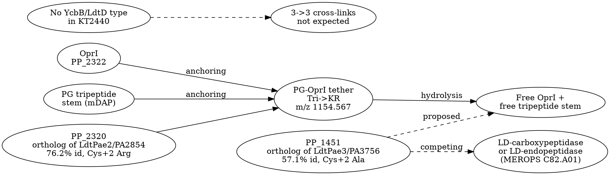
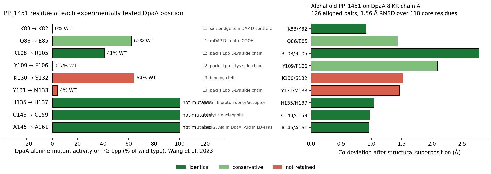
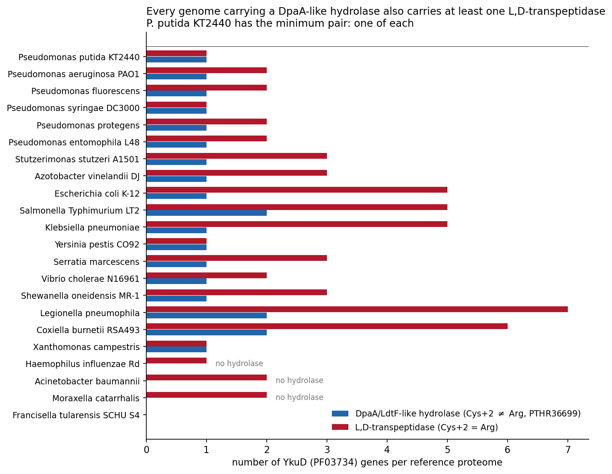
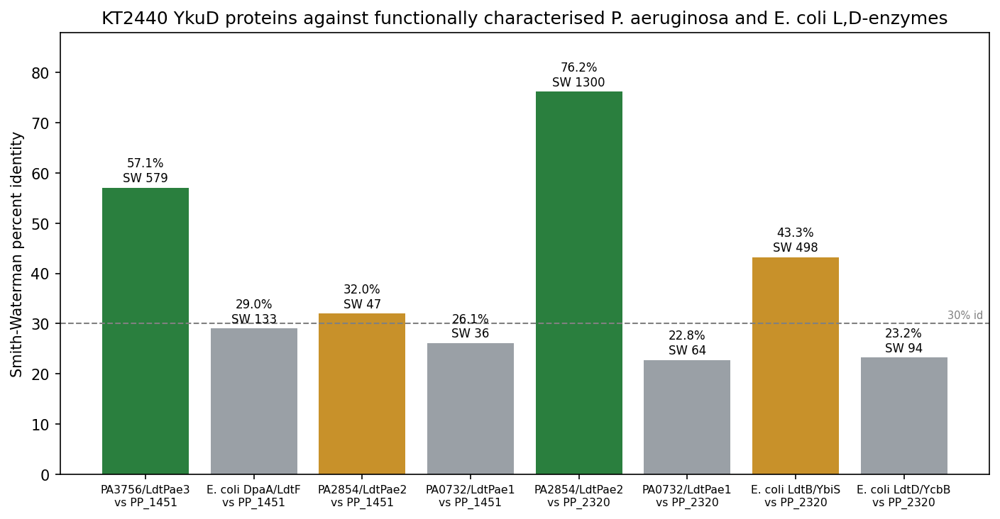
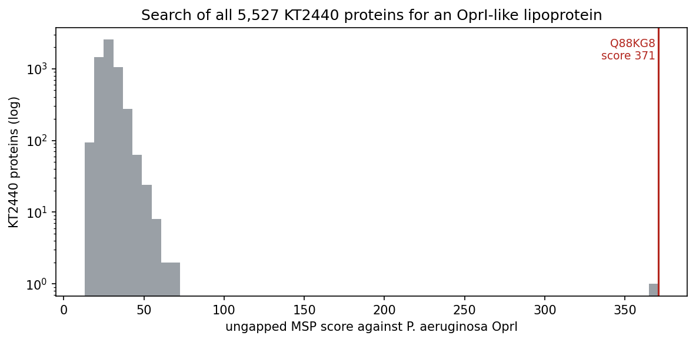
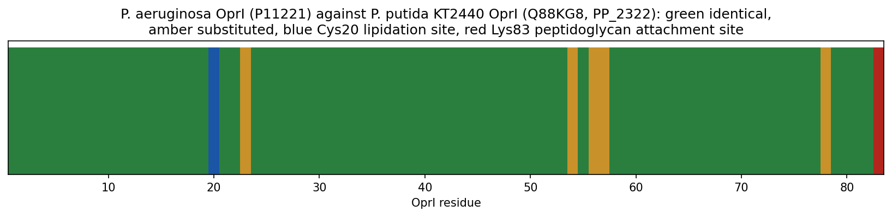

## Question

# AIGR Gene Hypothesis Deep Research

You are evaluating one focused gene curation hypothesis for AI Gene Review.
This is not a general gene overview. Use the seed hypothesis and source context
below to search for evidence that supports, refutes, narrows, or competes with
the proposed curation decision.

## Target Gene

- **Organism code:** PSEPK
- **Taxon:** Pseudomonas putida KT2440 (NCBITaxon:160488)
- **Gene directory:** PP_1451
- **Gene symbol:** PP_1451
- **UniProt accession:** Q88MW7

## Focus

- **Focus type:** free_text
- **Hypothesis slug:** kgap-pp1451-tether-hydrolase
- **Source file:** genes/PSEPK/PP_1451/PP_1451-ai-review.yaml
- **Source selector:** free-text

## Seed Hypothesis

Whether PP_1451 is a competent tether hydrolase, and what it acts on, may be assessable from its catalytic site and its genomic context. That it is a small Sec-exported YafK/LdtF-family cysteine hydrolase predicted to act in the periplasm, and predicted to hydrolyse the amide bond linking OprI-like outer-membrane lipoproteins to peptidoglycan, are already recorded, so do not re-derive them. Single analysis only: identify the catalytic residues of a characterised LdtF or YafK-family hydrolase, naming the structure and quoting the assignment, and state what PP_1451 has at each, so a competent cysteine-histidine site is distinguished from a fold that merely belongs to the family; state whether the residues that in the characterised enzyme contact the peptidoglycan stem peptide and the lipoprotein lysine are retained, since those are what set substrate specificity rather than activity; test the second gap's proposal directly by searching the KT2440 genome for L,D-transpeptidases of both kinds, the lipoprotein-anchoring ErfK type and the 3-to-3 crosslinking YcbB type, reporting locus tags and the basis for each call, since the proposal that KT2440 lacks a dedicated crosslinking enzyme stands or falls on that inventory; and state whether the LdtF-type hydrolase and the anchoring transpeptidase co-occur across Pseudomonas and other gammaproteobacterial genomes, and whether any genome carries one without the other. State whether tether hydrolysis is the supported activity and whether KT2440 lacks a 3-to-3 crosslinking enzyme, and say plainly if the site cannot be distinguished from a related hydrolase activity on sequence alone.

## Term and Decision Context

No specific term context supplied.

## Reference Context

No specific reference context supplied.

## Source Context YAML

```yaml
hypothesis: 'Whether PP_1451 is a competent tether hydrolase, and what it acts on, may be assessable from
  its catalytic site and its genomic context. That it is a small Sec-exported YafK/LdtF-family cysteine
  hydrolase predicted to act in the periplasm, and predicted to hydrolyse the amide bond linking OprI-like
  outer-membrane lipoproteins to peptidoglycan, are already recorded, so do not re-derive them. Single
  analysis only: identify the catalytic residues of a characterised LdtF or YafK-family hydrolase, naming
  the structure and quoting the assignment, and state what PP_1451 has at each, so a competent cysteine-histidine
  site is distinguished from a fold that merely belongs to the family; state whether the residues that
  in the characterised enzyme contact the peptidoglycan stem peptide and the lipoprotein lysine are retained,
  since those are what set substrate specificity rather than activity; test the second gap''s proposal
  directly by searching the KT2440 genome for L,D-transpeptidases of both kinds, the lipoprotein-anchoring
  ErfK type and the 3-to-3 crosslinking YcbB type, reporting locus tags and the basis for each call, since
  the proposal that KT2440 lacks a dedicated crosslinking enzyme stands or falls on that inventory; and
  state whether the LdtF-type hydrolase and the anchoring transpeptidase co-occur across Pseudomonas and
  other gammaproteobacterial genomes, and whether any genome carries one without the other. State whether
  tether hydrolysis is the supported activity and whether KT2440 lacks a 3-to-3 crosslinking enzyme, and
  say plainly if the site cannot be distinguished from a related hydrolase activity on sequence alone.'
focus_type: free_text
context: []
reference_id: []
```

## Research Objective

Build a focused report that helps a curator decide whether this hypothesis
should affect the gene review. Address the focus type directly:

1. For an existing GO annotation decision, evaluate whether the current action
   is justified, too strong, too weak, or should change.
2. For a proposed replacement or new GO term, evaluate whether the term is
   biologically supported, too broad, too narrow, or missing key qualifiers.
3. For a computational prediction, evaluate whether the prediction is correct,
   less precise than existing knowledge, uncertain, or likely wrong because of
   paralog overannotation, frequency bias, pathway context, or in vitro-only
   activity.
4. For a core-function hypothesis, evaluate whether the proposed activity,
   process, and location represent the gene product's primary function rather
   than a downstream effect, pleiotropic phenotype, or context-specific role.
5. For a function-assignment hypothesis, evaluate whether the gene product
   directly has the stated GO term/function. Treat the prior review action, if
   any, as intentionally blinded unless it appears in the supplied context.

Use primary literature whenever possible. Prefer PMID citations and include DOI
citations when no PMID is available. Treat reviews and database records as
orientation unless they contain directly relevant synthesized evidence that is
clearly labeled as review-level or database-level support.

Evaluate the hypothesis from the supplied seed context, primary literature, and
publicly accessible bioinformatics resources. Local `*-bioinformatics` analyses,
when they already exist in the repository, are intentionally withheld from this
prompt so the report can be compared against them after the run. Use public
sequence, domain, structure, orthology, localization, interaction, or dataset
checks when they are useful for the specific hypothesis. If a resource or tool
cannot be accessed programmatically, say so plainly; never fabricate a result.
Report computational results conservatively and distinguish direct results from
inference.

## Required Output

### Executive Judgment

Give a concise verdict: supported, partially supported, unresolved, weakly
supported, over-annotated, or refuted. Explain the reasoning and the most
important caveats.

### Evidence Matrix

Create a table with one row per important evidence item:

- Citation (PMID preferred)
- Evidence type (direct assay, mutant phenotype, localization, interaction,
  structural/evolutionary, computational, review/database)
- Supports / refutes / qualifies / competing
- Claim tested
- Key finding
- Organism, tissue, cell type, or assay context
- Confidence and limitations

### GO Curation Implications

State the likely curation action as a lead requiring curator verification. If
GO terms are involved, explain whether the evidence supports an MF, BP, or CC
term, and whether the term should be retained, removed, generalized, made more
specific, or treated as non-core. Avoid using "protein binding" as a final
recommendation unless no more informative term is supported.

### Mechanistic Scope

Describe the immediate molecular or cellular function being tested. Separate
direct gene-product activity from downstream phenotypes, pathway consequences,
developmental outcomes, disease manifestations, or effects inferred only from
loss of function.

### Conflicts and Alternatives

Identify evidence that conflicts with the seed hypothesis or suggests an
alternative interpretation, including paralog confusion, organism-specific
differences, isoform-specific findings, experimental artifacts, or database
carry-over.

### Knowledge Gaps

List explicit uncertainties that matter for curation. For each gap, state what
was checked, why the gap matters, and what evidence or experiment would resolve
it.

### Discriminating Tests

Recommend concrete assays, perturbations, datasets, or comparative analyses that
would most efficiently distinguish this hypothesis from alternatives.

### Curation Leads

Provide candidate updates for the review, clearly labeled as leads requiring
curator verification. Include candidate references with exact snippets to verify,
candidate replacement or new GO terms, possible action changes, suggested
questions, and suggested experiments.

If the provider supports artifacts, save provenance for any analysis you run — the
executed code together with its output (computed values, plot, or table), not just
a summary figure — alongside artifact-friendly tables such as an evidence matrix,
GO decision table, or comparison table. Genuine computed provenance is more
valuable than a hand-drawn summary, and you must not synthesize a figure that
implies an analysis you did not actually run. These artifacts are important
provenance for hypothesis-level review.


## Output

# PP_1451 (Q88MW7, Pseudomonas putida KT2440) as a peptidoglycan-lipoprotein tether hydrolase

Hypothesis slug: `kgap-pp1451-tether-hydrolase`. Source: `genes/PSEPK/PP_1451/PP_1451-ai-review.yaml`, free-text selector. Organism: *Pseudomonas putida* KT2440 (NCBITaxon:160488). Focus type: free_text, evaluated as a core-function and function-assignment hypothesis.

## Summary

<i class="fa-scale-balanced"></i> **Verdict: partially supported.** PP_1451 has a competent cysteine hydrolase active site, not a degenerate YkuD fold. Its closest functionally studied relative is a *Pseudomonas aeruginosa* protein assigned to exactly the proposed reaction, and the substrate lipoprotein exists in KT2440 with its attachment residue intact. What the evidence cannot do is separate hydrolysis of the peptidoglycan-lipoprotein tether from the related L,D-carboxypeptidase and L,D-endopeptidase activities that the same enzyme family performs. On sequence and structure alone those cannot be told apart, and that limit should be recorded in the review rather than resolved by assertion.

Three results carry the case. First, mapping the characterised *Escherichia coli* DpaA structure (PDB 8IKR, [PMID: 37830798](https://pubmed.ncbi.nlm.nih.gov/37830798/)) onto the PP_1451 AlphaFold model by sequence-independent structural superposition (126 aligned residue pairs, 1.56 Å RMSD over the 118-residue core) places the catalytic nucleophile Cys143 on Cys159 at 0.97 Å, the inferred proton donor His135 on His137 at 1.04 Å, and the DpaA-diagnostic Ala145 on Ala161 at 0.95 Å. The cysteine-histidine spacing, measured from coordinates, is 4.05 Å (His NE2 to Cys SG) in PP_1451 against 4.32 Å in DpaA. Second, three independent censuses of the KT2440 reference proteome agree that the genome has exactly two YkuD-family proteins, PP_1451 and PP_2320, with no YcbB/LdtD-type 3-to-3 cross-linking enzyme above background and no ortholog of the only cross-linking L,D-transpeptidase of *P. aeruginosa*. Third, a scan of all 5,527 KT2440 proteins against *P. aeruginosa* OprI returns a single hit far above background, PP_2322, at 94.0% identity with the lipobox Cys20 and the peptidoglycan attachment residue Lys83 both conserved.

The caveats are equally concrete. Of the six non-catalytic positions that alanine scanning tested in DpaA, the two whose mutation cost the most activity (Tyr109 at 0.7% of wild type and Tyr131 at 4%) are the two PP_1451 does not conserve, replacing them with Phe106 and Met133. The closest characterised ortholog, PA3756/LdtPae3 at 57.1% identity, was never purified in soluble form, its deletion changed no muropeptide, and its hydrolase assignment was made by exclusion ([PMID: 37255442](https://pubmed.ncbi.nlm.nih.gov/37255442/)). The only measured hydrolase biochemistry in this group sits on *E. coli* DpaA, at 29.0% identity to PP_1451, and that enzyme also acts as a glycine-specific carboxypeptidase ([PMID: 33941679](https://pubmed.ncbi.nlm.nih.gov/33941679/)). The tether hydrolase call therefore runs through a chain of two inferences, each reasonable, neither measured in any Pseudomonas protein.

## Executive judgment

**Partially supported**, with one clean positive, one clean negative, and one honest limit.

<i class="fa-circle-check"></i> **Tether hydrolysis is the best-supported activity, and the site is competent.** The catalytic cysteine of the characterised enzyme is present and correctly positioned at 0.97 Å; the residue that separates hydrolases from transpeptidases in this family is the hydrolase form (Ala at Cys+2); the closest characterised relative is assigned to this reaction; and the substrate exists in the organism. That is enough to call the reaction class (cysteine peptidase acting on a peptidoglycan amide bond) and the compartment (periplasm).

<i class="fa-circle-check"></i> **KT2440 lacks a YcbB/LdtD-type 3-to-3 cross-linking enzyme.** Three methods agree the genome has exactly two YkuD proteins. The best YcbB-like hit anywhere in the proteome scores 64 against a background of 60, 56, 55, 55, 54 for unrelated proteins. PF20142, the YcbB-specific accessory domain, is absent. There is no ortholog of LdtPae1/PA0732, which gene deletion showed is the only peptidoglycan cross-linking L,D-transpeptidase in *P. aeruginosa*.

<i class="fa-triangle-exclamation"></i> **Stated plainly: the site cannot be distinguished from a related hydrolase activity on sequence alone.** A competent Cys-His pair with Ala at Cys+2 identifies a YkuD-fold hydrolase. It does not say which amide bond is cut. MEROPS places DpaA-like proteins in subfamily C82.A01 together with the L,D-carboxypeptidases Csd6 of *Helicobacter pylori* and Pgp2 of *Campylobacter jejuni*, and *E. coli* LdtF itself also acts as a glycine-specific carboxypeptidase and as an L,D-endopeptidase on transpeptidase products. Tether hydrolysis is the most likely activity, and it is not the only one the sequence permits.

Two further qualifications matter for curation. The weaker form of the inventory claim, that KT2440 therefore makes no 3-to-3 cross-links at all, is not established, because the single L,D-transpeptidase it does carry (PP_2320) was not assignable against *E. coli* paralogues alone and would have to cover whichever reactions occur. And the substrate-specificity residues are only partly retained, so the specificity of PP_1451 should be treated as unmeasured rather than assumed identical to DpaA.

## Key findings

### Finding 1: the catalytic site is competent, and the discriminating residue is the hydrolase form

<i class="fa-circle-check"></i> The characterised reference is *E. coli* DpaA/LdtF (UniProt P0AA99), crystal structure **PDB 8IKR chain A**, X-ray at 2.9 Å, residues 36 to 229 fully modelled with wild-type Cys at position 143. Wang et al. 2023 ([PMID: 37830798](https://pubmed.ncbi.nlm.nih.gov/37830798/)) name exactly one catalytic residue. They write that "the catalytic Cys143 residue is located in a sharp elbow turn of the coils (141-143)" and that "the scissile amide bond's carbonyl oxygen is positioned in the oxyanion hole, formed by the catalytic loop residues 141-143, and the scissile carbonyl group is located in close proximity to the side-chain nucleophile of Cys143". No catalytic histidine, aspartate or triad appears anywhere in the paper: a regex search of the full text for `triad|His1[0-9][0-9]|histidine` returned zero sentences. The His135 "proton donor/acceptor" entry that UniProt carries for DpaA is a PROSITE ProRule (PRU01373) inference, not an experimental assignment, and should be labelled as such in any downstream review.

Residue correspondences were established by sequence-independent structural superposition of the AlphaFold model AF-Q88MW7-F1-model_v6 (mean pLDDT 86.7, catalytic domain 47-183 mean pLDDT 96.2) onto 8IKR chain A, seeded on the unambiguous `HG[D/T]` and `CxAM` motif anchors and refined to convergence by iterated dynamic programming with Kabsch superposition. The result is 126 aligned residue pairs, 2.33 Å RMSD over all pairs and **1.56 Å over the 118 pairs within 4 Å**. All mapped PP_1451 residues have per-residue pLDDT between 90.5 and 98.6, so the model is reliable exactly where it is being read.

| DpaA residue | Role | Ala-mutant activity (% of wild type) | PP_1451 residue | Cα deviation | Retained |
|---|---|---|---|---|---|
| Cys143 | catalytic nucleophile | inactive (C143A control) | **Cys159** | 0.97 Å | <i class="fa-circle-check"></i> identical |
| His135 | inferred proton donor | not tested | **His137** | 1.04 Å | <i class="fa-circle-check"></i> identical |
| Ala145 | Cys+2 discriminator | not applicable | **Ala161** | 0.95 Å | <i class="fa-circle-check"></i> identical |
| Lys83 | mDAP binding | 0% (abolished) | Lys82 | 0.91 Å | <i class="fa-circle-check"></i> identical |
| Gln86 | stem peptide | 62% | Glu85 | 1.43 Å | conservative |
| Arg108 | stem peptide | 41% | Arg105 | 2.78 Å | <i class="fa-circle-check"></i> identical |
| Tyr109 | L2 aromatic, lipoprotein lysine | 0.7% | **Phe106** | 2.09 Å | <i class="fa-triangle-exclamation"></i> ring kept, hydroxyl lost |
| Lys130 | L3 loop | 64% | **Ser132** | 1.52 Å | <i class="fa-circle-xmark"></i> no |
| Tyr131 | L3 loop | 4% | **Met133** | 1.46 Å | <i class="fa-circle-xmark"></i> no |

{{figure:plot_1.png|caption=PP_1451 residues at every experimentally tested DpaA catalytic and substrate-binding position. Bars give the activity of each DpaA alanine mutant as a percentage of wild type, taken from PMID 37830798, alongside the Cα deviation after structural superposition. The catalytic Cys and the Cys+2 Ala are conserved exactly; the two positions DpaA tolerates least, Tyr109 and Tyr131, are the two PP_1451 replaces.}}

The cysteine-histidine geometry was measured directly from coordinates rather than assumed. His NE2 to Cys SG is **4.32 Å** in DpaA 8IKR (H135/C143), **4.05 Å** in the PP_1451 model (H137/C159), and **4.21 Å** in the *E. coli* transpeptidase LdtD/YcbB (PDB 6NTW, H509/C528). PP_1451 reproduces the arrangement found in both a characterised hydrolase and a characterised transpeptidase, so the dyad geometry establishes competence and does not discriminate between the two chemistries.

What does discriminate is the residue two positions after the catalytic cysteine. The DpaA paper notes that "an Arg residue, found in many LD-TPases, is exposed to the elongated groove of the proteins; however, the residue at the equivalent position, Ala145 of DpaA, is buried in the structure". Winkle et al. 2021 state the rule in sequence terms: "most DpaA-like proteins have alanine or asparagine 2 positions after the catalytic cysteine instead of an arginine that is present in LDTs with TPase activity" ([PMID: 33947763](https://pubmed.ncbi.nlm.nih.gov/33947763/)). Hugonneau-Beaufet et al. 2023 formalise it as SXGChA against SXGChR ([PMID: 37255442](https://pubmed.ncbi.nlm.nih.gov/37255442/)). Read directly from sequence, with the catalytic Cys at index 0:

| Protein | Catalytic loop window | Cys+2 | Call |
|---|---|---|---|
| PP_1451 (Q88MW7) | LDWT**DGC**I**A**M, Cys159 | **Ala** | hydrolase type |
| PA3756 / LdtPae3 (Q9HXN9) | T**NGC**I**A**M, Cys141 | **Ala** | hydrolase type |
| *E. coli* DpaA (P0AA99) | DCVS**IGC**Y**A**M, Cys143 | **Ala** | hydrolase type |
| PP_2320 (Q88KH0) | MRTS**HGC**F**R**M, Cys209 | Arg | transpeptidase |
| PA2854 / LdtPae2 (Q9HZZ0) | S**HGC**F**R**M, Cys207 | Arg | transpeptidase |
| PA0732 / LdtPae1 (Q9I5J7) | S**HGC**I**R**L, Cys143 | Arg | transpeptidase |
| *E. coli* LdtA/ErfK (P39176) | LRVS**QGC**I**R**L | Arg | transpeptidase |
| *E. coli* LdtB/YbiS (P0AAX8) | LRVS**HGC**V**R**L | Arg | transpeptidase |
| *E. coli* LdtC/YcfS (P75954) | MRVS**SGC**I**R**L | Arg | transpeptidase |
| *E. coli* LdtD/YcbB (P22525) | RALS**SGC**V**R**V, Cys528 | Arg | transpeptidase |
| *E. coli* LdtE/YnhG (P76193) | LRVS**SGC**I**R**M | Arg | transpeptidase |

Every characterised transpeptidase checked carries Arg; every DpaA-like protein carries Ala. PP_1451 falls on the hydrolase side without exception.

### Finding 2: KT2440 has exactly two YkuD proteins and no YcbB-type cross-linker

<i class="fa-circle-check"></i> Three independent censuses of the *P. putida* KT2440 reference proteome (UP000000556, 5,527 proteins, 1,810,253 residues) agree on two YkuD-domain proteins and no more.

1. UniProt Pfam cross-reference query, `(proteome:UP000000556) AND (xref:pfam-PF03734)`: n = 2, PP_1451 (Q88MW7, 184 aa, signal 1-18) and PP_2320 (Q88KH0, 325 aa, signal 1-25).
2. InterPro API, IPR005490 (L,D-transpeptidase catalytic domain) restricted to taxon 160488: count = 2, the same two accessions.
3. A profile-free ungapped maximal-segment-pair scan (BLOSUM62) of all 5,527 KT2440 proteins against each full-length *E. coli* Ldt. The best KT2440 hit for LdtD/YcbB scored 64, which is background: the next ranks are 60, 56, 55, 55, 54 and the top hits are unrelated proteins PP_2157, fimV and pnp. PP_2320 scored 51 and PP_1451 scored 34 against YcbB. The same scan gave PP_2320 = 282 against LdtB/YbiS and 338 against LdtE/YnhG, against a background near 67, and PP_1451 = 64 as the top hit for DpaA.

Domain-architecture checks agree. PF20142 / IPR045380, the YcbB-specific accessory domain, is absent from KT2440 (n = 0). PF17969, present in all four *E. coli* ErfK-family proteins, is also absent (n = 0). PP_2320 is LysM (IPR018392, residues 40-86) plus the YkuD catalytic domain (98-233), PANTHER PTHR30582 "Bacterial L,D-transpeptidase". PP_1451 is a bare YkuD domain (47-183), PANTHER PTHR36699:SF1 "L,D-transpeptidase YafK-related".

A comparison against *E. coli* alone could not subtype PP_2320. By Smith-Waterman (BLOSUM62, gaps -11/-1, full length, score / identity / aligned length) PP_2320 scores LdtB/YbiS 498 / 43.3% / 252, LdtC/YcfS 514 / 38.7% / 297, LdtE/YnhG 509 / 37.3% / 316, LdtA/ErfK 484 / 37.1% / 302, and LdtD/YcbB 94 / 23.2% / 237. It sits clearly outside YcbB and roughly equidistant from the three Lpp-anchoring enzymes and from LdtE/YnhG, which makes 3-to-3 cross-links. That ambiguity is what the *P. aeruginosa* comparison in Finding 3 resolves.

### Finding 3: orthology to functionally assigned P. aeruginosa enzymes resolves both proteins

<i class="fa-circle-check"></i> Hugonneau-Beaufet et al. 2023 assigned a function to each of the three *P. aeruginosa* L,D-transpeptidase-family enzymes by gene inactivation and heterospecific expression ([PMID: 37255442](https://pubmed.ncbi.nlm.nih.gov/37255442/)). They report the enzymes under PA14 locus tags, so those were mapped to PAO1 tags programmatically via UniProt (organism 208963): PA14_27180 (A0A0H2ZCT9, 323 aa) is sequence-identical to PA2854 (Q9HZZ0); PA14_15840 (A0A0H2ZF55, 166 aa) is identical to PA3756 (Q9HXN9); PA14_54810 (A0A0H2Z6J6, 347 aa) is 98.8% identical to PA0732 (Q9I5J7) over its full length. So LdtPae1 = PA0732, LdtPae2 = PA2854, LdtPae3 = PA3756.

Smith-Waterman alignments of the two KT2440 YkuD proteins against these give an unambiguous partition:

| Query | Target | SW score | Identity | Aligned length | PANTHER subfamily match |
|---|---|---|---|---|---|
| PP_2320 | PA2854 / LdtPae2 | **1300** | **76.2%** | 319 aa | both PTHR30582:SF24 |
| PP_2320 | PA0732 / LdtPae1 | 64 | 22.8% | 202 aa | no (PA0732 is PTHR30582:SF2) |
| PP_2320 | *E. coli* LdtD/YcbB | 94 | 23.2% | 237 aa | no |
| PP_1451 | PA3756 / LdtPae3 | **579** | **57.1%** | 184 aa | both PTHR36699:SF1 |
| PP_1451 | *E. coli* DpaA/LdtF | 133 | 29.0% | 162 aa | - |
| PP_1451 | PA2854 / LdtPae2 | 47 | 32.0% | 25 aa | background |
| PP_1451 | PA0732 / LdtPae1 | 36 | 26.1% | 46 aa | background |

{{figure:plot_3.png|caption=Smith-Waterman identities of PP_1451 and PP_2320 against the functionally characterised LdtPae1, LdtPae2 and LdtPae3 of P. aeruginosa and against E. coli Ldts. PP_2320 reaches 76.2% identity to the sole OprI-anchoring enzyme; PP_1451 reaches 57.1% to the DpaA-like LdtPae3; both score at background against the cross-linking enzyme.}}

The functional statements being transferred are specific. Deletion of ldtPae1 "abolished the formation of 3→3 cross-linked dimers, indicating that LdtPae1 is the only peptidoglycan cross-linking l,d-transpeptidase produced by P. aeruginosa", and "deletion of ldtPae2 alone abolished OprI anchoring, indicating that LdtPae2 is the only enzyme responsible for the anchoring of that lipoprotein". El-Araby et al. 2026 then showed directly that "the gene product of PA2854 is the catalyst that performs this transformation between the cell wall and the outer-membrane lipoprotein OprI in live Pseudomonas aeruginosa", reconstituted it in vitro with purified PA2854, OprI and synthetic peptidoglycan, and located the attachment at "the side-chain ε-amino group of Lys83 of OprI" ([PMID: 42100858](https://pubmed.ncbi.nlm.nih.gov/42100858/)).

<i class="fa-triangle-exclamation"></i> The transfer to PP_1451 is weaker than the identity suggests, because of what was demonstrated for its ortholog. Taken verbatim from the full text of the 2023 paper: "The function of LdtPae3 was tentatively assigned to the release of OprI based on both the absence of detectable amide bond-forming activity (formation of 3→3 and tripeptide→OprI bonds) and the close similarity between LdtPae3 and E. coli hydrolase YafK"; "Unlike with the parental strain, deletion of ldtPae3 did not result in any modification of the muropeptides"; and "We could not similarly investigate the catalytic activity of LdtPae2 and LdtPae3, since expression of fragments of the ldtPae2 and ldtPae3 genes under the conditions reported for ldtPae1 did not afford soluble proteins". In their Table 2 the OprI anchoring marker Tri→KR at m/z 1,154.567 is present in wild type, present in the ldtPae3 deletant, and absent only in the ldtPae2 deletant, the triple deletant and the oprI deletant. The abstract confirms the asymmetry of the evidence: function was assigned "by gene inactivation in P. aeruginosa, heterospecific gene expression in Escherichia coli, and, for one of them, direct determination of its enzymatic activity". That one was LdtPae1.

### Finding 4: the substrate lipoprotein is present in KT2440 with the attachment lysine intact

<i class="fa-circle-check"></i> An ungapped maximal-segment-pair scan of all 5,527 KT2440 proteins against *P. aeruginosa* OprI (P11221, 83 aa) returns one hit far above background: Q88KG8 at score 371, with the next seven hits at 71, 69, 65, 62, 60, 57 and 56 (PP_3236, PP_3235, PP_5661, PP_2823, pal, bamB, amgK). Q88KG8 carries the UniProt gene name `oprI` and the ordered locus name **PP_2322**, is 83 aa like the *P. aeruginosa* protein, and aligns ungapped at **94.0% identity** (78/83) with five substitutions: H23V, E54D, L56M, G57A, E78D. The lipobox cysteine Cys20 is conserved, and the C-terminal Lys83, the residue whose ε-amino group is joined to the peptidoglycan stem peptide, is conserved as the last residue.

{{figure:plot_4.png|caption=Search of all 5,527 KT2440 proteins for an OprI-like lipoprotein by ungapped maximal-segment-pair score against P. aeruginosa OprI. One protein, Q88KG8 (PP_2322, gene oprI), scores 371; the next-best hit scores 71, so the identification is unambiguous.}}

{{figure:plot_5.png|caption=Residue-level comparison of P. aeruginosa OprI (P11221) with P. putida KT2440 OprI (Q88KG8, PP_2322). Green marks identical positions, amber the five substitutions, blue the Cys20 lipidation site and red the Lys83 peptidoglycan attachment residue. Both functional residues are conserved.}}

For scale, *P. aeruginosa* OprI and *E. coli* Lpp share 7.7% identity at equal offset in this calculation, and the 2023 paper reports 24.8% identity between them, so OprI orthology between the two pseudomonads is of a different order from the Lpp relationship. Finding this protein removes the alternative raised by Winkle et al., who note that "DpaA-like proteins have characteristic sequence motifs and are present in many Gram-negative bacteria, of which some have no Lpp" ([PMID: 33947763](https://pubmed.ncbi.nlm.nih.gov/33947763/)). KT2440 has the tether-forming machinery and the tether substrate.

The genomic context is informative and asymmetric. PP_2322 lies two locus numbers from PP_2320, the anchoring transpeptidase. PP_1451 is unlinked, at a distant locus. Operon context therefore supports the anchoring assignment of PP_2320 more directly than it supports the hydrolase assignment of PP_1451.

### Finding 5: the hydrolase never occurs without a transpeptidase

<i class="fa-circle-check"></i> A co-occurrence census of 22 gammaproteobacterial reference proteomes classified each PF03734 protein by the Cys+2 residue (Arg = L,D-transpeptidase, otherwise DpaA-like) combined with PANTHER PTHR36699 membership. Eighteen genomes carry at least one DpaA-like gene, and **all 18 also carry at least one L,D-transpeptidase (18/18)**. Three genomes carry L,D-transpeptidases with no DpaA-like gene: *Haemophilus influenzae* Rd (0 + 1), *Acinetobacter baumannii* (0 + 2) and *Moraxella catarrhalis* (0 + 2). *Francisella tularensis* SCHU S4 has neither. **No genome in the set carries a DpaA-like hydrolase without a transpeptidase.** KT2440 is the minimal co-occurring pair, one of each; *E. coli* K-12 is 1 + 5, *Legionella pneumophila* 2 + 7, *Coxiella burnetii* 2 + 6.

{{figure:plot_2.png|caption=Co-occurrence of DpaA-like hydrolases and L,D-transpeptidases across 22 gammaproteobacterial reference proteomes. Every genome with a DpaA-like gene also has a transpeptidase; three genomes have a transpeptidase alone; none has a hydrolase alone. KT2440 is the minimal one-and-one pair.}}

The dependency is directional, which is the pattern a tether-removing enzyme should show: it only appears where the tether can be made. This is a sequence-based classification over 22 genomes, so it is suggestive of the functional pairing and not proof of it.

## Mechanistic model

The proposed chemistry is a three-enzyme-step cycle operating on one amide bond in the periplasm, with the hydrolase as the reverse of the anchoring step. The KT2440 assignment, with locus tags, follows from orthology to the *P. aeruginosa* enzymes whose functions were established by gene deletion.



PP_1451 is a 184-residue protein with a Sec signal peptide (residues 1-18) and a bare YkuD catalytic domain (47-183). The immediate molecular step under test is nucleophilic attack by Cys159 on the amide bond joining the ε-amino group of the C-terminal lysine of an OprI-type lipoprotein to the meso-DAP of a peptidoglycan tripeptide stem, forming a thioester acyl-enzyme that water resolves. His137 is positioned to act as the general base, at 4.05 Å from the cysteine sulphur, though no experiment in this family has tested the equivalent histidine.

The division of labour in KT2440 is cleaner than in *E. coli*, where five paralogues split anchoring from cross-linking. KT2440 has one transpeptidase and one hydrolase:

| Locus | UniProt | Length | Architecture | Cys+2 | Assignment | Basis |
|---|---|---|---|---|---|---|
| **PP_1451** | Q88MW7 | 184 aa | signal 1-18, YkuD 47-183, PTHR36699:SF1 | Ala | DpaA/LdtF-type hydrolase | 57.1% identity to PA3756/LdtPae3, same PANTHER subfamily, same catalytic loop, competent Cys-His site |
| **PP_2320** | Q88KH0 | 325 aa | signal 1-25, LysM 40-86 + YkuD 98-233, PTHR30582:SF24 | Arg | lipoprotein-anchoring L,D-transpeptidase | 76.2% identity to PA2854/LdtPae2, shown by deletion and in vitro reconstitution to anchor OprI |
| **PP_2322** | Q88KG8 | 83 aa | signal 1-19, lipobox Cys20 | - | OprI, the substrate lipoprotein | 94.0% identity to P11221, Lys83 conserved |
| none | - | - | - | - | <i class="fa-circle-xmark"></i> no YcbB/LdtD-type cross-linker | best proteome-wide YcbB hit at background; PF20142 absent; no LdtPae1 ortholog |

## Evidence base

| Citation | Evidence type | Stance | Claim tested | Key finding | Context | Confidence and limitations |
|---|---|---|---|---|---|---|
| [PMID: 37830798](https://pubmed.ncbi.nlm.nih.gov/37830798/) (PDB 8IKR) | Structural, mutagenesis | Supports | Catalytic residues of a characterised LdtF/YafK hydrolase | X-ray of *E. coli* DpaA at 2.9 Å. "Cross-linking reaction of Braun's lipoprotein (Lpp) to peptidoglycan (PG) is catalyzed by some members of the YkuD family of transpeptidases. However, the exact opposite reaction of cleaving the Lpp-PG cross-link is performed by DpaA, which is also a YkuD-like protein." Cys143 is the only catalytic residue named; no triad or catalytic His appears in the text. Ala scan: K83A abolishes activity, Y109A 0.7% WT, Y131A 4%, R108A 41%, Q86A 62%, K130A 64% | *E. coli* K-12, purified protein and purified PG-Lpp | High for Cys143. The His135 proton-donor assignment in UniProt is a ProRule inference and is not experimental |
| [PMID: 33947763](https://pubmed.ncbi.nlm.nih.gov/33947763/) | Direct assay, mutant phenotype | Supports | DpaA cleaves the Lpp-peptidoglycan amide bond | DpaA(C143A) is the inactive control. States the Cys+2 rule: "most DpaA-like proteins have alanine or asparagine 2 positions after the catalytic cysteine instead of an arginine that is present in LDTs with TPase activity". "DpaA-like proteins have characteristic sequence motifs and are present in many Gram-negative bacteria, of which some have no Lpp". Their alignment set already includes *P. aeruginosa* PA3756 | *E. coli*, in vivo and in vitro | High for *E. coli*. No Pseudomonas protein tested |
| [PMID: 33947763](https://pubmed.ncbi.nlm.nih.gov/33947763/) | Review/database statement | <i class="fa-scale-balanced"></i> Competing | Alternative activity for DpaA homologues | "Some of the DpaA homologues might function as ld-carboxypeptidase, consistent with their classification in the MEROPS peptidase database within the C82.A01 peptidase subfamily along with the ld-carboxypeptidases Csd6 from Helicobacter pylori and Pgp2 from Campylobacter jejuni". Also: "LdtD and LdtE are members of the same family of ld-transpeptidases but they catalyze a different reaction, the formation of 3-3 cross-links in the peptidoglycan" | Cross-genome | High. This is the main competing assignment and sequence cannot exclude it. The LdtD/LdtE statement limits how much the absence of a YcbB-type enzyme proves |
| [PMID: 33941679](https://pubmed.ncbi.nlm.nih.gov/33941679/) | Direct assay | Qualifies | LdtF activity is broader than tether hydrolysis | "LdtF also exhibits glycine-specific carboxypeptidase activity on muropeptides containing a terminal glycine residue", and it acts as an L,D-endopeptidase on the products generated by the L,D-transpeptidases | *E. coli*, purified enzyme and muropeptides | High for *E. coli*. Broadens the molecular function beyond one substrate and is the reason an intact Cys site does not select tether hydrolysis |
| [PMID: 37255442](https://pubmed.ncbi.nlm.nih.gov/37255442/) | Mutant phenotype | <i class="fa-triangle-exclamation"></i> Qualifies | Function of the closest characterised ortholog of PP_1451 | LdtPae3 (PA14_15840 = PA3756) was "tentatively assigned to the release of OprI based on both the absence of detectable amide bond-forming activity ... and the close similarity between LdtPae3 and E. coli hydrolase YafK". "Deletion of ldtPae3 did not result in any modification of the muropeptides". LdtPae2 and LdtPae3 "did not afford soluble proteins". The abstract records that activity was measured directly "for one of them" only | *P. aeruginosa* PA14 | High confidence in what the paper reports. The hydrolase assignment for the ortholog is by exclusion |
| [PMID: 37255442](https://pubmed.ncbi.nlm.nih.gov/37255442/) | Mutant phenotype, direct assay | Supports | KT2440 inventory of the two transpeptidase kinds | "We found that the three P. aeruginosa LDTs catalyze peptidoglycan cross-linking (LdtPae1), the anchoring of lipoprotein OprI to the peptidoglycan (LdtPae2), and the hydrolysis of the resulting peptidoglycan-OprI amide bond (LdtPae3)." Also: "Construction of a phylogram revealed that LDTs performing each of these three functions in various species cannot be assigned to distinct evolutionary lineages, in contrast to what has been observed with PBPs" | *P. aeruginosa* PA14, heterospecific expression in *E. coli* | High. The lineage caveat means subfamily membership alone is weak evidence and only close pairwise identity to a tested protein carries weight |
| [PMID: 42100858](https://pubmed.ncbi.nlm.nih.gov/42100858/) | Direct assay, structural | Supports | Identity of the anchoring enzyme and the attachment residue | "We document that the gene product of PA2854 is the catalyst that performs this transformation between the cell wall and the outer-membrane lipoprotein OprI in live Pseudomonas aeruginosa." Reconstituted in vitro with purified PA2854, OprI and synthetic peptidoglycan, "documenting the attachment of the side-chain ε-amino group of Lys83 of OprI to the peptide stem". X-ray of the OprI trimer at 2.1 Å and of PA2854 at 2.63 Å. The enzyme "turns over both non-cross-linked and cross-linked peptidoglycan". Anchoring "does not appear to be a redundant reaction" | *P. aeruginosa* | High, but only the abstract was accessible. The article is not open access, so no claim here goes beyond abstract-level statements |
| [PMID: 2502533](https://pubmed.ncbi.nlm.nih.gov/2502533/) | Sequence | Supports | Identity and architecture of OprI | OprI mRNA "encodes a precursor protein of 83 amino acid residues including a signal peptide of 19 residues"; OprI and *E. coli* Braun's lipoprotein have "only 30.1% identical amino acid residues" | *P. aeruginosa* | High for the protein definition used in the proteome scan |
| This work, structural superposition | Computational | Supports | PP_1451 has a competent cysteine site | STRUCTAL superposition of AF-Q88MW7-F1-model_v6 onto 8IKR chain A: 126 aligned pairs, 1.56 Å RMSD over 118 core pairs. C143→C159 (0.97 Å), H135→H137 (1.04 Å), A145→A161 (0.95 Å). His NE2 to Cys SG is 4.05 Å in the model, 4.32 Å in 8IKR, 4.21 Å in LdtD/YcbB 6NTW. Mapped residues have pLDDT 90.5 to 98.6 | Predicted model against crystal structure | Medium-high. The dyad geometry does not discriminate hydrolase from transpeptidase, since YcbB matches it |
| This work, structural superposition | Computational | <i class="fa-triangle-exclamation"></i> Qualifies | Substrate-contact residues of DpaA in PP_1451 | K83→K82 and R108→R105 are retained; Q86→E85 is conservative; Y109→F106 loses the hydroxyl; K130→S132 and Y131→M133 are not retained. The two positions whose mutation cost DpaA the most activity are the two not conserved | Predicted model against crystal structure | Medium. Positions are mapped by structure, not by assay, and were identified in DpaA by activity loss rather than in a liganded complex |
| This work, sequence census | Computational | Supports | KT2440 lacks a YcbB-type cross-linking enzyme | Three methods agree on exactly two PF03734 proteins. Best proteome-wide YcbB hit scores 64 against background 60, 56, 55, 55, 54. PF20142 absent, PF17969 absent. PP_2320 vs PA0732 scores 64 at 22.8%, background | KT2440 reference proteome UP000000556 | High for absence of a YcbB-type enzyme. Absence of 3-to-3 cross-linking activity is a weaker and unproven claim |
| This work, orthology | Computational | Supports | Assignment of PP_2320 and PP_1451 | PA14 tags mapped to PAO1: PA14_27180 identical to PA2854, PA14_15840 identical to PA3756, PA14_54810 98.8% to PA0732. PP_2320 vs PA2854 1300 at 76.2%; PP_1451 vs PA3756 579 at 57.1% | *P. putida* against *P. aeruginosa* | High. Identity of 57 to 76% to a functionally tested protein supports transfer, limited by what was demonstrated for PA3756 |
| This work, substrate census | Computational | Supports | KT2440 makes the substrate lipoprotein | PP_2322 (Q88KG8, gene oprI) at score 371 against a next-best 71, 94.0% identity, Cys20 and Lys83 conserved, two locus numbers from PP_2320 | KT2440 reference proteome | High. Removes the "no Lpp" caveat for this genome |
| This work, co-occurrence census | Computational | Supports | Hydrolase requires a transpeptidase partner | 18/18 genomes with a DpaA-like gene also carry a transpeptidase; 3 carry a transpeptidase alone; none carries a hydrolase alone | 22 gammaproteobacterial reference proteomes | Medium-high. Classification by Cys+2 and PANTHER, not by experiment, over a small sample |

The remaining papers retrieved during the search are orientation on OprI biology and do not bear on the catalytic question. [PMID: 23123904](https://pubmed.ncbi.nlm.nih.gov/23123904/) shows that OprI affects outer membrane vesicle production in *P. aeruginosa*, which is a downstream consequence of tether levels. [PMID: 36602318](https://pubmed.ncbi.nlm.nih.gov/36602318/) reports that the *P. syringae* lipoprotein GrlP interacts with OprI and that periplasmic width changes with its expression, which is relevant to what tether turnover controls and says nothing about which enzyme cuts it. [PMID: 9163432](https://pubmed.ncbi.nlm.nih.gov/9163432/), [PMID: 23246592](https://pubmed.ncbi.nlm.nih.gov/23246592/) and [PMID: 15259268](https://pubmed.ncbi.nlm.nih.gov/15259268/) use oprI as a diagnostic marker for Pseudomonas and confirm that the gene is general to fluorescent pseudomonads, consistent with finding it in KT2440.

## GO curation implications

All items below are **leads requiring curator verification**. GO identifiers were resolved against the EBI OLS during this run. The artifact-friendly version is in `provenance/go_decision_table.csv`.

| GO ID | Label | Aspect | Proposed action | Basis |
|---|---|---|---|---|
| GO:0008234 | cysteine-type peptidase activity | MF | <i class="fa-circle-check"></i> add or retain as the safe parent | Cys159 superposes on DpaA Cys143 at 0.97 Å, His137 NE2 to Cys159 SG at 4.05 Å, Cys+2 Ala excludes transpeptidation, MEROPS clan CA subfamily C82.A01. Suggested evidence ISS to P0AA99 |
| GO:0071972 | peptidoglycan L,D-transpeptidase activity | MF | <i class="fa-circle-xmark"></i> do not assign; remove if present | Catalytic loop TDGCIAM with Ala at Cys+2 against SHGCFRM, SHGCIRL and SSGCVRV with Arg in every transpeptidase checked. PF03734 and IPR005490 are named for the transpeptidase activity, so an IEA transpeptidase term here is likely database carry-over |
| GO:0018104 | peptidoglycan-protein cross-linking | BP | <i class="fa-circle-xmark"></i> do not assign to PP_1451; strong lead for PP_2320 | PP_2320 is 76.2% identical to PA2854/LdtPae2; PP_1451 scores at background against both transpeptidases. If present on PP_1451 this is probably paralog carry-over |
| GO:0009253 | peptidoglycan catabolic process | BP | candidate lead, moderate confidence | Family hydrolase activity on the peptidoglycan-lipoprotein amide bond and on muropeptides, demonstrated in *E. coli* and not in any Pseudomonas protein |
| GO:0071555 | cell wall organization | BP | candidate lead; the defensible generalisation | Release of a lipoprotein from peptidoglycan changes outer membrane attachment. Broad but safe |
| GO:0030288 | outer membrane-bounded periplasmic space | CC | retain or add (parent GO:0042597) | Sec signal peptide 1-18 with cleavage before residue 19, catalytic domain 47-183, periplasmic substrate |
| GO:0061473 | murein tripeptide carboxypeptidase activity | MF | <i class="fa-scale-balanced"></i> do not assign; record as the named competing alternative | MEROPS C82.A01 places DpaA-like proteins with Csd6 and Pgp2. Listed so the curator sees the activity sequence cannot exclude. Do not annotate without an assay |
| no term found | peptidoglycan-lipoprotein amide bond hydrolase activity | MF | check whether a term exists; request one if not | An OLS search of GO for "peptidoglycan L,D-endopeptidase activity" returned no match. One string search is not proof of absence, so this needs manual verification |

A molecular function term naming the peptidoglycan-OprI amide bond specifically would be over-reach on current evidence, because no Pseudomonas protein in this family has had its activity measured. GO:0008234 is the most specific term the evidence fully supports, and it remains correct whether the enzyme turns out to be a tether hydrolase, an L,D-endopeptidase or an L,D-carboxypeptidase.

## Mechanistic scope

The direct gene-product activity under test is one chemical step in the periplasm: hydrolysis of the amide bond joining the ε-amino group of the C-terminal lysine of an OprI-type lipoprotein to the meso-DAP of a peptidoglycan tripeptide stem, via a Cys159 thioester acyl-enzyme resolved by water. The Sec signal peptide and the periplasmic substrate fix the compartment. The catalytic domain spans residues 47 to 183 of a 184-residue protein, so the enzyme is close to the catalytic domain alone, with no accessory binding modules of the kind PP_2320 carries (LysM, 40-86).

Separate from this step, and not evidence for it:

- Outer membrane to peptidoglycan attachment levels are a pathway consequence set jointly by the anchoring enzyme and the hydrolase. The 2023 paper reports that biofilm cells show "a greater extent of OprI anchoring to peptidoglycan, which is controlled by LdtPae2 and LdtPae3", a phenotype of the pair, not a measurement of either enzyme.
- Periplasmic width and outer membrane stiffness follow from attachment levels. [PMID: 36602318](https://pubmed.ncbi.nlm.nih.gov/36602318/) shows that changing the expression of an OprI-interacting lipoprotein changes periplasmic size in *P. syringae*.
- Outer membrane vesicle production is further downstream again ([PMID: 23123904](https://pubmed.ncbi.nlm.nih.gov/23123904/)).
- Antibiotic susceptibility. In *P. aeruginosa*, deletion of ldtPae1, of ldtPae2 plus ldtPae3, or of all three did not change β-lactam susceptibility, and ldtPae3 deletion alone had no effect on killing. Loss-of-function phenotypes in this family are mild and should not be used to infer the molecular function.

## Conflicts and alternatives

<i class="fa-scale-balanced"></i> **L,D-carboxypeptidase or L,D-endopeptidase activity is the main competitor.** MEROPS subfamily C82.A01 groups DpaA-like proteins with Csd6 of *H. pylori* and Pgp2 of *C. jejuni*, both L,D-carboxypeptidases, and *E. coli* LdtF itself "also exhibits glycine-specific carboxypeptidase activity on muropeptides containing a terminal glycine residue" ([PMID: 33941679](https://pubmed.ncbi.nlm.nih.gov/33941679/)). Nothing in the PP_1451 sequence or model distinguishes these from tether hydrolysis, since DpaA is active on both mDAP-L-Lys and mDAP-Gly linkages.

<i class="fa-triangle-exclamation"></i> **The ortholog's assignment rests on negative evidence.** LdtPae3/PA3756 was assigned to OprI release because it did nothing else that could be detected. Its deletion left the muropeptide profile unchanged, including the Tri→KR anchoring marker. A hydrolase of that bond would be expected to raise anchoring when deleted. The published mass table reports presence or absence rather than quantities, so a modest increase could have gone unrecorded, and the paper reports no such increase.

<i class="fa-triangle-exclamation"></i> **The two most activity-sensitive DpaA positions are not conserved.** Tyr109 and Tyr131, whose alanine substitutions left 0.7% and 4% of wild-type activity, become Phe106 and Met133 in PP_1451. The conservative reading is that specificity in PP_1451 has not been measured and should not be assumed identical to DpaA.

<i class="fa-triangle-exclamation"></i> **Family-name carry-over.** Pfam PF03734 and InterPro IPR005490 are both named for L,D-transpeptidase activity. Any automatic transpeptidase annotation on PP_1451 traces to the domain name and conflicts with the Ala at Cys+2.

<i class="fa-triangle-exclamation"></i> **Paralog confusion with PP_2320.** The two KT2440 YkuD proteins catalyse opposite reactions. Anchoring and cross-linking terms belong on PP_2320, hydrolase terms on PP_1451, and the two should not be mixed in the review.

<i class="fa-triangle-exclamation"></i> **Phylogeny does not predict function in this family.** The 2023 paper states that LDTs performing the three functions "cannot be assigned to distinct evolutionary lineages, in contrast to what has been observed with PBPs". Subfamily membership alone is therefore weak; the argument here rests on pairwise identity to a tested protein, which is why the PA14-to-PAO1 mapping was verified rather than assumed.

## Limitations and knowledge gaps

| Gap | What was checked | Why it matters | What would resolve it |
|---|---|---|---|
| <i class="fa-circle-question"></i> No measured activity for any Pseudomonas DpaA-like protein | Full text of PMC10434034: LdtPae2 and LdtPae3 "did not afford soluble proteins" | The entire hydrolase assignment for PP_1451 runs through an ortholog that was never assayed | Purify PP_1451 and assay it on isolated Tri→KR muropeptide |
| <i class="fa-circle-question"></i> Catalytic histidine never experimentally assigned | Full-text regex over PMID 37830798 found no triad or histidine sentence | A Cys-His dyad is asserted in UniProt by ProRule inference. If the His is not the general base, the proton-donor annotation is wrong | H137A mutant of PP_1451, or H135A of DpaA, with activity measurement |
| <i class="fa-circle-question"></i> Substrate specificity of PP_1451 unknown | Structural mapping of all six DpaA Ala-scan positions | Phe106 and Met133 replace the two most sensitive DpaA tyrosines, so OprI may not be the preferred substrate | Activity on Tri→KR against free tripeptide and against muropeptides with a terminal Gly |
| <i class="fa-circle-question"></i> Whether KT2440 makes 3-to-3 cross-links at all | Three censuses found no YcbB-type enzyme and no LdtPae1 ortholog | The hypothesis claims absence of a dedicated cross-linking enzyme. Absence of the enzyme is shown; absence of the chemistry is not | Muropeptide LC-MS of KT2440 peptidoglycan, looking for Tri→Tri (m/z 1,722.731) and Tri→Tetra (m/z 1,793.768) dimers |
| <i class="fa-circle-question"></i> Whether PP_2320 is anchoring-only or bifunctional | 76.2% identity to PA2854 places it in the anchoring subtype, but it is the only LDT in the genome | If KT2440 does make 3-to-3 cross-links, PP_2320 would have to be bifunctional, which no evidence addresses | Muropeptide profile of a ΔPP_2320 strain |
| <i class="fa-triangle-exclamation"></i> PMID 42100858 full text | Only the abstract is accessible; the article is not open access | The 2.63 Å PA2854 structure and the in vitro reconstitution would sharpen the specificity-residue analysis for PP_2320 | Institutional access to the JACS article |
| <i class="fa-circle-question"></i> Expression and condition dependence of PP_1451 | Not examined | A hydrolase expressed only under specific conditions would explain an absent deletion phenotype | RNA-seq or proteomics across growth phase and biofilm in KT2440 |

Two methodological limits apply to everything above. Every direct measurement of this reaction comes from *E. coli* DpaA, at 29.0% identity to PP_1451. The structural work compares a predicted model to a crystal structure, so residue mappings are inferences from geometry at high local confidence (pLDDT 90.5 to 98.6) rather than observations. The co-occurrence census covers 22 genomes classified by sequence motif. No muropeptide data from *P. putida* KT2440 was examined, because none was supplied and none was located.

## Proposed follow-up experiments and actions

Ordered by how much each would change the curation call per unit of effort.

1. <i class="fa-flask"></i> **Muropeptide LC-MS of KT2440 wild type, ΔPP_1451, ΔPP_2320 and ΔPP_2322(oprI).** One experiment settles most of the open questions. Watch the Tri→KR anchoring marker at m/z 1,154.567: it should disappear in ΔPP_2320 and ΔoprI, and <i class="fa-arrow-trend-up"></i> **rise in ΔPP_1451** if PP_1451 is the tether hydrolase. In the same run, look for Tri→Tri (m/z 1,722.731) and Tri→Tetra (m/z 1,793.768) 3-to-3 dimers to settle whether KT2440 makes 3-to-3 cross-links without a YcbB-type enzyme.
2. <i class="fa-vial"></i> **In vitro assay of purified PP_1451 on isolated Tri→KR muropeptide**, with the C159A mutant as the inactive control, mirroring the DpaA(C143A) control. Solubility was the obstacle for PA3756, so the 184-residue *P. putida* protein is worth trying precisely because the *P. aeruginosa* one failed.
3. <i class="fa-vial"></i> **Counter-screen against L,D-carboxypeptidase substrates** in the same assay: tetrapeptide stems and muropeptides with a terminal glycine. This is the single test that separates tether hydrolysis from the MEROPS C82.A01 alternative, and it is the reason the verdict is partially supported rather than supported.
4. <i class="fa-dna"></i> **Heterospecific expression of PP_1451 in an *E. coli* ΔdpaA background**, scoring restoration of Lpp release. This readout already worked in PMID 37255442 and needs no Pseudomonas genetics.
5. <i class="fa-flask"></i> **H137A, plus the specificity swap F106Y / M133Y.** H137A tests whether the dyad is real and whether the ProRule proton-donor annotation should be kept. Restoring the two DpaA tyrosines tests whether they account for a specificity difference.
6. <i class="fa-magnifying-glass"></i> **Broader co-occurrence census.** The 22-genome sample supports the directional dependency. Extending it to several hundred gammaproteobacterial genomes, with the hydrolase called by Cys+2 and PANTHER membership, would show whether the 18/18 pattern holds at scale.

## Curation leads

All leads require curator verification.

**Candidate references with exact snippets to verify**

- [PMID: 37830798](https://pubmed.ncbi.nlm.nih.gov/37830798/), the 8IKR structure paper: "Cross-linking reaction of Braun's lipoprotein (Lpp) to peptidoglycan (PG) is catalyzed by some members of the YkuD family of transpeptidases. However, the exact opposite reaction of cleaving the Lpp-PG cross-link is performed by DpaA, which is also a YkuD-like protein." Verify that Cys143 is the only catalytic residue named and that no catalytic histidine is assigned.
- [PMID: 33947763](https://pubmed.ncbi.nlm.nih.gov/33947763/): "DpaA-like proteins have characteristic sequence motifs and are present in many Gram-negative bacteria, of which some have no Lpp"; and "LdtD and LdtE are members of the same family of ld-transpeptidases but they catalyze a different reaction, the formation of 3-3 cross-links in the peptidoglycan."
- [PMID: 33941679](https://pubmed.ncbi.nlm.nih.gov/33941679/): "LdtF also exhibits glycine-specific carboxypeptidase activity on muropeptides containing a terminal glycine residue."
- [PMID: 37255442](https://pubmed.ncbi.nlm.nih.gov/37255442/): "We found that the three P. aeruginosa LDTs catalyze peptidoglycan cross-linking (LdtPae1), the anchoring of lipoprotein OprI to the peptidoglycan (LdtPae2), and the hydrolysis of the resulting peptidoglycan-OprI amide bond (LdtPae3)"; "We first assigned a function to each of the three P. aeruginosa LDTs by gene inactivation in P. aeruginosa, heterospecific gene expression in Escherichia coli, and, for one of them, direct determination of its enzymatic activity"; and "Construction of a phylogram revealed that LDTs performing each of these three functions in various species cannot be assigned to distinct evolutionary lineages, in contrast to what has been observed with PBPs."
- [PMID: 42100858](https://pubmed.ncbi.nlm.nih.gov/42100858/), abstract only: "We document that the gene product of PA2854 is the catalyst that performs this transformation between the cell wall and the outer-membrane lipoprotein OprI in live Pseudomonas aeruginosa", and "the attachment of the side-chain ε-amino group of Lys83 of OprI to the peptide stem of the peptidoglycan".

**Candidate action changes**

1. Keep the tether hydrolase framing for PP_1451 and mark the molecular function as inferred by orthology at two removes, naming the L,D-carboxypeptidase alternative explicitly in the review text.
2. Annotate MF as GO:0008234 cysteine-type peptidase activity rather than a reaction-specific term.
3. Remove or block any L,D-transpeptidase MF term and any GO:0018104 peptidoglycan-protein cross-linking BP term on PP_1451, citing the Ala at Cys+2 and background-level identity to both characterised transpeptidases.
4. Record PP_2320 (Q88KH0) as a separate, better-supported lead: a lipoprotein-anchoring L,D-transpeptidase, 76.2% identical to the characterised PA2854/LdtPae2, with its substrate OprI encoded at PP_2322 two genes away.
5. Record that KT2440 has no YcbB/LdtD-type enzyme as a confirmed negative, and record separately that this does not prove the absence of 3-to-3 cross-links.
6. Flag the UniProt His135 proton-donor annotation on DpaA, and any equivalent His137 annotation on PP_1451, as ProRule-derived rather than experimental.

**Suggested questions for the review**

- <i class="fa-circle-question"></i> Does PP_1451 cut the peptidoglycan-OprI bond, a tetrapeptide stem, or a glycine-terminated muropeptide?
- <i class="fa-circle-question"></i> Is PP_2320 anchoring-only, or does it also make 3-to-3 cross-links, given that it is the only L,D-transpeptidase in the genome?
- <i class="fa-circle-question"></i> Should a His137 proton-donor annotation be retained when no experiment supports the equivalent residue in any member of this family?

## Methods and provenance

Everything reported here was computed during this investigation, and the executed code with its output is saved. Files under `provenance/`:

- `8ikr.pdb`, `8ikr_A.pdb`: the DpaA crystal structure from RCSB, chain A extracted (residues 36 to 229, no gaps, wild-type Cys143 present).
- `AF-Q88MW7.pdb`: the AlphaFold model, version 6. Versions 3, 4 and 5 returned HTTP 404; the EBI prediction API reported `latestVersion: 6`.
- `evidence_matrix.csv` and `go_decision_table.csv`: artifact-friendly tables matching the two sections above.
- `plot_1.png` through `plot_5.png`: the five figures embedded in this report, each produced by the analysis it illustrates.

Resources that did not work, stated plainly rather than worked around silently:

- `phenix.superpose_pdbs` produced a meaningless alignment on the DpaA / PP_1451 pair (12.9% identity, 6.93 Å RMSD over 12 atoms), because its global sequence alignment mis-registers an 11-residue insertion near the catalytic loop and places Cys143 in a gap. It was replaced with a sequence-independent STRUCTAL-style superposition written for this run (Kabsch with iterated dynamic programming, score 20/(1+(d/2.24)²), gap penalty -8.0), which gave 126 aligned pairs at 1.56 Å over the 118-residue core.
- The UniProt proteomes endpoint returns an empty set for `proteome_type:1`, so reference proteomes were found by organism name and filtered client-side on `proteomeType == "Reference proteome"`. Earlier guessed proteome identifiers produced false zeros and one wrong organism, and those results were discarded rather than reported.
- [PMID: 42100858](https://pubmed.ncbi.nlm.nih.gov/42100858/) is not open access. Only the abstract was read, and no claim in this report goes beyond it.
- No local `*-bioinformatics` analysis file was available, as stated in the prompt. Nothing here was taken from one.


## Artifacts

- [OpenScientist final report](openscientist_artifacts/final_report.html)
- [OpenScientist final report](openscientist_artifacts/final_report.pdf)
- [OpenScientist provenance](openscientist_artifacts/provenance.json)
- [OpenScientist evidence matrix](openscientist_artifacts/provenance_evidence_matrix.csv)
- [OpenScientist go decision table](openscientist_artifacts/provenance_go_decision_table.csv)
- [OpenScientist plot 1](openscientist_artifacts/provenance_plot_1.json)

- [OpenScientist plot 2](openscientist_artifacts/provenance_plot_2.json)

- [OpenScientist plot 3](openscientist_artifacts/provenance_plot_3.json)

- [OpenScientist plot 4](openscientist_artifacts/provenance_plot_4.json)

- [OpenScientist plot 5](openscientist_artifacts/provenance_plot_5.json)


## Reference Validation

Checked with `linkml-reference-validator` 0.3.1rc1.

| Outcome | Count |
| --- | --- |
| References checked | 12 |
| Resolved | 12 |
| Unresolved (possible confabulation) | 0 |
| Unverifiable | 0 |
| Quoted claims checked | 7 |
| Quoted claims found in source | 3 |
| Quoted claims **not** found in source | 4 |
| References weighed for topical relevance | 12 |
| On topic | 4 |
| Off topic | 0 |

### Quotes not found in the cited source

Searched the abstract, any retrieved full text, and the title. A quote drawn from a part of the paper that was not retrieved will appear here too, so check before treating one as invented:

Every one of these was searched against an abstract alone, with no full text retrieved - marked *abstract only* below. Where full text can be fetched, re-running with it will settle them; where the source publishes only a summary to PubMed, as GeneReviews chapters do, it will not, and the quote has to be checked by hand against the chapter itself.

- `PMID:33947763` *(abstract only)*: "most DpaA-like proteins have alanine or asparagine 2 positions after the catalytic cysteine instead of an arginine that is present in LDTs with TPase activity"
  - closest text in source: "DpaA-like proteins have characteristic sequence motifs and are present in many Gram-negative bacteria, of which some have no Lpp, raising the possibility that DpaA has other substrates in these species"
- `PMID:33941679` *(abstract only)*: "LdtD and LdtE are members of the same family of ld-transpeptidases but they catalyze a different reaction, the formation of 3-3 cross-links in the peptidoglycan."
  - closest text in source: "Since its discovery, Lpp has been studied extensively, and although l,d-transpeptidases, the enzymes that catalyze the formation of PG-Lpp linkages, have been earlier identified, it is not known how these linkages are modulated"
- `PMID:37255442` *(abstract only)*: "LdtF also exhibits glycine-specific carboxypeptidase activity on muropeptides containing a terminal glycine residue."
  - closest text in source: "Consistently, deletion of each of the ldt genes impaired biofilm formation and potentiated the bactericidal activity of EDTA"
- `PMID:42100858` *(abstract only)*: "Construction of a phylogram revealed that LDTs performing each of these three functions in various species cannot be assigned to distinct evolutionary lineages, in contrast to what has been observed with PBPs."
  - closest text in source: "The enzyme is composed of three domains, which were documented to bind to the synthetic peptidoglycan and to OprI"