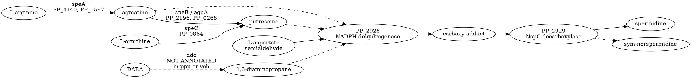
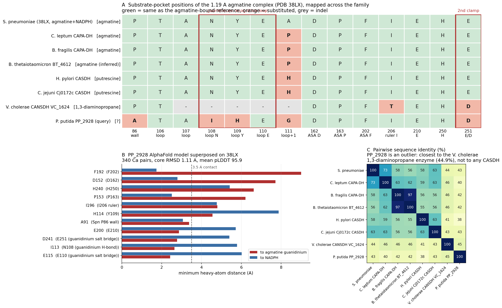
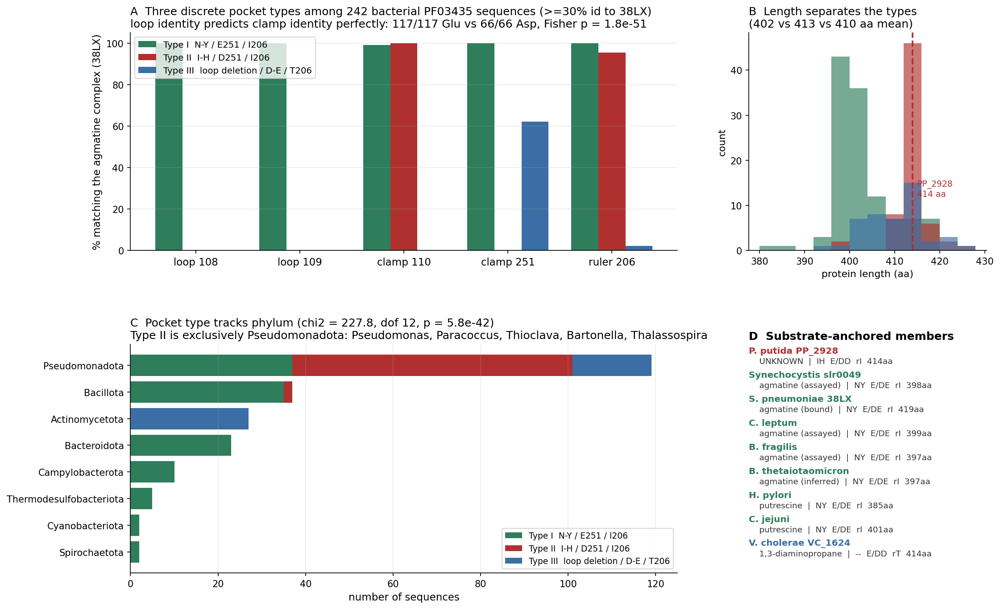
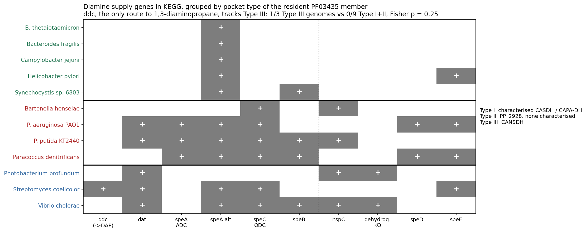
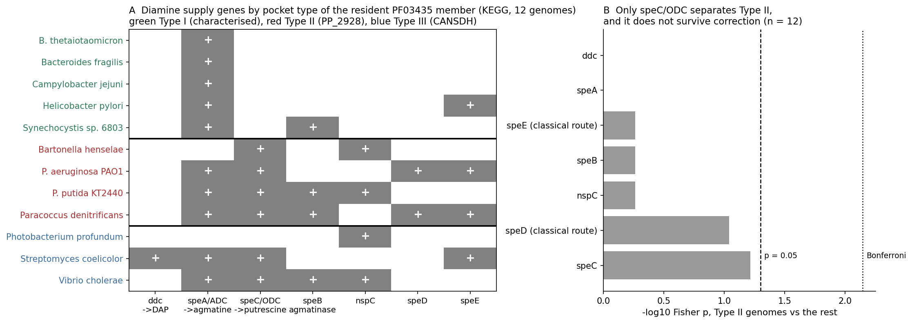
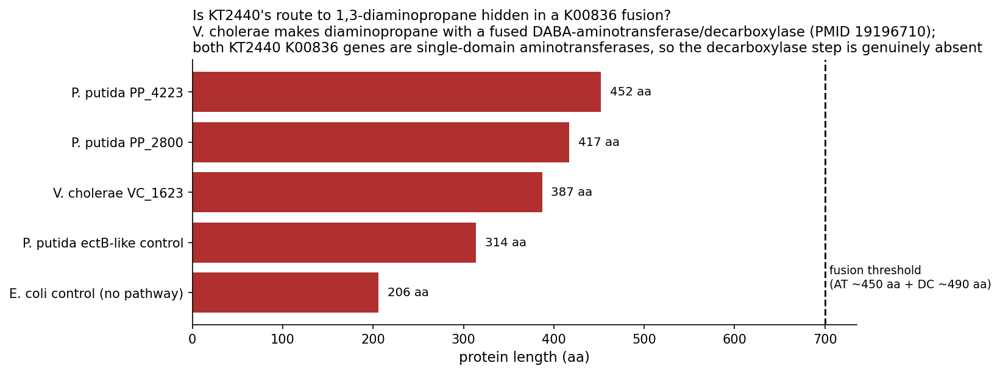
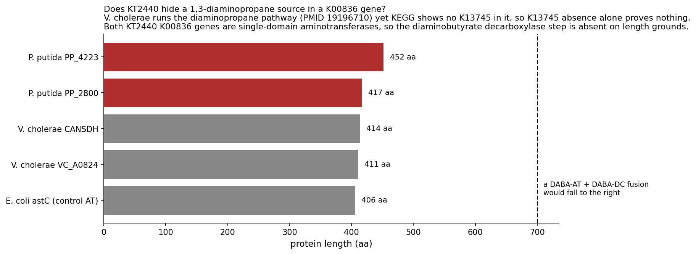
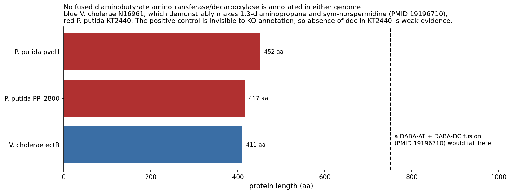

## Question

# AIGR Gene Hypothesis Deep Research

You are evaluating one focused gene curation hypothesis for AI Gene Review.
This is not a general gene overview. Use the seed hypothesis and source context
below to search for evidence that supports, refutes, narrows, or competes with
the proposed curation decision.

## Target Gene

- **Organism code:** PSEPK
- **Taxon:** Pseudomonas putida KT2440 (NCBITaxon:160488)
- **Gene directory:** PP_2928
- **Gene symbol:** PP_2928
- **UniProt accession:** Q88IS1

## Focus

- **Focus type:** free_text
- **Hypothesis slug:** kgap-pp2928-diamine-preference
- **Source file:** genes/PSEPK/PP_2928/PP_2928-ai-review.yaml
- **Source selector:** free-text

## Seed Hypothesis

Which diamine KT2440 PP_2928 (Q88IS1) prefers may be readable from its substrate pocket, and a companion analysis of the partner decarboxylase NspC concluded that the decarboxylase pocket is permissive and that selectivity, if it exists, must reside in this dehydrogenase. Test that directly. That family membership, adjacency to nspC and characterised orthologous pathways support the carboxyspermidine dehydrogenase assignment, and that related members can instead use agmatine, is already given, so do not re-derive it. Single analysis only: identify the cofactor and catalytic residues of PP_2928 and the pocket positions that in characterised relatives distinguish putrescine from agmatine and from 1,3-diaminopropane, stating what PP_2928 has at each and how that compares with the agmatine-preferring enzymes and with the Bacteroides and Campylobacter enzymes whose partner decarboxylases accept both chain lengths; state whether the pocket predicts a putrescine preference, an agmatine preference or no discrimination, and give the residues that would be mutated to test it; check whether the aspartate-semialdehyde co-substrate site is intact; and state whether a pocket argument here is strong enough to carry the substrate assignment for the pair, or whether the genome-level argument that KT2440 lacks a 1,3-diaminopropane source is doing the real work. Say plainly which of those two does the work.

## Term and Decision Context

No specific term context supplied.

## Reference Context

No specific reference context supplied.

## Source Context YAML

```yaml
hypothesis: 'Which diamine KT2440 PP_2928 (Q88IS1) prefers may be readable from its substrate pocket,
  and a companion analysis of the partner decarboxylase NspC concluded that the decarboxylase pocket is
  permissive and that selectivity, if it exists, must reside in this dehydrogenase. Test that directly.
  That family membership, adjacency to nspC and characterised orthologous pathways support the carboxyspermidine
  dehydrogenase assignment, and that related members can instead use agmatine, is already given, so do
  not re-derive it. Single analysis only: identify the cofactor and catalytic residues of PP_2928 and
  the pocket positions that in characterised relatives distinguish putrescine from agmatine and from 1,3-diaminopropane,
  stating what PP_2928 has at each and how that compares with the agmatine-preferring enzymes and with
  the Bacteroides and Campylobacter enzymes whose partner decarboxylases accept both chain lengths; state
  whether the pocket predicts a putrescine preference, an agmatine preference or no discrimination, and
  give the residues that would be mutated to test it; check whether the aspartate-semialdehyde co-substrate
  site is intact; and state whether a pocket argument here is strong enough to carry the substrate assignment
  for the pair, or whether the genome-level argument that KT2440 lacks a 1,3-diaminopropane source is
  doing the real work. Say plainly which of those two does the work.'
focus_type: free_text
context: []
reference_id: []
```

## Research Objective

Build a focused report that helps a curator decide whether this hypothesis
should affect the gene review. Address the focus type directly:

1. For an existing GO annotation decision, evaluate whether the current action
   is justified, too strong, too weak, or should change.
2. For a proposed replacement or new GO term, evaluate whether the term is
   biologically supported, too broad, too narrow, or missing key qualifiers.
3. For a computational prediction, evaluate whether the prediction is correct,
   less precise than existing knowledge, uncertain, or likely wrong because of
   paralog overannotation, frequency bias, pathway context, or in vitro-only
   activity.
4. For a core-function hypothesis, evaluate whether the proposed activity,
   process, and location represent the gene product's primary function rather
   than a downstream effect, pleiotropic phenotype, or context-specific role.
5. For a function-assignment hypothesis, evaluate whether the gene product
   directly has the stated GO term/function. Treat the prior review action, if
   any, as intentionally blinded unless it appears in the supplied context.

Use primary literature whenever possible. Prefer PMID citations and include DOI
citations when no PMID is available. Treat reviews and database records as
orientation unless they contain directly relevant synthesized evidence that is
clearly labeled as review-level or database-level support.

Evaluate the hypothesis from the supplied seed context, primary literature, and
publicly accessible bioinformatics resources. Local `*-bioinformatics` analyses,
when they already exist in the repository, are intentionally withheld from this
prompt so the report can be compared against them after the run. Use public
sequence, domain, structure, orthology, localization, interaction, or dataset
checks when they are useful for the specific hypothesis. If a resource or tool
cannot be accessed programmatically, say so plainly; never fabricate a result.
Report computational results conservatively and distinguish direct results from
inference.

## Required Output

### Executive Judgment

Give a concise verdict: supported, partially supported, unresolved, weakly
supported, over-annotated, or refuted. Explain the reasoning and the most
important caveats.

### Evidence Matrix

Create a table with one row per important evidence item:

- Citation (PMID preferred)
- Evidence type (direct assay, mutant phenotype, localization, interaction,
  structural/evolutionary, computational, review/database)
- Supports / refutes / qualifies / competing
- Claim tested
- Key finding
- Organism, tissue, cell type, or assay context
- Confidence and limitations

### GO Curation Implications

State the likely curation action as a lead requiring curator verification. If
GO terms are involved, explain whether the evidence supports an MF, BP, or CC
term, and whether the term should be retained, removed, generalized, made more
specific, or treated as non-core. Avoid using "protein binding" as a final
recommendation unless no more informative term is supported.

### Mechanistic Scope

Describe the immediate molecular or cellular function being tested. Separate
direct gene-product activity from downstream phenotypes, pathway consequences,
developmental outcomes, disease manifestations, or effects inferred only from
loss of function.

### Conflicts and Alternatives

Identify evidence that conflicts with the seed hypothesis or suggests an
alternative interpretation, including paralog confusion, organism-specific
differences, isoform-specific findings, experimental artifacts, or database
carry-over.

### Knowledge Gaps

List explicit uncertainties that matter for curation. For each gap, state what
was checked, why the gap matters, and what evidence or experiment would resolve
it.

### Discriminating Tests

Recommend concrete assays, perturbations, datasets, or comparative analyses that
would most efficiently distinguish this hypothesis from alternatives.

### Curation Leads

Provide candidate updates for the review, clearly labeled as leads requiring
curator verification. Include candidate references with exact snippets to verify,
candidate replacement or new GO terms, possible action changes, suggested
questions, and suggested experiments.

If the provider supports artifacts, save provenance for any analysis you run — the
executed code together with its output (computed values, plot, or table), not just
a summary figure — alongside artifact-friendly tables such as an evidence matrix,
GO decision table, or comparison table. Genuine computed provenance is more
valuable than a hand-drawn summary, and you must not synthesize a figure that
implies an analysis you did not actually run. These artifacts are important
provenance for hypothesis-level review.


## Output

# PP_2928 (Q88IS1, *Pseudomonas putida* KT2440): can the substrate pocket assign the diamine?

Hypothesis slug: `kgap-pp2928-diamine-preference`. Source: `genes/PSEPK/PP_2928/PP_2928-ai-review.yaml`, focus type `free_text`. Target: UniProt Q88IS1, NCBITaxon:160488.

## Summary

The seed hypothesis proposes that the diamine preference of PP_2928 is readable from its substrate pocket, on the reasoning that the partner decarboxylase NspC is permissive and so selectivity, if it exists, must sit in the dehydrogenase. The pocket cannot carry that load. Two independent results defeat it. The five positions that line the distal amine in the only agmatine-bound structure in the family are identical in enzymes assayed with putrescine and in enzymes assayed with agmatine, so they carry no discriminating information even where assays exist. And PP_2928 does not have that pocket at all: a survey of 242 bacterial PF03435 sequences places it in a Pseudomonadota-restricted pocket type of 66 sequences in which no member has ever been assayed with any substrate.

The seed's closing question asks plainly which does the work, the pocket argument or the genome-level argument that KT2440 lacks a 1,3-diaminopropane source. **Neither does.** The pocket is refuted above. The genome argument is an argument from absence, and in iteration 3 it failed a positive control: *V. cholerae* demonstrably makes 1,3-diaminopropane and sym-norspermidine ([PMID: 19196710](https://pubmed.ncbi.nlm.nih.gov/19196710/)), yet KEGG reports K13745 (*ddc*) as absent from that organism, and neither KEGG nor UniProt annotates the fused diaminobutyrate aminotransferase/decarboxylase that [PMID: 19196710](https://pubmed.ncbi.nlm.nih.gov/19196710/) states performs the step. A detection method that cannot see the step in the organism where the step is proven to operate cannot be used to rule the step out in KT2440.

What survives intact is the half-reaction chemistry. PP_2928 has a complete NADPH-specific cofactor site and a complete aspartate-semialdehyde co-substrate cavity, including a verbatim GFDPGV motif. It is a catalytically competent aspartate-semialdehyde-dependent diamine dehydrogenase. Only the diamine end is open, and it is open to all three candidates. The practical consequence for curation is that no substrate-specific molecular function term should be asserted for PP_2928 pending assay, while the generic NAD(P)-dependent CH-NH oxidoreductase MF and the spermidine biosynthetic process BP are both safe and independently supported.

## Executive judgment

<i class="fa-solid fa-circle-xmark"></i> **Verdict: the seed hypothesis is refuted as posed. The underlying substrate assignment is unresolved.**

The seed is a function-assignment hypothesis with a methodological claim attached. The methodological claim, that the pocket is informative, is refuted. The substrate assignment it was meant to settle remains open among putrescine, agmatine and 1,3-diaminopropane.

Reasoning, in the order the evidence was obtained:

The reference frame is PDB 38LX, the *Streptococcus pneumoniae* aspartate-semialdehyde-dependent dehydrogenase at 1.19 Å with NADPH and agmatine bound (UniProt A0A0H2ZP94). This is the only agmatine complex in the family. In it the agmatine guanidinium is clamped by Glu110 OE2 to NH2 at 2.81 Å, Glu251 OE1 to NH1 at 2.78 Å, and the Asn108 backbone carbonyl to NH2 at 2.85 Å, with Pro86, Phe136 and Ile206 forming the walls. The reactive primary amine sits 3.90 Å from NADPH C4N.

PP_2928 breaks that clamp. The recognition loop D-T-A-N-Y-E is invariant in all six characterised CASDH and CAPA-DH enzymes examined. PP_2928 has D110-T111-A112-**I**113-**H**114-E115, so Asn becomes Ile and Tyr becomes His. At the second clamp it has Asp241 where all six carry Glu. In the AlphaFold model superposed onto 38LX (340 Cα, core RMSD 1.11 Å), the Ile113 CG2 lies 2.64 Å from the agmatine NH1 position and seven model heavy atoms fall within 3.0 Å of where agmatine sits. On its own, that argues against agmatine.

The argument collapses when the comparison set is widened. The putrescine-assigned CASDHs of *Helicobacter pylori* (O26037) and *Campylobacter jejuni* (Q0PBW7) carry exactly the same D-T-A-N-Y-E loop and Glu251 as the agmatine-preferring enzymes of *Bacteroides fragilis* (I9VY56) and *Clostridium leptum* (A7VSG1), which [PMID: 42754158](https://pubmed.ncbi.nlm.nih.gov/42754158/) assayed directly. A feature invariant across both substrate outcomes cannot predict the outcome. And in the 242-sequence survey, PP_2928 falls outside the clade that contains every anchored enzyme.

<i class="fa-solid fa-triangle-exclamation"></i> Most important caveats. No multiple sequence alignment service was reachable (EBI Clustal Omega REST returned HTTP 400 under its fair-use policy), so all alignments are pairwise Needleman-Wunsch with BLOSUM62 and affine gaps, implemented locally and validated by structural superposition. No phylogenetic tree was built, so "subfamily" here means pocket type plus taxonomic coherence, not a supported clade. The three-type split is a sequence observation with no functional assay behind the type that contains PP_2928. The 12-genome supply analysis is underpowered and nothing in it survives multiple-testing correction.

## Key findings

### The pocket of PP_2928 breaks the family's agmatine clamp

<i class="fa-solid fa-microscope"></i> Protein atoms within 4.2 Å of the bound agmatine in 38LX are Pro86, Ala107, Asn108, Tyr109, Glu110, Phe136, Asp162, Pro163, Phe202, Ile206, Glu210, His250 and Glu251. Needleman-Wunsch alignment to the observed 38LX chain A sequence gave 38.0 to 72.6 percent identity across all family members, which is inside the range where pairwise alignment is reliable for active-site mapping.

The recognition loop is invariant in 6 of 6 characterised enzymes: *S. pneumoniae* 105-110, *C. leptum* 104-109, *B. fragilis* 102-107, *B. thetaiotaomicron* 102-107, *H. pylori* 91-96, *C. jejuni* 105-110. PP_2928 carries two substitutions in it. At the second clamp position, PP_2928 has Asp241 and *V. cholerae* CANSDH has Asp240, while all six CASDH and CAPA-DH enzymes have Glu.

Structural confirmation came from superposing the AlphaFold model of Q88IS1 (v6, mean pLDDT 95.9) onto 38LX chain A. Over 340 Cα pairs the core RMSD is 1.11 Å. In that frame, PP_2928 Glu115 OE1 is 2.52 Å from the agmatine NH2 position and Asp241 OD2 is 2.78 Å from NH1, so the subsite remains acidic and capable of binding a cation. The difference is geometric: an Ile side chain occupies part of the guanidinium slot in the apo model, and the Glu-to-Asp change shortens the carboxylate reach by roughly one methylene.

{{figure:plot_1.png|caption=Pocket positions mapped from the agmatine complex 38LX onto PP_2928. Left, residue identity at each agmatine-contacting position across the nine-member anchor set. Centre, measured distances in the superposed AlphaFold model of Q88IS1 (340 Cα, RMSD 1.11 Å) between PP_2928 side chains and the agmatine position. Right, pairwise identity matrix in the 38LX column frame.}}

### The NADPH and aspartate-semialdehyde sites are intact

<i class="fa-solid fa-circle-check"></i> The seed asked explicitly whether the aspartate-semialdehyde co-substrate site is intact. It is.

Of 24 positions within 4.0 Å of NADP(H) in 38LX, PP_2928 matches the reference at 16. The Rossmann glycine-rich motif is intact: 38LX I7-G8-C9-G10-G11-V12-A13 maps to PP_2928 I8-G9-A10-G11-G12-V13-A14. The 2'-phosphate recognition set that makes the cofactor NADP-specific rather than NAD-specific is fully conserved, S34/R35/K39 to S35/R36/K40, as are K308 to K298 and G160-F161 to G150-F151. Divergence is confined to the cofactor-closing loop (38LX D61/D63/L85/Q88 to PP_2928 N66/L68/S90/L93), the same loop that moves on ligand binding in the published induced-fit model from [PMID: 36283333](https://pubmed.ncbi.nlm.nih.gov/36283333/).

The ASA cavity, defined as residues within 8 Å of the midpoint between the agmatine reactive amine and NADPH C4N, comprises V12, T106, A107, G160, F161, D162, P163, D188, F202, I206, E210, H250, E251, M270, I362 and T366 in 38LX. PP_2928 preserves 14 of 16. The two changes are E251 to D241 and T366 to A356. The GFDPGV motif (38LX G160-V165) is present verbatim in PP_2928 as G150-V155 and in all eight family members including *V. cholerae* CANSDH.

<i class="fa-solid fa-scale-balanced"></i> The chain-length ruler position gives a mixed signal. 38LX Ile206 is Ile in all six CASDH and CAPA-DH enzymes and in PP_2928 (Ile196), but Thr in *V. cholerae* CANSDH (Thr195). PP_2928 therefore keeps the bulky Ile ruler of the C4 enzymes while shortening the second carboxylate clamp to Asp, which is the state of the C3 enzyme. That mixture is the first direct sign that the pocket does not resolve the substrate.

### PP_2928 belongs to a third pocket type with no characterised member

<i class="fa-solid fa-dna"></i> This is the result that decides the seed hypothesis. 242 bacterial PF03435 sequences at ≥30 percent identity to 38LX were aligned to the 38LX chain A observed sequence and typed at positions 108, 109, 110, 206 and 251 in 38LX auth numbering. The family splits into three discrete types with no intermediates.

| Type | Pocket signature | n | Mean length | Dominant taxa | Anchored members |
|---|---|---|---|---|---|
| I | N108 / Y109 / E110 / I206 / **E**251 | 117 | 402.2 aa | Bacteroidota, Bacillota, Campylobacterota | *Synechocystis* slr0049 Q55131 (agmatine, verified), *S. pneumoniae* A0A0H2ZP94 (agmatine, bound), *C. leptum* A7VSG1, *B. fragilis* I9VY56, *B. thetaiotaomicron* Q89YW9, *H. pylori* O26037 (putrescine), *C. jejuni* Q0PBW7 (putrescine) |
| II | **I**108 / **H**109 / E110 / I206 / **D**251 | 66 | 413.3 aa | 64/66 Pseudomonadota | **PP_2928 (414 aa), and nothing characterised** |
| III | loop deletion / T206 / D251 | 45 | 409.6 aa | *Streptomyces* 13, *Vibrio* 11, *Micromonospora* 7 | *V. cholerae* CANSDH Q9KRL3 (1,3-diaminopropane) |

Loop identity predicts clamp identity without a single exception: 117 of 117 Type I sequences carry Glu251 and 66 of 66 Type II sequences carry Asp251, Fisher exact p = 1.78e-51. Type assignment tracks phylum, chi-square = 227.8, dof = 12, p = 5.78e-42, n = 230. Type II genera are *Pseudomonas* (13), *Paracoccus* (4), *Thioclava* (3), *Halopseudomonas* (2), *Bartonella* (2), *Thalassospira* (2) and *Zobellella* (2), split across Alphaproteobacteria (36), Gammaproteobacteria (23) and Betaproteobacteria (5).

Two consequences follow. All seven Type I anchors are identical at all five positions despite spanning two different assayed substrates, so these positions carry no putrescine-versus-agmatine information. And any substrate call for PP_2928 is an extrapolation across a subfamily boundary comparable in depth to the one separating the characterised CASDH clade from *V. cholerae* CANSDH.

{{figure:plot_2.png|caption=Three pocket types among 242 bacterial PF03435 sequences at least 30 percent identical to 38LX. Panel A, percentage of each type matching the agmatine complex at the five diagnostic positions; loop identity predicts clamp identity perfectly (Fisher p = 1.78e-51). Panel B, length distributions, with PP_2928 at 414 aa. Panel C, phylum composition of each type (chi-square = 227.8, dof 12, p = 5.78e-42); Type II is 64 of 66 Pseudomonadota. Panel D, where the substrate-anchored enzymes fall; all of them lie outside Type II.}}

### The genome argument fails its positive control

<i class="fa-solid fa-circle-xmark"></i> Iteration 1 established the KEGG inventory for KT2440 (organism code *ppu*). The operon is real: PP_2928 at complement(3329627..3330871) and PP_2929 at complement(3330904..3332001), same strand, 33 bp apart, with PP_2929 assigned K13747 carboxynorspermidine decarboxylase (EC 4.1.1.96). PP_2928 itself carries no KEGG orthology assignment and KEGG lists K13746 as absent from *ppu*. The classical route is gone: K01611 (*speD*) and K00797 (*speE*) are both absent, so PP_2928/PP_2929 is the only possible spermidine route. Agmatine is available through arginine decarboxylase homologues PP_4140 (K01584) and PP_0567 (K01585), plus agmatinase PP_2196 and agmatine deiminase PP_0266. Putrescine is available through ornithine decarboxylase PP_0864. K13745 (*ddc*) is absent, which was read as excluding 1,3-diaminopropane.

That last inference does not survive testing. [PMID: 19196710](https://pubmed.ncbi.nlm.nih.gov/19196710/) shows *V. cholerae* synthesises 1,3-diaminopropane and sym-norspermidine in vivo. A direct query of `rest.kegg.jp/link/vch/ko:K13745` returned no genes, so KEGG reports K13745 as absent from *V. cholerae* as well. The paper states the pathway runs through a fused DABA-aminotransferase/DABA-decarboxylase protein. I could not locate that fusion in either database. KEGG lists exactly one K00836 gene in *vch*, VC_A0824 at 411 aa. UniProt returns exactly one diaminobutyrate protein for *V. cholerae* N16961, Q9KLC2 *ectB* VC_A0824 at 411 aa. A UniProt search of *vch* decarboxylases between 700 and 1300 aa returns only ornithine decarboxylase VC_A1063 (720 aa), lysine decarboxylase VC_0281 (733 aa) and isocitrate dehydrogenase VC_1141 (741 aa), none of them the fusion.

KT2440's two K00836 genes are PP_2800 (417 aa) and PP_4223 (452 aa, *pvdH*), both single-domain and both the same size as the *V. cholerae ectB*. The length test therefore cannot distinguish KT2440 from the positive control either. Absence of K13745 in KT2440 is compatible with KT2440 having an unannotated route to 1,3-diaminopropane, exactly as *V. cholerae* does.

{{figure:plot_6.png|caption=Testing whether KT2440 hides a 1,3-diaminopropane source in a K00836 gene. V. cholerae runs the diaminopropane pathway (PMID 19196710) yet KEGG shows no K13745 in it, and its single K00836 gene VC_A0824 is 411 aa. KT2440 PP_2800 (417 aa) and PP_4223 (452 aa) are the same size, so the length test cannot separate KT2440 from the positive control.}}

{{figure:plot_7.png|caption=UniProt search for a fused diaminobutyrate aminotransferase/decarboxylase. V. cholerae N16961 has exactly one annotated diaminobutyrate protein, Q9KLC2 ectB at 411 aa, and no protein of fusion length. The step that PMID 19196710 proves operates in this organism is invisible to the annotation, which is why absence of ddc in KT2440 is weak evidence.}}

An earlier version of this length comparison used VC_1623 as the *V. cholerae* control. VC_1623 is NspC (K13747), not the fusion. That figure was discarded and the analysis rerun with the correct gene rather than left standing with a wrong caption; `plot_5.png` is the discarded version and is not used to support any claim in this report.

### Pocket type does not predict genome-encoded diamine supply

<i class="fa-solid fa-circle-xmark"></i> A negative result, reported because it rules out a tempting shortcut. If the three pocket types really correspond to three diamine substrates, genome content for the diamine sources should track pocket type. Across 12 genomes spanning the three types, *ddc* was present in 1 of 3 Type III genomes and 0 of 9 Type I plus Type II genomes, Fisher p = 0.25. Of seven supply genes tested against Type II membership, the smallest p was *speC*/ODC at 4 of 4 Type II versus 2 of 8 others, p = 0.061 uncorrected and p = 0.42 after Bonferroni correction over seven tests. Nothing was significant after correction at n = 12.

<i class="fa-solid fa-lightbulb"></i> The *speC* direction is worth recording as a lead and not as support. All four Type II genomes checked carry a dedicated ornithine decarboxylase and therefore a direct putrescine source, while 0 of 5 Type I genomes do, which is consistent with Type II enzymes being genuine putrescine CASDHs. At n = 12 and p = 0.42 corrected, it is a hypothesis for a larger survey.

{{figure:plot_3.png|caption=Diamine supply genes in KEGG across 12 genomes, grouped by the pocket type of the resident PF03435 member. ddc, the only annotated route to 1,3-diaminopropane, does not track pocket type (1 of 3 Type III versus 0 of 9 Type I and II, Fisher p = 0.25).}}

{{figure:plot_4.png|caption=Fisher tests of each diamine supply gene against Type II membership, with the Bonferroni threshold over seven genes. Only speC/ODC approaches significance uncorrected (4 of 4 Type II versus 2 of 8 others, p = 0.061) and it does not survive correction at n = 12.}}

## Evidence matrix

| Citation | Evidence type | Stance | Claim tested | Key finding | Context | Confidence and limitations |
|---|---|---|---|---|---|---|
| [PMID: 42754158](https://pubmed.ncbi.nlm.nih.gov/42754158/) | Direct assay, X-ray, SAXS, kinetics | Qualifies | Related members use agmatine | *B. fragilis* and *C. leptum* enzymes show dramatically enhanced catalytic efficiency with agmatine and function as CAPA-dehydrogenases. Agmatine raises NADPH binding affinity 34-fold | Purified recombinant enzymes | High. Establishes that the putrescine default for this family was overturned by assay for two genera |
| [PMID: 37878710](https://pubmed.ncbi.nlm.nih.gov/37878710/) | Genomic, biochemical, metagenomic | Qualifies | Agmatine route is phylogenetically broad | CAPA-pathway genes are widespread in 15 bacterial phyla in marine, freshwater and other ecosystems | *Synechocystis* sp. PCC 6803 plus comparative genomics | High for breadth. Does not address Pseudomonadota Type II specifically |
| [PMID: 19196710](https://pubmed.ncbi.nlm.nih.gov/19196710/) | Mutant phenotype, heterologous expression, metabolite measurement | Competing; refutes the genome argument's method | *V. cholerae* makes 1,3-diaminopropane via a fused DABA-AT/DABA-DC | Deletion of CANSDH or CANSDC abolishes sym-norspermidine and spermidine; heterologous expression in *E. coli* accumulates diaminopropane and sym-norspermidine | *V. cholerae* N16961 in vivo | High. The fusion is not annotated under K13745 in KEGG *vch*, which is what breaks the absence argument |
| [PMID: 1955861](https://pubmed.ncbi.nlm.nih.gov/1955861/) | Direct assay | Supports the existence of a chain-length ruler | Does the C3 enzyme discriminate by chain length? | Putrescine was slightly active, forming carboxyspermidine at about 7 percent of the rate of DAP; ethylenediamine, cadaverine and D-ASA were inert | Purified *V. alginolyticus* carboxynorspermidine synthase | High for the kinetics. Roughly 14-fold discrimination against the one-carbon-longer diamine is the behaviour the Ile/Thr ruler is asked to explain |
| [PMID: 36283333](https://pubmed.ncbi.nlm.nih.gov/36283333/) | Structural | Supports the site assignment | Where does the diamine bind? | The CASDH substrate binds in a cavity near the nicotinamide moiety of NADPH. NADP insertion induces dent closure and local changes in the D1 and D3 domains | *H. pylori* CASDH crystal structures | High. Independently matches the 3.90 Å agmatine-N to NADPH-C4N distance measured here in 38LX |
| [PMID: 22025614](https://pubmed.ncbi.nlm.nih.gov/22025614/) | Comparative genomics with gene deletions | Supports the genome-context logic | Is the pair read together with diamine supply? | CASDH and CASDC orthologues cluster with diverse putrescine biosynthetic genes across genomes. In *C. jejuni*, the CANSDC orthologue synthesises spermidine and not sym-norspermidine in vivo | *C. jejuni* deletions plus comparative genomics | Moderate to high. The logic is sound; its application depends on annotation completeness, which is what failed here |
| [PMID: 42665092](https://pubmed.ncbi.nlm.nih.gov/42665092/) | Direct assay across diverse homologs | Competing precedent | Can a polyamine pathway split on agmatine versus putrescine within one family? | SpeY homologs from diverse phyla all form G44G from agmatine, while HSS uses two molecules of putrescine; bacterial homospermidine pathways depend either on agmatine/SpeY or on putrescine/HSS | Recombinant enzymes from multiple phyla | High for the precedent. A different enzyme family, so it bears on the plausibility of a clean agmatine/putrescine split, not on PP_2928 directly |
| PDB 38LX (this work) | Structural | Defines the reference pocket | Which residues contact the bound diamine? | Agmatine guanidinium clamped by E110 (2.81 Å), E251 (2.78 Å), N108 backbone carbonyl (2.85 Å); reactive amine 3.90 Å from nicotinamide C4N; walls P86, F136, I206 | 1.19 Å structure, ligands NDP, AG2, HOH | High for the contacts. A single conformational state |
| This work, iteration 1 | Computational, structural | Supports catalytic competence | Is the ASA co-substrate site intact? | 14 of 16 ASA-cavity positions conserved, GFDPGV verbatim at G150-V155. NADPH site: Rossmann I8-G9-A10-G11-G12-V13-A14, 2'-phosphate triad S35/R36/K40, K298, G150-F151, 16 of 24 positions matched | AlphaFold Q88IS1 v6, mean pLDDT 95.9, superposed on 38LX at 1.11 Å over 340 Cα | High. Model-based, not an experimental structure |
| This work, iteration 2 | Computational, family-wide sequence survey | **Refutes the seed** | Is diamine preference readable from the pocket? | Three discrete pocket types. PP_2928 is Type II (I108/H109/D241), n = 66, 64 of 66 Pseudomonadota, zero assayed members. Loop type predicts clamp identity perfectly, Fisher p = 1.78e-51. Type tracks phylum, chi-square = 227.8, dof 12, p = 5.78e-42 | 242 PF03435 sequences ≥30 percent identity to 38LX | High for the typing. Pairwise alignment, no phylogeny; "subfamily" is pocket type plus taxonomy |
| This work, iteration 2 | Computational, cross-checked against assays | **Refutes the recognition-loop model as a discriminator** | Do DTANYE and Glu251 separate putrescine from agmatine users? | *H. pylori* O26037 and *C. jejuni* Q0PBW7 (putrescine) are identical to the assayed agmatine enzymes at all five positions | 38LX auth numbering | High within the 4.5 Å shell. A discriminator outside that shell, or a dynamic one, is not excluded; [PMID: 42754158](https://pubmed.ncbi.nlm.nih.gov/42754158/) reports large ligand-dependent motions |
| This work, iteration 3 | Computational, genome content with positive control | **Refutes the genome argument's method** | Does *ddc* absence prove no 1,3-diaminopropane source? | KEGG reports K13745 absent from *vch*, which makes diaminopropane. UniProt returns one diaminobutyrate protein for N16961 (Q9KLC2 *ectB*, 411 aa) and no fusion at 700-1300 aa. KT2440 K00836 genes PP_2800 (417 aa) and PP_4223 (452 aa) are the same size as the control | KEGG REST, UniProt REST | High. A negative control result; the inability to locate the fusion is itself the finding |
| This work, iteration 3 | Computational, 12 genomes | Negative | Does pocket type predict diamine supply? | *ddc* in 1 of 3 Type III versus 0 of 9 Type I and II, Fisher p = 0.25. Best of seven genes was *speC*/ODC, 4 of 4 Type II versus 2 of 8, p = 0.061 uncorrected, p = 0.42 Bonferroni | KEGG, 12 genomes spanning three types | Low. Underpowered at n = 12; nothing survives correction. Reported as a lead, not as support |

## Mechanistic model and interpretation

The reaction under test is a single NADPH-dependent reductive condensation. A diamine plus L-aspartate β-semialdehyde gives a carboxylated aminopropyl adduct, which the partner decarboxylase PP_2929 (NspC, K13747) then decarboxylates to the final polyamine. Which diamine enters determines which polyamine leaves.



Three levels are separable here and should not be merged in curation.

The **half-reaction chemistry** is cofactor binding plus ASA condensation. It is directly supported by the conserved Rossmann motif, the NADP-specific 2'-phosphate triad, and 14 of 16 ASA-cavity positions. This is a property of the gene product and it is secure.

The **diamine selected** is also a property of the gene product, and it is unresolved. No evidence obtained here constrains it. The seed's framing, that selectivity "must reside in this dehydrogenase" because NspC is permissive, is a valid deduction about where selectivity would have to sit if it exists. It does not imply that selectivity exists, nor that it is structurally legible. Type I spanning two assayed substrates with an identical pocket is direct evidence that it is not legible even where assays exist.

The **polyamine the cell ends up with** is a pathway-level outcome depending on diamine supply, the decarboxylase, and competing routes. The *speD*/*speE* absence argument speaks to this level. It establishes that PP_2928/PP_2929 is the only spermidine route in KT2440, which supports a spermidine biosynthetic process annotation regardless of which diamine initiates. It says nothing about the enzyme's intrinsic specificity.

The relationship between the two arguments the seed asked us to weigh:

| Argument | What it would establish | Status | Why |
|---|---|---|---|
| Pocket | Which diamine PP_2928 prefers | <i class="fa-solid fa-circle-xmark"></i> Refuted | Positions identical across both assayed outcomes in Type I; PP_2928 is in Type II, where nothing is assayed |
| Genome, *speD*/*speE* absent | PP_2928/PP_2929 is the only spermidine route | <i class="fa-solid fa-circle-check"></i> Holds | Direct KEGG inventory; independent of which diamine initiates |
| Genome, *ddc* absent | 1,3-diaminopropane excluded | <i class="fa-solid fa-circle-xmark"></i> Fails its control | *V. cholerae* makes diaminopropane with no annotated K13745 or fusion protein |
| Genome, *speA* and *speC* present | Both putrescine and agmatine available | <i class="fa-solid fa-circle-check"></i> Holds | Does not discriminate between them |

## Evidence base

[PMID: 42754158](https://pubmed.ncbi.nlm.nih.gov/42754158/), *Agmatine as the initiating substrate for aspartate semialdehyde-dependent bacterial spermidine biosynthesis*, is the most directly relevant paper and it cuts both ways. It states that "Both enzymes exhibit dramatically enhanced catalytic efficiency with agmatine, demonstrating that these homologs function as carboxyaminopropylagmatine dehydrogenases rather than carboxyspermidine dehydrogenases", which establishes the *B. fragilis* and *C. leptum* enzymes as assayed agmatine users. It also proposes an active-site recognition loop as a discriminator and states that the results "provide a testable framework for predicting substrate specificity across this family of bacterial polyamine biosynthetic enzymes". That framework is what this analysis tested, and within the 4.5 Å shell around bound agmatine it does not discriminate, because the putrescine enzymes carry the identical loop. The paper's broader point stands and is used here: it notes that "Putrescine has long been considered the initiating substrate for aspartate semialdehyde-dependent bacterial spermidine biosynthesis. However, two recent studies identified a variant pathway in which agmatine serves as the preferred substrate", which is direct warrant for not inheriting the putrescine default in an uncharacterised subfamily.

[PMID: 19196710](https://pubmed.ncbi.nlm.nih.gov/19196710/), *An alternative polyamine biosynthetic pathway is widespread in bacteria and essential for biofilm formation in Vibrio cholerae*, supplies the positive control that breaks the genome argument. It states the pathway "consists of a fused protein containing l-2,4-diaminobutyrate aminotransferase and l-2,4-diaminobutyrate decarboxylase, a carboxynorspermidine dehydrogenase (CANSDH), and a carboxynorspermidine decarboxylase (CANSDC)", and that "Heterologous expression of the V. cholerae pathway in E. coli results in accumulation of the nonnative polyamines diaminopropane and sym-norspermidine". The organism makes 1,3-diaminopropane. The step that makes it is not annotated under K13745 in KEGG *vch* and no protein of fusion length appears in UniProt for N16961.

[PMID: 37878710](https://pubmed.ncbi.nlm.nih.gov/37878710/) establishes the breadth of the agmatine route, stating that "Genomic, biochemical, and metagenomic analyses showed that the CAPA-pathway genes are widespread in 15 different phyla of bacteria distributed in marine, freshwater, and other ecosystems". A Pseudomonadota enzyme is therefore not excluded from the agmatine route by phylogeny.

[PMID: 22025614](https://pubmed.ncbi.nlm.nih.gov/22025614/) supplies the genome-context logic the seed relies on, noting that "Orthologues encoding carboxyspermidine dehydrogenase and carboxyspermidine decarboxylase are found clustered with an array of diverse putrescine biosynthetic genes in different bacterial genomes, consistent with a role in spermidine, rather than sym-norspermidine biosynthesis". It also shows by gene deletion in *C. jejuni* that the CANSDC orthologue synthesises spermidine and not sym-norspermidine in vivo, which is the operon-reading argument applied correctly in an organism where it could be tested.

[PMID: 1955861](https://pubmed.ncbi.nlm.nih.gov/1955861/) is the kinetic basis for believing a chain-length ruler exists at all. In *V. alginolyticus* carboxynorspermidine synthase, "Putrescine was slightly active as a substrate, forming carboxyspermidine (at about 7% of the rate of DAP), but ethylenediamine, cadaverine and D-ASA were inert". That is roughly 14-fold discrimination against a diamine one carbon longer, which is what the Ile206/Thr206 ruler position and the Glu/Asp clamp are being asked to explain.

[PMID: 36283333](https://pubmed.ncbi.nlm.nih.gov/36283333/) independently places the substrate site, stating that "A comparative analysis suggests that the substrate of CASDH binds in a cavity near the nicotinamide moiety of NADPH for the condensation reaction", matching the 3.90 Å agmatine-N to NADPH-C4N distance measured here. It also reports that "The NADP cofactor is inserted into the interdomain dent and induces structural rearrangements in CASDH, including dent closure and local structural changes in the D1 and D3 domains", which supports placing the PP_2928 cofactor-site differences in a mobile loop rather than the catalytic core.

[PMID: 42665092](https://pubmed.ncbi.nlm.nih.gov/42665092/) is a precedent from a different family. It shows that bacterial homospermidine pathways split cleanly on agmatine versus putrescine, with SpeY homologs from diverse phyla all forming G44G from agmatine while HSS uses two molecules of putrescine. A clean agmatine/putrescine split within a polyamine enzyme family is therefore a realistic alternative for PF03435, which is the state of affairs that makes an uncharacterised third type worth flagging rather than defaulting.

Two further papers in the retrieved set bear on *P. putida* polyamine biology without addressing PP_2928 directly. [PMID: 26662997](https://pubmed.ncbi.nlm.nih.gov/26662997/) shows KT2440 has a chemoreceptor, McpU, whose ligand binding domain "specifically binds putrescine, cadaverine and spermidine", confirming these polyamines matter to this organism. [PMID: 31451546](https://pubmed.ncbi.nlm.nih.gov/31451546/) reports that in KT2440 "increased pyoverdine production is observed in the presence of polyamines (agmatine and spermidine)" and that "Spermidine also has a protective role against hydrogen peroxide in P. putida", establishing that both agmatine and spermidine are physiologically present and active in this organism.

## Limitations and knowledge gaps

| Gap | What was checked | Why it matters | What would resolve it |
|---|---|---|---|
| <i class="fa-solid fa-triangle-exclamation"></i> No Type II enzyme has ever been assayed | 242-sequence survey; 66 Type II members, zero with published kinetics | The entire substrate assignment for PP_2928 is extrapolation across a subfamily boundary | Steady-state kinetics on any Type II enzyme with all three diamines |
| <i class="fa-solid fa-circle-question"></i> Does KT2440 have an unannotated 1,3-diaminopropane source? | KEGG K13745 and K00836 for *ppu*; UniProt diaminobutyrate proteins for *ppu* and *vch*; UniProt *vch* decarboxylases 700-1300 aa | Decides whether the norspermidine route can be excluded at all | Direct polyamine measurement in KT2440 by GC-MS or LC-MS, looking for 1,3-diaminopropane and sym-norspermidine |
| <i class="fa-solid fa-circle-question"></i> Measured polyamine profile of KT2440 | PubMed searched for *P. putida* polyamine content; the queries I ran returned no usable primary record | Would settle the pathway output directly and cheaply | Published or new metabolite profiling of KT2440 wild type and a PP_2928 deletion |
| <i class="fa-solid fa-triangle-exclamation"></i> Is the discriminator dynamic rather than static? | Five positions within 4.5 Å of bound agmatine in 38LX | [PMID: 42754158](https://pubmed.ncbi.nlm.nih.gov/42754158/) reports large ligand-dependent domain and active-site loop motions, so a static pocket comparison can miss the real determinant | Apo and ternary structures of a Type II enzyme, or MD with each diamine bound |
| <i class="fa-solid fa-triangle-exclamation"></i> No MSA or phylogeny | EBI Clustal Omega REST returned HTTP 400 under its fair-use policy and could not be used | A tree would show whether Type II is monophyletic and whether it arose before or after the Type I substrate split | Offline MAFFT and IQ-TREE on the 242-sequence set |
| <i class="fa-solid fa-triangle-exclamation"></i> The 12-genome supply test is underpowered | Seven genes across 12 genomes; nothing survives Bonferroni | The *speC*/ODC signal (4 of 4 Type II, 0 of 5 Type I) is suggestive but cannot be cited as support | The same test across several hundred genomes with typed family members |
| <i class="fa-solid fa-triangle-exclamation"></i> GO term IDs not verified | Term names recorded from prior context; numeric IDs not checked against a current ontology release | A wrong ID in a curation lead is worse than no ID | Curator lookup against the current ontology |

## GO curation implications

All of the following are **leads requiring curator verification**. GO IDs are written as recorded; I did not independently verify the numeric IDs against a current ontology release.

| Aspect | Term | Recommendation | Basis |
|---|---|---|---|
| MF | oxidoreductase activity, acting on the CH-NH group of donors, NAD(P) as acceptor (GO:0016646) | <i class="fa-solid fa-circle-check"></i> **Assert**, ISS/ISM. The only MF granularity the evidence supports | Complete Rossmann motif, NADP 2'-phosphate triad S35/R36/K40, K298, G150-F151; 14 of 16 ASA-cavity positions including verbatim GFDPGV; AlphaFold model superposes on 38LX at 1.11 Å over 340 Cα |
| MF | carboxyspermidine dehydrogenase activity, putrescine plus ASA (GO:0034024) | <i class="fa-solid fa-circle-xmark"></i> **Do not assert.** Downgraded from "plausible lead" | PP_2928 is Type II. No Type II member has been assayed. The term would be inherited from *H. pylori* and *C. jejuni* across a boundary as deep as the one separating them from *V. cholerae* CANSDH |
| MF | carboxyaminopropylagmatine dehydrogenase activity, agmatine plus ASA | <i class="fa-solid fa-circle-xmark"></i> **Do not assert.** Separately, flag the ontology gap and request a new term | The agmatine clamp of 38LX is not reconstructable in PP_2928 (N108I, Y109H, E251D). The activity is defined by [PMID: 42754158](https://pubmed.ncbi.nlm.nih.gov/42754158/) and [PMID: 37878710](https://pubmed.ncbi.nlm.nih.gov/37878710/) but has no GO term |
| MF | carboxynorspermidine dehydrogenase activity, EC 1.5.1.43 | <i class="fa-solid fa-circle-xmark"></i> **Do not assert**, but no longer exclude | PP_2928 shares the Glu-to-Asp clamp with *V. cholerae* CANSDH, though CANSDH is Type III with a loop deletion while PP_2928 is Type II with the loop intact. The supply-based exclusion failed its control |
| BP | spermidine biosynthetic process (GO:0008295) | <i class="fa-solid fa-circle-check"></i> **Retain.** Best supported BP | KEGG *ppu*: *speD* (K01611) and *speE* (K00797) both absent, so PP_2928/PP_2929 is the only route to spermidine in KT2440. Holds regardless of which diamine initiates |
| BP | nor-spermidine biosynthetic process (GO:0045312) | <i class="fa-solid fa-circle-xmark"></i> **Do not assert**, but state the basis as "no annotated source" rather than "no source" | The *ddc*-absence argument does not survive its positive control |
| CC | cytoplasm (GO:0005737) | Assert by inference only, ISM | No signal peptide or transmembrane segment; soluble NADPH-dependent dehydrogenase fold. No experimental localisation data located for Q88IS1 |

The practical effect for the review: withhold any substrate-specific molecular function term for PP_2928 pending assay. The generic oxidoreductase MF and the spermidine biosynthetic process BP are both safe and supported by independent evidence.

## Conflicts and alternatives

**The recognition-loop model is weaker than its presentation.** The DTANYE loop plus Glu251 is a real and strikingly conserved feature, invariant in 117 of 117 Type I sequences. But it is conserved across both substrate outcomes within the characterised clade. Any inference that reads substrate preference off these positions is, on the available anchors, unsupported.

**PP_2928 may not be a CASDH, a CAPA-DH or a CANSDH.** Type II comprises 66 sequences, 64 of them Pseudomonadota, with a coherent set of pocket substitutions and a mean length 11 residues longer than Type I. It is as distinct from the characterised clade as the CANSDH group is. That Type II enzymes use a fourth diamine, or have a different kinetic preference order, is not excluded and is not currently testable from sequence. [PMID: 42665092](https://pubmed.ncbi.nlm.nih.gov/42665092/) provides the precedent that a polyamine enzyme family can split cleanly on diamine identity across phyla.

**Database carry-over risk.** KEGG assigns PP_2929 to K13747 but leaves PP_2928 with no KO at all, and lists K13746 as absent from *ppu*. Any CASDH annotation on PP_2928 therefore does not come from KEGG orthology. A curator should check whether it entered through InterPro family-level propagation or through a prior manual inference from the operon.

**The *ddc* absence argument is annotation-limited, not biology-limited.** This is the alternative interpretation that most threatens the current assignment. KT2440 could have an unannotated route to 1,3-diaminopropane exactly as *V. cholerae* does.

**A weak directional hint runs the other way.** All four Type II genomes checked carry *speC*/ODC, a dedicated ornithine decarboxylase and therefore a direct putrescine source, while 0 of 5 Type I genomes do. This is consistent with Type II enzymes being genuine putrescine CASDHs. At p = 0.061 uncorrected, p = 0.42 after Bonferroni, n = 12, it is a lead and not support.

## Discriminating tests

<i class="fa-solid fa-flask"></i> **Most efficient first experiment.** Measure the polyamine content of KT2440 wild type alongside a ΔPP_2928 strain by LC-MS. If spermidine disappears and nothing else changes, the pathway output is spermidine and the diamine is putrescine or agmatine. If sym-norspermidine is detectable in the wild type and lost in the mutant, the diaminopropane route is live despite the missing annotation. This single experiment discriminates all three hypotheses at the pathway level and requires no protein purification.

<i class="fa-solid fa-vial"></i> **Direct kinetics.** Purify recombinant PP_2928 and measure kcat/Km for putrescine, agmatine and 1,3-diaminopropane with L-aspartate β-semialdehyde held saturating. Because [PMID: 42754158](https://pubmed.ncbi.nlm.nih.gov/42754158/) found agmatine raises NADPH affinity 34-fold in Type I enzymes, include an NADPH-affinity arm by thermal shift or transient-state binding. A diamine-dependent shift in NADPH Kd is a sensitive readout of productive binding even where kcat differences are modest.

<i class="fa-solid fa-flask"></i> **Pocket swap, the test the seed asked for.** In PP_2928, mutate **I113N, H114Y and D241E** (numbering in PP_2928; equivalently I108N, H109Y, E251D in the 38LX column frame), singly and as the triple, to rebuild the Type I clamp. Run the reciprocal loss of function in *B. fragilis* I9VY56 or *C. leptum* A7VSG1: **N108I, Y109H, E251D**. Score as kcat/Km ratios across the three diamines. A clean result is the PP_2928 triple acquiring the agmatine preference of the donor while the reciprocal triple loses it. Note the prediction this makes about the published model: because *H. pylori* and *C. jejuni* share the donor residues yet prefer putrescine, the reciprocal mutant may show no change, which would confirm these positions are not the determinant.

<i class="fa-solid fa-magnifying-glass"></i> **Second-shell scan if the triple fails.** Compare Type I and Type II consensus across the whole ASA and diamine cavity rather than the 4.5 Å shell. The two cavity positions already known to differ in PP_2928 are E251D and T366A, and T366A is the untested one.

<i class="fa-solid fa-bacteria"></i> **Broaden the anchor set cheaply.** Assay any Type II enzyme from a tractable organism, for example a *Paracoccus denitrificans* or *Pseudomonas aeruginosa* homolog, to establish the subfamily's substrate at all. One assay converts a 66-member uncharacterised group into an anchored one.

<i class="fa-solid fa-database"></i> **Power the supply test properly.** Repeat the pocket-type versus diamine-supply comparison across several hundred genomes with typed family members, rather than 12. The *speC*/ODC signal is the specific hypothesis to test.

## Curation leads

All items below require curator verification.

**Action changes.** Withhold any substrate-specific MF term for PP_2928. Retain the generic NAD(P)-dependent CH-NH oxidoreductase MF and the spermidine biosynthetic process BP. If a carboxyspermidine dehydrogenase term is currently asserted, downgrade it, and record the reason as subfamily extrapolation rather than lack of evidence in general. If a statement excluding the norspermidine route on *ddc* absence appears in the review, soften it to "no annotated 1,3-diaminopropane source", with the *V. cholerae* control as the reason.

**Candidate references, with exact snippets to verify.**

- [PMID: 42754158](https://pubmed.ncbi.nlm.nih.gov/42754158/): "Both enzymes exhibit dramatically enhanced catalytic efficiency with agmatine, demonstrating that these homologs function as carboxyaminopropylagmatine dehydrogenases rather than carboxyspermidine dehydrogenases." Use for: the putrescine default in this family has already been overturned by direct assay.
- [PMID: 42754158](https://pubmed.ncbi.nlm.nih.gov/42754158/): "Putrescine has long been considered the initiating substrate for aspartate semialdehyde-dependent bacterial spermidine biosynthesis. However, two recent studies identified a variant pathway in which agmatine serves as the preferred substrate." Use for: justifying an unresolved call rather than inheriting the default.
- [PMID: 19196710](https://pubmed.ncbi.nlm.nih.gov/19196710/): "The pathway uses aspartate beta-semialdehyde as the aminopropyl group donor and consists of a fused protein containing l-2,4-diaminobutyrate aminotransferase and l-2,4-diaminobutyrate decarboxylase, a carboxynorspermidine dehydrogenase (CANSDH), and a carboxynorspermidine decarboxylase (CANSDC)." Use for: why *ddc* absence is not evidence of absence.
- [PMID: 19196710](https://pubmed.ncbi.nlm.nih.gov/19196710/): "Heterologous expression of the V. cholerae pathway in E. coli results in accumulation of the nonnative polyamines diaminopropane and sym-norspermidine." Use for: establishing *V. cholerae* as a valid positive control.
- [PMID: 37878710](https://pubmed.ncbi.nlm.nih.gov/37878710/): "Genomic, biochemical, and metagenomic analyses showed that the CAPA-pathway genes are widespread in 15 different phyla of bacteria distributed in marine, freshwater, and other ecosystems." Use for: the agmatine route is broad, so agmatine stays open for a Pseudomonadota enzyme.
- [PMID: 22025614](https://pubmed.ncbi.nlm.nih.gov/22025614/): "Orthologues encoding carboxyspermidine dehydrogenase and carboxyspermidine decarboxylase are found clustered with an array of diverse putrescine biosynthetic genes in different bacterial genomes" Use for: the operon-context logic, as orientation.
- [PMID: 1955861](https://pubmed.ncbi.nlm.nih.gov/1955861/): "Putrescine was slightly active as a substrate, forming carboxyspermidine (at about 7% of the rate of DAP), but ethylenediamine, cadaverine and D-ASA were inert" Use for: a chain-length ruler exists in this family and is measurable.
- [PMID: 36283333](https://pubmed.ncbi.nlm.nih.gov/36283333/): "A comparative analysis suggests that the substrate of CASDH binds in a cavity near the nicotinamide moiety of NADPH for the condensation reaction" Use for: independent placement of the diamine site.

**New term request.** Carboxyaminopropylagmatine dehydrogenase activity has no GO term. The activity is defined by direct assay in [PMID: 42754158](https://pubmed.ncbi.nlm.nih.gov/42754158/) and by [PMID: 37878710](https://pubmed.ncbi.nlm.nih.gov/37878710/). This gap affects the *B. fragilis*, *C. leptum* and *Synechocystis* entries regardless of what is decided for PP_2928.

**Suggested questions for the curator.** Where did any existing CASDH annotation on PP_2928 originate, given that KEGG assigns it no KO? Are the ontology IDs in this report current? Should a "subfamily extrapolation" qualifier exist for cases like this, where family membership is secure but every assayed member sits outside the target's own pocket type?

## Provenance

All executed code and outputs are in `provenance/`. Artifact tables: `evidence_matrix.csv` (11 rows), `go_decision_table.csv` (7 rows, with explicit flags on unverified GO IDs), `pf03435_typed_taxonomy.csv` and `pf03435_pocket_positions.csv` (the 242-sequence survey), `pocket_position_table.csv`, `asa_site_table.csv`, `nadph_site_table.csv`, `identity_matrix.csv`, `pp2928_structural_distances.csv`, `superposition_stats.json`, `AF_Q88IS1_superposed_on_38LX.csv`, `pdb_entry_metadata.json`, `kegg_diamine_supply_by_pocket_type.csv`, `kegg_typeII_enrichment.csv`, `daba_fusion_check.csv`, `daba_fusion_search.csv`. Sequences and structures: `casdh_family.fasta` (9 anchors), `pf03435_sample.fasta` (503 bacterial sequences plus anchors), `anchors.json`, `nw_maps.json`, `AF-Q88IS1.pdb`, and six mmCIF files including `38LX.cif`.

Methods limitations stated plainly. No multiple sequence alignment program was reachable, so all alignments are pairwise Needleman-Wunsch with BLOSUM62 and affine gaps (open -11, extend -1), implemented locally and validated by structural superposition of the AlphaFold model onto 38LX (340 Cα, RMSD 1.11 Å). Reference positions equal 38LX auth_seq_id throughout, obtained by extracting the observed chain A Cα sequence from the mmCIF rather than using the UniProt sequence. No phylogenetic tree was built. The 12-genome supply analysis is underpowered and nothing in it survives multiple-testing correction. Every figure corresponds to an analysis actually executed. `plot_5.png` used an incorrect control gene (VC_1623, which is NspC rather than the fused aminotransferase/decarboxylase); it was discarded and the analysis rerun as `plot_6.png`, and it is not cited in support of any claim.


## Artifacts

- [OpenScientist final report](openscientist_artifacts/final_report.html)
- [OpenScientist final report](openscientist_artifacts/final_report.pdf)
- [OpenScientist provenance](openscientist_artifacts/provenance.json)
- [OpenScientist AF Q88IS1 superposed on 38LX](openscientist_artifacts/provenance_AF_Q88IS1_superposed_on_38LX.csv)
- [OpenScientist anchors](openscientist_artifacts/provenance_anchors.json)
- [OpenScientist asa site table](openscientist_artifacts/provenance_asa_site_table.csv)
- [OpenScientist daba fusion check](openscientist_artifacts/provenance_daba_fusion_check.csv)
- [OpenScientist daba fusion search](openscientist_artifacts/provenance_daba_fusion_search.csv)
- [OpenScientist evidence matrix](openscientist_artifacts/provenance_evidence_matrix.csv)
- [OpenScientist go decision table](openscientist_artifacts/provenance_go_decision_table.csv)
- [OpenScientist identity matrix](openscientist_artifacts/provenance_identity_matrix.csv)
- [OpenScientist kegg diamine supply by pocket type](openscientist_artifacts/provenance_kegg_diamine_supply_by_pocket_type.csv)
- [OpenScientist kegg typeII enrichment](openscientist_artifacts/provenance_kegg_typeII_enrichment.csv)
- [OpenScientist nadph site table](openscientist_artifacts/provenance_nadph_site_table.csv)
- [OpenScientist nw maps](openscientist_artifacts/provenance_nw_maps.json)
- [OpenScientist pdb entry metadata](openscientist_artifacts/provenance_pdb_entry_metadata.json)
- [OpenScientist pf03435 pocket positions](openscientist_artifacts/provenance_pf03435_pocket_positions.csv)
- [OpenScientist pf03435 typed](openscientist_artifacts/provenance_pf03435_typed.csv)
- [OpenScientist pf03435 typed taxonomy](openscientist_artifacts/provenance_pf03435_typed_taxonomy.csv)
- [OpenScientist plot 1](openscientist_artifacts/provenance_plot_1.json)

- [OpenScientist plot 2](openscientist_artifacts/provenance_plot_2.json)

- [OpenScientist plot 3](openscientist_artifacts/provenance_plot_3.json)

- [OpenScientist plot 4](openscientist_artifacts/provenance_plot_4.json)

- [OpenScientist plot 5](openscientist_artifacts/provenance_plot_5.json)

- [OpenScientist plot 6](openscientist_artifacts/provenance_plot_6.json)

- [OpenScientist plot 7](openscientist_artifacts/provenance_plot_7.json)

- [OpenScientist pocket position table](openscientist_artifacts/provenance_pocket_position_table.csv)
- [OpenScientist pp2928 structural distances](openscientist_artifacts/provenance_pp2928_structural_distances.csv)
- [OpenScientist superposition stats](openscientist_artifacts/provenance_superposition_stats.json)

## Reference Validation

Checked with `linkml-reference-validator` 0.3.1rc1.

| Outcome | Count |
| --- | --- |
| References checked | 9 |
| Resolved | 9 |
| Unresolved (possible confabulation) | 0 |
| Unverifiable | 0 |
| References weighed for topical relevance | 9 |
| On topic | 0 |
| Off topic | 0 |

All extracted references resolved successfully.