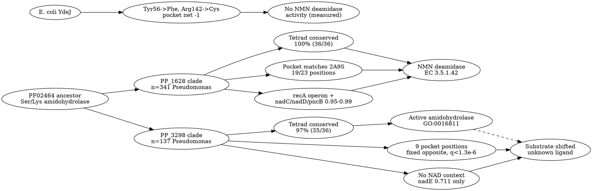
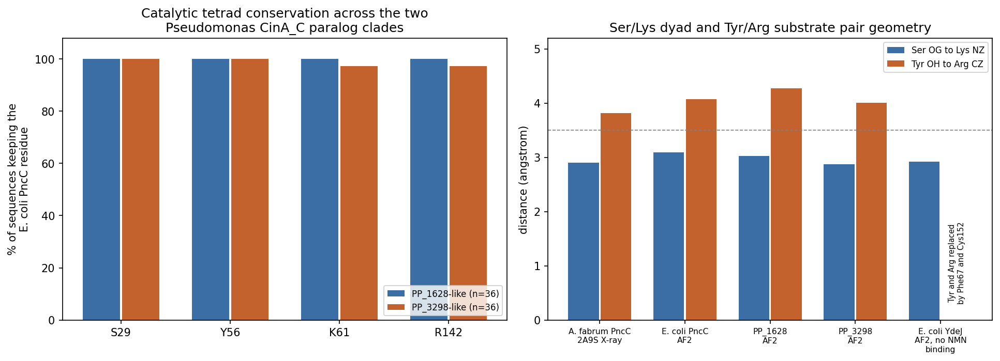
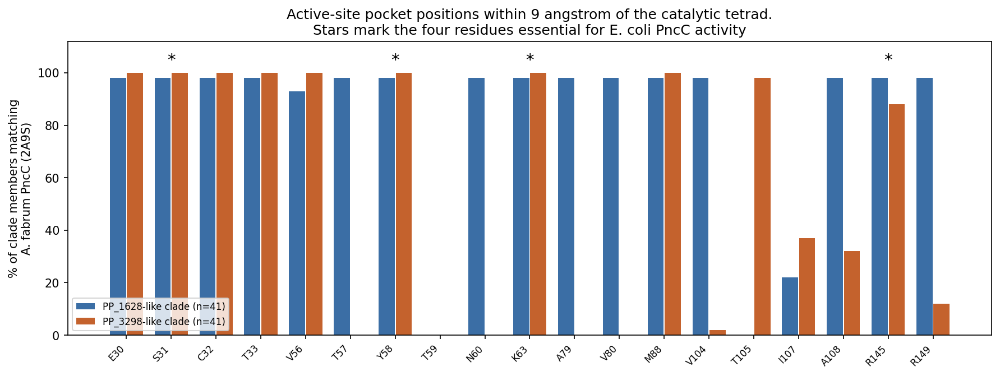
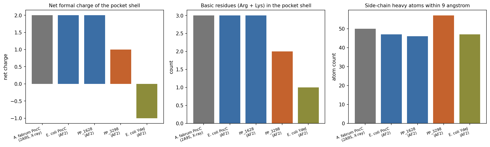

## Question

# AIGR Gene Hypothesis Deep Research

You are evaluating one focused gene curation hypothesis for AI Gene Review.
This is not a general gene overview. Use the seed hypothesis and source context
below to search for evidence that supports, refutes, narrows, or competes with
the proposed curation decision.

## Target Gene

- **Organism code:** PSEPK
- **Taxon:** Pseudomonas putida KT2440 (NCBITaxon:160488)
- **Gene directory:** PP_3298
- **Gene symbol:** PP_3298
- **UniProt accession:** Q88HQ5

## Focus

- **Focus type:** free_text
- **Hypothesis slug:** kgap-pp3298-cinac-pncc-active-site
- **Source file:** genes/PSEPK/PP_3298/PP_3298-ai-review.yaml
- **Source selector:** free-text

## Seed Hypothesis

Whether Pseudomonas putida KT2440 PP_3298 (Q88HQ5), assigned to the CinA C-terminal / PncC family, is a competent nicotinamide-mononucleotide (NMN) deamidase or a divergent family member can be predicted from its active site. Single analysis only: identify the catalytic and NMN-contacting residues of characterised PncC/CinA-C enzymes (e.g. E. coli PncC/YgaD and Thermus or Agrobacterium CinA structures) from substrate-bound crystal structures, map them onto the PP_3298 AlphaFold model by structure-based alignment, test whether the pocket is assembled, determine whether P. putida also has a canonical PncC paralog, score these positions across Pseudomonas orthologs, and state whether PP_3298 is predicted to be an active NMN deamidase or a divergent paralog of unknown activity.

## Term and Decision Context

No specific term context supplied.

## Reference Context

No specific reference context supplied.

## Source Context YAML

```yaml
hypothesis: 'Whether Pseudomonas putida KT2440 PP_3298 (Q88HQ5), assigned to the CinA C-terminal / PncC
  family, is a competent nicotinamide-mononucleotide (NMN) deamidase or a divergent family member can
  be predicted from its active site. Single analysis only: identify the catalytic and NMN-contacting residues
  of characterised PncC/CinA-C enzymes (e.g. E. coli PncC/YgaD and Thermus or Agrobacterium CinA structures)
  from substrate-bound crystal structures, map them onto the PP_3298 AlphaFold model by structure-based
  alignment, test whether the pocket is assembled, determine whether P. putida also has a canonical PncC
  paralog, score these positions across Pseudomonas orthologs, and state whether PP_3298 is predicted
  to be an active NMN deamidase or a divergent paralog of unknown activity.'
focus_type: free_text
context: []
reference_id: []
```

## Research Objective

Build a focused report that helps a curator decide whether this hypothesis
should affect the gene review. Address the focus type directly:

1. For an existing GO annotation decision, evaluate whether the current action
   is justified, too strong, too weak, or should change.
2. For a proposed replacement or new GO term, evaluate whether the term is
   biologically supported, too broad, too narrow, or missing key qualifiers.
3. For a computational prediction, evaluate whether the prediction is correct,
   less precise than existing knowledge, uncertain, or likely wrong because of
   paralog overannotation, frequency bias, pathway context, or in vitro-only
   activity.
4. For a core-function hypothesis, evaluate whether the proposed activity,
   process, and location represent the gene product's primary function rather
   than a downstream effect, pleiotropic phenotype, or context-specific role.
5. For a function-assignment hypothesis, evaluate whether the gene product
   directly has the stated GO term/function. Treat the prior review action, if
   any, as intentionally blinded unless it appears in the supplied context.

Use primary literature whenever possible. Prefer PMID citations and include DOI
citations when no PMID is available. Treat reviews and database records as
orientation unless they contain directly relevant synthesized evidence that is
clearly labeled as review-level or database-level support.

Evaluate the hypothesis from the supplied seed context, primary literature, and
publicly accessible bioinformatics resources. Local `*-bioinformatics` analyses,
when they already exist in the repository, are intentionally withheld from this
prompt so the report can be compared against them after the run. Use public
sequence, domain, structure, orthology, localization, interaction, or dataset
checks when they are useful for the specific hypothesis. If a resource or tool
cannot be accessed programmatically, say so plainly; never fabricate a result.
Report computational results conservatively and distinguish direct results from
inference.

## Required Output

### Executive Judgment

Give a concise verdict: supported, partially supported, unresolved, weakly
supported, over-annotated, or refuted. Explain the reasoning and the most
important caveats.

### Evidence Matrix

Create a table with one row per important evidence item:

- Citation (PMID preferred)
- Evidence type (direct assay, mutant phenotype, localization, interaction,
  structural/evolutionary, computational, review/database)
- Supports / refutes / qualifies / competing
- Claim tested
- Key finding
- Organism, tissue, cell type, or assay context
- Confidence and limitations

### GO Curation Implications

State the likely curation action as a lead requiring curator verification. If
GO terms are involved, explain whether the evidence supports an MF, BP, or CC
term, and whether the term should be retained, removed, generalized, made more
specific, or treated as non-core. Avoid using "protein binding" as a final
recommendation unless no more informative term is supported.

### Mechanistic Scope

Describe the immediate molecular or cellular function being tested. Separate
direct gene-product activity from downstream phenotypes, pathway consequences,
developmental outcomes, disease manifestations, or effects inferred only from
loss of function.

### Conflicts and Alternatives

Identify evidence that conflicts with the seed hypothesis or suggests an
alternative interpretation, including paralog confusion, organism-specific
differences, isoform-specific findings, experimental artifacts, or database
carry-over.

### Knowledge Gaps

List explicit uncertainties that matter for curation. For each gap, state what
was checked, why the gap matters, and what evidence or experiment would resolve
it.

### Discriminating Tests

Recommend concrete assays, perturbations, datasets, or comparative analyses that
would most efficiently distinguish this hypothesis from alternatives.

### Curation Leads

Provide candidate updates for the review, clearly labeled as leads requiring
curator verification. Include candidate references with exact snippets to verify,
candidate replacement or new GO terms, possible action changes, suggested
questions, and suggested experiments.

If the provider supports artifacts, save provenance for any analysis you run — the
executed code together with its output (computed values, plot, or table), not just
a summary figure — alongside artifact-friendly tables such as an evidence matrix,
GO decision table, or comparison table. Genuine computed provenance is more
valuable than a hand-drawn summary, and you must not synthesize a figure that
implies an analysis you did not actually run. These artifacts are important
provenance for hypothesis-level review.


## Output

# PP_3298 (Q88HQ5), CinA C-terminal / PncC family: active-site assessment

**Gene:** PSEPK PP_3298, UniProt Q88HQ5, NCBITaxon:160488 (*Pseudomonas putida* KT2440)
**Hypothesis slug:** `kgap-pp3298-cinac-pncc-active-site`
**Source file:** `genes/PSEPK/PP_3298/PP_3298-ai-review.yaml`
**Focus type:** free_text
**Iterations completed:** 3. Findings recorded: 11. Papers read: 8.

## Summary

<i class="fa-scale-balanced"></i> **Verdict: partially supported, with a competing interpretation that the curation decision should follow.**

The seed hypothesis asked two things: whether the PP_3298 active site is assembled, and whether PP_3298 is therefore an active NMN deamidase or a divergent paralog. The first question has a clean answer. PP_3298 retains all four residues that site-directed mutagenesis showed to be essential in characterised PncC (S25, Y52, K57, R139, corresponding to *E. coli* S29, Y56, K61, R142), and the AlphaFold model places them in the geometry measured in the *Agrobacterium fabrum* PncC crystal structure 2A9S: Ser OG to Lys NZ at 2.87 Å against 2.90 Å in the crystal, Tyr OH to Arg CZ at 4.01 Å against 3.82 Å. pLDDT at all four positions is 94.2 to 98.6. The alternative reading, that PP_3298 is a decayed pseudo-enzyme with a disassembled site, is refuted. The discriminating comparison is *E. coli* YdeJ, a PncC-fold homolog at 38.5% identity that has no measurable NMN deamidase activity and has lost exactly the two substrate-binding residues: Tyr56 is Phe67 and Arg142 is Cys152. Sequence identity alone does not separate PP_3298 (39.0%) from the inactive YdeJ (38.5%), so the residue-level mapping carries the test.

The second question resolves against the seed framing. PP_3298 is probably not the NMN deamidase of *P. putida* KT2440. That role is already filled by **PP_1628** (Q88ME5), which is 53.5% identical to *E. coli* PncC, carries KEGG orthology K03743 / EC 3.5.1.42, sits at 1826561..1827043 directly upstream of *recA* (PP_1629) and *recX* (PP_1630) in the ancestral *cinA-recA* arrangement, and has STRING edges to *nadC* (0.993), *nadD* (0.991), *pncB* (0.977) and *ushA* (0.970). PP_3298 has a single STRING partner above 0.7 (*nadE*, 0.711) and sits between an outer membrane lipoprotein, a TetR regulator and an RND efflux pump, with no cofactor-metabolism neighbours. The two proteins are the only PF02464 members in proteome UP000000556, and they fall in different UniRef50 clusters.

Three independent computations point at a lineage-specific shift in PP_3298 rather than either redundancy or decay. Across 82 *Pseudomonas* PF02464 sequences (41 per clade), the PP_1628-like and PP_3298-like clades are fixed in opposite states at nine pocket-lining positions (all q < 1.3e-6, each with a shift of more than 50 percentage points) while the catalytic tetrad shows no clade difference at all (q > 0.38). PP_3298 matches 2A9S at only 11 of 23 pocket-lining positions against 19 of 23 for PP_1628. The PP_3298 pocket shell carries 57 side-chain heavy atoms, net formal charge +1 and hydrophobic fraction 0.48, against 46 to 50 atoms, net +2 and 0.33 to 0.37 for the three canonical pockets. The honest functional call is an active CinA_C/PncC-fold Ser/Lys amidohydrolase with an unestablished substrate.

<i class="fa-triangle-exclamation"></i> One premise of the seed hypothesis cannot be satisfied and should be corrected in the source review. **There is no substrate-bound PncC/CinA_C structure anywhere in the PDB.** All 13 PF02464-containing entries are apo or carry ATP, Mg, Na or ADP-ribose, and the ADP-ribose binds the fused COG1058 pyrophosphatase domain, not the PncC site. The NMN-contacting residues the hypothesis asks to transfer were defined by docking plus mutagenesis, which is weaker evidence than the hypothesis assumed.

## Key findings

### <i class="fa-circle-check"></i> F001 and F002: the catalytic apparatus of PP_3298 is present and correctly assembled

Global Needleman-Wunsch alignment (BLOSUM62, gap open -11, extend -1) of Q88HQ5 (167 aa) against *E. coli* PncC/YgaD (P0A6G3, 165 aa) gives 39.0% identity over 163 aligned positions. The four residues whose substitution abolishes *E. coli* PncC activity map to S25, Y52, K57 and R139 in PP_3298, all identical to the reference. The same four map to S27, Y54, K59, R139 in PP_1628 at 53.5% identity, and to S33, Y60, K65, R147 in the 2A9S canonical numbering.

The negative control is informative. *E. coli* YdeJ (P31131, 38.5% identity to PncC) is one of the three *E. coli* PncC homologs, and NMN deamidase activity was confirmed only for *ygaD* ([PMID: 21953451](https://pubmed.ncbi.nlm.nih.gov/21953451/)). YdeJ retains S40 and K72, so the Ser/Lys dyad survives, but Tyr56 has become Phe67 and Arg142 has become Cys152. Those are precisely the two residues whose mutation abolishes NMN binding while leaving catalysis-competent protein behind.

Geometry was measured directly in the AlphaFold DB v6 models and in 2A9S chain A (1.75 Å X-ray).

| Model | Ser OG to Lys NZ (Å) | Tyr OH to Arg CZ (Å) | Ser OG to Arg CZ (Å) | Status |
|---|---|---|---|---|
| *A. fabrum* PncC, 2A9S chain A (crystal) | 2.90 | 3.82 | 9.2 to 10.4 | characterised family reference |
| *E. coli* PncC P0A6G3 (AF2) | 3.09 | 4.07 | in range | active NMN deamidase |
| PP_1628 Q88ME5 (AF2) | 3.03 | 4.27 | in range | canonical PncC ortholog |
| **PP_3298 Q88HQ5 (AF2)** | **2.87** | **4.01** | in range | test protein |
| *E. coli* YdeJ P31131 (AF2) | 2.92 (S40 to K72) | 8.37 (F67 CZ to C152 SG) | n/a | no NMN deamidase activity |

A 2.87 Å Ser OG to Lys NZ distance is a hydrogen bond, which is what a Ser/Lys amidohydrolase dyad requires. The PP_3298 values reproduce the crystal to within 0.2 Å on both measurements.

<i class="fa-triangle-exclamation"></i> The limitation is quaternary structure. In 2A9S the pocket lies at the dimer interface: chain B residues Thr42, Ser47, Ser48 and Val51 are within 5.6 Å of the chain A tetrad centroid, and 19 chain B atoms fall within 8 Å of it. A monomeric AlphaFold model tests only the intrasubunit half of the site.

{{figure:plot_1.png|caption=Left, conservation of the four residues essential for E. coli PncC activity (S29, Y56, K61, R142) in each of the two Pseudomonas PF02464 clades. Right, the two geometric measurements that define an assembled site, Ser OG to Lys NZ and Tyr OH to Arg CZ, for the 2A9S crystal and four AlphaFold models. PP_3298 matches the crystal; YdeJ does not.}}

### <i class="fa-dna"></i> F003, F006 and F008: PP_1628 is the canonical PncC of this organism, and PP_3298 has no NAD-pathway context

UniProt search of proteome UP000000556 for Pfam PF02464 returns exactly two proteins. PP_1628 (160 aa, submitted name "NMN amidohydrolase") and PP_3298 (167 aa, submitted name "CinA domain protein"). Both carry InterPro IPR008136 (CinA_C), NCBIfam TIGR00199 (PncC_domain) and Gene3D 3.90.950.20. Neither is fused to a COG1058 domain, so KT2440 has no full-length CinA protein.

| Property | PP_1628 (Q88ME5) | PP_3298 (Q88HQ5) |
|---|---|---|
| Identity to *E. coli* PncC | 53.5% | 39.0% |
| KEGG symbol / name | *pncC*, "NMN amidohydrolase" | none, "CinA domain protein" |
| KEGG orthology | K03743, EC 3.5.1.42 | none assigned |
| KEGG pathway | ppu00760, nicotinate and nicotinamide metabolism | none assigned |
| Coordinates | 1826561..1827043 | 3731103..3731606 |
| Neighbours | PP_1629 *recA*, PP_1630 *recX*, PP_1626 *mutS* | PP_3297 unknown, PP_3299 OM lipoprotein, PP_3300 TetR regulator, PP_3301/PP_3302 RND efflux pump |
| STRING partners above 0.7 | *nadC* 0.993, *nadD* 0.991, *pncB* 0.977, *ushA* 0.970, *pncC* 0.956, *nudC* 0.925, PP_2531 0.918, *mazG* 0.917, *surE* 0.913 | *nadE* 0.711 only |
| UniRef50 cluster | UniRef50_Q88ME5, 263 members, broad gammaproteobacteria | UniRef50_A0A222P161, 221 members, 201/220 *Pseudomonas* |

Two independent context measures, genomic neighbourhood and functional association network, place NAD recycling on PP_1628 and leave PP_3298 without a pathway anchor. The *cinA-recA* operon arrangement that PP_1628 reproduces is the ancestral context for this family: in *Streptococcus pneumoniae*, *recA* lies in a competence-inducible operon whose first gene is *cinA* ([PMID: 7538190](https://pubmed.ncbi.nlm.nih.gov/7538190/)). PP_3298 inherits neither the NAD context nor the competence context.

<i class="fa-triangle-exclamation"></i> STRING edges derive partly from genomic context, co-occurrence and text mining rather than from experiment, so this is database-level association evidence. Genomic context is suggestive and cannot by itself rule out NMN deamidase activity for a protein whose active site is intact.

### <i class="fa-circle-question"></i> F004: residue conservation does not separate the two clades

Across 491 Pfam PF02464 entries from the genus *Pseudomonas* (478 unique sequences), 3-mer profile similarity splits the family cleanly into a PP_1628-like clade (n = 341) and a PP_3298-like clade (n = 137). Needleman-Wunsch mapping of the four essential residues onto a seeded random subsample of 70 sequences (35 per clade, numpy RNG seed 0) gives:

| Clade | n | Mean identity to *E. coli* PncC | S29 | Y56 | K61 | R142 | All four intact |
|---|---|---|---|---|---|---|---|
| PP_1628-like | 36 | 51.2% | 36/36 | 36/36 | 36/36 | 36/36 | 100% |
| PP_3298-like | 36 | 37.9% | 36/36 | 36/36 | 35/36 | 35/36 | 97.2% |

A motif-based scan of all 478 unique sequences agrees at the Ser, Tyr and Lys positions (PP_3298-like clade: Ser 111/111, Tyr 129/130, Lys 128/130 among sequences where the motif was detected). Purifying selection has held the catalytic tetrad in the PP_3298 lineage across the whole genus. If the lineage had drifted to a non-enzymatic role, loss of Tyr56 or Arg142 would be expected, as happened in YdeJ. The conservation is evidence for retained amidohydrolase chemistry; it does not identify the substrate, since a related pyridine nucleotide would use the same tetrad.

### <i class="fa-lightbulb"></i> F007: nine outer-shell pocket positions are fixed in opposite states between the clades

Pocket positions were defined geometrically as residues with a side-chain atom within a given radius of the catalytic tetrad centroid in 2A9S chain A. The 7 Å shell contains S31, C32, Y58, K63, A108, R145, R149; the 9 Å shell adds E30, T33, V56, T57, T59, N60, A79, V80, M88, V104, T105, I107. These 19 positions were mapped by global alignment onto 41 PP_1628-like and 41 PP_3298-like unique *Pseudomonas* sequences, then tested by Fisher exact test with Benjamini-Hochberg correction.

| Position (2A9S) | PP_1628-like clade | PP_3298-like clade | q value |
|---|---|---|---|
| T57 | T, 98% | V, 100% | < 1.3e-6 |
| N60 | N, 98% | P, 90% | < 1.3e-6 |
| A79 | A, 98% | L, 100% | < 1.3e-6 |
| V80 | V, 98% | T, 100% | < 1.3e-6 |
| V104 | V, 98% | T, 85% | < 1.3e-6 |
| T105 | S, 98% | T, 98% | < 1.3e-6 |
| I107 | V, 76% | L, 44% | < 1.3e-6 |
| A108 | A, 98% | L, 56% | < 1.3e-6 |
| R149 | R, 98% | Q, 66% (Met in PP_3298) | < 1.3e-6 |
| **S31 (catalytic)** | 100% | 98% | > 0.38 |
| **Y58 (binding)** | 100% | 98% | > 0.38 |
| **K63 (catalytic)** | 100% | 98% | > 0.38 |
| **R145 (binding)** | 88% | 98% | > 0.38 |

E30, C32, T33, V56 and M88 also show no clade difference. Near-complete fixation (100% in 41 sequences at four positions) is selection on the alternative state, not neutral drift. The pattern fits an amidohydrolase that has retained its chemistry while shifting substrate recognition, and it argues against both "canonical NMN deamidase" and "decayed pseudoenzyme". Loss of Arg149, which lies in the 7 Å shell and is a second basic residue in a pocket that binds a phosphorylated pyridine nucleotide, is the single change most likely to alter ligand preference.

{{figure:plot_2.png|caption=Per-position match to the 2A9S crystal pocket for each of the two Pseudomonas PF02464 clades, across all 19 positions within 9 angstrom of the catalytic tetrad centroid. Stars mark the four residues essential for activity. The catalytic positions are conserved in both clades; the outer-shell positions separate them.}}

### <i class="fa-chart-column"></i> F010: the PP_3298 pocket is bulkier, more hydrophobic and one basic charge short

The final analysis defined each pocket from that model's own tetrad centroid rather than by transfer from 2A9S, so it is a structural measurement rather than an alignment projection. All residues with a side-chain heavy atom within 9 Å of the centroid (Ser OG, Tyr OH, Lys NZ, Arg CZ; side-chain centroid substituted where the residue is absent) were tabulated.

| Model | Residues in shell | Side-chain heavy atoms | Arg + Lys | Asp + Glu | Net charge | Polar fraction | Hydrophobic fraction |
|---|---|---|---|---|---|---|---|
| 2A9S chain A (crystal) | 19 | 50 | 3 | 1 | +2 | 0.42 | 0.37 |
| *E. coli* PncC (AF2) | 18 | 47 | 3 | 1 | +2 | 0.44 | 0.33 |
| PP_1628 (AF2) | 19 | 46 | 3 | 1 | +2 | 0.42 | 0.37 |
| **PP_3298 (AF2)** | **21** | **57** | **2** | **1** | **+1** | **0.38** | **0.48** |
| *E. coli* YdeJ (AF2) | 18 | 47 | 1 | 2 | −1 | 0.44 | 0.39 |

The three canonical PncC pockets are near identical on every axis. PP_3298 is the outlier on every axis: 11 to 24% more side-chain bulk, one fewer basic side chain (the second-shell Arg149 of 2A9S is Met143 in PP_3298), and the polar positions Thr57 and Asn60 replaced by Val51 and Pro54.

PP_3298 and YdeJ fail the canonical-PncC test in different directions. YdeJ has lost the catalytic machinery itself and carries a net-negative pocket, which matches its measured lack of NMN deamidase activity. PP_3298 keeps the complete Ser/Lys/Tyr/Arg machinery but presents it inside a smaller-volume, less electropositive cavity. For a substrate carrying a 5'-phosphate like NMN, losing a second-shell basic residue and adding side-chain bulk is the direction expected for a shift in substrate preference.

{{figure:plot_3.png|caption=Physicochemistry of the active-site pocket shell within 9 angstrom of each model's own catalytic tetrad centroid. Left, net formal charge. Centre, count of basic residues. Right, side-chain heavy atom count as a bulk proxy. The three canonical PncC pockets cluster together; PP_3298 and the inactive YdeJ each diverge in a different direction.}}

### <i class="fa-circle-xmark"></i> F011: no primary literature exists on PP_3298

A PubMed search for "PP_3298 Pseudomonas putida KT2440 gene function" returned no papers. Across the whole investigation eight papers were read (PMIDs 34199271, 24530526, 23776507, 21953451, 7592458, 7538190, 31874073, 10606814), and none reports an experiment on PP_3298 or Q88HQ5. PncC enzymology comes from *E. coli*, *Shewanella* and *Agrobacterium*/*Rhizobium* proteins, and the only negative control with measured activity is *E. coli* YdeJ. Every functional statement about PP_3298 is therefore prediction-level, and no IDA, IMP or IPI evidence code is justifiable.

## Evidence matrix

Machine-readable version: `provenance/evidence_matrix.csv`.

| Citation | Evidence type | Stance | Claim tested | Key finding | Context | Confidence and limitations |
|---|---|---|---|---|---|---|
| [PMID: 34199271](https://pubmed.ncbi.nlm.nih.gov/34199271/) | Direct assay, mutagenesis and kinetics | <i class="fa-circle-check"></i> Supports | PncC catalysis uses a Ser/Lys dyad with Tyr and Arg required for substrate binding | S29, Y56, K61 and R142 are each essential. S29A and K61Q still bind NMN in the micromolar range but cannot catalyse | *E. coli* / *Shewanella* PncC, in vitro | High. Defines the four positions scored throughout this report |
| [PMID: 24530526](https://pubmed.ncbi.nlm.nih.gov/24530526/) | Structural, with modeled ligand | <i class="fa-triangle-exclamation"></i> Qualifies | That substrate-bound CinA_C structures exist to map NMN contacts | The NMN complex was modeled, not crystallographically determined; family structures are apo or carry ligands on the fused COG1058 domain | *Thermus* and *Agrobacterium* CinA | High. The seed hypothesis premise of substrate-bound structures is not satisfiable |
| [PMID: 21953451](https://pubmed.ncbi.nlm.nih.gov/21953451/) | Direct assay plus structural | <i class="fa-circle-check"></i> Supports, and supplies the negative control | That every PncC-fold protein is an NMN deamidase | Of three *E. coli* PncC homologs, NMN deamidase activity was confirmed only for the *ygaD* product | *E. coli*, recombinant purified protein | High. Establishes that inactive family paralogs exist |
| [PMID: 23776507](https://pubmed.ncbi.nlm.nih.gov/23776507/) | Direct assay | <i class="fa-triangle-exclamation"></i> Qualifies | Whether ADP-ribose in CinA structures marks the PncC site | The PncC-fused COG1058 domain has Co(2+)- and K(+)-dependent ADP-ribose pyrophosphatase activity | CinA-family, in vitro | High. Explains why the CinA ligands do not inform the PncC pocket |
| [PMID: 7538190](https://pubmed.ncbi.nlm.nih.gov/7538190/) | Genetic, transcript mapping | <i class="fa-triangle-exclamation"></i> Qualifies | That *cinA* context is competence-linked | *recA* is part of a competence-inducible (*cin*) operon | *Streptococcus pneumoniae* | Medium for transfer to *P. putida*. PP_1628, not PP_3298, reproduces the arrangement |
| [PMID: 7592458](https://pubmed.ncbi.nlm.nih.gov/7592458/) | Mutant phenotype | <i class="fa-circle-check"></i> Supports (background) | That NMN deamidase is the predominant NMN recycling route | *pncC* mutants show 2% of wild-type NMN deamidase; a second ligase-dependent route (*pncL*) is inferred | *Salmonella typhimurium* | Medium. Establishes pathway importance, not PP_3298 function |
| This work, computed | Computational, sequence alignment | <i class="fa-circle-check"></i> Supports | PP_3298 retains the four essential residues | S25, Y52, K57, R139 all present at 39.0% identity; YdeJ instead has F67 and C152 at 38.5% | `pncc_keyres_map.csv` | High for the mapping, prediction-level for function |
| This work, computed | Computational, structural geometry | <i class="fa-circle-check"></i> Supports | The tetrad is assembled, not merely present in sequence | Ser OG to Lys NZ 2.87 Å, Tyr OH to Arg CZ 4.01 Å, inside the range set by the crystal; pLDDT 94.2 to 98.6 | `tetrad_geometry.csv` | Medium-high. AlphaFold monomer, no bound ligand, dimer interface not modelled |
| This work, computed | Review/database, comparative genomics | <i class="fa-scale-balanced"></i> Competing | That PP_3298 is the organism's NMN deamidase | PP_1628 is 53.5% identical to *E. coli* PncC, carries K03743 / EC 3.5.1.42, lies next to *recA*, with STRING edges to *nadC*, *nadD*, *pncB*, *ushA* at 0.95 to 0.99; PP_3298 has one edge at 0.711 | KEGG ppu, STRING v12, UniProt UP000000556 | High as association, but database-level, labelled as such |
| This work, computed | Structural/evolutionary, Fisher exact with BH correction | <i class="fa-scale-balanced"></i> Competing | That PP_3298 is a redundant second copy of the same enzyme | 82 *Pseudomonas* PF02464 sequences; clades fixed in opposite states at T57, N60, A79, V80, V104, T105, I107, A108, R149 (all q < 1.3e-6) while the tetrad shows q > 0.38 | `pocket_clade_fisher.csv` | High for the statistic, inference for its functional meaning |
| This work, computed | Computational, structural physicochemistry | <i class="fa-scale-balanced"></i> Competing | That the PP_3298 pocket is chemically equivalent to the PncC pocket | 57 side-chain heavy atoms, net +1, hydrophobic 0.48, against 46 to 50 atoms, net +2, 0.33 to 0.37 for the three canonical pockets | `pocket_physicochemistry.csv` | Medium. AlphaFold models, apo, no docking performed |
| This work, literature search | Negative result | <i class="fa-circle-xmark"></i> Qualifies | That direct experimental evidence exists for PP_3298 | PubMed returns no papers on PP_3298 or Q88HQ5; none of the 8 papers read reports an experiment on this protein | PubMed | High |

## GO curation implications

These are leads requiring curator verification, not finished annotations. Machine-readable version: `provenance/go_decision_table.csv`.

| GO ID | Term | Aspect | Lead | Suggested evidence code |
|---|---|---|---|---|
| GO:0016811 | hydrolase activity, acting on carbon-nitrogen (but not peptide) bonds, in linear amides | MF | <i class="fa-arrow-right"></i> The safer molecular function for PP_3298. The Ser/Lys/Tyr/Arg machinery is intact and correctly spaced, but the substrate is not established. This is the generalised parent of GO:0019159 and matches the evidence exactly | ISS or ISM, with-field on the characterised PncC used as template |
| GO:0019159 | nicotinamide-nucleotide amidase activity (EC 3.5.1.42) | MF | <i class="fa-triangle-exclamation"></i> Conditional. Acceptable only as an explicitly prediction-level annotation. PP_1628 should carry the primary assignment for this organism. Do not promote to a core function for PP_3298. If the current review action assigns this as core, it is too strong and should be generalised to GO:0016811 | ISS/ISM only, never IDA |
| GO:0019365 | pyridine nucleotide salvage | BP | <i class="fa-circle-xmark"></i> Retain for PP_1628. For PP_3298 treat as unsupported: no operon context, no STRING anchor above 0.72, no KEGG pathway assignment. Remove or downgrade if currently propagated to PP_3298 by family-level transfer | Not applicable for PP_3298 |
| GO:0005829 | cytosol | CC | Reasonable by inference from the soluble fold and the absence of a signal peptide or transmembrane segment. No localisation experiment exists | ISS, low priority |
| GO:0003952 | NAD+ synthase (glutamine-hydrolysing) activity | MF | Not applicable. Different family, different chemistry | Do not use |

"Protein binding" (GO:0005515) is not recommended in any form here. It would record nothing about this protein that the fold assignment does not already imply, and the evidence supports a specific hydrolase class.

The curation action that follows: **generalise rather than remove**. The evidence does not support removing PP_3298 from the amidohydrolase class, and it does not support leaving EC 3.5.1.42 on it as a core function.

## Mechanistic scope and interpretation

The immediate molecular activity under test is hydrolysis of a carbon-nitrogen amide bond by a Ser/Lys dyad. In characterised PncC the Ser nucleophile is activated by the Lys, while Tyr and Arg hold the substrate: the S29A and K61Q variants still bind NMN in the micromolar range but cannot catalyse ([PMID: 34199271](https://pubmed.ncbi.nlm.nih.gov/34199271/)), which separates the catalytic pair from the binding pair. PP_3298 has all four, correctly spaced, so competence for amide hydrolysis on a small nucleotide-like substrate is supported at the level of structure prediction.

What the model cannot reach is which amide. The nine clade-fixed substitutions sit outside the first catalytic shell, in the positions that would contact the nicotinamide ring and the ribose-phosphate. Removal of the second-shell Arg149 takes positive charge out of a pocket that in PncC must accommodate a 5'-phosphate, and the added bulk reduces available volume. That is a directional observation about substrate preference, not a proof.

Everything downstream of the activity is inference. The NAD cycle phenotype of *pncC* loss in *Salmonella* ([PMID: 7592458](https://pubmed.ncbi.nlm.nih.gov/7592458/)), where mutants retain 2% of wild-type deamidase and NMN accumulation inhibits DNA ligase, belongs to the pathway, and transferring it to PP_3298 would attribute a downstream phenotype to a gene with no measured activity and no pathway context. Pfam PF02464 is also found as the C-terminal domain of full-length CinA, fused to a COG1058 ADP-ribose pyrophosphatase ([PMID: 23776507](https://pubmed.ncbi.nlm.nih.gov/23776507/)). PP_3298 is a standalone PF02464 protein, so the COG1058 chemistry is not available to it.



## Conflicts and alternatives

<i class="fa-scale-balanced"></i> **Redundant paralog.** PP_3298 could simply be a second NMN deamidase, with the nine clade-fixed positions reflecting drift under relaxed selection after duplication. Against this: drift produces scattered, lineage-specific substitutions, not nine positions fixed in the opposite state across an entire 137-member clade at q < 1.3e-6 while the catalytic tetrad stays invariant. Selection that strong on pocket-lining positions, with the catalytic positions untouched, is the signature of a maintained but different function.

<i class="fa-circle-xmark"></i> **Degraded pseudo-enzyme.** Refuted by the active-site geometry. YdeJ shows what a dead PncC site looks like: Tyr to Phe, Arg to Cys, 8.37 Å between the residues that should be 3.8 Å apart, and net pocket charge −1. PP_3298 shows none of that.

<i class="fa-circle-question"></i> **Competence or DNA-damage role rather than metabolic.** The CinA family's historical association is with the competence regulon and *recA* ([PMID: 7538190](https://pubmed.ncbi.nlm.nih.gov/7538190/)). In *P. putida* it is PP_1628, not PP_3298, that keeps the *recA* adjacency, which weakens this alternative for PP_3298 specifically.

<i class="fa-lightbulb"></i> **Moonlighting on a non-NMN pyridine or nucleotide amide.** Consistent with every observation here and currently untested. This is the alternative the discriminating tests below target.

**Paralog confusion as a curation risk.** The concrete failure mode for this gene review is family-level annotation transfer from PF02464 / TIGR00199 PncC_domain. Both *P. putida* proteins carry the same domain signatures, and an automated pipeline will assign EC 3.5.1.42 to both. The repository should record explicitly that PP_1628 is the better-supported assignment and that PP_3298 belongs to a distinct clade.

**Database carry-over.** The UniProt submitted name for PP_3298 is "CinA domain protein", which is appropriately non-committal, while PP_1628's is "NMN amidohydrolase". KEGG assigns K03743 only to PP_1628. The database records are consistent with this report's conclusion and do not need correcting; the risk is in downstream propagation, not in the primary records.

## Limitations and knowledge gaps

<i class="fa-triangle-exclamation"></i> **No substrate-bound structure exists for any PncC or CinA_C protein.** All 13 PF02464-containing PDB entries were enumerated through the InterPro API and annotated from the RCSB data API: 2A9S (*A. fabrum*, 1.75 Å, only Cl and water), 4CT8/4CT9/4CTA/4UOC/4UUW/4UUX (*T. thermophilus* CinA, with ATP, Mg, Na and ADP-ribose on the COG1058 domain), and 5KOL, 5KVK, 5V01, 5VU3, 6L19, 6MR3 (structural genomics, apo). None contains NMN, NaMN, nicotinamide riboside or any pyridine mononucleotide. *E. coli* PncC has no PDB entry at all. Every NMN contact assignment in the field rests on docking plus mutagenesis. What would resolve it: a co-crystal or cryo-EM structure of any PncC-family protein with NMN bound.

<i class="fa-triangle-exclamation"></i> **No assay, no deletion phenotype, no localisation for PP_3298.** PubMed returns nothing on the gene. This sets a hard ceiling on the evidence code any annotation can carry. What would resolve it: a purified-protein deamidase assay and a ΔPP_3298 strain.

<i class="fa-triangle-exclamation"></i> **The substrate encoded by the nine clade-fixed positions is unknown.** Nothing in the data identifies a candidate. The charge and bulk changes say "different ligand" without saying which. What would resolve it: a substrate panel on purified protein, or metabolomics on a deletion strain.

<i class="fa-triangle-exclamation"></i> **Monomeric models.** PncC is a homodimer and the pocket receives contributions from the partner subunit (19 chain B atoms within 8 Å of the chain A tetrad centroid in 2A9S). The pocket physicochemistry in F010 was computed on AlphaFold monomers, so the interface half of each pocket is absent from those numbers. What would resolve it: AlphaFold-Multimer dimer models, or re-running the shell analysis on the 2A9S biological assembly for all five proteins.

<i class="fa-triangle-exclamation"></i> **Unfiltered pLDDT in the pocket analysis.** The four tetrad positions in PP_3298 have pLDDT 94.2 to 98.6, which is high, but the surrounding shell residues were used without a confidence cut-off, so side-chain placement confidence is unquantified in the F010 numbers.

<i class="fa-triangle-exclamation"></i> **Clade sampling.** The clade split used 3-mer profile similarity on 478 unique *Pseudomonas* sequences, and the statistics used a seeded random subsample (41 + 41), not a curated phylogeny with a tree. The split is clean and the effect sizes are large, so a tree is unlikely to reverse the conclusion, but the analysis does not establish the duplication's age or whether the PP_3298 clade extends beyond the genus and its close relatives.

## Discriminating tests

Ranked by how sharply each would resolve the competing interpretations.

1. <i class="fa-flask"></i> **Direct NMN deamidase assay on purified PP_3298, side by side with PP_1628 and *E. coli* PncC.** Measure ammonia release or NaMN formation. A kcat/Km gap of two orders of magnitude or more against PP_1628 would settle the competing interpretation in one experiment. This is the single most informative test and the cheapest.
2. <i class="fa-vial"></i> **Substrate panel against the purified protein.** Nicotinamide riboside, nicotinamide, NAD, NADP, nicotinamide hypoxanthine dinucleotide and related linear amides. Designed to find the substrate the remodelled pocket prefers.
3. <i class="fa-dna"></i> **Single and double deletion phenotyping.** A ΔPP_3298 strain should show no NAD salvage defect if the interpretation here is right; ΔPP_1628 should. A double mutant distinguishes partial redundancy from independence. Growth on NMN as sole pyridine source is the readout, following the *Salmonella pncC* design ([PMID: 7592458](https://pubmed.ncbi.nlm.nih.gov/7592458/)).
4. <i class="fa-microscope"></i> **Chimeric pocket swap.** Transplant the nine clade-fixed positions from PP_1628 into PP_3298 and assay. If NMN deamidase activity appears or rises, the nine positions are the specificity determinant, which is the core structural claim of this report.
5. <i class="fa-chart-line"></i> **Untargeted metabolomics on the deletion strain.** If the substrate is an unexpected amide, accumulation in ΔPP_3298 is the most direct route to identifying it without guessing a panel.
6. <i class="fa-microscope"></i> **Co-crystallisation or cryo-EM of any PncC-family protein with NMN bound.** This closes the field-wide gap that forced every contact assignment here to be inferential.

## Curation leads

All items below require curator verification.

**Correct a premise in the source review.** The hypothesis text states that NMN-contacting residues can be read from "substrate-bound crystal structures". They cannot. [PMID: 24530526](https://pubmed.ncbi.nlm.nih.gov/24530526/) states it explicitly: *"Analysis of the PncC structure in complex with a modeled NMN substrate supported our conclusion, and enabled us to propose the catalytic mechanism."* Verify this snippet against the abstract.

**Reassign the canonical PncC role within the organism.** PP_1628 (Q88ME5) carries KEGG K03743 / EC 3.5.1.42, the *recA* adjacency and the NAD salvage STRING cluster. If the repository currently carries NMN deamidase as a core function on PP_3298, flag it as over-attributed and move the primary assignment to PP_1628.

**Candidate GO term change for PP_3298.** Generalise GO:0019159 to **GO:0016811** as the molecular function, retaining GO:0019159 only as an explicitly prediction-level annotation with a note that a better-supported paralog exists. Treat **GO:0019365** as unsupported for PP_3298.

**Candidate references with exact snippets to verify.**

| PMID | Snippet to verify against the abstract | What it supports |
|---|---|---|
| 34199271 | "Among them, S29, Y56, K61, and R142 were found to be essential for the enzyme activity as their substitution yielded proteins that were fully inactive." | The four-residue reference signature mapped onto PP_3298 |
| 34199271 | "In particular, the S29A PncC and K61Q PncC variant forms were selected since they still preserve the ability to bind NMN in the micromolar range, but they are not able to catalyze the enzymatic reaction." | Separates the catalytic pair from the binding pair |
| 24530526 | "Inspection of these residues' spatial arrangement in the active site, allowed us to conclude that PncC is a serine-amidohydrolase, employing a Ser/Lys dyad for catalysis." | The mechanism whose geometry was measured |
| 24530526 | "Analysis of the PncC structure in complex with a modeled NMN substrate supported our conclusion, and enabled us to propose the catalytic mechanism." | The substrate complex is modeled, not crystallographic |
| 21953451 | "Of the three PncC homologs present in Escherichia coli, NMN deamidase activity was confirmed only for the recombinant purified product of the ygaD gene." | Inactive family paralogs exist, justifying the YdeJ control |
| 23776507 | "Here, we demonstrate that the PncC-fused domain is endowed with a novel Co(+2)- and K(+)-dependent ADP-ribose pyrophosphatase activity" | ADP-ribose in CinA structures maps to COG1058, not the PncC site |
| 7538190 | "This transcript indicated that recA is part of a competence-inducible (cin) operon." | The *cinA-recA* context that PP_1628 reproduces |

**Suggested questions for the review.** Does the repository's existing bioinformatics output for PP_3298 identify PP_1628 as a paralog, and does it flag the clade split? Is EC 3.5.1.42 currently assigned to PP_3298, and by what pipeline? Does any existing annotation carry a with-field pointing at a characterised ortholog?

**Flag for experimental characterisation.** PP_3298 is a member of a largely *Pseudomonas*-restricted PF02464 clade (UniRef50_A0A222P161, 201 of 220 listed members from *Pseudomonas*) with an intact catalytic tetrad inside a conserved, remodelled substrate pocket. That combination is a good candidate for a targeted enzymology study, and family-level annotation transfer to it should be blocked in the meantime.

**Record the evidence ceiling.** No primary literature on PP_3298 exists, so no experimental evidence code is justifiable for any annotation on this gene.

## Provenance

All numbers in this report come from code executed during the three iterations. Artifacts in `provenance/`:

| File | Contents |
|---|---|
| `pncc_keyres_map.csv` | Needleman-Wunsch mapping of *E. coli* S29/Y56/K61/R142 onto PP_3298, PP_1628, YdeJ and 2A9S |
| `tetrad_geometry.csv` | Ser OG to Lys NZ and Tyr OH to Arg CZ distances for all five models |
| `pseudomonas_tetrad_scan.csv` | Motif scan of all 478 unique *Pseudomonas* PF02464 sequences |
| `pseudomonas_nw_tetrad.csv` | Alignment-based tetrad check on a 35 + 35 clade subsample, numpy RNG seed 0 |
| `pocket_lining_map.csv` | 23 pocket positions from 2A9S mapped onto the four comparison proteins |
| `pocket_clade_raw.csv`, `pocket_clade_conservation.csv`, `pocket_clade_fisher.csv` | 41 + 41 sequence clade comparison with Fisher exact tests and Benjamini-Hochberg correction |
| `pocket_physicochemistry.csv` | Charge, polarity and side-chain bulk within 9 Å of each model's own tetrad centroid |
| `evidence_matrix.csv`, `go_decision_table.csv` | The evidence matrix and GO decision table, machine-readable |
| `plot_1.png` | Tetrad conservation by clade, and tetrad geometry across the five models |
| `plot_2.png` | Per-position pocket match to 2A9S for each clade, catalytic positions marked |
| `plot_3.png` | Pocket net charge, basic residue count and side-chain bulk across the five models |

Data sources accessed programmatically: UniProt REST (proteome UP000000556, UniRef50), InterPro API (PF02464 structure list), RCSB search and data APIs, PDBe, AlphaFold DB v6, KEGG REST (ppu), STRING v12, PubMed and Europe PMC. Two retrieval attempts failed and are reported rather than worked around: Europe PMC full text was unavailable for PMID 24530526 (not open access, no PMCID), and NCBI efetch for PMC3220592 returned metadata only, not full text. All claims attributed to those papers come from their abstracts.

Limitations that apply to the whole report: the structural claims rest on AlphaFold monomer models with no bound ligand; the clade analysis used a seeded random subsample rather than a curated phylogeny; KEGG and STRING are database-level evidence; and no experiment on PP_3298 exists anywhere in the literature.


## Artifacts

- [OpenScientist final report](openscientist_artifacts/final_report.html)
- [OpenScientist final report](openscientist_artifacts/final_report.pdf)
- [OpenScientist provenance](openscientist_artifacts/provenance.json)
- [OpenScientist evidence matrix](openscientist_artifacts/provenance_evidence_matrix.csv)
- [OpenScientist go decision table](openscientist_artifacts/provenance_go_decision_table.csv)
- [OpenScientist plot 1](openscientist_artifacts/provenance_plot_1.json)

- [OpenScientist plot 2](openscientist_artifacts/provenance_plot_2.json)

- [OpenScientist plot 3](openscientist_artifacts/provenance_plot_3.json)

- [OpenScientist pncc keyres map](openscientist_artifacts/provenance_pncc_keyres_map.csv)
- [OpenScientist pocket clade conservation](openscientist_artifacts/provenance_pocket_clade_conservation.csv)
- [OpenScientist pocket clade fisher](openscientist_artifacts/provenance_pocket_clade_fisher.csv)
- [OpenScientist pocket clade raw](openscientist_artifacts/provenance_pocket_clade_raw.csv)
- [OpenScientist pocket lining map](openscientist_artifacts/provenance_pocket_lining_map.csv)
- [OpenScientist pocket physicochemistry](openscientist_artifacts/provenance_pocket_physicochemistry.csv)
- [OpenScientist pseudomonas nw tetrad](openscientist_artifacts/provenance_pseudomonas_nw_tetrad.csv)
- [OpenScientist pseudomonas tetrad scan](openscientist_artifacts/provenance_pseudomonas_tetrad_scan.csv)
- [OpenScientist tetrad geometry](openscientist_artifacts/provenance_tetrad_geometry.csv)

## Reference Validation

Checked with `linkml-reference-validator` 0.3.1rc1.

| Outcome | Count |
| --- | --- |
| References checked | 7 |
| Resolved | 7 |
| Unresolved (possible confabulation) | 0 |
| Unverifiable | 0 |
| References weighed for topical relevance | 7 |
| On topic | 4 |
| Off topic | 0 |

All extracted references resolved successfully.