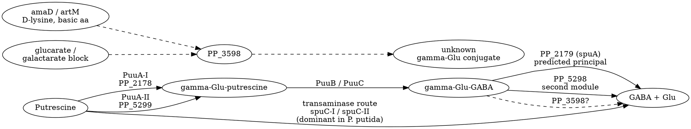
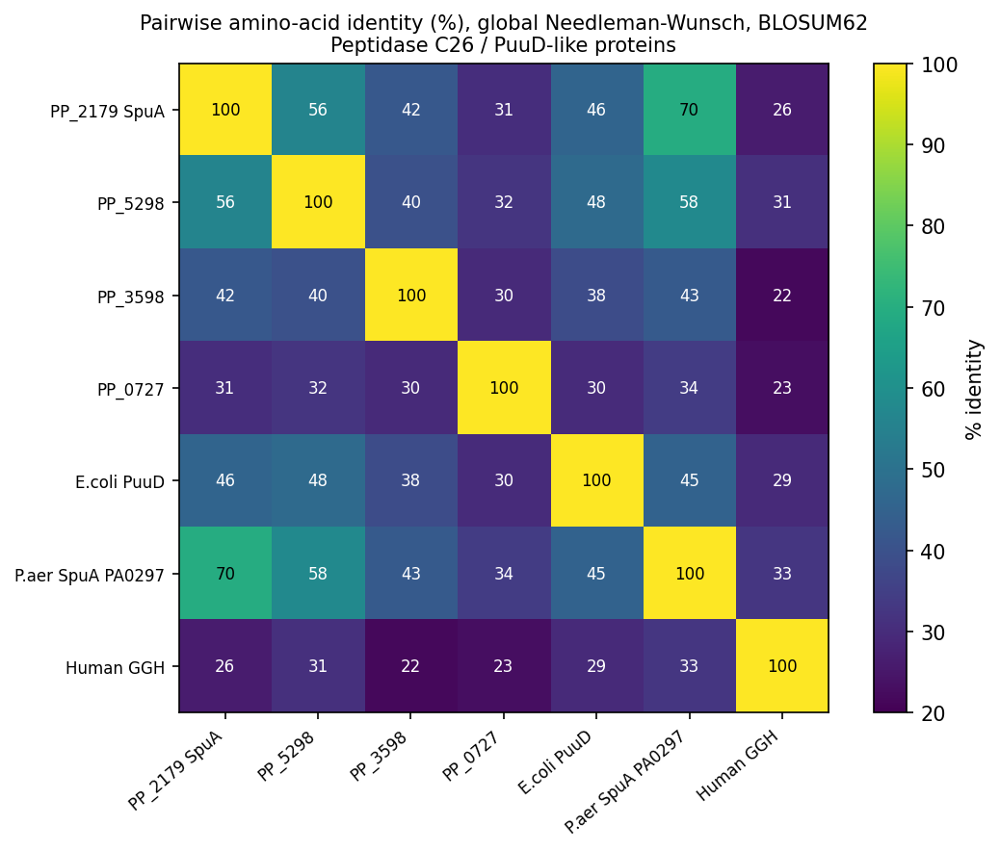
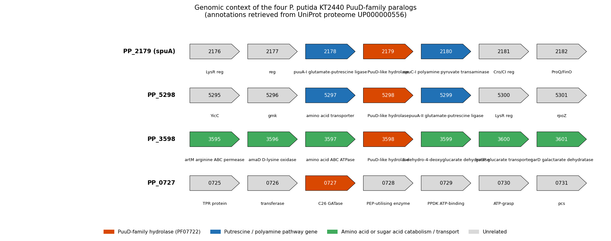
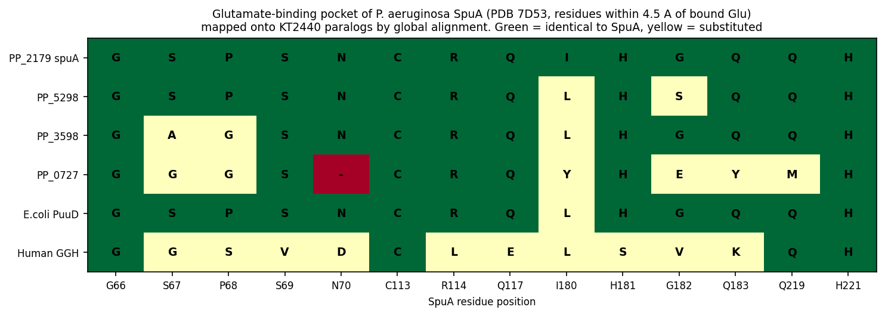
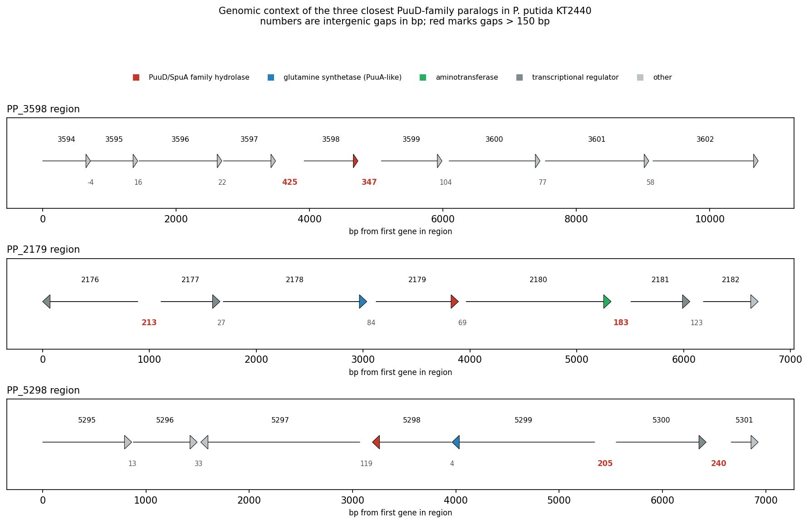

## Question

# AIGR Gene Hypothesis Deep Research

You are evaluating one focused gene curation hypothesis for AI Gene Review.
This is not a general gene overview. Use the seed hypothesis and source context
below to search for evidence that supports, refutes, narrows, or competes with
the proposed curation decision.

## Target Gene

- **Organism code:** PSEPK
- **Taxon:** Pseudomonas putida KT2440 (NCBITaxon:160488)
- **Gene directory:** PP_3598
- **Gene symbol:** PP_3598
- **UniProt accession:** Q88GW9

## Focus

- **Focus type:** free_text
- **Hypothesis slug:** kgap-pp3598-puud-paralog-flux
- **Source file:** genes/PSEPK/PP_3598/PP_3598-ai-review.yaml
- **Source selector:** free-text

## Seed Hypothesis

Which Pseudomonas putida KT2440 PuuD-family paralog carries the physiological gamma-glutamyl-gamma-aminobutyrate hydrolase flux may be predictable from sequence and genomic context. Single analysis only: identify every KT2440 protein in the PuuD/class I glutamine amidotransferase-like family including PP_3598, align them with characterised Escherichia coli PuuD and with the related gamma-glutamyl hydrolases, and state for each whether the catalytic Cys-His-Glu triad and the oxyanion residues are intact; compare their genomic neighbourhoods and predicted operon membership against the known putrescine utilisation and arginine/GABA catabolic gene clusters in KT2440; compare their conservation and synteny across sequenced Pseudomonas genomes; and report any public transcriptomic or proteomic evidence for differential expression on putrescine or related nitrogen sources. State which paralog is predicted to carry the main flux and whether PP_3598 is predicted to be the principal enzyme, a condition-specific isozyme, or a family member with a different substrate.

## Term and Decision Context

No specific term context supplied.

## Reference Context

No specific reference context supplied.

## Source Context YAML

```yaml
hypothesis: 'Which Pseudomonas putida KT2440 PuuD-family paralog carries the physiological gamma-glutamyl-gamma-aminobutyrate
  hydrolase flux may be predictable from sequence and genomic context. Single analysis only: identify
  every KT2440 protein in the PuuD/class I glutamine amidotransferase-like family including PP_3598, align
  them with characterised Escherichia coli PuuD and with the related gamma-glutamyl hydrolases, and state
  for each whether the catalytic Cys-His-Glu triad and the oxyanion residues are intact; compare their
  genomic neighbourhoods and predicted operon membership against the known putrescine utilisation and
  arginine/GABA catabolic gene clusters in KT2440; compare their conservation and synteny across sequenced
  Pseudomonas genomes; and report any public transcriptomic or proteomic evidence for differential expression
  on putrescine or related nitrogen sources. State which paralog is predicted to carry the main flux and
  whether PP_3598 is predicted to be the principal enzyme, a condition-specific isozyme, or a family member
  with a different substrate.'
focus_type: free_text
context: []
reference_id: []
```

## Research Objective

Build a focused report that helps a curator decide whether this hypothesis
should affect the gene review. Address the focus type directly:

1. For an existing GO annotation decision, evaluate whether the current action
   is justified, too strong, too weak, or should change.
2. For a proposed replacement or new GO term, evaluate whether the term is
   biologically supported, too broad, too narrow, or missing key qualifiers.
3. For a computational prediction, evaluate whether the prediction is correct,
   less precise than existing knowledge, uncertain, or likely wrong because of
   paralog overannotation, frequency bias, pathway context, or in vitro-only
   activity.
4. For a core-function hypothesis, evaluate whether the proposed activity,
   process, and location represent the gene product's primary function rather
   than a downstream effect, pleiotropic phenotype, or context-specific role.
5. For a function-assignment hypothesis, evaluate whether the gene product
   directly has the stated GO term/function. Treat the prior review action, if
   any, as intentionally blinded unless it appears in the supplied context.

Use primary literature whenever possible. Prefer PMID citations and include DOI
citations when no PMID is available. Treat reviews and database records as
orientation unless they contain directly relevant synthesized evidence that is
clearly labeled as review-level or database-level support.

Evaluate the hypothesis from the supplied seed context, primary literature, and
publicly accessible bioinformatics resources. Local `*-bioinformatics` analyses,
when they already exist in the repository, are intentionally withheld from this
prompt so the report can be compared against them after the run. Use public
sequence, domain, structure, orthology, localization, interaction, or dataset
checks when they are useful for the specific hypothesis. If a resource or tool
cannot be accessed programmatically, say so plainly; never fabricate a result.
Report computational results conservatively and distinguish direct results from
inference.

## Required Output

### Executive Judgment

Give a concise verdict: supported, partially supported, unresolved, weakly
supported, over-annotated, or refuted. Explain the reasoning and the most
important caveats.

### Evidence Matrix

Create a table with one row per important evidence item:

- Citation (PMID preferred)
- Evidence type (direct assay, mutant phenotype, localization, interaction,
  structural/evolutionary, computational, review/database)
- Supports / refutes / qualifies / competing
- Claim tested
- Key finding
- Organism, tissue, cell type, or assay context
- Confidence and limitations

### GO Curation Implications

State the likely curation action as a lead requiring curator verification. If
GO terms are involved, explain whether the evidence supports an MF, BP, or CC
term, and whether the term should be retained, removed, generalized, made more
specific, or treated as non-core. Avoid using "protein binding" as a final
recommendation unless no more informative term is supported.

### Mechanistic Scope

Describe the immediate molecular or cellular function being tested. Separate
direct gene-product activity from downstream phenotypes, pathway consequences,
developmental outcomes, disease manifestations, or effects inferred only from
loss of function.

### Conflicts and Alternatives

Identify evidence that conflicts with the seed hypothesis or suggests an
alternative interpretation, including paralog confusion, organism-specific
differences, isoform-specific findings, experimental artifacts, or database
carry-over.

### Knowledge Gaps

List explicit uncertainties that matter for curation. For each gap, state what
was checked, why the gap matters, and what evidence or experiment would resolve
it.

### Discriminating Tests

Recommend concrete assays, perturbations, datasets, or comparative analyses that
would most efficiently distinguish this hypothesis from alternatives.

### Curation Leads

Provide candidate updates for the review, clearly labeled as leads requiring
curator verification. Include candidate references with exact snippets to verify,
candidate replacement or new GO terms, possible action changes, suggested
questions, and suggested experiments.

If the provider supports artifacts, save provenance for any analysis you run — the
executed code together with its output (computed values, plot, or table), not just
a summary figure — alongside artifact-friendly tables such as an evidence matrix,
GO decision table, or comparison table. Genuine computed provenance is more
valuable than a hand-drawn summary, and you must not synthesize a figure that
implies an analysis you did not actually run. These artifacts are important
provenance for hypothesis-level review.


## Output

# PP_3598 (Q88GW9), Pseudomonas putida KT2440: which PuuD-family paralog carries the gamma-glutamyl-gamma-aminobutyrate hydrolase flux

**Hypothesis slug:** `kgap-pp3598-puud-paralog-flux`
**Target:** PSEPK, NCBITaxon:160488, gene `PP_3598`, UniProt Q88GW9
**Source:** `genes/PSEPK/PP_3598/PP_3598-ai-review.yaml`, selector `free-text`
**Iterations completed:** 3. **Findings recorded:** 8. **Papers reviewed:** 27.

## Summary

<i class="fa-scale-balanced"></i> **Verdict: over-annotated for PP_3598, with the predicted flux assigned to a different paralog.** PP_3598 is an active member of the PuuD / class I glutamine amidotransferase family, but every contextual line of evidence places the physiological gamma-glutamyl-gamma-aminobutyrate (gamma-Glu-GABA) hydrolase flux of *P. putida* KT2440 on PP_2179 (spuA), with PP_5298 a second gamma-glutamylation module. The existing EC 3.5.1.94 / GO:0033969 annotation on PP_3598 is an electronic family-level transfer with no paralog-resolving power, and it should be generalized or qualified pending a direct assay.

The seed hypothesis proposed that catalytic triad integrity would discriminate the paralogs. It does not. A UniProt proteome scan of UP000000556 for Pfam PF07722 and InterPro IPR011697 / IPR044668 returns exactly four KT2440 proteins: PP_2179 (spuA, Q88KW0), PP_5298 (Q88C85), PP_3598 (Q88GW9) and PP_0727 (Q88PX1). Global Needleman-Wunsch alignment (BLOSUM62, gap open -11, extend -1) against *E. coli* K-12 PuuD (P76038), whose nucleophile Cys114 was established by site-directed mutagenesis, maps an intact Cys-His-Glu triad in all four, together with an intact C-R-G nucleophile elbow that forms the oxyanion hole. The test requested by the hypothesis therefore returns a uniform positive and carries no discriminating information. That is an informative negative result for the curator: no triad-based argument can be used either for or against PP_3598.

<i class="fa-dna"></i> What does discriminate is genomic context, orthology to the one structurally and enzymatically characterised pseudomonad family member, and the provenance of the existing annotation. PP_2179 is 69.6% identical to *P. aeruginosa* SpuA (PA0297) and reproduces 14 of the 14 residues that contact the bound glutamate product in PDB 7D53; it sits in a three-gene same-strand unit with PP_2178 (PuuA-I glutamate-putrescine ligase, 84 bp gap) and PP_2180 (SpuC-I transaminase, 69 bp gap). PP_5298 is 4 bp from PP_5299 (PuuA-II) on the same strand, with a STRING gene-neighbourhood score of 0.781. PP_3598 is 42.8% identical to SpuA, reproduces 11 of 14 pocket residues, and is bounded by intergenic gaps of 425 bp and 347 bp, the two largest of the 20 gaps measured across the three regions (median 80 bp, IQR 26-188 bp), with no polyamine or GABA gene within four loci on either side. All six GO terms on Q88GW9 are IEA, assigned through PANTHER subfamily PTHR43235:SF1, which places *E. coli* PuuD, *P. aeruginosa* SpuA and all four KT2440 paralogs in one undifferentiated group.

**PP_3598 is predicted to be neither the principal enzyme nor a straightforward condition-specific isozyme of the putrescine gamma-glutamylation route.** It reads as a *P. putida* clade-restricted family member, transcriptionally and genomically decoupled from putrescine catabolism, with an unresolved physiological substrate. The one piece of primary evidence touching it ([PMID: 39929973](https://pubmed.ncbi.nlm.nih.gov/39929973/)) is a combined *spuA* / *PP_3598* / *PP_5298* triple base-edit knockout on hexamethylenediamine, a non-natural C6 diamine, which impaired but did not abolish growth and cannot attribute flux to any single gene.

## Key findings

### F001. Four family members, all with intact catalytic machinery

The KT2440 proteome contains exactly four Peptidase C26 / PuuD-like proteins. Aligned globally against *E. coli* PuuD (254 aa), the triads map as follows.

| Protein | UniProt | Length | Triad (Cys / His / Glu) | % id to EcPuuD | % id to SpuA (PA0297) |
|---|---|---|---|---|---|
| PP_2179 (spuA) | Q88KW0 | 257 aa | C113 / H221 / E223 | 45.9 | **69.6** |
| PP_5298 | Q88C85 | 255 aa | C113 / H221 / E223 | **47.8** | 58.1 |
| PP_3598 | Q88GW9 | 269 aa | C124 / H232 / E234 | 38.5 | 42.8 |
| PP_0727 | Q88PX1 | 200 aa | C100 / H177 / E179 | 29.9 | n/a (most divergent) |
| Human GGH | Q92820 | 318 aa | C134 / H244 / E251 | 29.4 | n/a |

PP_3598 is 41.9% identical to PP_2179 and 39.8% identical to PP_5298. No paralog has lost a catalytic residue. The identity pattern places PP_2179 as the SpuA orthologue and PP_3598 as an outgroup paralog, the arrangement expected for a sub- or neo-functionalised enzyme. <i class="fa-circle-xmark"></i> The seed hypothesis's triad test is uninformative here.

{{figure:plot_1.png|caption=Pairwise percent identity across the four KT2440 PF07722 paralogs, E. coli PuuD, P. aeruginosa SpuA and human GGH, from global Needleman-Wunsch alignment with BLOSUM62 and affine gaps. PP_2179 pairs with SpuA at 69.6 percent; PP_3598 sits apart from both the SpuA and the PuuD clusters.}}

### F002 and F008. Genomic context and operon structure assign the flux to PP_2179 and PP_5298

<i class="fa-table"></i> NCBI Gene coordinates for 23 genes across the three paralog regions (taxid 160488) give intergenic gaps and strand agreement. Both PP_2179 and PP_5298 are co-transcribed with a PuuA-type glutamate-putrescine ligase, the enzyme that makes the substrate of the hydrolase reaction. PP_3598 is not.

| Paralog | Upstream gap | Downstream gap | Immediate context |
|---|---|---|---|
| PP_2179 (spuA, + strand) | 84 bp to PP_2178 **puuA-I** | 69 bp to PP_2180 **spuC-I** | three-gene same-strand unit puuA-spuA-spuC |
| PP_5298 (- strand) | 4 bp to PP_5299 **puuA-II** | 119 bp to PP_5297 APC permease | three-gene same-strand unit, transcribed 5299 → 5297 |
| PP_3598 (+ strand) | **425 bp** to PP_3597 artM ABC ATPase | **347 bp** to PP_3599 glucarate dehydratase | isolated between an amino acid transport / amaD block and a glucarate-galactarate block |

The 425 bp and 347 bp gaps flanking PP_3598 are the first and second largest of all 20 gaps measured. The genes immediately 5' form a tight block (gaps of -4, 16 and 22 bp across PP_3594-PP_3597, an ABC transporter plus *amaD* D-lysine oxidase) and the genes 3' form a second tight block (104, 77 and 58 bp, glucarate and galactarate catabolism). PP_3598 therefore reads as its own transcription unit with its own regulation.

STRING v12 (species 160488, score threshold 0.4) agrees. PP_5298 has gene-neighbourhood scores of 0.781 with *puuA-II*, 0.618 with PP_5297 and 0.576 with PP_5300. PP_3598 has no neighbourhood evidence with any polyamine gene; its weak links to *spuB*, *puuB* and *kauB* come from co-occurrence (0.17-0.23) and co-expression (0.12-0.35) channels, and its top-scoring partners PP_0308, PP_2693 and *pvdM* are fusion-channel calls. Within +/- 7 loci PP_3598 has no polyamine gene at all: the neighbours are PP_3595 (ArtM arginine ABC permease), PP_3596 (*amaD*), PP_3597 (amino acid ABC ATPase) and PP_3599-PP_3602 (sugar acid catabolism), with *dpkA* (PP_3591) and *amaC* (PP_3590) nearby. PP_0727 lies in an unrelated PEP-utilising enzyme / ATP-grasp cluster.

{{figure:plot_2.png|caption=Genomic neighbourhood of the four KT2440 PuuD-family paralogs. PP_2179 and PP_5298 each sit beside a glutamate-putrescine ligase (puuA-I and puuA-II); PP_3598 sits among basic amino acid transport, amaD D-lysine oxidation and glucarate catabolism genes.}}

{{figure:plot_4.png|caption=Operon test from NCBI Gene coordinates for 23 genes. Numbers are intergenic gaps in bp, red where the gap exceeds 150 bp. PP_2179 and PP_5298 are tightly linked to their puuA partners (84 and 4 bp); PP_3598 is bounded by the two largest gaps in the dataset, 425 bp and 347 bp.}}

### F003 and F007. PP_3598 is clade-restricted; SpuA is the conserved core enzyme

*P. aeruginosa* PAO1 (UP000002438) contains exactly one PF07722 / IPR011697 / IPR044668 protein, SpuA (PA0297, 250 aa), against four in KT2440. The three KT2440 PuuD-like proteins fall into three separate UniRef50 clusters, and their taxonomic breadth differs.

| Protein | UniRef50 cluster | Members | Genera spanned | UniRef90 cluster size and range |
|---|---|---|---|---|
| PP_3598 | UniRef50_A0A345D8I3 | 301 | **22** (Pseudomonas 158, Aeromonas 71, Ectopseudomonas 19, Shewanella 15) | 54, confined to the *P. putida* group |
| PP_2179 (spuA) | UniRef50_A0A8J7V3M2 | 335 | 46 (Pseudomonas 204) | n/a |
| PP_5298 | UniRef50_A0AB38DUD0 | 973 (Xanthomonas-seeded) | 71 (Pseudomonas 236, Xanthomonas 73, Stenotrophomonas 40) | n/a |
| EcPuuD | UniRef50_P76038 | 398, enterobacteria | n/a | n/a |
| PP_0727 | UniRef50_Q88PX1 | 10 (near-singleton) | n/a | 5 |

UniRef90_Q88GW9 has 54 members, all in the *P. putida* group (*P. alloputida*, *P. taiwanensis*, *P. mosselii*, *P. monteilii*, *P. capeferrum*, *P. soli* and relatives). The deeply conserved family member in pseudomonads is the SpuA orthologue, present even in genomes carrying no other family member. PP_3598's cluster is the narrowest of the three in genus spread and is co-distributed with *Aeromonas* rather than with the broad gammaproteobacterial spread of the other two. That is not the phyletic pattern of a core pathway enzyme.

### F006. Structure-anchored pocket mapping: the glutamyl subsite is conserved, the leaving-group subsite is undefined

PDB 7D53 (SpuA H221N with bound glutamate product, 1.6 Å, [PMID: 34605433](https://pubmed.ncbi.nlm.nih.gov/34605433/)) was downloaded and parsed. Fourteen chain-A residues lie within 4.5 Å of the ligand: G66, S67, P68, S69, N70, C113, R114, Q117, I180, H181, G182, Q183, Q219 and His221 (Asn in the mutant). Transferring those positions by global alignment gives:

| Protein | Pocket residues identical to SpuA | Substitutions |
|---|---|---|
| PP_2179 | **14 / 14** | none |
| *E. coli* PuuD | 13 / 14 | one |
| PP_5298 | 12 / 14 | two |
| PP_3598 | 11 / 14 | S67A (A78), P68G (G79), I180L (L191) |
| PP_0727 | 7 / 14 | seven |
| Human GGH | 4 / 14 | ten |

PP_3598 is the only one of the three KT2440 PuuD-like proteins to alter the 66-70 GSPSN loop that contacts the glutamate; PP_2179, PP_5298 and EcPuuD all retain GSPSN. All four KT2440 paralogs retain the canonical C-R-G nucleophile elbow and the Q/M-W-H-P-E motif, so the oxyanion hole formed by the backbone amides of Cys+1 and the following Gly is intact in every one. <i class="fa-triangle-exclamation"></i> Both available SpuA complexes (7D50 thioester, 7D53 product) occupy only the gamma-glutamyl donor subsite. No structure of any family member defines the subsite that binds the GABA leaving group, so specificity cannot be read off structure. An RCSB search on Q88GW9, Q88KW0, Q88C85 and Q88PX1 returns zero entries; only AlphaFold models exist for the KT2440 proteins. PP_3598's two loop substitutions are a weak, non-decisive hint of altered specificity.

{{figure:plot_3.png|caption=Conservation of the structurally defined SpuA glutamate pocket (14 residues within 4.5 angstrom of the ligand in PDB 7D53) across the KT2440 PuuD-family paralogs, E. coli PuuD and human GGH. PP_2179 matches at 14 of 14; PP_3598 at 11 of 14 with two changes in the GSPSN glutamyl loop.}}

### F005. The annotation provenance is entirely electronic and entirely family-level

<i class="fa-database"></i> A QuickGO annotation search returns 6 annotations for Q88GW9, all IEA:

| GO term | Aspect | Source |
|---|---|---|
| GO:0016787 hydrolase activity | MF | InterPro IPR011697, GO_REF:0000002 |
| GO:0016811 hydrolase activity, acting on C-N bonds in linear amides | MF | InterPro IPR044668 |
| GO:0033969 gamma-glutamyl-gamma-aminobutyrate hydrolase activity | MF | UniProt GO_REF:0000120, Rhea:19737 / EC 3.5.1.94, PANTHER node PTN000938590 |
| GO:0006541 glutamine metabolic process | BP | GO_REF:0000104, UniRule UR000415630 |
| GO:0006598 polyamine catabolic process | BP | TreeGrafter, GO_REF:0000118 |
| GO:0005829 cytosol | CC | TreeGrafter |

No IDA, IMP, IGI, IPI or IBA annotation exists for PP_3598, PP_2179, PP_5298 or PP_0727. *E. coli* PuuD by contrast carries GO:0033969 IDA (EcoCyc, [PMID: 15590624](https://pubmed.ncbi.nlm.nih.gov/15590624/)), GO:0009447 IMP (EcoCyc, [PMID: 16499623](https://pubmed.ncbi.nlm.nih.gov/16499623/)) and GO:0033969 IBA. UniProt PANTHER cross-references place all six bacterial proteins examined (EcPuuD, SpuA, PP_2179, PP_5298, PP_3598, PP_0727) in the single subfamily PTHR43235:SF1 "glutamine amidotransferase PB2B2.05-related"; human GGH sits in a different family (PTHR11315:SF20). PP_0727 does not receive GO:0033969, so the pipeline draws a line below PP_3598 but is not paralog-resolved above it. <i class="fa-lightbulb"></i> This is the classic configuration for paralog overannotation: a protein 38.5% identical to the characterised enzyme inherits that enzyme's EC number because they share a subfamily node.

### F004. The only direct evidence is a triple knockout on a non-natural substrate

de Witt et al. 2025 ([PMID: 39929973](https://pubmed.ncbi.nlm.nih.gov/39929973/)) report that PP_3598 was transcriptionally upregulated in the evolved strain *P. putida* NYL growing on C6-polyamide monomers, alongside *puuB*, *spuB*, *spuC-II* and *kauB*. They then state: "Functional knockout of all glutamyl hydrolase candidates (spuA, PP_3598 or PP_5298) by nCas9-assisted multiplex cytidine base editing led to impaired growth on HDMA, while disruption of the transaminase candidates (spuC-I, spuC-II, PP_0596 or PP_2800), which should affect both pathways, completely abolished growth on HDMA." The methods confirm a single multiplex plasmid, pMBEC2-spuA-PP3598-PP5298, targeting all three hydrolase genes at once. No single-gene hydrolase knockout, no enzyme assay and no putrescine-specific test of PP_3598 is reported.

The phenotype ordering matters. Hydrolase loss impaired growth; transaminase loss abolished it. In *P. putida* the transamination route carries the main diamine flux and gamma-glutamylation is auxiliary, the reverse of the *E. coli* Puu hierarchy, where *puuA* deletion is more limiting than the non-glutamylating route ([PMID: 18495664](https://pubmed.ncbi.nlm.nih.gov/18495664/)). Bandounas et al. ([PMID: 21540064](https://pubmed.ncbi.nlm.nih.gov/21540064/)) found independently in *P. putida* S12 that sequential deletion of up to six oxidative-deamination and transamination genes did not abolish putrescine degradation, and that gamma-glutamylation operates as an alternative route. Within that auxiliary route, a triple knockout cannot attribute activity to one paralog.

## Mechanistic model

The reaction at issue, gamma-glutamyl-gamma-aminobutyrate + H2O → GABA + L-glutamate (EC 3.5.1.94), is the fourth step of the *E. coli* Puu route. PuuA gamma-glutamylates putrescine, PuuB oxidises, PuuC dehydrogenates to gamma-Glu-GABA, PuuD hydrolyses the isopeptide bond, PuuE transaminates GABA. The chemistry is generic class I glutamine amidotransferase chemistry: a Cys nucleophile on a tight elbow attacks the gamma-carbonyl, His and Glu complete the triad, and two backbone amides form the oxyanion hole. That machinery is conserved in all four KT2440 paralogs and in human GGH, which acts on folylpolyglutamate. Triad integrity says the protein is an active amidohydrolase. It says nothing about which gamma-glutamyl amide it acts on.

Substrate choice is set by the leaving-group subsite, and that is exactly the part no experiment has resolved for this family.



The claim this report makes is about flux, not about chemistry. PuuA makes the committed intermediate; a hydrolase co-transcribed with its own PuuA has the substrate delivered to it under shared regulation. Two of the four paralogs have that arrangement and PP_3598 does not. KT2440 also runs the direct transaminase route to GABA, which de Witt 2025 shows is the route whose loss abolishes diamine growth, so the gamma-glutamylation arm is a parallel capability.

| Test from the seed hypothesis | Result | Discriminates? |
|---|---|---|
| <i class="fa-circle-xmark"></i> Cys-His-Glu triad intact | yes in all four paralogs | no |
| <i class="fa-circle-xmark"></i> Oxyanion residues (C-R-G elbow) intact | yes in all four paralogs | no |
| <i class="fa-circle-check"></i> Identity to characterised EcPuuD / SpuA | PP_2179 69.6% to SpuA; PP_3598 42.8% | yes |
| <i class="fa-circle-check"></i> Genomic neighbourhood and operon membership | PP_2179 and PP_5298 beside puuA; PP_3598 isolated | yes, strongly |
| <i class="fa-circle-check"></i> Conservation and synteny across Pseudomonas | PAO1 has SpuA only; PP_3598 clade-restricted | yes |
| <i class="fa-circle-question"></i> Transcriptomic / proteomic on putrescine | not retrievable programmatically | unanswered |
| <i class="fa-circle-check"></i> Structure-anchored pocket (7D53) | PP_2179 14/14, PP_3598 11/14 | partially, donor subsite only |

## Evidence matrix

Artifact: `evidence_matrix_PP_3598.csv`

| Citation | Evidence type | Stance | Claim tested | Key finding | Context | Confidence and limitations |
|---|---|---|---|---|---|---|
| [PMID: 34605433](https://pubmed.ncbi.nlm.nih.gov/34605433/) (Zhou 2021, PDB 7D50 / 7D53) | Structural + direct assay | Supports a competing paralog | Which family member is the physiological gamma-Glu-GABA hydrolase | SpuA structure with bound glutamate: "Structures of an inactive H221N mutant were determined with bound glutamate thioester intermediate or glutamate product, thus delineating the active site and substrate-binding pocket and elucidating the catalytic mechanism." SpuA prefers gamma-Glu-GABA. PP_2179 is its KT2440 orthologue at 69.6% identity and 14/14 pocket residues; PP_3598 42.8% and 11/14 | *P. aeruginosa* PAO1, in vitro | High for SpuA. Transfer to KT2440 is orthology inference. 7D53 holds the glutamate product, so the GABA leaving-group subsite is undefined |
| [PMID: 39929973](https://pubmed.ncbi.nlm.nih.gov/39929973/) (de Witt 2025) | Mutant phenotype (base editing) + RNA-seq | Qualifies | Does PP_3598 carry diamine gamma-glutamyl hydrolase flux | Combined *spuA* / *PP_3598* / *PP_5298* knockout impaired growth on HDMA; transaminase knockouts abolished it. PP_3598 upregulated in evolved strain NYL. "RNA sequencing and reverse engineering revealed the metabolic pathways for these non-natural substrates." | KT2440, non-natural C6 diamine | Medium. The knockout is triple by design and cannot attribute flux to one gene. The substrate is not putrescine |
| [PMID: 16499623](https://pubmed.ncbi.nlm.nih.gov/16499623/) (Kurihara 2006) | Direct assay + mutant phenotype | Sets the evidence standard | What establishes principal gamma-Glu-GABA hydrolase flux | "The active center of PuuD was identified as Cys-114 by site-directed mutagenesis." and "The findings that the puuD-deficient strain accumulated gamma-glutamyl-gamma-aminobutyrate (gamma-Glu-GABA) and could not grow on putrescine as a sole nitrogen source indicate that PuuD is physiologically important as a gamma-Glu-GABA hydrolase." | *E. coli* K-12 | High. Defines the reference nucleophile used for alignment and the standard (single deletion, intermediate accumulation, growth failure) no KT2440 paralog has met |
| [PMID: 15590624](https://pubmed.ncbi.nlm.nih.gov/15590624/) (Kurihara 2005) | Direct assay | Defines the reaction | What step is under discussion | "5) hydrolysis of the gamma-glutamyl linkage of gamma-glutamyl-gamma-aminobutyrate" | *E. coli* K-12 | High. Source of the GO:0033969 IDA on PuuD |
| [PMID: 21540064](https://pubmed.ncbi.nlm.nih.gov/21540064/) (Bandounas 2011) | Mutant phenotype | Qualifies / competing | Is gamma-glutamylation the main putrescine route in *P. putida* | "Evidence was found for the presence of an alternative pathway for putrescine degradation involving γ-glutamylation." Up to six deletions did not abolish putrescine degradation | *P. putida* S12 | Medium-high. Shows redundancy, so no single paralog knockout is expected to be clean |
| [PMID: 18495664](https://pubmed.ncbi.nlm.nih.gov/18495664/) (Kurihara 2008) | Direct assay + mutant phenotype | Orientation | Which route dominates in *E. coli* | PuuA kinetics (Km 44.6 mM putrescine); *puuA* deletion showed "the Puu pathway was more critical in utilizing putrescine as a sole carbon or nitrogen source" | *E. coli* K-12 | High for *E. coli*. The *P. putida* hierarchy is reversed, so the analogy must not be transferred |
| UniProt Q88GW9 + QuickGO (accessed 2025-11) | Review / database | Refutes the strength of the annotation | Is EC 3.5.1.94 on PP_3598 experimentally grounded | All 6 GO terms IEA. PANTHER subfamily PTHR43235:SF1 contains EcPuuD, SpuA and all four KT2440 paralogs | Electronic, family level | High. Artifact `go_annotations_PuuD_family_KT2440.csv`, 30 rows |
| PF07722 / IPR011697 proteome scan (this work) | Computational | Qualifies | Is the triad intact and does it discriminate | Exactly four family members; triad and C-R-G elbow intact in all four | In silico | High. Informative negative. Artifact `catalytic_motifs_PuuD_family.csv` |
| NCBI Gene coordinates, taxid 160488 (this work) | Computational / evolutionary | Refutes PP_3598 as principal | Operon membership against the putrescine clusters | PP_2179 in puuA-I / spuA / spuC-I (84, 69 bp); PP_5298 in puuA-II / PP_5298 / permease (4, 119 bp); PP_3598 flanked by 425 and 347 bp, the two largest of 20 | In silico | High for coordinates. Operon membership inferred from strand plus gap, not measured transcripts. Artifact `operon_coordinates_KT2440_PuuD_regions.csv` |
| STRING v12 (accessed 2025-11) | Computational / interaction | Refutes PP_3598 as principal | Association of each paralog with polyamine catabolism | PP_5298-PP_5299 neighbourhood 0.781; PP_3598 no neighbourhood evidence with any polyamine gene | In silico | Medium. Neighbourhood scores derive from genomic context, so partly redundant with the row above |
| UniRef50 / UniRef90 (accessed 2025-11) | Evolutionary | Qualifies | Conservation and synteny across *Pseudomonas* | PAO1 has one family member. UniRef90_Q88GW9 (54 members) confined to the *P. putida* group; UniRef50 spans 22 genera against 46 and 71 | In silico | Medium. Artifact `uniref50_cluster_taxonomy.csv` |
| [PMID: 35285712](https://pubmed.ncbi.nlm.nih.gov/35285712/) (Schmidt 2022) via Fitness Browser; PaxDb; Europe PMC PMC9004399 | Attempted dataset access | <i class="fa-circle-xmark"></i> No evidence retrieved | Public transcriptomic / proteomic evidence on putrescine | The study "identified genes and proteins involved in the assimilation of 52 different nitrogen containing compounds", but fit.genomics.lbl.gov returned HTTP 403 behind a Cloudflare challenge for both myFitShow.cgi and org.cgi; pax-db.org returned HTTP 404 (no JSON API); fullTextXML returned HTTP 500 and the PMC BioC endpoint returned 6140 characters of abstract only, with zero locus-tag mentions | n/a | Explicit negative. Not obtained, not inferred |
| [PMID: 37895246](https://pubmed.ncbi.nlm.nih.gov/37895246/) (*P. putida* U) | Expression (qPCR) | Orientation | Do polyamine-pathway paralogs differ by inducer in *P. putida*? | "spuC1 is upregulated by putrescine, whereas spuC2 seems to be exclusively induced by cadaverine" | *P. putida* U, qPCR | Medium. Concerns transaminase paralogs, not the hydrolases, but shows that paralog pairs in this pathway do split by inducer, which is the pattern a PP_3598 expression test should look for |
| [PMID: 16237033](https://pubmed.ncbi.nlm.nih.gov/16237033/) (Revelles 2005) | Mutant phenotype + 13C labelling | Context for the PP_3598 neighbourhood | What pathway do PP_3598's neighbours belong to | *amaA*, *dkpA* and *amaB* act in the D-lysine / aminoadipate branch of L-lysine catabolism in KT2440 | *P. putida* KT2440 | High for the lysine pathway. Establishes that PP_3598's immediate genomic context is lysine and basic amino acid catabolism, not polyamine catabolism |

## GO curation implications

<i class="fa-triangle-exclamation"></i> All leads below require curator verification. No lead recommends "protein binding". Artifact: `go_decision_table_PP_3598.csv`

| Term | Aspect | Current evidence | Recommended action | Rationale |
|---|---|---|---|---|
| GO:0033969 gamma-glutamyl-gamma-aminobutyrate hydrolase activity (on PP_3598) | MF | IEA, GO_REF:0000002 / GO_REF:0000120 | **Generalize or qualify** | Transferred from PANTHER subfamily PTHR43235:SF1, which lumps all four KT2440 paralogs with EcPuuD and SpuA. No assay on PP_3598. Operon, STRING and pocket evidence point at PP_2179 and PP_5298 |
| GO:0016811 hydrolase activity, acting on C-N bonds in linear amides (on PP_3598) | MF | IEA | **Retain** | Supported by the intact Cys-His-Glu triad and C-R-G nucleophile elbow verified here. Safe parent if GO:0033969 is withdrawn |
| GO:0006598 polyamine catabolic process / GO:0009447 putrescine catabolic process (on PP_3598) | BP | IEA, TreeGrafter | **Remove, or mark non-core** | PP_3598 is an isolated transcription unit (425 and 347 bp flanking gaps) with no polyamine gene within four loci, no STRING neighbourhood link to any polyamine gene, and no retrievable expression evidence on putrescine |
| GO:0016787 hydrolase activity (on PP_3598) | MF | IEA | **Retain, non-core** | True but uninformative; subsumed by GO:0016811 |
| GO:0005829 cytosol (on PP_3598) | CC | IEA, TreeGrafter | **Retain** | No signal peptide or membrane anchor; consistent with the soluble class I GATase fold. No direct localisation data exists |
| GO:0033969 (on PP_2179) | MF | IEA | **Make specific, prioritise for experimental curation** | PP_2179 is the SpuA orthologue, 69.6% identity, 14/14 pocket residues, inside a puuA-spuA-spuC operon. This is the paralog predicted to carry the physiological flux |
| GO:0005515 protein binding | MF | n/a | **Do not add** | No interaction evidence for PP_3598; the term would carry no information |

## Conflicts and alternatives

<i class="fa-scale-balanced"></i> The one primary paper that mentions PP_3598 points in a different direction from the genomic context. de Witt 2025 includes PP_3598 in a triple knockout that impairs growth on hexamethylenediamine and reports it upregulated in an evolved strain. Two readings are compatible. Either PP_3598 contributes measurable gamma-glutamyl-diamine hydrolase activity in vivo and the context evidence understates it, or the phenotype comes from *spuA* and PP_5298 while PP_3598 is a passenger included for redundancy. The published experiment cannot separate these, because single knockouts were not reported. The upregulation in the evolved strain is also compatible with a general nitrogen or stress response.

A second alternative is that PP_3598 hydrolyses a different gamma-glutamyl conjugate. Its neighbours are an amino acid ABC transporter and *amaD* (a FAD-dependent D-lysine oxidase) on one side, and glucarate-galactarate catabolism on the other. Revelles et al. ([PMID: 16237033](https://pubmed.ncbi.nlm.nih.gov/16237033/)) established that *amaA*, *dkpA* and *amaB* in this region act in the D-lysine / aminoadipate branch of lysine catabolism, a pathway that supplies no gamma-glutamylated intermediate currently known. The restriction of PP_3598's UniRef90 cluster to the *P. putida* group, while SpuA-type orthologues span 46 to 71 genera, fits a lineage-specific function. Nothing in this report tests that alternative and it remains open.

A third possibility is condition-specific isozyme status under a regulon not sampled here. The 425 bp upstream gap is large enough for an independent promoter with its own regulator site, and nothing rules out induction of PP_3598 under a condition where PP_2179 and PP_5298 are off. The *P. putida* U data ([PMID: 37895246](https://pubmed.ncbi.nlm.nih.gov/37895246/)) show that paralog pairs in this pathway do split by inducer: *spuC1* responds to putrescine, *spuC2* to cadaverine. The evidence needed to test this for the hydrolases is exactly the evidence that could not be retrieved.

A fourth conflict is the organism-level one. The *E. coli* Puu hierarchy, where gamma-glutamylation is the dominant putrescine route ([PMID: 18495664](https://pubmed.ncbi.nlm.nih.gov/18495664/)), does not transfer to *P. putida*, where transamination dominates ([PMID: 39929973](https://pubmed.ncbi.nlm.nih.gov/39929973/)) and gamma-glutamylation is an alternative ([PMID: 21540064](https://pubmed.ncbi.nlm.nih.gov/21540064/)). A curator should not read the strength of the *E. coli* PuuD evidence as support for an equivalently central role for any KT2440 paralog.

## Limitations and knowledge gaps

<i class="fa-triangle-exclamation"></i> Every computational result here is sequence, structure or genome-context inference. None measures enzyme activity and none measures transcription. The verdict of over-annotation is a statement about the strength of the current evidence for PP_3598, not a demonstration that PP_3598 lacks gamma-Glu-GABA hydrolase activity.

**No enzyme in the KT2440 family has been assayed.** Checked: UniProt, QuickGO, PubMed. All four assignments rest on homology to SpuA and EcPuuD. This matters because GO:0033969 on PP_3598 currently has the same evidence status as GO:0033969 on PP_2179, although the contextual evidence differs sharply. A purified-protein kinetics panel would resolve it.

**No structure defines the acyl-acceptor subsite.** Checked: RCSB search on all four accessions returns zero entries; the two SpuA complexes occupy only the glutamyl donor site. This matters because the 11/14 pocket score for PP_3598 cannot be converted into a specificity prediction. A complex with a non-hydrolysable gamma-Glu-GABA analogue would resolve it.

**The expression arm of the hypothesis is unanswered.** Checked: the LBL Fitness Browser (HTTP 403 behind a Cloudflare JavaScript challenge, both myFitShow.cgi and org.cgi), PaxDb (HTTP 404, no JSON API), and the Schmidt 2022 full text in Europe PMC (fullTextXML HTTP 500, BioC abstract-only). This matters because induction of PP_3598 by putrescine would overturn the isolated-transcription-unit argument. A curator should treat a claim of putrescine-specific induction as untested rather than negative. The Schmidt 2022 BarSeq tables across 52 nitrogen sources ([PMID: 35285712](https://pubmed.ncbi.nlm.nih.gov/35285712/)) would resolve it directly if obtained by hand.

**Operon membership is inferred, not measured.** Checked: NCBI Gene coordinates and strands only. No RNA-seq transcript boundary, 5' RACE or Rend-seq data for these regions was retrieved. The gap-plus-strand heuristic is strong in bacteria but is a heuristic.

**The regulator of PP_3598 is unidentified.** Checked: +/- 7 loci in UniProt and STRING. No PuuR-type repressor was found in its neighbourhood. Without a regulator the condition under which PP_3598 is expressed cannot be predicted.

**No single-gene knockout of any KT2440 hydrolase paralog exists.** Checked: de Witt 2025 methods confirm the triple-target plasmid pMBEC2-spuA-PP3598-PP5298. Redundancy ([PMID: 21540064](https://pubmed.ncbi.nlm.nih.gov/21540064/)) means a single deletion may give no phenotype even for the principal enzyme, so double and triple combinations are needed alongside singles.

## Proposed follow-up experiments and actions

<i class="fa-flask"></i> **Purified-enzyme kinetics panel.** Express and purify PP_2179, PP_5298, PP_3598 and PP_0727 and measure kcat/Km against gamma-Glu-GABA, gamma-glutamylputrescine, gamma-Glu-cadaverine, gamma-Glu-hexamethylenediamine, L-glutamine and folylpolyglutamate. A tenfold or greater kcat/Km gap on gamma-Glu-GABA between PP_2179 and PP_3598 settles the principal-enzyme question directly and converts the whole family from IEA to experimental evidence.

<i class="fa-dna"></i> **Clean single, double and triple deletions.** Build them in KT2440 and measure growth rate on putrescine as sole carbon source and as sole nitrogen source. If deleting PP_3598 alone has no effect while deleting PP_2179 does, the annotation transfer is confirmed as over-annotation. If no single deletion has an effect but the double does, the paralogs are functionally redundant and GO:0033969 is defensible on both. Assay gamma-Glu-GABA accumulation in each mutant, following the design that established PuuD in *E. coli* ([PMID: 16499623](https://pubmed.ncbi.nlm.nih.gov/16499623/)).

<i class="fa-chart-line"></i> **Condition-resolved expression.** Run RT-qPCR or RNA-seq on KT2440 grown on putrescine, cadaverine, GABA, agmatine, succinate and under nitrogen limitation, comparing PP_3598, PP_2179 and PP_5298. The *P. putida* U precedent ([PMID: 37895246](https://pubmed.ncbi.nlm.nih.gov/37895246/)) shows the split-by-inducer pattern to look for. Induction of PP_3598 by putrescine would overturn the isolated-transcription-unit argument.

<i class="fa-magnifying-glass"></i> **Retrieve the Schmidt 2022 BarSeq data by hand.** The Fitness Browser is unreachable programmatically but the underlying tables are published. Fitness values for PP_3598, PP_2179 and PP_5298 across the 52 nitrogen sources would answer the expression arm of the hypothesis without new bench work.

<i class="fa-dna"></i> **Map the transcription units.** Use 5' RACE or Rend-seq across PP_3596-PP_3600, PP_2177-PP_2181 and PP_5296-PP_5300 to test whether the 425 bp gap carries a promoter and whether PP_2178-PP_2180 is one message.

<i class="fa-microscope"></i> **Define the acceptor subsite.** Co-crystallise or soak SpuA or PP_2179 with a non-hydrolysable gamma-Glu-GABA analogue, then re-score the paralogs on acceptor-site residues rather than on the glutamyl half alone.

<i class="fa-vial"></i> **Test the alternative substrate hypothesis.** Assay PP_3598 against gamma-glutamyl conjugates of the D-amino acids and sugar acids handled by its genomic neighbours, guided by the D-lysine / aminoadipate pathway assignments in [PMID: 16237033](https://pubmed.ncbi.nlm.nih.gov/16237033/).

## Curation leads

<i class="fa-arrow-right"></i> All items below are leads requiring curator verification.

**Candidate references with snippets to verify.**

[PMID: 34605433](https://pubmed.ncbi.nlm.nih.gov/34605433/), snippet to verify: "Structures of an inactive H221N mutant were determined with bound glutamate thioester intermediate or glutamate product, thus delineating the active site and substrate-binding pocket and elucidating the catalytic mechanism." Use to support GO:0033969 on PP_2179 by ISS and as the reference structure (PDB 7D53) for pocket comparison. The abstract also states that assays confirm SpuA prefers γ-Glu-GABA as a substrate; note the Greek gamma character in the published text when matching.

[PMID: 39929973](https://pubmed.ncbi.nlm.nih.gov/39929973/), snippet to verify: "RNA sequencing and reverse engineering revealed the metabolic pathways for these non-natural substrates." This is the only primary report touching PP_3598. Curate conservatively: the knockout was triple, so it does not support a single-gene MF assignment. It may support a BP contribution to diamine catabolism with the redundancy caveat recorded.

[PMID: 16499623](https://pubmed.ncbi.nlm.nih.gov/16499623/), snippets to verify: "The active center of PuuD was identified as Cys-114 by site-directed mutagenesis." and "The findings that the puuD-deficient strain accumulated gamma-glutamyl-gamma-aminobutyrate (gamma-Glu-GABA) and could not grow on putrescine as a sole nitrogen source indicate that PuuD is physiologically important as a gamma-Glu-GABA hydrolase." Use as the orthologue reference and as the benchmark no KT2440 paralog has met.

[PMID: 21540064](https://pubmed.ncbi.nlm.nih.gov/21540064/), snippet to verify: "Evidence was found for the presence of an alternative pathway for putrescine degradation involving γ-glutamylation." Use to justify a redundancy qualifier on any BP term assigned to a *P. putida* gamma-glutamyl hydrolase.

**Candidate action changes.** Weaken GO:0033969 on PP_3598 to its parent GO:0016811, or retain GO:0033969 with an explicit family-level-inference qualifier. Remove or mark non-core GO:0006598 / GO:0009447 on PP_3598. Promote PP_2179 for experimental curation of GO:0033969 and GO:0009447.

**Questions for the curator.** Does PANTHER subfamily PTHR43235:SF1 need splitting, given that every IEA assignment in this family inherits its lumping of EcPuuD, SpuA and all four KT2440 paralogs? Should all three KT2440 paralogs with intact triads carry GO:0033969 at IEA, or should the term be reserved for the one with operon and orthology support while the others take the parent? Is there a subscription-access or supplementary expression dataset for KT2440 on putrescine that could resolve the condition-specific isozyme question, given that public programmatic access failed for all three sources tried?

## Provenance artifacts

| File | Contents |
|---|---|
| `operon_coordinates_KT2440_PuuD_regions.csv` | 23 genes, coordinates, strands and intergenic gaps across the three paralog regions |
| `evidence_matrix_PP_3598.csv` | The evidence matrix above |
| `go_decision_table_PP_3598.csv` | The GO decision table above |
| `go_annotations_PuuD_family_KT2440.csv` | 30 QuickGO annotation rows for Q88GW9, Q88KW0, Q88C85, Q88PX1 and P76038 with evidence codes and GO_REFs |
| `catalytic_motifs_PuuD_family.csv` | Nucleophile elbow and Q-W-H-P-E motifs per paralog |
| `spuA_7D53_glutamate_pocket.csv` | The 14 residues within 4.5 Å of the bound glutamate in PDB 7D53 chain A |
| `pocket_mapping_vs_spuA_7D53.csv` | Pocket residue transfer onto each paralog by global alignment |
| `uniref50_cluster_taxonomy.csv` | Genus breakdown of the three UniRef50 clusters |
| `provenance/plot_1.png` | Pairwise identity matrix across the family |
| `provenance/plot_2.png` | Genomic neighbourhood map of the four paralogs |
| `provenance/plot_3.png` | SpuA pocket conservation heatmap |
| `provenance/plot_4.png` | Operon test: intergenic gaps and strand agreement |


## Artifacts

- [OpenScientist final report](openscientist_artifacts/final_report.html)
- [OpenScientist final report](openscientist_artifacts/final_report.pdf)
- [OpenScientist provenance](openscientist_artifacts/provenance.json)
- [OpenScientist catalytic motifs PuuD family](openscientist_artifacts/provenance_catalytic_motifs_PuuD_family.csv)
- [OpenScientist evidence matrix PP 3598](openscientist_artifacts/provenance_evidence_matrix_PP_3598.csv)
- [OpenScientist go annotations PuuD family KT2440](openscientist_artifacts/provenance_go_annotations_PuuD_family_KT2440.csv)
- [OpenScientist go decision table PP 3598](openscientist_artifacts/provenance_go_decision_table_PP_3598.csv)
- [OpenScientist operon coordinates 2179 5298](openscientist_artifacts/provenance_operon_coordinates_2179_5298.csv)
- [OpenScientist operon coordinates KT2440 PuuD regions](openscientist_artifacts/provenance_operon_coordinates_KT2440_PuuD_regions.csv)
- [OpenScientist plot 1](openscientist_artifacts/provenance_plot_1.json)

- [OpenScientist plot 2](openscientist_artifacts/provenance_plot_2.json)

- [OpenScientist plot 3](openscientist_artifacts/provenance_plot_3.json)

- [OpenScientist plot 4](openscientist_artifacts/provenance_plot_4.json)

- [OpenScientist pocket mapping vs spuA 7D53](openscientist_artifacts/provenance_pocket_mapping_vs_spuA_7D53.csv)
- [OpenScientist spuA 7D53 glutamate pocket](openscientist_artifacts/provenance_spuA_7D53_glutamate_pocket.csv)
- [OpenScientist uniref50 cluster taxonomy](openscientist_artifacts/provenance_uniref50_cluster_taxonomy.csv)

## Reference Validation

Checked with `linkml-reference-validator` 0.3.1rc1.

| Outcome | Count |
| --- | --- |
| References checked | 10 |
| Resolved | 10 |
| Unresolved (possible confabulation) | 0 |
| Unverifiable | 0 |
| References weighed for topical relevance | 10 |
| On topic | 1 |
| Off topic | 0 |

All extracted references resolved successfully.