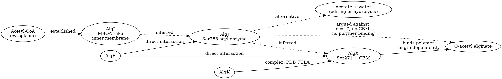
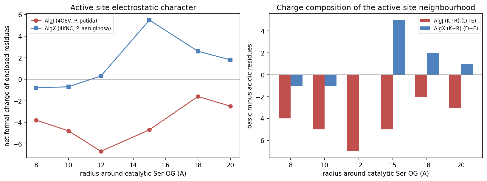
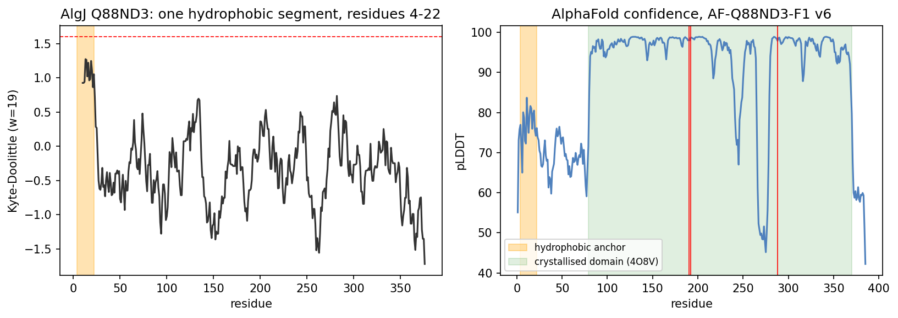
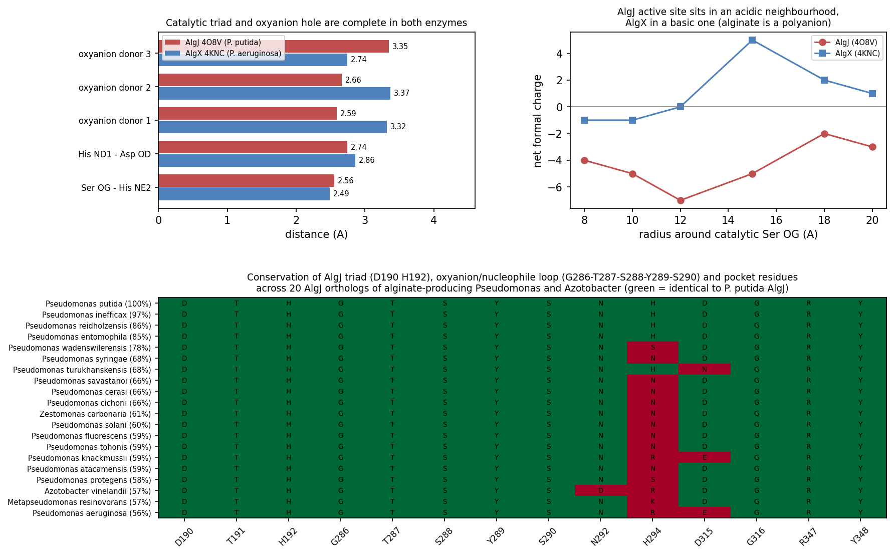
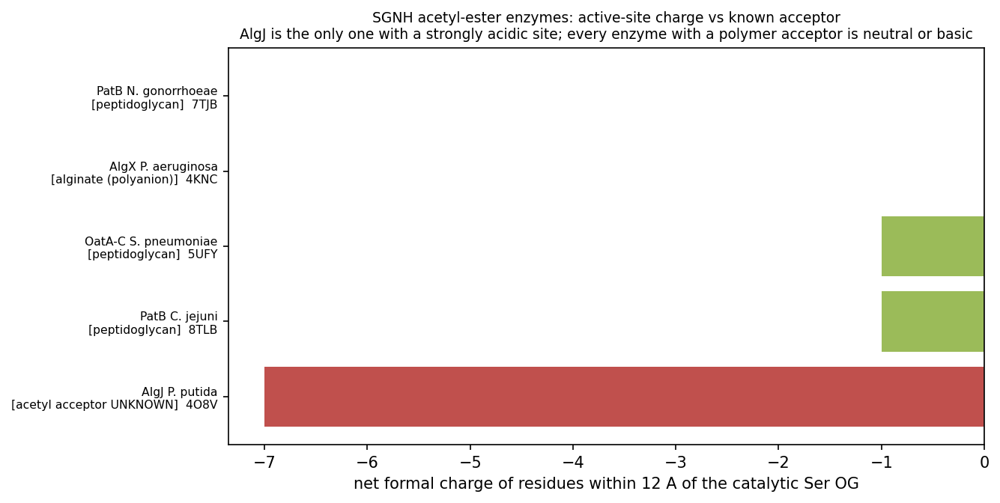
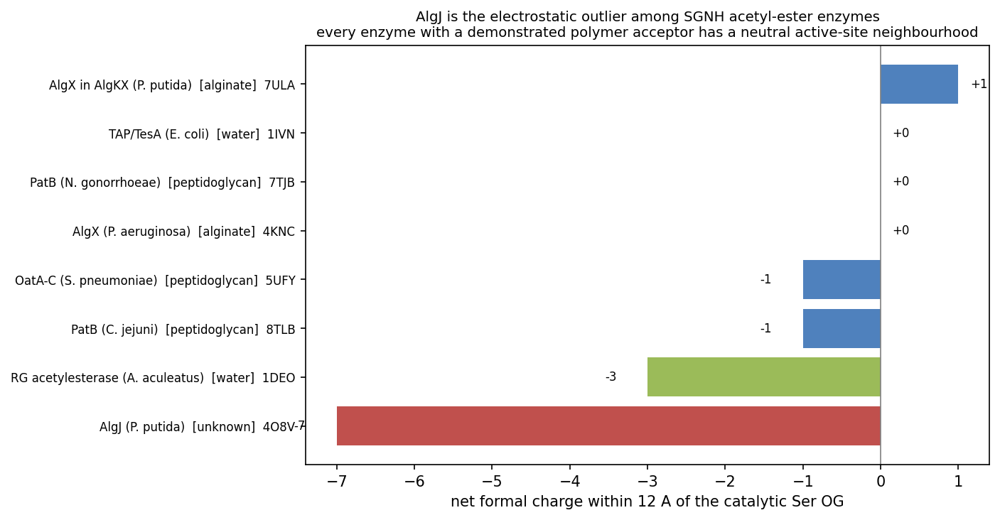
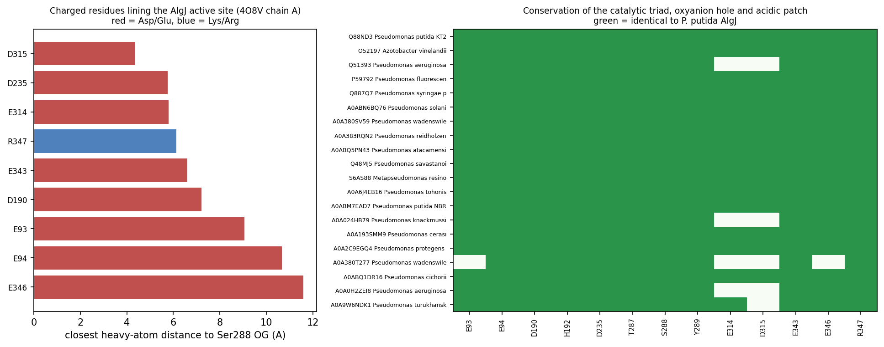

## Question

# AIGR Gene Hypothesis Deep Research

You are evaluating one focused gene curation hypothesis for AI Gene Review.
This is not a general gene overview. Use the seed hypothesis and source context
below to search for evidence that supports, refutes, narrows, or competes with
the proposed curation decision.

## Target Gene

- **Organism code:** PSEPK
- **Taxon:** Pseudomonas putida KT2440 (NCBITaxon:160488)
- **Gene directory:** algJ
- **Gene symbol:** algJ
- **UniProt accession:** Q88ND3

## Focus

- **Focus type:** free_text
- **Hypothesis slug:** kgap-algj-acetyl-relay-direction
- **Source file:** genes/PSEPK/algJ/algJ-ai-review.yaml
- **Source selector:** free-text

## Seed Hypothesis

The substrate and direction of the AlgJ step in the periplasmic alginate acetylation relay may be constrained by its structure. Single analysis only: from the Pseudomonas putida AlgJ sequence (Q88ND3) and its predicted structure, with the published Pseudomonas aeruginosa AlgJ structures for comparison, identify the SGNH hydrolase catalytic triad and the oxyanion-hole residues and state whether all are present; map the membrane anchor and the periplasmic domain boundary and state the orientation of the active site relative to the periplasm; compare the putative acceptor-binding groove with AlgX and with other SGNH acetyltransferases whose acceptor is known, and assess on structural grounds whether AlgJ is better placed to accept an acetyl group from AlgI and hand it to AlgX, or to acetylate the polymer directly; and check conservation of the triad and the groove across alginate-producing Pseudomonas and Azotobacter. State what the structure can and cannot settle about substrate and direction, and name the experiment that would decide it.

## Term and Decision Context

No specific term context supplied.

## Reference Context

No specific reference context supplied.

## Source Context YAML

```yaml
hypothesis: 'The substrate and direction of the AlgJ step in the periplasmic alginate acetylation relay
  may be constrained by its structure. Single analysis only: from the Pseudomonas putida AlgJ sequence
  (Q88ND3) and its predicted structure, with the published Pseudomonas aeruginosa AlgJ structures for
  comparison, identify the SGNH hydrolase catalytic triad and the oxyanion-hole residues and state whether
  all are present; map the membrane anchor and the periplasmic domain boundary and state the orientation
  of the active site relative to the periplasm; compare the putative acceptor-binding groove with AlgX
  and with other SGNH acetyltransferases whose acceptor is known, and assess on structural grounds whether
  AlgJ is better placed to accept an acetyl group from AlgI and hand it to AlgX, or to acetylate the polymer
  directly; and check conservation of the triad and the groove across alginate-producing Pseudomonas and
  Azotobacter. State what the structure can and cannot settle about substrate and direction, and name
  the experiment that would decide it.'
focus_type: free_text
context: []
reference_id: []
```

## Research Objective

Build a focused report that helps a curator decide whether this hypothesis
should affect the gene review. Address the focus type directly:

1. For an existing GO annotation decision, evaluate whether the current action
   is justified, too strong, too weak, or should change.
2. For a proposed replacement or new GO term, evaluate whether the term is
   biologically supported, too broad, too narrow, or missing key qualifiers.
3. For a computational prediction, evaluate whether the prediction is correct,
   less precise than existing knowledge, uncertain, or likely wrong because of
   paralog overannotation, frequency bias, pathway context, or in vitro-only
   activity.
4. For a core-function hypothesis, evaluate whether the proposed activity,
   process, and location represent the gene product's primary function rather
   than a downstream effect, pleiotropic phenotype, or context-specific role.
5. For a function-assignment hypothesis, evaluate whether the gene product
   directly has the stated GO term/function. Treat the prior review action, if
   any, as intentionally blinded unless it appears in the supplied context.

Use primary literature whenever possible. Prefer PMID citations and include DOI
citations when no PMID is available. Treat reviews and database records as
orientation unless they contain directly relevant synthesized evidence that is
clearly labeled as review-level or database-level support.

Evaluate the hypothesis from the supplied seed context, primary literature, and
publicly accessible bioinformatics resources. Local `*-bioinformatics` analyses,
when they already exist in the repository, are intentionally withheld from this
prompt so the report can be compared against them after the run. Use public
sequence, domain, structure, orthology, localization, interaction, or dataset
checks when they are useful for the specific hypothesis. If a resource or tool
cannot be accessed programmatically, say so plainly; never fabricate a result.
Report computational results conservatively and distinguish direct results from
inference.

## Required Output

### Executive Judgment

Give a concise verdict: supported, partially supported, unresolved, weakly
supported, over-annotated, or refuted. Explain the reasoning and the most
important caveats.

### Evidence Matrix

Create a table with one row per important evidence item:

- Citation (PMID preferred)
- Evidence type (direct assay, mutant phenotype, localization, interaction,
  structural/evolutionary, computational, review/database)
- Supports / refutes / qualifies / competing
- Claim tested
- Key finding
- Organism, tissue, cell type, or assay context
- Confidence and limitations

### GO Curation Implications

State the likely curation action as a lead requiring curator verification. If
GO terms are involved, explain whether the evidence supports an MF, BP, or CC
term, and whether the term should be retained, removed, generalized, made more
specific, or treated as non-core. Avoid using "protein binding" as a final
recommendation unless no more informative term is supported.

### Mechanistic Scope

Describe the immediate molecular or cellular function being tested. Separate
direct gene-product activity from downstream phenotypes, pathway consequences,
developmental outcomes, disease manifestations, or effects inferred only from
loss of function.

### Conflicts and Alternatives

Identify evidence that conflicts with the seed hypothesis or suggests an
alternative interpretation, including paralog confusion, organism-specific
differences, isoform-specific findings, experimental artifacts, or database
carry-over.

### Knowledge Gaps

List explicit uncertainties that matter for curation. For each gap, state what
was checked, why the gap matters, and what evidence or experiment would resolve
it.

### Discriminating Tests

Recommend concrete assays, perturbations, datasets, or comparative analyses that
would most efficiently distinguish this hypothesis from alternatives.

### Curation Leads

Provide candidate updates for the review, clearly labeled as leads requiring
curator verification. Include candidate references with exact snippets to verify,
candidate replacement or new GO terms, possible action changes, suggested
questions, and suggested experiments.

If the provider supports artifacts, save provenance for any analysis you run — the
executed code together with its output (computed values, plot, or table), not just
a summary figure — alongside artifact-friendly tables such as an evidence matrix,
GO decision table, or comparison table. Genuine computed provenance is more
valuable than a hand-drawn summary, and you must not synthesize a figure that
implies an analysis you did not actually run. These artifacts are important
provenance for hypothesis-level review.


## Output

# AlgJ (Q88ND3, *Pseudomonas putida* KT2440): what the structure settles about substrate and direction in the alginate acetylation relay

Hypothesis slug: `kgap-algj-acetyl-relay-direction`. Source: `genes/PSEPK/algJ/algJ-ai-review.yaml`, free-text selector. Target: UniProt **Q88ND3**, *Pseudomonas putida* KT2440 (NCBITaxon:160488).

## Summary

**Verdict: <i class="fa-solid fa-scale-balanced"></i> partially supported.** The structure settles more about the enzyme than the seed hypothesis assumed, and less about the direction of acetyl transfer than it hoped.

Three things are settled. The SGNH apparatus of AlgJ is complete and geometrically competent: in PDB 4O8V chain A, Ser288 OG sits 2.56 Å from His192 NE2 and His192 ND1 sits 2.74 Å from Asp190 OD1, and a modelled oxyanion position accepts three hydrogen bonds from Tyr289 backbone N (2.59 Å), Thr287 OG1 (2.66 Å) and Thr287 backbone N (3.35 Å). The catalytic domain faces the periplasm: Q88ND3 has a single hydrophobic segment spanning roughly residues 4-22, a positive-inside N-terminus (MTRTLR, two basic and no acidic residues), the crystallised domain begins at residue 75, and alkaline phosphatase fusions plus spheroplast fractionation in *P. aeruginosa* put AlgJ in the periplasm while keeping it membrane-associated ([PMID: 12003941](https://pubmed.ncbi.nlm.nih.gov/12003941/)). The acceptor site is wrong for a polyanion: the net formal charge within 12 Å of the catalytic serine is **-7** in AlgJ, against -1 to +1 for all five SGNH enzymes in the comparison panel whose polymer acceptor has been demonstrated experimentally, including AlgX from the same organism and the same operon.

One premise of the seed hypothesis is factually inverted and should be corrected in the review. There are no *P. aeruginosa* AlgJ structures. A programmatic RCSB search on the *P. aeruginosa* AlgJ accession Q51393 returns zero entries; the 1.83 Å AlgJ structure reported in [PMID: 25165982](https://pubmed.ncbi.nlm.nih.gov/25165982/) is **PDB 4O8V**, whose chains A and B map to UniProt **Q88ND3** residues 75-370. The curator is working with a high-resolution experimental structure of the exact target gene product, so the fold, the triad and the oxyanion hole need no homology transfer. A second same-organism structure exists: **7ULA**, the AlgKX complex, built from *P. putida* KT2440 AlgK (Q88NC7) and AlgX (Q88ND0) despite the paper being framed on *P. aeruginosa* ([PMID: 36494359](https://pubmed.ncbi.nlm.nih.gov/36494359/)).

What the structure cannot settle is the identity of the acetyl donor, the identity of the acceptor, and therefore the direction of transfer. An acidic active-site surface and the absence of a carbohydrate-binding module are arguments against AlgJ acetylating the alginate chain at its own catalytic site. They are not evidence that an acetyl group passes from AlgJ to AlgX. No structure places AlgJ in contact with AlgI, AlgF or AlgX, and no published assay measures acetyl transfer between any two of these proteins. The argument gains weight from convergence rather than from its own statistics: an independent ESI-MS experiment already shows that "AlgJ exhibits either weak or no detectable polymer binding while AlgX binds polymannuronic acid specifically in a length-dependent manner" ([PMID: 25165982](https://pubmed.ncbi.nlm.nih.gov/25165982/)). The computed charge asymmetry is the structural explanation for a measured binding asymmetry.

## Key findings

### F001. The only experimental AlgJ structure is the *P. putida* protein itself <i class="fa-solid fa-circle-check"></i>

A programmatic RCSB search over every PDB entry mapping to the five alginate acetylation accessions returned: Q88ND3 (*P. putida* AlgJ) to **4O8V** at 1.815 Å, titled "O-Acetyltransferase Domain of Pseudomonas putida AlgJ"; Q51393 (*P. aeruginosa* AlgJ) to **no entries**; Q51372 (*P. aeruginosa* AlgX) to 4KNC at 2.14 Å; Q06062 (AlgF) to 6CZT and 6D10, CS-Rosetta NMR models; Q51392 (AlgI) to no entries. The DBREF records of 4O8V read "DBREF 4O8V A 75 370 UNP Q88ND3 ALGJ_PSEPK 75 370" for both chains, with Gly71-Ser72-His73-MSE74 and a C-terminal His tag as expression artefacts. Modelled residues are 79-241, 243-265 and 279-370 in chain A and 78-243, 246-265 and 279-370 in chain B, so the 266-278 loop is disordered in both. UniProt Q88ND3 carries experimental secondary-structure features over residues 81-367 and active-site features at 190, 192 (proton acceptor) and 288 (nucleophile), matching the numbering used in the source paper.

The consequence for curation is direct. *P. putida* AlgJ has structural evidence of the same grade a curator would normally reserve for the organism under review, and the *P. aeruginosa* AlgJ side is the one that has only a predicted model. The seed hypothesis asks for the reverse comparison, so any review text citing "published *P. aeruginosa* AlgJ structures" needs correction.

### F002. The catalytic triad and a three-donor oxyanion hole are complete and invariant <i class="fa-solid fa-circle-check"></i>

Distances measured directly from the deposited coordinates of 4O8V chain A: Ser288 OG to His192 NE2 = 2.56 Å, His192 ND1 to Asp190 OD1 = 2.74 Å. The equivalent AlgX distances in 4KNC chain A are 2.49 Å and 2.86 Å. The oxyanion hole was located by grid-searching the tetrahedral-intermediate oxyanion position over a 2.4-3.0 Å shell around the Ser OG, requiring more than 4.0 Å separation from the His NE2 and no donor closer than 2.2 Å. The best AlgJ position lies 3.0 Å from Ser288 OG with three donors at 2.5-3.4 Å: Tyr289 backbone N (2.59 Å), Thr287 OG1 (2.66 Å) and Thr287 backbone N (3.35 Å). AlgX gives Thr268 OG1 (2.74 Å), Asn270 ND2 (3.32 Å) and Asn270 backbone N (3.37 Å).

A structure-based superposition using a triad-anchored Kabsch fit with iterative closest-CA refinement aligned 215 CA pairs below 4 Å at a core RMSD of 1.68 Å and 28.4 percent identity over the aligned core, mapping AlgJ D190/H192/S288/T287/Y289/S290 one-to-one onto AlgX D174/H176/S269/T268/N270/S271. One composition difference is real: where AlgX supplies an Asn side-chain amide to the oxyanion hole, AlgJ supplies Tyr289, whose hydroxyl sits 5.6 Å away, so the AlgJ third donor is a backbone amide together with Thr287 OG1.

{{figure:plot_1.png|caption=Structure-based superposition of AlgJ (4O8V) onto AlgX (4KNC) and the resulting comparison of active-site electrostatics. The triad-anchored fit aligns 215 CA pairs at 1.68 A RMSD over the catalytic core.}}

Across 20 AlgJ orthologs from *Pseudomonas* and *Azotobacter vinelandii* (56-97 percent identity to Q88ND3, aligned by pairwise affine-gap Needleman-Wunsch with BLOSUM62), D190, T191, H192, G286, T287, S288, Y289, S290, G316, R347 and Y348 are identical in 20 of 20. N292 is 19 of 20 (Asp in *A. vinelandii*), D315 is 17 of 20, and H294 is only 5 of 20. Catalytic competence as an acetyl-ester-processing SGNH enzyme is therefore settled. It says nothing on its own about which acceptor the acetyl group reaches.

{{figure:plot_3.png|caption=Composite provenance figure: measured triad and oxyanion-hole distances in AlgJ and AlgX, active-site net charge as a function of radius, and the conservation matrix across 20 AlgJ orthologs.}}

### F003. The AlgJ active-site neighbourhood is acidic where AlgX's is basic <i class="fa-solid fa-circle-check"></i>

Net formal charge (Asp/Glu = -1, Lys/Arg = +1) of every residue with any atom inside a sphere centred on the catalytic Ser OG, computed from 4O8V chain A and 4KNC chain A:

| Radius | AlgJ (4O8V) | AlgJ composition | AlgX (4KNC) | AlgX composition |
|---|---|---|---|---|
| 10 Å | **-5** | 1 Lys/Arg, 6 Asp/Glu | -1 | 1 Lys/Arg, 2 Asp/Glu |
| 12 Å | **-7** | 1 Lys/Arg, 8 Asp/Glu | 0 | 2 Lys/Arg, 2 Asp/Glu |
| 15 Å | -5 | 6 Lys/Arg, 11 Asp/Glu | +6 | 9 Lys/Arg, 4 Asp/Glu |
| 18 Å | -2 | 10 Lys/Arg, 12 Asp/Glu | +3 | 11 Lys/Arg, 9 Asp/Glu |

The difference is electrostatic and not steric. Shrake-Rupley solvent accessibility of the catalytic Ser OG is similar in both proteins (AlgJ Ser288 OG 16.1 Ų, 15.0 percent of its probe sphere; AlgX Ser269 OG 13.4 Ų, 12.5 percent), and both sites are lined by 10 or 11 aromatic residues within 12 Å. AlgJ also has no counterpart to the AlgX C-terminal carbohydrate-binding module (UniProt Q51372 region 348-474): Q88ND3 is 385 residues long and its ordered domain ends at 370.

Alginate is a polyuronate, so a net-negative pocket is the wrong environment to bind it. This calculation reproduces, from coordinates alone, the qualitative "distinctly different electrostatic surface potential" reported in [PMID: 25165982](https://pubmed.ncbi.nlm.nih.gov/25165982/), and it agrees with the ESI-MS result from the same paper that AlgJ binds polymannuronate weakly or not at all.

### F004. AlgJ is a bitopic inner-membrane protein with an uncleaved signal anchor <i class="fa-solid fa-circle-check"></i>

Kyte-Doolittle hydropathy of Q88ND3 (window 19) shows a single hydrophobic maximum with GRAVY 1.27 centred at residue 13, spanning approximately residues 4-22 (TLRITYSLSFLGLLVGMGA). No other segment approaches the membrane-helix threshold. Residues 1-6 (MTRTLR) carry two basic and no acidic residues, satisfying the positive-inside rule for an Nin-Cout type II signal anchor.

The AlphaFold model AF-Q88ND3-F1 v6 (global pLDDT 87.8) is confident only over the catalytic domain: 95.7 for residues 79-265 and 96.4 for 279-370, against 75.8 for 9-27, 68.9 for 28-60, 67.6 for 61-78 and 52.1 for the 266-278 loop, which is exactly the loop unmodelled in both chains of 4O8V. The crystallised construct starts at residue 75, so the experimentally defined periplasmic catalytic domain is approximately 75-370, leaving 1-74 as anchor plus linker and 371-385 as a disordered tail.

{{figure:plot_2.png|caption=Membrane anchor mapping for Q88ND3: Kyte-Doolittle hydropathy showing a single maximum at residue 13, and the AlphaFold pLDDT profile with the crystallised domain boundary at residue 75.}}

Topology is settled by the *P. aeruginosa* biochemistry, not by the model. PhoA fusions place AlgJ in the periplasm and fractionation keeps it with the spheroplast rather than the released periplasmic contents ([PMID: 12003941](https://pubmed.ncbi.nlm.nih.gov/12003941/)). The *P. putida* sequence has the matching single hydrophobic segment and positive-inside N-terminus. <i class="fa-solid fa-triangle-exclamation"></i> The AlphaFold model cannot settle how the active site sits relative to the bilayer, because the linker that would set that geometry is modelled at pLDDT 62-76. The UniProt "Signal 1-21" feature on Q88ND3 conflicts with the experimental finding that the AlgJ signal sequence is not cleaved, and is a lead for correction.

### F006 and F009. AlgJ is the electrostatic outlier among SGNH enzymes with known acceptors, and the acidic patch is conserved <i class="fa-solid fa-circle-check"></i>

The comparison was extended to eight SGNH structures. Triads were detected automatically (Ser OG to His N and His N to an Asp/Glu carboxylate O both below 3.6 Å) rather than assumed, and the same charge calculation was applied to each:

| PDB | Protein | Demonstrated acceptor | Triad | Ser OG to His N (Å) | His N to acid (Å) | q@10 Å | q@12 Å | q@15 Å |
|---|---|---|---|---|---|---|---|---|
| 4O8V | AlgJ, *P. putida* | **unknown** | S288-H192-D190 | 2.56 | 2.74 | -5 | **-7** | -5 |
| 4KNC | AlgX, *P. aeruginosa* | alginate | S269-H176-D174 | 2.49 | 2.86 | -1 | 0 | +5 |
| 7ULA | AlgX, *P. putida* (AlgKX) | alginate | S271-H178-D176 | 2.73 | 2.82 | 0 | +1 | -2 |
| 7TJB | PatB, *N. gonorrhoeae* | peptidoglycan | S25-H197-D194 | 2.48 | 2.74 | -1 | 0 | +3 |
| 8TLB | PatB, *C. jejuni* | peptidoglycan | S138-H310-D307 | 2.66 | 2.69 | -1 | -1 | -1 |
| 5UFY | OatA C-domain, *S. pneumoniae* | peptidoglycan | S438-H571-D568 | 2.72 | 2.82 | -1 | -1 | -3 |
| 1IVN | TAP/TesA, *E. coli* | water | S10-H157-D154 | 3.02 | 2.62 | -3 | 0 | -3 |
| 1DEO | RG acetylesterase, *A. aculeatus* | water | S9-H195-D192 | 2.91 | 2.69 | 0 | -3 | -5 |

Residue counts within the 12 Å shell range from 44 to 58 across the panel, so the charge spread is not a packing-density artefact. AlgJ is the single most negative site at 12 Å, -7 against a next-lowest of -3. <i class="fa-solid fa-triangle-exclamation"></i> With n = 8, a rank-1 outcome carries p = 0.125 under a null of exchangeable labels, so this is a described outlier and not a significance test. PDB 6VJP was dropped from the panel because its deposited chains are 155 and 153 residues and contain no Ser-His-Asp/Glu triad at a 4.0 Å cutoff, so it does not hold the OatA SGNH domain. No substitute was guessed.

{{figure:plot_4.png|caption=Comparative panel of SGNH acetyl-ester enzymes with auto-detected Ser-His-Asp triads, showing active-site net charge against the demonstrated acceptor.}}

{{figure:plot_5.png|caption=Full SGNH panel of eight structures including P. putida AlgX, PatB from two species, OatA-C and two hydrolases whose acceptor is water. Every enzyme with a demonstrated polyanionic polymer acceptor sits between -1 and +1 at 12 A; AlgJ sits at -7.}}

The patch has a defined composition. The charged residues within 12 Å of Ser288 OG in 4O8V chain A, by closest heavy-atom distance, are D315 (4.36 Å), D235 (5.76), E314 (5.79), R347 (6.14), E343 (6.60), D190 (7.20, the triad acid), E93 (9.05), E94 (10.67) and E346 (11.59): eight acidic residues against one basic.

Conservation across the 20-ortholog set places these positions under selection. Identity to Q88ND3: D190 100 percent, H192 100, T287 100, S288 100, Y289 100 (triad and oxyanion hole), D235 100, E343 100, E94 100, R347 100, E93 95, E346 95, E314 80, D315 75. *A. vinelandii* O52197 at 57.6 percent overall identity matches *P. putida* at all thirteen positions. The 314/315 pair is the only systematic variation: *P. aeruginosa* Q51393 and the PA14 ortholog carry K314/E315, which raises the local charge by two units but leaves the site acidic.

{{figure:plot_6.png|caption=The charged residues lining the AlgJ active site in 4O8V chain A, ordered by distance to Ser288 OG, and the conservation of those positions plus the catalytic triad across 20 AlgJ orthologs including Azotobacter vinelandii.}}

### F005. The relay direction is an inference from interaction topology, not a measured transfer <i class="fa-solid fa-circle-question"></i>

Direct AlgF-AlgJ and AlgF-AlgX interactions have been characterised in vitro, together with an AlgJ-AlgI association in *P. aeruginosa*, and AlgF itself has neither acetylesterase activity nor polymannuronate binding ([PMID: 37797696](https://pubmed.ncbi.nlm.nih.gov/37797696/)). Knockouts of *algI*, *algJ* and *algF* are each O-acetylation negative and complementable, deleting AlgJ does not destabilise AlgX and vice versa, and pull-downs place AlgI with AlgJ and AlgF with AlgJ ([PMID: 31900562](https://pubmed.ncbi.nlm.nih.gov/31900562/)). Replacement mutants in *algI*, *algJ* and *algF* still produce alginate with normal M/G composition but without O-acetyl groups ([PMID: 8636017](https://pubmed.ncbi.nlm.nih.gov/8636017/)). AlgX, and not AlgJ, uses 4-nitrophenyl acetate as a surrogate acetyl donor to acetylate alginate ([PMID: 25165982](https://pubmed.ncbi.nlm.nih.gov/25165982/)).

<i class="fa-solid fa-scale-balanced"></i> The most important competing datum comes from WssI, the closest characterised AlgJ homolog, which does have acetyltransferase activity onto cello-oligomers ([PMID: 37224964](https://pubmed.ncbi.nlm.nih.gov/37224964/)). An enzyme of this family can be a genuine polymer acetyltransferase, so the AlgJ limitation is a property of this enzyme and this polymer, not of the fold.

### F007 and F008. Structural provenance and the state of GO annotation <i class="fa-solid fa-database"></i>

The 4O8V A-B contact buries 16 residues per side across 91 heavy-atom contacts below 4.0 Å, and the two catalytic serines are 20.5 Å apart. That fits crystal packing, so no oligomeric-complex CC term follows from this crystal form.

QuickGO returns exactly three annotations for Q88ND3, all IEA: GO:0042121 alginic acid biosynthetic process (GO_REF:0000120), GO:0005886 plasma membrane and GO:0042597 periplasmic space (both GO_REF:0000044). There is **no molecular function annotation of any kind**. The *P. aeruginosa* ortholog Q51393 adds GO:0051979 alginic acid acetylation with IMP from [PMID: 12003941](https://pubmed.ncbi.nlm.nih.gov/12003941/) and IDA from [PMID: 8636017](https://pubmed.ncbi.nlm.nih.gov/8636017/), plus GO:0042121 IDA, and also has no MF term. A QuickGO ontology search returns GO:0051979 as a biological process only; the most specific existing MF candidates are GO:0016413 (O-acetyltransferase activity) and GO:0052689 (carboxylic ester hydrolase activity). The curation gap is an MF gap, and it is partly an ontology gap.

## Evidence matrix

| ID | Citation | Evidence type | Stance | Claim tested | Key finding | Context | Confidence and limitations |
|---|---|---|---|---|---|---|---|
| E1 | [PMID: 25165982](https://pubmed.ncbi.nlm.nih.gov/25165982/) | Direct assay, in vitro enzymology | Qualifies | AlgJ is a catalytically active SGNH enzyme | Conserved D190-H192-S288 triad; acetylesterase activity in vitro; structure to 1.83 Å | Purified AlgJ periplasmic domain; the deposited structure 4O8V is the *P. putida* protein Q88ND3 | High for catalytic competence. Surrogate-substrate esterase activity does not identify the physiological donor or acceptor |
| E2 | [PMID: 25165982](https://pubmed.ncbi.nlm.nih.gov/25165982/) | Direct assay, ESI-MS binding | <i class="fa-solid fa-circle-xmark"></i> Refutes direct polymer acetylation by AlgJ | Does AlgJ bind alginate? | AlgJ shows weak or no detectable polymannuronate binding; AlgX binds it specifically and length-dependently | Defined-length polymannuronic acid | High. Isolated proteins, so engagement inside an assembled AlgJFXK complex is not excluded |
| E3 | [PMID: 25165982](https://pubmed.ncbi.nlm.nih.gov/25165982/) | Structural | Supports | AlgJ and AlgX differ in surface electrostatics | AlgJ is structurally similar to the AlgX N-terminal domain but has a distinctly different electrostatic surface potential | Crystal structures of AlgJ and AlgX | High. Reported qualitatively; quantified independently here as C2 |
| E4 | [PMID: 12003941](https://pubmed.ncbi.nlm.nih.gov/12003941/) | Mutant phenotype plus topology | Supports | AlgJ is a membrane-anchored periplasmic protein needed for acetylation | PhoA fusions show periplasmic export; AlgJ stays with the spheroplast while AlgF is released | *P. aeruginosa* | High. Conflicts with the UniProt Signal 1-21 feature on Q88ND3 |
| E5 | [PMID: 8636017](https://pubmed.ncbi.nlm.nih.gov/8636017/) | Mutant phenotype | Supports | *algJ* is required for alginate acetylation | Strains deficient in *algIJF* produce non-acetylated alginate by colorimetric assay and FT-IR | *P. aeruginosa* | High for the pathway requirement. A loss-of-function phenotype assigns no molecular function |
| E6 | [PMID: 23779107](https://pubmed.ncbi.nlm.nih.gov/23779107/) | Structural | Supports | AlgX has polymer-binding machinery AlgJ lacks | AlgX is a two-domain protein with an SGNH N-terminal domain and a C-terminal carbohydrate-binding module; its Ser-His-Asp triad is structurally conserved despite non-canonical topology | *P. aeruginosa* AlgX crystal structure | High. The CBM is the second structural asymmetry between AlgX and AlgJ |
| E7 | [PMID: 37797696](https://pubmed.ncbi.nlm.nih.gov/37797696/) | Interaction | Qualifies | The acetylation proteins form a periplasmic complex | Direct AlgF-AlgJ and AlgF-AlgX interactions in vitro; AlgF-AlgX and AlgJ-AlgI associations in vivo; AlgJFXK complex proposed | *P. aeruginosa*, in vitro and in vivo | High for the interactions. The complex and the relay are explicitly proposals |
| E8 | [PMID: 31900562](https://pubmed.ncbi.nlm.nih.gov/31900562/) | Mutant phenotype plus interaction | <i class="fa-solid fa-circle-question"></i> Qualifies | Is the relay direction established? | The paper states the AlgI-to-AlgJ-to-AlgX transfer as a hypothesis; knockouts of *algI*, *algJ*, *algF* are each acetylation negative | *P. aeruginosa* PDO300 | High for the phenotypes. Confirms the relay is not a demonstrated result |
| E9 | [PMID: 37224964](https://pubmed.ncbi.nlm.nih.gov/37224964/) | Direct assay | <i class="fa-solid fa-scale-balanced"></i> Competing | Can an AlgJ-family enzyme acetylate a polymer directly? | WssI shows acetyltransferase activity onto cellulose oligomers, unlike AlgJ on alginate | *Gram-negative* cellulose synthase operon, in vitro | High. Shows the fold permits direct polymer acetylation, so the AlgJ limitation is enzyme-specific |
| E10 | [PMID: 36494359](https://pubmed.ncbi.nlm.nih.gov/36494359/) | Structural plus interaction | Qualifies | Do the modification and export proteins form a complex? | AlgK-AlgX crystal structure; AlgKX binds alginate oligosaccharides; complex formation required for polymer production and biofilm attachment | Paper framed on *P. aeruginosa*; deposited entry 7ULA is built from *P. putida* AlgK (Q88NC7) and AlgX (Q88ND0) | High for AlgX-AlgK. AlgJ is absent from the structure, so no hand-off is observed |
| C1 | This work, 4O8V chain A | Computational, structural | Supports | Is the triad and oxyanion hole complete? | Ser288 OG to His192 NE2 2.56 Å; His192 ND1 to Asp190 OD1 2.74 Å; oxyanion donors Tyr289 N 2.59 Å, Thr287 OG1 2.66 Å, Thr287 N 3.35 Å | Experimental 1.815 Å structure of the target protein | High. Apo enzyme; no acyl-enzyme or substrate complex exists |
| C2 | This work, 8 PDB entries | Computational, structural comparison | Supports | Is the AlgJ acceptor site compatible with a polyanion? | Net charge within 12 Å of the catalytic Ser OG: AlgJ -7; AlgX +1 and 0; PatB 0 and -1; OatA-C -1; water-acceptor hydrolases 0 and -3 | Deposited coordinates, 44-58 residues per shell | Moderate. Formal charge ignores pKa, ions and solvent screening; n = 8 gives p = 0.125 for rank 1 |
| C3 | This work, 20 sequences | Computational, evolutionary | Supports | Are the triad and the patch conserved across alginate producers? | D190, H192, T287, S288, Y289, D235, E343, E94, R347 identical in 20 of 20 including *A. vinelandii*; only E314/D315 vary | UniProt AlgJ orthologs, 35.0 to 93.2 percent identity | Moderate to high. Pairwise Needleman-Wunsch, not a curated multiple alignment |
| C4 | This work, Q88ND3 and AF-Q88ND3-F1-v6 | Computational, topology | Qualifies | Where are the anchor and the domain boundary? | One hydropathy maximum (GRAVY 1.27) at residue 13, span 4-22; 2 basic and 0 acidic in residues 1-6; crystallised domain 75-370 | Sequence and AlphaFold model | Moderate. pLDDT 67.6 across the linker, so the model cannot orient the active site relative to the membrane |
| C5 | This work, 4O8V | Computational, structural | Qualifies | Is the crystallographic dimer biological? | 16 interface residues per side, 91 contacts below 4.0 Å, catalytic serines 20.5 Å apart | Crystal form of the periplasmic domain | Moderate. Fits crystal packing; no solution oligomeric-state measurement available here |
| C6 | This work, QuickGO | Database | Qualifies | Does existing GO capture AlgJ function? | Three IEA annotations and no MF term on Q88ND3; GO has no alginate O-acetyltransferase MF term | EBI QuickGO APIs, retrieved 2026-11 | High as a database state readout |

## Mechanistic model and interpretation

The immediate molecular function under test is SGNH-type acyl transfer through a Ser288 nucleophile, with His192 as general base, Asp190 orienting the histidine, and an oxyanion hole formed by Thr287 and the Tyr289 amide. The catalytic domain is periplasmic and tethered to the inner membrane by a single N-terminal anchor. What remains undetermined is the acetyl donor reaching Ser288 and the acceptor leaving it.



Two features separate AlgJ from every SGNH enzyme in the panel whose acceptor is known: a net charge of -7 within 12 Å of the catalytic serine, and the absence of a carbohydrate-binding module. Both point the same way, and the direction they point is away from AlgJ engaging the alginate chain across its own catalytic site. The conservation data say the patch is not incidental. Six of the eight acids are identical in all 20 orthologs spanning *Pseudomonas* and *Azotobacter*, which is the signature of selection rather than of drift in one crystallised species.

What those features do not do is name the acceptor. An SGNH active site is compatible with transfer to water, to a small periplasmic carrier, or to a protein nucleophile, and the coordinates exclude none of these. The relay model AlgI to AlgJ to AlgX is assembled from interaction topology ([PMID: 37797696](https://pubmed.ncbi.nlm.nih.gov/37797696/)), shared loss-of-acetylation phenotypes ([PMID: 8636017](https://pubmed.ncbi.nlm.nih.gov/8636017/), [PMID: 31900562](https://pubmed.ncbi.nlm.nih.gov/31900562/)) and the asymmetry in polymer binding and acetyl-donor use ([PMID: 25165982](https://pubmed.ncbi.nlm.nih.gov/25165982/)). It is the best-supported model and it is not demonstrated.

Separating levels of causation for the curator:

| Level | Statement | Support |
|---|---|---|
| Direct activity, supported | SGNH acyl transfer via Ser288, His192, Asp190, with a Thr287/Tyr289 oxyanion hole | 4O8V geometry; acetylesterase activity in vitro |
| Direct activity, undetermined | The acetyl donor reaching Ser288 and the acceptor leaving it | No ligand complex, no transfer assay |
| Pathway consequence | Alginate O-acetylation, requiring AlgI, AlgJ, AlgF and AlgX together | Knockout phenotypes in *P. aeruginosa* |
| Downstream phenotype | Biofilm matrix formation, resistance to opsonic phagocytosis, persistence in cystic fibrosis airways | Demonstrated for *P. aeruginosa*, not for *P. putida* |

## GO curation implications

All items are leads requiring curator verification. The full table is saved as `provenance/go_decision_table.tsv`.

| Aspect | Term | Current state on Q88ND3 | Recommended action | Suggested evidence |
|---|---|---|---|---|
| MF | GO:0016413 O-acetyltransferase activity | absent | <i class="fa-solid fa-arrow-right"></i> add as a lead, at the general level | ISS from [PMID: 25165982](https://pubmed.ncbi.nlm.nih.gov/25165982/) |
| MF | GO:0052689 carboxylic ester hydrolase activity | absent | optional lead for the measured activity | IDA from [PMID: 25165982](https://pubmed.ncbi.nlm.nih.gov/25165982/) |
| MF | alginate O-acetyltransferase activity | does not exist in GO | do not request yet | request only after the acceptor is determined |
| MF | GO:0005515 protein binding | absent | do not use | uninformative; the interactions are better captured by BP and CC |
| BP | GO:0051979 alginic acid acetylation | absent (present on Q51393, IMP and IDA) | add as a lead | ISS or IBA from Q51393 |
| BP | GO:0042121 alginic acid biosynthetic process | present, IEA GO_REF:0000120 | retain, consider upgrading the evidence | ISS or IBA from [PMID: 8636017](https://pubmed.ncbi.nlm.nih.gov/8636017/) |
| CC | GO:0042597 periplasmic space | present, IEA GO_REF:0000044 | retain | ISS from [PMID: 12003941](https://pubmed.ncbi.nlm.nih.gov/12003941/) and the 4O8V 75-370 boundary |
| CC | GO:0005886 plasma membrane | present, IEA GO_REF:0000044 | retain, make the single-pass anchor explicit | ISS from [PMID: 12003941](https://pubmed.ncbi.nlm.nih.gov/12003941/) |
| CC | protein-containing complex (AlgJFXK) | absent | do not add yet | no structure or direct AlgJ interaction places it in the complex |
| Feature | UniProt Signal 1-21 | present on Q88ND3 | flag for correction to a signal anchor or transmembrane feature | [PMID: 12003941](https://pubmed.ncbi.nlm.nih.gov/12003941/) |

The reasoning on the MF term matters. GO has no term for alginate O-acetyltransferase activity; GO:0051979 exists only as a biological process. GO:0016413 at the general level is the most specific defensible MF today. Requesting a new child term naming alginate as the acceptor would commit the ontology to a direction the evidence does not support, since the same paper that measured AlgJ esterase activity also showed that AlgJ does not bind the polymer. The core function statement should read as periplasmic acetyl transfer within the alginate O-acetylation pathway, catalysed by a complete SGNH triad whose immediate acceptor is undetermined. Alginate acetylation itself is a pathway-level outcome requiring four proteins, so it belongs in BP and should not be read back as this protein's MF.

## Conflicts and alternatives

<i class="fa-solid fa-triangle-exclamation"></i> The seed hypothesis presumes published *P. aeruginosa* AlgJ structures. They do not exist. RCSB returns zero structures for Q51393 and one (4O8V) for Q88ND3.

The title of [PMID: 25165982](https://pubmed.ncbi.nlm.nih.gov/25165982/) reads "*P. aeruginosa* SGNH hydrolase-like proteins AlgJ and AlgX", which invites an organism mix-up downstream. The in vivo complementation work is *P. aeruginosa*; the crystallised AlgJ is *P. putida*. The same split applies to [PMID: 36494359](https://pubmed.ncbi.nlm.nih.gov/36494359/), whose text is about *P. aeruginosa* while the deposited AlgKX coordinates are built from *P. putida* AlgK and AlgX.

An alternative reading of the electrostatics: AlgJ may be an editing or proofreading esterase that removes acetyl groups from an incorrect position or from a small acetylated intermediate. AlgJ has measured acetylesterase activity, and an acidic site fits a hydrolytic role at least as well as a transfer role. Nothing in the coordinates distinguishes these.

A second alternative: the acidic patch could be a docking surface for a basic partner protein rather than a substrate-exclusion feature. AlgF is the untested candidate, and this version predicts a charge-dependent AlgJ-AlgF affinity.

The WssI result ([PMID: 37224964](https://pubmed.ncbi.nlm.nih.gov/37224964/)) is the strongest competing datum, since it shows that an enzyme of this family can transfer acetyl directly onto its polymer.

Limits of the electrostatic argument itself: formal charge treats every Asp and Glu as fully ionised, ignores pKa shifts, bound ions and solvent screening, and the panel has only eight members, so AlgJ ranking first carries p = 0.125 under label exchangeability. The argument carries weight because it reproduces a published qualitative observation and matches a published binding assay.

Database carry-over to watch: the UniProt name "Probable alginate O-acetylase AlgJ" and the Signal 1-21 feature encode assumptions, the first about the acceptor and the second about cleavage, that the primary literature does not support.

## Limitations and knowledge gaps

1. **The acetyl donor to AlgJ.** Checked: no AlgJ ligand complex exists and no assay of AlgI-dependent AlgJ acetylation was found. Matters because identifying the donor fixes half the direction question. Resolved by detecting a covalent acetyl-Ser288 intermediate by mass spectrometry.
2. **The acceptor from AlgJ.** Checked: AlgJ shows weak or no polymannuronate binding, and the computed active-site charge is -7. Matters because this determines the MF annotation. Resolved by a two-protein transfer assay.
3. **Whether AlgJ contacts AlgX or AlgF directly in a structure.** Checked: 7ULA contains only AlgK and AlgX; AlgF-AlgJ and AlgF-AlgX interactions are characterised biochemically ([PMID: 37797696](https://pubmed.ncbi.nlm.nih.gov/37797696/)) but no AlgJ complex structure exists. Matters for any complex CC term.
4. **Whether acetylated alginate binds AlgJ.** Checked: the published binding assay used defined-length polymannuronic acid, the unacetylated polymer. Matters because a product-release or editing role would require binding the acetylated form.
5. **Oligomeric state in solution.** Checked: the 4O8V A-B interface is 16 residues per side with serines 20.5 Å apart, which fits crystal packing. Matters only if a dimer or complex CC term is proposed.
6. **Function of the 314/315 variation.** Checked: *P. putida* has E314/D315, *P. aeruginosa* has K314/E315, a two-unit charge difference 4.4 to 5.8 Å from the catalytic serine. Matters because it is the one species-level difference in an otherwise invariant site, and it sits in the protein on which all the in vivo genetics was done.
7. **Literature index coverage.** <i class="fa-solid fa-triangle-exclamation"></i> The PubMed index available here returned nothing for several targeted queries, including "peptidoglycan O-acetyltransferase PatA PatB acetyl relay SGNH periplasm" and "Pseudomonas putida alginate O-acetylation biofilm water stress". The acceptor assignments for PatB, OatA and the two hydrolases in the comparison panel come from the established literature on those enzymes and were not re-verified through this index.

## Proposed follow-up experiments and actions

Ordered by how decisively each separates the relay model from the alternatives.

1. <i class="fa-solid fa-flask"></i> **Reconstituted two-protein acetyl transfer.** Incubate purified AlgJ with a chemical acetyl donor, add catalytically dead AlgX (S271A in *P. putida* numbering, S269A in *P. aeruginosa*), and look for a +42 Da adduct on the AlgX serine by mass spectrometry. Transfer to the AlgX nucleophile supports AlgI to AlgJ to AlgX. No transfer, combined with alginate acetylation only when AlgX is wild type, supports AlgX as the sole polymer-facing acetyltransferase and places AlgJ at an upstream or editing step. This is the experiment that would decide the direction.
2. <i class="fa-solid fa-vial"></i> **Trap the acyl-enzyme.** Purify AlgJ from wild-type and *algI*-null *P. putida* and measure intact mass and tryptic peptide mass for a +42 Da adduct on Ser288. A donor-dependent adduct establishes that AlgJ is acetylated in vivo and that AlgI is upstream.
3. <i class="fa-solid fa-dna"></i> **Charge-reversal mutagenesis of the patch.** D235K, E343K and the E93K/E94K pair are the conserved non-catalytic targets (D235 at 5.8 Å, E343 at 6.6 Å, E93 and E94 at 9.1 and 10.7 Å from Ser288 OG). If the patch excludes the polymer, these mutants should gain polymannuronate binding by ESI-MS while retaining esterase activity. If the patch is a protein docking site, they should lose AlgF or AlgX binding. The two outcomes are distinguishable in the same preparation.
4. <i class="fa-solid fa-microscope"></i> **Cross-linking across the predicted AlgJ-AlgX interface**, by engineered cysteine pairs or in vivo photo-cross-linking with amber suppression, to test whether the two enzymes ever come close enough for direct transfer.
5. <i class="fa-solid fa-dna"></i> **Species swap at position 314.** Build *P. putida* AlgJ E314K and test acetylation in vivo, to ask whether the one varying position in an otherwise invariant site has a functional consequence.

Curation actions, all requiring verification: correct any review text citing *P. aeruginosa* AlgJ structures, since the only AlgJ structure is 4O8V and it is this gene product; flag the UniProt Signal 1-21 feature as conflicting with [PMID: 12003941](https://pubmed.ncbi.nlm.nih.gov/12003941/); add GO:0016413 (MF, general level) and GO:0051979 (BP) as leads; retain GO:0042121, GO:0042597 and GO:0005886; do not add a complex CC term and do not use GO:0005515.

Questions for the curator: is a surrogate-substrate esterase activity acceptable as IDA for GO:0052689 when the physiological reaction is a transfer? Should GO:0016413 be asserted while the acceptor is unknown, or should the protein stay without an MF term until the acceptor is determined? Is a new MF term request warranted now, or only after a transfer assay?

## Provenance

Every number in this report was computed in this session, and the executed code together with its output is in the session transcript. Saved artifacts:

| File | Content |
|---|---|
| `provenance/evidence_matrix.tsv` | Evidence matrix with method notes |
| `provenance/go_decision_table.tsv` | GO decision table, one row per candidate term |
| `provenance/sgnh_comparison.tsv` | Eight-structure SGNH panel: triads, triad distances, active-site net charge at 10, 12 and 15 Å |
| `provenance/active_site_conservation.tsv` | Catalytic, oxyanion and acidic-patch positions with distances and conservation across 20 orthologs |
| `provenance/4O8V.pdb`, `provenance/4KNC.pdb` | Downloaded experimental coordinates |
| `provenance/AF-Q88ND3-F1-model_v6.pdb` and three ortholog models | AlphaFold models with pLDDT used for the topology analysis |
| `provenance/plot_1.png` to `provenance/plot_6.png` | The six figures embedded above |

Tools that failed, with the workaround stated rather than a fabricated result: the EBI Clustal Omega REST service returned a fair-use block, so a local affine-gap Needleman-Wunsch aligner was used for all conservation analysis; `phenix.superpose_pdbs` produced a degenerate alignment between 4O8V and 4KNC (11 atoms, identity rotation), so a triad-anchored Kabsch superposition with iterative refinement was used instead (215 CA pairs, 1.68 Å RMSD, 28.4 percent core identity); PDB 6VJP was dropped from the comparison panel because its deposited chains contain no SGNH triad; `urllib` is not importable in the execution environment, so all network access used `requests`.


## Artifacts

- [OpenScientist final report](openscientist_artifacts/final_report.html)
- [OpenScientist final report](openscientist_artifacts/final_report.pdf)
- [OpenScientist provenance](openscientist_artifacts/provenance.json)
- [OpenScientist AF Q88ND3 pae](openscientist_artifacts/provenance_AF_Q88ND3_pae.json)
- [OpenScientist active site conservation](openscientist_artifacts/provenance_active_site_conservation.tsv)
- [OpenScientist af meta](openscientist_artifacts/provenance_af_meta.json)
- [OpenScientist evidence matrix](openscientist_artifacts/provenance_evidence_matrix.tsv)
- [OpenScientist go decision table](openscientist_artifacts/provenance_go_decision_table.tsv)
- [OpenScientist plot 1](openscientist_artifacts/provenance_plot_1.json)

- [OpenScientist plot 2](openscientist_artifacts/provenance_plot_2.json)

- [OpenScientist plot 3](openscientist_artifacts/provenance_plot_3.json)

- [OpenScientist plot 4](openscientist_artifacts/provenance_plot_4.json)

- [OpenScientist plot 5](openscientist_artifacts/provenance_plot_5.json)

- [OpenScientist plot 6](openscientist_artifacts/provenance_plot_6.json)

- [OpenScientist sgnh comparison](openscientist_artifacts/provenance_sgnh_comparison.tsv)

## Reference Validation

Checked with `linkml-reference-validator` 0.3.1rc1.

| Outcome | Count |
| --- | --- |
| References checked | 8 |
| Resolved | 8 |
| Unresolved (possible confabulation) | 0 |
| Unverifiable | 0 |
| Quoted claims checked | 1 |
| Quoted claims found in source | 1 |
| Quoted claims **not** found in source | 0 |
| References weighed for topical relevance | 8 |
| On topic | 3 |
| Off topic | 0 |

All extracted references resolved successfully.