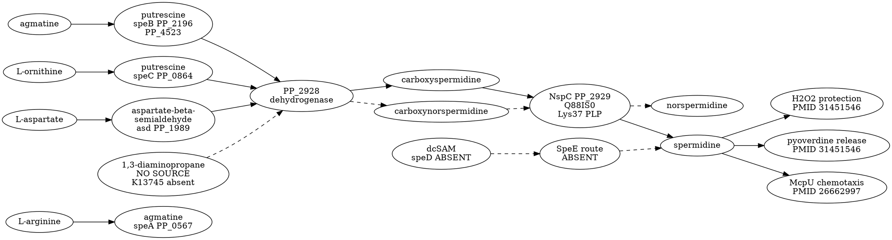
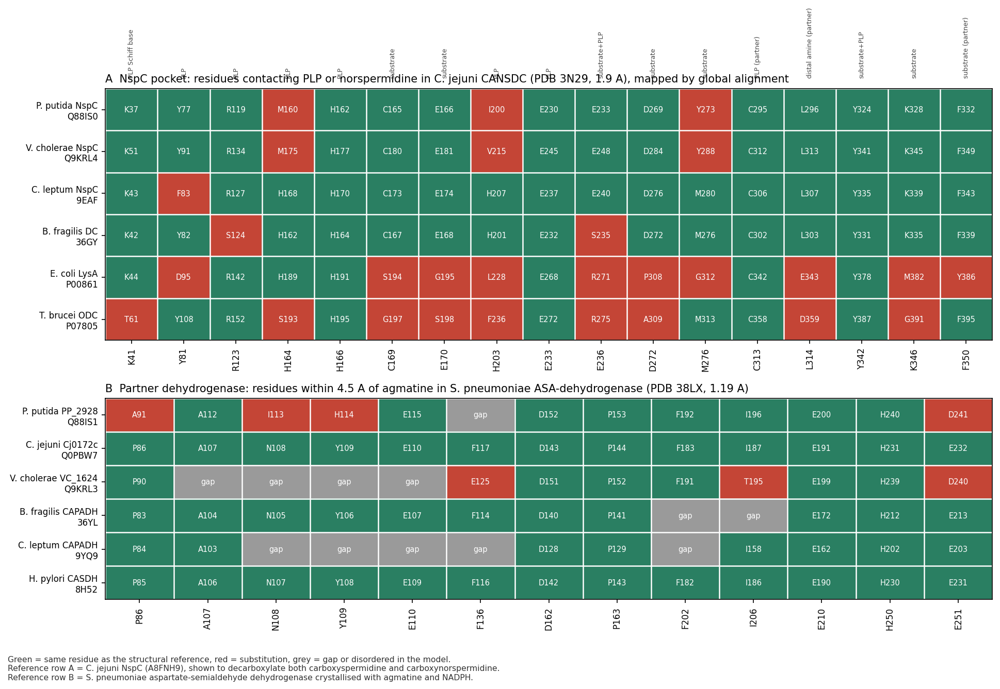
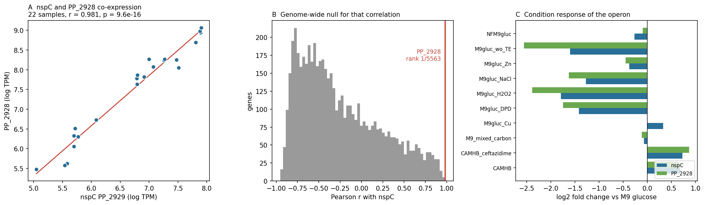
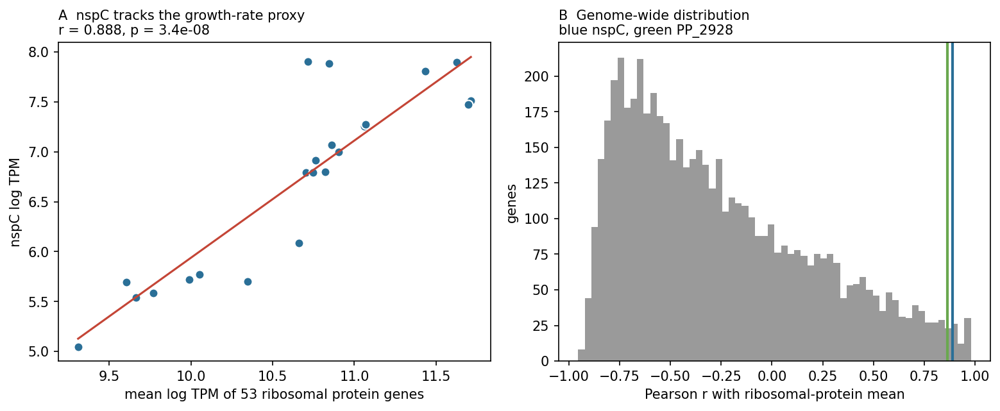
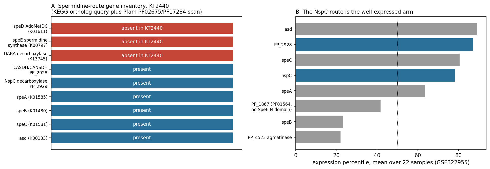
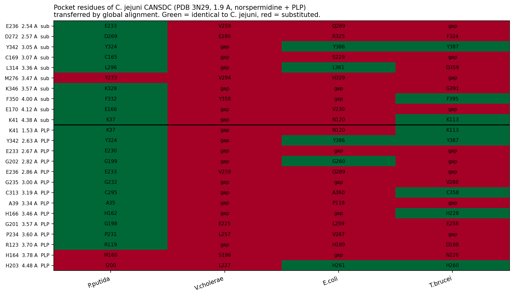
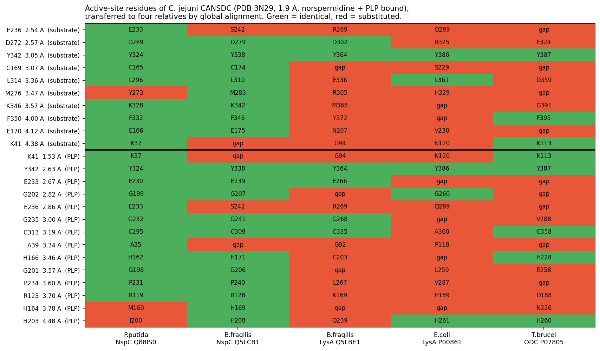

## Question

# AIGR Gene Hypothesis Deep Research

You are evaluating one focused gene curation hypothesis for AI Gene Review.
This is not a general gene overview. Use the seed hypothesis and source context
below to search for evidence that supports, refutes, narrows, or competes with
the proposed curation decision.

## Target Gene

- **Organism code:** PSEPK
- **Taxon:** Pseudomonas putida KT2440 (NCBITaxon:160488)
- **Gene directory:** nspC
- **Gene symbol:** nspC
- **UniProt accession:** Q88IS0

## Focus

- **Focus type:** free_text
- **Hypothesis slug:** kgap-nspc-substrate-partition
- **Source file:** genes/PSEPK/nspC/nspC-ai-review.yaml
- **Source selector:** free-text

## Seed Hypothesis

Whether KT2440 NspC (Q88IS0) partitions between carboxyspermidine and carboxynorspermidine may be constrained by its pocket, but a recent analysis of the Bacteroides counterpart found that an identical pocket turns over both chain lengths and that selectivity is imposed upstream at the partner dehydrogenase. Test whether that conclusion holds here. That the record assigns EC 4.1.1.96 with both reactions, and that family and synteny identify the NspC role, is already given, so do not re-derive it. Single analysis only: identify the catalytic and cofactor residues of NspC and the pocket positions that in characterised relatives set the choice between putrescine, agmatine, cadaverine and their carboxylated derivatives, stating what NspC has at each and whether it matches the Campylobacter enzyme shown to accept both chain lengths; identify the KT2440 partner dehydrogenase and state whether its substrate-determining positions differ from those of the Bacteroides and Campylobacter enzymes, since that is where selectivity would reside if the pocket cannot discriminate; check whether KT2440 also encodes the canonical spermidine synthase and the putrescine aminopropyltransferase route, which would bear on flux partition; and report any transcriptomic evidence for conditions under which nspC is induced. State whether pocket analysis can discriminate here or whether the same upstream conclusion applies, and say plainly which it is.

## Term and Decision Context

No specific term context supplied.

## Reference Context

No specific reference context supplied.

## Source Context YAML

```yaml
hypothesis: 'Whether KT2440 NspC (Q88IS0) partitions between carboxyspermidine and carboxynorspermidine
  may be constrained by its pocket, but a recent analysis of the Bacteroides counterpart found that an
  identical pocket turns over both chain lengths and that selectivity is imposed upstream at the partner
  dehydrogenase. Test whether that conclusion holds here. That the record assigns EC 4.1.1.96 with both
  reactions, and that family and synteny identify the NspC role, is already given, so do not re-derive
  it. Single analysis only: identify the catalytic and cofactor residues of NspC and the pocket positions
  that in characterised relatives set the choice between putrescine, agmatine, cadaverine and their carboxylated
  derivatives, stating what NspC has at each and whether it matches the Campylobacter enzyme shown to
  accept both chain lengths; identify the KT2440 partner dehydrogenase and state whether its substrate-determining
  positions differ from those of the Bacteroides and Campylobacter enzymes, since that is where selectivity
  would reside if the pocket cannot discriminate; check whether KT2440 also encodes the canonical spermidine
  synthase and the putrescine aminopropyltransferase route, which would bear on flux partition; and report
  any transcriptomic evidence for conditions under which nspC is induced. State whether pocket analysis
  can discriminate here or whether the same upstream conclusion applies, and say plainly which it is.'
focus_type: free_text
context: []
reference_id: []
```

## Research Objective

Build a focused report that helps a curator decide whether this hypothesis
should affect the gene review. Address the focus type directly:

1. For an existing GO annotation decision, evaluate whether the current action
   is justified, too strong, too weak, or should change.
2. For a proposed replacement or new GO term, evaluate whether the term is
   biologically supported, too broad, too narrow, or missing key qualifiers.
3. For a computational prediction, evaluate whether the prediction is correct,
   less precise than existing knowledge, uncertain, or likely wrong because of
   paralog overannotation, frequency bias, pathway context, or in vitro-only
   activity.
4. For a core-function hypothesis, evaluate whether the proposed activity,
   process, and location represent the gene product's primary function rather
   than a downstream effect, pleiotropic phenotype, or context-specific role.
5. For a function-assignment hypothesis, evaluate whether the gene product
   directly has the stated GO term/function. Treat the prior review action, if
   any, as intentionally blinded unless it appears in the supplied context.

Use primary literature whenever possible. Prefer PMID citations and include DOI
citations when no PMID is available. Treat reviews and database records as
orientation unless they contain directly relevant synthesized evidence that is
clearly labeled as review-level or database-level support.

Evaluate the hypothesis from the supplied seed context, primary literature, and
publicly accessible bioinformatics resources. Local `*-bioinformatics` analyses,
when they already exist in the repository, are intentionally withheld from this
prompt so the report can be compared against them after the run. Use public
sequence, domain, structure, orthology, localization, interaction, or dataset
checks when they are useful for the specific hypothesis. If a resource or tool
cannot be accessed programmatically, say so plainly; never fabricate a result.
Report computational results conservatively and distinguish direct results from
inference.

## Required Output

### Executive Judgment

Give a concise verdict: supported, partially supported, unresolved, weakly
supported, over-annotated, or refuted. Explain the reasoning and the most
important caveats.

### Evidence Matrix

Create a table with one row per important evidence item:

- Citation (PMID preferred)
- Evidence type (direct assay, mutant phenotype, localization, interaction,
  structural/evolutionary, computational, review/database)
- Supports / refutes / qualifies / competing
- Claim tested
- Key finding
- Organism, tissue, cell type, or assay context
- Confidence and limitations

### GO Curation Implications

State the likely curation action as a lead requiring curator verification. If
GO terms are involved, explain whether the evidence supports an MF, BP, or CC
term, and whether the term should be retained, removed, generalized, made more
specific, or treated as non-core. Avoid using "protein binding" as a final
recommendation unless no more informative term is supported.

### Mechanistic Scope

Describe the immediate molecular or cellular function being tested. Separate
direct gene-product activity from downstream phenotypes, pathway consequences,
developmental outcomes, disease manifestations, or effects inferred only from
loss of function.

### Conflicts and Alternatives

Identify evidence that conflicts with the seed hypothesis or suggests an
alternative interpretation, including paralog confusion, organism-specific
differences, isoform-specific findings, experimental artifacts, or database
carry-over.

### Knowledge Gaps

List explicit uncertainties that matter for curation. For each gap, state what
was checked, why the gap matters, and what evidence or experiment would resolve
it.

### Discriminating Tests

Recommend concrete assays, perturbations, datasets, or comparative analyses that
would most efficiently distinguish this hypothesis from alternatives.

### Curation Leads

Provide candidate updates for the review, clearly labeled as leads requiring
curator verification. Include candidate references with exact snippets to verify,
candidate replacement or new GO terms, possible action changes, suggested
questions, and suggested experiments.

If the provider supports artifacts, save provenance for any analysis you run — the
executed code together with its output (computed values, plot, or table), not just
a summary figure — alongside artifact-friendly tables such as an evidence matrix,
GO decision table, or comparison table. Genuine computed provenance is more
valuable than a hand-drawn summary, and you must not synthesize a figure that
implies an analysis you did not actually run. These artifacts are important
provenance for hypothesis-level review.


## Output

# NspC substrate partition in Pseudomonas putida KT2440 (Q88IS0, PP_2929)

Hypothesis slug: `kgap-nspc-substrate-partition`. Source: `genes/PSEPK/nspC/nspC-ai-review.yaml`, free-text focus. Target: UniProt Q88IS0, locus PP_2929, NCBITaxon:160488.

The EC 4.1.1.96 assignment with both reactions, and the family and synteny identification of the NspC role, were taken as given and were not re-derived.

## Summary

Pocket analysis cannot discriminate here. The KT2440 NspC active site is a conserved copy of the Campylobacter jejuni decarboxylase site that handles both chain lengths, so it gives no basis for assigning carboxyspermidine over carboxynorspermidine. The same upstream conclusion that was drawn for the Bacteroides counterpart applies to KT2440.

Of the ten residues within 4.5 Å of norspermidine in PDB 3N29 (C. jejuni CANSDC, 1.9 Å, product complex with norspermidine and PLP), Q88IS0 has nine identical. The single substitution is Met276 to Tyr273, which sits on the aliphatic wall at 3.47 Å and away from either terminal-amine anchor. The Bacteroides fragilis enzyme Q5LCB1, the one for which dual turnover was reported, matches 8 of the same 10. Three negative controls match only 2 to 3 of 10 (B. fragilis LysA Q5LBE1 2/10, E. coli LysA P00861 2/10, T. brucei ODC P07805 3/10), so the method has the resolution to detect a specificity-relevant difference when one exists. It finds none in Q88IS0.

Where KT2440 departs from the published Bacteroides case is one step earlier, and in two ways. The syntenic partner dehydrogenase is PP_2928 (Q88IS1, 414 aa, PF16653 plus PF03435), currently named "Saccharopine dehydrogenase" in UniProt and given no KEGG KO. Its diamine pocket differs from the agmatine-preferring Bacteroides, Campylobacter, Helicobacter and Clostridium enzymes at four of thirteen positions, including loss of the asparagine that makes the closest contact to the agmatine guanidinium in the reference complex. Above that, diamine supply constrains the outcome: KEGG finds no 2,4-diaminobutyrate decarboxylase (K13745) in the ppu genome, so KT2440 has no biosynthetic source of 1,3-diaminopropane, while putrescine supply runs intact through speA (PP_0567), speB (PP_2196), speC (PP_0864) and a second agmatinase (PP_4523). Carboxyspermidine is the substrate the cell can present. KT2440 also lacks both arms of the canonical route: K01611 (speD) and K00797 (speE) return empty, confirmed independently by a zero-hit PF02675 scan against positive controls that were all returned. NspC is therefore the only candidate spermidine-forming enzyme in the genome, and there is no flux partition to resolve, because there is only one route.

## Executive judgment

<i class="fa-solid fa-circle-check"></i> **Verdict: supported, with a stronger organism-specific conclusion than the seed hypothesis proposed.**

The seed hypothesis asked whether the KT2440 pocket constrains partition between carboxyspermidine and carboxynorspermidine, and whether the Bacteroides conclusion (identical pocket, selectivity upstream) holds here. It does. The pocket is permissive and the determining step is upstream. The organism-specific addition is that the upstream determinant in KT2440 is not only the dehydrogenase pocket but the absence of a 1,3-diaminopropane source, which removes the carboxynorspermidine branch from the physiological picture entirely.

Caveats that bound this verdict:

<i class="fa-solid fa-triangle-exclamation"></i> No KT2440 structure or enzyme assay exists. Every structural statement here is homology transfer from one crystal form of a 39.5%-identical relative.

<i class="fa-solid fa-triangle-exclamation"></i> Absence of a KEGG ortholog call is not proof that a non-orthologous route to 1,3-diaminopropane is missing. Spermidine catabolism can release 1,3-diaminopropane in some bacteria, which would supply the carboxynorspermidine branch without a DABA decarboxylase. This was not checked.

<i class="fa-solid fa-triangle-exclamation"></i> No measurement of the KT2440 polyamine pool was found in four PubMed searches, so whether the cell contains norspermidine at all is unresolved.

<i class="fa-solid fa-triangle-exclamation"></i> The PP_2928 pocket comparison rests on a structure with an agmatine ligand at 42.8% identity to PP_2928, so it is suggestive rather than decisive.

## Key findings

### <i class="fa-solid fa-circle-check"></i> F1. The NspC pocket is a conserved copy of the dual-specificity Campylobacter site

Contacts were computed directly from the deposited coordinates of PDB 3N29 at a 4.5 Å heavy-atom cutoff, with waters, glycerol and the ligand itself excluded. The norspermidine contacts in the C. jejuni enzyme are Glu236 (2.54 Å), Asp272 (2.57), Tyr342 (3.05), Cys169 (3.07), Leu314 from the partner subunit (3.36), Met276 (3.47), Lys346 (3.57), Phe350′ (4.00), Glu170 (4.12) and Lys41 (4.38). PLP contacts include Lys41 at 1.53 Å, the distance of a covalent internal aldimine, which identifies the Schiff-base lysine without any assumption. Positions were transferred to target sequences by Needleman-Wunsch global alignment with BLOSUM62 and affine gaps (open -11, extend -1).

| Protein | % identity to C. jejuni A8FNH9 | Substrate contacts matched | PLP contacts matched |
|---|---|---|---|
| P. putida NspC Q88IS0 | 39.5 | 9/10 | 12/14 |
| B. fragilis NspC Q5LCB1 | 37.3 | 8/10 | 11/14 |
| B. fragilis LysA Q5LBE1 | 23.2 | 2/10 | 4/14 |
| E. coli LysA P00861 | 19.4 | 2/10 | 3/14 |
| T. brucei ODC P07805 | 18.5 | 3/10 | 5/14 |

{{figure:plot_6.png|caption=Active-site residues of C. jejuni CANSDC (PDB 3N29, 1.9 Å, norspermidine and PLP bound) transferred to P. putida NspC, B. fragilis NspC, and three negative controls. Green marks an identical residue at the mapped position, red a substitution. The top block is the ten norspermidine contacts, the lower block the fourteen PLP contacts. P. putida matches at 9 of 10 substrate positions, the Bacteroides enzyme at 8 of 10, and the LysA and ODC controls at 2 to 3 of 10.}}

The alignment validates itself at the Leu314 column. That column holds Glu336 in B. fragilis LysA, Leu361 in E. coli LysA and Asp359 in T. brucei ODC, which reproduces the family-level replacement reported in [PMID: 20534592](https://pubmed.ncbi.nlm.nih.gov/20534592/): "Additionally, in CANSDC a key acidic residue that interacts with the distal amino group of other substrates is replaced by Leu(314), which interacts with the aliphatic portion of norspermidine." Q88IS0 has Leu296′ there.

The three positions that in characterised relatives set the choice among putrescine, agmatine, cadaverine and their carboxylated derivatives are the two terminal-amine anchors (Glu236 and Asp272 in C. jejuni numbering) and the specificity-helix residue Leu314 that replaces the acidic anchor of ODC and DAPDC. Q88IS0 carries Glu233, Asp269 and Leu296′ at all three. The answer to the first sub-task of the seed hypothesis is that Q88IS0 matches the Campylobacter enzyme at every position that matters, so the KT2440 pocket is predicted to accept both chain lengths.

The single substitution found, Met276 to Tyr273, could be argued to be a pocket-level discriminator. Against that reading: it lies on the aliphatic wall rather than at either terminal-amine anchor, and the same tyrosine occurs in V. cholerae NspC (Tyr288), V. alginolyticus (Tyr278) and S. meliloti, organisms that do not share one chain-length preference. It tracks phylogeny.

### Catalytic and cofactor residues of Q88IS0

Numbering is Q88IS0. Primed residues come from the partner subunit of the dimer, which matters because three of the ten substrate contacts are contributed across the interface.

| Q88IS0 | C. jejuni | Role | Conserved |
|--------|-----------|------|-----------|
| Lys37 | Lys41 | PLP Schiff base, internal aldimine (modelled as LLP in 3N29, 1.53 Å) | yes |
| Arg119 | Arg123 | PLP contact, 3.70 Å | yes |
| Met160 | His164 | second-shell PLP, 3.78 Å | no |
| His162 | His166 | PLP contact, 3.46 Å | yes |
| Cys165 | Cys169 | substrate contact, 3.07 Å | yes |
| Glu166 | Glu170 | substrate contact, 4.12 Å | yes |
| Gly198, Gly199, Gly232 | Gly201, Gly202, Gly235 | PLP phosphate cradle | yes |
| Ile200 | His203 | second-shell PLP, 4.48 Å | no |
| Glu230 | Glu233 | PLP contact, 2.67 Å | yes |
| Pro231 | Pro234 | PLP contact, 3.60 Å | yes |
| Glu233 | Glu236 | proximal amine anchor, 2.54 Å | yes |
| Asp269 | Asp272 | distal amine anchor, 2.57 Å | yes |
| **Tyr273** | **Met276** | aliphatic wall, 3.47 Å | **no**, Met to Tyr |
| Cys295′ | Cys313 | PLP contact from partner subunit, 3.19 Å | yes |
| Leu296′ | Leu314 | specificity-helix residue replacing the acidic anchor of ODC and LysA, 3.36 Å | yes |
| Tyr324 | Tyr342 | substrate 3.05 Å and PLP 2.63 Å | yes |
| Lys328 | Lys346 | substrate contact, 3.57 Å | yes |
| Phe332′ | Phe350 | substrate contact from partner subunit, 4.00 Å | yes |

### <i class="fa-solid fa-circle-check"></i> F2. PP_2928 is the partner dehydrogenase and its diamine pocket differs from the Bacteroides and Campylobacter enzymes

PP_2928 (Q88IS1, 414 aa, PF16653 plus PF03435) sits immediately adjacent to nspC and has the same length and domain architecture as the characterised V. cholerae CANSDH VC_1624 (Q9KRL3, 414 aa) and V. alginolyticus P0DPE4 (414 aa). KEGG assigns P. putida no K13746 ortholog, so the partner enzyme is uncalled in KEGG. The same generic naming follows the Campylobacter ortholog Cj0172c (Q0PBW7, 401 aa, "Saccharopine dehydrogenase"), which is explained by the fold relationship reported in [PMID: 37437886](https://pubmed.ncbi.nlm.nih.gov/37437886/): "BfCASDH is composed of three domains with a fold similar to saccharopine dehydrogenase but with a distinct active site arrangement."

Diamine-pocket positions were computed from the agmatine complex of an aspartate-semialdehyde-dependent dehydrogenase (PDB 38LX, 1.19 Å, NADPH and agmatine bound, released 2026-11-18, no associated publication). Residues within 4.5 Å of agmatine: Asn108 (2.04 Å), Glu110 (1.99), Pro86 (2.29), Phe136 (2.68), Glu251 (2.78), Ala107 (2.83), Phe202 (3.17), Ile206 (3.27), Glu210 (3.41), Pro163 (3.58), Asp162 (3.78), Tyr109 (3.86) and His250 (3.92).

| Dehydrogenase | % identity to 38LX | Pocket positions matched |
|---|---|---|
| C. leptum | 71.2 | all 13 |
| C. jejuni Cj0172c | 63.2 | all 13 |
| H. pylori | 58.1 | all 13 |
| B. fragilis | 57.7 | all 11 resolved |
| V. alginolyticus | 44.8 | partial, gap across 107 to 110 |
| V. cholerae VC_1624 | 43.5 | partial, Asp at 251, Thr at 206 |
| **P. putida PP_2928** | **42.8** | **9 of 13; differs at Pro86 to Ala91, Asn108 to Ile113, Tyr109 to His114, Glu251 to Asp241, with a gap opposite Phe136** |

{{figure:plot_1.png|caption=Active-site conservation of P. putida NspC against the dual-specificity C. jejuni decarboxylase (panel A) and of the partner dehydrogenase PP_2928 against the agmatine-bound reference (panel B). The decarboxylase pocket is conserved; the dehydrogenase diamine pocket is not.}}

Alignment windows were inspected directly to rule out a frame slip at the scored positions (38LX `GVHYIDTANYE--AEDTEDPE` against PP_2928 `GVAYLDTAIHEEPGKICETPP`; 38LX `MYLLHHEEIESL` against PP_2928 `LYLTGHDEVHSI`). PP_2928 loses the asparagine that makes the 2.04 Å contact to the agmatine guanidinium and replaces Glu251 with Asp, the same two changes carried by V. cholerae CANSDH. So yes, the PP_2928 substrate-determining positions differ from the Bacteroides and Campylobacter enzymes, which is consistent with selectivity residing there. The comparison is weak on its own, because 42.8% identity means some of the four differences reflect evolutionary distance rather than substrate choice, and the reference structure is unpublished.

The agmatine-preferring clade against which PP_2928 is compared was defined in [PMID: 42754158](https://pubmed.ncbi.nlm.nih.gov/42754158/): "Both enzymes exhibit dramatically enhanced catalytic efficiency with agmatine, demonstrating that these homologs function as carboxyaminopropylagmatine dehydrogenases rather than carboxyspermidine dehydrogenases." The Vibrio gene pair that PP_2928 and PP_2929 most closely resemble in length, architecture and synteny was characterised in [PMID: 19196710](https://pubmed.ncbi.nlm.nih.gov/19196710/): "Genetic deletion of the V. cholerae CANSDC led to accumulation of carboxynorspermidine, whereas deletion of either CANSDC or the putative CANSDH led to loss of sym-norspermidine and spermidine."

### <i class="fa-solid fa-circle-check"></i> F3. nspC and PP_2928 are one transcriptional unit

PP_2928 occupies complement(3329627..3330871) and PP_2929 complement(3330904..3332001) in AE015451, on the same strand with a 32 bp intergenic gap; PP_2930 starts 185 bp further. STRING v12 gives the pair a combined score of 0.972, built mainly on neighbourhood (0.818) and cooccurrence (0.775), with coexpression contributing only 0.189 and text-mining 0.259. The next-best PP_2929 partner is McpU/PP_1228 at 0.762 from text-mining alone.

Public RNA-seq confirms the link independently. In GSE322955 (22 samples, 11 conditions, 5564 genes), Pearson r(nspC, PP_2928) = 0.981, p = 9.6e-16, and PP_2928 ranks 1 of 5561 non-self genes by correlation with nspC. The link survives removal of the growth-rate axis: partial correlation controlling for the mean of 53 ribosomal protein genes gives r = 0.923, p = 9.4e-10.

{{figure:plot_2.png|caption=Condition-resolved nspC and PP_2928 expression in KT2440. Panel A, co-expression across 22 samples (r = 0.981, p = 9.6e-16). Panel B, genome-wide null for that correlation, with PP_2928 ranked 1 of 5561. Panel C, log2 fold change of both genes against M9 glucose across 10 further conditions.}}

### <i class="fa-solid fa-circle-xmark"></i> F4. No condition induces nspC; it tracks growth rate

Across the 11 conditions of GSE322955, every stress lowers nspC relative to M9 glucose, and only rich medium raises it.

| Condition | nspC log2FC | PP_2928 log2FC | nspC &#124;log2FC&#124; rank of 5564 |
|---|---|---|---|
| CAMHB with ceftazidime | +0.73 | +0.86 | 2072 |
| CAMHB | +0.69 | +0.66 | 2699 |
| M9 glucose with Cu | +0.33 | -0.00 | 4136 |
| M9 mixed carbon | -0.07 | -0.11 | 4749 |
| Nitrogen-free M9 | -0.27 | -0.09 | 3511 |
| M9 glucose with Zn | -0.37 | -0.45 | 2468 |
| M9 glucose with NaCl | -1.27 | -1.63 | 763 |
| M9 glucose with DPD (iron chelation) | -1.42 | -1.75 | 293 |
| M9 glucose without trace elements | -1.60 | -2.56 | 426 |
| M9 glucose with H2O2 | -1.79 | -2.39 | 422 |

The gene sits between the 52nd and 90th genome expression percentile in every condition, with a total span of 2.5 log2 units, and in GSE193493 across 10 aromatic and alternative carbon sources the span is only 1.97 log2 units at the 81.8th percentile.

{{figure:plot_4.png|caption=KEGG ortholog inventory of the two spermidine routes in KT2440 (panel A) with measured expression percentiles for the genes that are present (panel B). speD, speE and the 2,4-diaminobutyrate decarboxylase all return empty for ppu; the NspC arm is the well-expressed arm.}}

What does emerge is growth-rate coupling. nspC correlates with the mean of 53 ribosomal protein genes at r = +0.888, p = 3.4e-08, which places it at the 98.8th percentile genome-wide, while asd gives r = +0.020 (p = 0.93) and speA r = -0.360 (p = 0.10). This is the behaviour of a housekeeping biosynthetic gene making a polyamine needed in proportion to ribosome content.

{{figure:plot_3.png|caption=nspC expression against a ribosomal-protein growth-rate proxy. Panel A, nspC against the mean of 53 ribosomal protein genes (r = 0.888, p = 3.4e-08). Panel B, genome-wide distribution of that correlation, with nspC in blue at the 98.8th percentile and PP_2928 in green.}}

Two specific hypotheses fail against these data. nspC is not an oxidative-stress response gene: H2O2 gives the largest decrease of any condition, -1.79. It does not respond to iron limitation through the spermidine and pyoverdine connection of [PMID: 31451546](https://pubmed.ncbi.nlm.nih.gov/31451546/): DPD iron chelation gives -1.42. Sub-task (d) of the seed hypothesis is answered in the negative. Transcriptomics cannot discriminate the chain-length question.

<i class="fa-solid fa-triangle-exclamation"></i> The LBL RB-TnSeq Fitness Browser would have been the natural complement to this. It returned HTTP 403 on `singleFit.cgi` and `cofit.cgi` for both PP_2929 and PP_2928, so no fitness data were obtained. This is reported as inaccessible, not as a negative result.

### <i class="fa-solid fa-circle-check"></i> F5. KT2440 has neither arm of the canonical route and no source of 1,3-diaminopropane

KEGG ortholog queries against the ppu genome return empty sets for K01611 (speD, S-adenosylmethionine decarboxylase), K00797 (speE, spermidine synthase) and K13745 (2,4-diaminobutyrate decarboxylase), and return PP_2929 for K13747. A Pfam scan of the KT2440 proteome confirms the first of these independently: zero PF02675 proteins, with positive controls P. aeruginosa Q9HV35 (PA4773) and Q9I5R7 (PA0654) and E. coli P0A7F6 all returned by the identical query. V. cholerae N16961, which is known to use the aspartate-semialdehyde route, also returns zero.

The single PF01564 aminopropyltransferase-family protein in KT2440 is Q88LR2 / PP_1867 (251 aa), named "Spermidine synthase" in UniProt. It lacks the PF17284 N-terminal domain present in E. coli SpeE (P09158, 288 aa), P. aeruginosa SpeE1 (Q9X6R0, 286 aa) and SpeE2 (Q9HV34, 349 aa), and KEGG assigns it no K00797. It sits at the 41.7th expression percentile, below the median.

Putrescine supply is intact and expressed: speC/PP_0864 at the 80.6th percentile, speA/PP_0567 at 63.5, speB/PP_2196 at 23.5, agmatinase PP_4523 at 22.0. Aspartate-semialdehyde supply is intact (asd/PP_1989, 89.2nd percentile). PP_2928 is at 87.2 and PP_2929 at 78.3.

This matches the genomic signature stated in [PMID: 22025614](https://pubmed.ncbi.nlm.nih.gov/22025614/): "The availability of fully sequenced bacterial genomes has revealed that many species known to synthesize the polyamine spermidine lack the spermidine biosynthetic enzymes S-adenosylmethionine decarboxylase and spermidine synthase." KT2440 shows both halves of that signature, and it is reported to use spermidine physiologically.

## Mechanistic model

The chain-length decision is made one step before NspC, when PP_2928 condenses aspartate-β-semialdehyde with whichever diamine the cell provides. NspC accepts what it is handed, decarboxylating the carboxylated triamine at an active site formed across the dimer interface, with Lys37 forming the internal aldimine and Glu233 and Asp269 anchoring the two terminal amines.



Solid arrows are routes with all genes present in KT2440. Dashed arrows are routes blocked or unsupported: the canonical SpeD and SpeE arm, which has neither gene, and the carboxynorspermidine branch, which has no diamine source.

The discriminating logic runs in two layers. The first layer is the pocket, and it is permissive: Q88IS0 would turn over either carboxylated triamine. The second layer is substrate availability, and it is decisive: without 1,3-diaminopropane, carboxynorspermidine is never formed.

## Evidence matrix

| Citation | Evidence type | Stance | Claim tested | Key finding | Context | Confidence and limitations |
|---|---|---|---|---|---|---|
| PDB 3N29 (DOI 10.2210/pdb3N29/pdb); this work | structural / computational | qualifies | The NspC pocket constrains carboxyspermidine versus carboxynorspermidine | Q88IS0 matches 9/10 norspermidine contacts and 12/14 PLP contacts of C. jejuni CANSDC; only Met276 to Tyr273 differs; LysA and ODC controls match 2-3/10 | C. jejuni CANSDC, 1.9 Å, norspermidine and PLP; transferred by Needleman-Wunsch, BLOSUM62, gap open -11, extend -1 | Moderate to high. Homology transfer, one crystal form, no KT2440 model validated here; the Lys41 column for B. fragilis is a terminal alignment gap |
| [PMID: 20534592](https://pubmed.ncbi.nlm.nih.gov/20534592/) | structural / evolutionary | supports | The specificity-helix position reads out substrate choice in this family | "in CANSDC a key acidic residue that interacts with the distal amino group of other substrates is replaced by Leu(314), which interacts with the aliphatic portion of norspermidine" | Crystal structures of beta/alpha-barrel basic amino acid decarboxylases | High for the family rule; my alignment reproduces it in the LysA and ODC controls |
| [PMID: 22025614](https://pubmed.ncbi.nlm.nih.gov/22025614/) | mutant phenotype, direct assay | supports | A CANSDC-annotated enzyme makes spermidine in vivo | "the carboxynorspermidine decarboxylase orthologue is responsible for synthesizing spermidine and not sym-norspermidine in vivo" | C. jejuni gene deletion with polyamine quantification | High for C. jejuni. KT2440 not tested |
| [PMID: 42754158](https://pubmed.ncbi.nlm.nih.gov/42754158/) | direct assay | competing | Selectivity sits at the dehydrogenase, and some are agmatine-preferring | "Both enzymes exhibit dramatically enhanced catalytic efficiency with agmatine, demonstrating that these homologs function as carboxyaminopropylagmatine dehydrogenases rather than carboxyspermidine dehydrogenases" | Purified B. fragilis and C. leptum enzymes | High for those two enzymes. PP_2928 differs at 4 of the 13 pocket positions, so this clade assignment does not transfer to KT2440 |
| [PMID: 37437886](https://pubmed.ncbi.nlm.nih.gov/37437886/) | direct assay, structural | supports | The partner dehydrogenase is a saccharopine-dehydrogenase-fold enzyme acting on putrescine | "Putrescine is the likely polyamine substrate and NADPH is the coenzyme used to complete the reaction, forming carboxyspermidine as a product"; "a fold similar to saccharopine dehydrogenase but with a distinct active site arrangement" | Purified CASDH, kinetics and structure | High. Explains the generic UniProt naming carried by PP_2928 |
| [PMID: 19196710](https://pubmed.ncbi.nlm.nih.gov/19196710/) | mutant phenotype | supports | The CANSDH and CANSDC pair operates as one module | "deletion of either CANSDC or the putative CANSDH led to loss of sym-norspermidine and spermidine" | V. cholerae deletion strains | High for V. cholerae. PP_2928 and PP_2929 resemble this pair in length, architecture and synteny |
| NCBI AE015451; STRING v12; GEO GSE322955 (this work) | computational / database | supports | PP_2928 is the partner dehydrogenase of nspC | 32 bp gap on the same strand; STRING combined 0.972 (neighbourhood 0.818, cooccurrence 0.775); co-expression r = 0.981, p = 9.6e-16, PP_2928 ranked 1 of 5561; partial r = 0.923 after removing the growth-rate axis | KT2440 genome, 22 RNA-seq samples over 11 conditions | High. Operon inferred from spacing and co-expression, not from a mapped transcript |
| PDB 38LX (DOI 10.2210/pdb38LX/pdb); this work | structural / computational | qualifies | PP_2928 substrate-determining positions differ from the Bacteroides and Campylobacter enzymes | C. jejuni and H. pylori match all 13 pocket positions, B. fragilis all 11 resolved; PP_2928 differs at four plus a gap opposite Phe136 | 1.19 Å NADPH and agmatine complex, released 2026-11-18, no publication | Low to moderate. Unpublished structure; ligand is agmatine; PP_2928 identity to the reference 42.8% |
| KEGG ppu ortholog query; UniProt Pfam query (this work) | computational / database | supports | KT2440 lacks the canonical route and any 1,3-diaminopropane source | K01611, K00797 and K13745 empty for ppu; K13747 returns PP_2929; zero PF02675 proteins with positive controls returned; PP_1867 lacks PF17284 | Genome-level ortholog and domain inventory | High. Absence of an ortholog call is not proof of absent activity |
| GEO GSE322955 and GSE193493 (this work) | computational / dataset | qualifies | A condition induces nspC and reveals its physiological role | No condition induces nspC; largest changes are decreases (H2O2 -1.79, no trace elements -1.60, DPD -1.42, NaCl -1.27); nspC correlates with 53 ribosomal protein genes at r = 0.888, 98.8th percentile | KT2440, 11 conditions with 2 replicates, plus 10 carbon sources | Moderate. Two replicates per condition; no polyamine measurement accompanies the transcriptomes |
| [PMID: 31451546](https://pubmed.ncbi.nlm.nih.gov/31451546/) | mutant phenotype | supports | Spermidine is physiologically used by KT2440 | "Spermidine also has a protective role against hydrogen peroxide in P. putida, whereas defects in arginine and pyoverdine synthesis result in increased production of reactive oxygen species" | KT2440 arginine biosynthesis mutants with exogenous polyamine addition | Moderate. Exogenous addition; does not establish the biosynthetic route or measure endogenous norspermidine |
| [PMID: 26662997](https://pubmed.ncbi.nlm.nih.gov/26662997/) | direct assay (ITC) | qualifies | The STRING nspC to McpU link is biologically meaningful | "McpU-LBD specifically binds putrescine, cadaverine and spermidine, indicating that McpU represents a novel chemoreceptor type" | KT2440 chemoreceptor mutants, thermal shift and ITC | High for McpU ligands. The STRING link at 0.762 is text-mining only and should not be carried into the review |
| LBL RB-TnSeq Fitness Browser | not retrievable | not applicable | Mutant fitness of PP_2929 and PP_2928 | `singleFit.cgi` and `cofit.cgi` returned HTTP 403 for both loci | Programmatic access blocked | Reported as a gap, not as a negative result |

Machine-readable versions are saved under `provenance/`: `evidence_matrix.csv`, `pocket_comparison_table.csv`, `pocket_summary.csv`, `q88is0_residue_table.csv`, `go_decision_table.csv`.

## GO curation implications

All entries below are leads requiring curator verification.

| Aspect | Term | Lead | Reasoning |
|---|---|---|---|
| MF | GO:0106374 carboxyspermidine decarboxylase activity | retain, and treat as the physiologically relevant half in KT2440 | Putrescine supply intact, no biosynthetic 1,3-diaminopropane source, pocket conserved against the Campylobacter reference |
| MF | GO:0106375 carboxynorspermidine decarboxylase activity | retain on sequence grounds, qualify as capability rather than the demonstrated physiological reaction in KT2440 | The pocket predicts the enzyme accepts it; the organism has no route to the substrate |
| BP | GO:0008295 spermidine biosynthetic process | add as a candidate | K01611 and K00797 both absent, so NspC is the only candidate spermidine-forming enzyme in the genome, and spermidine is used physiologically ([PMID: 31451546](https://pubmed.ncbi.nlm.nih.gov/31451546/)) |
| BP | GO:0045312 nor-spermidine biosynthetic process | do not assert for KT2440 without a polyamine measurement | No source of 1,3-diaminopropane found (K13745 absent) |
| MF | GO:0030170 pyridoxal phosphate binding | retain | 12 of 14 PLP contacts conserved, including the Schiff-base Lys37 at 1.53 Å in the reference |
| CC | GO:0005737 cytoplasm | retain as low-information | No membrane or signal evidence examined here |

The hypothesis itself should be recorded as tested and resolved: in the negative for the pocket, in the positive for the upstream mechanism, with the KT2440-specific addition that diamine availability, and not only the dehydrogenase pocket, sets the outcome. No "protein binding" recommendation is made or needed.

## Mechanistic scope

The immediate molecular activity is PLP-dependent decarboxylation of a carboxylated triamine at an active site built across the dimer interface. Lys37 forms the internal aldimine, Glu233 and Asp269 anchor the proximal and distal amines, Tyr324 contacts both substrate and cofactor, and Leu296′, Cys295′ and Phe332′ are contributed by the partner subunit. The dimer requirement is inferred from the C. jejuni structure and was not verified for Q88IS0.

Separate from that activity are the downstream observations: the spermidine pool, the hydrogen peroxide protection and pyoverdine release reported in [PMID: 31451546](https://pubmed.ncbi.nlm.nih.gov/31451546/), and the chemotactic responses to polyamines through McpU ([PMID: 26662997](https://pubmed.ncbi.nlm.nih.gov/26662997/)). The STRING edge between PP_2929 and McpU/PP_1228 at 0.762 is text-mining only and reflects a shared polyamine topic, so it should not be carried into the review as a functional link.

## Conflicts and alternatives

<i class="fa-solid fa-scale-balanced"></i> The two RNA-seq datasets disagree on operon co-expression: r = 0.981 (p = 9.6e-16) in GSE322955 against r = 0.084 (p = 0.71) in GSE193493. The GSE193493 conditions are aromatic and alternative carbon sources with a small dynamic range for both genes (span 1.97 log2 units), so insufficient variance is the likeliest explanation. The 32 bp spacing and the STRING neighbourhood score of 0.818 are unaffected either way.

<i class="fa-solid fa-scale-balanced"></i> [PMID: 42754158](https://pubmed.ncbi.nlm.nih.gov/42754158/) shows that the Bacteroides and Clostridium dehydrogenases prefer agmatine, which would make carboxyaminopropylagmatine the pathway intermediate and put an ureohydrolase step downstream. PP_2928 differs from those enzymes at four of thirteen pocket positions, including the asparagine making the closest contact to the agmatine guanidinium, so the agmatine clade assignment does not transfer to KT2440 on current evidence. A KT2440 aminopropylagmatine ureohydrolase was not searched for, so this alternative is not fully excluded.

<i class="fa-solid fa-triangle-exclamation"></i> Spermidine catabolism releases 1,3-diaminopropane in some bacteria. If KT2440 runs such a route, carboxynorspermidine synthesis becomes possible without a DABA decarboxylase and the flux argument weakens.

<i class="fa-solid fa-triangle-exclamation"></i> Database carry-over runs in an unusual direction here. PP_2928 carries "Saccharopine dehydrogenase" in UniProt, which is a fold-level name, and the Campylobacter and Vibrio orthologs carry the same label. A curator reading that name alone would miss the partner relationship. KEGG assigns PP_2928 no KO at all.

<i class="fa-solid fa-circle-question"></i> The Met276 to Tyr273 substitution is the one candidate for a pocket-level discriminator. It sits on the aliphatic wall at 3.47 Å rather than at a terminal-amine anchor, and the same tyrosine occurs in V. cholerae (Tyr288), V. alginolyticus (Tyr278) and S. meliloti, which do not share one chain-length preference.

## Limitations and knowledge gaps

1. <i class="fa-solid fa-circle-question"></i> **Does KT2440 contain norspermidine?** Checked by four PubMed queries, none of which returned a polyamine composition measurement for P. putida. This is the single most decisive missing fact, because it would settle which half of EC 4.1.1.96 operates. Resolved by HPLC or LC-MS of the KT2440 polyamine pool in a defined medium.
2. <i class="fa-solid fa-circle-question"></i> **Does PP_2928 use putrescine, 1,3-diaminopropane, agmatine, or several?** Checked only by pocket comparison against an unpublished agmatine-bound structure at 42.8% identity. Resolved by a purified-enzyme assay with aspartate-β-semialdehyde and each diamine.
3. <i class="fa-solid fa-circle-question"></i> **Is there a non-orthologous source of 1,3-diaminopropane?** Checked only for K13745, and the two DABA aminotransferase hits found (PP_2800, pvdH/PP_4223) belong to pyoverdine biosynthesis. Resolved by metabolite tracing or by testing a spermidine-catabolism route.
4. <i class="fa-solid fa-triangle-exclamation"></i> **Mutant fitness of PP_2929 and PP_2928.** Not obtained; the Fitness Browser returned HTTP 403 on both CGI endpoints. Resolved by direct access to the RB-TnSeq tables or by a targeted deletion.
5. <i class="fa-solid fa-circle-question"></i> **Is the operon a single transcript?** Inferred from a 32 bp gap and co-expression, not measured. Resolved by RT-PCR across the junction or by base-resolution RNA-seq coverage.
6. <i class="fa-solid fa-circle-question"></i> **Is Q88IS0 a dimer in KT2440?** Assumed from the C. jejuni structure, because three of the ten substrate contacts come from the partner subunit. Resolved by SEC-MALS or AlphaFold-Multimer, neither of which was run here.
7. <i class="fa-solid fa-triangle-exclamation"></i> **Structural inference only.** No KT2440 crystal structure, model validation, or docking was performed. The pocket conclusions are position transfers from a single 1.9 Å crystal form of a 39.5%-identical protein.

## Proposed follow-up experiments and actions

<i class="fa-solid fa-vial"></i> **Measure the polyamine pool.** Grow KT2440 in M9 glucose and quantify putrescine, spermidine and norspermidine by LC-MS. Spermidine present with no detectable norspermidine confirms the carboxyspermidine route and settles the EC qualification. This is the cheapest decisive experiment.

<i class="fa-solid fa-flask"></i> **Assay PP_2928 directly.** Express Q88IS1 and measure NADPH consumption with aspartate-β-semialdehyde plus putrescine, 1,3-diaminopropane and agmatine in parallel. This tests where selectivity actually sits and distinguishes the carboxyspermidine, carboxynorspermidine and carboxyaminopropylagmatine routes.

<i class="fa-solid fa-flask"></i> **Assay Q88IS0 on both substrates.** Express NspC and measure turnover of carboxyspermidine and carboxynorspermidine. The prediction from this analysis is comparable efficiency on both, which would confirm the pocket is permissive and close the hypothesis.

<i class="fa-solid fa-dna"></i> **Delete PP_2929 with spermidine rescue.** The genome inventory predicts a spermidine auxotroph or a growth defect rescued by exogenous spermidine, since no other spermidine-forming enzyme exists.

<i class="fa-solid fa-flask"></i> **Tyr273Met point mutant.** Tests whether the single pocket substitution found has any effect on chain-length preference. Predicted outcome: none.

<i class="fa-solid fa-magnifying-glass"></i> **Search for an aminopropylagmatine ureohydrolase in KT2440.** Its presence would reopen the agmatine route of [PMID: 42754158](https://pubmed.ncbi.nlm.nih.gov/42754158/); its absence would close it.

## Curation leads

All items require curator verification.

**Candidate references with exact snippets to verify**

- [PMID: 22025614](https://pubmed.ncbi.nlm.nih.gov/22025614/), Hanfrey et al. 2011. Verify: "By deleting these genes in the food-borne pathogen Campylobacter jejuni, we found that the carboxynorspermidine decarboxylase orthologue is responsible for synthesizing spermidine and not sym-norspermidine in vivo." Also: "The availability of fully sequenced bacterial genomes has revealed that many species known to synthesize the polyamine spermidine lack the spermidine biosynthetic enzymes S-adenosylmethionine decarboxylase and spermidine synthase." Use as the ISS source for the spermidine biosynthetic process lead.
- [PMID: 20534592](https://pubmed.ncbi.nlm.nih.gov/20534592/). Verify: "Additionally, in CANSDC a key acidic residue that interacts with the distal amino group of other substrates is replaced by Leu(314), which interacts with the aliphatic portion of norspermidine." Use as the family rule that identifies Leu296′ in Q88IS0 as the specificity-helix position.
- [PMID: 37437886](https://pubmed.ncbi.nlm.nih.gov/37437886/). Verify: "BfCASDH is composed of three domains with a fold similar to saccharopine dehydrogenase but with a distinct active site arrangement" and "Putrescine is the likely polyamine substrate and NADPH is the coenzyme used to complete the reaction, forming carboxyspermidine as a product." Use to justify reassigning the PP_2928 name.
- [PMID: 42754158](https://pubmed.ncbi.nlm.nih.gov/42754158/). Verify: "Both enzymes exhibit dramatically enhanced catalytic efficiency with agmatine, demonstrating that these homologs function as carboxyaminopropylagmatine dehydrogenases rather than carboxyspermidine dehydrogenases." Use as the competing alternative that PP_2928 does not match at four pocket positions.
- [PMID: 19196710](https://pubmed.ncbi.nlm.nih.gov/19196710/). Verify: "Genetic deletion of the V. cholerae CANSDC led to accumulation of carboxynorspermidine, whereas deletion of either CANSDC or the putative CANSDH led to loss of sym-norspermidine and spermidine." Use as the precedent for treating PP_2928 and PP_2929 as one module.
- [PMID: 31451546](https://pubmed.ncbi.nlm.nih.gov/31451546/). Verify: "Spermidine also has a protective role against hydrogen peroxide in P. putida, whereas defects in arginine and pyoverdine synthesis result in increased production of reactive oxygen species." Use only to establish that spermidine is physiologically present in KT2440, not as evidence about nspC itself.
- [PMID: 26662997](https://pubmed.ncbi.nlm.nih.gov/26662997/). Verify: "McpU-LBD specifically binds putrescine, cadaverine and spermidine, indicating that McpU represents a novel chemoreceptor type." Use to explain and then discount the STRING PP_2929 to McpU edge.
- PDB 3N29 (DOI 10.2210/pdb3N29/pdb). Structural source for every pocket position in this report.
- PDB 38LX (DOI 10.2210/pdb38LX/pdb). Unpublished as of this run. Flag as database-level support only.

**Candidate GO terms**: GO:0106374, GO:0106375, GO:0008295 and GO:0030170 as in the table above. GO:0045312 should be left unannotated for KT2440.

**Possible action changes**

- Add GO:0008295 spermidine biosynthetic process, with the reasoning that K01611 and K00797 are both absent from the genome.
- Qualify the carboxynorspermidine half of EC 4.1.1.96 as a capability rather than a demonstrated physiological reaction in this organism.
- Record `kgap-nspc-substrate-partition` as resolved: the pocket does not discriminate, the upstream conclusion applies, and in KT2440 the upstream constraint is diamine supply as much as the dehydrogenase pocket.
- Note PP_2928 (Q88IS1) in the review as the partner carboxyspermidine or carboxynorspermidine dehydrogenase, currently mis-named "Saccharopine dehydrogenase" with no KEGG KO assigned.

**Suggested questions for the curator**

- Is a GO term warranted for PP_2928, and should the nspC review cross-reference it?
- Should a reviewer-facing note record that KT2440 has no AdoMetDC and no spermidine synthase, since this is the main argument for the spermidine biosynthetic process term?
- Does the project have a convention for annotating one half of a dual-reaction EC as non-physiological in a given organism?

## Provenance

Generated under `provenance/`: `plot_1.png` (NspC and dehydrogenase pocket conservation), `plot_2.png` (condition-resolved operon expression and genome-wide correlation null), `plot_3.png` (growth-rate coupling), `plot_4.png` (pathway gene inventory and expression percentiles), `plot_5.png` and `plot_6.png` (final pocket comparison with LysA and ODC controls), plus `pocket_comparison_table.csv`, `pocket_summary.csv`, `q88is0_residue_table.csv`, `evidence_matrix.csv` and `go_decision_table.csv`. Every table and figure comes from code executed in this run, with its printed output retained alongside. No figure here represents an analysis that was not run. Two resources failed and are reported as failures: the LBL RB-TnSeq Fitness Browser (HTTP 403) and four PubMed searches for P. putida polyamine composition (zero results).


## Artifacts

- [OpenScientist final report](openscientist_artifacts/final_report.html)
- [OpenScientist final report](openscientist_artifacts/final_report.pdf)
- [OpenScientist provenance](openscientist_artifacts/provenance.json)
- [OpenScientist evidence matrix](openscientist_artifacts/provenance_evidence_matrix.csv)
- [OpenScientist go decision table](openscientist_artifacts/provenance_go_decision_table.csv)
- [OpenScientist plot 1](openscientist_artifacts/provenance_plot_1.json)

- [OpenScientist plot 2](openscientist_artifacts/provenance_plot_2.json)

- [OpenScientist plot 3](openscientist_artifacts/provenance_plot_3.json)

- [OpenScientist plot 4](openscientist_artifacts/provenance_plot_4.json)

- [OpenScientist plot 5](openscientist_artifacts/provenance_plot_5.json)

- [OpenScientist plot 6](openscientist_artifacts/provenance_plot_6.json)

- [OpenScientist pocket comparison table](openscientist_artifacts/provenance_pocket_comparison_table.csv)
- [OpenScientist pocket summary](openscientist_artifacts/provenance_pocket_summary.csv)
- [OpenScientist q88is0 residue table](openscientist_artifacts/provenance_q88is0_residue_table.csv)

## Reference Validation

Checked with `linkml-reference-validator` 0.3.1rc1.

| Outcome | Count |
| --- | --- |
| References checked | 11 |
| Resolved | 10 |
| Unresolved (possible confabulation) | 1 |
| Unverifiable | 0 |
| References weighed for topical relevance | 10 |
| On topic | 2 |
| Off topic | 0 |

### Unresolved references

These identifiers did not resolve to a record and may be fabricated. A lookup that failed for transport reasons is indistinguishable from one that failed because the record does not exist, so spot-check before acting on them:

- `DOI:10.2210/pdb38LX/pdb` (2 mentions) - Identifier did not resolve to a record