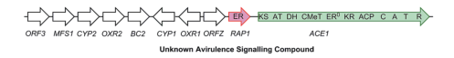

## Question

# Gene Research for Functional Annotation

## ⚠️ CRITICAL: Gene/Protein Identification Context

**BEFORE YOU BEGIN RESEARCH:** You MUST verify you are researching the CORRECT gene/protein. Gene symbols can be ambiguous, especially for less well-characterized genes from non-model organisms.

### Target Gene/Protein Identity (from UniProt):
- **UniProt Accession:** G4MVZ2
- **Protein Description:** RecName: Full=Polyketide synthase-nonribosomal peptide synthetase ACE1 {ECO:0000303|PubMed:18433432}; Short=PKS-NRPS ACE1 {ECO:0000303|PubMed:18433432}; EC=2.3.1.- {ECO:0000269|PubMed:29142718}; EC=6.3.2.- {ECO:0000269|PubMed:29142718}; AltName: Full=ACE1 cytochalasan biosynthesis cluster protein ACE1 {ECO:0000303|PubMed:29142718}; AltName: Full=Avirulence conferring enzyme {ECO:0000303|PubMed:12838393};
- **Gene Information:** Name=ACE1 {ECO:0000303|PubMed:12838393}; Synonyms=Pi33 {ECO:0000303|PubMed:12838393}; ORFNames=MGG_12447;
- **Organism (full):** Pyricularia oryzae (strain 70-15 / ATCC MYA-4617 / FGSC 8958) (Rice blast fungus) (Magnaporthe oryzae).
- **Protein Family:** Belongs to the NRP synthetase family. .
- **Key Domains:** Ac_transferase_dom_sf. (IPR001227); ACP-like_sf. (IPR036736); Acyl_transferase_dom. (IPR014043); Acyl_Trfase/lysoPLipase. (IPR016035); AMP-b_sf. (IPR045851)

### MANDATORY VERIFICATION STEPS:

1. **Check if the gene symbol "ACE1" matches the protein description above**
2. **Verify the organism is correct:** Pyricularia oryzae (strain 70-15 / ATCC MYA-4617 / FGSC 8958) (Rice blast fungus) (Magnaporthe oryzae).
3. **Check if protein family/domains align with what you find in literature**
4. **If you find literature for a DIFFERENT gene with the same or similar symbol, STOP**

### If Gene Symbol is Ambiguous or You Cannot Find Relevant Literature:

**DO NOT PROCEED WITH RESEARCH ON A DIFFERENT GENE.** Instead:
- State clearly: "The gene symbol 'ACE1' is ambiguous or literature is limited for this specific protein"
- Explain what you found (e.g., "Found extensive literature on a different gene with the same symbol in a different organism")
- Describe the protein based ONLY on the UniProt information provided above
- Suggest that the protein function can be inferred from domain/family information

### Research Target:

Please provide a comprehensive research report on the gene **ACE1** (gene ID: ACE1, UniProt: G4MVZ2) in PYRO7.

The research report should be a detailed narrative explaining the function, biological processes, and localization of the gene product. Citations should be given for all claims.

You should prioritize authoritative reviews and primary scientific literature when conducting research. You can supplement
this with annotations you find in gene/protein databases, but these can be outdated or inaccurate.

We are specifically interested in the primary function of the gene - for enzymes, what reaction is catalyzed, and what is the substrate specificity? For transporters, what is the substrate? For structural proteins or adapters, what is the broader structural role? For signaling molecules, what is the role in the pathway.

We are interested in where in or outside the cell the gene product carries out its function.

We are also interested in the signaling or biochemical pathways in which the gene functions. We are less interested in broad pleiotropic effects, except where these elucidate the precise role.

Include evidence where possible. We are interested in both experimental evidence as well as inference from structure, evolution, or bioinformatic analysis. Precise studies should be prioritized over high-throughput, where available.

## Output

Question: You are an expert researcher providing comprehensive, well-cited information.

Provide detailed information focusing on:
1. Key concepts and definitions with current understanding
2. Recent developments and latest research (prioritize 2023-2024 sources)
3. Current applications and real-world implementations
4. Expert opinions and analysis from authoritative sources
5. Relevant statistics and data from recent studies

Format as a comprehensive research report with proper citations. Include URLs and publication dates where available.
Always prioritize recent, authoritative sources and provide specific citations for all major claims.

# Gene Research for Functional Annotation

## ⚠️ CRITICAL: Gene/Protein Identification Context

**BEFORE YOU BEGIN RESEARCH:** You MUST verify you are researching the CORRECT gene/protein. Gene symbols can be ambiguous, especially for less well-characterized genes from non-model organisms.

### Target Gene/Protein Identity (from UniProt):
- **UniProt Accession:** G4MVZ2
- **Protein Description:** RecName: Full=Polyketide synthase-nonribosomal peptide synthetase ACE1 {ECO:0000303|PubMed:18433432}; Short=PKS-NRPS ACE1 {ECO:0000303|PubMed:18433432}; EC=2.3.1.- {ECO:0000269|PubMed:29142718}; EC=6.3.2.- {ECO:0000269|PubMed:29142718}; AltName: Full=ACE1 cytochalasan biosynthesis cluster protein ACE1 {ECO:0000303|PubMed:29142718}; AltName: Full=Avirulence conferring enzyme {ECO:0000303|PubMed:12838393};
- **Gene Information:** Name=ACE1 {ECO:0000303|PubMed:12838393}; Synonyms=Pi33 {ECO:0000303|PubMed:12838393}; ORFNames=MGG_12447;
- **Organism (full):** Pyricularia oryzae (strain 70-15 / ATCC MYA-4617 / FGSC 8958) (Rice blast fungus) (Magnaporthe oryzae).
- **Protein Family:** Belongs to the NRP synthetase family. .
- **Key Domains:** Ac_transferase_dom_sf. (IPR001227); ACP-like_sf. (IPR036736); Acyl_transferase_dom. (IPR014043); Acyl_Trfase/lysoPLipase. (IPR016035); AMP-b_sf. (IPR045851)

### MANDATORY VERIFICATION STEPS:

1. **Check if the gene symbol "ACE1" matches the protein description above**
2. **Verify the organism is correct:** Pyricularia oryzae (strain 70-15 / ATCC MYA-4617 / FGSC 8958) (Rice blast fungus) (Magnaporthe oryzae).
3. **Check if protein family/domains align with what you find in literature**
4. **If you find literature for a DIFFERENT gene with the same or similar symbol, STOP**

### If Gene Symbol is Ambiguous or You Cannot Find Relevant Literature:

**DO NOT PROCEED WITH RESEARCH ON A DIFFERENT GENE.** Instead:
- State clearly: "The gene symbol 'ACE1' is ambiguous or literature is limited for this specific protein"
- Explain what you found (e.g., "Found extensive literature on a different gene with the same symbol in a different organism")
- Describe the protein based ONLY on the UniProt information provided above
- Suggest that the protein function can be inferred from domain/family information

### Research Target:

Please provide a comprehensive research report on the gene **ACE1** (gene ID: ACE1, UniProt: G4MVZ2) in PYRO7.

The research report should be a detailed narrative explaining the function, biological processes, and localization of the gene product. Citations should be given for all claims.

You should prioritize authoritative reviews and primary scientific literature when conducting research. You can supplement
this with annotations you find in gene/protein databases, but these can be outdated or inaccurate.

We are specifically interested in the primary function of the gene - for enzymes, what reaction is catalyzed, and what is the substrate specificity? For transporters, what is the substrate? For structural proteins or adapters, what is the broader structural role? For signaling molecules, what is the role in the pathway.

We are interested in where in or outside the cell the gene product carries out its function.

We are also interested in the signaling or biochemical pathways in which the gene functions. We are less interested in broad pleiotropic effects, except where these elucidate the precise role.

Include evidence where possible. We are interested in both experimental evidence as well as inference from structure, evolution, or bioinformatic analysis. Precise studies should be prioritized over high-throughput, where available.

# Functional annotation of ACE1 (UniProt G4MVZ2) in PYRO7

## Identity and principal function

**The target is the rice-blast fungal ACE1, not human angiotensin-converting enzyme ACE1.** The supplied UniProt identity specifies *Pyricularia oryzae* (synonym *Magnaporthe oryzae*) reference strain 70-15 and locus **MGG_12447**. Primary literature identifies MGG_12447 as **ACE1**, an approximately 12.4-kb gene encoding a highly reducing polyketide synthase fused to a nonribosomal peptide synthetase (PKS–NRPS). Its biochemical role is to assemble the polyketide–amino-acid backbone of an infection-associated, probably cytochalasan-like secondary metabolite. The strain-70-15 accession is the supplied database identity; key biochemical and infection experiments used other rice-blast isolates, notably Guy11, so their results should not be mistaken for direct measurements in 70-15. [Song *et al*., *Chemical Science*, 2015](https://doi.org/10.1039/c4sc03707c); [Lambou *et al*., *PLOS Pathogens*, 22 January 2024](https://doi.org/10.1371/journal.ppat.1011945). (song2015heterologousexpressionof pages 1-2, lambou2024thebziptranscription pages 9-11, song2015heterologousexpressionof pages 2-3)

ACE1 is an **avirulence-conferring enzyme**, not a conventional secreted protein effector. In fungus–rice combinations involving the resistance specificity **Pi33**, functional ACE1 is associated with resistance to infection. The leading interpretation is that rice responds to an ACE1-dependent small molecule, rather than recognizing the large biosynthetic enzyme itself; however, neither the authentic eliciting molecule nor its mode of perception has been established. A 2024 review explicitly classifies ACE1 as a non-secreted PKS–NRPS, and the 2024 BIP1 study still calls the proposed Pi33-recognized product a *possible* cytochalasan derivative. [Liu *et al*., *Frontiers in Plant Science*, October 2024](https://doi.org/10.3389/fpls.2024.1478159); [Lambou *et al*., 2024](https://doi.org/10.1371/journal.ppat.1011945). (liu2024therolesof pages 3-4, lambou2024thebziptranscription pages 16-17)

## Catalytic reaction, substrates and pathway

The ACE1 domain arrangement is consistent with an iterative fungal PKS followed by one NRPS module: **KS–AT–DH–CMeT–ER⁰–KR–ACP–C–A–T–R**. Here KS extends an ACP-bound polyketide, CMeT introduces methyl groups, and the NRPS condensation/adenylation/thiolation machinery joins an amino-acid component. The embedded ER⁰ is predicted to be catalytically inactive; the neighboring gene **RAP1** encodes a *trans*-acting enoyl reductase required for the experimentally observed shift toward the amino-acid-containing product. The terminal R domain has sequence features consistent with reductive product release, but its exact reaction on the authentic in-fungus substrate has not been directly established. The domain architecture is illustrated in Song and colleagues’ cluster diagram. [Song *et al*., 2015](https://doi.org/10.1039/c4sc03707c). (song2015heterologousexpressionof pages 4-5, song2015heterologousexpressionof pages 5-7, song2015heterologousexpressionof pages 7-8, song2015heterologousexpressionof pages 2-3, song2015heterologousexpressionof media 53ff7c3f)

**Experimental substrate evidence is strongest at the level of incorporated building blocks, not purified-enzyme kinetics.** When ACE1 was expressed without RAP1, isotope feeding traced the resulting pyrone’s carbon skeleton to intact acetate-derived units, consistent with a **heptaketide**; methionine supplied its two methyl substituents, with **9.4% label incorporation at C-15 and C-16** in the reported experiment. ACE1 together with RAP1 instead yielded a structurally characterized **tyrosine-containing, nonaketide-derived amide**, supporting tyrosine selection by the NRPS portion in that expression system. The exact native precursor loading reaction, adenylation specificity constants and stoichiometric overall reaction have not been measured; the evidence does not justify assigning a named mature cytochalasan as ACE1’s directly isolated product. [Song *et al*., 2015](https://doi.org/10.1039/c4sc03707c). (song2015heterologousexpressionof pages 4-5, song2015heterologousexpressionof pages 5-7, song2015heterologousexpressionof pages 7-8)

Expression of ACE1 alone yielded a polyenyl pyrone termed **magnaporthepyrone**; host-dependent subsequent oxidation gave **12,13-dihydroxymagnaporthepyrone (compound 6)** in *Aspergillus oryzae* or **10,11-dihydroxymagnaporthepyrone (compound 7)** in *M. oryzae*. A construct lacking the ACE1 NRPS portion produced the same all-polyketide pyrone, confirming that these are not evidence of peptide incorporation. The proposed regioselective epoxidation followed by hydrolysis involves other host activities and should not be annotated as an established ACE1-catalyzed reaction. Co-expression with RAP1 instead produced **amide 8 (C₃₀H₄₃NO₄)**, a linear product resembling a cytochalasan backbone; its formation supports RAP1-dependent reductive programming and use of ACE1’s NRPS machinery, but the detailed sequence of reduction and release steps remains partly inferred. [Song *et al*., 2015](https://doi.org/10.1039/c4sc03707c). (song2015heterologousexpressionof pages 4-5, song2015heterologousexpressionof pages 5-7, song2015heterologousexpressionof pages 7-8)

The pathway context reinforces—but does not complete—the functional assignment. ACE1 sits in an approximately **57-kb cluster of 15 secondary-metabolism genes**, including **RAP1**, additional reductases, cytochrome P450s, and candidate cyclization/tailoring enzymes. In a **separate** pyrichalasan-producing *Magnaporthe* strain, an ACE1-cluster gene, **ORFZ**, functionally complemented loss of its homolog **PyiE** when precursor was supplied; ACE1-cluster **ORF3** could likewise replace the other pathway’s putative Diels–Alderase **PyiF**, and ACE1-cluster CYP1/CYP3 were functional in that separate system. These are informative cross-pathway experiments, **not** proof that the distinct pyrichalasan PKS–NRPS, PyiS, is ACE1 or that the native ACE1 end product has been isolated. [Zhang *et al*., *Chemistry—A European Journal*, January 2021](https://doi.org/10.1002/chem.202004444); [Lambou *et al*., 2024](https://doi.org/10.1371/journal.ppat.1011945). (lambou2024thebziptranscription pages 9-11, zhang2021chemicalandgenetic pages 3-4, zhang2021chemicalandgenetic pages 1-3, zhang2021chemicalandgenetic pages 7-8)

The following evidence summary separates observed products from proposed pathway endpoints. (song2015heterologousexpressionof pages 5-7, lambou2024thebziptranscription pages 16-17, zhang2021chemicalandgenetic pages 3-4)

| Claim | Primary evidence or measurement | Confidence or limitation |
|---|---|---|
| **Identity and architecture** | Fungal **ACE1/MGG_12447** is a 12.4-kb gene encoding a 4,035-aa highly reducing PKS fused to one NRPS module. The reported domain order is **KS–AT–DH–CMeT–ER⁰–KR–ACP–C–A–T–R**; the embedded ER is predicted inactive, while adjacent **RAP1** supplies a trans-acting ER (song2015heterologousexpressionof pages 1-2, song2015heterologousexpressionof pages 2-3, song2015heterologousexpressionof media 53ff7c3f). | **High.** Primary sequence analysis and heterologous expression agree. **G4MVZ2 and strain 70-15** are fixed by the supplied UniProt identity; many functional experiments used Guy11 or related isolates. |
| **Precursor and substrate specificity** | Labeling with [1,2-¹³C₂]acetate established an acetate-unit-derived **heptaketide** for ACE1-only pyrone products. Labeling with [methyl-¹³C]methionine marked both methyl groups, with 9.4% incorporation at C-15 and C-16. With RAP1, NMR identified a **tyrosine-containing nonaketide amide**, supporting tyrosine selection by the NRPS adenylation module (song2015heterologousexpressionof pages 4-5, song2015heterologousexpressionof pages 5-7, song2015heterologousexpressionof pages 7-8). | **Moderate–high.** Polyketide and methyl origins are directly demonstrated. Tyrosine incorporation is structurally supported in the 2015 product, but native substrate kinetics were not measured. The **exogenous O-methyltyrosine used in 2021** concerned separate pathway-complementation experiments and should not be conflated with the 2015 tyrosine assignment (zhang2021chemicalandgenetic pages 3-4). |
| **ACE1-only products** | ACE1 expressed without RAP1 produced the polyenyl pyrone **magnaporthepyrone**, subsequently converted in the expression hosts into **12,13-dihydroxymagnaporthepyrone (6)** or **10,11-dihydroxymagnaporthepyrone (7)** by inferred epoxidation and hydrolysis. Full-length ACE1 and an NRPS-deleted construct generated the same all-polyketide product (song2015heterologousexpressionof pages 4-5, song2015heterologousexpressionof pages 5-7). | **High for structures; moderate for the enzymatic route.** Compounds 6 and 7 are characterized **shunt products**, not mature cytochalasans or the native avirulence signal. Host monooxygenase and epoxide-hydrolysis steps are inferred. |
| **ACE1 plus RAP1 product** | Co-expression redirected synthesis from pyrone shunts to **amide 8, C₃₀H₄₃NO₄**, a tyrosine-containing, nonaketide-derived linear product resembling a cytochalasan backbone. RAP1-mediated reduction is proposed to enable correct chain extension and methylation (song2015heterologousexpressionof pages 4-5, song2015heterologousexpressionof pages 5-7, song2015heterologousexpressionof pages 7-8). | **High for compound structure and RAP1 dependence; moderate for detailed programming.** Amide 8 is probably a reduced shunt metabolite, not a demonstrated native pathway endpoint. |
| **Pi33 bioassay** | Purified compounds 6 and 7 caused localized necrosis on susceptible and Pi33-containing cultivars irrespective of genotype; neither converted a virulent infection into an avirulent reaction. Amide 8 caused no symptoms and did not alter pathogenicity (song2015heterologousexpressionof pages 4-5, song2015heterologousexpressionof pages 5-7). | **High.** Direct rice-leaf and infection assays exclude compounds 6, 7 and 8 as the Pi33-specific elicitor under the tested conditions. |
| **Cellular site and secretion** | A direct Ace1–eGFP fusion was reported to remain in fungal **appressoria** and was not detected in primary invasive hyphae. A separate promoter–eGFP reporter showed transcription peaking near penetration, with mRNA maximal around 17 hours after inoculation; reporter fluorescence in early hyphae was attributed to soluble GFP diffusion (fudal2007expressionofmagnaporthe pages 2-4). A 2024 review classifies ACE1 as a **non-secreted** PKS–NRPS (liu2024therolesof pages 3-4). | **Moderate.** Appressorial localization is supported, but fine subcellular localization and the metabolite-export route remain unresolved. Promoter-reporter fluorescence is not ACE1-protein localization. |
| **BIP1 regulation in 2024** | Expression profiling initially found **42** genes downregulated in Δbip1 appressoria; the authors summarized a curated network of **40**. Nine mapped to the **57-kb, 15-gene ACE1 cluster**. BIP1 bound TGACTC motifs in the shared RAP2 and ORF3 promoter; motif mutation weakened or abolished binding and ORF3 appressorium expression. ACE1/MGG_12447 and seven candidate cluster targets were downregulated during early barley infection (lambou2024thebziptranscription pages 9-11, lambou2024thebziptranscription pages 11-12). | **High for transcriptional regulation.** This establishes BIP1-dependent, penetration-stage cluster activation, not direct biochemical regulation of ACE1 catalysis. Deleting ACE1/SYN2 reportedly did not reduce general pathogenicity (lambou2024thebziptranscription pages 16-17). |
| **Native elicitor remains unknown** | Cluster architecture, ACE1/RAP1 chemistry and cross-complementation of ACE1-cluster **ORFZ** and **ORF3** in a separate pyrichalasan pathway support a cytochalasan-like product. Nevertheless, the ACE1 cluster is active only briefly in appressoria, productive native knockout chemistry has been difficult, and no mature Pi33-eliciting molecule has been isolated (lambou2024thebziptranscription pages 16-17, zhang2021chemicalandgenetic pages 3-4, zhang2021chemicalandgenetic pages 7-8). | **Moderate for a tyrosine-derived cytochalasan-like metabolite; low for an exact structure.** The defensible annotation is a PKS–NRPS core enzyme for a probable cytochalasan pathway, not a fully defined reaction yielding a named native end product. |

*Table: Evidence-strength summary for fungal ACE1/MGG_12447 (G4MVZ2), separating demonstrated enzymatic products and regulation from pathway inference. The authentic Pi33-eliciting metabolite and its export route remain unresolved.*

## Where and when ACE1 functions

The supported **cellular location is the fungal appressorium**, the specialized infection cell, during the onset of penetration. An earlier **Ace1–eGFP protein fusion**, discussed in the 2007 primary paper, was detected in appressoria but not in primary infectious hyphae. A distinct **ACE1-promoter–eGFP transcriptional reporter** cannot localize ACE1 protein: the authors attributed reporter fluorescence in early invasive hyphae to diffusion of free GFP from appressoria. Neither study resolves ACE1 to a specific organelle or establishes secretion of the enzyme into rice cells. Thus, **intracellular appressorial biosynthesis** is the defensible localization; where an eventual metabolite travels afterward remains unknown. [Fudal *et al*., *Eukaryotic Cell*, March 2007](https://doi.org/10.1128/EC.00330-05); [Liu *et al*., 2024](https://doi.org/10.3389/fpls.2024.1478159). (liu2024therolesof pages 3-4, fudal2007expressionofmagnaporthe pages 2-4)

In Guy11 infecting barley, ACE1 transcripts first appeared at low levels around **8 hours after inoculation**, peaked around **17 hours**, then fell to approximately **20% of peak at 24 hours** and **5% at 30 hours**. Promoter activity was readily observed in appressoria on barley, onion and penetrable cellophane, but only **1–5%** of appressoria on Teflon or Mylar were reporter-positive versus **50–75%** on barley or onion under the reported assay conditions. Expression persisted in several mutants unable to complete penetration; it was absent in a melanin/turgor-defective **buf1** mutant but could be restored by selected hyperosmotic treatments. These experiments associate induction with **initiation of the penetration program**, rather than requiring a plant-specific chemical signal or completed host invasion. [Fudal *et al*., 2007](https://doi.org/10.1128/EC.00330-05). (fudal2007expressionofmagnaporthe pages 1-2, fudal2007expressionofmagnaporthe pages 4-6, fudal2007expressionofmagnaporthe pages 2-4)

## Recent research and biological significance

A major **2024 advance** identified a transcriptional input into the ACE1 pathway. Comparing wild-type and **Δbip1** appressoria initially yielded **42 downregulated genes**; the authors summarized a **40-gene** infection-associated BIP1 network. **Nine** initially identified targets belonged to the **15-gene ACE1 cluster**. During early barley infection, ACE1/**MGG_12447** and seven candidate cluster targets were downregulated in Δbip1. The appressorial bZIP factor **BIP1** bound a **TGACTC** motif in the shared promoter of cluster genes **RAP2** and **ORF3** in vitro; mutating the motif abolished ORF3’s appressorium-specific expression. This demonstrates transcriptional coordination of the biosynthetic cluster, **not** that BIP1 is ACE1’s catalytic partner or that the cluster product has been identified. [Lambou *et al*., *PLOS Pathogens*, 22 January 2024](https://doi.org/10.1371/journal.ppat.1011945). (lambou2024thebziptranscription pages 9-11, lambou2024thebziptranscription pages 16-17, lambou2024thebziptranscription pages 11-12)

The distinction between an avirulence phenotype and general virulence is important. The 2024 authors note that deleting **ACE1/SYN2** had **not** produced a detectable reduction in general pathogenicity in the cited experiments. That finding does not negate ACE1’s Pi33-associated avirulence function: a pathway product can be dispensable for infection of a susceptible host while exposing the fungus to resistance in a host with the relevant recognition specificity. Purified 2015 products **6 and 7** caused local browning on both Pi33-containing and susceptible rice cultivars, **without Pi33-specific resistance**; **amide 8** induced neither symptoms nor an avirulence conversion. Accordingly, treating any of these characterized shunt products as the authentic Pi33 signal would contradict the bioassays. [Lambou *et al*., 2024](https://doi.org/10.1371/journal.ppat.1011945); [Song *et al*., 2015](https://doi.org/10.1039/c4sc03707c). (song2015heterologousexpressionof pages 4-5, song2015heterologousexpressionof pages 5-7, lambou2024thebziptranscription pages 16-17)

**Research and practical use.** ACE1/RAP1 expression in *Aspergillus* has provided a workable platform for dissecting a normally short-lived infection-stage pathway, and ACE1-cluster cross-complementation helps assign plausible downstream chemistry. In rice-blast research, fungal ACE1 status and rice Pi33 specificity are relevant to interpreting isolate–cultivar compatibility. These are research and resistance-assessment applications; the evidence reviewed here does **not** establish an ACE1-derived, commercially deployed crop-protection product or a chemically validated Pi33 elicitor. Resolving the authentic metabolite, its export/localization and its rice recognition mechanism remains necessary for a more precise biochemical annotation. [Song *et al*., 2015](https://doi.org/10.1039/c4sc03707c); [Zhang *et al*., 2021](https://doi.org/10.1002/chem.202004444); [Lambou *et al*., 2024](https://doi.org/10.1371/journal.ppat.1011945). (song2015heterologousexpressionof pages 1-2, song2015heterologousexpressionof pages 4-5, lambou2024thebziptranscription pages 16-17, zhang2021chemicalandgenetic pages 3-4, zhang2021chemicalandgenetic pages 7-8)

**Annotation conclusion:** ACE1/G4MVZ2 is best annotated as an **intracellular, penetration-stage fungal PKS–NRPS that, together with trans-enoyl reductase RAP1, builds a tyrosine-containing polyketide–peptide scaffold for a probable cytochalasan-like pathway associated with Pi33-specific avirulence**. Its native final product, fully specified overall reaction and metabolite export route remain unresolved. (song2015heterologousexpressionof pages 5-7, liu2024therolesof pages 3-4, lambou2024thebziptranscription pages 16-17, fudal2007expressionofmagnaporthe pages 2-4)

References

1. (song2015heterologousexpressionof pages 1-2): Zhongshu Song, Walid Bakeer, James W. Marshall, Ahmed A. Yakasai, Rozida Mohd Khalid, Jerome Collemare, Elizabeth Skellam, Didier Tharreau, Marc-Henri Lebrun, Colin M. Lazarus, Andrew M. Bailey, Thomas J. Simpson, and Russell J. Cox. Heterologous expression of the avirulence gene ace1 from the fungal rice pathogen magnaporthe oryzae. Chemical Science, 6:4837-4845, Jun 2015. URL: https://doi.org/10.1039/c4sc03707c, doi:10.1039/c4sc03707c. This article has 100 citations and is from a highest quality peer-reviewed journal.

2. (lambou2024thebziptranscription pages 9-11): Karine Lambou, Andrew Tag, Alexandre Lassagne, Jérôme Collemare, Pierre-Henri Clergeot, Crystel Barbisan, Philippe Perret, Didier Tharreau, Joelle Millazo, Elia Chartier, Ronald P. De Vries, Judith Hirsch, Jean-Benoit Morel, Roland Beffa, Thomas Kroj, Terry Thomas, and Marc-Henri Lebrun. The bzip transcription factor bip1 of the rice blast fungus is essential for infection and regulates a specific set of appressorium genes. PLOS Pathogens, 20:e1011945, Jan 2024. URL: https://doi.org/10.1371/journal.ppat.1011945, doi:10.1371/journal.ppat.1011945. This article has 13 citations and is from a highest quality peer-reviewed journal.

3. (song2015heterologousexpressionof pages 2-3): Zhongshu Song, Walid Bakeer, James W. Marshall, Ahmed A. Yakasai, Rozida Mohd Khalid, Jerome Collemare, Elizabeth Skellam, Didier Tharreau, Marc-Henri Lebrun, Colin M. Lazarus, Andrew M. Bailey, Thomas J. Simpson, and Russell J. Cox. Heterologous expression of the avirulence gene ace1 from the fungal rice pathogen magnaporthe oryzae. Chemical Science, 6:4837-4845, Jun 2015. URL: https://doi.org/10.1039/c4sc03707c, doi:10.1039/c4sc03707c. This article has 100 citations and is from a highest quality peer-reviewed journal.

4. (liu2024therolesof pages 3-4): Xin Liu, Xiaochun Hu, Zhouyi Tu, Zhenbiao Sun, Peng Qin, Yikang Liu, Xinwei Chen, Zhiqiang Li, Nan Jiang, and Yuanzhu Yang. The roles of magnaporthe oryzae avirulence effectors involved in blast resistance/susceptibility. Frontiers in Plant Science, Oct 2024. URL: https://doi.org/10.3389/fpls.2024.1478159, doi:10.3389/fpls.2024.1478159. This article has 23 citations.

5. (lambou2024thebziptranscription pages 16-17): Karine Lambou, Andrew Tag, Alexandre Lassagne, Jérôme Collemare, Pierre-Henri Clergeot, Crystel Barbisan, Philippe Perret, Didier Tharreau, Joelle Millazo, Elia Chartier, Ronald P. De Vries, Judith Hirsch, Jean-Benoit Morel, Roland Beffa, Thomas Kroj, Terry Thomas, and Marc-Henri Lebrun. The bzip transcription factor bip1 of the rice blast fungus is essential for infection and regulates a specific set of appressorium genes. PLOS Pathogens, 20:e1011945, Jan 2024. URL: https://doi.org/10.1371/journal.ppat.1011945, doi:10.1371/journal.ppat.1011945. This article has 13 citations and is from a highest quality peer-reviewed journal.

6. (song2015heterologousexpressionof pages 4-5): Zhongshu Song, Walid Bakeer, James W. Marshall, Ahmed A. Yakasai, Rozida Mohd Khalid, Jerome Collemare, Elizabeth Skellam, Didier Tharreau, Marc-Henri Lebrun, Colin M. Lazarus, Andrew M. Bailey, Thomas J. Simpson, and Russell J. Cox. Heterologous expression of the avirulence gene ace1 from the fungal rice pathogen magnaporthe oryzae. Chemical Science, 6:4837-4845, Jun 2015. URL: https://doi.org/10.1039/c4sc03707c, doi:10.1039/c4sc03707c. This article has 100 citations and is from a highest quality peer-reviewed journal.

7. (song2015heterologousexpressionof pages 5-7): Zhongshu Song, Walid Bakeer, James W. Marshall, Ahmed A. Yakasai, Rozida Mohd Khalid, Jerome Collemare, Elizabeth Skellam, Didier Tharreau, Marc-Henri Lebrun, Colin M. Lazarus, Andrew M. Bailey, Thomas J. Simpson, and Russell J. Cox. Heterologous expression of the avirulence gene ace1 from the fungal rice pathogen magnaporthe oryzae. Chemical Science, 6:4837-4845, Jun 2015. URL: https://doi.org/10.1039/c4sc03707c, doi:10.1039/c4sc03707c. This article has 100 citations and is from a highest quality peer-reviewed journal.

8. (song2015heterologousexpressionof pages 7-8): Zhongshu Song, Walid Bakeer, James W. Marshall, Ahmed A. Yakasai, Rozida Mohd Khalid, Jerome Collemare, Elizabeth Skellam, Didier Tharreau, Marc-Henri Lebrun, Colin M. Lazarus, Andrew M. Bailey, Thomas J. Simpson, and Russell J. Cox. Heterologous expression of the avirulence gene ace1 from the fungal rice pathogen magnaporthe oryzae. Chemical Science, 6:4837-4845, Jun 2015. URL: https://doi.org/10.1039/c4sc03707c, doi:10.1039/c4sc03707c. This article has 100 citations and is from a highest quality peer-reviewed journal.

9. (song2015heterologousexpressionof media 53ff7c3f): Zhongshu Song, Walid Bakeer, James W. Marshall, Ahmed A. Yakasai, Rozida Mohd Khalid, Jerome Collemare, Elizabeth Skellam, Didier Tharreau, Marc-Henri Lebrun, Colin M. Lazarus, Andrew M. Bailey, Thomas J. Simpson, and Russell J. Cox. Heterologous expression of the avirulence gene ace1 from the fungal rice pathogen magnaporthe oryzae. Chemical Science, 6:4837-4845, Jun 2015. URL: https://doi.org/10.1039/c4sc03707c, doi:10.1039/c4sc03707c. This article has 100 citations and is from a highest quality peer-reviewed journal.

10. (zhang2021chemicalandgenetic pages 3-4): Haili Zhang, Verena Hantke, Pia Bruhnke, Elizabeth J. Skellam, and Russell John Cox. Chemical and genetic studies on the formation of pyrrolones during the biosynthesis of cytochalasans. Chemistry – A European Journal, 27:3106-3113, Jan 2021. URL: https://doi.org/10.1002/chem.202004444, doi:10.1002/chem.202004444. This article has 37 citations.

11. (zhang2021chemicalandgenetic pages 1-3): Haili Zhang, Verena Hantke, Pia Bruhnke, Elizabeth J. Skellam, and Russell John Cox. Chemical and genetic studies on the formation of pyrrolones during the biosynthesis of cytochalasans. Chemistry – A European Journal, 27:3106-3113, Jan 2021. URL: https://doi.org/10.1002/chem.202004444, doi:10.1002/chem.202004444. This article has 37 citations.

12. (zhang2021chemicalandgenetic pages 7-8): Haili Zhang, Verena Hantke, Pia Bruhnke, Elizabeth J. Skellam, and Russell John Cox. Chemical and genetic studies on the formation of pyrrolones during the biosynthesis of cytochalasans. Chemistry – A European Journal, 27:3106-3113, Jan 2021. URL: https://doi.org/10.1002/chem.202004444, doi:10.1002/chem.202004444. This article has 37 citations.

13. (fudal2007expressionofmagnaporthe pages 2-4): Isabelle Fudal, Jérôme Collemare, Heidi U. Böhnert, Delphine Melayah, and Marc-Henri Lebrun. Expression of magnaporthe grisea avirulence gene ace1 is connected to the initiation of appressorium-mediated penetration. Eukaryotic Cell, 6:546-554, Mar 2007. URL: https://doi.org/10.1128/ec.00330-05, doi:10.1128/ec.00330-05. This article has 94 citations and is from a peer-reviewed journal.

14. (lambou2024thebziptranscription pages 11-12): Karine Lambou, Andrew Tag, Alexandre Lassagne, Jérôme Collemare, Pierre-Henri Clergeot, Crystel Barbisan, Philippe Perret, Didier Tharreau, Joelle Millazo, Elia Chartier, Ronald P. De Vries, Judith Hirsch, Jean-Benoit Morel, Roland Beffa, Thomas Kroj, Terry Thomas, and Marc-Henri Lebrun. The bzip transcription factor bip1 of the rice blast fungus is essential for infection and regulates a specific set of appressorium genes. PLOS Pathogens, 20:e1011945, Jan 2024. URL: https://doi.org/10.1371/journal.ppat.1011945, doi:10.1371/journal.ppat.1011945. This article has 13 citations and is from a highest quality peer-reviewed journal.

15. (fudal2007expressionofmagnaporthe pages 1-2): Isabelle Fudal, Jérôme Collemare, Heidi U. Böhnert, Delphine Melayah, and Marc-Henri Lebrun. Expression of magnaporthe grisea avirulence gene ace1 is connected to the initiation of appressorium-mediated penetration. Eukaryotic Cell, 6:546-554, Mar 2007. URL: https://doi.org/10.1128/ec.00330-05, doi:10.1128/ec.00330-05. This article has 94 citations and is from a peer-reviewed journal.

16. (fudal2007expressionofmagnaporthe pages 4-6): Isabelle Fudal, Jérôme Collemare, Heidi U. Böhnert, Delphine Melayah, and Marc-Henri Lebrun. Expression of magnaporthe grisea avirulence gene ace1 is connected to the initiation of appressorium-mediated penetration. Eukaryotic Cell, 6:546-554, Mar 2007. URL: https://doi.org/10.1128/ec.00330-05, doi:10.1128/ec.00330-05. This article has 94 citations and is from a peer-reviewed journal.

## Artifacts

- [Edison artifact artifact-00](ACE1-deep-research-falcon_artifacts/artifact-00.md)

## Citations

1. zhang2021chemicalandgenetic pages 3-4
2. fudal2007expressionofmagnaporthe pages 2-4
3. liu2024therolesof pages 3-4
4. lambou2024thebziptranscription pages 16-17
5. song2015heterologousexpressionof pages 1-2
6. lambou2024thebziptranscription pages 9-11
7. song2015heterologousexpressionof pages 2-3
8. song2015heterologousexpressionof pages 4-5
9. song2015heterologousexpressionof pages 5-7
10. song2015heterologousexpressionof pages 7-8
11. zhang2021chemicalandgenetic pages 1-3
12. zhang2021chemicalandgenetic pages 7-8
13. lambou2024thebziptranscription pages 11-12
14. fudal2007expressionofmagnaporthe pages 1-2
15. fudal2007expressionofmagnaporthe pages 4-6
16. Song *et al*., *Chemical Science*, 2015
17. Lambou *et al*., *PLOS Pathogens*, 22 January 2024
18. Liu *et al*., *Frontiers in Plant Science*, October 2024
19. Lambou *et al*., 2024
20. Song *et al*., 2015
21. Zhang *et al*., *Chemistry—A European Journal*, January 2021
22. 1,2-¹³C₂
23. methyl-¹³C
24. Fudal *et al*., *Eukaryotic Cell*, March 2007
25. Liu *et al*., 2024
26. Fudal *et al*., 2007
27. Zhang *et al*., 2021
28. https://doi.org/10.1039/c4sc03707c
29. https://doi.org/10.1371/journal.ppat.1011945
30. https://doi.org/10.3389/fpls.2024.1478159
31. https://doi.org/10.1002/chem.202004444
32. https://doi.org/10.1128/EC.00330-05
33. https://doi.org/10.1039/c4sc03707c,
34. https://doi.org/10.1371/journal.ppat.1011945,
35. https://doi.org/10.3389/fpls.2024.1478159,
36. https://doi.org/10.1002/chem.202004444,
37. https://doi.org/10.1128/ec.00330-05,