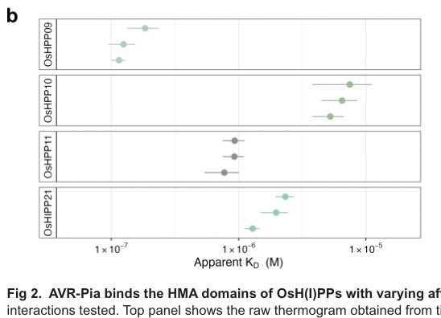

## Question

# Gene Research for Functional Annotation

## ⚠️ CRITICAL: Gene/Protein Identification Context

**BEFORE YOU BEGIN RESEARCH:** You MUST verify you are researching the CORRECT gene/protein. Gene symbols can be ambiguous, especially for less well-characterized genes from non-model organisms.

### Target Gene/Protein Identity (from UniProt):
- **UniProt Accession:** B9WZW9
- **Protein Description:** SubName: Full=AVR-Pia protein {ECO:0000313|EMBL:BAH23994.1};
- **Gene Information:** Name=AVR-Pia {ECO:0000313|EMBL:BAH23994.1};
- **Organism (full):** Pyricularia oryzae (Rice blast fungus) (Magnaporthe oryzae).
- **Protein Family:** Not specified in UniProt
- **Key Domains:** Not specified in UniProt

### MANDATORY VERIFICATION STEPS:

1. **Check if the gene symbol "AVR-Pia" matches the protein description above**
2. **Verify the organism is correct:** Pyricularia oryzae (Rice blast fungus) (Magnaporthe oryzae).
3. **Check if protein family/domains align with what you find in literature**
4. **If you find literature for a DIFFERENT gene with the same or similar symbol, STOP**

### If Gene Symbol is Ambiguous or You Cannot Find Relevant Literature:

**DO NOT PROCEED WITH RESEARCH ON A DIFFERENT GENE.** Instead:
- State clearly: "The gene symbol 'AVR-Pia' is ambiguous or literature is limited for this specific protein"
- Explain what you found (e.g., "Found extensive literature on a different gene with the same symbol in a different organism")
- Describe the protein based ONLY on the UniProt information provided above
- Suggest that the protein function can be inferred from domain/family information

### Research Target:

Please provide a comprehensive research report on the gene **AVR-Pia** (gene ID: AVR-Pia, UniProt: B9WZW9) in PYROR.

The research report should be a detailed narrative explaining the function, biological processes, and localization of the gene product. Citations should be given for all claims.

You should prioritize authoritative reviews and primary scientific literature when conducting research. You can supplement
this with annotations you find in gene/protein databases, but these can be outdated or inaccurate.

We are specifically interested in the primary function of the gene - for enzymes, what reaction is catalyzed, and what is the substrate specificity? For transporters, what is the substrate? For structural proteins or adapters, what is the broader structural role? For signaling molecules, what is the role in the pathway.

We are interested in where in or outside the cell the gene product carries out its function.

We are also interested in the signaling or biochemical pathways in which the gene functions. We are less interested in broad pleiotropic effects, except where these elucidate the precise role.

Include evidence where possible. We are interested in both experimental evidence as well as inference from structure, evolution, or bioinformatic analysis. Precise studies should be prioritized over high-throughput, where available.

## Output

Question: You are an expert researcher providing comprehensive, well-cited information.

Provide detailed information focusing on:
1. Key concepts and definitions with current understanding
2. Recent developments and latest research (prioritize 2023-2024 sources)
3. Current applications and real-world implementations
4. Expert opinions and analysis from authoritative sources
5. Relevant statistics and data from recent studies

Format as a comprehensive research report with proper citations. Include URLs and publication dates where available.
Always prioritize recent, authoritative sources and provide specific citations for all major claims.

# Gene Research for Functional Annotation

## ⚠️ CRITICAL: Gene/Protein Identification Context

**BEFORE YOU BEGIN RESEARCH:** You MUST verify you are researching the CORRECT gene/protein. Gene symbols can be ambiguous, especially for less well-characterized genes from non-model organisms.

### Target Gene/Protein Identity (from UniProt):
- **UniProt Accession:** B9WZW9
- **Protein Description:** SubName: Full=AVR-Pia protein {ECO:0000313|EMBL:BAH23994.1};
- **Gene Information:** Name=AVR-Pia {ECO:0000313|EMBL:BAH23994.1};
- **Organism (full):** Pyricularia oryzae (Rice blast fungus) (Magnaporthe oryzae).
- **Protein Family:** Not specified in UniProt
- **Key Domains:** Not specified in UniProt

### MANDATORY VERIFICATION STEPS:

1. **Check if the gene symbol "AVR-Pia" matches the protein description above**
2. **Verify the organism is correct:** Pyricularia oryzae (Rice blast fungus) (Magnaporthe oryzae).
3. **Check if protein family/domains align with what you find in literature**
4. **If you find literature for a DIFFERENT gene with the same or similar symbol, STOP**

### If Gene Symbol is Ambiguous or You Cannot Find Relevant Literature:

**DO NOT PROCEED WITH RESEARCH ON A DIFFERENT GENE.** Instead:
- State clearly: "The gene symbol 'AVR-Pia' is ambiguous or literature is limited for this specific protein"
- Explain what you found (e.g., "Found extensive literature on a different gene with the same symbol in a different organism")
- Describe the protein based ONLY on the UniProt information provided above
- Suggest that the protein function can be inferred from domain/family information

### Research Target:

Please provide a comprehensive research report on the gene **AVR-Pia** (gene ID: AVR-Pia, UniProt: B9WZW9) in PYROR.

The research report should be a detailed narrative explaining the function, biological processes, and localization of the gene product. Citations should be given for all claims.

You should prioritize authoritative reviews and primary scientific literature when conducting research. You can supplement
this with annotations you find in gene/protein databases, but these can be outdated or inaccurate.

We are specifically interested in the primary function of the gene - for enzymes, what reaction is catalyzed, and what is the substrate specificity? For transporters, what is the substrate? For structural proteins or adapters, what is the broader structural role? For signaling molecules, what is the role in the pathway.

We are interested in where in or outside the cell the gene product carries out its function.

We are also interested in the signaling or biochemical pathways in which the gene functions. We are less interested in broad pleiotropic effects, except where these elucidate the precise role.

Include evidence where possible. We are interested in both experimental evidence as well as inference from structure, evolution, or bioinformatic analysis. Precise studies should be prioritized over high-throughput, where available.

# Functional annotation of fungal AVR-Pia (UniProt B9WZW9)

## Identity and principal function

**AVR-Pia is a secreted effector of the rice blast fungus *Pyricularia oryzae*, also called *Magnaporthe oryzae*—not the rice Pia resistance gene or the distinct fungal effector AVR-Pik.** The supplied UniProt record identifies B9WZW9 as AVR-Pia and cites EMBL BAH23994.1; the papers retrieved independently establish the identity and function of the fungal protein named AVR-Pia, although they do not independently cross-reference that accession to their experimental sequence. The original cloning study identified the fungal locus as **pex22** and showed that introducing it into an AVR-Pia-negative isolate restored avirulence specifically on Pia-bearing rice. (sornkom2017fluorescentreporteranalysis pages 1-2, yoshida2009associationgeneticsreveals pages 4-6)

AVR-Pia’s best-established molecular activity is **binding rice proteins through heavy metal-associated (HMA) domains**. Binding the HMA domain integrated into the rice immune receptor RGA5 makes the fungus detectable and triggers resistance when the partner receptor RGA4 is present. More recent work identified four other rice HMA-domain proteins that bind AVR-Pia, making host-protein engagement a plausible route to its infection-promoting activity. **No catalytic reaction, transported substrate, or specific host biochemical pathway altered by AVR-Pia has been demonstrated**; it should be annotated as an intracellularly acting *protein-binding effector*, not as an enzyme, transporter, or fungal HMA protein. The HMA domain belongs to its **rice binding partners**, not to AVR-Pia. (ortiz2017recognitionofthe pages 1-2, maidment2026twofoldsmany pages 6-9, maidment2026twofoldsmany pages 18-20)

## Protein architecture and biological context

The encoded protein is **85 amino acids** long, including a predicted **19-residue N-terminal secretion signal**; the original sequence analysis identified no conventional functional domain. Subsequent experimental NMR structure determination placed the mature protein in the **MAX** (*Magnaporthe* avirulence and ToxB-like) structural family: its core comprises two antiparallel three-stranded β-sheets forming a β-sandwich, stabilized by a disulfide bond. MAX membership resolves the apparent absence of a recognizable sequence-based family annotation: proteins in this family can share a fold despite little sequence similarity. Structural homology does **not** imply that AVR-Pia and other MAX effectors have identical host targets. (yoshida2009associationgeneticsreveals pages 4-6, wei2023recentadvancesin pages 5-7, guillen2015structureanalysisuncovers pages 10-13, maidment2026twofoldsmany pages 2-4)

In the original association study, presence of pex22 across **22 fungal isolates** perfectly tracked the AVR-Pia phenotype (*P* = 3.8 × 10⁻⁵); complementation restored resistance-inducing activity on Pia-positive Sasanishiki but not on Pia-negative Shin-2. Expression of pex22 inside Pia-positive rice cells induced cell death, including when its secretion signal was removed. These experiments establish its **avirulence-determinant function and intracellular recognizability**, not a defined enzymatic activity or proof that each host interactor promotes susceptibility. The gene also shows presence/absence variation among isolates. A 2026 study estimates that AVR-Pia occurs in **approximately 20% of rice-infecting isolates**; that estimate should not be interpreted as a universal frequency across locations or seasons. (yoshida2009associationgeneticsreveals pages 4-6, yoshida2009associationgeneticsreveals pages 9-11, yoshida2009associationgeneticsreveals pages 6-9, maidment2026twofoldsmany pages 2-4)

## Where AVR-Pia acts

AVR-Pia is made by the **fungus during infection**. Reporter experiments detected induction during appressorial differentiation, before penetration; expression was visible even in a penetration-deficient fungal mutant. A functional fluorescent AVR-Pia fusion accumulated at the **biotrophic interfacial complex (BIC)** beside invasive hyphae, colocalized with the BIC effector PWL2, and was detected in the **rice-cell cytoplasm** after delivery. Reporter measurements detected induction at approximately **18 hours post-inoculation** and BIC-associated fusion protein at approximately **27–30 hours**. Deleting the signal-peptide coding region altered the secretion-associated localization pattern. Thus, the best-supported route is *fungal production → secretion to the infection interface/BIC → delivery into the host cell*, with the key characterized binding and recognition events occurring intracellularly. (sornkom2017fluorescentreporteranalysis pages 2-3, sornkom2017fluorescentreporteranalysis pages 3-6)

Some experimental AVR-Pia and receptor fusions also showed nuclear as well as cytoplasmic fluorescence in transient-expression assays. This does **not** establish a specifically nuclear virulence function; infection imaging and intracellular receptor recognition support a host-cytoplasmic action, while the exact subcellular sites and physiological consequences of binding the newly identified rice proteins remain unresolved. (cesari2013thericeresistance pages 7-9, sornkom2017fluorescentreporteranalysis pages 3-6, maidment2026twofoldsmany pages 18-20)

## Recognition pathway: why an effector causes resistance

In rice carrying the **Pia locus**, RGA5 is the *sensor* nucleotide-binding leucine-rich repeat receptor and RGA4 is its cell-death/defence-signalling partner. The resistance-competent **RGA5-A** isoform binds AVR-Pia directly; RGA4 is required for effective resistance but was not the direct AVR-Pia-binding partner in the reported interaction assays. RGA5 restrains RGA4-associated cell death in the absence of a recognized effector. Recognition through RGA5’s C-terminal integrated **RATX1/HMA domain** enables RGA4-dependent effector-triggered immunity and a localized hypersensitive cell-death response. This is a **host defence pathway activated by detection of AVR-Pia**, not a demonstrated immune-signalling activity intrinsically catalysed by the fungal protein. (cesari2013thericeresistance pages 1-2, cesari2013thericeresistance pages 7-9, liu2024therolesof pages 7-9, ortiz2017recognitionofthe pages 1-2)

Biophysical analysis measured an apparent dissociation constant of **7.8 µM** for purified AVR-Pia binding the RGA5 integrated HMA domain. Structure-guided substitutions at AVR-Pia’s exposed binding surface impaired HMA engagement; notably, **F24S** rendered the effector fully virulent on Pia rice in infection assays, whereas some substitutions that weakened binding remained recognizable. AVR-Pia also associates with RGA5 regions outside the HMA domain, but those contacts alone did not substitute for HMA-dependent recognition. The naturally occurring **AVR-Pia-H3** variant carries F24S and T46N and evades normal RGA5-mediated detection without a major change to its MAX fold. These results make binding to RGA5-HMA a mechanistically supported determinant of race-specific resistance, while leaving details of the receptor pair’s activation transition incompletely resolved. (ortiz2017recognitionofthe pages 4-5, ortiz2017recognitionofthe pages 7-9, ortiz2017recognitionofthe pages 2-4, maidment2026twofoldsmany pages 6-9)

## Host-protein binding: latest direct evidence

A **peer-reviewed study published 13 July 2026**—newer than the requested 2023–2024 priority window—validated binding of AVR-Pia to **OsHPP09, OsHPP10, OsHPP11 and OsHIPP21**. It used complementary protein-interaction assays in vitro and in plant tissue, measured binding of purified HMA domains by isothermal titration calorimetry (ITC), and solved the AVR-Pia–OsHPP09-HMA crystal structure. These are experimentally supported **interactors or candidate virulence targets**, not four proven susceptibility genes for AVR-Pia. Preliminary screens produced additional candidate hits; the four listed here are the interactors carried forward into the reported biochemical characterization. (maidment2026twofoldsmany pages 1-2, maidment2026twofoldsmany pages 2-4, maidment2026twofoldsmany pages 6-9)

The affinity comparison below concerns **isolated HMA domains**, not full-length proteins inside infected rice. The cited study’s Figure 2 reports three independent ITC experiments for each newly measured interaction. (maidment2026twofoldsmany pages 6-9, maidment2026twofoldsmany media e322509a)

| Rice protein HMA domain | Biological class | AVR-Pia apparent *K*D (in vitro ITC) | Significance |
|---|---|---:|---|
| OsHPP09-HMA | HPP | 115 nM | Strongest validated interaction; approximately 68-fold tighter than RGA5-HMA |
| OsHPP11-HMA | HPP | 772 nM | High-affinity, submicromolar interaction |
| OsHIPP21-HMA | HIPP | 1.29 µM | Intermediate-affinity interaction |
| OsHPP10-HMA | HPP | 5.26 µM | Weakest of the four validated host-protein interactions |
| RGA5-HMA integrated domain | NLR-integrated HMA | 7.8 µM | Immune-receptor reference value from a separate, older assay reported in 2017 |

*Table: Apparent domain-level affinities measured with purified HMA domains; these values do not establish full-length binding or efficacy in plant cells. Host-target values are from peer-reviewed Maidment et al. (2026), Figure 2 and text, while RGA5-HMA is the separately reported 2017 reference (maidment2026twofoldsmany pages 6-9, maidment2026twofoldsmany pages 17-18, maidment2026twofoldsmany media e322509a, ortiz2017recognitionofthe pages 4-5).*

In the OsHPP09 complex, AVR-Pia forms an antiparallel β-sheet interface with the rice HMA domain, supplemented by hydrogen bonds and salt bridges. Replacing **OsHPP09 E16** disrupted AVR-Pia binding without grossly disrupting the HMA fold, providing a potential target for future structure-guided host modification. The naturally occurring AVR-Pia-H3 substitutions also disrupted detectable stable binding to the newly characterized HMA proteins. Despite sharing the MAX fold, AVR-Pik and PWL2 preferentially engage **different** HMA-protein subsets; their experimentally demonstrated effects on their own targets must not be assigned to AVR-Pia. (maidment2026twofoldsmany pages 12-14, maidment2026twofoldsmany pages 14-17, maidment2026twofoldsmany pages 6-9, maidment2026twofoldsmany pages 17-18)

**Interpretive limit:** Binding is firmly demonstrated, and the 2026 authors describe AVR-Pia as contributing to rice virulence. Their host-interactor experiments do **not** establish which of these four interactions changes rice susceptibility, what host process is manipulated, whether the interactions occur at a particular host organelle during natural infection, or whether modifying OsHPP09 E16 protects a crop in the field. The authors explicitly identify functional outcomes and possible redundancy among HMA-targeting effectors as open questions. (maidment2026twofoldsmany pages 2-4, maidment2026twofoldsmany pages 17-18, maidment2026twofoldsmany pages 18-20)

## Research and agricultural applications

AVR-Pia presence and functional allele status can inform **Pia-dependent isolate phenotyping and resistance-gene matching**, but its isolate-level presence/absence and immune-evasive variants limit reliance on Pia alone. The receptor–effector structures provide a testbed for **engineering rice immune recognition**: a 2022 RGA5-HMA design gained new effector recognition in a heterologous assay yet did not gain the corresponding resistance in transgenic rice, whereas a **February 2024** three-interface engineered receptor, **RGA5^HMA5**, conferred resistance in transgenic rice to strains expressing the *different* effector AVR-PikD. Importantly, that engineered construct did **not** retain AVR-Pia recognition in the assays reported. These are controlled experimental implementations, **not evidence of field deployment** or of AVR-Pia-specific protection by RGA5^HMA5. (yoshida2009associationgeneticsreveals pages 4-6, ortiz2017recognitionofthe pages 2-4, cesari2022newrecognitionspecificity pages 1-2, zhang2024thesyntheticnlr pages 2-5, zhang2024thesyntheticnlr pages 5-8)

**Annotation conclusion.** Assign AVR-Pia to the fungal secreted **MAX effector** structural family; describe its supported activity as **binding intracellular rice HMA-domain proteins**, including the RGA5 immune sensor. Annotate secretion through the infection interface/BIC and action after entry into the **rice host cell**. Annotate *Pia/RGA5–RGA4-dependent effector-triggered immunity* as its established recognition outcome, while qualifying its precise susceptibility-promoting mechanism and the physiological roles of its newly identified host interactors as unresolved. (guillen2015structureanalysisuncovers pages 10-13, sornkom2017fluorescentreporteranalysis pages 3-6, cesari2013thericeresistance pages 1-2, maidment2026twofoldsmany pages 6-9, maidment2026twofoldsmany pages 17-18)

### Selected primary sources and dates

- Yoshida *et al.*, **May 2009**, *The Plant Cell*: original pex22/AVR-Pia identification and fungal complementation. https://doi.org/10.1105/tpc.109.066324 (yoshida2009associationgeneticsreveals pages 4-6)
- Cesari *et al.*, **April 2013**, *The Plant Cell*: direct binding to the rice RGA4/RGA5 resistance system. https://doi.org/10.1105/tpc.112.107201 (cesari2013thericeresistance pages 1-2)
- de Guillen *et al.*, **October 2015**, *PLOS Pathogens*: experimental MAX-fold structures. https://doi.org/10.1371/journal.ppat.1005228 (guillen2015structureanalysisuncovers pages 10-13)
- Ortiz *et al.*, **January 2017**, *The Plant Cell*: HMA recognition interface and immune-escape substitutions. https://doi.org/10.1105/tpc.16.00435 (ortiz2017recognitionofthe pages 4-5, ortiz2017recognitionofthe pages 7-9)
- Sornkom *et al.*, **2017**, *Molecular Plant Pathology*: infection-stage expression, BIC localization and host-cell delivery. https://doi.org/10.1111/mpp.12468 (sornkom2017fluorescentreporteranalysis pages 1-2, sornkom2017fluorescentreporteranalysis pages 3-6)
- Zhang *et al.*, **February 2024**, *Nature Communications*: experimental engineering of the RGA5 receptor, with the effector-specificity limitation noted above. https://doi.org/10.1038/s41467-024-45380-2 (zhang2024thesyntheticnlr pages 2-5, zhang2024thesyntheticnlr pages 5-8)
- Maidment *et al.*, **13 July 2026**, *PLOS Pathogens*: validated host HMA interactors, quantitative binding and crystal structure. https://doi.org/10.1371/journal.ppat.1014382 (maidment2026twofoldsmany pages 2-4, maidment2026twofoldsmany pages 6-9)

References

1. (sornkom2017fluorescentreporteranalysis pages 1-2): Worawan Sornkom, Shinsuke Miki, Saori Takeuchi, Ayumi Abe, Kozo Asano, and Teruo Sone. Fluorescent reporter analysis revealed the timing and localization of avr-pia expression, an avirulence effector of magnaporthe oryzae. Molecular plant pathology, 18 8:1138-1149, Oct 2017. URL: https://doi.org/10.1111/mpp.12468, doi:10.1111/mpp.12468. This article has 17 citations and is from a peer-reviewed journal.

2. (yoshida2009associationgeneticsreveals pages 4-6): Kentaro Yoshida, Hiromasa Saitoh, Shizuko Fujisawa, Hiroyuki Kanzaki, Hideo Matsumura, Kakoto Yoshida, Yukio Tosa, Izumi Chuma, Yoshitaka Takano, Joe Win, Sophien Kamoun, and Ryohei Terauchi. Association genetics reveals three novel avirulence genes from the rice blast fungal pathogen <i>magnaporthe oryzae</i>. The Plant Cell, 21:1573-1591, May 2009. URL: https://doi.org/10.1105/tpc.109.066324, doi:10.1105/tpc.109.066324. This article has 590 citations.

3. (ortiz2017recognitionofthe pages 1-2): Diana Ortiz, Karine de Guillen, Stella Cesari, Véronique Chalvon, Jérome Gracy, André Padilla, and Thomas Kroj. Recognition of the <i>magnaporthe oryzae</i> effector avr-pia by the decoy domain of the rice nlr immune receptor rga5. The Plant Cell, 29:156-168, Jan 2017. URL: https://doi.org/10.1105/tpc.16.00435, doi:10.1105/tpc.16.00435. This article has 168 citations.

4. (maidment2026twofoldsmany pages 6-9): Josephine H. R. Maidment, Svenja C. Saile, Aurélien Bocquet, Céline Thivolle, Léo Bourcet, Lisa-Fatimatou Planel, Muriel Gelin, Thomas Kroj, André Padilla, Karine de Guillen, and Stella Cesari. Two folds, many faces: the magnaporthe oryzae max effector avr-pia targets novel rice hma domain-containing proteins. PLOS Pathogens, 22:e1014382, Jul 2026. URL: https://doi.org/10.1371/journal.ppat.1014382, doi:10.1371/journal.ppat.1014382. This article has 0 citations and is from a highest quality peer-reviewed journal.

5. (maidment2026twofoldsmany pages 18-20): Josephine H. R. Maidment, Svenja C. Saile, Aurélien Bocquet, Céline Thivolle, Léo Bourcet, Lisa-Fatimatou Planel, Muriel Gelin, Thomas Kroj, André Padilla, Karine de Guillen, and Stella Cesari. Two folds, many faces: the magnaporthe oryzae max effector avr-pia targets novel rice hma domain-containing proteins. PLOS Pathogens, 22:e1014382, Jul 2026. URL: https://doi.org/10.1371/journal.ppat.1014382, doi:10.1371/journal.ppat.1014382. This article has 0 citations and is from a highest quality peer-reviewed journal.

6. (wei2023recentadvancesin pages 5-7): Yun-Yun Wei, Shuang Liang, Xue-Ming Zhu, Xiao-Hong Liu, and Fu-Cheng Lin. Recent advances in effector research of magnaporthe oryzae. Biomolecules, 13:1650, Nov 2023. URL: https://doi.org/10.3390/biom13111650, doi:10.3390/biom13111650. This article has 26 citations.

7. (guillen2015structureanalysisuncovers pages 10-13): Karine de Guillen, Diana Ortiz-Vallejo, Jérome Gracy, Elisabeth Fournier, Thomas Kroj, and André Padilla. Structure analysis uncovers a highly diverse but structurally conserved effector family in phytopathogenic fungi. PLOS Pathogens, 11:e1005228, Oct 2015. URL: https://doi.org/10.1371/journal.ppat.1005228, doi:10.1371/journal.ppat.1005228. This article has 270 citations and is from a highest quality peer-reviewed journal.

8. (maidment2026twofoldsmany pages 2-4): Josephine H. R. Maidment, Svenja C. Saile, Aurélien Bocquet, Céline Thivolle, Léo Bourcet, Lisa-Fatimatou Planel, Muriel Gelin, Thomas Kroj, André Padilla, Karine de Guillen, and Stella Cesari. Two folds, many faces: the magnaporthe oryzae max effector avr-pia targets novel rice hma domain-containing proteins. PLOS Pathogens, 22:e1014382, Jul 2026. URL: https://doi.org/10.1371/journal.ppat.1014382, doi:10.1371/journal.ppat.1014382. This article has 0 citations and is from a highest quality peer-reviewed journal.

9. (yoshida2009associationgeneticsreveals pages 9-11): Kentaro Yoshida, Hiromasa Saitoh, Shizuko Fujisawa, Hiroyuki Kanzaki, Hideo Matsumura, Kakoto Yoshida, Yukio Tosa, Izumi Chuma, Yoshitaka Takano, Joe Win, Sophien Kamoun, and Ryohei Terauchi. Association genetics reveals three novel avirulence genes from the rice blast fungal pathogen <i>magnaporthe oryzae</i>. The Plant Cell, 21:1573-1591, May 2009. URL: https://doi.org/10.1105/tpc.109.066324, doi:10.1105/tpc.109.066324. This article has 590 citations.

10. (yoshida2009associationgeneticsreveals pages 6-9): Kentaro Yoshida, Hiromasa Saitoh, Shizuko Fujisawa, Hiroyuki Kanzaki, Hideo Matsumura, Kakoto Yoshida, Yukio Tosa, Izumi Chuma, Yoshitaka Takano, Joe Win, Sophien Kamoun, and Ryohei Terauchi. Association genetics reveals three novel avirulence genes from the rice blast fungal pathogen <i>magnaporthe oryzae</i>. The Plant Cell, 21:1573-1591, May 2009. URL: https://doi.org/10.1105/tpc.109.066324, doi:10.1105/tpc.109.066324. This article has 590 citations.

11. (sornkom2017fluorescentreporteranalysis pages 2-3): Worawan Sornkom, Shinsuke Miki, Saori Takeuchi, Ayumi Abe, Kozo Asano, and Teruo Sone. Fluorescent reporter analysis revealed the timing and localization of avr-pia expression, an avirulence effector of magnaporthe oryzae. Molecular plant pathology, 18 8:1138-1149, Oct 2017. URL: https://doi.org/10.1111/mpp.12468, doi:10.1111/mpp.12468. This article has 17 citations and is from a peer-reviewed journal.

12. (sornkom2017fluorescentreporteranalysis pages 3-6): Worawan Sornkom, Shinsuke Miki, Saori Takeuchi, Ayumi Abe, Kozo Asano, and Teruo Sone. Fluorescent reporter analysis revealed the timing and localization of avr-pia expression, an avirulence effector of magnaporthe oryzae. Molecular plant pathology, 18 8:1138-1149, Oct 2017. URL: https://doi.org/10.1111/mpp.12468, doi:10.1111/mpp.12468. This article has 17 citations and is from a peer-reviewed journal.

13. (cesari2013thericeresistance pages 7-9): Stella Cesari, Gaëtan Thilliez, Cécile Ribot, Véronique Chalvon, Corinne Michel, Alain Jauneau, Susana Rivas, Ludovic Alaux, Hiroyuki Kanzaki, Yudai Okuyama, Jean-Benoit Morel, Elisabeth Fournier, Didier Tharreau, Ryohei Terauchi, and Thomas Kroj. The rice resistance protein pair rga4/rga5 recognizes the <i>magnaporthe oryzae</i> effectors avr-pia and avr1-co39 by direct binding. The Plant Cell, 25:1463-1481, Apr 2013. URL: https://doi.org/10.1105/tpc.112.107201, doi:10.1105/tpc.112.107201. This article has 697 citations.

14. (cesari2013thericeresistance pages 1-2): Stella Cesari, Gaëtan Thilliez, Cécile Ribot, Véronique Chalvon, Corinne Michel, Alain Jauneau, Susana Rivas, Ludovic Alaux, Hiroyuki Kanzaki, Yudai Okuyama, Jean-Benoit Morel, Elisabeth Fournier, Didier Tharreau, Ryohei Terauchi, and Thomas Kroj. The rice resistance protein pair rga4/rga5 recognizes the <i>magnaporthe oryzae</i> effectors avr-pia and avr1-co39 by direct binding. The Plant Cell, 25:1463-1481, Apr 2013. URL: https://doi.org/10.1105/tpc.112.107201, doi:10.1105/tpc.112.107201. This article has 697 citations.

15. (liu2024therolesof pages 7-9): Xin Liu, Xiaochun Hu, Zhouyi Tu, Zhenbiao Sun, Peng Qin, Yikang Liu, Xinwei Chen, Zhiqiang Li, Nan Jiang, and Yuanzhu Yang. The roles of magnaporthe oryzae avirulence effectors involved in blast resistance/susceptibility. Frontiers in Plant Science, Oct 2024. URL: https://doi.org/10.3389/fpls.2024.1478159, doi:10.3389/fpls.2024.1478159. This article has 23 citations.

16. (ortiz2017recognitionofthe pages 4-5): Diana Ortiz, Karine de Guillen, Stella Cesari, Véronique Chalvon, Jérome Gracy, André Padilla, and Thomas Kroj. Recognition of the <i>magnaporthe oryzae</i> effector avr-pia by the decoy domain of the rice nlr immune receptor rga5. The Plant Cell, 29:156-168, Jan 2017. URL: https://doi.org/10.1105/tpc.16.00435, doi:10.1105/tpc.16.00435. This article has 168 citations.

17. (ortiz2017recognitionofthe pages 7-9): Diana Ortiz, Karine de Guillen, Stella Cesari, Véronique Chalvon, Jérome Gracy, André Padilla, and Thomas Kroj. Recognition of the <i>magnaporthe oryzae</i> effector avr-pia by the decoy domain of the rice nlr immune receptor rga5. The Plant Cell, 29:156-168, Jan 2017. URL: https://doi.org/10.1105/tpc.16.00435, doi:10.1105/tpc.16.00435. This article has 168 citations.

18. (ortiz2017recognitionofthe pages 2-4): Diana Ortiz, Karine de Guillen, Stella Cesari, Véronique Chalvon, Jérome Gracy, André Padilla, and Thomas Kroj. Recognition of the <i>magnaporthe oryzae</i> effector avr-pia by the decoy domain of the rice nlr immune receptor rga5. The Plant Cell, 29:156-168, Jan 2017. URL: https://doi.org/10.1105/tpc.16.00435, doi:10.1105/tpc.16.00435. This article has 168 citations.

19. (maidment2026twofoldsmany pages 1-2): Josephine H. R. Maidment, Svenja C. Saile, Aurélien Bocquet, Céline Thivolle, Léo Bourcet, Lisa-Fatimatou Planel, Muriel Gelin, Thomas Kroj, André Padilla, Karine de Guillen, and Stella Cesari. Two folds, many faces: the magnaporthe oryzae max effector avr-pia targets novel rice hma domain-containing proteins. PLOS Pathogens, 22:e1014382, Jul 2026. URL: https://doi.org/10.1371/journal.ppat.1014382, doi:10.1371/journal.ppat.1014382. This article has 0 citations and is from a highest quality peer-reviewed journal.

20. (maidment2026twofoldsmany media e322509a): Josephine H. R. Maidment, Svenja C. Saile, Aurélien Bocquet, Céline Thivolle, Léo Bourcet, Lisa-Fatimatou Planel, Muriel Gelin, Thomas Kroj, André Padilla, Karine de Guillen, and Stella Cesari. Two folds, many faces: the magnaporthe oryzae max effector avr-pia targets novel rice hma domain-containing proteins. PLOS Pathogens, 22:e1014382, Jul 2026. URL: https://doi.org/10.1371/journal.ppat.1014382, doi:10.1371/journal.ppat.1014382. This article has 0 citations and is from a highest quality peer-reviewed journal.

21. (maidment2026twofoldsmany pages 17-18): Josephine H. R. Maidment, Svenja C. Saile, Aurélien Bocquet, Céline Thivolle, Léo Bourcet, Lisa-Fatimatou Planel, Muriel Gelin, Thomas Kroj, André Padilla, Karine de Guillen, and Stella Cesari. Two folds, many faces: the magnaporthe oryzae max effector avr-pia targets novel rice hma domain-containing proteins. PLOS Pathogens, 22:e1014382, Jul 2026. URL: https://doi.org/10.1371/journal.ppat.1014382, doi:10.1371/journal.ppat.1014382. This article has 0 citations and is from a highest quality peer-reviewed journal.

22. (maidment2026twofoldsmany pages 12-14): Josephine H. R. Maidment, Svenja C. Saile, Aurélien Bocquet, Céline Thivolle, Léo Bourcet, Lisa-Fatimatou Planel, Muriel Gelin, Thomas Kroj, André Padilla, Karine de Guillen, and Stella Cesari. Two folds, many faces: the magnaporthe oryzae max effector avr-pia targets novel rice hma domain-containing proteins. PLOS Pathogens, 22:e1014382, Jul 2026. URL: https://doi.org/10.1371/journal.ppat.1014382, doi:10.1371/journal.ppat.1014382. This article has 0 citations and is from a highest quality peer-reviewed journal.

23. (maidment2026twofoldsmany pages 14-17): Josephine H. R. Maidment, Svenja C. Saile, Aurélien Bocquet, Céline Thivolle, Léo Bourcet, Lisa-Fatimatou Planel, Muriel Gelin, Thomas Kroj, André Padilla, Karine de Guillen, and Stella Cesari. Two folds, many faces: the magnaporthe oryzae max effector avr-pia targets novel rice hma domain-containing proteins. PLOS Pathogens, 22:e1014382, Jul 2026. URL: https://doi.org/10.1371/journal.ppat.1014382, doi:10.1371/journal.ppat.1014382. This article has 0 citations and is from a highest quality peer-reviewed journal.

24. (cesari2022newrecognitionspecificity pages 1-2): Stella Cesari, Yuxuan Xi, Nathalie Declerck, Véronique Chalvon, Léa Mammri, Martine Pugnière, Corinne Henriquet, Karine de Guillen, Vincent Chochois, André Padilla, and Thomas Kroj. New recognition specificity in a plant immune receptor by molecular engineering of its integrated domain. Nature Communications, Mar 2022. URL: https://doi.org/10.1038/s41467-022-29196-6, doi:10.1038/s41467-022-29196-6. This article has 118 citations and is from a highest quality peer-reviewed journal.

25. (zhang2024thesyntheticnlr pages 2-5): Xin Zhang, Yang Liu, Guixin Yuan, Shiwei Wang, Dongli Wang, Tongtong Zhu, Xuefeng Wu, Mengqi Ma, Liwei Guo, Hailong Guo, Vijai Bhadauria, Junfeng Liu, and You-Liang Peng. The synthetic nlr rga5hma5 requires multiple interfaces within and outside the integrated domain for effector recognition. Nature Communications, Feb 2024. URL: https://doi.org/10.1038/s41467-024-45380-2, doi:10.1038/s41467-024-45380-2. This article has 41 citations and is from a highest quality peer-reviewed journal.

26. (zhang2024thesyntheticnlr pages 5-8): Xin Zhang, Yang Liu, Guixin Yuan, Shiwei Wang, Dongli Wang, Tongtong Zhu, Xuefeng Wu, Mengqi Ma, Liwei Guo, Hailong Guo, Vijai Bhadauria, Junfeng Liu, and You-Liang Peng. The synthetic nlr rga5hma5 requires multiple interfaces within and outside the integrated domain for effector recognition. Nature Communications, Feb 2024. URL: https://doi.org/10.1038/s41467-024-45380-2, doi:10.1038/s41467-024-45380-2. This article has 41 citations and is from a highest quality peer-reviewed journal.

## Artifacts

- [Edison artifact artifact-00](AVR-Pia-deep-research-falcon_artifacts/artifact-00.md)

## Citations

1. yoshida2009associationgeneticsreveals pages 4-6
2. cesari2013thericeresistance pages 1-2
3. guillen2015structureanalysisuncovers pages 10-13
4. sornkom2017fluorescentreporteranalysis pages 1-2
5. ortiz2017recognitionofthe pages 1-2
6. maidment2026twofoldsmany pages 6-9
7. maidment2026twofoldsmany pages 18-20
8. wei2023recentadvancesin pages 5-7
9. maidment2026twofoldsmany pages 2-4
10. yoshida2009associationgeneticsreveals pages 9-11
11. yoshida2009associationgeneticsreveals pages 6-9
12. sornkom2017fluorescentreporteranalysis pages 2-3
13. sornkom2017fluorescentreporteranalysis pages 3-6
14. cesari2013thericeresistance pages 7-9
15. liu2024therolesof pages 7-9
16. ortiz2017recognitionofthe pages 4-5
17. ortiz2017recognitionofthe pages 7-9
18. ortiz2017recognitionofthe pages 2-4
19. maidment2026twofoldsmany pages 1-2
20. maidment2026twofoldsmany pages 17-18
21. maidment2026twofoldsmany pages 12-14
22. maidment2026twofoldsmany pages 14-17
23. cesari2022newrecognitionspecificity pages 1-2
24. zhang2024thesyntheticnlr pages 2-5
25. zhang2024thesyntheticnlr pages 5-8
26. https://doi.org/10.1105/tpc.109.066324
27. https://doi.org/10.1105/tpc.112.107201
28. https://doi.org/10.1371/journal.ppat.1005228
29. https://doi.org/10.1105/tpc.16.00435
30. https://doi.org/10.1111/mpp.12468
31. https://doi.org/10.1038/s41467-024-45380-2
32. https://doi.org/10.1371/journal.ppat.1014382
33. https://doi.org/10.1111/mpp.12468,
34. https://doi.org/10.1105/tpc.109.066324,
35. https://doi.org/10.1105/tpc.16.00435,
36. https://doi.org/10.1371/journal.ppat.1014382,
37. https://doi.org/10.3390/biom13111650,
38. https://doi.org/10.1371/journal.ppat.1005228,
39. https://doi.org/10.1105/tpc.112.107201,
40. https://doi.org/10.3389/fpls.2024.1478159,
41. https://doi.org/10.1038/s41467-022-29196-6,
42. https://doi.org/10.1038/s41467-024-45380-2,