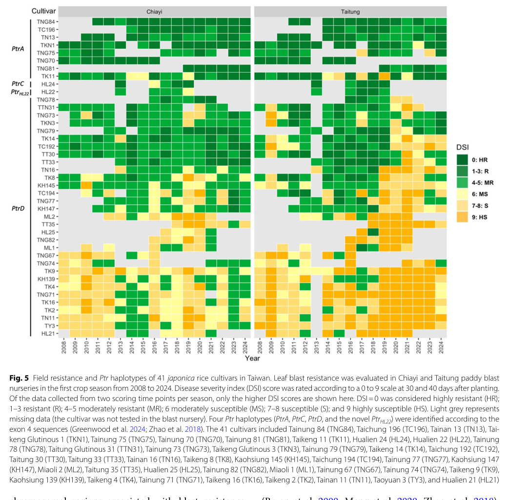

## Question

# Gene Research for Functional Annotation

## ⚠️ CRITICAL: Gene/Protein Identification Context

**BEFORE YOU BEGIN RESEARCH:** You MUST verify you are researching the CORRECT gene/protein. Gene symbols can be ambiguous, especially for less well-characterized genes from non-model organisms.

### Target Gene/Protein Identity (from UniProt):
- **UniProt Accession:** F7J183
- **Protein Description:** SubName: Full=Effector protein AVR-Pita {ECO:0000313|EMBL:BAK40882.1};
- **Gene Information:** Name=AVR-Pita {ECO:0000313|EMBL:BAK40882.1};
- **Organism (full):** Pyricularia oryzae (Rice blast fungus) (Magnaporthe oryzae).
- **Protein Family:** Belongs to the peptidase M35 family.
- **Key Domains:** Fungal_M35_metalloproteases. (IPR050414); Lys_MEP. (IPR029463); MetalloPept_cat_dom_sf. (IPR024079); Aspzincin_M35 (PF14521)

### MANDATORY VERIFICATION STEPS:

1. **Check if the gene symbol "AVR-Pita" matches the protein description above**
2. **Verify the organism is correct:** Pyricularia oryzae (Rice blast fungus) (Magnaporthe oryzae).
3. **Check if protein family/domains align with what you find in literature**
4. **If you find literature for a DIFFERENT gene with the same or similar symbol, STOP**

### If Gene Symbol is Ambiguous or You Cannot Find Relevant Literature:

**DO NOT PROCEED WITH RESEARCH ON A DIFFERENT GENE.** Instead:
- State clearly: "The gene symbol 'AVR-Pita' is ambiguous or literature is limited for this specific protein"
- Explain what you found (e.g., "Found extensive literature on a different gene with the same symbol in a different organism")
- Describe the protein based ONLY on the UniProt information provided above
- Suggest that the protein function can be inferred from domain/family information

### Research Target:

Please provide a comprehensive research report on the gene **AVR-Pita** (gene ID: AVR-Pita, UniProt: F7J183) in PYROR.

The research report should be a detailed narrative explaining the function, biological processes, and localization of the gene product. Citations should be given for all claims.

You should prioritize authoritative reviews and primary scientific literature when conducting research. You can supplement
this with annotations you find in gene/protein databases, but these can be outdated or inaccurate.

We are specifically interested in the primary function of the gene - for enzymes, what reaction is catalyzed, and what is the substrate specificity? For transporters, what is the substrate? For structural proteins or adapters, what is the broader structural role? For signaling molecules, what is the role in the pathway.

We are interested in where in or outside the cell the gene product carries out its function.

We are also interested in the signaling or biochemical pathways in which the gene functions. We are less interested in broad pleiotropic effects, except where these elucidate the precise role.

Include evidence where possible. We are interested in both experimental evidence as well as inference from structure, evolution, or bioinformatic analysis. Precise studies should be prioritized over high-throughput, where available.

## Output

Question: You are an expert researcher providing comprehensive, well-cited information.

Provide detailed information focusing on:
1. Key concepts and definitions with current understanding
2. Recent developments and latest research (prioritize 2023-2024 sources)
3. Current applications and real-world implementations
4. Expert opinions and analysis from authoritative sources
5. Relevant statistics and data from recent studies

Format as a comprehensive research report with proper citations. Include URLs and publication dates where available.
Always prioritize recent, authoritative sources and provide specific citations for all major claims.

# Gene Research for Functional Annotation

## ⚠️ CRITICAL: Gene/Protein Identification Context

**BEFORE YOU BEGIN RESEARCH:** You MUST verify you are researching the CORRECT gene/protein. Gene symbols can be ambiguous, especially for less well-characterized genes from non-model organisms.

### Target Gene/Protein Identity (from UniProt):
- **UniProt Accession:** F7J183
- **Protein Description:** SubName: Full=Effector protein AVR-Pita {ECO:0000313|EMBL:BAK40882.1};
- **Gene Information:** Name=AVR-Pita {ECO:0000313|EMBL:BAK40882.1};
- **Organism (full):** Pyricularia oryzae (Rice blast fungus) (Magnaporthe oryzae).
- **Protein Family:** Belongs to the peptidase M35 family.
- **Key Domains:** Fungal_M35_metalloproteases. (IPR050414); Lys_MEP. (IPR029463); MetalloPept_cat_dom_sf. (IPR024079); Aspzincin_M35 (PF14521)

### MANDATORY VERIFICATION STEPS:

1. **Check if the gene symbol "AVR-Pita" matches the protein description above**
2. **Verify the organism is correct:** Pyricularia oryzae (Rice blast fungus) (Magnaporthe oryzae).
3. **Check if protein family/domains align with what you find in literature**
4. **If you find literature for a DIFFERENT gene with the same or similar symbol, STOP**

### If Gene Symbol is Ambiguous or You Cannot Find Relevant Literature:

**DO NOT PROCEED WITH RESEARCH ON A DIFFERENT GENE.** Instead:
- State clearly: "The gene symbol 'AVR-Pita' is ambiguous or literature is limited for this specific protein"
- Explain what you found (e.g., "Found extensive literature on a different gene with the same symbol in a different organism")
- Describe the protein based ONLY on the UniProt information provided above
- Suggest that the protein function can be inferred from domain/family information

### Research Target:

Please provide a comprehensive research report on the gene **AVR-Pita** (gene ID: AVR-Pita, UniProt: F7J183) in PYROR.

The research report should be a detailed narrative explaining the function, biological processes, and localization of the gene product. Citations should be given for all claims.

You should prioritize authoritative reviews and primary scientific literature when conducting research. You can supplement
this with annotations you find in gene/protein databases, but these can be outdated or inaccurate.

We are specifically interested in the primary function of the gene - for enzymes, what reaction is catalyzed, and what is the substrate specificity? For transporters, what is the substrate? For structural proteins or adapters, what is the broader structural role? For signaling molecules, what is the role in the pathway.

We are interested in where in or outside the cell the gene product carries out its function.

We are also interested in the signaling or biochemical pathways in which the gene functions. We are less interested in broad pleiotropic effects, except where these elucidate the precise role.

Include evidence where possible. We are interested in both experimental evidence as well as inference from structure, evolution, or bioinformatic analysis. Precise studies should be prioritized over high-throughput, where available.

# Functional annotation report: AVR-Pita (UniProt F7J183)

## Identity and scope

The supplied UniProt record identifies F7J183, derived from EMBL BAK40882.1, as **AVR-Pita from *Pyricularia oryzae***, the rice-blast fungus also called *Magnaporthe oryzae*. The organism, effector name, and annotated fungal M35 metalloprotease domains agree with the subject of the AVR-Pita literature; this is **not** the similarly named AVR-Pia effector or the rice resistance protein Pi-ta. Original cloning established that a fungal AVR-Pita gene confers avirulence on rice carrying the corresponding resistance phenotype and encodes a predicted zinc-metalloprotease-like protein. Importantly, the papers reviewed do not explicitly match their experimental protein sequences to **F7J183/BAK40882.1**. Findings for a particular experimental allele should therefore not be assumed to apply to every residue or recognition phenotype of F7J183 without sequence comparison. [UniProt record](https://www.uniprot.org/uniprotkb/F7J183/entry); [Orbach *et al.*, November 2000](https://doi.org/10.1105/tpc.12.11.2019). (orbach2000atelomericavirulence pages 1-2, orbach2000atelomericavirulence pages 5-6, chuma2011multipletranslocationof pages 1-2)

The naming also requires care: **AVR-Pita1 and AVR-Pita2** are related, often mobile homologs that can confer avirulence in tested fungal backgrounds, whereas **AVR-Pita3** lacks that activity. Even among closely related copies, recognition can differ. A family-level name alone does not identify which experimentally characterized allele F7J183 represents. [Chuma *et al.*, July 2011](https://doi.org/10.1371/journal.ppat.1002147). (chuma2011multipletranslocationof pages 10-12, chuma2011multipletranslocationof pages 1-2)

## Primary molecular function: an effector with *predicted*, not established, protease activity

The best-supported functional description is **secreted, host-targeting fungal effector involved in infection and allele-specific activation of rice immunity**. Its classification as an M35 zinc metalloprotease is a *sequence/domain inference*, not a demonstrated catalytic reaction. In the original 223-residue AVR-Pita protein, similarity to fungal neutral metalloproteases and the conserved motif led to predictions that His176 and His180 bind zinc and Glu177 participates in catalysis. Changing Glu177 to glycine abolished the tested avirulence phenotype. This establishes the biological importance of that residue, **not** that loss of peptide-bond hydrolysis caused the phenotype: a substitution could also alter protein structure or recognition. Neither a purified-enzyme cleavage reaction, cleavage-site preference, physiological substrate, nor a catalytic requirement for mitochondrial targeting has been established by these studies. Accordingly, **proteolytic substrate specificity is unknown**; rice OsCOX11 is an experimentally supported *binding partner*, not a proven cleavage substrate. Residue numbers refer to the studied sequence, not a verified alignment to F7J183. [Orbach *et al.*, 2000](https://doi.org/10.1105/tpc.12.11.2019); [Han *et al.*, January 2021](https://doi.org/10.1186/s12284-021-00453-4). (orbach2000atelomericavirulence pages 5-6, orbach2000atelomericavirulence pages 7-9, han2021thefungaleffector pages 2-4, han2021thefungaleffector pages 4-6)

For a compact distinction between demonstrated functions and mechanistic inference, the evidence can be summarized as follows.

| Aspect | Direct result | Confidence / limitation | DOI link |
|---|---|---|---|
| Identity and M35 annotation | AVR-Pita from *Pyricularia oryzae* (= *Magnaporthe oryzae*) is a predicted 223-aa neutral zinc metalloprotease-like effector. Sequence similarity supports M35/M36 classification; His176 and His180 are predicted zinc ligands and Glu177 the catalytic residue. E177G abolished avirulence. (orbach2000atelomericavirulence pages 5-6, orbach2000atelomericavirulence pages 7-9) | **Moderate for metalloprotease-like classification; low for enzymatic reaction.** No purified-enzyme proteolysis, cleavage specificity, physiological substrate, or direct catalytic assay has been reported. The cited experiments were not explicitly accession-matched to F7J183/BAK40882.1. | [Orbach et al., 2000](https://doi.org/10.1105/tpc.12.11.2019) |
| Secretion and infection-interface localization | Fluorescent AVR-Pita accumulated in the biotrophic interfacial complex (BIC); its secretion/BIC localization persisted during brefeldin-A treatment, supporting a Golgi-independent route. In 2023, AVR-Pita was detected in BICs in 100% of observed UBA4+ infection cells, disappeared in Δ*uba4*, and was restored by paromomycin, linking production to Uba4–Urm1-dependent tRNA-U34 thiolation. (li2023unconventionalsecretionof pages 3-4, giraldo2013twodistinctsecretion pages 4-6) | **High for BIC accumulation and BFA resistance.** The AVR-Pita-specific experiments establish secretion to the host–fungus interface more directly than final translocation across the plant membrane; broader host-cytoplasmic delivery is supported by cytoplasmic-effector studies. No experiment was explicitly accession-matched to F7J183. | [Giraldo et al., 2013](https://doi.org/10.1038/ncomms2996); [Li et al., 2023](https://doi.org/10.1038/s41564-023-01443-6) |
| Host localization and virulence target | Mature AVR-Pita bound rice OsCOX11 in yeast two-hybrid and in-vitro pull-down assays. AVR-Pita:YFP co-localized with mitochondrial markers and OsCOX11:mCherry. AVR-Pita or OsCOX11 overexpression increased cytochrome-c-oxidase activity, reduced chitin-triggered ROS/defense-gene responses, and increased blast susceptibility; reduced OsCOX11 dosage increased resistance. (han2021thefungaleffector pages 2-4, han2021thefungaleffector pages 4-6, han2021thefungaleffector pages 6-8) | **Moderate–high for binding/localization; moderate for the physiological pathway.** Major functional evidence relies on ectopic or constitutive expression, and no catalytic mutant or OsCOX11 cleavage product established that protease activity mediates the effect. | [Han et al., 2021](https://doi.org/10.1186/s12284-021-00453-4) |
| Immune recognition: revised 2024 model | CRISPR/RNAi and infection assays showed that Ptr—not the linked NLR Pi-ta—is required for AVR-Pita recognition. PtrA confers Pi-ta2 resistance and recognized all variants tested; PtrB confers classical Pi-ta resistance but recognized only Tyr191/192 variants. A Tyr→Cys substitution enabled escape from PtrB while retaining PtrA recognition. (xiao2024theunconventionalresistance pages 2-3, xiao2024theunconventionalresistance pages 3-5, xiao2024theunconventionalresistance pages 5-6, xiao2024theunconventionalresistance pages 6-7) | **High for genetic receptor assignment and allele specificity.** The historical Pi-ta–AVR-Pita interaction could not be reproduced. Yeast two-hybrid and co-IP detected no direct Ptr–AVR-Pita binding, and no Ptr cleavage was observed, so the molecular sensing mechanism remains unresolved. (xiao2024theunconventionalresistance pages 8-9, xiao2024theunconventionalresistance pages 6-7) | [Xiao et al., 2024](https://doi.org/10.1038/s41477-024-01694-z) |
| Field implementation and breeding relevance | The released Taiwanese cultivar Tainung 84 carries PtrA and has maintained strong blast resistance since 2010. PtrA occurred in 8 of 41 surveyed japonica cultivars (19.5%), which showed good field resistance during 2008–2024. Fine mapping delimited the Ptr locus to 140.4 kb. (wang2024ptrapiztand pages 1-2, wang2024ptrapiztand media 83198969) | **High for field association; not proof that AVR-Pita recognition alone caused durability.** Tainung 84 also carries *Piz-t* and the partial-resistance QTL qBR12_3.3–4.4; the authors therefore support multilocus pyramiding rather than relying solely on PtrA. | [Wang et al., 2024](https://doi.org/10.1186/s40529-024-00444-w) |

*Table: Evidence-ranked functional annotation of AVR-Pita, separating experimentally demonstrated secretion, host targeting, and immune recognition from sequence-based protease inference. Accession-specific assignment to F7J183 remains unverified in the cited experiments.*

## Where AVR-Pita acts: infection interface and host mitochondria

AVR-Pita has an N-terminal secretion-associated region; experimental work often studies a C-terminal **176-residue, processed-region construct** separately from the precursor. During invasion, fluorescent AVR-Pita accumulates at the **biotrophic interfacial complex (BIC)**, the specialized interface between fungal invasive hyphae and the living rice cell. In contrast to conventionally secreted apoplastic effectors, its BIC accumulation continues under brefeldin A treatment, supporting a Golgi-bypass secretion route. This experiment directly establishes secretion/interface localization; it should not, by itself, be overstated as imaging every subsequent membrane-crossing step for AVR-Pita. [Jia *et al.*, August 2000](https://doi.org/10.1093/emboj/19.15.4004); [Giraldo *et al.*, June 2013](https://doi.org/10.1038/ncomms2996). (younas2024progressinthe pages 8-9, giraldo2013twodistinctsecretion pages 4-6, giraldo2013twodistinctsecretion pages 1-2)

A **2023 primary study** added a regulatory mechanism for effector deployment. In infected cells, fluorescent AVR-Pita was present at BICs in all examined wild-type *UBA4* samples but absent from the BICs of the *uba4* deletion mutant; paromomycin restored the signal. The authors relate this phenotype to Uba4–Urm1-dependent thiolation of wobble uridine in tRNA and efficient translation of mRNAs enriched for AA-ending codons, rather than to a universal block of secretion. Their AVR-Pita codon-use analysis reported **88% AA-ending codons** among the relevant synonymous codons, compared with **67% for PWL2**. These results characterize production and deployment in the fungal infection cell, not AVR-Pita’s enzymatic substrate. [Li *et al.*, August 2023](https://doi.org/10.1038/s41564-023-01443-6). (li2023unconventionalsecretionof pages 3-4, li2023unconventionalsecretionof pages 5-6)

**Inside plant cells**, the strongest experimentally identified host-associated location is the **mitochondrion**. AVR-Pita fluorescent fusions colocalized with mitochondrial markers in rice protoplasts and onion cells. Yeast two-hybrid and purified-protein pull-down assays showed interaction with rice **OsCOX11**, a cytochrome-*c*-oxidase assembly factor; OsCOX11 residues 140–220 were sufficient for interaction in the reported mapping assays. In transgenic rice, AVR-Pita expression increased cytochrome-*c*-oxidase activity and attenuated chitin-triggered reactive oxygen species (ROS) and defense-gene responses; OsCOX11 overexpression similarly increased susceptibility, whereas reduced OsCOX11 dosage increased resistance. The resulting model is **AVR-Pita → OsCOX11-associated mitochondrial respiratory/ROS regulation → weaker basal immunity**. Because much of the functional evidence comes from ectopic expression and no cleavage of OsCOX11 was shown, the precise biochemical step between binding and enhanced oxidase activity remains unresolved. [Han *et al.*, 2021](https://doi.org/10.1186/s12284-021-00453-4). (han2021thefungaleffector pages 2-4, han2021thefungaleffector pages 4-6, han2021thefungaleffector pages 6-8)

## Recognition and signaling: the consequential 2024 revision

The classical model held that intracellular AVR-Pita binds the leucine-rich region of the rice NLR **Pi-ta**, triggering effector-triggered resistance; historical transient-expression and interaction work supported that interpretation. **Xiao and colleagues substantially revised the receptor assignment in 2024.** In their tested rice backgrounds, targeted disruption of the nearby unconventional resistance gene **Ptr**, but not the NLR gene *Pi-ta*, abolished AVR-Pita-dependent resistance; complementation and infection assays assigned the classical Pi-ta phenotype to **PtrB** and the broader Pi-ta2 phenotype to **PtrA**. They could not reproduce the earlier Pi-ta–AVR-Pita interaction in their assays. Consequently, presenting NLR Pi-ta as the *established* receptor or signaling component for AVR-Pita would misrepresent the current genetic evidence. Ptr has an armadillo-repeat region and predicted transmembrane spans, but its downstream immune-signaling mechanism remains unresolved. [Jia *et al.*, 2000](https://doi.org/10.1093/emboj/19.15.4004); [Xiao *et al.*, June 2024](https://doi.org/10.1038/s41477-024-01694-z). (xiao2024theunconventionalresistance pages 1-2, xiao2024theunconventionalresistance pages 2-3, xiao2024theunconventionalresistance pages 7-8, xiao2024theunconventionalresistance pages 3-5, xiao2024theunconventionalresistance pages 6-7)

The specificity of this host response is experimentally informative: **PtrA recognized all AVR-Pita variants tested in the 2024 study**, whereas **PtrB recognized a narrower set carrying tyrosine at effector position 191/192**. A tyrosine-to-cysteine change at that position permitted escape from PtrB but not PtrA in the tested genetic backgrounds. “Recognition” here means a demonstrated **Ptr-dependent genetic/infection phenotype**, *not* proven physical binding: yeast two-hybrid and co-immunoprecipitation did not detect a direct Ptr–AVR-Pita interaction, and co-expression did not establish cleavage of Ptr. An intermediary host component or another recognition mechanism remains possible. Positions 191 and 192 reflect numbering differences between tested effector variants and must not be assigned to F7J183 without alignment. [Xiao *et al.*, 2024](https://doi.org/10.1038/s41477-024-01694-z). (xiao2024theunconventionalresistance pages 8-9, xiao2024theunconventionalresistance pages 5-6, xiao2024theunconventionalresistance pages 6-7)

## Population evidence and practical relevance

In the **2024 isolate survey**, 44 fungal isolates were examined: AVR-Pita was amplified from **36**, sequence was resolved for **32**, and these yielded **11 protein variants**; **12 isolates** carried at least two polymorphic copies. All 36 amplification-positive isolates were noninfectious on the tested Pi-ta2 differential rice line. The denominator matters: **11 variants among 32 sequenced isolates** is not an inventory of all natural AVR-Pita alleles, and an amplified gene does not establish the F7J183 sequence. Gene presence, copy number, and the relevant tyrosine/cysteine polymorphism are therefore useful *research-stage* indicators for evaluating resistance spectra. Older chromosomal studies found active AVR-Pita homologs on chromosomes **1, 3, 4, 5, 6 and 7**, as well as supernumerary chromosomes, consistent with repeated movement and potential loss of avirulence recognition. [Xiao *et al.*, 2024](https://doi.org/10.1038/s41477-024-01694-z); [Chuma *et al.*, 2011](https://doi.org/10.1371/journal.ppat.1002147). (xiao2024theunconventionalresistance pages 3-5, chuma2011multipletranslocationof pages 1-2)

Independent **2023 regional surveillance** illustrates why results should not be generalized between populations: PCR testing of **397** isolates collected in China found AVR-Pita1 in **186/215 (86.51%)** Heilongjiang isolates but **90/182 (49.45%)** Hainan isolates; AVR-Pita3 was not detected in the Hainan sample. These are detection frequencies for *family-member assays*, **not** measurements of F7J183 protein abundance, catalytic activity, or Ptr recognition. [Liu and colleagues, 2023](https://doi.org/10.3864/j.issn.0578-1752.2023.03.006). (吴伟怀2023黑龙江省和海南省稻瘟病菌中avrpita家族的分布及变异分析 pages 3-6, 吴伟怀2023黑龙江省和海南省稻瘟病菌中avrpita家族的分布及变异分析 pages 1-3)

A real-world breeding example is the released Taiwanese cultivar **Tainung 84**, which carries **PtrA** and has retained strong blast resistance since its **2010** release. A December **2024** field/genetic study found PtrA in **8 of 41** surveyed local japonica cultivars (**19.5%**), associated with good field resistance in evaluations spanning **2008–2024**. Crucially, Tainung 84 also carries **Piz-t** and a partial-resistance locus, **qBR12_3.3–4.4**: its durable performance cannot be attributed exclusively to AVR-Pita recognition or used as proof that PtrA alone will remain durable everywhere. The authors identify marker-assisted combination of resistance loci as a prospective breeding application, not a demonstrated AVR-Pita-specific commercial diagnostic. The study’s **Figure 5** displays the cultivar haplotypes alongside their field-resistance records. [Wang *et al.*, December 2024](https://doi.org/10.1186/s40529-024-00444-w). (wang2024ptrapiztand pages 1-2, wang2024ptrapiztand pages 11-13, wang2024ptrapiztand media 83198969)

**Annotation conclusion.** For F7J183, the defensible annotation is **AVR-Pita-family, M35 metalloprotease-like fungal effector; secreted to the infection interface and associated with host-cell mitochondrial OsCOX11/ROS regulation; capable of triggering allele-dependent Ptr-mediated rice resistance when the effector allele is recognized**. Whether this exact accession is an active AVR-Pita1-like allele, **what reaction it catalyzes—if any—and which peptide substrate it cleaves remain unverified**. This distinction between measured effector biology and inferred protease chemistry is essential for functional annotation. (orbach2000atelomericavirulence pages 5-6, han2021thefungaleffector pages 2-4, giraldo2013twodistinctsecretion pages 4-6, xiao2024theunconventionalresistance pages 8-9, chuma2011multipletranslocationof pages 1-2)

References

1. (orbach2000atelomericavirulence pages 1-2): Marc J. Orbach, Leonard Farrall, James A. Sweigard, Forrest G. Chumley, and Barbara Valent. A telomeric avirulence gene determines efficacy for the rice blast resistance gene pi-ta. Plant Cell, 12:2019-2032, Nov 2000. URL: https://doi.org/10.1105/tpc.12.11.2019, doi:10.1105/tpc.12.11.2019. This article has 786 citations and is from a highest quality peer-reviewed journal.

2. (orbach2000atelomericavirulence pages 5-6): Marc J. Orbach, Leonard Farrall, James A. Sweigard, Forrest G. Chumley, and Barbara Valent. A telomeric avirulence gene determines efficacy for the rice blast resistance gene pi-ta. Plant Cell, 12:2019-2032, Nov 2000. URL: https://doi.org/10.1105/tpc.12.11.2019, doi:10.1105/tpc.12.11.2019. This article has 786 citations and is from a highest quality peer-reviewed journal.

3. (chuma2011multipletranslocationof pages 1-2): Izumi Chuma, Chihiro Isobe, Yuma Hotta, Kana Ibaragi, Natsuru Futamata, Motoaki Kusaba, Kentaro Yoshida, Ryohei Terauchi, Yoshikatsu Fujita, Hitoshi Nakayashiki, Barbara Valent, and Yukio Tosa. Multiple translocation of the avr-pita effector gene among chromosomes of the rice blast fungus magnaporthe oryzae and related species. PLoS Pathogens, 7:e1002147, Jul 2011. URL: https://doi.org/10.1371/journal.ppat.1002147, doi:10.1371/journal.ppat.1002147. This article has 326 citations and is from a highest quality peer-reviewed journal.

4. (chuma2011multipletranslocationof pages 10-12): Izumi Chuma, Chihiro Isobe, Yuma Hotta, Kana Ibaragi, Natsuru Futamata, Motoaki Kusaba, Kentaro Yoshida, Ryohei Terauchi, Yoshikatsu Fujita, Hitoshi Nakayashiki, Barbara Valent, and Yukio Tosa. Multiple translocation of the avr-pita effector gene among chromosomes of the rice blast fungus magnaporthe oryzae and related species. PLoS Pathogens, 7:e1002147, Jul 2011. URL: https://doi.org/10.1371/journal.ppat.1002147, doi:10.1371/journal.ppat.1002147. This article has 326 citations and is from a highest quality peer-reviewed journal.

5. (orbach2000atelomericavirulence pages 7-9): Marc J. Orbach, Leonard Farrall, James A. Sweigard, Forrest G. Chumley, and Barbara Valent. A telomeric avirulence gene determines efficacy for the rice blast resistance gene pi-ta. Plant Cell, 12:2019-2032, Nov 2000. URL: https://doi.org/10.1105/tpc.12.11.2019, doi:10.1105/tpc.12.11.2019. This article has 786 citations and is from a highest quality peer-reviewed journal.

6. (han2021thefungaleffector pages 2-4): Jingluan Han, Xiaoyu Wang, Fengping Wang, Zhe Zhao, Gousi Li, Xiaoyuan Zhu, Jing Su, and Letian Chen. The fungal effector avr-pita suppresses innate immunity by increasing cox activity in rice mitochondria. Rice, Jan 2021. URL: https://doi.org/10.1186/s12284-021-00453-4, doi:10.1186/s12284-021-00453-4. This article has 86 citations and is from a peer-reviewed journal.

7. (han2021thefungaleffector pages 4-6): Jingluan Han, Xiaoyu Wang, Fengping Wang, Zhe Zhao, Gousi Li, Xiaoyuan Zhu, Jing Su, and Letian Chen. The fungal effector avr-pita suppresses innate immunity by increasing cox activity in rice mitochondria. Rice, Jan 2021. URL: https://doi.org/10.1186/s12284-021-00453-4, doi:10.1186/s12284-021-00453-4. This article has 86 citations and is from a peer-reviewed journal.

8. (li2023unconventionalsecretionof pages 3-4): Gang Li, Nawaraj Dulal, Ziwen Gong, and Richard A. Wilson. Unconventional secretion of magnaporthe oryzae effectors in rice cells is regulated by trna modification and codon usage control. Nature Microbiology, 8:1706-1716, Aug 2023. URL: https://doi.org/10.1038/s41564-023-01443-6, doi:10.1038/s41564-023-01443-6. This article has 36 citations and is from a highest quality peer-reviewed journal.

9. (giraldo2013twodistinctsecretion pages 4-6): Martha C. Giraldo, Yasin F. Dagdas, Yogesh K. Gupta, Thomas A. Mentlak, Mihwa Yi, Ana Lilia Martinez-Rocha, Hiromasa Saitoh, Ryohei Terauchi, Nicholas J. Talbot, and Barbara Valent. Two distinct secretion systems facilitate tissue invasion by the rice blast fungus magnaporthe oryzae. Nature Communications, Jun 2013. URL: https://doi.org/10.1038/ncomms2996, doi:10.1038/ncomms2996. This article has 412 citations and is from a highest quality peer-reviewed journal.

10. (han2021thefungaleffector pages 6-8): Jingluan Han, Xiaoyu Wang, Fengping Wang, Zhe Zhao, Gousi Li, Xiaoyuan Zhu, Jing Su, and Letian Chen. The fungal effector avr-pita suppresses innate immunity by increasing cox activity in rice mitochondria. Rice, Jan 2021. URL: https://doi.org/10.1186/s12284-021-00453-4, doi:10.1186/s12284-021-00453-4. This article has 86 citations and is from a peer-reviewed journal.

11. (xiao2024theunconventionalresistance pages 2-3): Gui Xiao, Nutthalak Laksanavilat, Stella Cesari, Karine Lambou, Maël Baudin, Ahmad Jalilian, Mary Jeanie Telebanco-Yanoria, Veronique Chalvon, Isabelle Meusnier, Elisabeth Fournier, Didier Tharreau, Bo Zhou, Jun Wu, and Thomas Kroj. The unconventional resistance protein ptr recognizes the magnaporthe oryzae effector avr-pita in an allele-specific manner. Nature plants, 10:994-1004, Jun 2024. URL: https://doi.org/10.1038/s41477-024-01694-z, doi:10.1038/s41477-024-01694-z. This article has 38 citations and is from a highest quality peer-reviewed journal.

12. (xiao2024theunconventionalresistance pages 3-5): Gui Xiao, Nutthalak Laksanavilat, Stella Cesari, Karine Lambou, Maël Baudin, Ahmad Jalilian, Mary Jeanie Telebanco-Yanoria, Veronique Chalvon, Isabelle Meusnier, Elisabeth Fournier, Didier Tharreau, Bo Zhou, Jun Wu, and Thomas Kroj. The unconventional resistance protein ptr recognizes the magnaporthe oryzae effector avr-pita in an allele-specific manner. Nature plants, 10:994-1004, Jun 2024. URL: https://doi.org/10.1038/s41477-024-01694-z, doi:10.1038/s41477-024-01694-z. This article has 38 citations and is from a highest quality peer-reviewed journal.

13. (xiao2024theunconventionalresistance pages 5-6): Gui Xiao, Nutthalak Laksanavilat, Stella Cesari, Karine Lambou, Maël Baudin, Ahmad Jalilian, Mary Jeanie Telebanco-Yanoria, Veronique Chalvon, Isabelle Meusnier, Elisabeth Fournier, Didier Tharreau, Bo Zhou, Jun Wu, and Thomas Kroj. The unconventional resistance protein ptr recognizes the magnaporthe oryzae effector avr-pita in an allele-specific manner. Nature plants, 10:994-1004, Jun 2024. URL: https://doi.org/10.1038/s41477-024-01694-z, doi:10.1038/s41477-024-01694-z. This article has 38 citations and is from a highest quality peer-reviewed journal.

14. (xiao2024theunconventionalresistance pages 6-7): Gui Xiao, Nutthalak Laksanavilat, Stella Cesari, Karine Lambou, Maël Baudin, Ahmad Jalilian, Mary Jeanie Telebanco-Yanoria, Veronique Chalvon, Isabelle Meusnier, Elisabeth Fournier, Didier Tharreau, Bo Zhou, Jun Wu, and Thomas Kroj. The unconventional resistance protein ptr recognizes the magnaporthe oryzae effector avr-pita in an allele-specific manner. Nature plants, 10:994-1004, Jun 2024. URL: https://doi.org/10.1038/s41477-024-01694-z, doi:10.1038/s41477-024-01694-z. This article has 38 citations and is from a highest quality peer-reviewed journal.

15. (xiao2024theunconventionalresistance pages 8-9): Gui Xiao, Nutthalak Laksanavilat, Stella Cesari, Karine Lambou, Maël Baudin, Ahmad Jalilian, Mary Jeanie Telebanco-Yanoria, Veronique Chalvon, Isabelle Meusnier, Elisabeth Fournier, Didier Tharreau, Bo Zhou, Jun Wu, and Thomas Kroj. The unconventional resistance protein ptr recognizes the magnaporthe oryzae effector avr-pita in an allele-specific manner. Nature plants, 10:994-1004, Jun 2024. URL: https://doi.org/10.1038/s41477-024-01694-z, doi:10.1038/s41477-024-01694-z. This article has 38 citations and is from a highest quality peer-reviewed journal.

16. (wang2024ptrapiztand pages 1-2): Sheng-Shan Wang, Wei-Bin Chang, Ming-Chien Hsieh, Szu-Yu Chen, Dah-Jing Liao, Ching-Ying Liao, Wei-Chiang Shen, Hong-Hua Chen, Chieh-Yi Chen, Yi-Chia Chen, Yueh-Lin Lin, Chih-Wei Tung, Ruey-Shyang Chen, and Chia-Lin Chung. Ptra, piz-t, and a novel minor-effect qtl (qbr12_3.3–4.4) collectively contribute to the durable blast-resistance of rice cultivar tainung 84. Botanical Studies, Dec 2024. URL: https://doi.org/10.1186/s40529-024-00444-w, doi:10.1186/s40529-024-00444-w. This article has 0 citations and is from a peer-reviewed journal.

17. (wang2024ptrapiztand media 83198969): Sheng-Shan Wang, Wei-Bin Chang, Ming-Chien Hsieh, Szu-Yu Chen, Dah-Jing Liao, Ching-Ying Liao, Wei-Chiang Shen, Hong-Hua Chen, Chieh-Yi Chen, Yi-Chia Chen, Yueh-Lin Lin, Chih-Wei Tung, Ruey-Shyang Chen, and Chia-Lin Chung. Ptra, piz-t, and a novel minor-effect qtl (qbr12_3.3–4.4) collectively contribute to the durable blast-resistance of rice cultivar tainung 84. Botanical Studies, Dec 2024. URL: https://doi.org/10.1186/s40529-024-00444-w, doi:10.1186/s40529-024-00444-w. This article has 0 citations and is from a peer-reviewed journal.

18. (younas2024progressinthe pages 8-9): Muhammad Usama Younas, Irshad Ahmad, Muhammad Qasim, Zainab Ijaz, Nimra Rajput, Saima Parveen Memon, Waqar UL Zaman, Xiaohong Jiang, Yi Zhang, and Shimin Zuo. Progress in the management of rice blast disease: the role of avirulence and resistance genes through gene-for-gene interactions. Agronomy, 14:163, Jan 2024. URL: https://doi.org/10.3390/agronomy14010163, doi:10.3390/agronomy14010163. This article has 52 citations and is from a peer-reviewed journal.

19. (giraldo2013twodistinctsecretion pages 1-2): Martha C. Giraldo, Yasin F. Dagdas, Yogesh K. Gupta, Thomas A. Mentlak, Mihwa Yi, Ana Lilia Martinez-Rocha, Hiromasa Saitoh, Ryohei Terauchi, Nicholas J. Talbot, and Barbara Valent. Two distinct secretion systems facilitate tissue invasion by the rice blast fungus magnaporthe oryzae. Nature Communications, Jun 2013. URL: https://doi.org/10.1038/ncomms2996, doi:10.1038/ncomms2996. This article has 412 citations and is from a highest quality peer-reviewed journal.

20. (li2023unconventionalsecretionof pages 5-6): Gang Li, Nawaraj Dulal, Ziwen Gong, and Richard A. Wilson. Unconventional secretion of magnaporthe oryzae effectors in rice cells is regulated by trna modification and codon usage control. Nature Microbiology, 8:1706-1716, Aug 2023. URL: https://doi.org/10.1038/s41564-023-01443-6, doi:10.1038/s41564-023-01443-6. This article has 36 citations and is from a highest quality peer-reviewed journal.

21. (xiao2024theunconventionalresistance pages 1-2): Gui Xiao, Nutthalak Laksanavilat, Stella Cesari, Karine Lambou, Maël Baudin, Ahmad Jalilian, Mary Jeanie Telebanco-Yanoria, Veronique Chalvon, Isabelle Meusnier, Elisabeth Fournier, Didier Tharreau, Bo Zhou, Jun Wu, and Thomas Kroj. The unconventional resistance protein ptr recognizes the magnaporthe oryzae effector avr-pita in an allele-specific manner. Nature plants, 10:994-1004, Jun 2024. URL: https://doi.org/10.1038/s41477-024-01694-z, doi:10.1038/s41477-024-01694-z. This article has 38 citations and is from a highest quality peer-reviewed journal.

22. (xiao2024theunconventionalresistance pages 7-8): Gui Xiao, Nutthalak Laksanavilat, Stella Cesari, Karine Lambou, Maël Baudin, Ahmad Jalilian, Mary Jeanie Telebanco-Yanoria, Veronique Chalvon, Isabelle Meusnier, Elisabeth Fournier, Didier Tharreau, Bo Zhou, Jun Wu, and Thomas Kroj. The unconventional resistance protein ptr recognizes the magnaporthe oryzae effector avr-pita in an allele-specific manner. Nature plants, 10:994-1004, Jun 2024. URL: https://doi.org/10.1038/s41477-024-01694-z, doi:10.1038/s41477-024-01694-z. This article has 38 citations and is from a highest quality peer-reviewed journal.

23. (吴伟怀2023黑龙江省和海南省稻瘟病菌中avrpita家族的分布及变异分析 pages 3-6): 刘瑞， 赵羽涵， 顾欣怡， 王艳霞， 靳学慧， 吴伟怀. 黑龙江省和海南省稻瘟病菌中 avr-pita 家族的分布及变异分析. Unknown journal, 2023. URL: https://doi.org/10.3864/j.issn.0578-1752.2023.03.006, doi:10.3864/j.issn.0578-1752.2023.03.006.

24. (吴伟怀2023黑龙江省和海南省稻瘟病菌中avrpita家族的分布及变异分析 pages 1-3): 刘瑞， 赵羽涵， 顾欣怡， 王艳霞， 靳学慧， 吴伟怀. 黑龙江省和海南省稻瘟病菌中 avr-pita 家族的分布及变异分析. Unknown journal, 2023. URL: https://doi.org/10.3864/j.issn.0578-1752.2023.03.006, doi:10.3864/j.issn.0578-1752.2023.03.006.

25. (wang2024ptrapiztand pages 11-13): Sheng-Shan Wang, Wei-Bin Chang, Ming-Chien Hsieh, Szu-Yu Chen, Dah-Jing Liao, Ching-Ying Liao, Wei-Chiang Shen, Hong-Hua Chen, Chieh-Yi Chen, Yi-Chia Chen, Yueh-Lin Lin, Chih-Wei Tung, Ruey-Shyang Chen, and Chia-Lin Chung. Ptra, piz-t, and a novel minor-effect qtl (qbr12_3.3–4.4) collectively contribute to the durable blast-resistance of rice cultivar tainung 84. Botanical Studies, Dec 2024. URL: https://doi.org/10.1186/s40529-024-00444-w, doi:10.1186/s40529-024-00444-w. This article has 0 citations and is from a peer-reviewed journal.

## Artifacts

- [Edison artifact artifact-00](AVR-Pita-deep-research-falcon_artifacts/artifact-00.md)

## Citations

1. orbach2000atelomericavirulence pages 1-2
2. orbach2000atelomericavirulence pages 5-6
3. chuma2011multipletranslocationof pages 1-2
4. chuma2011multipletranslocationof pages 10-12
5. orbach2000atelomericavirulence pages 7-9
6. han2021thefungaleffector pages 2-4
7. han2021thefungaleffector pages 4-6
8. li2023unconventionalsecretionof pages 3-4
9. giraldo2013twodistinctsecretion pages 4-6
10. han2021thefungaleffector pages 6-8
11. xiao2024theunconventionalresistance pages 2-3
12. xiao2024theunconventionalresistance pages 3-5
13. xiao2024theunconventionalresistance pages 5-6
14. xiao2024theunconventionalresistance pages 6-7
15. xiao2024theunconventionalresistance pages 8-9
16. wang2024ptrapiztand pages 1-2
17. younas2024progressinthe pages 8-9
18. giraldo2013twodistinctsecretion pages 1-2
19. li2023unconventionalsecretionof pages 5-6
20. xiao2024theunconventionalresistance pages 1-2
21. xiao2024theunconventionalresistance pages 7-8
22. wang2024ptrapiztand pages 11-13
23. UniProt record
24. Orbach *et al.*, November 2000
25. Chuma *et al.*, July 2011
26. Orbach *et al.*, 2000
27. Han *et al.*, January 2021
28. Orbach et al., 2000
29. Giraldo et al., 2013
30. Li et al., 2023
31. Han et al., 2021
32. Xiao et al., 2024
33. Wang et al., 2024
34. Jia *et al.*, August 2000
35. Giraldo *et al.*, June 2013
36. Li *et al.*, August 2023
37. Han *et al.*, 2021
38. Jia *et al.*, 2000
39. Xiao *et al.*, June 2024
40. Xiao *et al.*, 2024
41. Chuma *et al.*, 2011
42. Liu and colleagues, 2023
43. Wang *et al.*, December 2024
44. https://www.uniprot.org/uniprotkb/F7J183/entry
45. https://doi.org/10.1105/tpc.12.11.2019
46. https://doi.org/10.1371/journal.ppat.1002147
47. https://doi.org/10.1186/s12284-021-00453-4
48. https://doi.org/10.1038/ncomms2996
49. https://doi.org/10.1038/s41564-023-01443-6
50. https://doi.org/10.1038/s41477-024-01694-z
51. https://doi.org/10.1186/s40529-024-00444-w
52. https://doi.org/10.1093/emboj/19.15.4004
53. https://doi.org/10.3864/j.issn.0578-1752.2023.03.006
54. https://doi.org/10.1105/tpc.12.11.2019,
55. https://doi.org/10.1371/journal.ppat.1002147,
56. https://doi.org/10.1186/s12284-021-00453-4,
57. https://doi.org/10.1038/s41564-023-01443-6,
58. https://doi.org/10.1038/ncomms2996,
59. https://doi.org/10.1038/s41477-024-01694-z,
60. https://doi.org/10.1186/s40529-024-00444-w,
61. https://doi.org/10.3390/agronomy14010163,
62. https://doi.org/10.3864/j.issn.0578-1752.2023.03.006,