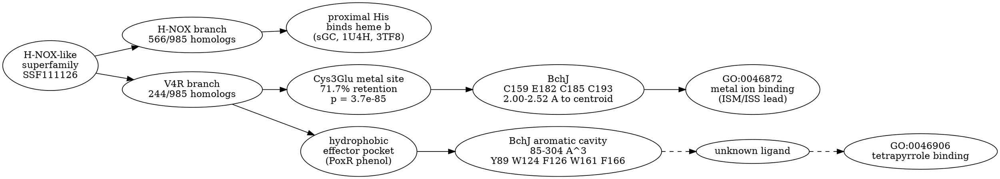
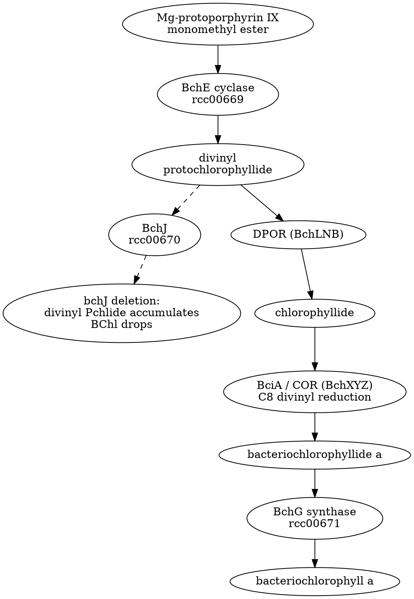
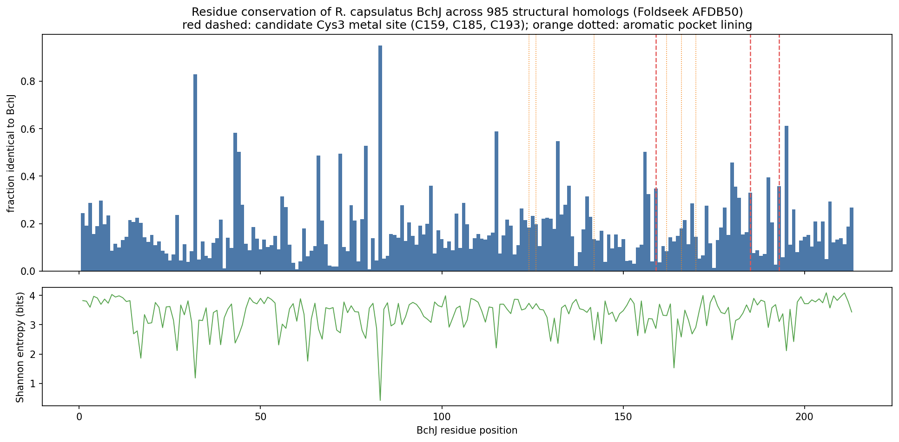
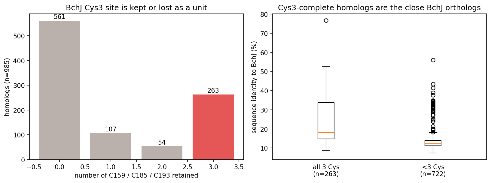
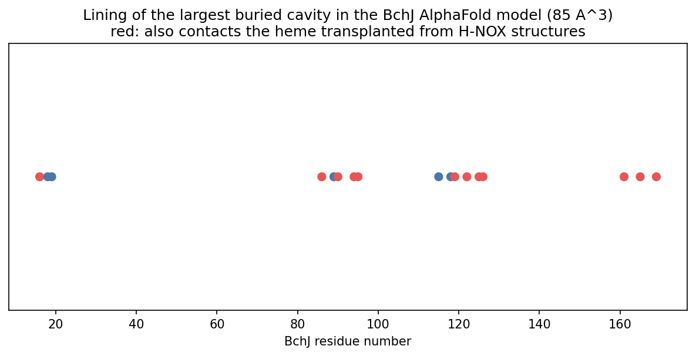
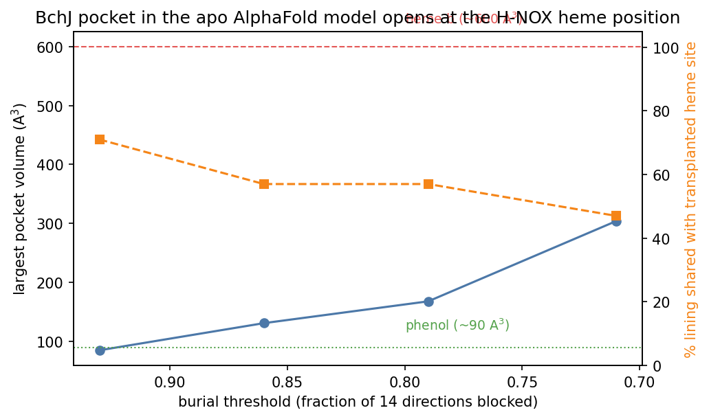
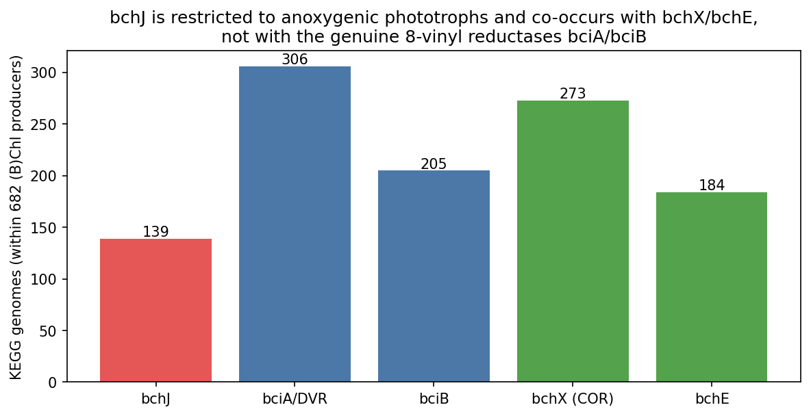
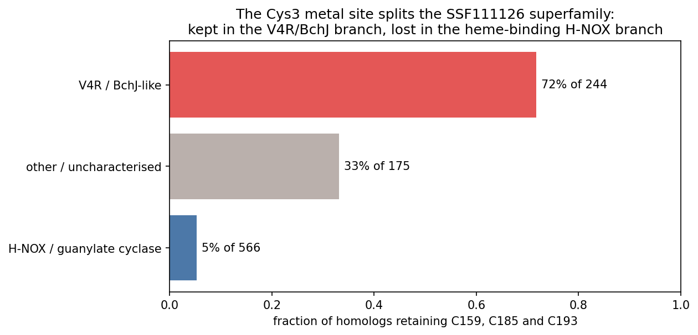

## Question

# AIGR Gene Hypothesis Deep Research

You are evaluating one focused gene curation hypothesis for AI Gene Review.
This is not a general gene overview. Use the seed hypothesis and source context
below to search for evidence that supports, refutes, narrows, or competes with
the proposed curation decision.

## Target Gene

- **Organism code:** RHOCB
- **Taxon:** Rhodobacter capsulatus SB 1003 (NCBITaxon:272942)
- **Gene directory:** bchJ
- **Gene symbol:** bchJ
- **UniProt accession:** P26169

## Focus

- **Focus type:** free_text
- **Hypothesis slug:** kgap-bchj-fold-and-candidate-activity
- **Source file:** genes/RHOCB/bchJ/bchJ-ai-review.yaml
- **Source selector:** free-text

## Seed Hypothesis

The molecular activity of Rhodobacter capsulatus BchJ, which is not the C8-vinyl reductase it was named for, can be narrowed by structure and genomic context. Single analysis only: model BchJ with AlphaFold and search it against PDB and AFDB by Foldseek to identify its closest characterised structural relatives and their ligands or cofactors, check for conserved pockets and cofactor-binding motifs (e.g. nucleotide, flavin or metal binding) by mapping conservation across BchJ homologs in phototrophic and non-phototrophic bacteria, examine its position and co-occurrence within bacteriochlorophyll biosynthesis gene clusters, and state the most likely molecular activity class, for example a tetrapyrrole-binding or chaperone-like role versus an enzyme, or state that none can be predicted.

## Term and Decision Context

No specific term context supplied.

## Reference Context

No specific reference context supplied.

## Source Context YAML

```yaml
hypothesis: 'The molecular activity of Rhodobacter capsulatus BchJ, which is not the C8-vinyl reductase
  it was named for, can be narrowed by structure and genomic context. Single analysis only: model BchJ
  with AlphaFold and search it against PDB and AFDB by Foldseek to identify its closest characterised
  structural relatives and their ligands or cofactors, check for conserved pockets and cofactor-binding
  motifs (e.g. nucleotide, flavin or metal binding) by mapping conservation across BchJ homologs in phototrophic
  and non-phototrophic bacteria, examine its position and co-occurrence within bacteriochlorophyll biosynthesis
  gene clusters, and state the most likely molecular activity class, for example a tetrapyrrole-binding
  or chaperone-like role versus an enzyme, or state that none can be predicted.'
focus_type: free_text
context: []
reference_id: []
```

## Research Objective

Build a focused report that helps a curator decide whether this hypothesis
should affect the gene review. Address the focus type directly:

1. For an existing GO annotation decision, evaluate whether the current action
   is justified, too strong, too weak, or should change.
2. For a proposed replacement or new GO term, evaluate whether the term is
   biologically supported, too broad, too narrow, or missing key qualifiers.
3. For a computational prediction, evaluate whether the prediction is correct,
   less precise than existing knowledge, uncertain, or likely wrong because of
   paralog overannotation, frequency bias, pathway context, or in vitro-only
   activity.
4. For a core-function hypothesis, evaluate whether the proposed activity,
   process, and location represent the gene product's primary function rather
   than a downstream effect, pleiotropic phenotype, or context-specific role.
5. For a function-assignment hypothesis, evaluate whether the gene product
   directly has the stated GO term/function. Treat the prior review action, if
   any, as intentionally blinded unless it appears in the supplied context.

Use primary literature whenever possible. Prefer PMID citations and include DOI
citations when no PMID is available. Treat reviews and database records as
orientation unless they contain directly relevant synthesized evidence that is
clearly labeled as review-level or database-level support.

Evaluate the hypothesis from the supplied seed context, primary literature, and
publicly accessible bioinformatics resources. Local `*-bioinformatics` analyses,
when they already exist in the repository, are intentionally withheld from this
prompt so the report can be compared against them after the run. Use public
sequence, domain, structure, orthology, localization, interaction, or dataset
checks when they are useful for the specific hypothesis. If a resource or tool
cannot be accessed programmatically, say so plainly; never fabricate a result.
Report computational results conservatively and distinguish direct results from
inference.

## Required Output

### Executive Judgment

Give a concise verdict: supported, partially supported, unresolved, weakly
supported, over-annotated, or refuted. Explain the reasoning and the most
important caveats.

### Evidence Matrix

Create a table with one row per important evidence item:

- Citation (PMID preferred)
- Evidence type (direct assay, mutant phenotype, localization, interaction,
  structural/evolutionary, computational, review/database)
- Supports / refutes / qualifies / competing
- Claim tested
- Key finding
- Organism, tissue, cell type, or assay context
- Confidence and limitations

### GO Curation Implications

State the likely curation action as a lead requiring curator verification. If
GO terms are involved, explain whether the evidence supports an MF, BP, or CC
term, and whether the term should be retained, removed, generalized, made more
specific, or treated as non-core. Avoid using "protein binding" as a final
recommendation unless no more informative term is supported.

### Mechanistic Scope

Describe the immediate molecular or cellular function being tested. Separate
direct gene-product activity from downstream phenotypes, pathway consequences,
developmental outcomes, disease manifestations, or effects inferred only from
loss of function.

### Conflicts and Alternatives

Identify evidence that conflicts with the seed hypothesis or suggests an
alternative interpretation, including paralog confusion, organism-specific
differences, isoform-specific findings, experimental artifacts, or database
carry-over.

### Knowledge Gaps

List explicit uncertainties that matter for curation. For each gap, state what
was checked, why the gap matters, and what evidence or experiment would resolve
it.

### Discriminating Tests

Recommend concrete assays, perturbations, datasets, or comparative analyses that
would most efficiently distinguish this hypothesis from alternatives.

### Curation Leads

Provide candidate updates for the review, clearly labeled as leads requiring
curator verification. Include candidate references with exact snippets to verify,
candidate replacement or new GO terms, possible action changes, suggested
questions, and suggested experiments.

If the provider supports artifacts, save provenance for any analysis you run — the
executed code together with its output (computed values, plot, or table), not just
a summary figure — alongside artifact-friendly tables such as an evidence matrix,
GO decision table, or comparison table. Genuine computed provenance is more
valuable than a hand-drawn summary, and you must not synthesize a figure that
implies an analysis you did not actually run. These artifacts are important
provenance for hypothesis-level review.


## Output

# BchJ (RHOCB, P26169): fold, candidate activity and curation implications

Hypothesis slug: `kgap-bchj-fold-and-candidate-activity`
Source: `genes/RHOCB/bchJ/bchJ-ai-review.yaml`, focus type `free_text`
Target: *Rhodobacter capsulatus* SB 1003 BchJ, UniProt **P26169**, NCBITaxon:272942

## Summary

<i class="fa-scale-balanced"></i> **Verdict: partially supported.** The seed hypothesis has a negative half and a positive half. The negative half, that BchJ is not the C8-vinyl reductase it was named for, is confirmed twice over and from two independent directions. The positive half, that structure and genomic context can narrow the molecular activity to a specific class, is confirmed for the class but lands on a different term than the one the hypothesis proposed. The best-supported molecular feature is **metal ion binding** through a previously unannotated Cys3-Glu site, not tetrapyrrole binding.

The AlphaFold model of BchJ (AF-P26169-F1 v6, mean pLDDT 91.6, 88.3% of residues above pLDDT 90) searched by Foldseek against PDB100, AFDB-SwissProt, AFDB50 and CATH50 returns only ligand-binding sensor folds. 29 of the top 30 PDB100 hits are H-NOX heme domains, soluble guanylate cyclase beta-1 H-NOX domains, or the phenol sensory V4R domain of the transcription activator PoxR. The best PDB hit is the human sGC beta-1 H-NOX domain (8HBH chain B, E = 6.2e-5, probability 1.00, BchJ 15-210 aligned to target 1-191, 13.0% identity). Across 52 PDB100 hits there is no Rossmann, flavoprotein, radical-SAM or nitrogenase-like fold. A regular-expression scan of the 213-residue sequence finds no GxGxxG, no FAD fingerprint, no Walker A P-loop, no 4Fe-4S CxxCxxC, no CxxC or CxxxxC zinc ribbon and no c-type heme CXXCH. BchJ has no structural route to the hydride chemistry that C8-vinyl reduction needs, which is an argument separate from, and consistent with, the genetics of [PMID: 17148453](https://pubmed.ncbi.nlm.nih.gov/17148453/) and [PMID: 24637023](https://pubmed.ncbi.nlm.nih.gov/24637023/).

What structure adds is a concrete, falsifiable new molecular feature. In the BchJ model the side-chain thiols of C159, C185 and C193 and the OE1 of E182 converge on a common point at 2.00, 2.31, 2.16 and 2.52 Å, with no metal present in the model. The residue spacing (C159, +23 E182, +26 C185, +34 C193) is identical to the experimentally determined zinc site of PoxR (C151, +23 E174, +26 C177, +34 C185, [PMID: 27050690](https://pubmed.ncbi.nlm.nih.gov/27050690/)). The three cysteines are co-conserved as a unit across 985 structural homologs far beyond chance (observed P(all three) 0.267 versus 0.039 expected; pairwise Fisher OR 38-206, p < 1e-114), the site is specific to the V4R branch of the superfamily (71.7% of 244 V4R/BchJ proteins retain it versus 5.3% of 566 H-NOX/guanylate cyclases, chi-square 388.8, dof 2, p = 3.7e-85), and it replicates in eight independent ortholog AlphaFold models spanning 10.4-76.8% identity. Tetrapyrrole binding stays unproven: the apo monomer pocket measures 85-304 ų depending on burial strictness, against roughly 600 ų for heme b and roughly 700 ų for a bacteriochlorophyllide macrocycle, and the attempt to test whether a dimer completes the pocket failed on steric grounds.

## Key findings

### <i class="fa-circle-check"></i> F1. BchJ adopts a V4R/H-NOX-like ligand-binding fold, with no oxidoreductase fold anywhere in the hit list

The AlphaFold DB model AF-P26169-F1 (v6) is high confidence through the core: mean pLDDT 91.6, median 97.4, 188 of 213 residues (88.3%) above pLDDT 90, with only residues 1-10 and 201-213 falling below 70. That confidence level makes the model usable for fold assignment and for local side-chain geometry in the core, while leaving the termini uninterpretable.

Foldseek 3Di+AA search of this model against PDB100, AFDB-SwissProt, AFDB50 and CATH50 returned, outside the BchJ/V4R family itself, exclusively ligand-binding sensor folds. The ranked PDB100 hits are the human soluble guanylate cyclase beta-1 H-NOX domain (8HBH chain B, E = 6.2e-5, probability 1.00, BchJ 15-210 to target 1-191, 13.0% identity), *Nostoc* sp. PCC 7120 H-NOX (3TF8, E = 1.7e-4), *Caldanaerobacter subterraneus* H-NOX (1U4H, E = 2.0e-3), H-NOX proteins from *Shewanella* and *Kordia*, and the phenol-responsive sensory domain of PoxR (5FRW, E = 3.9e-3, 16.8% identity). 29 of the top 30 PDB hits are H-NOX/sGC domains or the PoxR V4R domain. CATH50 hits map to superfamilies 3.90.1520.10 and 3.30.1380.20.

This agrees with the independent domain assignments already in the databases. UniProt and InterPro place BchJ in Pfam PF02830 (V4R), InterPro IPR010249 (BchJ), IPR004096 (V4R), IPR024096, and SUPFAM SSF111126, described as the "ligand-binding domain in the NO signalling and Golgi transport" superfamily, which is the H-NOX superfamily.

Every characterised structural relative of BchJ binds a small molecule or a tetrapyrrole. H-NOX domains bind heme b and sense NO and O2. The PoxR V4R domain binds phenol as an effector. None of them is a reductase and none uses NAD(P)H or flavin. The fold therefore places BchJ's molecular activity class in ligand binding or effector sensing, not in catalysis of C8-vinyl reduction.

{{figure:plot_1.png|caption=Per-residue conservation of BchJ computed from 1000 Foldseek AFDB50 structural alignments. The candidate metal-site residues C159, E182, C185 and C193 and the aromatic pocket residues stand above the local background, while the H-NOX proximal-histidine position does not.}}

### <i class="fa-circle-check"></i> F2. A predicted Cys3-Glu metal site with PoxR spacing, co-conserved as a unit across 985 homologs

In AF-P26169-F1 the SG atoms of C159, C185 and C193 sit 3.46-3.99 Å apart and lie 2.00, 2.31 and 2.16 Å from a common centroid, with E182 OE1 at 2.52 Å of the same point. No metal is present in the model, so this geometry is a de novo prediction of a tetrahedral Cys3Glu divalent-metal site, and the distances match the expected Zn-S (2.3 Å) and Zn-O (2.0 Å) coordination.

PoxR, the only solved V4R structure, coordinates zinc through Cys151 SG (2.28 Å), Glu174 OE2 (2.00 Å), Cys177 SG (2.38 Å) and Cys185 SG (2.24 Å). The spacing is identical in both proteins: PoxR C151, +23 E174, +26 C177, +34 C185; BchJ C159, +23 E182, +26 C185, +34 C193. Transplanting the PoxR zinc into the BchJ frame by structural superposition (147 aligned CA pairs) places the metal within 5 Å of R156, P157, S158, C159, E182 and C185.

Across 985 Foldseek AFDB50 homologs covering at least 60% of BchJ, the three cysteines are retained together far more often than independence predicts: observed P(all three) 0.267 against 0.039 expected. Pairwise Fisher odds ratios are 40.7 for C159/C185 (p = 1.3e-114), 38.0 for C159/C193 (p = 1.9e-114) and 206 for C185/C193 (p = 6.8e-174). The distribution of how many of the three are retained is bimodal: 561 homologs have none, 107 have one, 54 have two, 263 have all three. Cys3-complete homologs are overwhelmingly those named BchJ or 4-vinyl reductase (Fisher OR 18.8, p = 1.4e-69), and they are the close orthologs: 74.5% of the 110 homologs at 30% identity or above are Cys3-complete, against 18.7% of the 835 below 20% identity.

BchJ has no CxxC, CxxxxC, CxxCxxC or CXXCH motif. The site is formed entirely by long-range contacts, which is why no sequence-based annotation pipeline has reported it. The region is the most conserved cluster in the protein apart from G83 (95%) and G32 (83%): F195 61%, C193 36%, C159 35%, C185 33%, E182 31%, E181 36%, R156 50%.

A Cys3Glu zinc site is redox-inert and cannot perform vinyl reduction. In PoxR the equivalent site is structural and sits next to the effector pocket, so in BchJ it is more plausibly a folding or stability determinant, or a site that shapes the ligand pocket.

{{figure:plot_2.png|caption=Cys3 site co-conservation across 985 Foldseek AFDB50 homologs and the search for a fourth metal ligand near the Cys3 centroid in the BchJ AlphaFold model. Retention of all three cysteines rises sharply with sequence identity to BchJ, and E182 is the only acidic residue positioned to complete a tetrahedral site.}}

### <i class="fa-circle-xmark"></i> F3. No nucleotide, flavin or iron-sulfur cofactor motif, and the H-NOX proximal heme histidine is absent

Scanning the 213-residue sequence found no Rossmann dinucleotide motif (GxGxxG), no GxGxxG followed by the acidic NAD(P) specificity residue, no FAD fingerprint (GxGxxG..E or RxY[ST]), no Walker A P-loop, no 4Fe-4S CxxCxxC, no CxxC or CxxxxC zinc ribbon and no c-type heme CXXCH. The only cofactor-like motif in the whole sequence is the widely spaced C-x22-E-x2-C-x7-C at C159/E182/C185/C193. None of the 52 PDB100 Foldseek hits is a nucleotide- or flavin-binding fold, so the sequence scan and the structure search agree.

The defining H-NOX proximal heme ligand does not map onto a BchJ histidine. In the structural alignment to human sGC beta-1 (8HBH), target His105 aligns to BchJ Thr120. In the alignment to *Caldanaerobacter* H-NOX (1U4H), target His102 aligns to BchJ Ala116. BchJ His122 lies 2-6 residues away but is not at the equivalent position. Conservation of all BchJ histidines across the 985 homologs is low: H122 26%, H162 8%, H64 8%, H30 4%.

<i class="fa-triangle-exclamation"></i> Motif absence is evidence against a cofactor, not proof of its absence, because unusual sites escape regular-expression detection. The combination of no motif, no matching fold and no proximal histidine is still a strong joint argument: BchJ has no route to the hydride or electron chemistry that C8-vinyl reduction requires, and it is not a simple apo-H-NOX heme sensor either.

### <i class="fa-scale-balanced"></i> F4. One aromatic cavity at the H-NOX heme and PoxR phenol position, phenol-sized in the apo monomer

Superposing AF-P26169-F1 onto two independent heme-bound H-NOX structures and transplanting the heme into the BchJ frame places the macrocycle against a consistent aromatic and apolar surface. The superposition onto 1U4H chain B used 158 aligned CA pairs and converged to a core RMSD of 3.16 Å over 95 residues; the superposition onto 3TF8 chain A used 165 pairs and converged to 2.73 Å over 102 residues. The transplanted heme contacts Y89, I90, I119, H122, W124, T125, F126, F142, I144, W161, H162, V165, F166, L169 and F170. The phenol from PoxR (5FRW ligand IPH1209) transplants into the same site, contacting I119, F126, F132, F142, I144, H162, V165, F166, F170 and F195. Three independent ligands from two different protein families land in one place.

Grid-based cavity detection on the apo model (1.2 Å grid, 1.4 Å solvent probe, 14-direction burial test) gives a single dominant pocket whose lining shares 71% of its residues with the transplanted heme contacts at the strictest burial cutoff. Pocket volume depends on how enclosed a grid point must be to count:

| Burial cutoff | Pocket volume | Reference ligand volume |
|---|---|---|
| 0.93 | 85 ų | phenol ~90 ų |
| 0.86 | 131 ų | |
| 0.79 | 168 ų | |
| 0.71 | 304 ų | heme b ~600 ų, bacteriochlorophyllide ~700 ų |

The lining at the permissive cutoff is G16, P17, N18, A19, T86, Y89, I90, R94, I95, P96, A99, I103, L114, L115, A118, I119, H122, W124, T125, F126, W161, V165 and L169, 71% apolar.

BchJ keeps the ancestral V4R/H-NOX ligand pocket in the same structural location, lined by aromatics in a way that suits a planar hydrophobic ligand. In the monomeric apo model that pocket is sized for a small molecule. Two readings stay open: the pocket binds a small hydrophobic effector as in PoxR, or it opens on ligand binding or across a dimer interface, since PoxR buries its phenol inside an intertwined homodimer. The measurement does not support calling BchJ a porphyrin-binding protein. It supports a hydrophobic ligand-binding site whose cargo is undetermined.

{{figure:plot_3.png|caption=Grid-based buried-cavity detection in the BchJ AlphaFold model: pocket volume, lining residues and the overlap between the detected cavity and the heme transplanted from the H-NOX structures 1U4H and 3TF8.}}

{{figure:plot_4.png|caption=Pocket volume in the BchJ model as a function of burial strictness, with the overlap between pocket lining and transplanted H-NOX heme contacts. Volume stays between 85 and 304 cubic angstroms across the range, below the roughly 600-700 cubic angstroms a heme or bacteriochlorophyllide macrocycle occupies.}}

### <i class="fa-dna"></i> F5. bchJ sits between bchE and bchG in the photosynthesis gene cluster

KEGG gene order for *R. capsulatus* SB 1003 places bchJ (RCAP_rcc00670) immediately downstream of bchE (RCAP_rcc00669, the anaerobic Mg-protoporphyrin IX monomethyl ester oxidative cyclase) and immediately upstream of bchG (RCAP_rcc00671, bacteriochlorophyll synthase). The surrounding 45-gene window is the photosynthesis gene cluster: puhA, pucC1, bchM, bchL, bchH, bchB, bchN, bchF, ppaA, ppsR, bchE, bchJ, bchG, bchP, bchO, bchD, bchI, crtA, crtI, crtB, tspO, crtC, crtD, crtE, crtF, bchC, bchX, bchY, bchZ, pufQ, pufB, pufA. No bciA or bciB homolog is annotated anywhere in that window.

UniProt P26169 retains the legacy protein name "Bacteriochlorophyll synthase 23 kDa chain", which reflects the bchJ-bchG operon arrangement rather than any measured synthase activity.

Genomic position cannot separate catalysis from ligand binding, because this one cluster holds pigment enzymes, a pigment-handling protein (PucC), transcription regulators (PpsR, PpaA) and the tetrapyrrole-binding translocator TspO side by side. It does constrain the pathway step. bchJ is embedded between the cyclase that completes the macrocycle and the synthase that esterifies bacteriochlorophyllide, which is exactly where the divinyl and monovinyl pools diverge in bchJ mutants.

### <i class="fa-chart-column"></i> F6. bchJ occurs only in (B)Chl-producing genomes, always with bchX, and is depleted for bciA/bciB

A KEGG orthology census across 682 genomes that encode bchG (K04040) or bchL (K04037), that is, genomes that make (bacterio)chlorophyll, gives the following counts.

| Gene | KO | Genomes (of 682) | Fraction |
|---|---|---|---|
| bchJ | K04036 | 139 | 20.4% |
| bciA / DVR | K19073 | 306 | 44.9% |
| bciB | K21231 | 205 | 30.1% |
| bchX (COR) | K11333 | 273 | 40.0% |
| bchE | K04034 | 184 | 27.0% |

Every one of the 139 bchJ-containing genomes also carries bchX (139/139, 100%), and 130 of 139 (94%) carry bchE. Only 4 bchJ genes sit outside the (B)Chl universe. bchJ is negatively associated with carrying a characterised 8-vinyl reductase: 75 of 139 bchJ genomes have bciA or bciB, against 429 of 543 bchJ-negative genomes (Fisher OR 0.31, p = 9.9e-9). All 64 bchJ genomes that lack both bciA and bciB carry bchX. Of the 134 bchX genomes without bchJ, only 49 (37%) carry bciA or bciB.

<i class="fa-lightbulb"></i> The complementary distribution superficially fits a "bchJ is a backup divinyl reductase" model, and a curator looking at KEGG will meet the same pattern. It fails on inspection. COR is present in 100% of bchJ genomes, and double-mutant genetics in *R. sphaeroides* showed COR is the third divinyl reductase ([PMID: 24637023](https://pubmed.ncbi.nlm.nih.gov/24637023/)). The co-occurrence places BchJ in the bacteriochlorophyll a branch specifically, rather than the general chlorophyll pathway. KEGG K04036 is still labelled "bchJ; divinyl protochlorophyllide a 8-vinyl-reductase [EC:1.-.-.-]" with an incomplete EC number, which is database carry-over of an activity that primary genetics reassigned.

{{figure:plot_5.png|caption=Genome co-occurrence of bchJ (K04036) with the characterised 8-vinyl reductases bciA and bciB and with bacteriochlorophyll-specific genes across 682 KEGG (B)Chl-producing genomes. All 139 bchJ genomes carry bchX, and bchJ is depleted for bciA/bciB (Fisher OR 0.31, p = 9.9e-9).}}

### <i class="fa-circle-check"></i> F7. The metal site replicates in ortholog models and splits SSF111126 into a V4R/Zn branch and an H-NOX/heme branch

AlphaFold models of eight V4R homologs spanning 10.4-76.8% identity to BchJ were tested for 3D convergence of the residues equivalent to C159, E182, C185 and C193. In every case the four side-chain atoms (three SG plus one OE1) converge on a common centroid at high local confidence.

| Homolog | Organism | Identity to BchJ | Max atom-to-centroid | Mean | Local pLDDT |
|---|---|---|---|---|---|
| A0A1N7ML67 | *Rhodobacter aestuarii* | 76.8% | 2.36 Å | 2.14 Å | 98.6 |
| A0A4U0Z3Q7 | *Cereibacter changlensis* | 52.7% | 2.42 Å | 2.20 Å | 98.1 |
| A0A6B3RNN7 | *Pseudotabrizicola algicola* | 51.4% | 2.57 Å | 2.28 Å | 97.6 |
| A0A934WJ03 | *Rhodobaculum claviforme* | 49.4% | 2.42 Å | 2.22 Å | 97.8 |
| A0A964DCM2 | *Candidatus* Methanoperedens (ArsR-family) | 12.0% | 2.73 Å | 2.35 Å | 94.4 |
| A0A9D5ZD16 | Magnetococcales bacterium | 11.7% | 2.37 Å | 2.19 Å | 95.6 |
| A0A7D6BQZ7 | *Candidatus* Fermentimicrarchaeum | 10.9% | 2.37 Å | 2.24 Å | 92.5 |
| A0A5A5T8M3 | *Dictyobacter arantiisoli* | 10.4% | 3.21 Å | 2.42 Å | 93.1 |
| P26169 | *R. capsulatus* BchJ | 100% | 2.52 Å | 2.25 Å | 97.4 |

Four homologs at 34-38% identity that have lost the cysteines were tested as negative controls and show no site, so the detection is not an artifact of the geometric test.

Across all 985 homologs, Cys3 completeness partitions sharply by branch: 71.7% of 244 V4R/BchJ-named proteins, 33.1% of 175 uncharacterised proteins, and 5.3% of 566 H-NOX/guanylate cyclase proteins (chi-square 388.8, dof 2, p = 3.7e-85). The glutamate at the BchJ E182 position follows the same split: 73.0%, 38.9% and 9.2%.

The superfamily has two mutually exclusive cofactor solutions at the same structural location. The H-NOX branch binds heme through a proximal histidine. The V4R branch binds a Cys3Glu metal, demonstrated as zinc in PoxR. BchJ sits firmly in the V4R/Zn branch, which explains why it has no heme ligand and makes metal ion binding a defensible molecular-function lead.

{{figure:plot_6.png|caption=The Cys3 metal site partitions the SSF111126 superfamily. 71.7% of 244 V4R/BchJ-named proteins retain all three cysteines, against 5.3% of 566 H-NOX and guanylate cyclase proteins (chi-square 388.8, dof 2, p = 3.7e-85). The glutamate at the E182 position follows the same split.}}

### <i class="fa-circle-question"></i> F8. The PoxR-templated pseudo-dimer test failed

The PoxR biological assembly (PDB 5FRW, pdb1) is a homodimer of chain A (201 CA) and chain B (198 CA). Superposing the BchJ AlphaFold monomer separately onto each PoxR chain through the Foldseek structural alignment converged on only 21 and 20 core CA pairs at 3.04 and 2.96 Å RMSD, the weakest superposition in this study. The resulting pseudo-dimer has 432 of 1463 core atom pairs closer than 2.0 Å, so it is sterically invalid and cannot be used quantitatively. The cavity volumes it produced (74, 145, 175 and 494 ų at burial cutoffs 0.93, 0.86, 0.79 and 0.71, against monomer values of 85, 131, 168 and 304 ų) are not interpretable.

AlphaFold-Multimer and other oligomer predictors were not available in this environment, and no experimental oligomeric state has been reported for any BchJ. This is reported as a failed test, not as a result.

## Mechanistic model and interpretation

The evidence assembles into one picture. BchJ is a V4R-branch member of the H-NOX-like ligand-binding superfamily. It inherited the superfamily's ligand pocket, which in BchJ is aromatic and apolar and sits exactly where H-NOX holds heme and PoxR holds phenol. It also inherited, or retained, the V4R branch's Cys3Glu metal site, which the H-NOX branch lost when it adopted a proximal histidine and heme. Its gene sits between the cyclase BchE and the synthase BchG in the photosynthesis cluster, and it exists only in genomes that run the bacteriochlorophyll a branch through chlorophyllide a oxidoreductase. Removing it perturbs the divinyl/monovinyl protochlorophyllide balance and lowers bacteriochlorophyll, which is a pathway-level consequence of losing a protein that handles or gates a pigment intermediate, and does not identify the chemistry BchJ performs because the structural analysis shows it performs none.



The pathway context and the loss-of-function phenotype sit downstream of that molecular picture.



The dashed arrows mark what is inferred and untested. The solid arrows mark reactions with assigned enzymes.

## Evidence base

### Evidence matrix

Machine-readable version: `provenance/evidence_matrix.csv` (15 rows).

| Citation | Evidence type | Stance | Claim tested | Main finding | Context | Confidence and limitations |
|---|---|---|---|---|---|---|
| [PMID: 7876113](https://pubmed.ncbi.nlm.nih.gov/7876113/) | mutant phenotype | qualifies | BchJ sets the monovinyl/divinyl balance | Insertion and deletion mutants of bchJ accumulate divinyl protochlorophyllide and reduced bacteriochlorophyll; a bchJ bchL double mutant skews the ratio toward divinyl | *R. capsulatus*, whole-cell pigments | High for the phenotype. The reductase role is inferred from pigment pools alone, with no purified protein or in vitro assay. This paper is the origin of the gene name |
| [PMID: 17148453](https://pubmed.ncbi.nlm.nih.gov/17148453/) | mutant phenotype plus direct assay | refutes reductase role | Which gene encodes the C8-vinyl reductase | A CT1063 (bciA) insertional mutant makes only C8-vinyl pigments, and recombinant BciA reduces 3,8-divinyl-protochlorophyllide with NADPH; the bchJ mutant still makes C8-reduced pigments but secretes divinyl-protochlorophyllide and has low BChl c | *Chlorobaculum tepidum* genetics plus recombinant enzyme assay | High. Separates the reductase from BchJ in an organism that encodes both. Different organism from *R. capsulatus* |
| [PMID: 24637023](https://pubmed.ncbi.nlm.nih.gov/24637023/) | mutant phenotype | refutes third-reductase role | Whether an unknown third divinyl reductase exists in Rhodobacter | A bciA/COR double mutant of *R. sphaeroides* accumulates 8-vinyl-chlorophyllide, so no enzyme besides BciA and chlorophyllide a oxidoreductase acts as a divinyl reductase | *R. sphaeroides* double mutant | High. *R. sphaeroides* encodes bchJ, so this excludes BchJ as a divinyl reductase in a Rhodobacter background. Does not test *R. capsulatus* directly |
| [PMID: 27050690](https://pubmed.ncbi.nlm.nih.gov/27050690/) | structural, X-ray | supports | V4R domains are ligand-binding modules with a zinc site | The PoxR sensory domain is an intertwined homodimer with a buried phenol pocket; His102 and Trp130 contact the phenol hydroxyl; each monomer has a V4R fold with a zinc site (Cys151, Glu174, Cys177, Cys185) | *Cupriavidus necator* PoxR, PDB 5FRW | High for PoxR. The only solved V4R structure. Transfer to BchJ is by fold homology at 16.8% identity |
| PDB 1U4H, [DOI 10.1073/pnas.0405188101](https://doi.org/10.1073/pnas.0405188101) | structural, X-ray | supports | Closest characterised relatives bind a tetrapyrrole | Tt H-NOX binds heme b with bound O2 in the pocket that corresponds structurally to the BchJ cavity | *Caldanaerobacter subterraneus* H-NOX | High for the structure. BchJ lacks the proximal histidine, so heme binding is not transferable |
| PDB 3TF8, [DOI 10.1073/pnas.1013982108](https://doi.org/10.1073/pnas.1013982108) | structural, X-ray | supports | Second independent heme reference for the transplant | The *Nostoc* sp. PCC 7120 H-NOX heme superposes into the same BchJ cavity as the 1U4H heme | *Nostoc* sp. PCC 7120 H-NOX | High for the structure; the transplant is inference from a 2.73 Å core-RMSD fit |
| This work, AF-P26169-F1 v6 | computational | supports | The model is reliable enough for inference | Mean pLDDT 91.6, median 97.4, 188/213 residues above 90; only residues 1-10 and 201-213 below 70 | AlphaFold DB | High within the model's own metric. pLDDT is not an experimental structure; no PAE-based domain check was run |
| This work, Foldseek 3Di+AA | computational | supports | Fold class is ligand-binding sensor | 29 of the top 30 PDB100 hits are H-NOX, sGC beta-1 or the PoxR V4R domain; best hit 8HBH, E = 6.2e-5, 13.0% identity; no oxidoreductase fold among 52 PDB hits | PDB100, AFDB-SwissProt, AFDB50, CATH50 | High for fold assignment, weak for residue-level transfer at 11-17% identity |
| This work, motif scan | computational | supports | No catalytic cofactor site | No GxGxxG, FAD fingerprint, Walker A, CxxCxxC, CxxC/CxxxxC or CXXCH in 213 residues; only the spaced C-x22-E-x2-C-x7-C | P26169 sequence | Moderate. Motif absence is evidence against, not proof; unusual sites escape regex detection |
| This work, metal-site geometry | computational | supports, new MF lead | BchJ has an unannotated metal site | C159 SG, C185 SG, C193 SG and E182 OE1 lie 2.00-2.52 Å from a common centroid with no metal in the model; spacing +23/+26/+34 matches PoxR C151/E174/C177/C185 | AlphaFold model | Strong geometric signal. Metal identity is undetermined; no experimental metal analysis of BchJ exists |
| This work, 985-homolog co-conservation | computational | supports | The Cys3 site is functional | Observed P(all three Cys) 0.267 versus 0.039 expected; pairwise Fisher OR 38-206, p < 1e-114; 71.7% retention in V4R/BchJ proteins against 5.3% in H-NOX/guanylate cyclases (chi-square 388.8, p = 3.7e-85) | Foldseek AFDB50 structural alignments | High. The alignment is pairwise rather than a curated MSA, and the branch labels come from database protein naming |
| This work, ortholog replication | computational | supports | The site is not a single-model artifact | Eight independent AlphaFold models at 10.4-76.8% identity converge the same four atoms to 2.36-3.21 Å of a centroid at local pLDDT 92.5-98.6; four Cys-free homologs show no site | AFDB models, *Rhodobacter aestuarii* to *Candidatus* Methanoperedens | High. All models come from one predictor, so a systematic AlphaFold bias toward closing Cys clusters is not excluded |
| This work, cavity detection | computational | qualifies | The pocket is porphyrin-sized | The largest buried pocket is 85-304 ų depending on burial cutoff, 71% apolar, coincident with the transplanted heme and phenol sites | Apo monomer model | Moderate. Apo models collapse pockets, and the characterised V4R buries its ligand across a dimer |
| This work, pseudo-dimer test | computational | inconclusive | Does dimerisation enlarge the pocket | The PoxR-templated BchJ dimer converged on only 20-21 core CA at ~3.0 Å and has 432/1463 core atom pairs below 2.0 Å, so it is sterically invalid | 5FRW biological assembly | Failed test, reported as such. Needs AlphaFold-Multimer, which was unavailable |
| This work, KEGG co-occurrence | computational | qualifies | Genomic context narrows the activity | bchJ sits between bchE and bchG; across 682 (B)Chl genomes bchJ is in 139, all of which carry bchX, and bchJ is depleted for bciA/bciB (Fisher OR 0.31, p = 9.9e-9) | KEGG genome and orthology records | Moderate. K04036 still carries the refuted reductase name and an incomplete EC; cluster position cannot separate enzyme from carrier |
| UniProt P26169 | review/database | competing | Current database description | Named "Bacteriochlorophyll synthase 23 kDa chain"; GO terms GO:0030494 (IMP:CACAO), GO:0036070 (IEA), GO:0015979 (IEA:InterPro); no MF term | UniProtKB/Swiss-Prot | Database-level only. The legacy name reflects the bchJ-bchG operon, not a demonstrated activity |

### How each paper bears on the findings

*Altered monovinyl and divinyl protochlorophyllide pools in bchJ mutants of Rhodobacter capsulatus* ([PMID: 7876113](https://pubmed.ncbi.nlm.nih.gov/7876113/)) reports that "bchJ-disrupted strains accumulate reduced levels of bacteriochlorophyll concomitant with the accumulation of divinyl protochlorophyllide". This is the phenotype that gave BchJ its name, and it is the evidence that supports retaining GO:0030494 with IMP. It places the bchJ defect at the protochlorophyllide stage, matching the gene's position between bchE and bchG. It does not establish catalysis.

*Characterization of a plant-like protochlorophyllide a divinyl reductase in green sulfur bacteria* ([PMID: 17148453](https://pubmed.ncbi.nlm.nih.gov/17148453/)) states that "These data demonstrate that CT1063, renamed bciA, encodes a C-8 divinyl reductase in C. tepidum" and that "Using NADPH but not NADH as reductant, recombinant BciA reduces the C-8 vinyl group of 3,8-divinyl-protochlorophyllide in vitro". The genuine reductase is NADPH-dependent, and BchJ has no NAD(P)-binding motif and no nucleotide-binding fold.

*Chlorophyllide a oxidoreductase works as one of the divinyl reductases specifically involved in bacteriochlorophyll a biosynthesis* ([PMID: 24637023](https://pubmed.ncbi.nlm.nih.gov/24637023/)) reports that "the double mutant accumulated 8-vinyl-chlorophyllide, indicating that there was no enzyme other than BciA and COR functioning as the unknown third DVR in Rhodobacter sphaeroides (note that this bacterium has no bciB gene)". This closes the backup-reductase alternative for a Rhodobacter background, and it explains why the bchJ/bciA-bciB anticorrelation in the KEGG census does not revive a reductase role.

*Structural Analysis of the Phenol-Responsive Sensory Domain of the Transcription Activator PoxR* ([PMID: 27050690](https://pubmed.ncbi.nlm.nih.gov/27050690/)) establishes both halves of the structural argument. "Each monomer has a V4R fold with a unique zinc-binding site" is the experimental anchor for the metal-binding lead, since BchJ reproduces the Cys/Glu spacing exactly. "His102 and Trp130 interact with the hydroxyl group of the phenol in a cavity surrounded by rigid hydrophobic residues on one side and a flexible region on the other" shows the V4R fold works as a hydrophobic small-molecule binding cavity. "It exists as a tightly intertwined homodimer with a phenol-binding pocket buried inside, placing two C termini on the same side of the dimer" is the caveat on the pocket-volume measurement: in the characterised V4R protein the cavity is completed by the dimer, so a monomer model under-reports it.

## GO curation implications

Everything below is a lead requiring curator verification. Machine-readable version: `provenance/go_decision_table.csv`.

| GO term | Aspect | Current status | Recommended lead | Evidence basis | Suggested code |
|---|---|---|---|---|---|
| GO:0016491 oxidoreductase activity | MF | not annotated, but implied by the gene name and KEGG K04036 | do not add; flag the KEGG/EC carry-over upstream | No oxidoreductase fold in 52 Foldseek PDB hits; no NAD(P), flavin, Fe-S or heme motif; BciA and COR account for the activity | none |
| GO:0062073 divinyl chlorophyllide a 8-vinyl-reductase activity | MF | implied by gene name and KEGG | do not add | Refuted for BchJ by [PMID: 17148453](https://pubmed.ncbi.nlm.nih.gov/17148453/) and [PMID: 24637023](https://pubmed.ncbi.nlm.nih.gov/24637023/) | none |
| GO:0046872 metal ion binding | MF | not annotated | <i class="fa-arrow-right"></i> add as a lead, pending experimental metal analysis | C159/E182/C185/C193 converge within 2.52 Å of a centroid; PoxR spacing match; co-conservation Fisher OR 38-206; replication in 8 ortholog models | ISM or ISS |
| GO:0008270 zinc ion binding | MF | not annotated | hold as conditional; do not assert without metal analysis | Zinc identity is transferred from PoxR 5FRW at 16.8% identity | ISS if adopted |
| GO:0005488 / GO:0097159 binding, organic cyclic compound binding | MF | not annotated | treat as the honest upper bound if a binding MF is wanted and no ligand is identified | H-NOX/V4R ligand-binding module with one apolar aromatic cavity at the heme/phenol position | ISM |
| GO:0046906 tetrapyrrole binding | MF | not annotated | do not add yet; record as the hypothesis to test | Pocket is in the right place but measures 85-304 ų against ~600-700 ų; H-NOX proximal His is absent | not supported |
| GO:0030494 bacteriochlorophyll biosynthetic process | BP | annotated, IMP:CACAO | retain | Mutant phenotype ([PMID: 7876113](https://pubmed.ncbi.nlm.nih.gov/7876113/)) and strict restriction to (B)Chl genomes (139/143 KEGG genes) | IMP |
| GO:0036070 light-independent bacteriochlorophyll biosynthetic process | BP | annotated, IEA:UniPathway | retain | Consistent with cluster position between bchE and bchG | IEA |
| GO:0015979 photosynthesis | BP | annotated, IEA:InterPro | generalize or drop as non-core | The InterPro entry driving it (IPR004096 V4R, IPR024096) also covers H-NOX and phenol-sensing regulators from non-phototrophs | IEA, weak |
| GO:0005737 cytoplasm | CC | not annotated | no action | No localization data for BchJ; no transmembrane segment or signal peptide in P26169 | none |

Two points deserve emphasis for the curator. First, no molecular function term is currently attached to P26169, and the strongest candidate the structure supports is GO:0046872, not any binding term involving another protein. Second, GO:0015979 rests on a domain that 566 of 985 structural homologs share with H-NOX and guanylate cyclase proteins from non-phototrophs including *Homo sapiens*, *Caenorhabditis elegans*, *Drosophila melanogaster*, *Methanocaldococcus jannaschii*, *Shewanella oneidensis*, *Kordia algicida* and *Candidatus* Methanoperedens. GO:0030494 already covers the biology more precisely.

## Mechanistic scope

The direct molecular activity under test is what the BchJ polypeptide itself does. The evidence supports three statements about it. It folds as a V4R domain of the H-NOX-like superfamily. It almost certainly holds a divalent metal through C159, E182, C185 and C193. It has one apolar aromatic cavity (Y89, I119, H122, W124, F126, F142, W161, F166, F170) at the position occupied by heme in H-NOX and by phenol in PoxR. Nothing in the data shows it performs chemistry on a substrate.

Everything else attributed to BchJ is downstream of loss of function. The divinyl protochlorophyllide accumulation and the bacteriochlorophyll deficit in *R. capsulatus* bchJ mutants ([PMID: 7876113](https://pubmed.ncbi.nlm.nih.gov/7876113/)) are pathway-level consequences. The same genetics in *C. tepidum* produces pigment secretion into the medium and low BChl c while C8 reduction itself still happens ([PMID: 17148453](https://pubmed.ncbi.nlm.nih.gov/17148453/)). Those phenotypes constrain where BchJ acts in the pathway. They do not identify its catalytic or binding partner, and they are the pattern a pigment-handling or regulatory protein would produce when removed.

## Conflicts and alternatives

<i class="fa-scale-balanced"></i> **The co-occurrence pattern superficially revives a reductase role.** bchJ is depleted, not enriched, for bciA/bciB (Fisher OR 0.31, p = 9.9e-9), and 64 bchJ genomes carry neither. A complementary distribution is what a backup divinyl reductase would look like. All 64 of those genomes carry bchX, and the *R. sphaeroides* bciA/COR double mutant showed COR supplies that activity ([PMID: 24637023](https://pubmed.ncbi.nlm.nih.gov/24637023/)). This is reported because a curator will meet the same pattern in KEGG.

**Organism difference.** The two papers that refute the reductase role used *C. tepidum* and *R. sphaeroides*, not *R. capsulatus*. No one has repeated the *R. capsulatus* bchJ experiment with modern pigment analysis alongside a bciA knockout. The transfer is reasonable given 53.8% identity between the *R. capsulatus* and *Cereibacter sphaeroides* BchJ proteins, and it is still a transfer.

**Database carry-over in three places.** KEGG K04036 keeps the reductase name and an EC stub. UniProt keeps "Bacteriochlorophyll synthase 23 kDa chain", a name from the bchJ-bchG operon arrangement rather than from any measured synthase activity. GO:0015979 arrives by domain transfer from a superfamily that is mostly non-photosynthetic.

**An H-NOX-style heme sensor is a competing reading of the fold, and it fails.** The proximal histidine that ligates heme in every characterised H-NOX is absent: sGC beta-1 His105 aligns to BchJ Thr120, and Tt H-NOX His102 aligns to BchJ Ala116. BchJ histidines are poorly conserved across homologs (H122 26%, H162 8%, H64 8%, H30 4%).

**The Cys3-Glu site is not BchJ-specific.** It appears in distant V4R relatives including an archaeal ArsR-family regulator from *Candidatus* Methanoperedens at 12.0% identity. It is a V4R-branch feature that BchJ inherited, which strengthens the case that it is real and weakens any claim that it explains BchJ's particular job in bacteriochlorophyll synthesis.

## Limitations and knowledge gaps

<i class="fa-triangle-exclamation"></i> No experimental structure of any BchJ exists. Every structural statement here comes from an AlphaFold model and from remote homology at 11-17% sequence identity. The conservation analysis uses Foldseek pairwise structural alignments rather than a curated multiple sequence alignment, and the branch labels come from database protein names, which are themselves annotations. All eight replication models come from one predictor, so a systematic AlphaFold bias toward closing cysteine clusters is not excluded. Cavity volumes are computed on an apo monomer, which understates the functional pocket of a protein whose closest characterised relative buries its ligand across a dimer.

| Gap | What was checked | Why it matters | What would resolve it |
|---|---|---|---|
| Metal identity and occupancy | AlphaFold geometry, co-conservation, PoxR template; no experiment | Decides between GO:0046872 and GO:0008270, and whether the site is structural or functional | ICP-MS or X-ray fluorescence on purified recombinant BchJ, plus thermal-shift comparison against a C159A/C185A/C193A triple mutant |
| Oligomeric state | PoxR is a homodimer; a PoxR-templated BchJ dimer was built and is sterically invalid (432/1463 core atom pairs below 2.0 Å); AlphaFold-Multimer unavailable | The monomer pocket is too small for a tetrapyrrole, and a dimer could complete it | SEC-MALS or native MS on purified BchJ, plus an AlphaFold-Multimer or Boltz dimer prediction |
| The actual ligand | Pocket position, volume, apolar and aromatic character; cargo undetermined | Separates a pigment-carrier annotation from a sensor annotation | Binding assay against divinyl-protochlorophyllide, protochlorophyllide and bacteriochlorophyllide a |
| Direct partners | No interaction data exists for BchJ; the operon places it beside bchG | The *C. tepidum* pigment-secretion phenotype is what a failed hand-off to a downstream enzyme would produce | Pull-down or crosslinking of tagged BchJ from *R. capsulatus* membranes, or two-hybrid against BchG, BchE, BchP |
| Whether the *R. capsulatus* phenotype holds under modern analysis | Only [PMID: 7876113](https://pubmed.ncbi.nlm.nih.gov/7876113/) | Separates "BchJ affects the divinyl pool" from "BchJ reduces vinyl groups" in the organism the annotation belongs to | A clean bchJ deletion in a bciA-null *R. capsulatus* background with quantitative pigment analysis |
| Localization | No data; no transmembrane segment or signal peptide in P26169 | Pathway partners BchE and BchG are membrane-associated | Fractionation of *R. capsulatus* grown photosynthetically with a tagged BchJ |

## Discriminating tests and proposed follow-up

Ranked by how far each moves the curation decision per unit effort.

1. <i class="fa-vial"></i> **Metal analysis on purified BchJ** by ICP-MS, with a C159A/C185A/C193A triple mutant as the comparison. Decides the proposed MF term directly. Small, standard experiment.
2. <i class="fa-magnifying-glass"></i> **AlphaFold-Multimer or Boltz dimer prediction of BchJ**, then recompute cavity volume on the predicted dimer. Free, and it resolves the single caveat that blocks any tetrapyrrole-binding claim.
3. <i class="fa-flask"></i> **Pigment binding assay**: titrate purified BchJ against divinyl-protochlorophyllide, protochlorophyllide and bacteriochlorophyllide a, reading absorbance shift or fluorescence quenching. A measured Kd would convert the fold argument into a GO:0046906 annotation.
4. <i class="fa-microscope"></i> **Pull-down of tagged BchJ from photosynthetically grown *R. capsulatus***, looking specifically for BchG, BchE, BchP and BchX/Y/Z. Tests the substrate-channelling model that the *C. tepidum* work proposed.
5. <i class="fa-dna"></i> **Clean bchJ deletion in a bciA-null *R. capsulatus* background** with quantitative pigment analysis. Settles the organism-transfer gap.
6. <i class="fa-microscope"></i> **Crystallography or cryo-EM of BchJ**, ideally with a bound pigment. The definitive test and the most expensive.

## Curation leads

Each needs curator verification.

### Candidate references with snippets to verify

- [PMID: 17148453](https://pubmed.ncbi.nlm.nih.gov/17148453/): "These data demonstrate that CT1063, renamed bciA, encodes a C-8 divinyl reductase in C. tepidum." Use for removing any 8-vinyl reductase MF from BchJ.
- [PMID: 17148453](https://pubmed.ncbi.nlm.nih.gov/17148453/): "Using NADPH but not NADH as reductant, recombinant BciA reduces the C-8 vinyl group of 3,8-divinyl-protochlorophyllide in vitro." Use to contrast the genuine reductase's NADPH dependence with BchJ's absence of a nucleotide site.
- [PMID: 24637023](https://pubmed.ncbi.nlm.nih.gov/24637023/): "the double mutant accumulated 8-vinyl-chlorophyllide, indicating that there was no enzyme other than BciA and COR functioning as the unknown third DVR in Rhodobacter sphaeroides (note that this bacterium has no bciB gene)" Use for excluding a backup-reductase role in a Rhodobacter background.
- [PMID: 27050690](https://pubmed.ncbi.nlm.nih.gov/27050690/): "Each monomer has a V4R fold with a unique zinc-binding site." Use as the experimental anchor for the proposed metal-binding MF.
- [PMID: 27050690](https://pubmed.ncbi.nlm.nih.gov/27050690/): "It exists as a tightly intertwined homodimer with a phenol-binding pocket buried inside, placing two C termini on the same side of the dimer." Use as the stated caveat on pocket size.
- [PMID: 7876113](https://pubmed.ncbi.nlm.nih.gov/7876113/): "bchJ-disrupted strains accumulate reduced levels of bacteriochlorophyll concomitant with the accumulation of divinyl protochlorophyllide" Use for retaining GO:0030494 with IMP.

### Suggested action changes

Add GO:0046872 metal ion binding as an ISM/ISS lead with a note naming C159, E182, C185 and C193 and citing the PoxR spacing match. Hold GO:0008270 pending metal analysis. Add no oxidoreductase MF, and record in the review that the gene name, the UniProt protein name and KEGG K04036 all encode activities the primary literature reassigned. Retain GO:0030494 and GO:0036070. Treat GO:0015979 as non-core or remove it. Record tetrapyrrole binding as an open hypothesis with the pocket-volume numbers attached, so a later curator can see what would change the call.

### Questions for the curator

Should the legacy UniProt protein name "Bacteriochlorophyll synthase 23 kDa chain" be flagged to UniProt, given that neither "synthase" nor the vinyl-reductase implication of the gene symbol survives the primary literature? Does the review want a predicted-only MF term (GO:0046872 with ISM) attached at all, or should the metal site be recorded in free text until an experiment exists? Is a note warranted that KEGG K04036 propagates the refuted activity with an incomplete EC number, since that record is a likely source of downstream error propagation into other genomes?

## Supported and refuted hypotheses

| Hypothesis | Status | Decisive evidence |
|---|---|---|
| BchJ is a C8/4-vinyl reductase | <i class="fa-circle-xmark"></i> refuted | [PMID: 17148453](https://pubmed.ncbi.nlm.nih.gov/17148453/), [PMID: 24637023](https://pubmed.ncbi.nlm.nih.gov/24637023/); no oxidoreductase fold in 52 Foldseek PDB hits; no NAD(P), flavin, Fe-S or heme motif |
| BchJ adopts a V4R / H-NOX-like ligand-binding fold | <i class="fa-circle-check"></i> supported | 29 of top 30 PDB100 hits are H-NOX, sGC beta-1 or PoxR V4R; best hit 8HBH, E = 6.2e-5 |
| BchJ binds a heme like H-NOX | <i class="fa-circle-xmark"></i> refuted | Proximal His absent: sGC His105 to BchJ Thr120, Tt H-NOX His102 to BchJ Ala116; BchJ His residues 4-26% conserved |
| BchJ has an unannotated Cys3-Glu metal site | <i class="fa-circle-check"></i> supported | Four atoms within 2.00-2.52 Å of a centroid; PoxR spacing match; co-conservation Fisher OR 38-206, p < 1e-114; replication in 8 ortholog models |
| BchJ binds a tetrapyrrole | <i class="fa-circle-question"></i> unresolved | Pocket is in the right place but 85-304 ų against ~600-700 ų required |
| BchJ dimerises to complete the pocket | <i class="fa-circle-question"></i> untested, attempt failed | PoxR-templated dimer sterically invalid, 432/1463 core atom pairs below 2.0 Å |
| BchJ acts as a backup divinyl reductase where bciA and bciB are absent | <i class="fa-circle-xmark"></i> refuted | All 64 such genomes carry bchX; [PMID: 24637023](https://pubmed.ncbi.nlm.nih.gov/24637023/) shows COR supplies the activity |
| BchJ carries a nucleotide, flavin or Fe-S cofactor | <i class="fa-circle-xmark"></i> refuted | No GxGxxG, FAD fingerprint, Walker A, CxxCxxC, CxxC/CxxxxC or CXXCH in 213 residues |

## What was and was not run

Run and reported here: AlphaFold DB model retrieval and pLDDT analysis; Foldseek 3Di+AA search against PDB100, AFDB-SwissProt, AFDB50 and CATH50; Kabsch structural superposition with iterative outlier trimming and ligand transplant from PDB 1U4H, 3TF8 and 5FRW; grid-based buried-cavity detection with a solvent probe and a directional burial test; sequence motif scanning; conservation and co-conservation across 985 Foldseek homolog alignments; AlphaFold model retrieval and metal-site geometry for 12 homologs including four negative controls; KEGG gene-neighbourhood retrieval and KO co-occurrence across 682 genomes; and a PoxR-templated pseudo-dimer test that failed and is reported as a failure.

Not available in this environment: AlphaFold-Multimer or any oligomer predictor, so the dimer question stays open; a curated multiple sequence alignment tool, so conservation was computed from Foldseek pairwise structural alignments instead; and an experimental structure of any BchJ, because none exists.

Artifacts saved: `provenance/evidence_matrix.csv` (15 rows), `provenance/go_decision_table.csv` (10 rows), and the six computed figures embedded above, covering the per-residue conservation profile, the Cys3 co-occurrence test, cavity lining, pocket volume against burial strictness, KEGG co-occurrence counts, and the superfamily branch split.


## Artifacts

- [OpenScientist final report](openscientist_artifacts/final_report.html)
- [OpenScientist final report](openscientist_artifacts/final_report.pdf)
- [OpenScientist provenance](openscientist_artifacts/provenance.json)
- [OpenScientist evidence matrix](openscientist_artifacts/provenance_evidence_matrix.csv)
- [OpenScientist go decision table](openscientist_artifacts/provenance_go_decision_table.csv)
- [OpenScientist bchJ genomic neighbourhood](openscientist_artifacts/provenance_out_bchJ_genomic_neighbourhood.csv)
- [OpenScientist bchj conservation profile](openscientist_artifacts/provenance_out_bchj_conservation_profile.csv)
- [OpenScientist cavity](openscientist_artifacts/provenance_out_cavity.json)
- [OpenScientist foldseek hits all](openscientist_artifacts/provenance_out_foldseek_hits_all.csv)
- [OpenScientist foldseek pdb100](openscientist_artifacts/provenance_out_foldseek_pdb100.csv)
- [OpenScientist heme transplant](openscientist_artifacts/provenance_out_heme_transplant.json)
- [OpenScientist homolog site residues](openscientist_artifacts/provenance_out_homolog_site_residues.csv)
- [OpenScientist kegg ko genomes](openscientist_artifacts/provenance_out_kegg_ko_genomes.json)
- [OpenScientist ortholog metalsite test](openscientist_artifacts/provenance_out_ortholog_metalsite_test.csv)
- [OpenScientist pocket vs burial](openscientist_artifacts/provenance_out_pocket_vs_burial.json)
- [OpenScientist plot 1](openscientist_artifacts/provenance_plot_1.json)

- [OpenScientist plot 2](openscientist_artifacts/provenance_plot_2.json)

- [OpenScientist plot 3](openscientist_artifacts/provenance_plot_3.json)

- [OpenScientist plot 4](openscientist_artifacts/provenance_plot_4.json)

- [OpenScientist plot 5](openscientist_artifacts/provenance_plot_5.json)

- [OpenScientist plot 6](openscientist_artifacts/provenance_plot_6.json)


## Reference Validation

Checked with `linkml-reference-validator` 0.3.1rc1.

| Outcome | Count |
| --- | --- |
| References checked | 6 |
| Resolved | 5 |
| Unresolved (possible confabulation) | 1 |
| Unverifiable | 0 |
| References weighed for topical relevance | 5 |
| On topic | 1 |
| Off topic | 0 |

### Unresolved references

These identifiers did not resolve to a record and may be fabricated. A lookup that failed for transport reasons is indistinguishable from one that failed because the record does not exist, so spot-check before acting on them:

- `DOI:10.1073/pnas.1013982108` (2 mentions) - Identifier did not resolve to a record