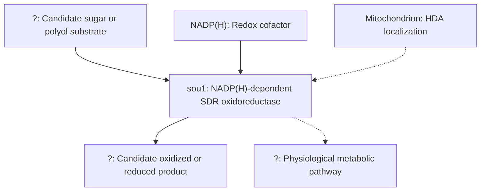

# Pathway Summary for sou1

## Overview

sou1 encodes a predicted mitochondrial short-chain dehydrogenase/reductase
whose sequence supports a broad NADP(H)-dependent oxidoreductase activity on
CH-OH groups of sugar or polyol substrates. Its precise substrate and pathway
context in S. pombe remain unresolved: sorbose/fructose, mannitol, xylulose,
and arabitol are all indirect or disfavored calls rather than direct Q9Y6Z9
biochemical results
[file:SCHPO/SPAC8E11.10/SPAC8E11.10-deep-research-falcon.md,
file:SCHPO/SPAC8E11.10/SPAC8E11.10-hypotheses/prediction-nadp-arabitol-dehydrogenase/openscientist.md].

## Candidate Sugar/Polyol Oxidoreductase Activity

The best-supported molecular-function level is the general SDR-family reaction
class: oxidoreduction of a CH-OH donor with NAD or NADP as acceptor. The
Candida SOU1 ortholog and comparative-genomics literature connect SOU1-like
enzymes to NADPH-dependent L-sorbose reduction, while the PANTHER subfamily
places Q9Y6Z9 near L-xylulose reductase-related enzymes. Those comparators
support the NADP(H)-dependent sugar/polyol oxidoreductase neighborhood, but
they do not establish that S. pombe Sou1 uses sorbose, xylulose, mannitol,
arabitol, or any one physiological substrate
[file:SCHPO/SPAC8E11.10/SPAC8E11.10-deep-research-falcon.md,
file:SCHPO/SPAC8E11.10/SPAC8E11.10-hypotheses/prediction-nadp-arabitol-dehydrogenase/openscientist.md].

## Pathway Diagram

## Experimental Resolution

A resolved pathway assignment needs purified-enzyme substrate panels and
S. pombe physiology. Direct assays should test the candidate ketose/polyol
pairs raised by orthology and subfamily placement, including sorbose/sorbitol,
fructose/mannitol, xylulose/xylitol, and arabitol-linked reactions, with NADPH
and NADH side by side. Growth or metabolomic assays in matching carbon sources
would then be needed to decide whether any in-vitro substrate is a
physiological pathway substrate
[file:SCHPO/SPAC8E11.10/SPAC8E11.10-hypotheses/prediction-nadp-arabitol-dehydrogenase/openscientist.md].
