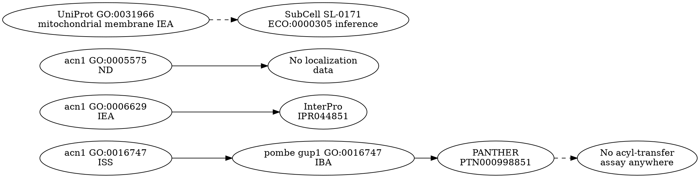
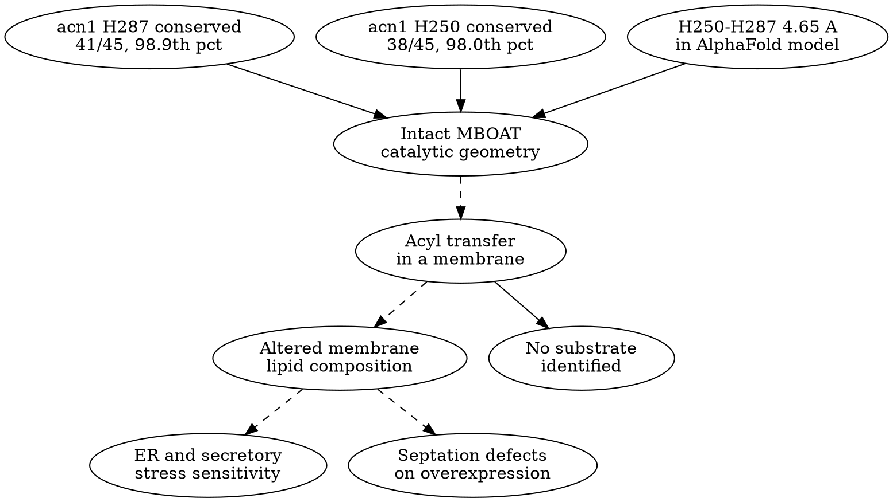
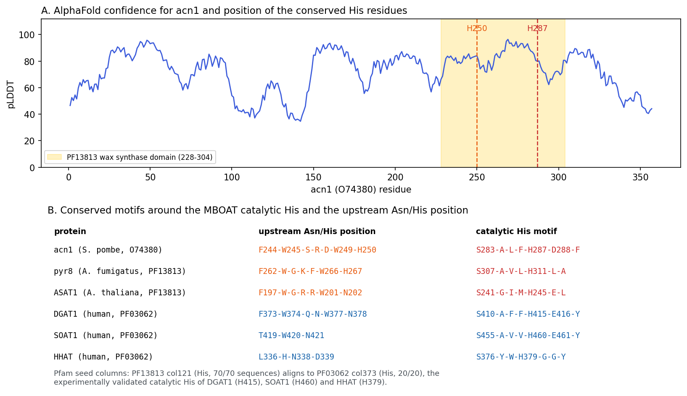
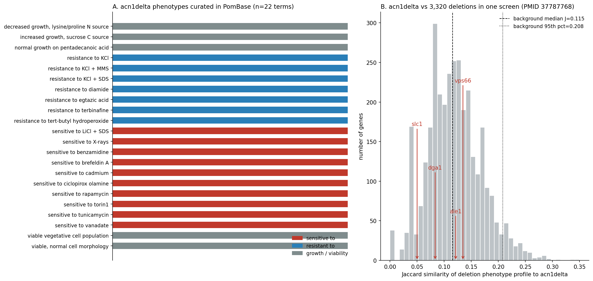
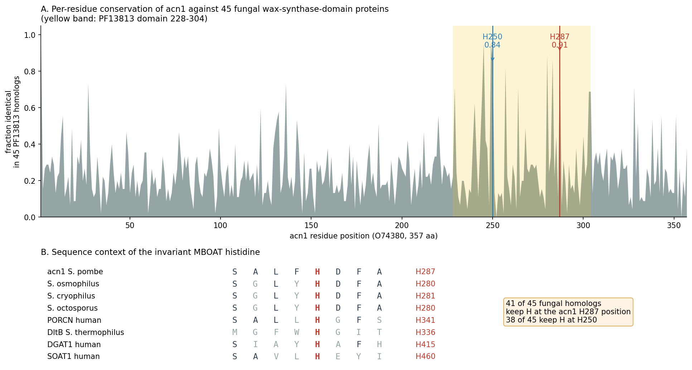
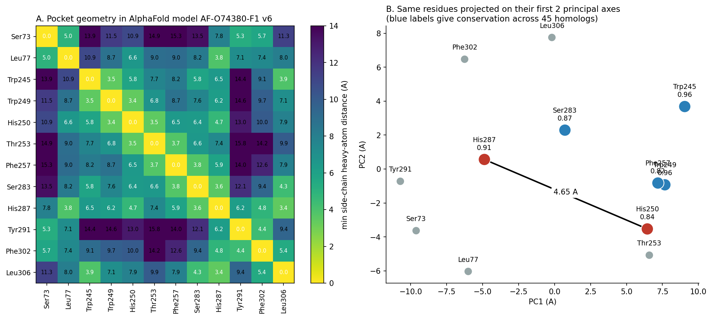

## Question

# AIGR Gene Hypothesis Deep Research

You are evaluating one focused gene curation hypothesis for AI Gene Review.
This is not a general gene overview. Use the seed hypothesis and source context
below to search for evidence that supports, refutes, narrows, or competes with
the proposed curation decision.

## Target Gene

- **Organism code:** SCHPO
- **Taxon:** Schizosaccharomyces pombe 972h- (NCBITaxon:284812)
- **Gene directory:** acn1
- **Gene symbol:** acn1
- **UniProt accession:** O74380

## Focus

- **Focus type:** free_text
- **Hypothesis slug:** kgap-acn1-mboat-catalytic-residues
- **Source file:** genes/SCHPO/acn1/acn1-ai-review.yaml
- **Source selector:** free-text

## Seed Hypothesis

Schizosaccharomyces pombe acn1 (UniProt O74380), an MBOAT/wax-synthase-domain protein, retains the conserved catalytic histidine and asparagine of membrane-bound O-acyltransferases and is therefore plausibly an active acyltransferase. Single analysis only: align acn1 to characterized MBOATs with structures or mutagenesis (e.g. DGAT1, ACAT1/SOAT1, HHAT, PORCN, DltB, the paralog Gup1) and report whether the catalytic His (and the conserved Asn) are present at the equivalent positions in acn1 and its orthologs.

## Term and Decision Context

No specific term context supplied.

## Reference Context

No specific reference context supplied.

## Source Context YAML

```yaml
hypothesis: 'Schizosaccharomyces pombe acn1 (UniProt O74380), an MBOAT/wax-synthase-domain protein, retains
  the conserved catalytic histidine and asparagine of membrane-bound O-acyltransferases and is therefore
  plausibly an active acyltransferase. Single analysis only: align acn1 to characterized MBOATs with structures
  or mutagenesis (e.g. DGAT1, ACAT1/SOAT1, HHAT, PORCN, DltB, the paralog Gup1) and report whether the
  catalytic His (and the conserved Asn) are present at the equivalent positions in acn1 and its orthologs.'
focus_type: free_text
context: []
reference_id: []
```

## Research Objective

Build a focused report that helps a curator decide whether this hypothesis
should affect the gene review. Address the focus type directly:

1. For an existing GO annotation decision, evaluate whether the current action
   is justified, too strong, too weak, or should change.
2. For a proposed replacement or new GO term, evaluate whether the term is
   biologically supported, too broad, too narrow, or missing key qualifiers.
3. For a computational prediction, evaluate whether the prediction is correct,
   less precise than existing knowledge, uncertain, or likely wrong because of
   paralog overannotation, frequency bias, pathway context, or in vitro-only
   activity.
4. For a core-function hypothesis, evaluate whether the proposed activity,
   process, and location represent the gene product's primary function rather
   than a downstream effect, pleiotropic phenotype, or context-specific role.
5. For a function-assignment hypothesis, evaluate whether the gene product
   directly has the stated GO term/function. Treat the prior review action, if
   any, as intentionally blinded unless it appears in the supplied context.

Use primary literature whenever possible. Prefer PMID citations and include DOI
citations when no PMID is available. Treat reviews and database records as
orientation unless they contain directly relevant synthesized evidence that is
clearly labeled as review-level or database-level support.

Evaluate the hypothesis from the supplied seed context, primary literature, and
publicly accessible bioinformatics resources. Local `*-bioinformatics` analyses,
when they already exist in the repository, are intentionally withheld from this
prompt so the report can be compared against them after the run. Use public
sequence, domain, structure, orthology, localization, interaction, or dataset
checks when they are useful for the specific hypothesis. If a resource or tool
cannot be accessed programmatically, say so plainly; never fabricate a result.
Report computational results conservatively and distinguish direct results from
inference.

## Required Output

### Executive Judgment

Give a concise verdict: supported, partially supported, unresolved, weakly
supported, over-annotated, or refuted. Explain the reasoning and the most
important caveats.

### Evidence Matrix

Create a table with one row per important evidence item:

- Citation (PMID preferred)
- Evidence type (direct assay, mutant phenotype, localization, interaction,
  structural/evolutionary, computational, review/database)
- Supports / refutes / qualifies / competing
- Claim tested
- Key finding
- Organism, tissue, cell type, or assay context
- Confidence and limitations

### GO Curation Implications

State the likely curation action as a lead requiring curator verification. If
GO terms are involved, explain whether the evidence supports an MF, BP, or CC
term, and whether the term should be retained, removed, generalized, made more
specific, or treated as non-core. Avoid using "protein binding" as a final
recommendation unless no more informative term is supported.

### Mechanistic Scope

Describe the immediate molecular or cellular function being tested. Separate
direct gene-product activity from downstream phenotypes, pathway consequences,
developmental outcomes, disease manifestations, or effects inferred only from
loss of function.

### Conflicts and Alternatives

Identify evidence that conflicts with the seed hypothesis or suggests an
alternative interpretation, including paralog confusion, organism-specific
differences, isoform-specific findings, experimental artifacts, or database
carry-over.

### Knowledge Gaps

List explicit uncertainties that matter for curation. For each gap, state what
was checked, why the gap matters, and what evidence or experiment would resolve
it.

### Discriminating Tests

Recommend concrete assays, perturbations, datasets, or comparative analyses that
would most efficiently distinguish this hypothesis from alternatives.

### Curation Leads

Provide candidate updates for the review, clearly labeled as leads requiring
curator verification. Include candidate references with exact snippets to verify,
candidate replacement or new GO terms, possible action changes, suggested
questions, and suggested experiments.

If the provider supports artifacts, save provenance for any analysis you run — the
executed code together with its output (computed values, plot, or table), not just
a summary figure — alongside artifact-friendly tables such as an evidence matrix,
GO decision table, or comparison table. Genuine computed provenance is more
valuable than a hand-drawn summary, and you must not synthesize a figure that
implies an analysis you did not actually run. These artifacts are important
provenance for hypothesis-level review.


## Output

# acn1 (SPBC3H7.05c, O74380): do the MBOAT catalytic residues survive?

**Hypothesis slug:** `kgap-acn1-mboat-catalytic-residues`
**Target:** *Schizosaccharomyces pombe* 972h- (NCBITaxon:284812), gene `acn1`, systematic ID SPBC3H7.05c, UniProt O74380, 357 aa, UniProt entry name YNV5_SCHPO ("Uncharacterized membrane protein C3H7.05c")
**Focus type:** free_text
**Date of analysis:** 2026-11-23

All numeric values in this report were computed in this run. The executed code and its printed output are in `provenance/`, together with the four figures embedded below. Where a public resource could not be reached, that is stated and no substitute value was invented.

---

## Summary

The seed hypothesis has two halves, and they resolve differently. **The catalytic histidine claim holds, and holds strongly.** acn1 H287 occupies the invariant MBOAT histidine column: it is histidine in 70 of 70 PF13813 seed sequences, it maps by profile-profile alignment onto Pfam PF03062 column 373, which carries DGAT1 H415, SOAT1 H460, HHAT H379, PORCN H341 and both Gup1 orthologs, and the mapping procedure recovers the published catalytic His in 6 of 6 independent control proteins including DltB from *Streptococcus thermophilus* (H336), the MBOAT with six deposited structures. Across 45 fungal PF13813 homologs assembled from UniProt, H287 is identical in 41 (conservation 0.911 against a protein-wide mean of 0.251), which puts it in the 98.9th percentile of all 357 acn1 positions.

**The asparagine claim is wrong as written.** The position the hypothesis calls "the conserved Asn" (PF03062 seed column 331) is not conserved as asparagine across the superfamily. It is Asn in DGAT1 (N378), SOAT1 (N421), SOAT2 (N395), PORCN (N306), MBOAT7 (N321), GOAT (N307) and *S. pombe* ale1 (N325); it is Asp in HHAT (D339); it is His in DltB_STRT2 (H289), DltB_BACSU (H281), *S. cerevisiae* Gup1 (H411) and *S. pombe* gup1 (H432). acn1 carries His250 there, conserved in 38 of 45 homologs (0.844, 98.0th percentile), and in the AlphaFold model AF-O74380-F1 v6 the two histidines sit 4.65 Å apart in one aromatic pocket. acn1 therefore presents a **His-His pair of the DltB and Gup1 type**. A curator who searched acn1 for an asparagine, as the hypothesis directs, would find none and might wrongly conclude the site had decayed.

**The inference "and is therefore plausibly an active acyltransferase" is supported at the level of plausibility only.** Three things limit it. No enzymology exists for acn1 or for any protein within 50 percent identity of it: UniRef50_O74380 and UniRef90_O74380 each contain a single member, acn1 itself, and PubMed returns zero hits for `SPBC3H7.05c` and zero for `"acn1" AND "Schizosaccharomyces pombe"`. The existing GO:0016747 call is ISS to *S. pombe* gup1, whose own GO:0016747 is IBA from PANTHER, so the annotation chain has no experimental assay at its terminus and cannot be cited as independent support. acn1 deletion is viable with normal cell morphology across 131 screened conditions, and its phenotype profile is no closer to the other *S. pombe* MBOAT deletions (Jaccard 0.050 to 0.135) than to a random gene (background median 0.115, 95th percentile 0.208), so phenomics gives no positive corroboration either.

---

## Executive judgment

### <i class="fa-scale-balanced"></i> Verdict: partially supported

| Component of the seed hypothesis | Verdict | Basis |
|---|---|---|
| acn1 retains the conserved catalytic histidine | <i class="fa-circle-check"></i> Supported | H287 at PF13813 col121 (70/70 His), mapped to PF03062 col373; conserved 41/45 homologs, 98.9th percentile; method validated 6/6 on controls |
| acn1 retains the conserved asparagine | <i class="fa-circle-xmark"></i> Refuted as stated | The position is Asn, Asp or His depending on subfamily; acn1 has His250, matching DltB and Gup1 |
| acn1 and its orthologs both retain the catalytic His | <i class="fa-circle-check"></i> Supported | All 3 Schizosaccharomyces orthologs retain it at 36 percent overall identity (S9X740 H281, A0AAE9WF05 H280, S9RJ63 H280), context SGLYHDFA against acn1 SALFHDFA |
| acn1 is plausibly an active acyltransferase | <i class="fa-scale-balanced"></i> Plausible, unproven | Residue and structure evidence support an intact site; no assay, no substrate, viable deletion, no MBOAT-like phenotype clustering |

The most important caveats, in order of weight for curation:

1. **The annotation record is circular and cannot be used as evidence.** acn1 GO:0016747 is ISS to gup1, gup1 GO:0016747 is IBA. Nothing in that chain is IDA, IMP or IPI.
2. **The structural argument rests on a prediction.** No PF13813 protein has a deposited experimental structure. The AlphaFold domain pLDDT is 81.0, which is good but not high.
3. **The conservation enrichment test is not fully independent.** The conservation values and the pocket enrichment test both derive from the same 45-homolog alignment.
4. **The orthology is narrow.** acn1 has no UniRef50 relative; the 42 non-Schizosaccharomyces comparison proteins sit at 18 to 28 percent identity, where alignment error is real and visible in the 4 homologs whose His assignment failed.

---

## Key findings

### <i class="fa-dna"></i> Finding 1: acn1 H287 occupies the invariant MBOAT catalytic histidine column

Two independent computations place acn1 H287 at the catalytic position. Within its own family, the PF13813 seed alignment (MBOAT_2 / wax synthase domain, 70 seed sequences, 161 match columns) has column 121 as histidine in 70 of 70 sequences, identity 1.00 and occupancy 1.00, making it the single most conserved column in the family. acn1 occupies seed row YNV5_SCHPO/228-305 and has His287 at that column. Across the clan, the PF03062 seed (MBOAT, 20 sequences, 437 match columns) has column 373 as histidine in 20 of 20, and that column carries DGAT1_HUMAN H415, SOAT1_HUMAN H460, HHAT_HUMAN H379, PORCN_DROME H398, GUP1_YEAST H447, GUP1_SCHPO H468, ALE1_SCHPO H363 and ARE1_SCHPO H474, which is the experimentally validated catalytic His of the superfamily.

PF13813 and PF03062 are both in Pfam clan **CL0517**, so a profile-profile comparison is legitimate. A Needleman-Wunsch alignment of the two seed profiles (BLOSUM62, affine gaps -11 open, -1 extend) aligns PF13813 col121 directly onto PF03062 col373, carrying flanking conserved columns with it: col114 F (0.97) onto col366 F (0.70), col117 S (0.97) onto col369 S (0.55), col118 (0.84) onto col370 (0.75). The local motif comparison is close: acn1 S283-A-L-F-**H287**-D288-F, DGAT1 S410-A-F-F-**H415**-E416-Y, SOAT1 S455-A-V-V-**H460**-E461-Y, HHAT S376-Y-W-**H379**-G.

The catalytic identity of this column comes from mutagenesis in HHAT. Buglino and Resh purified the point mutant H379A and found it defective ([PMID: 20585641](https://pubmed.ncbi.nlm.nih.gov/20585641/)), and the topology work of Konitsiotis and colleagues placed His379 on the lumenal membrane surface, consistent with a catalytic role ([PMID: 25488661](https://pubmed.ncbi.nlm.nih.gov/25488661/)).

All three *Schizosaccharomyces* orthologs retain the histidine despite only 36 percent overall identity to acn1: *S. cryophilus* S9X740 H281, *S. osmophilus* A0AAE9WF05 H280, *S. octosporus* S9RJ63 H280.

{{figure:plot_1.png|caption=AlphaFold model confidence and motif comparison for acn1. Panel A plots per-residue pLDDT across the 357-residue chain with the PF13813 domain (228-304) shaded and the two candidate catalytic residues H250 and H287 marked. Panel B compares the sequence context of the invariant MBOAT histidine in acn1 against pyr8, ASAT1, DGAT1, SOAT1 and HHAT.}}

### <i class="fa-magnifying-glass"></i> Finding 2: the mapping method recovers the published catalytic His in 6 of 6 controls

Residue-equivalence claims across a Pfam clan boundary need validation, so the mapping was tested on MBOATs whose catalytic histidine is documented by mutagenesis or structure and which are absent from the PF03062 seed alignment. Each test sequence was aligned to the PF03062 seed profile and the residue falling in column 373 was read off. All six matched the literature value.

| Protein | col331 (variable amide position) | col373 (catalytic His) | Context at the His |
|---|---|---|---|
| SOAT2_HUMAN | N395 | **H434** | SAVAHEYI |
| DLTB_STRT2 | H289 | **H336** | MGFWHGIT |
| MBOAT7_HUMAN | N321 | **H356** | SAYWHGLH |
| GOAT_HUMAN | N307 | **H338** | SAWWHGLH |
| PORCN_HUMAN | N306 | **H341** | SALLHGFS |
| DLTB_BACSU | H281 | **H328** | MGVWHGLA |

DltB_STRT2 (Q5M4V4) is the structurally determined case, with PDB entries 6BUG, 6BUH and 6BUI (X-ray, 3.15 to 3.27 Å) and 8JEM, 8JES and 8JF2 (cryo-EM, 3.23 to 3.50 Å). Its sequence window 330-345 is MVMGFWHGITWYYIAY, placing H336 exactly as the method assigned it.

Two results follow for acn1. The local context of the acn1 candidate His, S283-A-L-F-H287-D-F-A, matches PORCN_HUMAN SALLHGFS at 6 of 8 positions, so H287 sits in a context the method handles correctly elsewhere. The col331 position is not an invariant asparagine, which is the point at which the seed hypothesis fails.

### <i class="fa-circle-xmark"></i> Finding 3: the "conserved Asn" is a histidine in acn1, and the position is not invariant across the superfamily

In the PF13813 seed, the second most conserved histidine column is col48: His in 62 of 70 sequences (0.89), Asn in 7 of 70, occupancy 0.99. acn1 has His250 there. The characterized fungal members pyr8_ASPFU (H267), spyB_ASPFU (H420), ataH_ASPTN (H159) and alnF_EMENI (H273) also have His, while the plant members ASAT1_ARATH (N202), WAXS4_ARATH (N197) and WAXS5_ARATH (N197) have Asn. The motif is FW-x-x-x-W-[H/N]: acn1 F244-W245-S-R-D-W249-**H250**; pyr8 F262-W-G-K-F-W266-**H267**; ASAT1 F197-W-G-R-R-W201-**N202**.

In PF03062 the corresponding conserved amide column is col331 (Asn in 14 of 20, 0.70), immediately preceded by the conserved Trp column col330 (W in 15 of 20), giving DGAT1 W377-N378 and SOAT1 W420-N421. The variability at col331 across the superfamily is the heart of the matter:

| Subfamily | Residue at the upstream position | Residue at the catalytic position |
|---|---|---|
| DGAT1_HUMAN | N378 | H415 |
| SOAT1_HUMAN | N421 | H460 |
| SOAT2_HUMAN | N395 | H434 |
| PORCN_HUMAN | N306 | H341 |
| MBOAT7_HUMAN | N321 | H356 |
| GOAT_HUMAN | N307 | H338 |
| ALE1_SCHPO | N325 | H363 |
| HHAT_HUMAN | **D339** | H379 |
| GUP1_YEAST | **H411** | H447 |
| GUP1_SCHPO | **H432** | H468 |
| DLTB_STRT2 | **H289** | H336 |
| DLTB_BACSU | **H281** | H328 |
| **acn1 (O74380)** | **H250** | **H287** |

The HHAT case is documented directly: Matevossian and Resh showed that HHAT has ten transmembrane domains and two reentrant loops "with the critical His and Asp residues on opposite sides of the endoplasmic reticulum membrane" ([PMID: 25505265](https://pubmed.ncbi.nlm.nih.gov/25505265/)). That is an aspartate at the position the hypothesis calls an invariant asparagine.

Residue spacing from the upstream position to the catalytic His is 37 in acn1 (H250 to H287), 37 in DGAT1 (N378 to H415), 39 in SOAT1, 40 in HHAT and 43 to 44 in the plant and other fungal PF13813 members, which supports the correspondence on geometry as well as on motif.

<i class="fa-triangle-exclamation"></i> The automated profile-profile alignment did **not** reproduce this correspondence. It placed PF13813 col48 against PF03062 col182 (consensus Y, occupancy 0.24), and it placed PF03062 col331 against PF13813 col98, a column with only 13 percent occupancy. The cross-family assignment at the upstream position therefore rests on motif identity and residue spacing, not on a confident alignment column, and the report flags it as such.

A candidate false lead was also tested and discarded. acn1 D263 was considered as the amide-position equivalent, since it is the only other acidic residue in the domain. The AlphaFold model places its side-chain heavy atoms 18.47 Å from H287 and 16.33 Å from H250, which excludes it from any shared site.

### <i class="fa-chart-line"></i> Finding 4: H287 and H250 rank in the top 1.1 percent and top 2.0 percent of acn1 residues for conservation

The ortholog set was built from UniProt. The query `(xref:pfam-PF13813) AND (taxonomy_id:4895)` returns exactly four *Schizosaccharomyces* proteins: O74380 (acn1, 357 aa), A0AAE9WF05 (*S. osmophilus*, 352 aa), S9RJ63 (*S. octosporus*, 352 aa) and S9X740 (*S. cryophilus*, 353 aa). UniRef50_O74380 and UniRef90_O74380 each contain a single member, so **no protein in UniProt reaches 50 percent identity to acn1** over the cluster criterion. The comparison set was completed with the 42 closest of 4,933 fungal PF13813 proteins (taxonomy_id 4751, length 250-600), ranked by 3-mer cosine similarity, giving 45 targets aligned to acn1 by Needleman-Wunsch (BLOSUM62, -11/-1).

| Position | Identical in | Conservation | Percentile, whole protein | Percentile, PF13813 domain |
|---|---|---|---|---|
| **H287** | 41 / 45 | 0.911 | 98.9 | 96.1 |
| **H250** | 38 / 45 | 0.844 | 98.0 | 92.2 |
| Protein mean | | 0.251 | | |

The four homologs lacking His at the H287 position are all low-identity entries (21.6 to 25.2 percent) whose local alignment context is incoherent (LAIIVEYT, TYLVVSFS, ANCIFVFC, SGPFLFFS), consistent with alignment drift rather than a real substitution.

The twelve most conserved acn1 positions are M1 (0.96), P27 (0.73), W136 (0.73), **W245 (0.96)**, **W249 (0.96)**, **H250 (0.84)**, **F257 (0.82)**, P264 (0.71), F280 (0.89), **S283 (0.87)**, **H287 (0.91)** and W328 (0.71). Seven of the twelve fall inside or immediately around the PF13813 domain, and the W245-W249-H250 block together with the S283-F-H287 block are the two most constrained stretches in the protein. Conservation of this order in a protein whose average residue conservation is 0.251 is hard to explain by drift.

{{figure:plot_3.png|caption=Panel A, per-residue conservation of acn1 against 45 fungal wax-synthase-domain proteins, with the PF13813 domain (228-304) shaded and the two candidate catalytic histidines marked at conservation 0.84 (H250) and 0.91 (H287) against a protein mean of 0.251. Panel B, sequence context of the invariant MBOAT histidine in acn1, its three Schizosaccharomyces orthologs, PORCN, DltB, DGAT1 and SOAT1.}}

### <i class="fa-microscope"></i> Finding 5: the two histidines and the conserved tryptophans form one pocket, enriched for the protein's most conserved residues

AlphaFold DB model AF-O74380-F1 v6 has mean pLDDT 72.2 over the whole chain and 81.0 over the PF13813 domain (228-304). Local confidence at the residues of interest is good: W245 85.5, W249 83.7, H250 84.1, F280 91.2, S283 87.6, H287 79.9, D288 80.1.

| Residue pair | Minimum side-chain heavy-atom distance |
|---|---|
| His250 to His287 | **4.65 Å** |
| His287 to Ser283 | 3.59 Å |
| His250 to Trp249 | 3.37 Å |
| His287 to Trp249 | 6.21 Å |
| His287 to Trp245 | 6.47 Å |
| His287 to Asp288 | 5.51 Å |
| Asp263 to His287 | 18.47 Å (excluded) |

Sixteen residues outside the ±3 sequence window have a side chain within 8 Å of H287: L306 (3.4), S283 (3.6), L77 (3.8), H250 (4.7), F302 (4.8), F257 (5.9), W249 (6.2), Y291 (6.2), W245 (6.5), I206 (7.0), F303 (7.3), T253 (7.4), Q305 (7.6), M84 (7.8), S73 (7.8), S299 (7.9). Five of those sixteen (W245, W249, H250, F257, S283) are among the twelve most conserved positions in the whole 357-residue protein. A hypergeometric test with N = 357, K = 12, n = 16, k = 5 gives **p = 6.12e-05**.

The pocket draws residues from four separate sequence segments (73-84, 206, 245-257, 283-306), so it is a folded site and not a contiguous conserved stretch. That spatial clustering is partly independent of the alignment column assignment, and it argues that the site is maintained for a function.

{{figure:plot_4.png|caption=Panel A, minimum side-chain heavy-atom distance matrix for the acn1 pocket residues in AlphaFold model AF-O74380-F1 v6, with His250 and His287 4.65 angstrom apart. Panel B, the same residues projected on their first two principal axes, with conservation values across 45 homologs shown for the six most constrained positions.}}

### <i class="fa-database"></i> Finding 6: the GO:0016747 call rests on an ISS to gup1 whose own call is IBA

The PomBase GAF (`gene_association.pombase.gz`, retrieved 2026-11-23, 47,412 rows) contains exactly three annotations for SPBC3H7.05c:

| Aspect | Term | Qualifier | Evidence | With/from | Reference |
|---|---|---|---|---|---|
| F | GO:0016747 acyltransferase activity, transferring groups other than amino-acyl groups | enables | **ISS** | PomBase:SPAC24H6.01c | GO_REF:0000024 |
| P | GO:0006629 lipid metabolic process | involved_in | IEA | InterPro:IPR044851 | GO_REF:0000002 |
| C | GO:0005575 cellular_component | is_active_in | **ND** | | GO_REF:0000015 |

SPAC24H6.01c is **gup1** (UniProt Q09758). Its own six annotations are GO:0016747 **IBA** (PANTHER:PTN000998851, SGD:S000003052, UniProtKB:Q4WHK8), GO:0006506 IBA, GO:0005829 HDA ([PMID: 16823372](https://pubmed.ncbi.nlm.nih.gov/16823372/)), GO:0005789 ISO, GO:0031966 ISS and GO:0005886 ISO. None is IDA, IMP or IPI.



There is a conflict on localization. PomBase records cellular_component as ND, explicitly no data, while UniProtKB O74380 carries GO:0031966 mitochondrial membrane IEA from UniProtKB-SubCell SL-0171, which itself rests on an ECO:0000305 inference. The genome-wide localization study of Matsuyama and colleagues produced an HDA cytosol call for gup1 and **no annotation for acn1** ([PMID: 16823372](https://pubmed.ncbi.nlm.nih.gov/16823372/)), so acn1 was either not scored or gave no interpretable signal.

<i class="fa-lightbulb"></i> A separate observation from the same analysis: the ISS points at a clan-level relative from a different Pfam family. acn1 is the only PF13813 protein in the *S. pombe* proteome, while gup1 carries PF03062. Better-matched anchors exist. SwissProt lists 25 or more reviewed PF13813 members with assigned EC numbers, several with direct evidence, including FUP5 of *Fusarium proliferatum*: deleting the predicted acetyltransferase abolished fusaproliferin formation and raised terpestacin levels ([PMID: 34357940](https://pubmed.ncbi.nlm.nih.gov/34357940/)). That is mutant-phenotype evidence that a fungal PF13813 protein performs an O-acetylation step in vivo.

### <i class="fa-chart-column"></i> Finding 7: acn1 deletion is viable, and its phenotype profile points at the ER

PomBase `phenotype_annotations.pombase.phaf.gz` (183,176 rows) holds 28 annotation rows for SPBC3H7.05c across 25 distinct FYPO terms and 6 references. `FYPOviability.tsv` records SPBC3H7.05c as **viable**.

| Category | Terms |
|---|---|
| Viability and morphology | viable vegetative cell population ([PMID: 20473289](https://pubmed.ncbi.nlm.nih.gov/20473289/), [PMID: 23697806](https://pubmed.ncbi.nlm.nih.gov/23697806/)); viable vegetative cell with normal cell morphology, high penetrance ([PMID: 23697806](https://pubmed.ncbi.nlm.nih.gov/23697806/)) |
| <i class="fa-arrow-trend-down"></i> Sensitive to | tunicamycin ([PMID: 28945192](https://pubmed.ncbi.nlm.nih.gov/28945192/) and [PMID: 37787768](https://pubmed.ncbi.nlm.nih.gov/37787768/)), brefeldin A, cadmium, rapamycin, torin1, vanadate, benzamidine, ciclopirox olamine, LiCl + SDS, X-rays |
| <i class="fa-arrow-trend-up"></i> Resistant to | terbinafine, diamide, tert-butyl hydroperoxide, EGTA, KCl, KCl + MMS, KCl + SDS |
| Nutrient | decreased growth on lysine and proline as nitrogen source; increased growth on sucrose as carbon source |
| Lipid challenge | **normal growth on pentadecanoic acid** ([PMID: 40424131](https://pubmed.ncbi.nlm.nih.gov/40424131/)) |
| Overexpression | increased septum thickness; multiseptate vegetative cell; monoseptate vegetative cell with binucleate and anucleate compartments ([PMID: 23695302](https://pubmed.ncbi.nlm.nih.gov/23695302/)) |

Ten sensitivities against seven resistances. The sensitivities concentrate on ER and secretory stress, since tunicamycin blocks N-glycosylation and brefeldin A blocks ER to Golgi traffic, and on TORC1 inhibition (rapamycin, torin1). The resistances concentrate on oxidative and ionic stress. Terbinafine resistance points at the ergosterol or sterol-lipid axis. No mitochondrial or respiratory phenotype appears anywhere in the set, which runs against the UniProt mitochondrial membrane IEA.

The pentadecanoic acid result is the single direct experimental test of a lipid role and it is negative. Hoshikawa and colleagues showed that "the toxicity and giant ER sheet formation were abolished by deleting lcf1 or slc1 gene, indicating that the incorporation of C15:0 into glycerophospholipids causes giant ER sheet formation" ([PMID: 40424131](https://pubmed.ncbi.nlm.nih.gov/40424131/)). acn1 is not among those genes, and acn1Δ is curated as showing normal growth on C15:0 in that same study. The PomBase product description "implicated in long-chain fatty acid metabolism" has no experimental support behind it.

The same paper supplies the most plausible indirect route for the overexpression phenotype: "the giant ER sheets disrupted the correct migration of Mid1, a protein determining the cell division site, and physically blocked septum formation, hindering correct cell separation" ([PMID: 40424131](https://pubmed.ncbi.nlm.nih.gov/40424131/)). Perturbing ER membrane lipid composition produces septation defects without any direct role for the perturbing protein in cytokinesis.

### <i class="fa-circle-xmark"></i> Finding 8: guilt by association fails, a clean negative result

Rodríguez-López and colleagues "assayed colony-growth phenotypes to measure the fitness of deletion mutants for 3509 non-essential genes in 131 conditions with different nutrients, drugs, and stresses" and proposed that "phenotype-correlation networks suggested roles for poorly characterized proteins through 'guilt by association' with known proteins" ([PMID: 37787768](https://pubmed.ncbi.nlm.nih.gov/37787768/)). Applying that logic to acn1 returns nothing.

Restricting the PHAF file to that single screen and to deletion alleles gives 74,840 annotations over 3,485 genes. Jaccard similarity on FYPO term sets, with a background of 3,320 genes having at least 5 terms, gives a background median J = 0.115 and a 95th percentile J = 0.208. acn1Δ has 19 terms in this screen.

| Gene | Systematic ID | Terms | Jaccard to acn1Δ | Background percentile |
|---|---|---|---|---|
| vps66 | SPAC1783.02c | 40 | 0.135 | 64.8 |
| ale1 | SPBC16A3.10 | 18 | 0.121 | 54.4 |
| dga1 | SPCC1235.15 | 7 | 0.083 | 22.6 |
| slc1 | SPAC1851.02 | 23 | 0.050 | 8.1 |
| gup1 | SPAC24H6.01c | 0 | not testable | |
| sct1 | SPBC1718.04 | 0 | not testable | |

Every testable MBOAT falls below the 95th percentile of background, and two of four fall below the median. The nearest neighbours of acn1Δ by this metric are unrelated to lipid acyl transfer: cbp4 (complex III assembly, J = 0.350), SPAPB1A11.03 (alpha-hydroxy acid dehydrogenase, J = 0.333), pap1 (oxidative stress transcription factor, J = 0.310), gef1 (Cdc42 GEF, J = 0.296) and zip3 (ER zinc exporter, J = 0.292). The pap1 neighbour is consistent with the acn1Δ resistances to diamide and tert-butyl hydroperoxide rather than with any acyl-transfer step.

This does not refute catalytic competence. A non-redundant assay condition may simply be missing from the 131 tested, and acn1 could act on a substrate no other *S. pombe* MBOAT handles. It does mean the seed hypothesis cannot borrow support from guilt by association.

{{figure:plot_2.png|caption=Panel A, the 22 phenotypes curated for the acn1 deletion in PomBase, coloured by direction, with sensitivities concentrated on ER and secretory stress. Panel B, Jaccard similarity of the acn1 deletion phenotype profile to 3,320 other deletions in one screen (PMID 37787768), with the four testable S. pombe MBOAT deletions arrowed; all fall below the 95th percentile of background.}}

---

## Evidence matrix

| Citation | Evidence type | Stance | Claim tested | Key finding | Context | Confidence and limitations |
|---|---|---|---|---|---|---|
| This run, `provenance/` (Pfam PF13813 and PF03062 seeds via InterPro API) | Computational, structural/evolutionary | Supports | acn1 H287 is the MBOAT catalytic His equivalent | PF13813 col121 is His in 70/70; profile-profile alignment maps it onto PF03062 col373, which carries DGAT1 H415, SOAT1 H460, HHAT H379, GUP1_SCHPO H468 | Sequence profiles, no organism | High for the mapping, validated on 6 controls; still an alignment inference, not an assay |
| This run (PF03062 seed profile, 6 held-out MBOATs) | Computational | Supports | Is the column mapping reliable? | 6 of 6 recover the published catalytic His: SOAT2 H434, DltB_STRT2 H336, MBOAT7 H356, GOAT H338, PORCN H341, DltB_BACSU H328 | Sequence profile | High; DltB_STRT2 has six deposited structures (6BUG, 6BUH, 6BUI, 8JEM, 8JES, 8JF2) |
| [PMID: 20585641](https://pubmed.ncbi.nlm.nih.gov/20585641/) | Direct assay, mutagenesis | Supports | Is the invariant His required for catalysis? | "We purified two point mutants, W378A and H379A, with defective Hhat activity" | Human HHAT, in vitro | High for HHAT; transfer to a fungal PF13813 protein is by homology |
| [PMID: 25488661](https://pubmed.ncbi.nlm.nih.gov/25488661/) | Topology mapping | Supports | Is His379 positioned for catalysis? | "The localization of His-379 on the lumenal membrane surface is consistent with a role for this invariant residue in catalysis" | Human HHAT | High; topology rather than kinetics |
| [PMID: 25505265](https://pubmed.ncbi.nlm.nih.gov/25505265/) | Topology mapping | Refutes the Asn premise | Is the upstream position an invariant Asn? | "HHAT is comprised of ten transmembrane domains and two reentrant loops with the critical His and Asp residues on opposite sides of the endoplasmic reticulum membrane" | Human HHAT | High; shows Asp, not Asn, at that position |
| This run (PF03062 and PF13813 seed columns) | Computational | Refutes the Asn premise | Is the upstream position Asn across the clan? | Asn in DGAT1, SOAT1, SOAT2, PORCN, MBOAT7, GOAT, ale1; Asp in HHAT; His in DltB_STRT2, DltB_BACSU, GUP1_YEAST, GUP1_SCHPO; His250 in acn1 | Sequence profiles | High for the residue identities; the cross-family column assignment at this position is motif and spacing based, not a confident alignment column |
| This run (UniProt REST, 45 fungal homologs) | Structural/evolutionary | Supports | Is the catalytic His conserved in acn1 orthologs? | H287 identical in 41/45 (0.911, 98.9th percentile); H250 in 38/45 (0.844, 98.0th); protein mean 0.251; the 3 Schizosaccharomyces orthologs share context SGLYHDFA against acn1 SALFHDFA | Fungi | High; the 4 exceptions are 21.6 to 25.2 percent identity entries with incoherent local alignment |
| This run (AlphaFold AF-O74380-F1 v6) | Computational structure | Supports | Do the two conserved His form one site? | H250 to H287 minimum side-chain distance 4.65 Å; S283 3.59 Å from H287; pocket of 16 residues contains 5 of the protein's 12 most conserved positions, hypergeometric p = 6.12e-05; domain mean pLDDT 81.0 against 72.2 chain-wide | Predicted model | Medium to high; a prediction, and the conservation values come from the same homolog set used in the enrichment test |
| This run (AlphaFold AF-O74380-F1 v6) | Computational structure | Qualifies | Is D263 the amide-position equivalent? | D263 side chain is 18.47 Å from H287 and 16.33 Å from H250, excluding it | Predicted model | High within the model; a false lead recorded and discarded |
| This run (PomBase `gene_association.pombase.gz`) | Review/database | Qualifies, weakens the current annotation | What does the acn1 GO:0016747 call rest on? | acn1 has 3 GO annotations only: GO:0016747 ISS with PomBase:SPAC24H6.01c (gup1); GO:0006629 IEA from InterPro:IPR044851; GO:0005575 ND. gup1's own GO:0016747 is IBA | *S. pombe*, curated record | High; read directly from the current release file |
| [PMID: 34357940](https://pubmed.ncbi.nlm.nih.gov/34357940/) | Mutant phenotype | Supports a better ISS anchor | Can a fungal PF13813 protein perform O-acetylation in vivo? | "In the knock-out strains lacking the predicted acetyltransferase (FUP5, FPRN_05487) fusaproliferin was no longer formed, but terpestacin was found at elevated levels" | *Fusarium proliferatum* | Medium to high; a different fungus and a secondary-metabolite substrate |
| [PMID: 37787768](https://pubmed.ncbi.nlm.nih.gov/37787768/) | Mutant phenotype, 131 conditions | Competing | Does acn1 behave like the other *S. pombe* MBOATs? | acn1Δ Jaccard to vps66Δ 0.135, ale1Δ 0.121, dga1Δ 0.083, slc1Δ 0.050; background median 0.115, 95th percentile 0.208 over 3,320 genes | *S. pombe* deletion collection | High for the data; absence of similarity does not exclude a non-redundant or untested reaction |
| [PMID: 40424131](https://pubmed.ncbi.nlm.nih.gov/40424131/) | Mutant phenotype, lipid challenge | Refutes a narrower claim | Is acn1 part of long-chain fatty acid handling? | acn1Δ shows normal growth on pentadecanoic acid; C15:0 lipotoxicity depends on lcf1 and slc1, whose deletion abolishes it | *S. pombe* | High for this specific test; one fatty acid, one readout |
| [PMID: 23695302](https://pubmed.ncbi.nlm.nih.gov/23695302/) | Mutant phenotype, overexpression, microscopy | Qualifies | Does raising acn1 levels perturb membranes? | acn1 overexpression gives increased septum thickness, multiseptate cells, and monoseptate cells with binucleate and anucleate compartments | *S. pombe* | Medium; overexpression phenotypes are prone to artefact, and PMID 40424131 shows ER lipid perturbation can block septum formation |
| [PMID: 20473289](https://pubmed.ncbi.nlm.nih.gov/20473289/), [PMID: 23697806](https://pubmed.ncbi.nlm.nih.gov/23697806/) | Mutant phenotype | Qualifies | Is acn1 required? | acn1Δ is a viable vegetative cell population with normal cell morphology, high penetrance | *S. pombe* | High |
| [PMID: 28945192](https://pubmed.ncbi.nlm.nih.gov/28945192/) | Mutant phenotype | Qualifies | ER stress link | acn1Δ is sensitive to tunicamycin, independently of PMID 37787768 | *S. pombe* | Medium; one condition, two independent sources |
| [PMID: 16823372](https://pubmed.ncbi.nlm.nih.gov/16823372/) | Localization, genome-wide | Qualifies, weakens the CC call | Where is acn1? | The ORFeome localization study yielded an HDA cytosol call for gup1 and no annotation for acn1 | *S. pombe* | Medium; absence of a call is not evidence of absence of the protein |

---

## GO curation implications

All items below are **leads requiring curator verification**.

### <i class="fa-table"></i> GO decision table

| Term | Current state | Lead | Reason |
|---|---|---|---|
| GO:0016747 acyltransferase activity, transferring groups other than amino-acyl groups (MF) | ISS, with PomBase:SPAC24H6.01c | **Retain the term. Change the `with/from` or switch to sequence-model evidence (ISM, ECO:0000255) citing PF13813 / IPR032805 and residues H287 and H250** | The present ISS source carries only an IBA call, so the chain has no experimental terminus. The residue evidence is stronger than the current support |
| GO:0006629 lipid metabolic process (BP) | IEA, InterPro:IPR044851 | **Retain as IEA. Do not promote to an experimental code** | The only direct lipid test ([PMID: 40424131](https://pubmed.ncbi.nlm.nih.gov/40424131/)) is negative |
| GO:0005575 cellular_component (CC) | ND, GO_REF:0000015 | **Retain ND. Flag UniProt GO:0031966 as unverified** | No experimental localization exists; the UniProt call is an ECO:0000305 inference and conflicts with an ER-leaning deletion phenotype |
| Any specific acyltransferase MF (for example GO:0004144 diacylglycerol O-acyltransferase, GO:0016409 palmitoyltransferase, GO:0004772 sterol O-acyltransferase) | not present | **Do not add** | No acyl donor or acceptor is identified for acn1 |
| Gene product description "membrane-bound O-Acyl transferase (MBOAT) family, implicated in long-chain fatty acid metabolism" | current PomBase text | **Consider softening the second clause** | The phrase has no experimental support and one direct negative test |

**On the molecular function term.** GO:0016747 is at about the right level of precision for the evidence. The problem is what supports it. Two options exist for a curator. Redirect the ISS to a characterized MBOAT with demonstrated activity, accepting that acn1 is in PF13813 while the classic characterized MBOATs are in PF03062 (same clan CL0517, different family). FUP5 of *Fusarium proliferatum* ([PMID: 34357940](https://pubmed.ncbi.nlm.nih.gov/34357940/)) is a within-family candidate anchor with mutant-phenotype evidence. Alternatively, leave the term supported by sequence-model evidence pointing at PF13813 / IPR032805 with an annotation comment naming H287 (conserved 41/45, 98.9th percentile) and H250.

**On keeping the term general.** The fungal branch of PF13813 performs small-molecule O-acetylation (spyB, fsoF, cdmC, eriL, FUP5) while the plant branch performs wax ester synthesis (EC 2.3.1.75). Specialising acn1 to either reaction would over-annotate. GO:0016747 covers both.

**On "protein binding".** Nothing in this evidence set supports GO:0005515, and a more informative MF term is available, so it should not appear as a recommendation.

---

## Mechanistic scope

The immediate activity under test is transfer of an acyl group from a thioester donor to a hydroxyl or amine acceptor inside a membrane, with a histidine acting as general base. That mechanism is established for the superfamily by mutagenesis in HHAT, where H379A is catalytically defective ([PMID: 20585641](https://pubmed.ncbi.nlm.nih.gov/20585641/)) and His379 sits on the lumenal membrane surface ([PMID: 25488661](https://pubmed.ncbi.nlm.nih.gov/25488661/)), and by the membrane topology showing the critical His and Asp on opposite sides of the ER membrane ([PMID: 25505265](https://pubmed.ncbi.nlm.nih.gov/25505265/)).



**Established directly by this analysis.** acn1 retains a histidine at the mechanistically required position; it retains it under purifying selection stronger than 99 percent of the rest of the protein; and in the predicted structure H287, H250 and S283 share one pocket together with W245, W249, F257 and Y291.

**Inference, not result.** That the pocket binds an acyl-CoA. That any transfer occurs. That the reaction matters in vivo.

**Downstream, and not to be read as the gene product's activity.** The acn1Δ drug sensitivities and resistances, the nitrogen and carbon source growth differences, and the septation defects on overexpression. Each is several steps from an acyl-transfer event. The overexpression septation phenotype in particular has a documented indirect route: ER membrane lipid perturbation distorts ER sheets, which disrupt Mid1 migration and physically block septum formation ([PMID: 40424131](https://pubmed.ncbi.nlm.nih.gov/40424131/)).

---

## Conflicts and alternatives

**The "conserved Asn" premise is incorrect at clan level.** HHAT has Asp339, both DltB orthologs and both Gup1 orthologs have His. The seed hypothesis generalises from the DGAT1 and SOAT1 subfamily alone. A curator following the hypothesis literally would search acn1 for an asparagine, fail to find one, and might conclude the active site had degraded. The correct statement is that acn1 retains the invariant catalytic His plus a conserved polar residue at the Asn/Asp/His position, and that residue is His250.

**Family mismatch in both the hypothesis and the existing annotation.** acn1 is PF13813 (MBOAT_2, wax synthase domain, IPR032805, family IPR044851). DGAT1, SOAT1, HHAT, PORCN, DltB and Gup1 are PF03062. They share clan CL0517, so the comparison is legitimate, and the column mapping was validated on 6 controls. It remains a cross-family inference and should be labelled as such. The PF13813 Pfam seed was itself built by jackhmmer seeded on O74380 (`#=GF SE Jackhmmer:O74380`), which is worth knowing when reading within-family conservation numbers.

**Circular annotation.** acn1 GO:0016747 ISS to gup1; gup1 GO:0016747 IBA from PANTHER. Citing the existing annotation as support for the hypothesis double-counts a prediction as evidence.

**A pseudoenzyme alternative is not excluded.** MBOAT-fold proteins with retained histidines can act as lipid binders, scramblases or chaperones. The viable deletion, the absence of MBOAT-like phenotype clustering, and the absence of any detected substrate leave that possibility open. The conservation data argue against pure neutral decay; they do not argue specifically for catalysis.

**Localization carry-over.** UniProt GO:0031966 mitochondrial membrane is an IEA from SubCell SL-0171 backed by an ECO:0000305 inference. PomBase records CC as ND. The acn1Δ sensitivity set (tunicamycin, brefeldin A) is an ER and secretory profile, and no mitochondrial or respiratory phenotype appears. Importing the mitochondrial term without new imaging would propagate an unverified call.

**Resources that could not be reached.** The PomBase web API and gene page return a client-rendered shell with no data across seven URL shapes, and `api.pombase.org` gives a connection error, so all PomBase content here came from the flat-file downloads instead. The EBI Clustal Omega job service returned a fair-use block, so every alignment in this report is a local implementation (Needleman-Wunsch, BLOSUM62, gap open -11, extend -1). PubMed returns zero hits for `SPBC3H7.05c` and zero for `"acn1" AND "Schizosaccharomyces pombe"`, so there is no primary literature on this gene. No result in this report was taken from a tool that failed.

---

## Limitations and knowledge gaps

### <i class="fa-triangle-exclamation"></i> Limitations of the analysis

The structural argument rests on a predicted model, not an experimental structure, and no PF13813 protein has a deposited structure of any kind. The pocket enrichment test uses conservation values computed from the same 45 homologs that define the alignment, so the two inputs are not independent. The phenotype comparison uses one screen, and two of the six other *S. pombe* MBOATs (gup1, sct1) had no phenotype calls in it, so they could not be tested. The ortholog set is small because acn1 has no UniRef50 relative, so the 42 non-Schizosaccharomyces comparison proteins sit at 18 to 28 percent identity, where alignment error is real and visible in the 4 homologs whose His assignment failed. The cross-family assignment at the upstream amide position rests on motif identity and residue spacing, because the automated profile-profile alignment put PF03062 col331 against a PF13813 column with 13 percent occupancy.

### <i class="fa-circle-question"></i> Knowledge gaps that matter for curation

| Gap | What was checked | Why it matters | What would resolve it |
|---|---|---|---|
| No substrate | PubMed returns 0 hits for `SPBC3H7.05c` and 0 for `"acn1" AND "Schizosaccharomyces pombe"`; no lipidomics dataset reports an acn1-dependent species | The MF term cannot be made specific without one | Lipidomics of acn1Δ against wild type; in vitro assay with candidate acyl-CoAs |
| No localization | PomBase CC is ND; [PMID: 16823372](https://pubmed.ncbi.nlm.nih.gov/16823372/) produced no acn1 call; UniProt's mitochondrial term is an ECO:0000305 inference | Mitochondrial and ER assignments imply different substrate pools | A functional GFP or mNeonGreen fusion imaged with ER and mitochondrial markers |
| Catalytic requirement untested | No mutagenesis of any PF13813 protein appears in the retrieved literature | H287 conservation could reflect a structural rather than catalytic role | H287A and H250A alleles tested against an acn1-dependent phenotype |
| No condition in which acn1 is required | Viable in [PMID: 20473289](https://pubmed.ncbi.nlm.nih.gov/20473289/) and [PMID: 23697806](https://pubmed.ncbi.nlm.nih.gov/23697806/); viable across 131 conditions in [PMID: 37787768](https://pubmed.ncbi.nlm.nih.gov/37787768/) | Without a phenotype there is no assay for point mutants | Synthetic genetic array against the other six *S. pombe* MBOATs, in particular ale1, dga1 and slc1 |
| Orthology is narrow | UniRef50_O74380 has one member; only 4 Schizosaccharomyces PF13813 proteins exist; closest fungal homologs reach 28.3 percent identity | Function transfer from distant fungi is unreliable | Characterize the *S. octosporus* or *S. cryophilus* ortholog in parallel |
| Is the ER-leaning phenotype causal or secondary? | Tunicamycin sensitivity in two independent studies ([PMID: 28945192](https://pubmed.ncbi.nlm.nih.gov/28945192/), [PMID: 37787768](https://pubmed.ncbi.nlm.nih.gov/37787768/)); brefeldin A in one | It is the only hint at a cellular compartment | Test whether acn1Δ activates the Ire1 pathway under unstressed conditions |

---

## Discriminating tests

Ranked by how much each would move the curation decision per unit of effort.

1. <i class="fa-flask"></i> **H287A and H250A knock-in alleles in a sensitized background.** Start with tunicamycin and brefeldin A sensitivity, which are already documented for acn1Δ. If either point mutant phenocopies the deletion, catalysis is separated from structure directly. This is the single test that converts the hypothesis from plausibility to evidence.
2. <i class="fa-vial"></i> **Untargeted lipidomics of acn1Δ against wild type, with an acn1 overexpression arm.** The overexpression septation phenotype ([PMID: 23695302](https://pubmed.ncbi.nlm.nih.gov/23695302/)) gives a gain-of-function readout, so comparing both directions should expose any acn1-dependent species. The method of [PMID: 40424131](https://pubmed.ncbi.nlm.nih.gov/40424131/) already handled *S. pombe* complex lipids and detected acyl-chain saturation shifts.
3. <i class="fa-microscope"></i> **Localization by functional fluorescent fusion** with an ER marker (Ire1 or Sec63) and mitochondrial co-staining. Settles the GO:0031966 conflict and constrains the substrate pool. Low cost, high curation value.
4. <i class="fa-dna"></i> **Synthetic genetic interaction scan against ale1, dga1, slc1, gup1, vps66 and sct1.** Tests redundancy directly, which is the most likely explanation for the viable deletion if acn1 is a working enzyme.
5. <i class="fa-vial"></i> **In vitro acyl transfer with microsomes from acn1-overexpressing cells**, scanning acyl-CoA donors against sterol, diacylglycerol, lysophospholipid and glycerol acceptors. Slower, and a negative outcome would be uninformative given the detergent sensitivity of MBOATs, so it ranks below the genetics.
6. <i class="fa-book-open"></i> **Comparative survey of PF13813 for any member with a measured activity.** Several fungal members have assigned EC numbers and mutant evidence (spyB, fsoF, cdmC, eriL, FUP5). If one holds up on inspection, the acn1 ISS can be redirected to it with a defensible `with/from` inside the correct Pfam family.

---

## Curation leads

All items below require curator verification.

### Candidate references with exact snippets to verify

| PMID | Snippet to verify | How to use it |
|---|---|---|
| [20585641](https://pubmed.ncbi.nlm.nih.gov/20585641/) | "We purified two point mutants, W378A and H379A, with defective Hhat activity." | Establishes by mutagenesis that the invariant MBOAT His is required for activity. Use as the mechanistic anchor, not as evidence about acn1 |
| [25488661](https://pubmed.ncbi.nlm.nih.gov/25488661/) | "The localization of His-379 on the lumenal membrane surface is consistent with a role for this invariant residue in catalysis." | Confirms the catalytic position to which acn1 H287 maps |
| [25505265](https://pubmed.ncbi.nlm.nih.gov/25505265/) | "We show that HHAT is comprised of ten transmembrane domains and two reentrant loops with the critical His and Asp residues on opposite sides of the endoplasmic reticulum membrane." | Shows Asp, not Asn, at the upstream position. The counterexample that breaks the "conserved Asn" premise |
| [34357940](https://pubmed.ncbi.nlm.nih.gov/34357940/) | "In the knock-out strains lacking the predicted acetyltransferase (FUP5, FPRN_05487) fusaproliferin was no longer formed, but terpestacin was found at elevated levels." | Mutant-phenotype evidence that a fungal PF13813 protein performs O-acetylation in vivo. Candidate within-family ISS anchor |
| [40424131](https://pubmed.ncbi.nlm.nih.gov/40424131/) | "The toxicity and giant ER sheet formation were abolished by deleting lcf1 or slc1 gene, indicating that the incorporation of C15:0 into glycerophospholipids causes giant ER sheet formation." | acn1 is absent from that list, and acn1Δ is curated as showing normal growth on pentadecanoic acid in the same study |
| [40424131](https://pubmed.ncbi.nlm.nih.gov/40424131/) | "The giant ER sheets disrupted the correct migration of Mid1, a protein determining the cell division site, and physically blocked septum formation, hindering correct cell separation." | Supplies the indirect route from membrane lipid perturbation to septation defects, relevant to the acn1 overexpression phenotype |
| [37787768](https://pubmed.ncbi.nlm.nih.gov/37787768/) | "We assayed colony-growth phenotypes to measure the fitness of deletion mutants for 3509 non-essential genes in 131 conditions with different nutrients, drugs, and stresses." | Source of 19 of the acn1Δ phenotype calls and of the condition breadth under which acn1 stays viable |
| [37787768](https://pubmed.ncbi.nlm.nih.gov/37787768/) | "Phenotype-correlation networks suggested roles for poorly characterized proteins through 'guilt by association' with known proteins." | The logic applied to acn1, which returns a null result |
| [16823372](https://pubmed.ncbi.nlm.nih.gov/16823372/) | *ORFeome cloning and global analysis of protein localization in the fission yeast Schizosaccharomyces pombe* (verify the exact abstract wording before quoting) | The genome-wide localization dataset that annotated gup1 (HDA cytosol) and produced no acn1 call |
| [23695302](https://pubmed.ncbi.nlm.nih.gov/23695302/) | Verify the acn1 overexpression septation phenotypes before citing them | The study's stated scope is transcription factors and acn1 is not one, so the curator should confirm acn1 was in the tested set |

### Possible action changes

- Change the GO:0016747 `with/from` from PomBase:SPAC24H6.01c to either a characterized PF13813 member or to sequence-model evidence citing PF13813 / IPR032805. The present source carries only an IBA call.
- Add an annotation comment recording the residue evidence (H287 conserved in 41/45 fungal homologs, 98.9th percentile of acn1 positions; H250 in 38/45; the two 4.65 Å apart in AF-O74380-F1 v6) so it is not re-derived at the next review.
- Mark UniProt GO:0031966 as unverified in the review, with the reason that PomBase records CC as ND and the deletion phenotype profile is ER-leaning.
- Soften the "implicated in long-chain fatty acid metabolism" clause in the product description, citing the negative pentadecanoic acid result.

### Suggested questions for the curator

1. Is a cross-family ISS within Pfam clan CL0517 (PF13813 to PF03062) acceptable practice here, or should the MF rest on sequence-model evidence instead?
2. Should the residue-level evidence be captured in an annotation comment, so the next review does not repeat the alignment work?
3. Should the UniProt mitochondrial membrane IEA be actively contested in this review, given PomBase records CC as ND and no experimental localization exists?
4. Does the hypothesis text itself need correcting in the source YAML, since "the conserved asparagine" is not a property of the MBOAT superfamily?

### Suggested experiments

Items 1 to 3 of the discriminating tests above, in that order: point mutants first, lipidomics second, localization third.

---

## Provenance

Executed code and printed output for every number in this report are in `provenance/`:

- Pfam PF13813 and PF03062 seed alignment retrieval through the InterPro API (`?annotation=alignment:seed`), column occupancy and identity calculation, and the profile-profile Needleman-Wunsch alignment of the two clan CL0517 seeds.
- Sequence-to-profile validation of the column-373 mapping on six held-out MBOATs (SOAT2, DltB_STRT2, MBOAT7, GOAT, PORCN, DltB_BACSU).
- UniProt retrieval of the 4 Schizosaccharomyces PF13813 proteins and 4,933 fungal PF13813 proteins, 3-mer cosine prefilter, 45 pairwise Needleman-Wunsch alignments, the per-residue conservation vector, and the percentile ranks of H250 and H287.
- AlphaFold AF-O74380-F1 v6 retrieval through the AlphaFold API, pLDDT extraction, side-chain minimum-distance calculations, the 8 Å pocket definition, and the hypergeometric enrichment test.
- PomBase flat-file retrieval (`gene_association.pombase.gz`, `phenotype_annotations.pombase.phaf.gz`, `FYPOviability.tsv`, `gene_IDs_names_products.tsv`, `PeptideStats.tsv`), FYPO and FYECO label resolution through the OLS4 API, and the Jaccard phenotype-profile comparison against 3,320 genes.
- QuickGO annotation retrieval for UniProtKB:O74380 and NCBI E-utilities searches for `SPBC3H7.05c` and related terms.
- Four figures, each generated from the computation it illustrates: `plot_1.png` (pLDDT trace and motif comparison), `plot_2.png` (acn1Δ phenotype profile and MBOAT Jaccard comparison), `plot_3.png` (per-residue conservation trace and catalytic-His context table), `plot_4.png` (pocket distance matrix and principal-axis projection).


## Artifacts

- [OpenScientist final report](openscientist_artifacts/final_report.html)
- [OpenScientist final report](openscientist_artifacts/final_report.pdf)
- [OpenScientist provenance](openscientist_artifacts/provenance.json)
- [OpenScientist plot 1](openscientist_artifacts/provenance_plot_1.json)

- [OpenScientist plot 2](openscientist_artifacts/provenance_plot_2.json)

- [OpenScientist plot 3](openscientist_artifacts/provenance_plot_3.json)

- [OpenScientist plot 4](openscientist_artifacts/provenance_plot_4.json)


## Reference Validation

Checked with `linkml-reference-validator` 0.3.1rc1.

| Outcome | Count |
| --- | --- |
| References checked | 11 |
| Resolved | 11 |
| Unresolved (possible confabulation) | 0 |
| Unverifiable | 0 |
| Quoted claims checked | 4 |
| Quoted claims found in source | 4 |
| Quoted claims **not** found in source | 0 |
| References weighed for topical relevance | 11 |
| On topic | 0 |
| Off topic | 0 |

All extracted references resolved successfully.