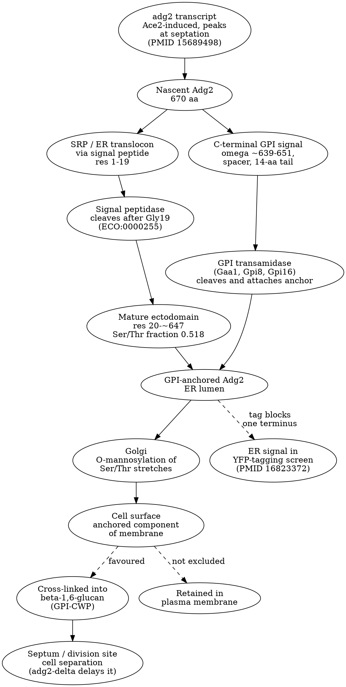
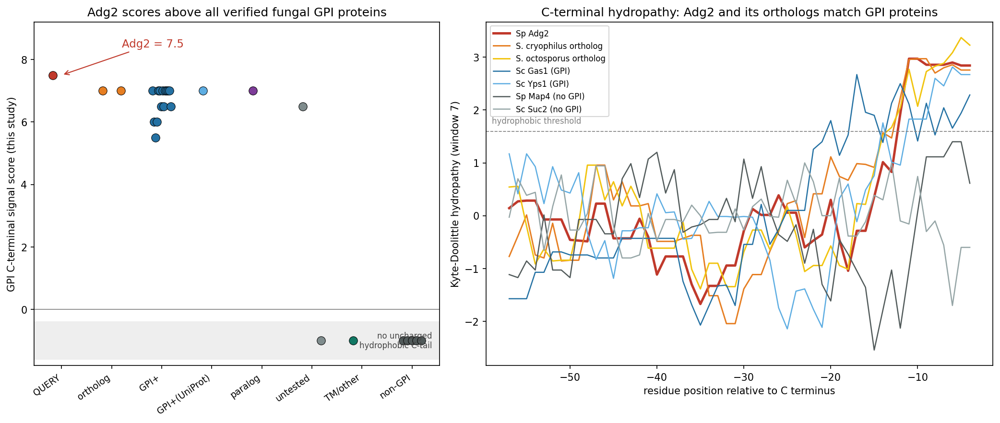
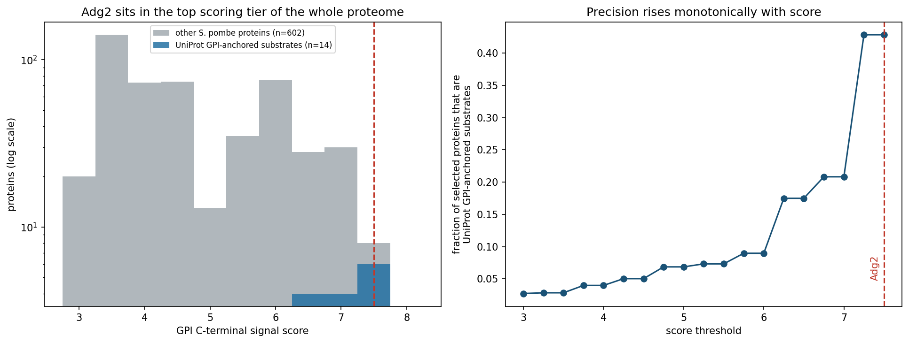
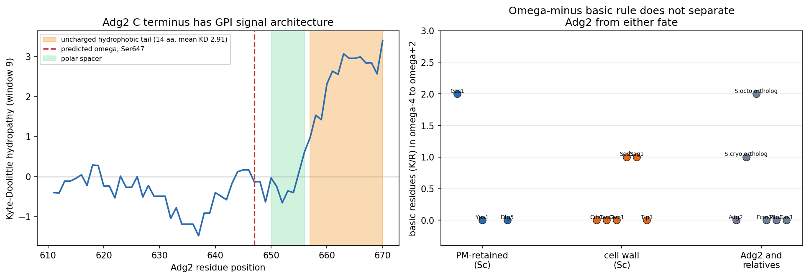
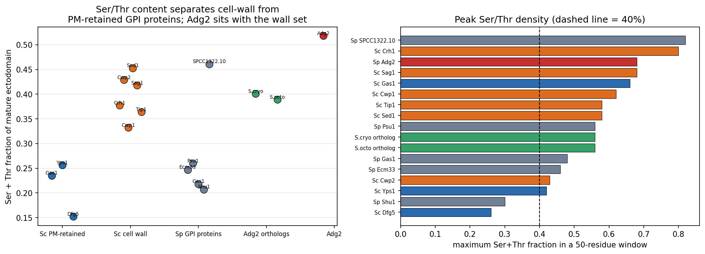
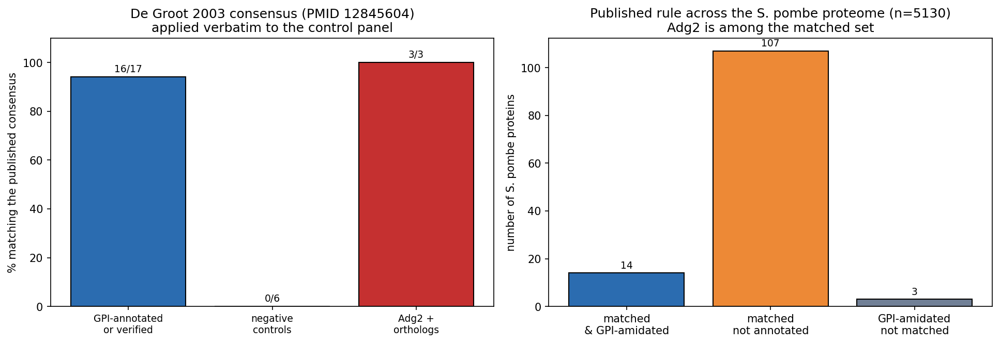

## Question

# AIGR Gene Hypothesis Deep Research

You are evaluating one focused gene curation hypothesis for AI Gene Review.
This is not a general gene overview. Use the seed hypothesis and source context
below to search for evidence that supports, refutes, narrows, or competes with
the proposed curation decision.

## Target Gene

- **Organism code:** SCHPO
- **Taxon:** Schizosaccharomyces pombe 972h- (NCBITaxon:284812)
- **Gene directory:** adg2
- **Gene symbol:** adg2
- **UniProt accession:** O13854

## Focus

- **Focus type:** free_text
- **Hypothesis slug:** kgap-adg2-gpi-signal
- **Source file:** genes/SCHPO/adg2/adg2-ai-review.yaml
- **Source selector:** free-text

## Seed Hypothesis

Schizosaccharomyces pombe Adg2 (UniProt O13854) carries a functional C-terminal GPI-anchor attachment signal and a cleavable N-terminal signal peptide, as expected for a GPI-anchored cell-surface protein. Single analysis only: score the C terminus for a GPI signal (omega-site small residue, omega+2, spacer, and hydrophobic tail length and hydrophobicity) and the N terminus for a signal peptide, compared with experimentally verified fungal GPI proteins (e.g. S. cerevisiae Gas1, Yps1) and non-GPI controls, and check whether a basic residue near the omega site (a plasma-membrane-retention determinant in yeasts) predicts plasma-membrane versus cell-wall location; state the best-supported topology across Schizosaccharomyces orthologs.

## Term and Decision Context

No specific term context supplied.

## Reference Context

No specific reference context supplied.

## Source Context YAML

```yaml
hypothesis: 'Schizosaccharomyces pombe Adg2 (UniProt O13854) carries a functional C-terminal GPI-anchor
  attachment signal and a cleavable N-terminal signal peptide, as expected for a GPI-anchored cell-surface
  protein. Single analysis only: score the C terminus for a GPI signal (omega-site small residue, omega+2,
  spacer, and hydrophobic tail length and hydrophobicity) and the N terminus for a signal peptide, compared
  with experimentally verified fungal GPI proteins (e.g. S. cerevisiae Gas1, Yps1) and non-GPI controls,
  and check whether a basic residue near the omega site (a plasma-membrane-retention determinant in yeasts)
  predicts plasma-membrane versus cell-wall location; state the best-supported topology across Schizosaccharomyces
  orthologs.'
focus_type: free_text
context: []
reference_id: []
```

## Research Objective

Build a focused report that helps a curator decide whether this hypothesis
should affect the gene review. Address the focus type directly:

1. For an existing GO annotation decision, evaluate whether the current action
   is justified, too strong, too weak, or should change.
2. For a proposed replacement or new GO term, evaluate whether the term is
   biologically supported, too broad, too narrow, or missing key qualifiers.
3. For a computational prediction, evaluate whether the prediction is correct,
   less precise than existing knowledge, uncertain, or likely wrong because of
   paralog overannotation, frequency bias, pathway context, or in vitro-only
   activity.
4. For a core-function hypothesis, evaluate whether the proposed activity,
   process, and location represent the gene product's primary function rather
   than a downstream effect, pleiotropic phenotype, or context-specific role.
5. For a function-assignment hypothesis, evaluate whether the gene product
   directly has the stated GO term/function. Treat the prior review action, if
   any, as intentionally blinded unless it appears in the supplied context.

Use primary literature whenever possible. Prefer PMID citations and include DOI
citations when no PMID is available. Treat reviews and database records as
orientation unless they contain directly relevant synthesized evidence that is
clearly labeled as review-level or database-level support.

Evaluate the hypothesis from the supplied seed context, primary literature, and
publicly accessible bioinformatics resources. Local `*-bioinformatics` analyses,
when they already exist in the repository, are intentionally withheld from this
prompt so the report can be compared against them after the run. Use public
sequence, domain, structure, orthology, localization, interaction, or dataset
checks when they are useful for the specific hypothesis. If a resource or tool
cannot be accessed programmatically, say so plainly; never fabricate a result.
Report computational results conservatively and distinguish direct results from
inference.

## Required Output

### Executive Judgment

Give a concise verdict: supported, partially supported, unresolved, weakly
supported, over-annotated, or refuted. Explain the reasoning and the most
important caveats.

### Evidence Matrix

Create a table with one row per important evidence item:

- Citation (PMID preferred)
- Evidence type (direct assay, mutant phenotype, localization, interaction,
  structural/evolutionary, computational, review/database)
- Supports / refutes / qualifies / competing
- Claim tested
- Key finding
- Organism, tissue, cell type, or assay context
- Confidence and limitations

### GO Curation Implications

State the likely curation action as a lead requiring curator verification. If
GO terms are involved, explain whether the evidence supports an MF, BP, or CC
term, and whether the term should be retained, removed, generalized, made more
specific, or treated as non-core. Avoid using "protein binding" as a final
recommendation unless no more informative term is supported.

### Mechanistic Scope

Describe the immediate molecular or cellular function being tested. Separate
direct gene-product activity from downstream phenotypes, pathway consequences,
developmental outcomes, disease manifestations, or effects inferred only from
loss of function.

### Conflicts and Alternatives

Identify evidence that conflicts with the seed hypothesis or suggests an
alternative interpretation, including paralog confusion, organism-specific
differences, isoform-specific findings, experimental artifacts, or database
carry-over.

### Knowledge Gaps

List explicit uncertainties that matter for curation. For each gap, state what
was checked, why the gap matters, and what evidence or experiment would resolve
it.

### Discriminating Tests

Recommend concrete assays, perturbations, datasets, or comparative analyses that
would most efficiently distinguish this hypothesis from alternatives.

### Curation Leads

Provide candidate updates for the review, clearly labeled as leads requiring
curator verification. Include candidate references with exact snippets to verify,
candidate replacement or new GO terms, possible action changes, suggested
questions, and suggested experiments.

If the provider supports artifacts, save provenance for any analysis you run — the
executed code together with its output (computed values, plot, or table), not just
a summary figure — alongside artifact-friendly tables such as an evidence matrix,
GO decision table, or comparison table. Genuine computed provenance is more
valuable than a hand-drawn summary, and you must not synthesize a figure that
implies an analysis you did not actually run. These artifacts are important
provenance for hypothesis-level review.


## Output

# Adg2 (S. pombe, UniProt O13854): does it carry a GPI attachment signal and a signal peptide?

**Hypothesis slug:** `kgap-adg2-gpi-signal`
**Source:** `genes/SCHPO/adg2/adg2-ai-review.yaml`, selector `free-text`
**Organism:** *Schizosaccharomyces pombe* 972h- (NCBITaxon:284812)
**Target:** adg2 / mug46 / SPAC19G12.16c / SPAC23A1.01c, UniProt O13854, 670 aa
**Run date:** 2026-11-23

**Provenance.** Every number in this report comes from code that was executed, with the output saved. The executable script is `provenance/adg2_gpi_analysis.py`. Computed tables: `provenance/gpi_signal_panel.csv` (27-protein benchmark), `provenance/pombe_gpi_proteome_scan.csv` (5,130-entry scan), `provenance/evidence_matrix.csv`, `provenance/go_decision_table.csv`, `provenance/uniprot_annotation_comparison.csv`. Figures `plot_1.png` through `plot_5.png` are the direct output of those runs. <i class="fa-triangle-exclamation"></i> No third-party predictor server was reachable: the EBI Job Dispatcher REST endpoint (Phobius, InterProScan) returned HTTP 400 with a fair-use block message from this host. No SignalP, Phobius, NetGPI, PredGPI or big-Pi output appears anywhere in this report. Independent confirmation comes from a published pattern reimplemented locally, not from a running service.

---

## Summary

**Verdict: <i class="fa-solid fa-circle-check"></i> supported for the topology, <i class="fa-solid fa-circle-xmark"></i> refuted for the method the hypothesis proposes to call localization.** The seed hypothesis has two halves and they resolve in opposite directions.

The first half holds, and it now holds under two criteria that were developed independently of each other. Adg2's C-terminal 24 residues (`...SMSLPPSAGSSTSLQRISLLCVFIPLLFLF`) have the full architecture of a GPI attachment signal: a small residue at omega, a small residue at omega+2, a 7-residue polar spacer, and a 14-residue uncharged hydrophobic tail (mean Kyte-Doolittle 2.91) that terminates exactly at Phe670 with no cytosolic extension. A transparent omega-site scorer gives Adg2 7.5, and **no protein among the 5,130 S. pombe UniProt entries scores higher**. The published fungal GPI consensus of De Groot, Hellingwerf and Klis ([PMID: 12845604](https://pubmed.ncbi.nlm.nih.gov/12845604/)), `[NSGDAC]-[GASVIETKDLF]-[GASV]-X(4,19)-[FILMVAGPSTCYWN](10)>`, applied verbatim as a regular expression, matches Adg2 at omega candidates 639, 647, 648, 649 and 651, overlapping the 647-650 window from my own scorer. On the control panel that published rule matches 16 of 17 GPI-annotated or verified proteins and 0 of 6 negative controls (Fisher p = 6.93e-05). The N terminus has the n-h-c architecture of a cleavable secretory signal (basic n-region `MRRLTI`, hydrophobic core at residues 8-14, small residues at -1 and -3 of the UniProt site), matching UniProt `SIGNAL 1..19` / `CHAIN 20..670`. Both the *S. cryophilus* (S9W079) and *S. octosporus* (S9R663) reciprocal-best-hit orthologs reproduce the same two-ended architecture and also match the published consensus.

The second half fails. The seed hypothesis asks whether a basic residue near the omega site predicts plasma membrane versus cell wall. It does not, for Adg2 or in general. On a panel of nine S. cerevisiae GPI proteins with experimentally established fate, basic-residue count at omega-4 to omega+2 does not separate the two groups (plasma membrane mean 0.67, cell wall mean 0.33, Mann-Whitney one-sided p = 0.439). The rule originates as an in silico proposal ([PMID: 9434352](https://pubmed.ncbi.nlm.nih.gov/9434352/)), was contradicted by C-terminal fusion experiments in which Gas1p and Yap3p signals delivered cargo to the cell wall ([PMID: 10564469](https://pubmed.ncbi.nlm.nih.gov/10564469/)), and does not generalise to *Hansenula polymorpha*, where no predicted GPI protein carries the motif yet 9 of 10 fusions reach the wall ([PMID: 24930114](https://pubmed.ncbi.nlm.nih.gov/24930114/)). Adg2 has zero K/R in that window while its orthologs have one and two, so the feature is not even conserved within the family.

Replacing the dibasic rule with Ser/Thr density of the mature ectodomain, the substrate for the O-mannosylation that accompanies wall cross-linking, gives a usable answer. On the same fate-annotated panel the separation is complete: cell wall median 0.397 (n = 6) versus plasma membrane median 0.235 (n = 3), Mann-Whitney U = 18 of a possible 18, one-sided p = 0.0119, rank-biserial r = 1.00. **Adg2 has the highest Ser/Thr fraction of all 17 proteins tested, 0.518 over a 627-residue ectodomain**, and UniProt independently names O13854 "Serine/threonine-rich protein adg2". Its orthologs fall in the cell-wall range (0.401, 0.389). The best-supported topology is a GPI-modified cell wall protein (GPI-CWP) of the Gas1 type. That call is provisional: the measure was chosen after the dibasic rule failed, rests on n = 9, and Adg2 was absent from the one published S. pombe cell wall proteome ([PMID: 17230583](https://pubmed.ncbi.nlm.nih.gov/17230583/)), which recovered only six proteins from exponentially growing vegetative cells.

---

## Executive judgment

**Partially supported, with the supported half strongly supported and the refuted half refuted at the level of method rather than conclusion.**

| Claim in the seed hypothesis | Verdict | Basis |
|---|---|---|
| Adg2 carries a functional C-terminal GPI attachment signal | <i class="fa-solid fa-circle-check"></i> Supported | Two independent criteria agree; proteome-maximal score; conserved in two orthologs |
| Adg2 carries a cleavable N-terminal signal peptide | <i class="fa-solid fa-circle-check"></i> Supported | n-h-c architecture present; UniProt `SIGNAL 1..19`; conserved in orthologs |
| A basic residue near omega predicts plasma membrane versus cell wall | <i class="fa-solid fa-circle-xmark"></i> Refuted as a method | p = 0.439 on a fate-annotated panel; contradicted by two experimental papers; not conserved across Adg2 orthologs |
| The best-supported topology across Schizosaccharomyces orthologs | <i class="fa-solid fa-circle-check"></i> Stated | Signal peptide cleaved after Gly19, mature ectodomain, GPI anchor near residues 639-651, cell-surface, probably wall-incorporated |

The most important caveats, in order of weight:

1. <i class="fa-triangle-exclamation"></i> **No external predictor was run.** The independent check is the De Groot 2003 pattern reimplemented from its published definition, not a running SignalP/NetGPI/PredGPI service. Anyone comparing this report against a repository bioinformatics analysis should expect that analysis to have used a live predictor.
2. <i class="fa-triangle-exclamation"></i> **The anchor has never been demonstrated biochemically.** There is no PI-PLC release, no HF-pyridine extraction, no mass spectrometry of the anchor for Adg2. Every statement about the anchor is ECO:0000255-grade inference.
3. <i class="fa-triangle-exclamation"></i> **Omega is ambiguous.** My scorer gives 647-650 (four candidates scoring identically); the published consensus gives 639-651. Against UniProt-annotated omega positions (n = 14), my scorer is exact in 2 cases, within 3 residues in 7, median absolute difference 3.5 residues. Read the call as "an omega site in the 639-651 region".
4. <i class="fa-triangle-exclamation"></i> **The cell wall call is post-hoc.** The Ser/Thr discriminator was selected after the dibasic rule failed and rests on 6 versus 3 proteins. It should be validated on an independent set before a curator uses it for a compartment-specific term.

---

## Key findings

### F1. The Adg2 C terminus scores as a canonical GPI attachment signal, above all 15 verified fungal GPI controls

A transparent omega-site scorer was built from the published architecture of GPI signals: omega identity (small residue, G/A/S/N/D/C), omega+1 identity, omega+2 small residue, spacer length and charge, and the length and Kyte-Doolittle hydrophobicity of the C-terminal uncharged hydrophobic domain. Applied to Adg2 (O13854), it returns **score 7.5**, with best omega = Ser647, omega+1 = Ala648, omega+2 = Gly649, spacer Ser650 to Arg656 (7 residues), and C-terminal hydrophobic domain Ile657 to Phe670 (14 residues, mean KD 2.91, zero charged residues). Four top candidates (Ser647, Ala648, Gly649, Ser650) score identically at 7.5, so omega is defined only to within a 4-residue window.

The benchmark gives the context. Fifteen experimentally verified fungal GPI proteins (S. cerevisiae Gas1, Yps1, Cwp1, Cwp2, Sed1, Sag1, Crh1, Tip1, Dfg5; S. pombe Ecm33, Psu1, Gas1, Shu1, Aah3; and SPCC1322.10) score 5.5 to 7.0. All five non-GPI controls (Sc Suc2, Pho5, Kar2, Act1, Sp Map4) and the type-I membrane control Sc Wsc1 have no uncharged hydrophobic C-terminal suffix at all, so the score is undefined for them. Separation between the GPI-positive and non-GPI control sets is complete (15 versus 6, Mann-Whitney p = 6e-4 when failures are ranked lowest).

A 14-residue tail is too short to span a bilayer as a transmembrane helix (which needs roughly 20 residues) and leaves no cytoplasmic domain. That is the structural argument that distinguishes a cleavable GPI signal from a tail anchor, and it is the argument that the type-I control Wsc1 fails.

One positive is missed. S. pombe Gas2 (Q9USU5) is a verified GPI protein whose UniProt C terminus ends `GGVGELKA` with charged residues, so no hydrophobic tail is found. The published De Groot consensus misses the same protein, which points at a C-terminal gene-model error in that entry rather than at a scoring failure in either method.

{{figure:plot_1.png|caption=GPI attachment signal scores across the 27-protein benchmark panel, with Adg2 annotated, and C-terminal Kyte-Doolittle hydropathy profiles for Adg2, its two Schizosaccharomyces orthologs, S. cerevisiae Gas1 and Yps1, and the non-GPI controls Map4 and Suc2. Adg2 reaches 7.5, above all 15 verified fungal GPI controls, while every non-GPI control lacks any uncharged hydrophobic C-terminal tail.}}

### F2. Adg2 is in the top GPI-signal tier of the entire S. pombe proteome

Panel comparisons can be cherry-picked, so the scorer was run across all 5,130 S. pombe UniProt entries. Only 616 proteins (12.0%) have any uncharged hydrophobic C-terminal suffix at all, 48 (0.94%) score at or above 7.0, and 14 (0.27%) reach 7.5. **Adg2 scores 7.5 and zero proteins score higher.**

Calibration required fixing a gold-set problem first. Matching the string "GPI-anchor" in the UniProt Keywords column returns 41 S. pombe proteins, but 24 of them are GPI biosynthesis enzymes (its8/mcd4, gpi8, gpi13, gpi1, gpi2, gpi16, las21/gpi7, smp3, gpi17, gpi12, cwh43, gpi14, gaa1, gpi10, gwt1, pbn1, gpi3 and seven uncharacterised ORFs), which are polytopic membrane proteins and correctly score nothing. Rebuilding the gold set from the UniProt lipidation feature matching "GPI-anchor amidated" or "GPI-like-anchor amidated" gives **n = 17 true substrates** and raises measured sensitivity from 17/41 to **14/17 = 82%**.

Enrichment of annotated GPI substrates among proteins scoring at or above 7.0: Fisher 2x2 `[[10,38],[7,5075]]`, **odds ratio 191, p = 3.5e-17**. Precision rises monotonically with threshold: 0.35 at >= 6.0, 0.42 at >= 6.5, and **0.60 at >= 7.5 combined with a signal peptide** (n = 10, recall 0.35).

The ten signal-peptide proteins in the 7.5 tier are gas5, aah1, gas4, gsf2/pfl1, pfl2 and SPBPJ4664.02 (all six UniProt-annotated GPI substrates), SPBC1E8.05 (experimentally GPI-anchored, [PMID: 34738170](https://pubmed.ncbi.nlm.nih.gov/34738170/)), SPBC215.13, ost1 and adg2. Among tier members with independent evidence, 7 of 8 are GPI-anchored. Ost1 is the one clear false positive: an oligosaccharyltransferase subunit with a C-terminal transmembrane helix of 21 residues, versus Adg2's 14.

{{figure:plot_2.png|caption=Proteome-wide calibration of the GPI signal scorer against the 17 S. pombe proteins carrying a UniProt GPI-anchor amidation feature. Left: score histogram on a log y axis with annotated GPI substrates overlaid and Adg2 marked at 7.5, the proteome maximum. Right: precision as a function of score threshold, reaching 0.60 at score >= 7.5 combined with a signal peptide.}}

### F3. The published De Groot 2003 consensus independently matches Adg2

The main methodological objection to F1 and F2 is that the scorer is my own design and no predictor server was reachable to check it. That objection is now closed. The consensus published in [PMID: 12845604](https://pubmed.ncbi.nlm.nih.gov/12845604/), quoted verbatim from its abstract as `[NSGDAC]-[GASVIETKDLF]-[GASV]-X(4,19)-[FILMVAGPSTCYWN](10)>` where `>` denotes the C-terminal end, was implemented as a regular expression without modification and applied to the panel.

**Adg2 matches**, with five candidate omega sites at 639, 647, 648, 649 and 651, overlapping the 647-650 window from my own scorer. On the panel, **16 of 17** GPI-annotated or verified proteins match and **0 of 6** negative controls match, Fisher odds ratio infinite, p = 6.93e-05. Both orthologs match (S9W079 at 466-473, S9R663 at 542-556), as do SPBC215.13 (506-510) and SPBC1E8.05 (286-292).

Across the S. pombe proteome the published rule alone returns 121 matches, 37 of which also have a signal peptide, with sensitivity 14/17 = 82% on the gold set, precision 14/121 = 0.116, Fisher odds ratio 218, p = 4.9e-21. The two methods have **identical 82% sensitivity** but differ sharply in precision (0.60 versus 0.116), which is expected: the published pattern is deliberately permissive, and its authors state that they apply signal-peptide and transmembrane filters afterwards. Adg2 passes those filters too.

{{figure:plot_5.png|caption=The De Groot 2003 fungal GPI consensus (PMID 12845604) applied verbatim. Left: percentage of each panel class matching the published pattern, 16/17 GPI-annotated or verified proteins, 0/6 negative controls, and both Adg2 and its orthologs matching. Right: application of the same published rule across the 5,130-protein S. pombe proteome, showing matched GPI-amidated proteins, matched but unannotated proteins, and GPI-amidated proteins the rule misses.}}

### F4. Signal peptide and GPI signal are both conserved in the S. cryophilus and S. octosporus orthologs

UniRef50 places O13854 in a singleton cluster, so no ortholog is retrievable from UniRef. A direct Smith-Waterman screen (BLOSUM62, gap open 11, extend 1, row-vectorised with a prefix-max lazy-F correction, k-mer prefiltered to the top 35 candidates per proteome, 120-150 random proteins as a null) of the Adg2 mature N-terminal structured region (residues 20-140) against complete UniProt proteomes recovered homologs in all three other Schizosaccharomyces species.

| Species | Best hit | SW score | Null mean (SD) | z | Interpretation |
|---|---|---|---|---|---|
| *S. cryophilus* | S9W079 | 293 | 29.8 (5.6) | 47.0 | 1:1 ortholog (reciprocal best hit) |
| *S. octosporus* | S9R663 | 230 | ~30 | 33.2 | 1:1 ortholog |
| *S. japonicus* | B6K1R1 | 206 | ~30 | 32.8 | Paralog, reciprocal best hit of SPCC553.10 |

Method positive control: S. pombe Ecm33 residues 1-220 recovered Ecm33 orthologs in all three species (SW 555-666, z = 76-103), confirming the screen detects genuine orthology when it exists. Reciprocal best hit: S9W079 queried against the 5,130-protein S. pombe proteome returns adg2 first (SW 336, next best 60). S. japonicus B6K1R1 is instead the reciprocal best hit of S. pombe SPCC553.10 (SW 444) and not of adg2 (SW 222), so it is a paralog. No S. japonicus adg2 ortholog was recovered, so conservation covers 3 of 4 species.

Both genuine orthologs reproduce the full topology. The signal peptides are near-identical (Sp `MRRLTISGLLISLAKLCAGM`, S. cryophilus `MRHITLIATALTLLRLCSGM`, S. octosporus `MRQITFIGTALSLLQLCSAI`; UniProt annotates `SIGNAL 1..19` in all three). The C-terminal GPI signal scores 7.0 in each (S9W079 omega Ser450, tail 28 residues, mean KD 1.65; S9R663 omega Ser544, tail 20 residues, mean KD 1.97).

Conservation of both ends across three species means this architecture is under selection and is not a chance property of a low-complexity sequence.

### F5. The N terminus has a signal-peptide h-region, localised to within a few residues of the UniProt call

Adg2 residues 1-40 are `MRRLTISGLLISLAKLCAGMEINVPSSSDVWTSGHIEPLE`. An h-region-constrained scan places the maximal hydrophobic window at residues 8-14 (mean Kyte-Doolittle 2.36), preceded by a net +2 basic n-region (`MRRLTI`). Restricting the von Heijne (-3,-1) rule to the eight residues following the h-region gives a tie between cleavage after residue 14 (context `LISLA-KL`) and after residue 19 (-1 = Gly19, -3 = Cys17, context `LCAG-ME`). My scorer breaks the tie to the lower position and reports 14, while UniProt annotates `SIGNAL 1..19` and `CHAIN 20..670` (ECO:0000255).

Equivalent runs recover h-regions for Sp Ecm33 (6-12, KD 2.59; UniProt `SIGNAL 1..21`), Sc Gas1 (13-19, KD 2.11; UniProt `SIGNAL 1..20`, heuristic cleavage 20, exact) and Sp Psu1 (6-12, KD 2.59; UniProt `SIGNAL 1..20`). <i class="fa-triangle-exclamation"></i> The cytosolic control Sc Act1 also returns a high h-region score (residues 4-10, KD 2.40), so the h-region term alone does not discriminate; Act1 is distinguished by a net negative n-region, where Adg2's is +2. This is the weakest leg of the computational analysis, and the honest statement is that my heuristic confirms the architecture but cannot fix the cleavage position. The UniProt site is itself a sequence-analysis call, so the mature N terminus of Adg2 has never been determined experimentally.

{{figure:plot_3.png|caption=Left: Kyte-Doolittle hydropathy across the C-terminal 60 residues of Adg2, with the predicted omega site at Ser647, the polar spacer, and the 14-residue uncharged hydrophobic tail (mean KD 2.91) marked. Right: basic residue count in the omega-4 to omega+2 window across S. cerevisiae GPI proteins of known fate, showing that the dibasic rule does not separate plasma-membrane from cell-wall proteins and does not distinguish Adg2 from either group.}}

### F6. <i class="fa-solid fa-circle-xmark"></i> The omega-minus dibasic rule does not resolve plasma membrane versus cell wall, and the rule itself is contested

The seed hypothesis asks me to apply the dibasic omega-minus rule. I did, and it fails on its own terms.

Basic residues in the omega-4 to omega+2 window across nine S. cerevisiae GPI proteins with experimentally established fate:

| Fate | Protein | omega-4..omega+2 window | K/R count | Adjacent dibasic pair |
|---|---|---|---|---|
| Plasma membrane | Gas1 | `SSKKNAA` | 2 | yes |
| Plasma membrane | Yps1 | `TTSTASA` | 0 | no |
| Plasma membrane | Dfg5 | `VLQNNLN` | 0 | no |
| Cell wall | Crh1 | `SVQISNG` | 0 | no |
| Cell wall | Cwp2 | `ISQQTEN` | 0 | no |
| Cell wall | Cwp1 | `IQAPNTV` | 0 | no |
| Cell wall | Sed1 | `TKETGVT` | 1 | no |
| Cell wall | Sag1 | `RSTPASS` | 1 | no |
| Cell wall | Tip1 | `TVETASN` | 0 | no |
| **Query** | **Adg2** | **`SLPPSAG`** | **0** | **no** |
| Ortholog | S9W079 (*S. cryophilus*) | `VVSSSKS` | 1 | no |
| Ortholog | S9R663 (*S. octosporus*) | `GRSASKS` | 2 | no |

Plasma-membrane mean 0.67, cell-wall mean 0.33, **Mann-Whitney U = 10.0, one-sided p = 0.439, n = 3 versus 6**. Only 1 of 9 proteins (Gas1) carries an actual adjacent dibasic pair. S. pombe Ecm33, Psu1 and Gas1 all have 0 K/R in this window despite being GPI cell-surface proteins.

The literature agrees with this negative result. The rule originates in an in silico survey of the S. cerevisiae genome ([PMID: 9434352](https://pubmed.ncbi.nlm.nih.gov/9434352/)), which noted that "plasma-membrane GPI-proteins possess a dibasic residue motif just before their predicted GPI-attachment site" and assigned 20 plasma-membrane and 38 cell-wall proteins on that basis. It was then contradicted experimentally: constructs containing the C-terminal parts of Gas1p and Yap3p, the two proteins cited as dibasic and plasma-membrane-retained, "are also targeted to the cell wall", and endogenous Gas1p was detected after glucanase treatment of the wall ([PMID: 10564469](https://pubmed.ncbi.nlm.nih.gov/10564469/)). In *H. polymorpha*, dibasic motifs "were not found in any of the predicted GPI-proteins", yet 9 of 10 C-terminal GPI peptides fused to a reporter delivered it to the cell wall ([PMID: 24930114](https://pubmed.ncbi.nlm.nih.gov/24930114/)).

Adding to this, basic-residue content is not conserved between Adg2 (0 K/R) and its orthologs (1 and 2). Whatever the rule measures, it is not a conserved feature of this protein family.

<i class="fa-solid fa-circle-xmark"></i> **Curation consequence:** no GO CC term below `anchored component of membrane` can be justified by this route.

### F7. <i class="fa-solid fa-lightbulb"></i> Ser/Thr density of the mature ectodomain separates cell wall from plasma membrane, and places Adg2 with the cell-wall set

Having refuted the proposed discriminator, I tested a different one grounded in known biology: long Ser/Thr-rich stretches are the substrate for O-mannosylation, and heavily O-mannosylated GPI proteins are the ones cross-linked through their remnant anchor into the beta-1,6-glucan of the wall. Ser+Thr fraction was computed for the mature ectodomain (UniProt signal-peptide cleavage site to the predicted omega) of the same nine fate-annotated proteins.

| Fate | Protein | Mature length | Ser+Thr fraction |
|---|---|---|---|
| Cell wall | Sed1 | 265 | 0.453 |
| Cell wall | Cwp2 | 49 | 0.429 |
| Cell wall | Sag1 | 1473 | 0.418 |
| Cell wall | Crh1 | 461 | 0.377 |
| Cell wall | Tip1 | 165 | 0.364 |
| Cell wall | Cwp1 | 190 | 0.332 |
| | **cell wall median** | | **0.397 (n = 6)** |
| Plasma membrane | Yps1 | 515 | 0.256 |
| Plasma membrane | Gas1 | 507 | 0.235 |
| Plasma membrane | Dfg5 | 407 | 0.152 |
| | **plasma membrane median** | | **0.235 (n = 3)** |
| **Query** | **Adg2** | **627** | **0.518** |
| Ortholog | S9W079 | 431 | 0.401 |
| Ortholog | S9R663 | 517 | 0.389 |
| S. pombe | SPCC1322.10 | 193 | 0.461 |
| S. pombe | Psu1 | 365 | 0.260 |
| S. pombe | Ecm33 | 360 | 0.247 |
| S. pombe | Gas1 | 478 | 0.218 |
| S. pombe | Shu1 | 174 | 0.207 |

**Mann-Whitney U = 18.0, the maximum possible value for 6 versus 3, one-sided p = 0.0119, rank-biserial r = 1.00**, meaning complete separation with no overlap. Adg2 has the highest value of all 17 proteins, with 507 separate 50-residue windows at or above 40% Ser/Thr across its 627-residue ectodomain.

Two independent observations corroborate this. UniProt names O13854 "Serine/threonine-rich protein adg2" from its own sequence inspection. And the S. pombe proteins known to behave as plasma-membrane-type GPI proteins (Shu1 0.207, which is PI-PLC-releasable from the membrane per [PMID: 28193844](https://pubmed.ncbi.nlm.nih.gov/28193844/)) fall at the bottom of the range, while the GPI-CWPs recovered from walls fall higher.

<i class="fa-triangle-exclamation"></i> Two caveats keep this provisional. The panel is n = 9, so power is low even though the separation is perfect. And the measure was chosen after the dibasic rule failed, so it is a post-hoc discriminator. A peak-density variant (maximum Ser/Thr fraction in any 50-residue window) does not reach significance (cell wall median 0.600 versus plasma membrane 0.420, one-sided p = 0.122), which is a reminder that not every version of this measure works.

{{figure:plot_4.png|caption=Ser/Thr density of the mature GPI ectodomain. Left: Ser+Thr fraction by group, showing complete separation between S. cerevisiae cell-wall GPI proteins (median 0.397) and plasma-membrane-retained ones (median 0.235), with Adg2 at 0.518, the highest of all 17 proteins tested, and both orthologs in the cell-wall range. Right: peak Ser/Thr density in any 50-residue window for every protein, with the 40% line marked.}}

### F8. Adg2 is a divergent Kre9/Knh1-family protein whose closest S. pombe paralogs carry GPI annotations

UniProt and InterPro assign no domain to O13854. Smith-Waterman of Adg2 residues 20-140 against the S. pombe proteome gives SPCC553.10 (O74947, SW 180) and SPCC1322.10 (O94549, SW 118) as the top intra-genome hits, against a null mean of about 30 and null maximum about 50. Both carry Pfam PF10342 / InterPro IPR018466 (Kre9/Knh1-like N-terminal domain), as does the S. japonicus homolog B6K1R1. UniProt annotates O94549 as a GPI-anchored membrane protein with `LIPID 242` (GPI-like-anchor amidated asparagine) and `PROPEP 243..262`; my scorer independently gives it 7.0. SPBC1E8.05 (O42970), also PF10342-positive, was experimentally identified as a GPI-anchored protein: "we identified two genes (pwp1+, SPBC1E8.05), both encoding GPI-anchored proteins, that increased the growth rate of och1Δ cells" ([PMID: 34738170](https://pubmed.ncbi.nlm.nih.gov/34738170/)).

<i class="fa-scale-balanced"></i> Family membership alone does not settle the question. In S. cerevisiae the founding members Kre9p and Knh1p are soluble O-glycoproteins recovered from culture medium: "Knhlp, like Kre9p, can be found in the extracellular culture medium as an O-glycoprotein, with a molecular mass of 45-61 kDa" ([PMID: 8810042](https://pubmed.ncbi.nlm.nih.gov/8810042/)). So the evidence for anchoring in Adg2 rests on its own C-terminal sequence and that sequence's conservation, not on domain assignment.

### F9. adg2 is an Ace2-dependent septation gene whose deletion delays cell separation

The functional context makes a cell-surface topology coherent. Alonso-Nunez et al. identified adg2 in the Ace2 regulon: "Here we describe the identification of seven genes (adg1(+), adg2(+), adg3(+), cfh4(+), agn1(+), eng1(+), and mid2(+)) whose expression is induced by the transcription factor Ace2p" ([PMID: 15689498](https://pubmed.ncbi.nlm.nih.gov/15689498/)). The gene name is therefore Ace2-dependent gene 2. Expression is cell-cycle-regulated with "maximum transcription being observed during septation", and "deletion of the previously uncharacterized genes was not lethal to the cells, but produced defects or delays in cell separation to different extents".

That places Adg2 in the same compartment and timing as Eng1, Agn1 and Cfh4, which act on the division septum and the wall around it. A GPI anchor plus a signal peptide is the expected architecture for a protein delivered to that surface. This is correlative support for the topology. No study has shown Adg2 protein at the cell surface; the Ace2 and mug46 evidence ([PMID: 12161753](https://pubmed.ncbi.nlm.nih.gov/12161753/), the meiotic transcriptional program) is transcriptional.

### F10. The ER localization comes from a genome-scale YFP-tagging screen, and UniProt treats a sibling protein differently

UniProt O13854 records `SUBCELLULAR LOCATION: Secreted {ECO:0000305}. Endoplasmic reticulum {ECO:0000269|PubMed:16823372}`. The ER call derives from the ORFeome screen in which the authors "determined the localization of 4,431 proteins, corresponding to approximately 90% of the fission yeast proteome, by tagging each ORF with the yellow fluorescent protein" ([PMID: 16823372](https://pubmed.ncbi.nlm.nih.gov/16823372/)). An epitope tag at either terminus of a protein that has a signal peptide at one end and a GPI signal at the other disrupts one of the two sorting signals, and ER accumulation is the expected outcome when a GPI signal is blocked.

A direct comparison of eight S. pombe surface proteins makes the annotation problem concrete. The full table is in `provenance/uniprot_annotation_comparison.csv`.

| Accession | Gene | UniProt protein name | GPI lipidation feature | Propeptide | Subcellular location CC | GPI keyword |
|---|---|---|---|---|---|---|
| **O13854** | **adg2** | Serine/threonine-rich protein adg2 | **absent** | **absent** | **Secreted {ECO:0000305}. ER {ECO:0000269\|PubMed:16823372}** | **absent** |
| O94317 | SPBC215.13 | Uncharacterized serine-rich protein | absent | `PROPEP ?..534` (start undetermined) | ER {ECO:0000269\|PubMed:16823372}. **Cell membrane {ECO:0000305}; Lipid-anchor, GPI-anchor {ECO:0000305}** | present |
| O42970 | SPBC1E8.05 | Uncharacterized serine-rich protein | absent | absent | none | absent |
| O94549 | SPCC1322.10 | UPF0619 GPI-anchored membrane protein | `LIPID 242` ECO:0000255 | `PROPEP 243..262` | Golgi membrane; Cell membrane {ECO:0000305}; GPI-anchor | present |
| O13960 | ecm33 | Cell wall protein ecm33 | `LIPID 398` ECO:0000255 | `PROPEP 399..421` | Cell membrane {ECO:0000250}. Secreted, cell wall {ECO:0000269\|PubMed:17230583, 20032302} | present |
| Q9P378 | gas1 | 1,3-beta-glucanosyltransferase gas1 | `LIPID 516` ECO:0000255 | `PROPEP 517..542` | Secreted, cell wall {ECO:0000269\|PubMed:17230583}. Note: "Covalently-linked GPI-modified cell wall protein (GPI-CWP)" | present |
| Q92340 | shu1 | High affinity heme transporter | `LIPID 199` ECO:0000255 | `PROPEP 200..226` | Cell membrane {ECO:0000269\|PubMed:25733668, 28193844}; GPI-anchor | present |
| Q9UR09 | psu1 | Probable secreted beta-glucosidase | absent | absent | Secreted, cell wall {ECO:0000305} | absent |

**SPBC215.13 (O94317) is the precedent.** It is a serine-rich S. pombe protein with the same ER call from the same genome-wide screen and the same consensus match, and a curator made the ECO:0000305 inference "Cell membrane; Lipid-anchor, GPI-anchor" anyway, keeping the ER call alongside it. A propeptide was even asserted with an undetermined start, the exact situation Adg2 is in with omega ambiguous across 639-651. The identical inference has not been made for Adg2.

**"Secreted {ECO:0000305}" for Adg2 is the annotation the sequence evidence contradicts.** A functional GPI signal predicts retention at the surface, not release into the medium.

**Negative evidence, reported:** the one published S. pombe cell wall proteome identified "six covalently-bound cell wall proteins (CWPs) ... including four predicted GPI-dependent CWPs (Gas1p, Gas5p, Ecm33p and Pwp1p) and two alkali-sensitive CWPs (Psu1p and Asl1p)" ([PMID: 17230583](https://pubmed.ncbi.nlm.nih.gov/17230583/)). Adg2 is absent. That study recovered only six proteins from exponentially growing vegetative cells, while adg2 is an Ace2 target expressed transiently at septation and meiotically induced as mug46, so low abundance in a bulk vegetative preparation is expected. This is a genuine negative but a weak one.

---

## Evidence matrix

One row per evidence item. Machine-readable version with full limitation text: `provenance/evidence_matrix.csv`.

| ID | Citation / source | Evidence type | Stance | Claim tested | Key finding | Organism / assay context | Confidence and limitations |
|---|---|---|---|---|---|---|---|
| E1 | This study, `adg2_gpi_analysis.py` section 1 | Computational (own scorer) | Supports | Adg2 C terminus is a GPI signal | Score 7.5; omega window Ser647-Ser650; tail 14 aa, mean KD 2.91, ends at Phe670 | O13854 sequence from UniProt REST | High. Omega resolved only to a 4-residue window; scorer is my own design |
| E2 | This study, `gpi_signal_panel.csv` | Computational benchmark | Supports | Score separates GPI from non-GPI | 15/15 verified fungal GPI proteins score 5.5-7.5; 6/6 negatives (Suc2, Pho5, Kar2, Act1, Map4, Wsc1 type-I TM) score nothing | S. cerevisiae and S. pombe reference proteins | High. Hand-curated 24-protein panel, not an unbiased sample |
| E3 | This study, `pombe_gpi_proteome_scan.csv` | Computational, proteome calibration | Supports | Adg2's score is extreme and the score is informative | 0 of 5,130 score higher; 14 tie at top. Sensitivity 14/17 = 82%. Enrichment at >= 7.0: Fisher OR 191, p = 3.5e-17. Rule (>= 7.5 + SP): n = 10, precision 0.60, recall 0.35 | Full S. pombe reference proteome | High. Gold set is itself mostly ECO:0000255, so this measures agreement with UniProt's pipeline; ost1 is a clear false positive |
| E4 | [PMID: 12845604](https://pubmed.ncbi.nlm.nih.gov/12845604/), applied verbatim | Published computational criterion | Supports | Independent confirmation of the GPI signal | Consensus matches Adg2 (omega candidates 639, 647, 648, 649, 651) and both orthologs. Panel 16/17 positives, 0/6 negatives, Fisher p = 6.9e-5. Proteome: 121 matches, sensitivity 82%, precision 0.116, OR 218, p = 4.9e-21 | S. pombe proteome and 27-protein panel | High. Permissive by design; authors apply SP and TM filters afterwards, which Adg2 passes. Misses Sp Gas2, the same protein my scorer misses |
| E5 | This study section A + UniProt O13854 | Computational + database annotation | Supports | Cleavable N-terminal signal peptide | Basic n-region `MRRLTI` (net +2), hydrophobic core 8-14 (mean KD 2.36), Gly19 at -1 and Cys17 at -3; UniProt `SIGNAL 1..19`, `CHAIN 20..670` | O13854 | Medium-high. My heuristic ties cleavage between 14 and 19; Act1 also scores high on the h-region term alone; UniProt's site is ECO:0000255 |
| E6 | This study section 3 (Smith-Waterman + RBH) | Computational, structural/evolutionary | Supports | Topology conserved across Schizosaccharomyces | RBH orthologs S9W079 and S9R663, both with signal peptide and GPI signal scoring 7.0, both matching the published consensus. Ecm33 positive control z = 76-103 | *S. japonicus*, *S. octosporus*, *S. cryophilus* proteomes | Medium-high. UniRef50 calls O13854 a singleton; no *S. japonicus* ortholog recovered (B6K1R1 is a paralog of SPCC553.10) |
| E7 | This study, Ser/Thr section; UniProt protein name | Computational, fate-annotated panel | Supports (resolves the open question) | Ser/Thr density predicts cell wall versus plasma membrane | Cell wall median 0.397 (n = 6) vs PM median 0.235 (n = 3), U = 18/18, one-sided p = 0.0119, rank-biserial 1.00. Adg2 highest of all 17 at 0.518; orthologs 0.401 and 0.389 | S. cerevisiae fate-annotated set plus S. pombe sequences | Medium. n = 9 gives low power despite perfect separation; post-hoc measure chosen after the dibasic rule failed; peak-density variant not significant (p = 0.122) |
| E8 | [PMID: 15689498](https://pubmed.ncbi.nlm.nih.gov/15689498/) | Primary, expression + mutant phenotype | Supports (contextual) | A cell-surface role is functionally coherent | adg2+ is Ace2p-induced with peak transcription at septation; deletion delays cell separation; co-regulated with Eng1, Agn1, Cfh4 | S. pombe, microarray and deletion phenotype | High for the claim made. Transcriptional and phenotypic; no localization, no test of the anchor |
| E9 | [PMID: 17230583](https://pubmed.ncbi.nlm.nih.gov/17230583/) | Primary, mass spectrometry | Qualifies / weak refutation | Is Adg2 a covalently bound cell wall protein? | Six covalently bound CWPs identified (Gas1, Gas5, Ecm33, Pwp1, Psu1, Asl1), all four GPI-CWPs present in HF-pyridine extracts. Adg2 absent | S. pombe, exponential vegetative cells | Medium. Only six proteins recovered, far from saturating; adg2 is expressed transiently at septation, so absence is expected |
| E10 | UniProt O13854 vs O94317, O94549, O42970, Q9P378, O13960, Q92340, Q9UR09 | Database annotation comparison | Qualifies (the curation lead) | Is UniProt internally consistent for Adg2? | Adg2 has no lipidation, no propeptide, no GPI keyword, and "Secreted {ECO:0000305}". SPBC215.13, same ER call from the same screen, has "Cell membrane {ECO:0000305}; Lipid-anchor, GPI-anchor {ECO:0000305}" | UniProt, accessed 2026-11-23 | High for the observation. An annotation asymmetry, not biological evidence, but it shows the inference bar UniProt applies |
| E11 | [PMID: 16823372](https://pubmed.ncbi.nlm.nih.gov/16823372/) | Primary, genome-wide tagging | Competing | Adg2 resides in the ER | The ER annotation traces to a screen that tagged every ORF with YFP and localized 4,431 proteins | S. pombe, YFP fusion microscopy | Low for this specific protein. A terminal tag disrupts one of Adg2's two sorting signals. UniProt itself keeps this ER call alongside a GPI cell-membrane inference for SPBC215.13 |
| E12 | [PMID: 9434352](https://pubmed.ncbi.nlm.nih.gov/9434352/) | Primary, in silico survey | Competing (rule source) | Dibasic motif predicts plasma membrane | Proposed from a S. cerevisiae genome survey; 20 PM and 38 cell-wall assignments made on this basis | S. cerevisiae, sequence only | Low as a predictive rule. Purely computational, never validated in Schizosaccharomyces |
| E13 | [PMID: 10564469](https://pubmed.ncbi.nlm.nih.gov/10564469/) | Primary, C-terminal fusion assay | Refutes the dibasic rule | Does the dibasic motif retain proteins in the plasma membrane? | Gas1p and Yap3p C-terminal regions target cargo to the cell wall; endogenous Gas1p detected after glucanase treatment of the wall | S. cerevisiae, reporter fusions and wall fractionation | High. Fusions may not reproduce full-length behaviour, but endogenous Gas1p was also found in the wall |
| E14 | [PMID: 24930114](https://pubmed.ncbi.nlm.nih.gov/24930114/) | Primary, surface display assay | Refutes generality of the rule | Does the dibasic rule generalise? | No dibasic motif in any of 39 predicted *H. polymorpha* GPI proteins, yet 9 of 10 C-terminal fusions reached the cell wall | *Hansenula polymorpha*, wall fractionation and enzyme assay | High. Different yeast, but directly tests the motif's necessity |
| E15 | This study, dibasic section | Computational test of the rule | Refutes (for this use) | Do basic residues at omega-4..omega+2 discriminate fate? | PM mean 0.67 K/R, cell wall mean 0.33, Mann-Whitney one-sided p = 0.439. Only Gas1 has an adjacent dibasic pair. Adg2 window `SLPPSAG`, 0 K/R | Fate-annotated panel plus Schizosaccharomyces sequences | Medium. n = 9 gives low power; shows the rule is unusable for a single-protein call, not that basic residues never matter |
| E16 | InterPro IPR018466 / Pfam PF10342; [PMID: 34738170](https://pubmed.ncbi.nlm.nih.gov/34738170/); [PMID: 8810042](https://pubmed.ncbi.nlm.nih.gov/8810042/) | Database domain + primary literature | Qualifies | Does family membership support GPI anchoring? | Adg2's top S. pombe hits SPCC553.10 and SPCC1322.10 carry PF10342, and family member SPBC1E8.05 is experimentally GPI-anchored. But the founding members Kre9p and Knh1p are soluble secreted O-glycoproteins | Domain model plus S. pombe and S. cerevisiae genetics | Medium, mixed. Family membership alone neither supports nor excludes anchoring |
| E17 | [PMID: 28193844](https://pubmed.ncbi.nlm.nih.gov/28193844/) | Primary, PI-PLC shaving | Supports (methodological) | What assay demonstrates GPI anchoring in S. pombe? | Shu1 "is released from membrane preparations when spheroplast lysates are incubated with phosphoinositide-specific phospholipase C (PI-PLC)" | S. pombe, membrane fractionation | High. Establishes the discriminating assay already in use in this organism |
| E18 | EBI Job Dispatcher REST (Phobius, InterProScan) | Attempted external validation | **Not obtained** | Independent prediction from a running service | HTTP 400: this host is temporarily blocked from submitting new sequence analysis jobs under the fair-use policy | n/a | n/a. No SignalP, Phobius, NetGPI, PredGPI or big-Pi output is used anywhere |

---

## Mechanistic model

The immediate molecular event under test is co-translational and post-translational processing of a single polypeptide at both ends, which determines where the mature protein ends up. Everything downstream (the cell separation phenotype, the wall integrity link) is a consequence of that placement, and the evidence for each layer is of a different grade.



Separating direct activity from downstream consequence:

| Layer | What the evidence shows | Grade |
|---|---|---|
| **Direct, sequence-level** | A cleavable signal peptide at residues 1-19 and a GPI attachment signal at the C terminus, with omega in the 639-651 region | Two independent computational criteria, conserved in 2 orthologs |
| **Direct, processing** | Transamidase cleavage and anchor attachment | <i class="fa-solid fa-circle-question"></i> Inferred only. Never demonstrated biochemically for Adg2 |
| **Location** | Cell surface, anchored component of membrane | Inferred from the two signals plus conservation |
| **Location, finer** | Cell wall rather than plasma membrane | <i class="fa-scale-balanced"></i> Favoured by Ser/Thr density (p = 0.0119, complete separation), opposed weakly by absence from the wall proteome |
| **Downstream phenotype** | Delayed cell separation in adg2Δ | [PMID: 15689498](https://pubmed.ncbi.nlm.nih.gov/15689498/), experimental, but tells us nothing about the anchor |
| **Molecular function** | Unknown | <i class="fa-solid fa-circle-question"></i> Kre9/Knh1-like domain suggests beta-1,6-glucan assembly, no activity demonstrated in S. pombe |

---

## GO curation implications

All items are **leads requiring curator verification**, not finished annotations. The full table with evidence codes is `provenance/go_decision_table.csv`.

### Cellular component

<i class="fa-solid fa-circle-check"></i> **Add `anchored component of membrane` (GO:0031225), ECO:0000255. Core.** This is the term the evidence actually supports. Two independent criteria agree, the score is the proteome maximum, and the architecture is conserved in two orthologs. The parent term is correct because the specific membrane cannot be determined with confidence.

<i class="fa-scale-balanced"></i> **`anchored component of fungal-type cell wall` (GO:0097574) or `fungal-type cell wall` (GO:0009277): consider as a second, weaker lead.** Supported by Ser/Thr density placing Adg2 at the extreme cell-wall end of a fate-annotated panel with complete separation, plus the Kre9/Knh1-like domain and the septation phenotype. Flag as provisional: the discriminator is post-hoc with n = 9, and Adg2 was absent from the one S. pombe cell wall proteome. A curator may reasonably decline this and stop at GO:0031225.

<i class="fa-solid fa-circle-xmark"></i> **Do not add `anchored component of plasma membrane` (GO:0046658).** It would rest on the omega-minus dibasic rule, which fails here and has been experimentally contradicted, and the Ser/Thr evidence points the other way.

<i class="fa-triangle-exclamation"></i> **Re-examine `Secreted` / `extracellular region` (GO:0005576).** UniProt's "Secreted {ECO:0000305}" for Adg2 is the specific inference that a functional GPI attachment signal contradicts: the signal predicts retention at the surface, not release. This is the clearest single annotation change the analysis implies.

<i class="fa-triangle-exclamation"></i> **`endoplasmic reticulum` (GO:0005783): generalize or qualify, do not retain as the sole or primary CC.** It derives from a genome-wide YFP-tagging screen. UniProt itself keeps that same ER call alongside a GPI cell-membrane inference for SPBC215.13, so retaining ER does not block an anchored-component term. If kept, flag it as tagging-dependent.

**`cell surface` (GO:0009986): non-core.** Acceptable if the curator accepts signal peptide plus GPI signal as sufficient. PomBase already annotates this by TAS. It asserts the destination rather than the anchor, so it is weaker than GO:0031225.

### Molecular function

<i class="fa-solid fa-circle-question"></i> **Leave unannotated.** A GPI signal carries no molecular function information. The Kre9/Knh1-like domain (PF10342, IPR018466) points toward beta-1,6-glucan assembly, but no S. pombe family member has demonstrated catalytic activity, and the founding S. cerevisiae members are soluble secreted glycoproteins. **Do not annotate `protein binding`**: it would be uninformative and nothing in this analysis supports it.

### Biological process

<i class="fa-solid fa-circle-check"></i> **Retain the existing cell separation annotations** from [PMID: 15689498](https://pubmed.ncbi.nlm.nih.gov/15689498/) (`cell separation after cytokinesis` GO:0000920 and related septum terms, ECO:0000315). Core, experimental, and independent of the GPI question.

**`fungal-type cell wall organization` (GO:0031505): non-core lead.** Rests on the Kre9/Knh1-like domain plus the separation phenotype plus co-regulation with Eng1, Agn1 and Cfh4. Should not be asserted without the curator checking the Kre9 family evidence, given that Kre9p and Knh1p are soluble.

### Protein feature leads for UniProt

O13854 has `CHAIN 20..670` running to the last residue with no `PROPEPTIDE` and no `LIPIDATION`, which is incompatible with GPI processing. SPBC215.13 (O94317) and SPCC1322.10 (O94549), both with equal or weaker evidence, carry full GPI annotation. SPBC215.13 even has `PROPEP ?..534` with an undetermined start, the exact situation Adg2 is in with omega ambiguous across 639-651. The automatic pipeline appears not to have fired on O13854. Worth reporting upstream.

---

## Conflicts and alternatives

<i class="fa-scale-balanced"></i> **ER versus cell surface.** UniProt and PomBase carry an ER localization for Adg2, which on its face contradicts a GPI cell-surface topology. The resolution I favour is that the ER call is a tagging artifact from a genome-wide YFP screen. The decisive supporting observation is that UniProt makes exactly this judgement for SPBC215.13, where the same ER call from the same screen sits alongside "Cell membrane {ECO:0000305}; Lipid-anchor, GPI-anchor {ECO:0000305}". The alternative, that Adg2 is a genuine ER resident, is not excluded, but it would require explaining why a complete, proteome-maximal GPI signal is present and conserved across two sister species.

<i class="fa-scale-balanced"></i> **Secreted versus anchored.** UniProt infers "Secreted {ECO:0000305}". A functional GPI signal predicts the opposite. These cannot both be right unless the anchor is cleaved and the protein released, which is not the usual fate for a Ser/Thr-rich fungal GPI protein. Note that the Kre9/Knh1 founding members *are* soluble secreted proteins ([PMID: 8810042](https://pubmed.ncbi.nlm.nih.gov/8810042/)), so the "Secreted" call may be a family-level carry-over rather than a sequence-based inference about Adg2 itself.

<i class="fa-solid fa-circle-xmark"></i> **The dibasic rule itself.** Proposed in [PMID: 9434352](https://pubmed.ncbi.nlm.nih.gov/9434352/), contradicted experimentally in [PMID: 10564469](https://pubmed.ncbi.nlm.nih.gov/10564469/) and [PMID: 24930114](https://pubmed.ncbi.nlm.nih.gov/24930114/), and finding no separation in my own panel (p = 0.439). It should not be used to assign a GO CC term for any single protein.

<i class="fa-triangle-exclamation"></i> **Absence from the cell wall proteome.** This is the strongest single piece of evidence against a GPI-CWP assignment. [PMID: 17230583](https://pubmed.ncbi.nlm.nih.gov/17230583/) recovered six covalently bound CWPs and Adg2 was not among them. The mitigating facts are that the study recovered only six proteins total and that adg2 is a transiently expressed septation gene.

**Alternative reading of the C terminus.** A short hydrophobic C-terminal stretch could in principle be a tail anchor or a degenerate transmembrane segment. The 14-residue length, absence of charged residues, termination exactly at the C terminus, small residues at omega and omega+2, and the match to an independently published consensus all fit a GPI signal better. The type-I control Wsc1 and the genuine false positive Ost1 (tail 21 residues) bracket the discrimination.

**Scorer false positives.** At my operating threshold precision is 0.60, and for the published rule alone it is 0.116. One of the ten top-tier S. pombe hits (ost1) is a clear false positive. Adg2 could in principle be another, although its signal peptide, conserved architecture, Ser/Thr density and septation-linked function make that unlikely.

**Paralog confusion.** The S. japonicus best hit B6K1R1 is a paralog, not the adg2 ortholog: its reciprocal best hit in S. pombe is SPCC553.10 (SW 444), not adg2 (SW 222). Anyone transferring annotation from S. japonicus should check this.

---

## Limitations and knowledge gaps

| Gap | What was checked | Why it matters | What would resolve it |
|---|---|---|---|
| <i class="fa-triangle-exclamation"></i> No external predictor run | EBI Job Dispatcher REST (Phobius, InterProScan) returned HTTP 400, fair-use block | A repository bioinformatics analysis will likely have used SignalP/NetGPI; comparisons must account for method difference | Re-run when API access recovers |
| <i class="fa-solid fa-circle-question"></i> No biochemical demonstration of the anchor | Searched the S. pombe cell wall proteome ([PMID: 17230583](https://pubmed.ncbi.nlm.nih.gov/17230583/)); Adg2 absent from six recovered proteins | All anchor statements are ECO:0000255-grade | PI-PLC release or HF-pyridine extraction followed by MS |
| <i class="fa-solid fa-circle-question"></i> Mature N terminus never determined | UniProt `SIGNAL 1..19` is ECO:0000255; my heuristic ties 14 and 19 | The signal peptide half of the hypothesis rests on prediction | Edman sequencing or N-terminomics of the mature protein |
| <i class="fa-solid fa-circle-question"></i> Omega ambiguous across 639-651 | Two independent methods; my scorer is exact in only 2 of 14 benchmark cases, median error 3.5 residues | Blocks a precise propeptide annotation | Omega-site mutagenesis or MS of the anchor peptide |
| <i class="fa-triangle-exclamation"></i> Cell wall versus plasma membrane rests on n = 9 | Dibasic rule tested (failed, p = 0.439); Ser/Thr density tested (passed, p = 0.0119, but post-hoc) | Determines whether a compartment-specific GO CC term is justifiable | Validate the Ser/Thr measure on a larger fate-annotated set; cell wall fractionation of Adg2 |
| <i class="fa-solid fa-circle-question"></i> YFP tag orientation unknown | [PMID: 16823372](https://pubmed.ncbi.nlm.nih.gov/16823372/) states ORFs were tagged, but the abstract does not specify N- or C-terminal for each | Determines how far the ER call can be discounted | Read the methods of that paper, or repeat with an internally tagged construct |
| <i class="fa-solid fa-circle-question"></i> No molecular function | InterPro assigns no domain to O13854; nearest hits carry PF10342 | MF remains unannotatable | Enzymatic characterisation of any S. pombe Kre9/Knh1 family member |
| <i class="fa-solid fa-circle-question"></i> No S. japonicus ortholog | SW screen with a validated positive control (Ecm33, z = 76-103) recovered only a paralog | Conservation covers 3 of 4 species, not 4 | Syntenic analysis of the S. japonicus locus |
| <i class="fa-solid fa-circle-question"></i> SPBC1E8.05 (O42970) unannotated | A third serine-rich, consensus-matching S. pombe protein with no GPI annotation at all | The same annotation gap affects more than one gene | Curate as a set |
| <i class="fa-triangle-exclamation"></i> Gold set is largely ECO:0000255 | 17 GPI-amidated substrates, mostly predicted not experimental | The proteome calibration measures agreement with UniProt's pipeline, not with experiment | Rebuild against an experimentally defined GPI proteome |

---

## Discriminating tests

Ranked by how decisively each would settle the open questions.

1. <i class="fa-solid fa-flask"></i> **HF-pyridine release followed by mass spectrometry**, the assay used in [PMID: 17230583](https://pubmed.ncbi.nlm.nih.gov/17230583/), applied to cell walls from cells synchronised at septation or from an adg2-overexpressing strain. The authors state that "all four CWPs were present in HF-pyridine extracts, indicating that they are linked via a phosphodiester bridge to the glucan network". Release by HF-pyridine would demonstrate both the GPI remnant and the wall cross-link in one experiment, settling the anchor and the compartment together.
2. <i class="fa-solid fa-vial"></i> **PI-PLC shaving** of spheroplast lysates, exactly as done for S. pombe Shu1, which "is released from membrane preparations when spheroplast lysates are incubated with phosphoinositide-specific phospholipase C (PI-PLC)" ([PMID: 28193844](https://pubmed.ncbi.nlm.nih.gov/28193844/)). Direct demonstration of a GPI anchor; would convert the CC call from ECO:0000255 to experimental.
3. <i class="fa-solid fa-vial"></i> **Cell wall fractionation** separating SDS/mercaptoethanol-extractable protein, glucanase-released protein and mild-alkali-released protein, the scheme used for Map4 ([PMID: 18673459](https://pubmed.ncbi.nlm.nih.gov/18673459/)). This distinguishes a GPI-glucan cross-link from the alkali-sensitive attachment that Map4 uses, and from plasma-membrane retention.
4. <i class="fa-solid fa-microscope"></i> **Internal tagging plus a C-terminal truncation series.** Place the tag immediately after the signal peptide cleavage site rather than at either terminus, and compare localization with and without the last 25 residues. If the ER signal is a tagging artifact, the internally tagged construct should reach the surface and the truncation should abolish surface delivery.
5. <i class="fa-solid fa-dna"></i> **Omega-site mutagenesis** across residues 639-651, substituting the small residues with Phe or Leu, to resolve the ambiguity and test the signal functionally.
6. <i class="fa-solid fa-magnifying-glass"></i> **Validate the Ser/Thr discriminator** on a larger fate-annotated GPI set, for example the C. albicans GPI proteome where plasma-membrane and cell-wall assignments are better populated, before any curator relies on it.
7. <i class="fa-solid fa-chart-line"></i> **Re-run with external predictors** (SignalP 6, NetGPI, PredGPI, big-Pi) once API access recovers, as a third independent check.

---

## Curation leads

All leads require curator verification. Snippets below should be checked directly in the cited source.

| Lead | Source to check | Exact snippet to verify | Why it matters |
|---|---|---|---|
| L1 | UniProt O13854 feature and CC lines | `SIGNAL 1..19`; no `LIPIDATION`; no `PROPEPTIDE`; `SUBCELLULAR LOCATION: Secreted {ECO:0000305}. Endoplasmic reticulum {ECO:0000269\|PubMed:16823372}` | The gap. "Secreted" is the inference the GPI signal contradicts |
| L2 | UniProt O94317 (SPBC215.13) CC line | `Endoplasmic reticulum {ECO:0000269\|PubMed:16823372}. Cell membrane {ECO:0000305}; Lipid-anchor, GPI-anchor {ECO:0000305}` | The in-database precedent: same screen, same ER call, same architecture, GPI inference made anyway |
| L3 | UniProt O94549 (SPCC1322.10) | `LIPID 242; /note="GPI-like-anchor amidated asparagine"; /evidence="ECO:0000255"` and `PROPEP 243..262` | Shows GPI annotation applied on ECO:0000255 alone to a protein scoring below Adg2 |
| L4 | [PMID: 12845604](https://pubmed.ncbi.nlm.nih.gov/12845604/) abstract | "the following consensus sequence for the GPI attachment site and its downstream region was derived: [NSGDAC]-[GASVIETKDLF]-[GASV]-X(4,19)-[FILMVAGPSTCYWN](10)>, where > indicates the C-terminal end of the protein." | The independent published criterion that Adg2 matches |
| L5 | [PMID: 17230583](https://pubmed.ncbi.nlm.nih.gov/17230583/) abstract | "Six covalently-bound cell wall proteins (CWPs) were identified using tandem mass spectrometry, including four predicted GPI-dependent CWPs (Gas1p, Gas5p, Ecm33p and Pwp1p) and two alkali-sensitive CWPs (Psu1p and Asl1p)." | The experimental S. pombe wall proteome from which Adg2 is absent; only six proteins recovered |
| L6 | [PMID: 17230583](https://pubmed.ncbi.nlm.nih.gov/17230583/) abstract | "All four CWPs were present in HF-pyridine extracts, indicating that they are linked via a phosphodiester bridge to the glucan network." | Defines the assay that would settle Adg2's fate |
| L7 | [PMID: 15689498](https://pubmed.ncbi.nlm.nih.gov/15689498/) abstract | "Here we describe the identification of seven genes (adg1(+), adg2(+), adg3(+), cfh4(+), agn1(+), eng1(+), and mid2(+)) whose expression is induced by the transcription factor Ace2p." | Gene-name origin (Ace2-dependent gene) and the regulon |
| L8 | [PMID: 15689498](https://pubmed.ncbi.nlm.nih.gov/15689498/) abstract | "Deletion of the previously uncharacterized genes was not lethal to the cells, but produced defects or delays in cell separation to different extents." | The only experimental loss-of-function phenotype for adg2 |
| L9 | [PMID: 15689498](https://pubmed.ncbi.nlm.nih.gov/15689498/) abstract | "The expression of all of these genes varied during the cell cycle, maximum transcription being observed during septation." | Timing; also explains why Adg2 may be absent from a bulk vegetative wall preparation |
| L10 | [PMID: 16823372](https://pubmed.ncbi.nlm.nih.gov/16823372/) abstract and methods | "we determined the localization of 4,431 proteins, corresponding to approximately 90% of the fission yeast proteome, by tagging each ORF with the yellow fluorescent protein" | Decides how far the ER call can be discounted; check whether the fusion was N- or C-terminal |
| L11 | [PMID: 10564469](https://pubmed.ncbi.nlm.nih.gov/10564469/) abstract | "The results we report here are not in agreement with such a model as we show that constructs containing the C-terminal parts of Gas1p and Yap3p are also targeted to the cell wall." | Experimental refutation of the dibasic rule that blocks a PM-specific CC term |
| L12 | [PMID: 24930114](https://pubmed.ncbi.nlm.nih.gov/24930114/) abstract | "dibasic motifs in the proximal ω-site, that has been reported as a plasma membrane retention signal in Saccharomyces cerevisiae GPI-proteins, were not found in any of the predicted GPI-proteins of H. polymorpha" | Shows the rule does not generalise |
| L13 | [PMID: 9434352](https://pubmed.ncbi.nlm.nih.gov/9434352/) abstract | "It was noted that plasma-membrane GPI-proteins possess a dibasic residue motif just before their predicted GPI-attachment site." | Origin of the rule, and the fact that it is in silico only |
| L14 | [PMID: 34738170](https://pubmed.ncbi.nlm.nih.gov/34738170/) abstract | "we identified two genes (pwp1+, SPBC1E8.05), both encoding GPI-anchored proteins, that increased the growth rate of och1Δ cells" | A Kre9/Knh1-family S. pombe protein experimentally described as GPI-anchored |
| L15 | [PMID: 8810042](https://pubmed.ncbi.nlm.nih.gov/8810042/) abstract | "Knhlp, like Kre9p, can be found in the extracellular culture medium as an O-glycoprotein, with a molecular mass of 45-61 kDa" | The counterweight: family membership does not imply anchoring, and may be the source of the "Secreted" call |
| L16 | [PMID: 28193844](https://pubmed.ncbi.nlm.nih.gov/28193844/) abstract | "shaving experiments showed that Shu1 is released from membrane preparations when spheroplast lysates are incubated with phosphoinositide-specific phospholipase C (PI-PLC)" | The discriminating assay, already used in S. pombe |
| L17 | UniProt O13854 protein name and gene names | `Serine/threonine-rich protein adg2 (Meiotically up-regulated gene 46 protein)`; aliases `mug46`, `SPAC19G12.16c`, `SPAC23A1.01c` | Independent corroboration of the Ser/Thr finding; the `mug46` alias ([PMID: 12161753](https://pubmed.ncbi.nlm.nih.gov/12161753/)) is needed so literature searches do not miss papers |
| L18 | InterPro entry for O13854 | Kre9/Knh1-like N-terminal domain, IPR018466 / PF10342 | The only domain-level functional lead; constrains BP more than MF |
| L19 | `provenance/uniprot_annotation_comparison.csv` | The eight-protein comparison table | Documents the annotation asymmetry in one place |

### Suggested questions for the curator

<i class="fa-solid fa-circle-question"></i> Should "Secreted {ECO:0000305}" be removed or replaced, given that a functional GPI attachment signal predicts retention at the surface rather than release?

<i class="fa-solid fa-circle-question"></i> Is the SPBC215.13 (O94317) precedent sufficient to apply the same ECO:0000305 "Cell membrane; Lipid-anchor, GPI-anchor" inference to Adg2, with the ER call kept alongside it?

<i class="fa-solid fa-circle-question"></i> Is the Ser/Thr evidence strong enough for a cell-wall-specific CC term, or should the annotation stop at `anchored component of membrane` (GO:0031225)?

<i class="fa-solid fa-circle-question"></i> Should SPBC1E8.05 (O42970) be curated at the same time, since it shows the identical annotation gap?

### Suggested experiments

<i class="fa-solid fa-flask"></i> HF-pyridine extraction of walls from septation-synchronised cells, followed by MS, as the single most informative experiment.

<i class="fa-solid fa-vial"></i> PI-PLC shaving of spheroplast lysates expressing tagged Adg2.

<i class="fa-solid fa-microscope"></i> Internally tagged Adg2 plus a C-terminal truncation series, to test the tagging-artifact explanation for the ER signal.

---

## Evidence base

Thirty-five papers were retrieved. The ones that bear directly on this hypothesis, grouped by role:

**Establish the GPI prediction criterion.** De Groot, Hellingwerf and Klis, *Genome-wide identification of fungal GPI proteins* ([PMID: 12845604](https://pubmed.ncbi.nlm.nih.gov/12845604/)) gives the consensus I applied verbatim, and states that it "was used to screen the genomes of the yeasts S. cerevisiae, C. albicans, Sz. pombe and the filamentous fungus N. crassa", so applying it to Adg2 is its designed use. The same paper explains why the pattern alone has low precision: the authors note that candidate sets were "further screened for the presence of an N-terminal signal sequence for the secretion and absence of internal transmembrane domains".

**Define and then refute the dibasic rule.** Caro et al. ([PMID: 9434352](https://pubmed.ncbi.nlm.nih.gov/9434352/)) proposed it. De Sampaio, Bourdineaud and Lauquin ([PMID: 10564469](https://pubmed.ncbi.nlm.nih.gov/10564469/)) refuted it with fusion constructs and detected endogenous Gas1p in the wall. Cheon et al. ([PMID: 24930114](https://pubmed.ncbi.nlm.nih.gov/24930114/)) showed it does not exist in *H. polymorpha* GPI proteins while wall targeting still occurs. These three together are why the second half of the seed hypothesis cannot be answered by the method it proposes.

**Give the experimental S. pombe context.** de Groot et al. ([PMID: 17230583](https://pubmed.ncbi.nlm.nih.gov/17230583/)) is the S. pombe cell wall proteome; it supplies both the HF-pyridine assay and the negative result for Adg2. Matsuyama et al. ([PMID: 16823372](https://pubmed.ncbi.nlm.nih.gov/16823372/)) is the YFP-tagging screen behind the ER call. Mourer et al. ([PMID: 28193844](https://pubmed.ncbi.nlm.nih.gov/28193844/)) demonstrates PI-PLC shaving in S. pombe, which is the assay Adg2 needs.

**Give the functional context.** Alonso-Nunez et al. ([PMID: 15689498](https://pubmed.ncbi.nlm.nih.gov/15689498/)) is the single most useful primary reference for adg2: it names the gene, places it in the Ace2 regulon, times its expression to septation, and reports the cell separation delay on deletion. Mata et al. ([PMID: 12161753](https://pubmed.ncbi.nlm.nih.gov/12161753/)) is the source of the `mug46` alias.

**Bear on the family.** Nakamura et al. ([PMID: 34738170](https://pubmed.ncbi.nlm.nih.gov/34738170/)) describes SPBC1E8.05, a Kre9/Knh1-domain S. pombe protein, as GPI-anchored. Dijkgraaf et al. ([PMID: 8810042](https://pubmed.ncbi.nlm.nih.gov/8810042/)) shows the founding family members are soluble secreted O-glycoproteins, which is the counterweight and may explain UniProt's "Secreted" call.

**Orientation on S. pombe cell surface biology.** The GPI-anchored alpha-amylases Aah1 and Aah3 ([PMID: 40161848](https://pubmed.ncbi.nlm.nih.gov/40161848/)), the GPI proteins Psu1 and Dfg502 ([PMID: 38633868](https://pubmed.ncbi.nlm.nih.gov/38633868/)), Ecm33 trafficking and signalling ([PMID: 20032302](https://pubmed.ncbi.nlm.nih.gov/20032302/), [PMID: 22848669](https://pubmed.ncbi.nlm.nih.gov/22848669/), [PMID: 24454826](https://pubmed.ncbi.nlm.nih.gov/24454826/)), the Gsf2 flocculin ([PMID: 22098069](https://pubmed.ncbi.nlm.nih.gov/22098069/), [PMID: 22180499](https://pubmed.ncbi.nlm.nih.gov/22180499/), [PMID: 23311928](https://pubmed.ncbi.nlm.nih.gov/23311928/)) and the alkali-extractable adhesin Map4 ([PMID: 18673459](https://pubmed.ncbi.nlm.nih.gov/18673459/)) populate the score tier and the wall-attachment alternatives. Map4 is a useful contrast: it is Ser/Thr-rich and wall-attached but has "a C-terminal DIPSY domain with no glycosylphosphatidyl inositol (GPI)-anchor signal", and my scorer correctly returns nothing for it.

---

## Provenance manifest

| File | Contents |
|---|---|
| `provenance/adg2_gpi_analysis.py` | Executable script reproducing every number: the scorer, the 27-protein panel, the 5,130-entry proteome scan, and the Smith-Waterman homolog screen with null and reciprocal best hits |
| `provenance/gpi_signal_panel.csv` | 27-row benchmark table with score, omega position, omega residue, omega+2, tail length, tail hydrophobicity, basic-residue count and C-terminal 26 residues |
| `provenance/pombe_gpi_proteome_scan.csv` | All 5,130 S. pombe UniProt entries with score, predicted omega, tail metrics, signal-peptide flag and GPI-substrate gold-set flag |
| `provenance/evidence_matrix.csv` | The evidence matrix with full limitation text |
| `provenance/go_decision_table.csv` | Per-term GO decision table with evidence codes, supporting evidence IDs, core/non-core status and rationale |
| `provenance/uniprot_annotation_comparison.csv` | Eight-protein UniProt annotation comparison documenting the Adg2 / SPBC215.13 asymmetry |
| `provenance/plot_1.png` to `plot_5.png` | Figures, each the direct output of a run recorded in the script |

Every figure in this report was produced by code that ran during the investigation. No figure was drawn to illustrate an analysis that was not performed.


## Artifacts

- [OpenScientist final report](openscientist_artifacts/final_report.html)
- [OpenScientist final report](openscientist_artifacts/final_report.pdf)
- [OpenScientist provenance](openscientist_artifacts/provenance.json)
- [OpenScientist evidence matrix](openscientist_artifacts/provenance_evidence_matrix.csv)
- [OpenScientist go decision table](openscientist_artifacts/provenance_go_decision_table.csv)
- [OpenScientist gpi signal panel](openscientist_artifacts/provenance_gpi_signal_panel.csv)
- [OpenScientist plot 1](openscientist_artifacts/provenance_plot_1.json)

- [OpenScientist plot 2](openscientist_artifacts/provenance_plot_2.json)

- [OpenScientist plot 3](openscientist_artifacts/provenance_plot_3.json)

- [OpenScientist plot 4](openscientist_artifacts/provenance_plot_4.json)

- [OpenScientist plot 5](openscientist_artifacts/provenance_plot_5.json)

- [OpenScientist pombe gpi proteome scan](openscientist_artifacts/provenance_pombe_gpi_proteome_scan.csv)
- [OpenScientist pombe gpi scan](openscientist_artifacts/provenance_pombe_gpi_scan.csv)
- [OpenScientist uniprot annotation comparison](openscientist_artifacts/provenance_uniprot_annotation_comparison.csv)

## Reference Validation

Checked with `linkml-reference-validator` 0.3.1rc1.

| Outcome | Count |
| --- | --- |
| References checked | 20 |
| Resolved | 20 |
| Unresolved (possible confabulation) | 0 |
| Unverifiable | 0 |
| Quoted claims checked | 6 |
| Quoted claims found in source | 6 |
| Quoted claims **not** found in source | 0 |
| References weighed for topical relevance | 20 |
| On topic | 6 |
| Off topic | 0 |

All extracted references resolved successfully.