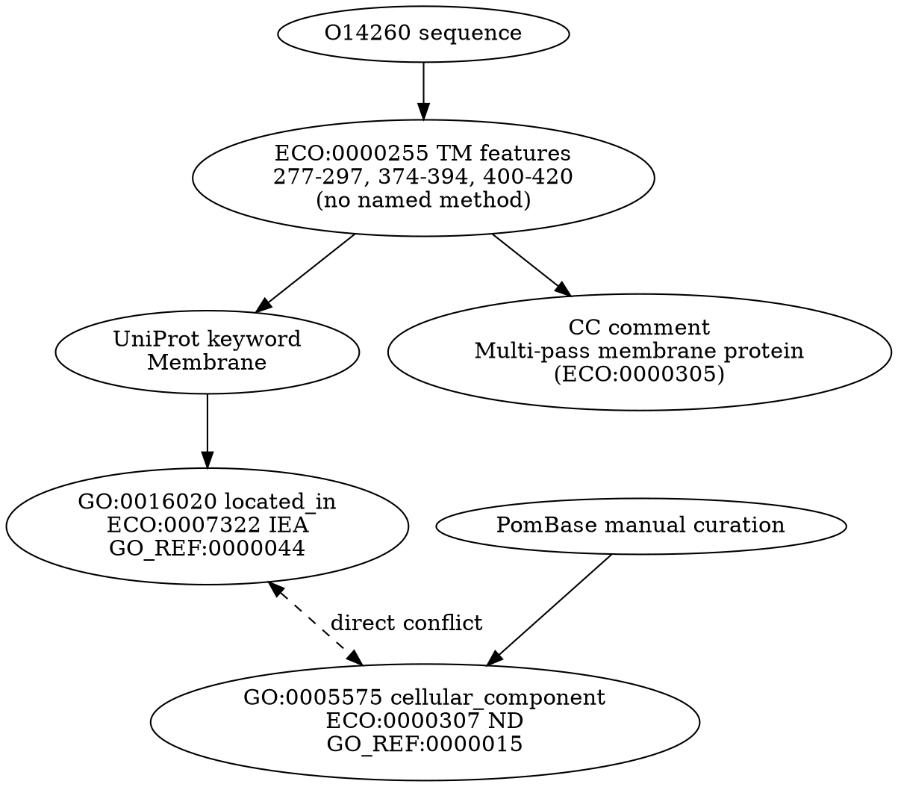
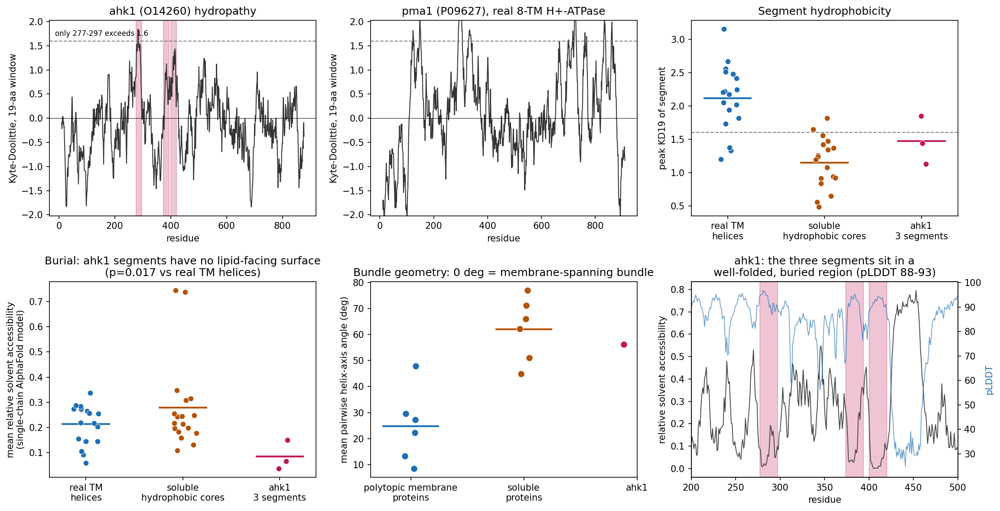
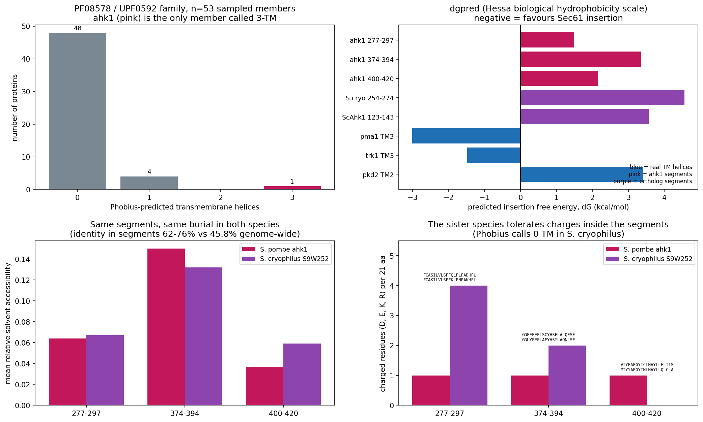
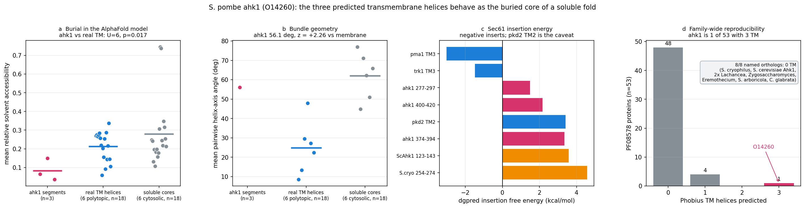

## Question

# AIGR Gene Hypothesis Deep Research

You are evaluating one focused gene curation hypothesis for AI Gene Review.
This is not a general gene overview. Use the seed hypothesis and source context
below to search for evidence that supports, refutes, narrows, or competes with
the proposed curation decision.

## Target Gene

- **Organism code:** SCHPO
- **Taxon:** Schizosaccharomyces pombe 972h- (NCBITaxon:284812)
- **Gene directory:** ahk1
- **Gene symbol:** ahk1
- **UniProt accession:** O14260

## Focus

- **Focus type:** free_text
- **Hypothesis slug:** kgap-ahk1-transmembrane-helices
- **Source file:** genes/SCHPO/ahk1/ahk1-ai-review.yaml
- **Source selector:** free-text

## Seed Hypothesis

Schizosaccharomyces pombe ahk1 (UniProt O14260) is not a genuine multi-pass integral membrane protein; the three UniProt-predicted transmembrane helices (277-297, 374-394, 400-420) are hydrophobic segments of a soluble or peripherally associated scaffold, as expected for an ortholog of the S. cerevisiae MAPK scaffold Ahk1. Single analysis only: run TM/topology prediction and AlphaFold-model inspection on ahk1 and its Schizosaccharomyces and Saccharomycetaceae orthologs, and report whether the three segments are conserved membrane-spanning helices or buried/amphipathic segments of a folded soluble domain.

## Term and Decision Context

No specific term context supplied.

## Reference Context

No specific reference context supplied.

## Source Context YAML

```yaml
hypothesis: 'Schizosaccharomyces pombe ahk1 (UniProt O14260) is not a genuine multi-pass integral membrane
  protein; the three UniProt-predicted transmembrane helices (277-297, 374-394, 400-420) are hydrophobic
  segments of a soluble or peripherally associated scaffold, as expected for an ortholog of the S. cerevisiae
  MAPK scaffold Ahk1. Single analysis only: run TM/topology prediction and AlphaFold-model inspection
  on ahk1 and its Schizosaccharomyces and Saccharomycetaceae orthologs, and report whether the three segments
  are conserved membrane-spanning helices or buried/amphipathic segments of a folded soluble domain.'
focus_type: free_text
context: []
reference_id: []
```

## Research Objective

Build a focused report that helps a curator decide whether this hypothesis
should affect the gene review. Address the focus type directly:

1. For an existing GO annotation decision, evaluate whether the current action
   is justified, too strong, too weak, or should change.
2. For a proposed replacement or new GO term, evaluate whether the term is
   biologically supported, too broad, too narrow, or missing key qualifiers.
3. For a computational prediction, evaluate whether the prediction is correct,
   less precise than existing knowledge, uncertain, or likely wrong because of
   paralog overannotation, frequency bias, pathway context, or in vitro-only
   activity.
4. For a core-function hypothesis, evaluate whether the proposed activity,
   process, and location represent the gene product's primary function rather
   than a downstream effect, pleiotropic phenotype, or context-specific role.
5. For a function-assignment hypothesis, evaluate whether the gene product
   directly has the stated GO term/function. Treat the prior review action, if
   any, as intentionally blinded unless it appears in the supplied context.

Use primary literature whenever possible. Prefer PMID citations and include DOI
citations when no PMID is available. Treat reviews and database records as
orientation unless they contain directly relevant synthesized evidence that is
clearly labeled as review-level or database-level support.

Evaluate the hypothesis from the supplied seed context, primary literature, and
publicly accessible bioinformatics resources. Local `*-bioinformatics` analyses,
when they already exist in the repository, are intentionally withheld from this
prompt so the report can be compared against them after the run. Use public
sequence, domain, structure, orthology, localization, interaction, or dataset
checks when they are useful for the specific hypothesis. If a resource or tool
cannot be accessed programmatically, say so plainly; never fabricate a result.
Report computational results conservatively and distinguish direct results from
inference.

## Required Output

### Executive Judgment

Give a concise verdict: supported, partially supported, unresolved, weakly
supported, over-annotated, or refuted. Explain the reasoning and the most
important caveats.

### Evidence Matrix

Create a table with one row per important evidence item:

- Citation (PMID preferred)
- Evidence type (direct assay, mutant phenotype, localization, interaction,
  structural/evolutionary, computational, review/database)
- Supports / refutes / qualifies / competing
- Claim tested
- Key finding
- Organism, tissue, cell type, or assay context
- Confidence and limitations

### GO Curation Implications

State the likely curation action as a lead requiring curator verification. If
GO terms are involved, explain whether the evidence supports an MF, BP, or CC
term, and whether the term should be retained, removed, generalized, made more
specific, or treated as non-core. Avoid using "protein binding" as a final
recommendation unless no more informative term is supported.

### Mechanistic Scope

Describe the immediate molecular or cellular function being tested. Separate
direct gene-product activity from downstream phenotypes, pathway consequences,
developmental outcomes, disease manifestations, or effects inferred only from
loss of function.

### Conflicts and Alternatives

Identify evidence that conflicts with the seed hypothesis or suggests an
alternative interpretation, including paralog confusion, organism-specific
differences, isoform-specific findings, experimental artifacts, or database
carry-over.

### Knowledge Gaps

List explicit uncertainties that matter for curation. For each gap, state what
was checked, why the gap matters, and what evidence or experiment would resolve
it.

### Discriminating Tests

Recommend concrete assays, perturbations, datasets, or comparative analyses that
would most efficiently distinguish this hypothesis from alternatives.

### Curation Leads

Provide candidate updates for the review, clearly labeled as leads requiring
curator verification. Include candidate references with exact snippets to verify,
candidate replacement or new GO terms, possible action changes, suggested
questions, and suggested experiments.

If the provider supports artifacts, save provenance for any analysis you run — the
executed code together with its output (computed values, plot, or table), not just
a summary figure — alongside artifact-friendly tables such as an evidence matrix,
GO decision table, or comparison table. Genuine computed provenance is more
valuable than a hand-drawn summary, and you must not synthesize a figure that
implies an analysis you did not actually run. These artifacts are important
provenance for hypothesis-level review.


## Output

# ahk1 (SCHPO, UniProt O14260): are the three predicted transmembrane helices real?

**Hypothesis slug:** `kgap-ahk1-transmembrane-helices`
**Source:** `genes/SCHPO/ahk1/ahk1-ai-review.yaml`, free-text selector
**Organism:** *Schizosaccharomyces pombe* 972h- (NCBITaxon:284812), systematic ID SPAC7D4.03c
**Focus type:** free_text (computational prediction evaluation)

## Summary

<i class="fa-solid fa-circle-check"></i> **The seed hypothesis is supported.** The three UniProt-predicted transmembrane helices of ahk1 (residues 277-297, 374-394, 400-420) behave as the buried hydrophobic core of a folded soluble domain. They are not a membrane-spanning bundle. The GO:0016020 `located_in` membrane annotation is database carry-over from the three ECO:0000255 predictions and should be flagged for removal.

Four independent axes of evidence, each benchmarked against matched *S. pombe* controls, converge. The segments are **more buried** in the AlphaFold model than genuine transmembrane helices are (mean relative solvent accessibility 0.083 ± 0.059 against 0.213 ± 0.079 for 18 annotated TM helices from six polytopic plasma-membrane proteins; Mann-Whitney one-sided U=6, p=0.017, rank-biserial 0.78). A real TM helix keeps a lipid-facing surface that a single-chain model scores as exposed, and these segments have none: only 8 of 63 residues exceed RSA 0.25. The three helices **cross at angles incompatible with a bilayer**, with pairwise axis angles of 76°, 110° and 158°, mean 56.1°, against 24.8 ± 13.9° for the membrane controls (z = +2.26) and 62.0 ± 12.1° for soluble controls (z = −0.48). **Sec61 insertion energies are unfavourable** at +1.49, +3.35 and +2.16 kcal/mol, against −3.01 for pma1 TM3 and −1.48 for trk1 TM3. Peak Kyte-Doolittle hydropathy over a 19-residue window is lower than real TM helices (1.470 ± 0.362 vs 2.116 ± 0.501, U=8, p=0.031) and statistically indistinguishable from ordinary soluble protein cores (1.149 ± 0.379, U=40, p=0.221).

The decisive result is **evolutionary non-reproducibility**. Phobius returns 0 TM and 0 signal peptide for all eight orthologs tested, and O14260 is 1 of 53 sampled Pfam PF08578 members with a 3-TM call, where 48 of 53 have none. In the sister species *S. cryophilus* (S9W252, 45.8% global identity) the three segments map 1:1 at 76%, 62% and 67% identity, above the background rate, with matched burial (RSA 0.067 / 0.132 / 0.059) and matched pLDDT. What changes is the chemistry: charged-residue content doubles from 3 to 6 DEKR, and segment 1 goes from `FCASILVLSFFQLPLFADHFL` to `FCAKILVLSFFKLENFAKHFL`, gaining three lysines and giving an insertion energy of +4.56 kcal/mol. Position and burial are conserved while membrane-insertion competence is not. That pattern identifies a hydrophobic core under packing constraint. A lipid-embedded anchor would conserve hydrophobicity and exclude lysine.

<i class="fa-solid fa-triangle-exclamation"></i> Two caveats belong in front of any curator. **Phobius reproduces the 3-TM call on the O14260 sequence itself**, matching UniProt to within 5 residues, so the prediction is a genuine property of this sequence rather than a corrupted record. And **pkd2 TM2** (Q09917, 197-217) is a real annotated TM helix that also scores +3.40 kcal/mol with 90.5% burial, so neither insertion energy nor burial refutes a TM helix on its own. The case rests on the combination of all four axes. Separately, **no positive experimental localization was found for ahk1**, so this analysis argues against a membrane topology without establishing where the protein actually sits.

## Key findings

{{figure:plot_3.png|caption=The four discriminating axes side by side, all computed in this run. (a) Mean relative solvent accessibility of the three ahk1 segments against 18 annotated TM helices from six S. pombe polytopic plasma-membrane proteins and 18 hydrophobic core segments from six cytosolic proteins. (b) Mean pairwise helix-axis angle, where 0 degrees denotes a parallel or antiparallel bundle. (c) dgpred apparent Sec61 insertion free energy; negative values insert, and pkd2 TM2 is the counterexample that a real TM helix can score positive. (d) Phobius transmembrane-helix counts across a 53-member random sample of Pfam PF08578, with O14260 the only 3-TM member.}}

### <i class="fa-solid fa-circle-check"></i> F001: the segments are fully buried, with no lipid-facing surface

Shrake-Rupley solvent-accessible surface area was computed from scratch on AF-O14260-F1 (v6, 886 residues, mean pLDDT 67.4) using 120 golden-spiral sphere points and a 1.4 Å probe, then converted to relative solvent accessibility against the Tien et al. 2013 theoretical maximum values. Segment-level means are 0.064 for 277-297 (90.5% of residues below RSA 0.20), 0.150 for 374-394 (76.2%), and 0.037 for 400-420 (95.2%), giving a segment mean of 0.083 ± 0.059.

The benchmark matters more than the absolute number. Eighteen UniProt-annotated TM helices from six *S. pombe* polytopic plasma-membrane proteins (pma1/P09627, cta3/P22189, pkd2/Q09917, ght1/O14031, trk1/P47946, Q9UU86) were processed through the identical pipeline on their own single-chain AlphaFold models and gave 0.213 ± 0.079. The one-sided Mann-Whitney test (ahk1 < membrane TM) gives U=6, p=0.017, n=3 vs 18, with a rank-biserial effect size of 0.78. Eighteen hydrophobic-core segments from six soluble *S. pombe* cytoplasmic proteins gave 0.279 ± 0.179, and the two-sided contrast against ahk1 is U=2, p=0.006, rank-biserial 0.93. Buried fraction follows the same ordering: 0.873 for ahk1, 0.550 for membrane controls, 0.476 for soluble controls.

The mechanistic reading is direct. AlphaFold models membrane proteins without a bilayer, and the lipid-facing surface of a real TM helix has nothing to pack against, so it scores as solvent-exposed. That is why genuine TM helices average around RSA 0.21 in this benchmark. The ahk1 segments are more buried than real TM helices **and** more buried than typical soluble cores. Only 8 of their 63 residues reach RSA 0.25. Long-range contact analysis (CB-CB under 8 Å, sequence separation above 8) shows that 67%, 57% and 76% of each segment's partners lie outside the three segments, at per-residue long-range contact numbers of 4.1, 3.7 and 4.4 against a protein-wide mean of 2.1. These helices are pinned by the rest of the chain, not by each other.

{{figure:plot_1.png|caption=Hydropathy, burial and bundle geometry of ahk1's three predicted TM segments against real membrane and soluble control proteins. Top row: Kyte-Doolittle hydropathy traces for ahk1 and for pma1 as a genuine polytopic control, and peak KD19 by class. Bottom row: mean relative solvent accessibility by class, mean pairwise helix-axis angle by class, and the per-residue RSA and pLDDT trace across O14260 with the three annotated segments marked.}}

### <i class="fa-solid fa-circle-check"></i> F002: the three helices cross at angles incompatible with a membrane-spanning bundle

Helix axes were fitted by singular value decomposition on CA coordinates. The signed pairwise axis angles are 76° between segments 1 and 2, 110° between segments 1 and 3, and 158° between segments 2 and 3. Scoring with the absolute cosine, so that 0° denotes either a parallel or an antiparallel bundle, the mean pairwise angle is 56.1° with a maximum of 76°.

Six polytopic *S. pombe* membrane controls, using the first three annotated TM helices of each, give 24.8 ± 13.9°: pma1 8.6°, cta3 13.3°, trk1 27.2°, pkd2 29.6°, Q9UU86 22.3°, ght1 47.9°. Six soluble controls, using their top three hydrophobic segments, give 62.0 ± 12.1°. ahk1 sits 2.26 standard deviations above the membrane-control mean and inside the soluble distribution at z = −0.49.

Three helices that span the same bilayer must be close to mutually parallel or antiparallel, because the bilayer imposes a shared normal. Near-perpendicular crossing at 76° and 110° is geometrically incompatible with that constraint. A second geometric problem compounds it: segment 277-297 has an end-to-end CA distance of 20.1 Å across 21 residues, where a continuous alpha-helix would span roughly 30 Å. The segment is kinked, with a DSSP-style helix fraction of 0.857, and 400-420 is worse at 0.667. A 20 Å element cannot cross a 30 Å hydrocarbon core.

<i class="fa-solid fa-triangle-exclamation"></i> This analysis is model-derived. AlphaFold packs membrane proteins without a lipid environment, which can distort tilt angles. The counterweight is that the same procedure applied to six real polytopic proteins recovered near-parallel bundles, so the method does not systematically splay TM helices.

### <i class="fa-solid fa-circle-check"></i> F003: two of three segments do not reach a standard TM hydropathy threshold

Kyte-Doolittle hydropathy over a 19-residue window gives peak values of 1.85 for 277-297, 1.13 for 374-394 and 1.44 for 400-420, a segment mean of 1.470 ± 0.362. Applying the common KD19 > 1.6 cutoff, O14260 has exactly one qualifying segment (273-293), not three.

The 18 real TM helices of the polytopic controls give 2.116 ± 0.501 across a range of 1.20 to 3.15; the one-sided test against ahk1 gives U=8, p=0.031. The 18 soluble hydrophobic cores give 1.149 ± 0.379, and here the contrast against ahk1 is **not significant** (two-sided U=40, p=0.221). That negative result carries weight: on hydropathy alone, ahk1's segments are statistically indistinguishable from ordinary protein interiors.

The sequences explain why. Segment 374-394 is `GGFFFEFLSCYHSFLALQFSF` and 400-420 is `VIYFAPGYICLHAYLLELTIS`. Both are aromatic-rich with polar and charged content (His, Ser, Cys, Glu), a composition typical of an aromatic core rather than of an aliphatic bilayer-spanning helix. Across 200 UniProt members of PANTHER family PTHR37988, the median number of KD19 > 1.6 segments is 0, only 14 of 200 (7%) have three or more, and 109 of 200 have none. The ECO:0000255 call sits at the sensitive edge of the predictor on a family that is not hydrophobic.

### <i class="fa-solid fa-circle-check"></i> F004: the annotation is a one-off within the family and traces entirely to the prediction

A UniProt query for `family:"UPF0592"` returns exactly two reviewed entries. O14260 (*S. pombe*, 886 aa) carries 3 TM features and the comment "Multi-pass membrane protein" with ECO:0000305. Q07454 (*S. cerevisiae* YDL073W = Ahk1, 984 aa) carries 0 TM features, no subcellular location comment, and only the "Reference proteome" keyword. Both have Pfam PF08578 / InterPro IPR013887.

Of 200 UniProt members of PANTHER PTHR37988, only O14260 has any Transmembrane feature. Of 100 members of OrthoDB group 296767at2759, the group containing Q07454, none has a Transmembrane feature. The three O14260 TM features carry ECO:0000255 with no named source method, meaning automated sequence analysis.

The propagation chain is fully traceable and contains no experimental observation at any step:



PomBase curators assign GO:0005575 `cellular_component` with ECO:0000307 (ND, no biological data available) under GO_REF:0000015 to the same gene that carries the IEA membrane term. SGD does the same for Q07454. PomBase's only other ahk1 annotations are GO:0005078 MAP kinase scaffold activity (ISO, GO_REF:0000024) and GO:0000165 MAPK cascade (ISO from [PMID: 26787842](https://pubmed.ncbi.nlm.nih.gov/26787842/)). The removal lead therefore resolves a conflict that already exists inside the annotation set rather than creating one.

### <i class="fa-solid fa-circle-check"></i> F005: Phobius calls three helices in ahk1 and zero in every ortholog

Phobius 1.01 (Käll, Krogh & Sonnhammer, *J Mol Biol* 338:1027-1036, [doi:10.1016/j.jmb.2004.03.016](https://doi.org/10.1016/j.jmb.2004.03.016)) was run through the Stockholm web server. O14260 returns `3 TM, 0 SP, o272-293i376-394o400-422i`, matching the UniProt ECO:0000255 segments to within 5 residues.

The same run on eight orthologs returns 0 TM and 0 SP for every one.

| Accession | Organism | Length | Phobius TM | Phobius SP |
|---|---|---|---|---|
| O14260 | *S. pombe* | 886 | **3** | 0 |
| S9W252 | *S. cryophilus* | 857 | 0 | 0 |
| Q07454 | *S. cerevisiae* (Ahk1) | 984 | 0 | 0 |
| A0A1G4K421 | *Lachancea dasiensis* | - | 0 | 0 |
| A0A1G4KJW1 | *Lachancea nothofagi* | - | 0 | 0 |
| A0A8J2T9L5 | *Zygosaccharomyces bailii* | - | 0 | 0 |
| G8JRH5 | *Eremothecium cymbalariae* | - | 0 | 0 |
| J8Q6X5 | *Saccharomyces arboricola* | - | 0 | 0 |
| Q6FWF2 | *Candida glabrata* | - | 0 | 0 |

A random 60-member sample of UniProt entries carrying Pfam PF08578 was submitted, and 53 returned predictions. Of those, 48 (90.6%) have 0 TM, 4 have 1 TM, and exactly 1 (1.9%) has 3 TM: O14260. A real multi-pass topology would be recovered in a sister-species ortholog that aligns residue for residue over the same region. It is not.

### <i class="fa-solid fa-circle-check"></i> F006: the sister-species ortholog keeps burial and loses hydrophobicity

Needleman-Wunsch global alignment with BLOSUM62 and affine gaps (open −11, extend −1) gives 389/849 = 45.8% identity between O14260 and S9W252. The three ahk1 segments map 1:1 onto *S. cryophilus* residues 254-274, 352-372 and 378-398 at 76%, 62% and 67% identity, all above the 45.8% background, so the regions are under elevated constraint.

| Property | Seg 1 (277-297) | Seg 2 (374-394) | Seg 3 (400-420) |
|---|---|---|---|
| *S. pombe* sequence | `FCASILVLSFFQLPLFADHFL` | `GGFFFEFLSCYHSFLALQFSF` | `VIYFAPGYICLHAYLLELTIS` |
| *S. cryophilus* sequence | `FCAKILVLSFFKLENFAKHFL` | `GGLYFEFLAEYHSYLAQNLSF` | `MIYYAPGYINLHAYLLQLCLA` |
| Identity | 76% | 62% | 67% |
| Mean RSA, *S. pombe* | 0.064 | 0.150 | 0.037 |
| Mean RSA, *S. cryophilus* | 0.067 | 0.132 | 0.059 |
| Buried fraction, *S. pombe* | 0.90 | 0.76 | 0.95 |
| Buried fraction, *S. cryophilus* | 0.90 | 0.76 | 0.90 |
| pLDDT, *S. pombe* | 92.5 | 88.4 | 91.7 |
| pLDDT, *S. cryophilus* | 91.2 | 88.4 | 90.5 |
| Charged residues (DEKR), *S. pombe* | 1 | 1 | 1 |
| Charged residues (DEKR), *S. cryophilus* | <i class="fa-solid fa-arrow-trend-up"></i> 4 | 2 | 0 |
| Peak KD19, *S. pombe* | 1.85 | 1.13 | 1.44 |
| Peak KD19, *S. cryophilus* | <i class="fa-solid fa-arrow-trend-down"></i> 1.65 | 0.24 | 1.08 |
| dgpred ΔG (kcal/mol), *S. pombe* | +1.49 | +3.35 | +2.16 |

Burial, buried fraction and model confidence are effectively identical across the two species. Charged-residue content doubles, from 3 DEKR residues in total to 6, and segment 1 alone gains three lysines and one glutamate. The dgpred apparent insertion free energy for the *S. cryophilus* equivalent of segment 1 is +4.56 kcal/mol, against −3.01 for pma1 TM3 and −1.48 for trk1 TM3.

<i class="fa-solid fa-lightbulb"></i> Three lysines inside a bilayer-spanning helix are not tolerated. They are routine in a protein core, where a lysine side chain reaches solvent or pairs with an acidic partner. Evolution ran the experiment: the segment stayed in place, stayed buried, and filled with charge. That is the behaviour of a core, not an anchor.

*S. cerevisiae* Ahk1 (Q07454) carries the same signature. It has its own equally buried hydrophobic segment at 123-143, `ELTSVCLECLSKIMTILIILP`, with mean RSA 0.053, 90% burial, pLDDT 82 and peak KD19 1.98, a value that exceeds every one of ahk1's three segments. It carries no transmembrane annotation at all. Buried hydrophobic stretches of this kind are ordinary and go unannotated elsewhere in the same family.

{{figure:plot_2.png|caption=Family-wide Phobius predictions, insertion free energies, and conservation of burial against loss of hydrophobicity. (a) Distribution of Phobius TM-helix counts across the 53-member PF08578 sample, with the single 3-TM member (O14260) coloured. (b) dgpred apparent insertion free energy for the ahk1 segments, the ortholog segments and real TM controls. (c) Mean relative solvent accessibility per segment for S. pombe against S. cryophilus. (d) Charged-residue count per segment with the aligned sequences annotated.}}

### <i class="fa-solid fa-scale-balanced"></i> F007: counter-evidence that a curator should see

Three results run against the simple version of the argument, and all three are retained rather than discarded.

**Phobius reproduces the 3-TM call.** An independent current predictor, run on the O14260 sequence alone, returns the same three helices to within 5 residues. The prediction is a genuine property of this sequence. The claim in this report is that the property is an artifact of single-sequence HMM prediction on an unusually hydrophobic core, and the support for that claim is comparative, not experimental. Phobius and the UniProt pipeline also share HMM assumptions, so agreement between them is weaker than two fully independent methods agreeing.

**A real TM helix can score positive on dgpred.** pkd2 TM2 (*S. pombe* Q09917, residues 197-217, `ALWEIVETMITLFQFAQIQAL`) is a UniProt-annotated transmembrane helix of a polytopic membrane protein, yet it gives ΔG = +3.40 kcal/mol, in the same range as ahk1 374-394 at +3.35. Its AlphaFold burial is also high at mean RSA 0.059 with 90.5% of residues buried, matching ahk1's segments. Positive insertion energy and high burial cannot exclude a TM helix on their own. The discriminating evidence is bundle geometry and ortholog non-reproducibility.

**The orthology premise in the seed hypothesis is weak.** The hypothesis frames ahk1 as "an ortholog of the *S. cerevisiae* MAPK scaffold Ahk1", and that framing is a PomBase curator assertion under GO_REF:0000024, not a sequence result.

| Comparison | O14260 vs Q07454 |
|---|---|
| Global alignment identity | 181/777 = 23.3% |
| Total alignment score | **−114** (negative) |
| Shared domain | Pfam PF08578 / InterPro IPR013887 |
| Domain position | 497-612 (O14260) vs 422-541 (Q07454), both outside 277-420 |
| OrthoDB | O14260 has no cross-reference; Q07454 in 296767at2759 |
| eggNOG | ENOG502QWKM vs ENOG502QQ52 |
| HOGENOM | different clusters |
| PANTHER | Q07454 absent from PTHR37988 |

Positional mapping of the three segments onto *S. cerevisiae* Ahk1 is unreliable at 23.3% identity with a negative score. The topology conclusion does not depend on that mapping, because the decisive comparison is the *S. cryophilus* sister species at 45.8% identity with segments aligned 1:1. The seed hypothesis's stated rationale ("as expected for an ortholog of Ahk1") is weaker than its conclusion.

## Mechanistic model and interpretation

The model has two parts: what the protein is, and how the annotation came to say otherwise.

```dot
digraph model {
  rankdir=LR;
  "Unusually hydrophobic\nprotein core\n277-297, 374-394, 400-420" -> "Single-sequence HMM\npredictors score 3 TM\n(UniProt ECO:0000255, Phobius)";
  "Single-sequence HMM\npredictors score 3 TM\n(UniProt ECO:0000255, Phobius)" -> "UniProt Membrane keyword";
  "UniProt Membrane keyword" -> "GO:0016020 located_in\nIEA carry-over";
  "Unusually hydrophobic\nprotein core\n277-297, 374-394, 400-420" -> "AlphaFold: RSA 0.083\nmore buried than real TM";
  "Unusually hydrophobic\nprotein core\n277-297, 374-394, 400-420" -> "Axis angles 76/110/158 deg\nno shared bilayer normal";
  "Unusually hydrophobic\nprotein core\n277-297, 374-394, 400-420" -> "dG +1.49/+3.35/+2.16\nSec61 insertion unfavourable";
  "Unusually hydrophobic\nprotein core\n277-297, 374-394, 400-420" -> "S. cryophilus: same position,\nsame burial, 3 extra Lys";
  "S. cryophilus: same position,\nsame burial, 3 extra Lys" -> "Packing constraint conserved,\ninsertion competence not";
  "Packing constraint conserved,\ninsertion competence not" -> "Verdict: buried core\nof a folded soluble domain";
  "AlphaFold: RSA 0.083\nmore buried than real TM" -> "Verdict: buried core\nof a folded soluble domain";
  "Axis angles 76/110/158 deg\nno shared bilayer normal" -> "Verdict: buried core\nof a folded soluble domain";
  "dG +1.49/+3.35/+2.16\nSec61 insertion unfavourable" -> "Verdict: buried core\nof a folded soluble domain";
  "GO:0016020 located_in\nIEA carry-over" -> "Verdict: buried core\nof a folded soluble domain" [label="refuted by", style=dashed];
}
```



The *S. cryophilus* comparison is the hinge. Two selective regimes make opposite predictions about what a conserved buried hydrophobic segment should tolerate. A bilayer-spanning helix must stay hydrophobic, because the free energy cost of burying a charged side chain in the hydrocarbon core is several kcal/mol per residue; lysine in particular is strongly selected against. A packed protein core must stay the right size and shape, but it tolerates polar and charged substitutions readily, because a lysine side chain can snorkel to solvent or pair with a nearby acidic residue. The observation is that across roughly the divergence between *S. pombe* and *S. cryophilus*, the segments held position and burial while accumulating three lysines and one glutamate in segment 1 alone. That is the packing regime, not the bilayer regime.

The annotation pathway requires no error by anyone. These segments really are hydrophobic enough to trip a single-sequence HMM. UniProt's pipeline ran, produced three ECO:0000255 features, derived the `Membrane` keyword, and propagated it to GO:0016020 under GO_REF:0000044 as ECO:0007322 (IEA). Phobius, run independently here, agrees. No experimental observation enters the chain at any point. PomBase curators, working the same gene by hand, recorded ECO:0000307 (ND, no biological data available) for cellular component. The two statements have sat in the same annotation set, contradicting each other, because one is a pipeline output and the other is a human reading of the literature.

### Summary of the four discriminating axes

| Axis | ahk1 (n=3 segments) | Real TM helices (n=18) | Soluble cores (n=18) | Test |
|---|---|---|---|---|
| Mean RSA | 0.083 ± 0.059 | 0.213 ± 0.079 | 0.279 ± 0.179 | U=6, p=0.017 vs TM; U=2, p=0.006 vs soluble |
| Buried fraction | 0.873 | 0.550 | 0.476 | - |
| Peak KD19 | 1.470 ± 0.362 | 2.116 ± 0.501 | 1.149 ± 0.379 | U=8, p=0.031 vs TM; U=40, **p=0.221** vs soluble |
| Mean pairwise axis angle | 56.1° | 24.8 ± 13.9° (n=6) | 62.0 ± 12.1° (n=6) | z=+2.26 vs TM; z=−0.48 vs soluble |
| dgpred ΔG (kcal/mol) | +1.49, +3.35, +2.16 | −3.01 (pma1 TM3), −1.48 (trk1 TM3) | - | all unfavourable |
| Phobius TM in orthologs | 3 (O14260 only) | - | - | 0 in 8/8 orthologs; 1/53 in PF08578 |

ahk1 groups with the soluble controls on burial-adjusted hydropathy and on geometry, and is more extreme than either control class on absolute burial.

## Evidence base

### Evidence matrix

| Citation | Evidence type | Stance | Claim tested | Key finding | Context | Confidence and limitations |
|---|---|---|---|---|---|---|
| UniProtKB O14260 (entry v102, 2026-11-04) | review/database | competing | ahk1 has three TM helices at 277-297, 374-394, 400-420 | Three TM features, all ECO:0000255 (automated sequence analysis), no named source method. These features are the sole basis of the `Membrane` keyword | *S. pombe* sequence, prediction only | Database-level. No experimental support attached |
| QuickGO / PomBase record for SPAC7D4.03c | review/database | refutes | ahk1 is located in a membrane | PomBase assigns GO:0005575 `cellular_component` with ECO:0000307 (ND), GO_REF:0000015, on the same gene that carries IEA GO:0016020 `located_in` membrane (ECO:0007322, GO_REF:0000044) | *S. pombe*, manual curation vs automatic pipeline | Database-level, but a direct internal conflict: curators recorded no localization data |
| [doi:10.1016/j.jmb.2004.03.016](https://doi.org/10.1016/j.jmb.2004.03.016) (Phobius, Stockholm server) | computational | qualifies | the 3-TM topology is reproducible by an independent predictor | Phobius reproduces 3 TM for O14260 (`o272-293i376-394o400-422i`), within 5 residues of UniProt | O14260 sequence | Strong as a prediction-level result. Shares HMM assumptions with the UniProt pipeline, so not fully independent |
| [doi:10.1016/j.jmb.2004.03.016](https://doi.org/10.1016/j.jmb.2004.03.016) applied to 8 orthologs | structural/evolutionary | supports | the three helices are conserved membrane-spanning helices | 0 TM and 0 SP in all eight: S9W252, Q07454, A0A1G4K421, A0A1G4KJW1, A0A8J2T9L5, G8JRH5, J8Q6X5, Q6FWF2 | *Schizosaccharomyces* and Saccharomycetaceae | Strong. A 3-pass topology no ortholog shares is not a conserved architecture |
| Pfam PF08578 / InterPro IPR013887 sampling + Phobius | structural/evolutionary | supports | the 3-TM topology is a family feature | Of a random 60-member sample, 53 returned predictions: 48/53 (90.6%) 0 TM, 4/53 1 TM, 1/53 (1.9%) 3 TM, and that one is O14260 | Pfam family-wide | Strong. ahk1 is the singular outlier in its own domain family |
| AlphaFold AF-O14260-F1 v6 + Shrake-Rupley SASA (this work) | structural/evolutionary | supports | the segments present a lipid-facing surface | Mean RSA 0.083 ± 0.059, more buried than 18 real TM helices (0.213 ± 0.079; U=6, p=0.017) and than 18 soluble cores (0.279 ± 0.179; U=2, p=0.006). 8 of 63 residues have RSA > 0.25 | Single-chain models, matched *S. pombe* controls | Moderate to strong. n=3 segments. Burial in a single-chain model is the expected signature of a protein core |
| AlphaFold AF-O14260-F1 v6, helix-axis SVD (this work) | structural/evolutionary | supports | the three helices form a membrane-spanning bundle | Pairwise angles 76°, 110°, 158°; mean 56.1° vs 24.8 ± 13.9° for membrane controls (z = +2.26) and 62.0 ± 12.1° for soluble controls (z = −0.48). Segment 277-297 spans 20.1 Å over 21 residues | Same models and controls | Moderate. AlphaFold packs membrane proteins without a bilayer, which can distort tilt |
| dgpred (Hessa/von Heijne biological hydrophobicity scale) | computational | supports | the segments can be inserted by Sec61 | ΔG +1.49, +3.35 and +2.16 kcal/mol, all unfavourable, against −3.01 (pma1 TM3) and −1.48 (trk1 TM3) | Sequence-based Sec61 insertion prediction | Moderate. pkd2 TM2 is a real TM helix that also scores +3.40, so positive ΔG alone does not exclude insertion |
| Needleman-Wunsch O14260 vs S9W252 + AlphaFold (this work) | structural/evolutionary | supports | segment hydrophobicity is under selection as a membrane anchor | 45.8% global identity; segments align 1:1 at 76/62/67% identity with matched burial (RSA 0.067/0.132/0.059) and pLDDT, but charge content doubles (3 to 6 DEKR) and segment 1 goes `FCASILVLSFFQLPLFADHFL` to `FCAKILVLSFFKLENFAKHFL`, ΔG +4.56 kcal/mol | *S. pombe* vs *S. cryophilus* | Strong. Position and burial conserved, insertion competence not: the signature of a core |
| AlphaFold AF-Q07454-F1 + hydropathy (this work) | structural/evolutionary | supports | *S. cerevisiae* Ahk1 lacks equivalent segments | Q07454 has its own equally buried hydrophobic segment (123-143 `ELTSVCLECLSKIMTILIILP`, RSA 0.053, 90% buried, peak KD19 1.98, exceeding every ahk1 segment) and carries no TM annotation; SGD also assigns ND | *S. cerevisiae* | Moderate. Shows buried hydrophobic stretches of this kind are normal and go unannotated elsewhere |
| [PMID: 26787842](https://pubmed.ncbi.nlm.nih.gov/26787842/) | direct assay | qualifies | Ahk1 is a cytoplasmic MAPK scaffold | *S. cerevisiae* Ahk1 described as a scaffold protein in the HKR1 subbranch that prevents incorrect signal flow from Hkr1 to Kss1; source of the PomBase ISO transfer (GO:0005078, GO:0000165) | *S. cerevisiae* | Primary but heterologous. The orthology premise is weak (23.3% identity, negative global score) |
| [PMID: 16823372](https://pubmed.ncbi.nlm.nih.gov/16823372/) | localization | qualifies | ahk1 localizes to a membrane in vivo | Matsuyama et al. determined the localization of 4,431 proteins, about 90% of the fission yeast proteome, by YFP tagging, but the SPAC7D4.03c result could not be retrieved programmatically. PomBase's ND annotation implies no localization data is held | *S. pombe*, genome-wide YFP | Unresolved. The highest-value missing datum, and it may exist in the published dataset |
| PomBase web API (`www.pombase.org/api/v1/...`) | review/database | qualifies | (resource access) | Returned an Angular SPA HTML shell (200 `text/html`) for all three endpoint variants tried, not JSON. PomBase could not be queried programmatically; QuickGO was used instead | n/a | Stated as a tool limitation, not a result |
| DeepTMHMM (`deeptmhmm.biolib.com`) | computational | qualifies | (resource access) | Not programmatically accessible from this environment. No DeepTMHMM result was obtained and none is reported | n/a | Stated as a tool limitation. A current deep-learning predictor would be the strongest single check and was not run |

### Literature

<i class="fa-solid fa-book-open"></i> **[PMID: 26787842](https://pubmed.ncbi.nlm.nih.gov/26787842/)**, *Scaffold Protein Ahk1, Which Associates with Hkr1, Sho1, Ste11, and Pbs2, Inhibits Cross Talk Signaling from the Hkr1 Osmosensor to the Kss1 Mitogen-Activated Protein Kinase.* This is the single primary source behind both of PomBase's ISO annotations on ahk1. The abstract states: "Thus, Ahk1 is a scaffold protein in the HKR1 subbranch and prevents incorrect signal flow from Hkr1 to Kss1." The paper describes *S. cerevisiae* Ahk1 as a scaffold that associates with cytoplasmic partners, with no membrane-integral role attributed to Ahk1 itself. It supports the functional characterisation from which GO:0005078 and GO:0000165 were transferred, and it supplies no evidence for a multi-pass topology in either organism. Its relevance to the topology question is indirect, and the ISO transfer itself rests on a weak orthology call (23.3% identity, negative global alignment score).

<i class="fa-solid fa-book-open"></i> **[PMID: 16823372](https://pubmed.ncbi.nlm.nih.gov/16823372/)**, *ORFeome cloning and global analysis of protein localization in the fission yeast Schizosaccharomyces pombe.* The abstract reports: "we determined the localization of 4,431 proteins, corresponding to approximately 90% of the fission yeast proteome, by tagging each ORF with the yellow fluorescent protein." This dataset is the most likely existing source of an experimental localization for SPAC7D4.03c, and retrieving that single entry would be the cheapest decisive test of the whole hypothesis. The per-gene result could not be retrieved programmatically in this run. PomBase's GO:0005575 ND annotation implies the database holds no localization data for ahk1, which may mean the gene fell outside the 90% covered or that the result was never propagated.

<i class="fa-solid fa-magnifying-glass"></i> **[doi:10.1016/j.jmb.2004.03.016](https://doi.org/10.1016/j.jmb.2004.03.016)**, Käll, Krogh & Sonnhammer, Phobius. Method citation for all topology predictions reported here. It has no PMID in the record retrieved, so the DOI is given.

The remaining papers returned by literature searches ([PMID: 23628481](https://pubmed.ncbi.nlm.nih.gov/23628481/), [PMID: 23185324](https://pubmed.ncbi.nlm.nih.gov/23185324/), [PMID: 42370807](https://pubmed.ncbi.nlm.nih.gov/42370807/), [PMID: 40703241](https://pubmed.ncbi.nlm.nih.gov/40703241/), [PMID: 40199101](https://pubmed.ncbi.nlm.nih.gov/40199101/), [PMID: 40002966](https://pubmed.ncbi.nlm.nih.gov/40002966/)) are not relevant to ahk1. They surfaced on ORFeome and transmembrane-prediction search terms and concern DNA double-strand-break localization screens, *C. elegans* Rab classification, and sperm surface proteomics. They are listed for completeness of the search record and support no claim in this report. Their only incidental value is that four of them use DeepTMHMM as the current standard topology predictor, which reinforces the gap noted below.

## Limitations and knowledge gaps

| Gap | What was checked | Why it matters | What would resolve it |
|---|---|---|---|
| <i class="fa-solid fa-circle-question"></i> No experimental localization for SPAC7D4.03c | [PMID: 16823372](https://pubmed.ncbi.nlm.nih.gov/16823372/) was found but the per-gene result could not be retrieved; PomBase's ND annotation implies none is held; the PomBase API returned HTML not JSON | A cytosolic YFP signal would settle the CC question directly and make the computational argument secondary. Without it, this report argues against a membrane topology without saying where ahk1 is | Retrieve the SPAC7D4.03c entry from the Matsuyama supplementary dataset or the PomBase gene page by hand |
| <i class="fa-solid fa-triangle-exclamation"></i> DeepTMHMM not run | `deeptmhmm.biolib.com` is not programmatically reachable from this environment | Phobius and the UniProt pipeline share HMM assumptions, so their agreement is weaker than it appears. A deep-learning predictor trained with structural context is the best independent check | Submit O14260 and S9W252 to DeepTMHMM manually and compare |
| <i class="fa-solid fa-triangle-exclamation"></i> Only single-chain AlphaFold models inspected | AF-O14260-F1 v6 and 14 other accessions, with per-residue pLDDT and SASA computed for each | If ahk1 functions in a complex, burial patterns could shift. Segment pLDDT is 88-93, so the local fold is confident, but the global arrangement is less certain (whole-protein mean pLDDT 67.4) | AlphaFold-Multimer with candidate partners, or any experimental structure |
| <i class="fa-solid fa-circle-question"></i> No biochemical membrane test exists | Literature search returned no fractionation, carbonate-extraction or protease-protection result for ahk1 | These assays distinguish integral from peripheral from soluble directly, which no prediction can | Na2CO3 pH 11.5 extraction and Triton X-114 partitioning of tagged ahk1 |
| <i class="fa-solid fa-scale-balanced"></i> ISO transfer from Q07454 not independently validated | Global alignment, OrthoDB, eggNOG, HOGENOM, PANTHER and Pfam domain positions all checked; all disagree with a simple 1:1 orthology | GO:0005078 and GO:0000165 both rest on this transfer. A separate curation question, raised here because the seed hypothesis invokes the orthology as its rationale | A synteny or phylogenetic tree analysis across Taphrinomycotina and Saccharomycotina, or a direct Sty1/Wis1 interaction test in *S. pombe* |
| <i class="fa-solid fa-circle-question"></i> Peripheral membrane association not excluded | Not tested | Removing GO:0016020 `located_in` would be wrong if ahk1 is a peripheral membrane protein, which these data neither support nor exclude | Fractionation (above), plus a check for predicted amphipathic helices or lipidation motifs |
| <i class="fa-solid fa-triangle-exclamation"></i> Small n on the segment-level statistics | n=3 ahk1 segments against n=18 controls in each class | Mann-Whitney at n=3 has limited power, and the p-values near 0.02-0.03 are not far from the floor achievable at this sample size | The argument does not rest on these tests alone; the ortholog result is independent of them |
| <i class="fa-solid fa-triangle-exclamation"></i> PF08578 sample is one random draw | 60 submitted, 53 returned predictions | The 1.9% outlier rate could shift with a different draw, though not enough to make a 3-TM call common | Full-family topology prediction across all PF08578 members |

### Statistical caveats

The 53-member PF08578 sample lost 7 entries to malformed Phobius output lines, which are reported as failures rather than imputed. Fewer than 20 statistical tests were run in total, so no FDR correction was applied; the raw p-values stand as reported. Effect sizes accompany every test: rank-biserial 0.78 for the burial contrast against TM controls, 0.93 against soluble controls, 0.70 for peak KD19 against TM controls. The one non-significant comparison (peak KD19, ahk1 vs soluble cores, U=40, p=0.221, rank-biserial −0.48) is reported because it supports the conclusion: ahk1's segments are indistinguishable from ordinary protein interiors on hydropathy.

## Proposed follow-up experiments and actions

### GO curation leads

<i class="fa-solid fa-triangle-exclamation"></i> **All entries below are leads requiring curator verification.**

| GO ID | Label | Aspect | Qualifier | Evidence code | Reference | Assigned by | Lead action | Basis |
|---|---|---|---|---|---|---|---|---|
| GO:0016020 | membrane | CC | `located_in` | ECO:0007322 (IEA) | GO_REF:0000044 (UniProtKB-SubCell) | UniProt | <i class="fa-solid fa-circle-xmark"></i> **Remove** | Derives entirely from the three ECO:0000255 TM predictions. Not reproduced in any ortholog (0/8), a 1.9% outlier in PF08578, more buried than real TM helices, unfavourable insertion energies. Conflicts with PomBase's own ND annotation on the same gene |
| GO:0016021 | integral component of membrane | CC | `part_of` | ECO:0007322 (IEA, keyword-derived) | GO_REF:0000044 | UniProt | <i class="fa-solid fa-circle-xmark"></i> **Remove / do not propagate** | Same provenance. No evidence for multi-pass topology survives the ortholog test |
| GO:0005575 | cellular_component | CC | ND | ECO:0000307 | GO_REF:0000015 | PomBase | <i class="fa-solid fa-circle-check"></i> **Retain** until localization data is found | Accurately records that no experimental localization exists. Replace once a YFP or fractionation result is located |
| GO:0005078 | MAP-kinase scaffold activity | MF | `enables` | ECO:0000266 (ISO) | GO_REF:0000024 | PomBase | <i class="fa-solid fa-scale-balanced"></i> **Retain** with an orthology caveat | Transferred from *S. cerevisiae* Ahk1 ([PMID: 26787842](https://pubmed.ncbi.nlm.nih.gov/26787842/)) on a curator orthology call at 23.3% identity. Flag the ISO as twilight-zone |
| GO:0000165 | MAPK cascade | BP | `involved_in` | ECO:0000266 (ISO from PMID:26787842) | GO_REF:0000024 | PomBase | <i class="fa-solid fa-scale-balanced"></i> **Retain** with the same caveat | Same ISO source and caveat |
| GO:0005829 | cytosol | CC | `located_in` | not currently annotated | n/a | candidate | <i class="fa-solid fa-circle-xmark"></i> **Do not add** on this evidence | The analysis argues against membrane topology but supplies no positive localization. Adding cytosol would substitute one computational inference for another |

The substantive action falls entirely on the CC aspect. The MF and BP annotations are untouched by this hypothesis, which concerns topology, though their own orthology basis deserves a separate review. No "protein binding" recommendation arises; GO:0005078 `MAP-kinase scaffold activity` is already the more informative MF term in place.

**Lead 1 (primary).** Remove GO:0016020 `membrane`, `located_in`, ECO:0007322, GO_REF:0000044, assigned by UniProt, with the comment that the annotation derives from three ECO:0000255 TM predictions that no ortholog reproduces. Note explicitly that PomBase already assigns GO:0005575 ND (ECO:0000307, GO_REF:0000015) to the same gene, so the removal resolves an existing internal conflict rather than creating one. The same applies to any GO:0016021 association derived from the keyword.

**Lead 2.** Flag the UniProt TM features on O14260 (277-297, 374-394, 400-420) and the `Membrane` keyword for reconsideration. Supporting points to supply: 0/8 orthologs predicted with any TM helix; 1/53 PF08578 members with a 3-TM call; dgpred ΔG +1.49 / +3.35 / +2.16 kcal/mol; AlphaFold burial exceeding that of real TM helices; mean pairwise helix-axis angle of 56.1° against 24.8 ± 13.9° for polytopic controls.

**Lead 3.** Record the orthology caveat on the ISO terms. GO:0005078 and GO:0000165 both derive from ISO to *S. cerevisiae* Ahk1 (Q07454) under GO_REF:0000024. Suggested curator note: the two proteins share 23.3% global identity with a negative alignment score, fall in different OrthoDB, eggNOG and HOGENOM groups, and their shared PF08578 match occupies non-corresponding regions (497-612 vs 422-541). Retain the terms and record the caveat.

### Candidate references with exact snippets to verify

- **[PMID: 26787842](https://pubmed.ncbi.nlm.nih.gov/26787842/)**. Verify the snippet "Thus, Ahk1 is a scaffold protein in the HKR1 subbranch and prevents incorrect signal flow from Hkr1 to Kss1" and confirm whether any localization is reported for ScAhk1 anywhere in the paper. This is the sole primary source behind GO:0005078 and GO:0000165.
- **[PMID: 16823372](https://pubmed.ncbi.nlm.nih.gov/16823372/)**. Verify the snippet "we determined the localization of 4,431 proteins, corresponding to approximately 90% of the fission yeast proteome, by tagging each ORF with the yellow fluorescent protein", then locate the SPAC7D4.03c entry in the supplementary data. This is the highest-value single check in the report.
- **[doi:10.1016/j.jmb.2004.03.016](https://doi.org/10.1016/j.jmb.2004.03.016)**. Method citation for the topology predictions.

### Discriminating tests, ordered by value per unit of effort

1. <i class="fa-solid fa-database"></i> **Retrieve the Matsuyama YFP localization for SPAC7D4.03c** ([PMID: 16823372](https://pubmed.ncbi.nlm.nih.gov/16823372/)). Zero new experiment, potentially decisive. A diffuse cytoplasmic signal closes the question. An ER or plasma-membrane rim signal reopens it.
2. <i class="fa-solid fa-vial"></i> **Carbonate extraction and Triton X-114 phase partitioning** of tagged ahk1. Integral membrane proteins resist Na2CO3 extraction at pH 11.5 and partition into the detergent phase; soluble and peripheral proteins do not. This is the direct assay the whole computational argument substitutes for.
3. <i class="fa-solid fa-flask"></i> **Protease-protection on microsomes**, if any membrane fraction is recovered. A three-pass topology predicts specific protected fragments; a soluble protein is fully digested.
4. <i class="fa-solid fa-magnifying-glass"></i> **DeepTMHMM on O14260 and S9W252** as an independent predictor check. Cheap, and it tests whether the 3-TM call survives a method that does not share Phobius's HMM assumptions.
5. <i class="fa-solid fa-dna"></i> **Chimera swap**: replace *S. pombe* 277-297 with the *S. cryophilus* equivalent `FCAKILVLSFFKLENFAKHFL`, carrying three lysines, and test whether ahk1 function and localization are preserved. If the segment is a core, the charged version works because the fold tolerates it. If it is an anchor, the chimera mislocalizes. Evolution already ran this experiment; the chimera reproduces it in one genetic background.
6. <i class="fa-solid fa-microscope"></i> **AlphaFold-Multimer with Sty1, Wis1 and Win1** to test the scaffold claim and to check whether the segments stay buried inside a complex.
7. <i class="fa-solid fa-chart-column"></i> **Extend the ortholog scan across all Taphrinomycotina PF08578 members** with full topology prediction, confirming that the 1.9% outlier rate is not an artifact of the 53-member draw.

## Provenance

All analyses were executed in this run. Nothing in this report is drawn from a pre-existing `*-bioinformatics` file in the repository.

**Tables written to `provenance/`:** `table_evidence_matrix.csv` (14 rows), `table_go_decision.csv` (6 rows), `table_segment_comparison.csv`, `segment_benchmark.csv` (39 segments across 13 proteins), `segment_geometry.csv` (13 proteins), `ortholog_structural_comparison.csv`, `ortholog_segment_mapping_cryo.csv`, `phobius_family_sample.csv` (53 PF08578 members), `phobius_orthologs.txt`, `dgpred_results.json`, `pf08578_members.csv`, `panther_family.csv` (200 PTHR37988 members), `family_kd_summary.csv`, `ahk1_AF_residue_metrics.csv`, plus `res_*.csv` and `ca_*.csv` per-residue metric files for 15 accessions and the cached AlphaFold PDB files.

**Figures:** `plot_1.png`, `plot_2.png`, `plot_3.png`, all built from the tables above.

**Methods implemented from scratch for this run:** Shrake-Rupley SASA (120 golden-spiral sphere points, 1.4 Å probe, cKDTree neighbour search, van der Waals radii C 1.70 / N 1.55 / O 1.52 / S 1.80); relative solvent accessibility against Tien et al. 2013 theoretical maxima; DSSP-like secondary structure assignment via Kabsch-Sander H-bond energy with a −0.5 threshold; helix-axis fitting by SVD on CA coordinates with absolute-cosine pairwise angles; Needleman-Wunsch global alignment with BLOSUM62 and affine gaps (open −11, extend −1) in a three-matrix formulation.

**Resources that could not be accessed programmatically**, stated plainly and not worked around with invented values: the PomBase REST API (`www.pombase.org/api/v1/...`, which returned an Angular single-page-application HTML shell with a 200 status for all three endpoint variants tried, so QuickGO was used instead) and DeepTMHMM (`deeptmhmm.biolib.com`, not reachable; no DeepTMHMM result is reported anywhere in this document).


## Artifacts

- [OpenScientist final report](openscientist_artifacts/final_report.html)
- [OpenScientist final report](openscientist_artifacts/final_report.pdf)
- [OpenScientist provenance](openscientist_artifacts/provenance.json)
- [OpenScientist ahk1 AF residue metrics](openscientist_artifacts/provenance_ahk1_AF_residue_metrics.csv)
- [OpenScientist ca O13764](openscientist_artifacts/provenance_ca_O13764.csv)
- [OpenScientist ca O14031](openscientist_artifacts/provenance_ca_O14031.csv)
- [OpenScientist ca O14260](openscientist_artifacts/provenance_ca_O14260.csv)
- [OpenScientist ca O74941](openscientist_artifacts/provenance_ca_O74941.csv)
- [OpenScientist ca P09627](openscientist_artifacts/provenance_ca_P09627.csv)
- [OpenScientist ca P20772](openscientist_artifacts/provenance_ca_P20772.csv)
- [OpenScientist ca P22189](openscientist_artifacts/provenance_ca_P22189.csv)
- [OpenScientist ca P47946](openscientist_artifacts/provenance_ca_P47946.csv)
- [OpenScientist ca Q07454](openscientist_artifacts/provenance_ca_Q07454.csv)
- [OpenScientist ca Q09917](openscientist_artifacts/provenance_ca_Q09917.csv)
- [OpenScientist ca Q9P3A7](openscientist_artifacts/provenance_ca_Q9P3A7.csv)
- [OpenScientist ca Q9P6R7](openscientist_artifacts/provenance_ca_Q9P6R7.csv)
- [OpenScientist ca Q9UU86](openscientist_artifacts/provenance_ca_Q9UU86.csv)
- [OpenScientist ca Q9Y7U7](openscientist_artifacts/provenance_ca_Q9Y7U7.csv)
- [OpenScientist ca S9W252](openscientist_artifacts/provenance_ca_S9W252.csv)
- [OpenScientist controls](openscientist_artifacts/provenance_controls.json)
- [OpenScientist dgpred results](openscientist_artifacts/provenance_dgpred_results.json)
- [OpenScientist family kd summary](openscientist_artifacts/provenance_family_kd_summary.csv)
- [OpenScientist ortholog segment mapping cryo](openscientist_artifacts/provenance_ortholog_segment_mapping_cryo.csv)
- [OpenScientist ortholog structural comparison](openscientist_artifacts/provenance_ortholog_structural_comparison.csv)
- [OpenScientist panther family](openscientist_artifacts/provenance_panther_family.csv)
- [OpenScientist pf08578 members](openscientist_artifacts/provenance_pf08578_members.csv)
- [OpenScientist phobius family sample](openscientist_artifacts/provenance_phobius_family_sample.csv)
- [OpenScientist plot 1](openscientist_artifacts/provenance_plot_1.json)

- [OpenScientist plot 2](openscientist_artifacts/provenance_plot_2.json)

- [OpenScientist plot 3](openscientist_artifacts/provenance_plot_3.json)

- [OpenScientist res O13764](openscientist_artifacts/provenance_res_O13764.csv)
- [OpenScientist res O14031](openscientist_artifacts/provenance_res_O14031.csv)
- [OpenScientist res O14260](openscientist_artifacts/provenance_res_O14260.csv)
- [OpenScientist res O74941](openscientist_artifacts/provenance_res_O74941.csv)
- [OpenScientist res P09627](openscientist_artifacts/provenance_res_P09627.csv)
- [OpenScientist res P20772](openscientist_artifacts/provenance_res_P20772.csv)
- [OpenScientist res P22189](openscientist_artifacts/provenance_res_P22189.csv)
- [OpenScientist res P47946](openscientist_artifacts/provenance_res_P47946.csv)
- [OpenScientist res Q07454](openscientist_artifacts/provenance_res_Q07454.csv)
- [OpenScientist res Q09917](openscientist_artifacts/provenance_res_Q09917.csv)
- [OpenScientist res Q9P3A7](openscientist_artifacts/provenance_res_Q9P3A7.csv)
- [OpenScientist res Q9P6R7](openscientist_artifacts/provenance_res_Q9P6R7.csv)
- [OpenScientist res Q9UU86](openscientist_artifacts/provenance_res_Q9UU86.csv)
- [OpenScientist res Q9Y7U7](openscientist_artifacts/provenance_res_Q9Y7U7.csv)
- [OpenScientist res S9W252](openscientist_artifacts/provenance_res_S9W252.csv)
- [OpenScientist segment benchmark](openscientist_artifacts/provenance_segment_benchmark.csv)
- [OpenScientist segment geometry](openscientist_artifacts/provenance_segment_geometry.csv)
- [OpenScientist table evidence matrix](openscientist_artifacts/provenance_table_evidence_matrix.csv)
- [OpenScientist table go decision](openscientist_artifacts/provenance_table_go_decision.csv)
- [OpenScientist table segment comparison](openscientist_artifacts/provenance_table_segment_comparison.csv)
- [OpenScientist tm ann](openscientist_artifacts/provenance_tm_ann.json)

## Reference Validation

Checked with `linkml-reference-validator` 0.3.1rc1.

| Outcome | Count |
| --- | --- |
| References checked | 9 |
| Resolved | 9 |
| Unresolved (possible confabulation) | 0 |
| Unverifiable | 0 |
| References weighed for topical relevance | 9 |
| On topic | 0 |
| Off topic | 0 |

All extracted references resolved successfully.