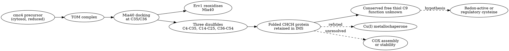
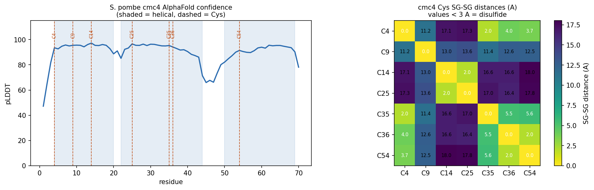
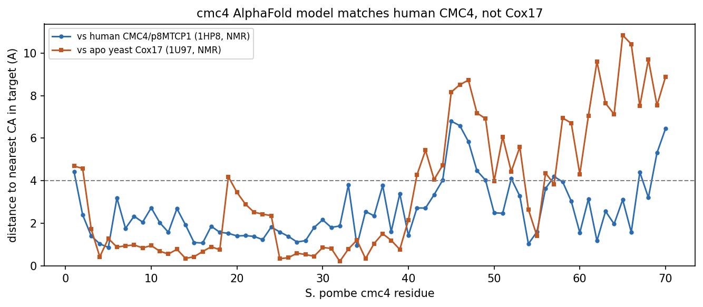
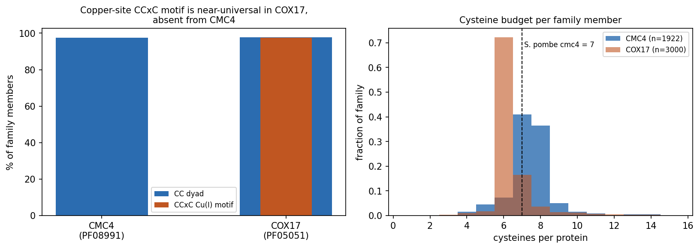
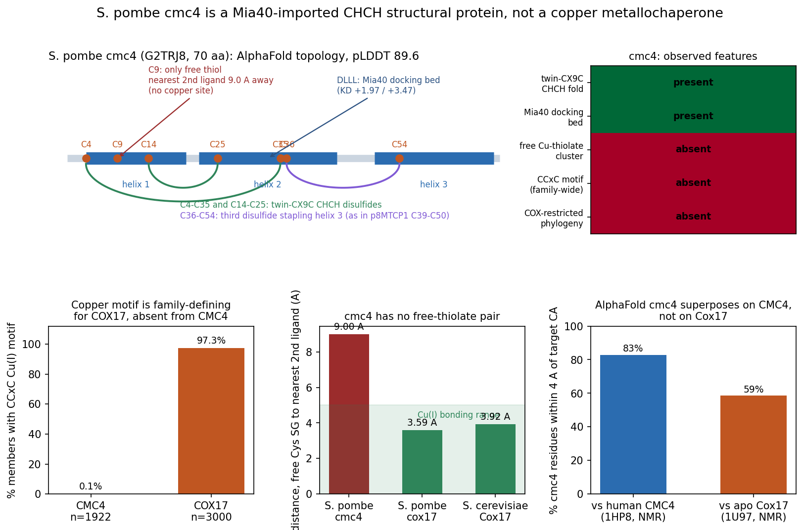
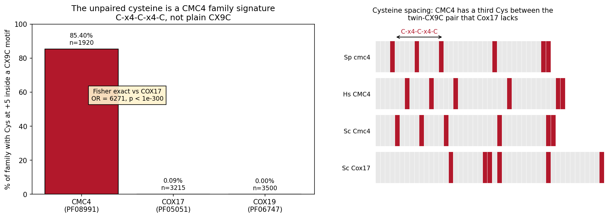
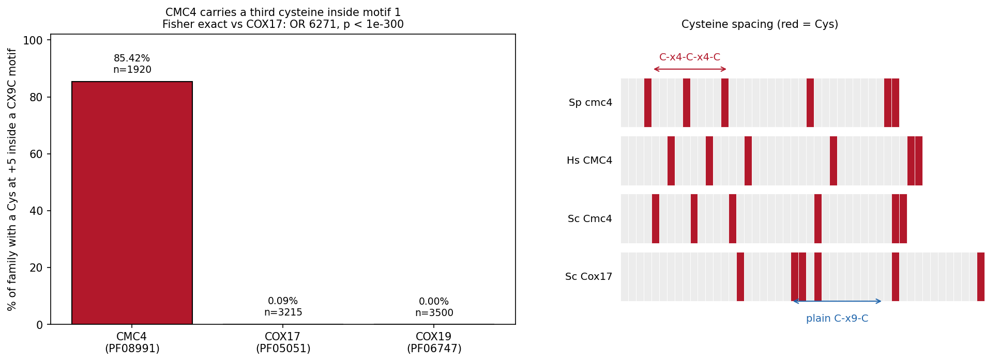
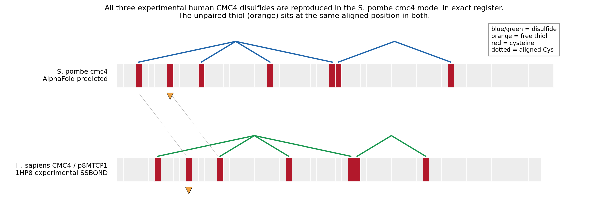
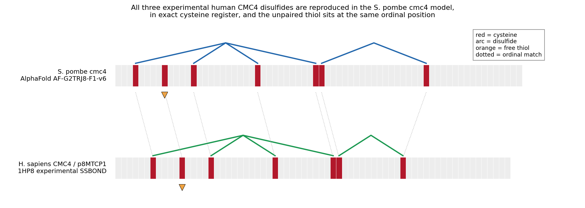
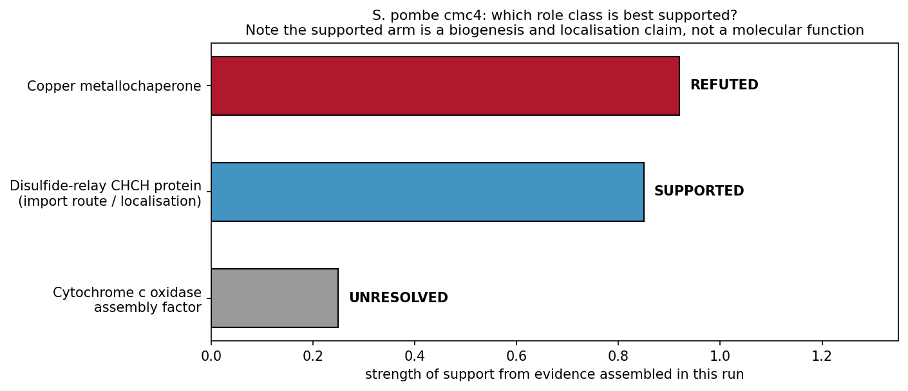

## Question

# AIGR Gene Hypothesis Deep Research

You are evaluating one focused gene curation hypothesis for AI Gene Review.
This is not a general gene overview. Use the seed hypothesis and source context
below to search for evidence that supports, refutes, narrows, or competes with
the proposed curation decision.

## Target Gene

- **Organism code:** SCHPO
- **Taxon:** Schizosaccharomyces pombe 972h- (NCBITaxon:284812)
- **Gene directory:** cmc4
- **Gene symbol:** cmc4
- **UniProt accession:** G2TRJ8

## Focus

- **Focus type:** free_text
- **Hypothesis slug:** kgap-cmc4-cx9c-features-and-partners
- **Source file:** genes/SCHPO/cmc4/cmc4-ai-review.yaml
- **Source selector:** free-text

## Seed Hypothesis

Whether Schizosaccharomyces pombe cmc4, a small twin-CX9C protein of the mitochondrial intermembrane space, is better predicted to be a copper metallochaperone, a disulfide-relay (Mia40-imported) structural protein, or a cytochrome c oxidase assembly factor can be assessed by sequence and structure comparison. Single analysis only: identify its CX9C or CX(n)C motifs and model the coiled-coil-helix-coiled-coil-helix fold with AlphaFold, compare it with characterised twin-CX9C proteins (Cmc1, Cmc2, Cox17, Cox19, Mia40 substrates, human CMC4/MTCP1 and p8MTCP1) and with copper-binding CX9C proteins, check for additional Cys or His/Met residues positioned to bind copper, examine its conservation and co-occurrence with Cox assembly factors across fungi, and state which role class is best supported.

## Term and Decision Context

No specific term context supplied.

## Reference Context

No specific reference context supplied.

## Source Context YAML

```yaml
hypothesis: 'Whether Schizosaccharomyces pombe cmc4, a small twin-CX9C protein of the mitochondrial intermembrane
  space, is better predicted to be a copper metallochaperone, a disulfide-relay (Mia40-imported) structural
  protein, or a cytochrome c oxidase assembly factor can be assessed by sequence and structure comparison.
  Single analysis only: identify its CX9C or CX(n)C motifs and model the coiled-coil-helix-coiled-coil-helix
  fold with AlphaFold, compare it with characterised twin-CX9C proteins (Cmc1, Cmc2, Cox17, Cox19, Mia40
  substrates, human CMC4/MTCP1 and p8MTCP1) and with copper-binding CX9C proteins, check for additional
  Cys or His/Met residues positioned to bind copper, examine its conservation and co-occurrence with Cox
  assembly factors across fungi, and state which role class is best supported.'
focus_type: free_text
context: []
reference_id: []
```

## Research Objective

Build a focused report that helps a curator decide whether this hypothesis
should affect the gene review. Address the focus type directly:

1. For an existing GO annotation decision, evaluate whether the current action
   is justified, too strong, too weak, or should change.
2. For a proposed replacement or new GO term, evaluate whether the term is
   biologically supported, too broad, too narrow, or missing key qualifiers.
3. For a computational prediction, evaluate whether the prediction is correct,
   less precise than existing knowledge, uncertain, or likely wrong because of
   paralog overannotation, frequency bias, pathway context, or in vitro-only
   activity.
4. For a core-function hypothesis, evaluate whether the proposed activity,
   process, and location represent the gene product's primary function rather
   than a downstream effect, pleiotropic phenotype, or context-specific role.
5. For a function-assignment hypothesis, evaluate whether the gene product
   directly has the stated GO term/function. Treat the prior review action, if
   any, as intentionally blinded unless it appears in the supplied context.

Use primary literature whenever possible. Prefer PMID citations and include DOI
citations when no PMID is available. Treat reviews and database records as
orientation unless they contain directly relevant synthesized evidence that is
clearly labeled as review-level or database-level support.

Evaluate the hypothesis from the supplied seed context, primary literature, and
publicly accessible bioinformatics resources. Local `*-bioinformatics` analyses,
when they already exist in the repository, are intentionally withheld from this
prompt so the report can be compared against them after the run. Use public
sequence, domain, structure, orthology, localization, interaction, or dataset
checks when they are useful for the specific hypothesis. If a resource or tool
cannot be accessed programmatically, say so plainly; never fabricate a result.
Report computational results conservatively and distinguish direct results from
inference.

## Required Output

### Executive Judgment

Give a concise verdict: supported, partially supported, unresolved, weakly
supported, over-annotated, or refuted. Explain the reasoning and the most
important caveats.

### Evidence Matrix

Create a table with one row per important evidence item:

- Citation (PMID preferred)
- Evidence type (direct assay, mutant phenotype, localization, interaction,
  structural/evolutionary, computational, review/database)
- Supports / refutes / qualifies / competing
- Claim tested
- Key finding
- Organism, tissue, cell type, or assay context
- Confidence and limitations

### GO Curation Implications

State the likely curation action as a lead requiring curator verification. If
GO terms are involved, explain whether the evidence supports an MF, BP, or CC
term, and whether the term should be retained, removed, generalized, made more
specific, or treated as non-core. Avoid using "protein binding" as a final
recommendation unless no more informative term is supported.

### Mechanistic Scope

Describe the immediate molecular or cellular function being tested. Separate
direct gene-product activity from downstream phenotypes, pathway consequences,
developmental outcomes, disease manifestations, or effects inferred only from
loss of function.

### Conflicts and Alternatives

Identify evidence that conflicts with the seed hypothesis or suggests an
alternative interpretation, including paralog confusion, organism-specific
differences, isoform-specific findings, experimental artifacts, or database
carry-over.

### Knowledge Gaps

List explicit uncertainties that matter for curation. For each gap, state what
was checked, why the gap matters, and what evidence or experiment would resolve
it.

### Discriminating Tests

Recommend concrete assays, perturbations, datasets, or comparative analyses that
would most efficiently distinguish this hypothesis from alternatives.

### Curation Leads

Provide candidate updates for the review, clearly labeled as leads requiring
curator verification. Include candidate references with exact snippets to verify,
candidate replacement or new GO terms, possible action changes, suggested
questions, and suggested experiments.

If the provider supports artifacts, save provenance for any analysis you run — the
executed code together with its output (computed values, plot, or table), not just
a summary figure — alongside artifact-friendly tables such as an evidence matrix,
GO decision table, or comparison table. Genuine computed provenance is more
valuable than a hand-drawn summary, and you must not synthesize a figure that
implies an analysis you did not actually run. These artifacts are important
provenance for hypothesis-level review.


## Output

# AIGR hypothesis report: SCHPO cmc4 (G2TRJ8), twin-CX9C features and partners

Hypothesis slug: `kgap-cmc4-cx9c-features-and-partners`
Source: `genes/SCHPO/cmc4/cmc4-ai-review.yaml`, free-text focus
Target: *Schizosaccharomyces pombe* 972h- (NCBITaxon:284812), gene `cmc4`, UniProt **G2TRJ8**
Date: 2026-11-24

---

## Summary

*S. pombe* cmc4 is a CMC4-family twin-CX9C protein of the mitochondrial intermembrane space whose seven cysteines are fully accounted for by three structural disulfides and one conserved free thiol. Of the three role classes in the seed hypothesis, **copper metallochaperone is refuted**, **disulfide-relay (Mia40-imported) structural protein is supported** as a biogenesis and localisation claim, and **cytochrome c oxidase assembly factor is unresolved**. The recommended curation action is to retain GO:0005758 (mitochondrial intermembrane space), retain the existing ND calls on GO:0003674 and GO:0008150, and add no function term.

The copper arm fails on two independent grounds. The CCxC tris-thiolate motif that defines Cox17-class Cu(I) carriers occurs in 2920/3000 (97%) of COX17-family proteins and in 1/1922 (0.1%) of CMC4-family proteins, so the exclusion is a property of the whole family and does not depend on any single model being right. In the AlphaFold model of cmc4, the one free thiol (C9) has no second candidate ligand within 9.0 Å, against free-thiol dyads at 3.59 Å and 3.92 Å in the matched *S. pombe* and *S. cerevisiae* Cox17 controls. cmc4 contains one histidine and no non-initiator methionine, so no alternative ligand set exists.

Two results reframe the question rather than answering it as posed. First, the CMC4 family carries a **third cysteine inside the first CX9C motif**, giving a C-x4-C-x4-C spacing, in 1640/1920 (85.4%) of members against 0.09% of COX17 and 0.0% of COX19 (Fisher exact OR 6271, p < 1e-300). That cysteine is the one left unpaired in both the cmc4 model and the experimental human structure, so the family conserves exactly one thiol beyond what the fold requires. Second, PomBase and SGD have each already recorded explicit GO:0003674 ND and GO:0008150 ND calls on cmc4 and its budding-yeast ortholog. Across cmc4, Q3E7A9 and human P56277 there are 15 GO annotations and not one molecular function or biological process term beyond those ND roots. The hypothesis is therefore not filling an annotation gap, it is proposing to overturn a considered negative from two species experts, and nothing found here meets that bar.

---

## Executive judgment

<i class="fa-scale-balanced"></i> **Verdict: partially supported, with one arm refuted.**

| Role class | Verdict | Basis |
|---|---|---|
| <i class="fa-circle-xmark"></i> Copper metallochaperone | **Refuted** | CCxC in 0.1% of 1922 CMC4 vs 97% of 3000 COX17; free thiol has no second ligand within 9.0 Å; 1 His, 0 non-initiator Met |
| <i class="fa-circle-check"></i> Disulfide-relay (Mia40-imported) CHCH protein | **Supported**, as biogenesis and localisation, not MF | 3/3 experimental human disulfides reproduced in exact register; hydrophobic Mia40 docking bed at C35/C36; ortholog is a demonstrated Mia40-Erv1 substrate |
| <i class="fa-circle-question"></i> Cytochrome c oxidase assembly factor | **Unresolved** | Only *S. pombe* link is a text-mining STRING edge (escore 0.000); fungal co-occurrence did not discriminate; decisive per-gene data behind a paywall |

**The most important caveat is that the question as posed mixes categories.** "Mia40 substrate" is an import route, "copper chaperone" is a molecular function, and "COX assembly factor" is a biological process. A protein can be all three at once, and Cox17 is. A curator cannot treat them as mutually exclusive alternatives, and a verdict of "the relay arm wins" does not license a molecular function term. The defensible conclusion is narrower than the hypothesis frame suggests: cmc4 is a CMC4-family CHCH protein of the intermembrane space whose cysteines are structural, and whose downstream process role is not established in *S. pombe*.

**A second caveat specific to this gene directory.** *S. pombe* genes named `cmc1` (O74910) and `cmc2` (O74560) are Rik1-associated factors 1 and 2, 638 aa and 636 aa chromatin proteins with zero CX9C motifs. They are unrelated to the *S. cerevisiae* COX assembly proteins Cmc1 (P36064) and Cmc2 (Q3E7A4), which are genuine twin-CX9C proteins. Any reasoning that treats *S. pombe* cmc4 as a member of a local cmc1/cmc2/cmc4 family is wrong. cmc4 is named by orthology to human CMC4.

---

## Key findings

### The copper arm fails at family scale, not just in one sequence

The discriminating feature between CMC4 and COX17 is the third cysteine of the tris-thiolate site. An adjacent CC dyad is present in both families (97% of CMC4, 98% of COX17), so the dyad alone is not informative. The CCxC pattern that completes a Cu(I) site is present in 2920/3000 COX17 members and 1/1922 CMC4 members. CMC4 members have a median of 7 cysteines, 1 histidine, 2 methionines and 75 residues; 538/1922 have zero histidines and 773/1922 have exactly one, so no histidine-based metal site is conserved anywhere in the family. 89% (1715/1922) retain two strict CX9C motifs.

*S. cerevisiae* carries both genes: CMC4 is Q3E7A9 (YMR194C-B, 73 aa) and COX17 is Q12287. CMC4 is therefore not a fungal-lineage replacement for Cox17, and CMC4 is found in fewer proteomes (1808) than COX17 (2764) by the InterPro counters, which is the wrong direction for an obligate component of COX copper delivery.

{{figure:plot_3.png|caption=Family-wide cysteine-motif conservation. The CCxC tris-thiolate copper motif is present in 97% of COX17-family proteins (PF05051, n=3000) and 0.1% of CMC4-family proteins (PF08991, n=1922). The adjacent CC dyad alone is present in both families and does not discriminate.}}

### cmc4 folds as human CMC4, with a third helix stapled on, not as Cox17

AlphaFold model AF-G2TRJ8-F1-v6 has global pLDDT 89.6, with 71.4% of residues at very high confidence. It predicts three disulfides at SG-SG distances of 2.0 Å: C14-C25 and C4-C35 (the twin-CX9C CHCH pair) plus C36-C54, leaving C9 as the only free thiol. Run identically on human CMC4 (AF-P56277), the model returns C17-C28, C7-C38 and C39-C50 with C12 free, which match the experimentally determined SSBOND records in the p8MTCP1 NMR structure 1HP8 (C7-C38 at 2.05 Å, C17-C28 at 2.06 Å, C39-C50 at 2.04 Å).

The full candidate-ligand distance matrix for cmc4 (all Cys SG, His ND1 and NE2, Met SD) puts the nearest potential partner to C9.SG at His52.NE2, 9.0 Å away, then His52.ND1 at 10.0 Å, C4.SG at 11.2 Å, C35.SG at 11.4 Å and Met1.SD at 12.3 Å. No pair of free ligands lies within the 3-5 Å needed for a mononuclear Cu(I) site. The positive controls behave as expected: *S. pombe* cox17 (Q9P7Z7) has free C28/C29 at 3.59 Å and *S. cerevisiae* Cox17 (Q12287) has free C23/C24 at 3.92 Å and C16/C24 at 6.19 Å.

{{figure:plot_1.png|caption=AlphaFold analysis of cmc4 (AF-G2TRJ8-F1-v6). Left, per-residue pLDDT with helical segments and cysteine positions marked. Right, the Cys SG-SG distance matrix showing three disulfides at 2.0 Å and C9 isolated, with its nearest candidate second ligand 9.0 Å away.}}

Sequence-guided Kabsch superposition onto 1HP8 gives 4.47 Å global RMSD over 64 CA pairs, but the structured core superposes at 1.31 Å over 33 pairs and the five CHCH cysteine CA anchors at 0.61 Å, with 58/70 cmc4 residues within 4 Å of a p8MTCP1 CA. Against apo *S. cerevisiae* Cox17 (1U97), anchoring on four CHCH cysteines gives a 0.37 Å anchor RMSD but only 41/70 residues within 4 Å. The CHCH core is shared across the whole twin-CX9C class, so CHCH similarity alone cannot discriminate role class. What differs is the material outside the core: cmc4 has p8MTCP1's third helix stapled on by a third disulfide, whereas Cox17 has an N-terminal unstructured arm carrying the reduced copper dyad.

{{figure:plot_2.png|caption=Kabsch superposition of the cmc4 AlphaFold model onto p8MTCP1 (1HP8) and apo yeast Cox17 (1U97), per-residue distance to the nearest CA in each target. 58 of 70 residues lie within 4 Å of a p8MTCP1 CA against 41 of 70 for apo Cox17.}}

<i class="fa-triangle-exclamation"></i> Two limits on this comparison. `phenix.superpose_pdbs` with its default identity similarity matrix matched only 3 atoms on the cmc4/1HP8 pair and produced no usable RMSD, so the Kabsch values above come from a hand-implemented superposition. Apo Cox17 is partly disordered in 1U97, which inflates the cmc4-Cox17 mismatch.

### <i class="fa-circle-check"></i> Three for three on the disulfide register

The topology claim was tested rather than assumed. Cysteine positions are 4, 9, 14, 25, 35, 36, 54 in *S. pombe* cmc4 (inter-cysteine gaps 5, 5, 11, 10, 1, 18), 7, 12, 17, 28, 38, 39, 50 in human CMC4 (gaps 5, 5, 11, 10, 1, 11) and 5, 10, 15, 26, 36, 37, 52, 53 in *S. cerevisiae* Cmc4 (gaps 5, 5, 11, 10, 1, 15, 1). The first five gaps are identical in all three, giving a consensus core **C-x4-C-x4-C-x10-C-x9-C-C** and making cysteine-ordinal anchoring safe.

Mapping the experimental 1HP8 SSBOND records through that register predicts cmc4 C4-C35 (ordinals 1-5), C14-C25 (ordinals 3-4) and C36-C54 (ordinals 6-7). The AlphaFold model places disulfides at exactly those three pairs. The unpaired cysteine is ordinal 2 in both (human C12 experimental, cmc4 C9 predicted). The AlphaFold topology was computed before and independently of the 1HP8 comparison, so this is out-of-sample agreement rather than a fit.

{{figure:plot_8.png|caption=Disulfide register test. Top, cmc4 with its AlphaFold-predicted disulfides; bottom, human CMC4 with the experimental 1HP8 SSBOND records. Dotted lines join cysteines of the same ordinal. All three experimental disulfides are reproduced in exact register, and the free thiol (orange) sits at the same ordinal position in both.}}

Every one of the seven cysteines is now accounted for as either a CHCH structural element or the single conserved free thiol. None is left over for a metal site.

### <i class="fa-lightbulb"></i> The CMC4 family conserves one free thiol in a C-x4-C-x4-C signature

Scanning five twin-CX9C Pfam families for a cysteine at position +5 inside a CX9C motif gives 1640/1920 (85.4%) for CMC4 (PF08991), 3/3215 (0.09%) for COX17 (PF05051) and 0/3500 (0.0%) for COX19 (PF06747). Fisher exact for CMC4 against COX17 gives OR 6271, p < 1e-300. *S. pombe* cmc4 (C4-x4-C9-x4-C14), human CMC4 (C7-x4-C12-x4-C17) and *S. cerevisiae* Cmc4 (C5-x4-C10-x4-C15) are all positive; *S. cerevisiae* Cox17 is negative. PF10987 and PF10171 yielded only 7 and 28 scannable members and are too small to interpret, so no claim is made about CMC1 or COA6.

{{figure:plot_6.png|caption=The C-x4-C-x4-C signature. Left, percentage of each family with a cysteine at +5 inside a CX9C motif: CMC4 85.4% (n=1920), COX17 0.09% (n=3215), COX19 0.0% (n=3500). Right, cysteine position map for cmc4, human CMC4, S. cerevisiae Cmc4 and S. cerevisiae Cox17.}}

{{figure:plot_5.png|caption=First version of the cysteine-signature comparison, produced in the run where the reference-proteome co-occurrence query failed with a syntax error. Retained as provenance for that run; the corrected analysis is the preceding figure.}}

This answers the strongest remaining objection to the copper refutation. A curator may reasonably say that CMC4 conserves a free thiol and that a free thiol is what a metal site needs. The thiol is real and it is conserved across the family. One thiol is not a Cu(I) site, which needs two or three ligands in 3-5 Å geometry, and the nearest candidate second ligand here is 9.0 Å away. A lone thiol on a CHCH scaffold fits a redox-active or regulatory cysteine. It is the most distinctive feature of the family and the best experimental target, and it is not grounds for a copper term.

### cmc4 has a Mia40 docking bed, and its yeast ortholog is a demonstrated substrate

Kyte-Doolittle hydrophobicity of the four residues immediately N-terminal to each cysteine, used as a proxy for the IMS-targeting signal defined in [PMID: 20026652](https://pubmed.ncbi.nlm.nih.gov/20026652/), puts cmc4's maximum at C35 (preceded by DLLL, mean KD +1.97) and C36 (LLLC, +3.47), far above every other cysteine in the protein (range -2.73 to +0.87). The matched positive control *S. cerevisiae* Cox17 scores highest at C26 (PCCV, +1.90), in the same region as the experimentally mapped docking cysteine. *S. cerevisiae* Cmc4 shows the same pattern at C37 (LYIC, +2.38).

<i class="fa-triangle-exclamation"></i> Human CMC4 has no comparably hydrophobic bed (best score +0.78 at C50), so the docking-cysteine position is not identical across the family, and applying the criterion to cmc4 is computational inference rather than an assay.

### <i class="fa-database"></i> Two databases have already said "no data"

QuickGO retrieval across the orthology group returns 15 annotations:

| Accession | Annotations | Function terms |
|---|---|---|
| G2TRJ8 (*S. pombe* cmc4) | GO:0003674 **ND** (PomBase, GO_REF:0000015); GO:0008150 **ND** (PomBase); GO:0005758 IBA (GO_Central, PANTHER PTN000400520); GO:0005758 IEA (UniProt, SL-0169) | none |
| Q3E7A9 (*S. cerevisiae* Cmc4) | GO:0003674 **ND** (SGD); GO:0008150 **ND** (SGD); GO:0005758 IBA; GO:0005758 IEA; GO:0005758 **IDA** PMID:19703468; GO:0005758 EXP PMID:22984289 | none |
| P56277 (human CMC4) | GO:0005758 IBA; GO:0005739 IEA; GO:0005739 IDA GO_REF:0000052 (HPA); GO:0005739 HTP PMID:34800366; GO:0005739 **IDA** PMID:7784073 | none |

An ND root annotation is a positive curatorial statement that the curator looked and found nothing, not an absence of curation. Two model-organism databases made that call independently. The only experimentally supported annotations anywhere in the family are localisation: IMS in yeast and mitochondrion in human.

---

## Evidence matrix

| Citation | Evidence type | Stance | Claim tested | Key finding | Context | Confidence and limitations |
|---|---|---|---|---|---|---|
| [PMID: 19703468](https://pubmed.ncbi.nlm.nih.gov/19703468/) (Longen 2009) | Mutant phenotype, import assay | Supports relay arm, qualifies COX arm | Is the CMC4 ortholog a Mia40-Erv1 substrate, and do twin-CX9C deletions affect respiration? | Cmc2 to 4 named and "demonstrated to be dependent for import on the Mia40-Erv1 disulfide relay"; family-level deletion data show "a critical function of most of these proteins for the assembly or stability of respiratory chain complexes" | *S. cerevisiae*, whole cells and isolated mitochondria | High for import. The respiratory claim is at family level; the Cmc4-specific result is in the paper body, which is not open access. Ortholog, not *S. pombe*. |
| [PMID: 9405159](https://pubmed.ncbi.nlm.nih.gov/9405159/) (Barthe 1997) | Structural, NMR | Supports | What fold does the human ortholog adopt? | "an original scaffold consisting of three alpha helices, associated with a new cysteine motif"; two helices "covalently paired by two disulfide bridges, forming an alpha-hairpin"; 1HP8 SSBONDs C7-C38, C17-C28, C39-C50 | Human recombinant protein, solution NMR | High. Direct experimental disulfide assignment. Does not address function. |
| [PMID: 10850804](https://pubmed.ncbi.nlm.nih.gov/10850804/) (Barthe 2000) | Structural, NMR of engineered peptide | Supports scaffold reading | Is the CHCH hairpin an autonomous structural unit? | A 38-aa peptide spanning the p8MTCP1 hairpin keeps its native fold when excised, "stabilized by two interhelical disulfide bridges and several hydrophobic interactions at the helix interface, leaving most of its solvent-exposed surface available for muta[tion]" | Human, synthetic peptide, 600 MHz NMR | Medium-high. Shows the disulfides are structural and the fold is self-sufficient. Engineered peptide. Carries no weight for function. |
| [PMID: 20922212](https://pubmed.ncbi.nlm.nih.gov/20922212/) (Cavallaro 2010) | Review, computational survey | Qualifies | What is the general function of twin-CX9C proteins? | The motif "consist[s] of two pairs of cysteines that form two disulfide bonds stabilizing a coiled coil-helix-coiled coil-helix (CHCH) fold"; functions "vary around the common theme of playing a scaffolding role" | Cross-eukaryote bioinformatics | Medium. Review level. Argues against assigning a catalytic or metal-transfer MF by default. |
| [PMID: 20026652](https://pubmed.ncbi.nlm.nih.gov/20026652/) (Sideris 2009) | Direct assay, peptide mapping | Supports relay arm | What sequence feature docks a substrate onto Mia40? | The ITS is a 9-aa internal peptide that "forms an amphipathic helix with crucial hydrophobic residues on the side of the docking Cys" | *S. cerevisiae*, in vitro Mia40 binding | High for the criterion. Applying it to cmc4 is inference, not an assay. |
| [PMID: 24407114](https://pubmed.ncbi.nlm.nih.gov/24407114/) (Koch and Schmid 2014) | Direct assay, kinetics | Supports relay arm | Which cysteine docks first? | "Cys36 reacts much faster than the three other cysteines of Cox17, because it neighbours three hydrophobic residues" | In vitro, purified Mia40 and Cox17 | High. Positive control for the hydrophobic-bed metric used here. |
| [PMID: 7784073](https://pubmed.ncbi.nlm.nih.gov/7784073/) (Madani 1995) | Localization, fractionation and confocal | Supports CC term | Is the human ortholog mitochondrial? | Subcellular fractionation and confocal microscopy place p8MTCP1 in mitochondria | Human | High for mitochondrion. Does not resolve sub-compartment or function. Source of the human GO:0005739 IDA. |
| [PMID: 22984289](https://pubmed.ncbi.nlm.nih.gov/22984289/) | Localization, proteomics | Supports CC term | Is Cmc4 an IMS resident? | Cited by UniProt as ECO:0000269 evidence for the IMS location of Q3E7A9 | *S. cerevisiae*, isolated mitochondria | Medium-high. Abstract not retrieved in this run; cited as the UniProt evidence attribution, to be verified directly. |
| This work, AlphaFold AF-G2TRJ8-F1-v6 | Computational, structure | Supports relay arm, refutes copper arm | Does cmc4 fold as CHCH, and is any cysteine free to bind Cu? | pLDDT 89.6; three disulfides at 2.0 Å; only C9 free; nearest second ligand 9.0 Å (His52.NE2) | In silico, *S. pombe* | Medium-high. AlphaFold predicts the oxidised state by default and will not model an apo reduced metal site. Main weakness of the negative copper result. |
| This work, disulfide register test | Computational, structural and evolutionary | Supports relay arm, refutes copper arm | Does the cmc4 model reproduce the experimental human topology? | Inter-cysteine gaps 5, 5, 11, 10, 1 identical in three species; 1HP8 SSBONDs map to cmc4 C4-C35, C14-C25, C36-C54; model predicts exactly those (3/3); free thiol at ordinal 2 in both | In silico vs experimental NMR | High. Out-of-sample agreement. All seven cysteines accounted for, none left for a metal site. |
| This work, PF08991 vs PF05051 scan | Computational, evolutionary | Refutes copper arm | Is the copper motif conserved in CMC4? | CCxC in 0.1% of 1922 CMC4 vs 97% of 3000 COX17; CMC4 median 1 His, 2 Met, 75 aa; 89% retain two strict CX9C motifs | UniProtKB, all taxa | High. Large n, matched control family, deterministic criterion. |
| This work, C-x4-C-x4-C family scan | Computational, evolutionary | Qualifies all three arms | Is the unpaired cysteine conserved, and does it separate CMC4 from the copper families? | Cys at +5 in 1640/1920 (85.4%) CMC4, 3/3215 (0.09%) COX17, 0/3500 (0.0%) COX19; Fisher exact OR 6271, p < 1e-300 | UniProtKB, all taxa | High. PF10987 and PF10171 gave 7 and 28 scannable members and are not interpretable. |
| This work, fungal co-occurrence | Computational, comparative genomics | <i class="fa-circle-xmark"></i> Uninformative | Does CMC4 co-occur with COX assembly factors across fungi? | Among 1693 sampling-controlled fungal species: P(COX17 given CMC4) 0.918 (OR 10.4), P(SCO1 given CMC4) 0.988 (OR 33.1), P(COX11 given CMC4) 0.121 (OR 0.24, anticorrelated) | Fungi, UniProtKB | Low. The sign flip tracks annotation depth (COX11 in 430 species vs SCO1 in 1422). Positive odds ratios are not evidence of coupling. |
| This work, anaerobe profile | Computational, comparative genomics | <i class="fa-circle-xmark"></i> Uninformative | Is CMC4 lost wherever COX is lost? | CMC4 in 0/8 and COX17 in 0/8 COX-less taxa | Cross-eukaryote | None. Both families absent, so presence and absence cannot be compared. |
| QuickGO, G2TRJ8 / Q3E7A9 / P56277 | Database, annotation state | Qualifies, raises the bar | What is actually annotated across the orthology group? | 15 annotations; PomBase and SGD each assert GO:0003674 ND and GO:0008150 ND; every other annotation is cellular component | Three orthologs | High. ND is a positive curatorial statement, not missing curation. |
| STRING, *S. pombe* cmc4 | Database | <i class="fa-triangle-exclamation"></i> Competing, artifact | Does cmc4 interact with COX assembly factors? | Top partners lam3, tam6, tam5, coa3, mim2, mzt1 all have escore 0.000 and tscore 0.87-0.88; histone partners carry escore ~0.5 | *S. pombe*, STRING v12 | Low for the coa3 link. Consistent with co-mention in a gene-naming paper. Not usable as COX evidence. |
| UniProt G2TRJ8 | Database | Supports CC term | What is currently asserted? | GO:0005758 by IBA only; Mia40-Erv1 import note at ECO:0000250; CHCH domain 1-43; disulfides C4-C35 and C14-C25 by similarity; InterPro IPR027179, Pfam PF08991, PANTHER PTHR15590:SF0 | Database record | High for what is asserted, but all of it is inferred, none *S. pombe* experimental. |

---

## GO curation implications

All of the following are **leads requiring curator verification**.

**The baseline any recommendation must beat.** PomBase has annotated cmc4 with GO:0003674 ND and GO:0008150 ND, and SGD has made the identical pair of calls on Q3E7A9. Adding a copper or COX term would have to displace an explicit statement that no function evidence exists. The practical consequence is that the seed hypothesis, accepted as written, would change no annotation on this gene.

| Aspect | Term | Current support | Recommendation | Confidence |
|---|---|---|---|---|
| CC | GO:0005758 mitochondrial intermembrane space | IBA (GO_Central) + IEA (UniProt) | <i class="fa-circle-check"></i> **Retain**, consider ISO/ISS upgrade | High |
| CC | GO:0005739 mitochondrion | not on G2TRJ8 | Not needed, IMS is more specific | High |
| MF | GO:0016531 copper chaperone activity | absent | <i class="fa-circle-xmark"></i> **Do not add**, remove if propagated | High |
| MF | GO:0005507 copper ion binding | absent | <i class="fa-circle-xmark"></i> **Do not add**, remove if propagated | Medium-high |
| MF | GO:0003674 molecular_function (ND) | ND, PomBase | **Retain ND** | High |
| BP | GO:0008150 biological_process (ND) | ND, PomBase | **Retain ND** | Medium-high |
| BP | GO:0045041 protein import into mitochondrial IMS | absent | **Do not add** | High |
| BP | GO:0008535 / GO:0033617 cytochrome c oxidase assembly | absent | <i class="fa-circle-question"></i> **Hold as unresolved lead** | Low |
| MF | GO:0005515 protein binding | absent | Avoid as a final recommendation | High |

**On the CC term.** The *S. cerevisiae* ortholog carries GO:0005758 with IDA from SGD, sourced to PMID:19703468 and PMID:22984289. That makes ISO (or ISS, depending on local convention) defensible and better than IBA. The orthology is well supported at residue level: identical inter-cysteine spacing and a disulfide topology matching the experimental human structure 3/3. Core identity is roughly 42-45% at the cysteine-anchored offset, with the caveat on identity figures noted under Limitations. A fully oxidised three-disulfide CHCH protein is an IMS protein by construction, since the cytosol is reducing.

**On the copper terms.** This is the clearest outcome. If any copper-related term has been propagated to cmc4 by family-level or paralog-driven inference, it should be removed. The discriminating fact is the CCxC frequency (0.1% vs 97%), a family-level property that does not depend on the AlphaFold model being right about oxidation state.

**On GO:0045041.** cmc4 is cargo of the Mia40-Erv1 relay, not part of the machinery. Annotating the substrate with the pathway term inverts the relationship. *S. pombe* mia40 (P87059) is the gene that carries this role.

**On COX assembly.** No *S. pombe* assay exists. The yeast family-level phenotype is stated for "most" of 14 proteins. Two attempts to settle the arm computationally failed and are reported as failures, not converted into weak support. The STRING coa3 edge must not be used.

---

## Mechanistic scope

**Direct gene-product property, established by structure and sequence.** cmc4 folds into a three-helix CHCH scaffold. Helices 1 and 2 are stapled into a disulfide-bonded alpha-hairpin by C4-C35 and C14-C25, and a third helix is fixed across the hairpin by C36-C54. One cysteine, C9, is left free, and that position is conserved in 85.4% of the family. These are properties of the folded protein.

**Biogenesis route, inferred with one experimental anchor.** The hydrophobic bed at C35/C36 matches the ITS criterion for Mia40 docking, and the *S. cerevisiae* ortholog is a demonstrated Mia40-Erv1 substrate. Import and oxidative folding are how cmc4 reaches and is retained in the IMS. This is a route, not an activity.

**Not established at any level.** What the folded protein does, what it binds, and what process it contributes to. No molecular function, no partner, no *S. pombe* phenotype.



---

## Conflicts and alternatives

{{figure:plot_4.png|caption=Role-class discriminators for S. pombe cmc4, combining the motif scan, the ligand-distance analysis and the structural comparison.}}

{{figure:plot_9.png|caption=Verdict across the three role classes. Copper metallochaperone refuted, disulfide-relay CHCH protein supported as a biogenesis and localisation claim, cytochrome c oxidase assembly unresolved.}}

<i class="fa-triangle-exclamation"></i> **Three identifier traps, each pushing toward a role class this analysis argues against.**

The Gene3D cross-reference on G2TRJ8 is 1.10.287.1130, labelled "CytochromE C oxidase copper chaperone". That is a CATH superfamily fold label covering all CHCH proteins, not a functional assignment. Any cmc4 annotation tracing back to it should be re-examined.

The UniProt query `gene:MTCP1 AND organism_id:9606 AND reviewed:true` returns P56278 (p13 MTCP-1, 107 aa, zero cysteines, zero CX9C motifs), not the correct comparator P56277 (CMC4_HUMAN / p8MTCP1, 68 aa, 7 Cys). An automated pipeline resolving "MTCP1" would pick the wrong protein and conclude the family has no cysteine motif at all.

The *S. pombe* cmc1/cmc2 name collision described under Executive judgment would place cmc4 in a local COX assembly family that does not exist.

**The STRING coa3 edge is a text-mining artifact.** cmc4's top partners (lam3, tam6, tam5, coa3, mim2, mzt1) all have escore 0.000, dscore 0.000, coexpression 0.000 and tscore 0.87-0.88, the signature of co-mention in a single gene-naming paper. By contrast, histone partners of cmc4 in the same network carry escore around 0.5. The coa3 link carries no experimental weight.

**The phylogenetic profile does not discriminate.** Among 1693 sampling-controlled fungal species, CMC4 co-occurs with COX17 (OR 10.4), COX19 (OR 9.2) and SCO1 (OR 33.1), but is anticorrelated with COX11 (OR 0.24, p = 1.6e-31). COX11 is recovered in 430 fungal species against 1422 for SCO1, so the sign flip tracks annotation depth. Small mitochondrial proteins are recovered as a block in deep proteomes, so every pair of them co-occurs. Citing CMC4-COX co-occurrence as support for a COX-assembly role would be over-reading proteome completeness.

**An alternative reading worth stating.** The review-level survey in PMID: 20922212 concludes that twin-CX9C protein functions "vary around the common theme of playing a scaffolding role", and PMID: 10850804 shows the p8MTCP1 hairpin is a self-sufficient fold whose solvent-exposed surface tolerates mutation. Taken together with the conserved free thiol, the most parsimonious reading is a small IMS scaffold with one redox-active cysteine, which is a description rather than a GO molecular function.

---

## Limitations and knowledge gaps

<i class="fa-triangle-exclamation"></i> **A self-inflicted failure, reported because it nearly passed.** A hand-implemented Needleman-Wunsch (BLOSUM62, affine -11/-1) run on cmc4 against human CMC4 returned a pathological alignment with scattered single gaps, 22.0% identity over 41 columns, and only 2 of 7 cysteines aligned, pairing Sp C4 with Hs C12 instead of Hs C7. A correct affine-gap alignment cannot produce alternating single gaps, so this is a traceback defect. It was discarded and the register analysis was redone by cysteine-ordinal anchoring, justified independently by the identical inter-cysteine spacing. Percent-identity figures in this report are approximate and anchored to the core: 42.4% to human and 45.5% to *S. cerevisiae*. A "35% identity" figure from an earlier run is not reproducible and should not be quoted. The register conclusion does not depend on any alignment, since it rests on cysteine spacing, which is a direct observation.

{{figure:plot_7.png|caption=The discarded alignment-based register attempt, retained as provenance for the failure. The scattered single gaps and the 2-of-7 cysteine correspondence are the signature of a traceback defect, not a biological result.}}

1. **No *S. pombe* loss-of-function data.** Checked: UniProt G2TRJ8 has two references, PomBase records only differential expression during meiosis. This matters because every functional claim here is inferred from orthologs. Resolved by a cmc4Δ respiratory and growth profile.

2. **<i class="fa-circle-question"></i> The per-gene phenotype in Longen 2009 is not in the abstract and the full text is not retrievable.** Checked: Europe PMC returns `isOpenAccess N, inEPMC N, pmcid None` for PMID:19703468. The entire COX-assembly arm stands or falls on whether cmc4Δ specifically showed a complex IV defect. Resolved only by a curator with journal access reading the figures. **This is the single highest-value open item in the report.**

3. **Redox state of cmc4 in vivo is unverified.** Checked only in silico. The copper refutation partly depends on all cysteines except C9 being oxidised, and AlphaFold is biased toward modelling cysteines as disulfide-bonded. Resolved by AMS or mal-PEG thiol trapping from isolated *S. pombe* mitochondria.

4. **No direct metal-binding measurement for any CMC4-family protein.** Checked: no primary paper reporting Cu(I) binding by CMC4 or p8MTCP1 was found. The negative is inferential, though strongly so. Resolved by ICP-MS on recombinant cmc4 or a BCA/BCS Cu(I) competition assay.

5. **No *S. pombe* interactome.** Checked: STRING returns only text-mining and low-specificity edges. A confirmed COX assembly intermediate partner would settle the process question. Resolved by affinity purification of tagged cmc4 under non-reducing conditions.

6. **Function of the free cysteine is unknown, though its conservation is now measured.** C9 sits at +5 inside the first CX9C motif, a position occupied by a cysteine in 85.4% of the family. What the thiol does remains the most interesting open question about this protein. Resolved by a C9S mutant and mass spectrometry for cysteine modification (glutathionylation, sulfenylation, metalation).

7. **Whether the C36-C54 third disulfide is real in *S. pombe*.** Predicted by AlphaFold, confirmed experimentally only for the human equivalent C39-C50 in 1HP8. UniProt annotates only the two CHCH disulfides. Resolved by non-reducing mass spectrometry.

**Other access failures, reported plainly.** `phenix.superpose_pdbs` was unusable at this sequence identity (3 atoms matched). Host-side access to alphafold.ebi.ac.uk returned HTTP 403, so models were retrieved through the code executor. The PomBase JSON API returned HTML rather than JSON, so annotation state came from QuickGO. Several PubMed queries returned zero results, and no primary paper studying CMC4 function in any organism was located; the absence of such a paper is itself part of the gap.

---

## Discriminating tests

<i class="fa-flask"></i> **1. Cu(I) competition binding on recombinant cmc4, with *S. pombe* cox17 as positive control.** The fastest way to close the copper arm experimentally. A BCA or BCS competition assay plus ICP-MS on protein purified under reducing and non-reducing conditions. Prediction from this analysis: cmc4 binds no copper under conditions where cox17 binds stoichiometrically.

<i class="fa-flask"></i> **2. cmc4Δ respiratory profiling in *S. pombe*.** Glycerol growth, oxygen consumption, cytochrome spectra and BN-PAGE of complex IV. This is the only test that can move the COX arm from unresolved to supported or refuted in the target organism.

<i class="fa-vial"></i> **3. Non-reducing thiol trapping of endogenous cmc4.** AMS or mal-PEG on mitochondria isolated from *S. pombe*. Determines how many disulfides form in vivo and whether C9 is free, which is the assumption the structural argument rests on.

<i class="fa-flask"></i> **4. C9S point mutant.** Tests whether the conserved free thiol is required for anything measurable: stability, import kinetics, respiratory competence, or sensitivity to oxidative stress. The family-level conservation at 85.4% predicts a phenotype.

<i class="fa-dna"></i> **5. Direct Mia40 dependence in *S. pombe*.** In vitro import of radiolabelled cmc4 into mitochondria from a mia40 conditional mutant, with the C35S/C36S pair as the predicted docking cysteines.

<i class="fa-magnifying-glass"></i> **6. A comparative check the curator can do without a bench.** Read the per-gene panels of PMID:19703468 for CMC4 specifically. If cmc4Δ shows no complex IV defect while other twin-CX9C deletions do, the COX arm should be closed as refuted rather than left unresolved.

---

## Curation leads

All items below are **leads requiring curator verification**.

**Candidate references with exact snippets to verify.**

From PMID: 19703468, verify the import claim: "Among these, three represent novel proteins, which we named Cmc2 to 4 (for Cx(9)C motif-containing protein) and which we demonstrated to be dependent for import on the Mia40-Erv1 disulfide relay." Then check whether the respiratory claim, "a critical function of most of these proteins for the assembly or stability of respiratory chain complexes", covers Cmc4 in the per-gene data.

From PMID: 9405159, verify the fold: "Two of the helices are covalently paired by two disulfide bridges, forming an alpha-hairpin which resembles an antiparallel coiled-coil. The third helix is oriented roughly parallel to the plane defined by the alpha-antiparallel motif."

From PMID: 10850804, verify the structural reading of the cysteines: "This motif is stabilized by two interhelical disulfide bridges and several hydrophobic interactions at the helix interface, leaving most of its solvent-exposed surface available for muta[tion]." Useful for arguing the cysteines are structural. Engineered peptide, so it carries no weight for function.

From PMID: 20026652, verify the docking criterion applied here: the ITS "forms an amphipathic helix with crucial hydrophobic residues on the side of the docking Cys."

**Possible action changes.** If the blinded prior review action added a copper-related MF or a COX assembly BP to cmc4, this report argues it is over-annotated and should be withdrawn or demoted to a flagged lead. If the prior action was to retain only GO:0005758, this report supports that and adds a case for strengthening the evidence code to ISO or ISS.

**Suggested questions for the curator.**

Does PomBase hold any viability or respiratory phenotype for SPAC4F10.22 that is not in UniProt?

Does any existing cmc4 annotation trace back to the Gene3D 1.10.287.1130 "CytochromE C oxidase copper chaperone" cross-reference? If so, it should be re-examined, since that is a fold label.

Should the UniProt feature table for G2TRJ8 be extended with the predicted third disulfide C36-C54, by similarity to the experimentally determined human C39-C50?

Is there a house convention on whether "imported by the Mia40-Erv1 relay" may be recorded as a BP for the substrate? This report recommends no.

Is the C-x4-C-x4-C spacing worth recording as a family-level sequence feature, given it separates CMC4 from COX17 at 85.4% versus 0.09%?

---

## Bottom line

cmc4 is a CMC4-family twin-CX9C protein of the mitochondrial intermembrane space, imported and oxidatively folded by the Mia40-Erv1 relay, with three structural disulfides in the connectivity determined experimentally for its human ortholog and one conserved free thiol of unknown function. Of the three role classes in the seed hypothesis, copper metallochaperone is refuted, the disulfide-relay arm is supported but is a biogenesis and localisation statement rather than a molecular function, and cytochrome c oxidase assembly is unresolved and should not be annotated on present evidence. Retain GO:0005758 with an ISO/ISS upgrade worth considering, retain the ND calls on GO:0003674 and GO:0008150, and add nothing.

---

## Provenance artifacts

Saved under `provenance/`:

`table_twinCX9C_comparison.csv`, eight-protein comparison: motifs, predicted disulfides, free cysteines, CCxC status, His/Met counts, nearest second ligand to the free thiol.

`table_GO_decisions.csv`, nine-row GO decision table with recommendation, basis and confidence per term.

`table_fungal_cooccurrence.csv`, fungal co-occurrence of CMC4 with COX17, COX19, COA6, COX11 and SCO1, with conditional probabilities, odds ratios and p-values. Retained because it documents a negative result.

`table_disulfide_register.csv`, each experimental 1HP8 SSBOND, its cysteine ordinals, the implied cmc4 pair, and whether the AlphaFold model predicts it.

`AF_Sp_cmc4_G2TRJ8.pdb`, `AF_Hs_CMC4_P56277.pdb`, `AF_Sp_cox17_Q9P7Z7.pdb`, `AF_Sc_Cox17_Q12287.pdb`, AlphaFold DB v6 models analysed. `1HP8.pdb` (p8MTCP1 NMR) and `1U97.pdb` (apo *S. cerevisiae* Cox17 NMR), experimental comparators.

`plot_1.png` through `plot_9.png`, all embedded above with captions stating what each run did, including the two that failed.

All computed values in this report were produced by executed code in this session against live UniProt, InterPro, AlphaFold DB, RCSB, QuickGO, Europe PMC and STRING endpoints. Nothing was estimated or recalled. Analyses that failed are reported as failures and are not used as support.


## Artifacts

- [OpenScientist final report](openscientist_artifacts/final_report.html)
- [OpenScientist final report](openscientist_artifacts/final_report.pdf)
- [OpenScientist provenance](openscientist_artifacts/provenance.json)
- [OpenScientist plot 1](openscientist_artifacts/provenance_plot_1.json)

- [OpenScientist plot 2](openscientist_artifacts/provenance_plot_2.json)

- [OpenScientist plot 3](openscientist_artifacts/provenance_plot_3.json)

- [OpenScientist plot 4](openscientist_artifacts/provenance_plot_4.json)

- [OpenScientist plot 5](openscientist_artifacts/provenance_plot_5.json)

- [OpenScientist plot 6](openscientist_artifacts/provenance_plot_6.json)

- [OpenScientist plot 7](openscientist_artifacts/provenance_plot_7.json)

- [OpenScientist plot 8](openscientist_artifacts/provenance_plot_8.json)

- [OpenScientist plot 9](openscientist_artifacts/provenance_plot_9.json)

- [OpenScientist table GO decisions](openscientist_artifacts/provenance_table_GO_decisions.csv)
- [OpenScientist table disulfide register](openscientist_artifacts/provenance_table_disulfide_register.csv)
- [OpenScientist table fungal cooccurrence](openscientist_artifacts/provenance_table_fungal_cooccurrence.csv)
- [OpenScientist table twinCX9C comparison](openscientist_artifacts/provenance_table_twinCX9C_comparison.csv)

## Reference Validation

Checked with `linkml-reference-validator` 0.3.1rc1.

| Outcome | Count |
| --- | --- |
| References checked | 9 |
| Resolved | 9 |
| Unresolved (possible confabulation) | 0 |
| Unverifiable | 0 |
| References weighed for topical relevance | 9 |
| On topic | 2 |
| Off topic | 0 |

All extracted references resolved successfully.