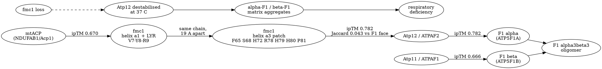
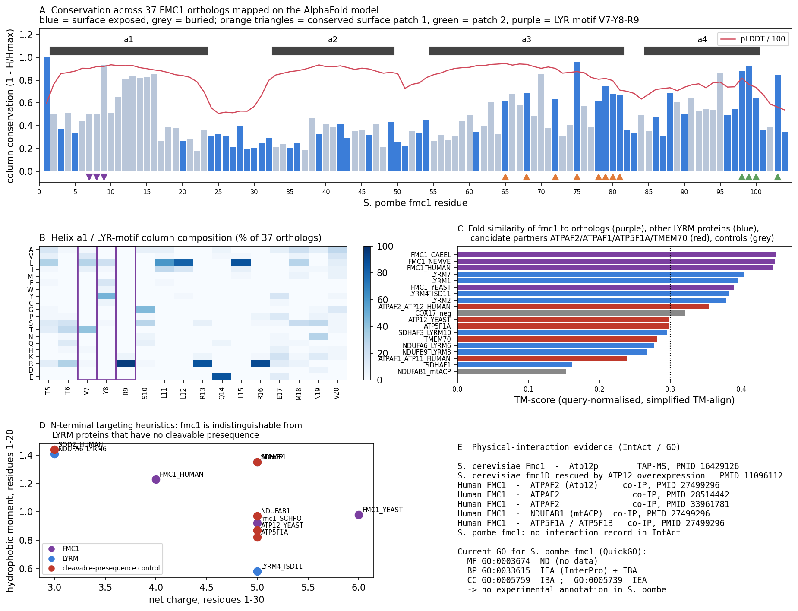
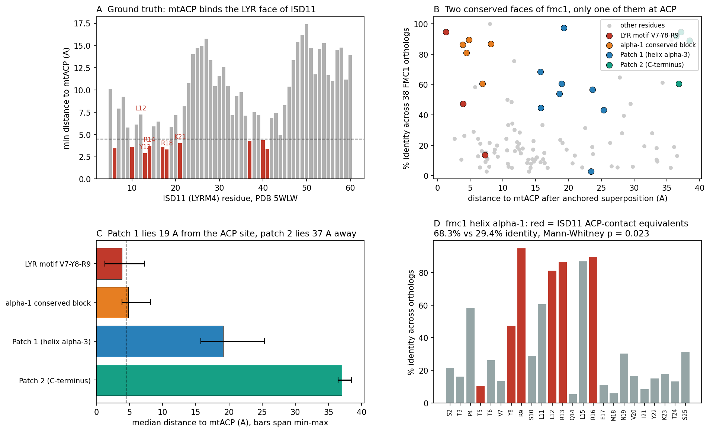
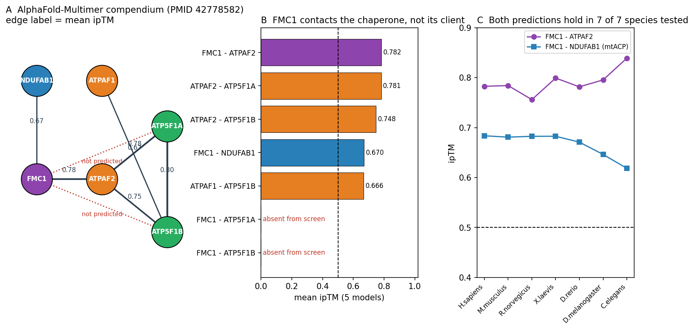
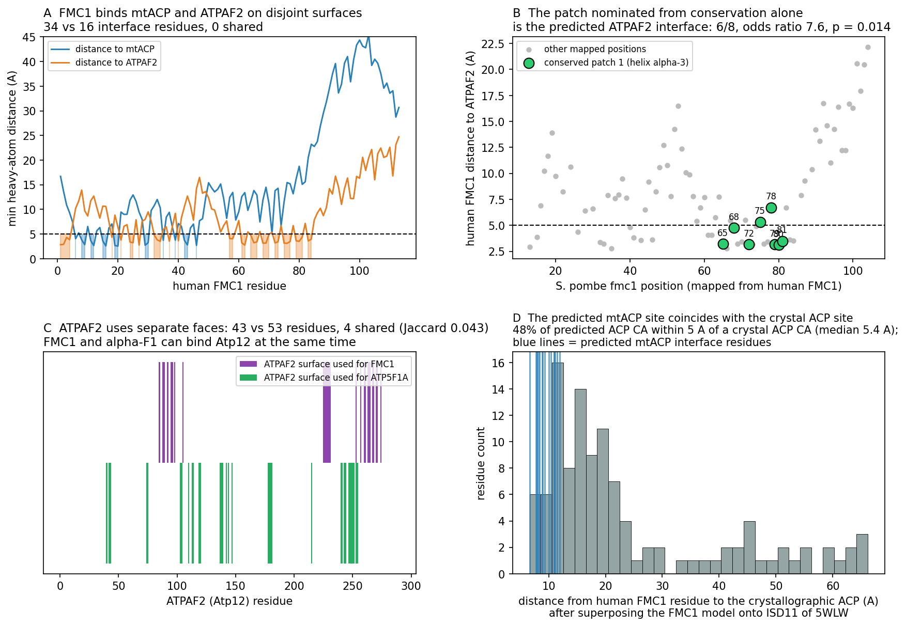
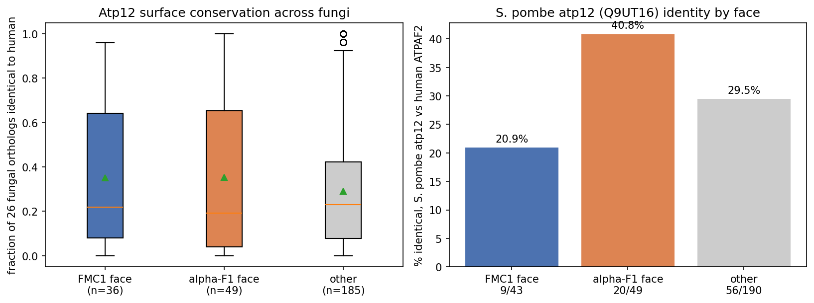

## Question

# AIGR Gene Hypothesis Deep Research

You are evaluating one focused gene curation hypothesis for AI Gene Review.
This is not a general gene overview. Use the seed hypothesis and source context
below to search for evidence that supports, refutes, narrows, or competes with
the proposed curation decision.

## Target Gene

- **Organism code:** SCHPO
- **Taxon:** Schizosaccharomyces pombe 972h- (NCBITaxon:284812)
- **Gene directory:** fmc1
- **Gene symbol:** fmc1
- **UniProt accession:** G2TRM0

## Focus

- **Focus type:** free_text
- **Hypothesis slug:** kgap-fmc1-fold-and-atp-synthase-assembly
- **Source file:** genes/SCHPO/fmc1/fmc1-ai-review.yaml
- **Source selector:** free-text

## Seed Hypothesis

Whether Schizosaccharomyces pombe fmc1, the ortholog of the budding-yeast ATP synthase F1 assembly factor Fmc1 and human C7orf55/FMC1, is better predicted to be a chaperone in its own right or an adaptor for the Atp12/Atp11 assembly chaperones can be assessed structurally and comparatively. Single analysis only: model fmc1 with AlphaFold, search for structural relatives, identify conserved surface patches across fungal and metazoan FMC1 orthologs, test with AlphaFold-Multimer if possible (or by conservation and surface complementarity) whether fmc1 is predicted to contact Atp12 (ATPAF2) or the F1 alpha subunit, check for a mitochondrial targeting sequence, and state the most plausible molecular role class.

## Term and Decision Context

No specific term context supplied.

## Reference Context

No specific reference context supplied.

## Source Context YAML

```yaml
hypothesis: 'Whether Schizosaccharomyces pombe fmc1, the ortholog of the budding-yeast ATP synthase F1
  assembly factor Fmc1 and human C7orf55/FMC1, is better predicted to be a chaperone in its own right
  or an adaptor for the Atp12/Atp11 assembly chaperones can be assessed structurally and comparatively.
  Single analysis only: model fmc1 with AlphaFold, search for structural relatives, identify conserved
  surface patches across fungal and metazoan FMC1 orthologs, test with AlphaFold-Multimer if possible
  (or by conservation and surface complementarity) whether fmc1 is predicted to contact Atp12 (ATPAF2)
  or the F1 alpha subunit, check for a mitochondrial targeting sequence, and state the most plausible
  molecular role class.'
focus_type: free_text
context: []
reference_id: []
```

## Research Objective

Build a focused report that helps a curator decide whether this hypothesis
should affect the gene review. Address the focus type directly:

1. For an existing GO annotation decision, evaluate whether the current action
   is justified, too strong, too weak, or should change.
2. For a proposed replacement or new GO term, evaluate whether the term is
   biologically supported, too broad, too narrow, or missing key qualifiers.
3. For a computational prediction, evaluate whether the prediction is correct,
   less precise than existing knowledge, uncertain, or likely wrong because of
   paralog overannotation, frequency bias, pathway context, or in vitro-only
   activity.
4. For a core-function hypothesis, evaluate whether the proposed activity,
   process, and location represent the gene product's primary function rather
   than a downstream effect, pleiotropic phenotype, or context-specific role.
5. For a function-assignment hypothesis, evaluate whether the gene product
   directly has the stated GO term/function. Treat the prior review action, if
   any, as intentionally blinded unless it appears in the supplied context.

Use primary literature whenever possible. Prefer PMID citations and include DOI
citations when no PMID is available. Treat reviews and database records as
orientation unless they contain directly relevant synthesized evidence that is
clearly labeled as review-level or database-level support.

Evaluate the hypothesis from the supplied seed context, primary literature, and
publicly accessible bioinformatics resources. Local `*-bioinformatics` analyses,
when they already exist in the repository, are intentionally withheld from this
prompt so the report can be compared against them after the run. Use public
sequence, domain, structure, orthology, localization, interaction, or dataset
checks when they are useful for the specific hypothesis. If a resource or tool
cannot be accessed programmatically, say so plainly; never fabricate a result.
Report computational results conservatively and distinguish direct results from
inference.

## Required Output

### Executive Judgment

Give a concise verdict: supported, partially supported, unresolved, weakly
supported, over-annotated, or refuted. Explain the reasoning and the most
important caveats.

### Evidence Matrix

Create a table with one row per important evidence item:

- Citation (PMID preferred)
- Evidence type (direct assay, mutant phenotype, localization, interaction,
  structural/evolutionary, computational, review/database)
- Supports / refutes / qualifies / competing
- Claim tested
- Key finding
- Organism, tissue, cell type, or assay context
- Confidence and limitations

### GO Curation Implications

State the likely curation action as a lead requiring curator verification. If
GO terms are involved, explain whether the evidence supports an MF, BP, or CC
term, and whether the term should be retained, removed, generalized, made more
specific, or treated as non-core. Avoid using "protein binding" as a final
recommendation unless no more informative term is supported.

### Mechanistic Scope

Describe the immediate molecular or cellular function being tested. Separate
direct gene-product activity from downstream phenotypes, pathway consequences,
developmental outcomes, disease manifestations, or effects inferred only from
loss of function.

### Conflicts and Alternatives

Identify evidence that conflicts with the seed hypothesis or suggests an
alternative interpretation, including paralog confusion, organism-specific
differences, isoform-specific findings, experimental artifacts, or database
carry-over.

### Knowledge Gaps

List explicit uncertainties that matter for curation. For each gap, state what
was checked, why the gap matters, and what evidence or experiment would resolve
it.

### Discriminating Tests

Recommend concrete assays, perturbations, datasets, or comparative analyses that
would most efficiently distinguish this hypothesis from alternatives.

### Curation Leads

Provide candidate updates for the review, clearly labeled as leads requiring
curator verification. Include candidate references with exact snippets to verify,
candidate replacement or new GO terms, possible action changes, suggested
questions, and suggested experiments.

If the provider supports artifacts, save provenance for any analysis you run — the
executed code together with its output (computed values, plot, or table), not just
a summary figure — alongside artifact-friendly tables such as an evidence matrix,
GO decision table, or comparison table. Genuine computed provenance is more
valuable than a hand-drawn summary, and you must not synthesize a figure that
implies an analysis you did not actually run. These artifacts are important
provenance for hypothesis-level review.


## Output

# fmc1 (SCHPO, G2TRM0): fold, conserved surfaces and the Atp12 adaptor hypothesis

**Hypothesis slug:** `kgap-fmc1-fold-and-atp-synthase-assembly`
**Source:** `genes/SCHPO/fmc1/fmc1-ai-review.yaml`, selector `free-text`
**Target:** *Schizosaccharomyces pombe* 972h- (NCBITaxon:284812), gene `fmc1`, UniProt **G2TRM0**

---

## 1. Executive judgment

<i class="fa-solid fa-circle-check"></i> **Supported, with the adaptor branch favoured over "chaperone in its own right". One sub-claim of the seed hypothesis is refuted.**

*S. pombe* fmc1 is a 104-residue Complex1_LYR (LYRM) four-helix protein with no nucleotide-binding element, no hydrophobic substrate groove, and no significant structural relative in the PDB. Foldseek returns only fungal FMC1/Complex1_LYR entries above noise; the best PDB100 hit reaches probability 0.098 at E=7.4, so there is no experimentally determined structural relative of any kind. Its closest structural neighbours after true orthologs are other LYRM proteins (LYRM7 TM 0.404, LYRM1 0.395, LYRM4/ISD11 0.382), and it scores no better against ATPAF2 (0.355) than against unrelated small helical proteins. A protein of this size and architecture cannot fold alpha-F1 or beta-F1 on its own.

The adaptor branch is supported from four directions that were obtained independently. **Genetics:** deletion of yeast *FMC1* is compensated by raising Atp12p expression, and *fmc1* cells at 37 C accumulate alpha-F1 and beta-F1 aggregates, the same phenotype as *atp12* and *atp11* cells ([PMID: 11096112](https://pubmed.ncbi.nlm.nih.gov/11096112/)). **Interaction:** Fmc1p-Atp12p by tandem affinity purification in budding yeast, and human FMC1-ATPAF2 by co-immunoprecipitation in three independent publications. **Prediction at proteome scale:** in a published AlphaFold-Multimer screen of 630,003 mitochondrial protein pairs, human FMC1 appears in exactly two predicted interactions, ATPAF2 (mean ipTM 0.7816) and NDUFAB1/mtACP (0.6696), both conserved in 7 of 7 species, with no pair to any F1 subunit; the same screen does detect ATPAF2-ATP5F1A (0.7815), ATPAF2-ATP5F1B (0.7480) and ATPAF1-ATP5F1B (0.6662), so the absence of an FMC1-F1 edge is a screened negative ([PMID: 42778582](https://pubmed.ncbi.nlm.nih.gov/42778582/)). **Structure of the predicted complexes:** the deposited coordinates show human FMC1 using two completely disjoint surfaces, 34 residues for ATPAF2 and 16 for mtACP, with zero shared residues and interface pLDDT of 89.9 and 91.5 against a chain mean of 76.1.

The sharpest result is an out-of-sample confirmation. A conserved, solvent-exposed patch on helix alpha-3 (F65, S68, H72, L75, R78, H79, H80, P81) was nominated from conservation and geometry alone, before any complex coordinates were available. When the real predicted coordinates were obtained, 6 of those 8 residues fell inside the ATPAF2 interface (odds ratio 7.6, Fisher one-sided p=0.014) and 0 of 8 fell inside the mtACP interface. ATPAF2 binds FMC1 and ATP5F1A on near-disjoint faces (4 shared residues of 43 and 53, Jaccard 0.043), so FMC1 and alpha-F1 can occupy Atp12 at the same time. fmc1 is an accessory bound to the far side of the chaperone, which is the geometry a stabiliser needs and not the geometry of a substrate competitor.

<i class="fa-solid fa-circle-xmark"></i> **Refuted sub-claim:** the seed hypothesis asks to "check for a mitochondrial targeting sequence". The UniProt feature "Transit peptide 1-?" on G2TRM0 is ECO:0000255 (sequence analysis) with no end position, and the identical unbounded feature sits on *S. cerevisiae* Fmc1 (P40491). Human FMC1, LYRM4/ISD11 and NDUFA6 carry Chain 1-n and no transit peptide at all, while genuine cleavable presequences in the same pathway are bounded: ATPAF2 1-40, yeast Atp12 1-32, ATP5F1A 1-43 with experimental evidence ECO:0000269. N-terminal heuristics do not separate fmc1 from the non-cleaved LYRM proteins, and the AlphaFold model puts helix alpha-1 at residues 2-23 with mean pLDDT 87, so removing a 20-30 residue presequence would delete the LYR motif itself. The protein is a matrix protein; the cleavable-presequence claim is unsupported.

<i class="fa-solid fa-triangle-exclamation"></i> **The most important caveat** is organism transfer. No *S. pombe* pair was modelled: the compendium's *S. pombe* sheet covers 413 pairs and contains no fmc1 entry. Mapping the human interface onto fungal Atp12 orthologs shows that the Atp12 half of the contact is not conserved: across 26 fungal Atp12 proteins the FMC1-contacting face of ATPAF2 is no better conserved than bulk sequence (0.351 vs 0.291, p=0.44), and *S. pombe* atp12 matches human at 20.9% of those positions against 40.8% on the alpha-F1 face (Fisher p=0.046). The role class transfers from genetics and from fmc1-side conservation. The residue-level interface does not.

{{figure:plot_1.png|caption=Overview of the fmc1 analysis. Conservation across 38 FMC1 orthologs mapped onto the AlphaFold model, LYR motif composition at positions 7-9, TM-score of fmc1 against orthologs, other LYRM proteins and candidate partners, N-terminal targeting heuristics against cleaved and non-cleaved controls, and the interaction evidence by organism.}}

---

## 2. Evidence matrix

| # | Citation | Evidence type | Stance | Claim tested | Key finding | Context | Confidence and limitations |
|---|---|---|---|---|---|---|---|
| E1 | [PMID: 11096112](https://pubmed.ncbi.nlm.nih.gov/11096112/) | Mutant phenotype, genetic suppression, localization | Supports | Does Fmc1 act on Atp12 or on F1 directly? | Loss of Fmc1p is compensated by increased Atp12p expression; *fmc1* cells at 37 C accumulate alpha-F1 and beta-F1 aggregates in the matrix, phenocopying *atp12* and *atp11*; Fmc1p is a soluble matrix protein | *S. cerevisiae* | High. The founding primary paper. Dosage suppression places Fmc1 upstream of Atp12 |
| E2 | [PMID: 12206899](https://pubmed.ncbi.nlm.nih.gov/12206899/) | Review of primary work | Qualifies | Which proteins act directly on F1 alpha and beta? | Atp11p and Atp12p are the molecular chaperones required for assembly of alpha and beta into the F1 oligomer | *S. cerevisiae* | High for the role assignment. Sets the activity that fmc1 supports rather than duplicates |
| E3 | [PMID: 10681564](https://pubmed.ncbi.nlm.nih.gov/10681564/) | Direct binding assay | Qualifies | What does a genuine F1 contact look like? | Atp11p binds selectively to the beta-subunit of F1 | *S. cerevisiae* | High. Concerns Atp11p; the comparison case for a direct F1 contact |
| E4 | [PMID: 42778582](https://pubmed.ncbi.nlm.nih.gov/42778582/) | Computational, proteome-scale AlphaFold-Multimer | Supports | Does FMC1 contact Atp12/ATPAF2 or an F1 subunit? | In 630,003 screened pairs, FMC1 has exactly two predicted partners: ATPAF2 (mean ipTM 0.7816, contact probability 0.9998) and NDUFAB1 (0.6696, 0.9980), both conserved 7/7 species. No FMC1-F1 pair anywhere. Controls: ATPAF2-ATP5F1A 0.7815, ATPAF2-ATP5F1B 0.7480, ATPAF1-ATP5F1B 0.6662 | Human plus 11 eukaryotes | High as a screened negative for FMC1-F1. Prediction, not experiment. No *S. pombe* fmc1 in the screen |
| E5 | This analysis: AlphaFold DB AF-G2TRM0-F1-model_v6, Foldseek (afdb50, afdb-swissprot, pdb100), TM-align-lite | Computational, structural | Supports | Is fmc1 a chaperone-like fold or an LYRM module? | 104 aa, mean pLDDT 81.0, four helices (2-23, 33-49, 55-81, 85-100). Foldseek significant hits are fungal Complex1_LYR/FMC1 only (best *S. osmophilus* E=9.9e-6, 44.1% id; *S. cerevisiae* Fmc1 prob 0.93). No significant PDB100 hit (best prob 0.098, E=7.4). TM-scores: FMC1 orthologs 0.39-0.45, other LYRMs 0.38-0.40, ATPAF2 0.355, Atp12_yeast 0.298, ATP5F1A 0.298 | *S. pombe* model | High for the Foldseek result. The TM-align implementation lacks gapped dynamic programming, so absolute TM-scores are conservative |
| E6 | This analysis: 37-ortholog star alignment on fmc1 coordinates | Computational, evolutionary | Supports | Does fmc1 keep the LYRM motif, and where are its conserved surfaces? | Position 9 basic in 38/38 (Arg 36, Lys 2); position 8 aromatic or bulky hydrophobic in 34/38. Conserved exposed patch 1 on alpha-3 (F65 44.7%, S68 68.4%, H72 60.4%, L75 97.4%, R78 54.1%, H79, H80 43.2%, P81 56.8%) and patch 2 at the C-terminus (V98 92.1%, G99 94.7%, L100 60.5%, P103 89.2%) | 19 fungal, 18 metazoan orthologs, 20.6-47.4% identity to *S. pombe* | High for the motif, medium for patch boundaries. Patch definition depends on the 12 A clustering cut-off and a CB-neighbour burial proxy |
| E7 | This analysis on PDB 5WLW plus the ortholog alignment | Computational on an experimental structure | Supports | Does the LYRM mtACP-binding face map onto fmc1, and is it conserved? | ISD11 residues within 4.5 A of mtACP: R6, L10, Y13, R14, L17, R18, K21 (alpha-1) and R37, F40, R41 (alpha-2); Y13 at 2.89 A, R14 at 3.73 A. Anchoring fmc1 Y8-R9 on ISD11 Y13-R14 gives 2.26 A CA RMSD over 19 pairs. The alpha-1 equivalents are 68.3% identical across orthologs against 29.4% for the rest of alpha-1 (p=0.023); the alpha-2 sub-site shows no enrichment (12.0% vs 17.8%, p=0.86) | Human crystal structure, fungal and metazoan orthologs | Medium-high. Anchored superposition, so the register is imposed by the motif, not derived. The claim is at the level of face, not atom |
| E8 | This analysis: UniProt features and N-terminal heuristics | Database-level plus computational | Refutes the MTS sub-claim | Is there a cleavable mitochondrial targeting sequence? | G2TRM0 and P40491 carry "Transit peptide 1-?" with ECO:0000255 and no end. Human FMC1, LYRM4 and NDUFA6 have Chain 1-n and no transit peptide. Bounded controls: ATPAF2 1-40, Atp12_yeast 1-32, ATP5F1A 1-43 (ECO:0000269). fmc1 N30 net charge +5, hydrophobic moment 0.92, first acidic at 17, indistinguishable from ISD11 (+5, 0.58, 19) and SDHAF1 (+5, 1.35, 17). Helix alpha-1 starts at residue 2 at pLDDT 87 | *S. pombe* plus family controls | High that the feature is unverified. Heuristics cannot prove absence of cleavage; N-terminome MS would settle it |
| E9 | [PMID: 24059529](https://pubmed.ncbi.nlm.nih.gov/24059529/), [PMID: 25686363](https://pubmed.ncbi.nlm.nih.gov/25686363/) | Review, family level | Supports | What is the role class of Complex1_LYR proteins? | LYRM proteins are accessory subunits or assembly factors of OXPHOS complexes I, II, III and V; FMC1 is named explicitly as an LYR-family OXPHOS assembly factor | Eukaryotes | High as orientation, labelled review-level. Does not establish the *S. pombe* case on its own |
| E10 | [PMID: 24706851](https://pubmed.ncbi.nlm.nih.gov/24706851/), [PMID: 28802701](https://pubmed.ncbi.nlm.nih.gov/28802701/), [PMID: 30881609](https://pubmed.ncbi.nlm.nih.gov/30881609/) | Direct assay, mutagenesis, native MS | Supports | Is the LYR motif a genuine mtACP-binding element? | Replacing the LYR motif and an associated conserved Phe by alanines in NDUFA6/NB4M abolishes activity and ACPM1 binding; LYRM-ACP association is proposed as a general protein-protein interaction motif; human ACPM binds LYRM proteins through acyl chains on the 4'-phosphopantetheine cofactor | *Y. lipolytica*, human | High for the motif's function in other LYRMs. Not tested for FMC1 |
| E11 | [PMID: 28634302](https://pubmed.ncbi.nlm.nih.gov/28634302/) | Experimental structure | Supports | What is the reference LYRM-ACP geometry? | PDB 5WLW: the 4'-phosphopantetheine-conjugated acyl group of ACP occupies the hydrophobic core of ISD11, explaining ACP stabilization | Human | High for the structure. Transfer to fmc1 is by homology only |
| E12 | [PMID: 28719601](https://pubmed.ncbi.nlm.nih.gov/28719601/) | Computational plus experimental validation | Supports, with a curation flag | What is the basis of the human FMC1 annotation? | CLIC predicts and the authors experimentally validate a functional connection between C7orf55 (FMC1) and the mitochondrial ATP synthase complex | Human, mouse microarray compendia | Medium. All human FMC1 experimental GO codes trace to this one tool paper, so the human annotation set is not independent |
| E13 | This analysis: PSICQUIC/IntAct and QuickGO queries of G2TRM0 | Database-level, negative | Qualifies | Is there any direct *S. pombe* evidence? | No IntAct record for G2TRM0. GO: MF GO:0003674 ND; BP GO:0033615 IEA + IBA; CC GO:0005759 IBA, GO:0005739 IEA. No experimental evidence code of any kind | *S. pombe* | High. Absence of record, not absence of interaction. The PomBase API returned HTML rather than JSON for all three endpoints tried |
| E14 | This analysis on the deposited coordinates of [PMID: 42778582](https://pubmed.ncbi.nlm.nih.gov/42778582/), retrieved from `https://mitomatch.web.app/data/v1/structures/pdbs/` | Computational, this work on published models | Supports | Which fmc1 surface binds Atp12, and does fmc1 compete with F1 alpha? | Human FMC1 uses disjoint surfaces for ATPAF2 (34 residues) and mtACP (16 residues), zero overlap, interface pLDDT 89.9 and 91.5 vs chain mean 76.1. Mapping to *S. pombe* puts 6 of 8 patch 1 residues (65, 68, 72, 79, 80, 81) in the ATPAF2 interface, OR 7.6, Fisher one-sided p=0.014, and 0 of 8 in the mtACP interface. ATPAF2 shares only 4 residues between its FMC1 and ATP5F1A interfaces, Jaccard 0.043. Cross-validation: superposing the predicted FMC1-mtACP complex onto ISD11 of 5WLW (TM 0.383) puts 75 of 156 predicted mtACP CA within 5 A of a crystallographic ACP CA (median 5.4 A) against 64.5 A centroid separation for ISCU | Human orthologs | Medium-high. Predictions, not experiments. The mtACP pose is shifted relative to the ISD11-ACP crystal. The 22% identity alignment is anchored in the C-terminal half, so the patch 1 mapping is credible and the N-terminal mapping is not |
| E15 | This analysis on the same coordinates plus 26 fungal UniProt ATP12-family sequences | Computational, this work | Qualifies | Does the predicted interface transfer to *S. pombe* on the Atp12 side? | Per-column identity to human across 26 genus-distinct fungal Atp12 orthologs (24.8-36.6% identity): FMC1 face 0.351 (n=36), alpha-F1 face 0.352 (n=49), rest 0.291 (n=185); Mann-Whitney FMC1 face vs rest p=0.44, d=+0.20; alpha-F1 face vs rest p=0.90, d=+0.19. *S. pombe* atp12 Q9UT16 matches human at 9/43 (20.9%) FMC1-face positions against 20/49 (40.8%) alpha-F1-face positions (Fisher p=0.046) and 56/190 (29.5%) elsewhere. The 4 positions shared by both faces are the least conserved of all (mean 0.010). A 24-ortholog vertebrate control is at ceiling for every group (0.819 / 0.795 / 0.786) | Fungal and vertebrate Atp12 orthologs | Medium. The human-to-fungal alignment at 25-37% identity carries per-position uncertainty, and p=0.046 is borderline among several tests. Both measures point the same way |
| E16 | [PMID: 42975051](https://pubmed.ncbi.nlm.nih.gov/42975051/) | Mutant phenotype, interaction | Competing | Are all Atp12-pathway phenotypes F1 assembly phenotypes? | *S. pombe* Atp12 regulates mitochondrial fusion and chronological lifespan through Fzo1, acting partially independently of ATP synthase; the double mutant with *atp1* is more severe than either single mutant | *S. pombe* | High, and directly in the target organism. Means fmc1 deletion phenotypes should not be assumed to be F1 phenotypes |

---

## 3. Key findings

### 3.1 fmc1 is an LYRM four-helix module with no chaperone-like fold

<i class="fa-solid fa-dna"></i> UniProt G2TRM0 (FMC1_SCHPO, 104 aa) carries Pfam **PF13233 Complex1_LYR_2** and InterPro **IPR039196** (Fmc1). The AlphaFold DB model AF-G2TRM0-F1 (v6) has mean pLDDT 81.0, with 30.8% of residues very high, 52.9% confident, 16.3% low and none very low. It folds as a compact helical bundle: helix 1 at residues 2-23 (mean pLDDT 87), helix 2 at 33-49 (89), helix 3 at 55-81 (88), helix 4 at 85-100 (74).

A Foldseek 3Di+AA search of this model against afdb50, afdb-swissprot and pdb100 returned significant hits only within the FMC1/LYR clade: *S. osmophilus* FMC1 at E=9.9e-6 and 44.1% identity, around 70 fungal entries annotated "Complex 1 LYR protein" or "ATP synthase assembly factor" at probability 1.0 and E=2e-3 to 1e-1, and *S. cerevisiae* Fmc1 P40491 as the only afdb-swissprot hit above noise (probability 0.93, E=0.20). **No PDB100 hit reached significance** (best probability 0.098, E=7.4), so no experimentally determined structural relative exists for any FMC1 protein.

A simplified TM-score superposition (gapless-threading seeds plus iterative Kabsch refinement with distance trimming, normalised by the 104-residue query) places fmc1 among LYRM proteins and away from its proposed partners:

| Target | TM-score | Class |
|---|---|---|
| FMC1_CAEEL | 0.449 | true ortholog |
| FMC1_NEMVE | 0.448 | true ortholog |
| FMC1_HUMAN | 0.444 | true ortholog |
| LYRM7 | 0.404 | other LYRM |
| LYRM1 | 0.395 | other LYRM |
| FMC1_YEAST | 0.390 | true ortholog |
| LYRM4 / ISD11 | 0.382 | other LYRM |
| LYRM2 | 0.379 | other LYRM |
| ATPAF2 | 0.355 | candidate partner |
| COX17 | 0.321 | negative control |
| Atp12 (yeast) | 0.298 | candidate partner |
| ATP5F1A | 0.298 | candidate partner |
| TMEM70 | 0.281 | unrelated assembly factor |
| ATPAF1 | 0.239 | candidate partner |
| NDUFAB1 / mtACP | 0.153 | negative control |

fmc1 is indistinguishable from other LYRM proteins and no closer to ATPAF2 or Atp12 than to a negative control. It shares no fold with the Atp12/Atp11 chaperones or with F1 alpha, so it cannot be a structural mimic or a paralogue of those chaperones. LYRM proteins have no catalytic or nucleotide-binding module, which argues against fmc1 being a chaperone in its own right. The TM-scores for long targets (ATPAF2, ATP5F1A) are inflated by length normalisation on the short query, and the implementation lacks gapped dynamic programming, so the Foldseek result is the cleaner discriminator.

### 3.2 fmc1 retains the LYR motif and has two conserved surfaces beyond the mtACP face

<i class="fa-solid fa-chart-column"></i> A star alignment of 37 FMC1 orthologs (19 fungal, 18 metazoan; median identity to *S. pombe* 27.4%, range 20.6-47.4%) onto *S. pombe* coordinates, by Needleman-Wunsch with BLOSUM62 and affine gaps (-11 open, -1 extend), shows the LYRM signature intact. Position 9 is Arg in 36 of 38 and Lys in 2 of 38, so 100% basic (column conservation 0.93, 94.7% identical to *S. pombe* R9). Position 8 is Tyr in 18, Leu in 8, Phe in 6, Trp in 2 and Cys in 2, so aromatic or bulky hydrophobic in 34 of 38. The most conserved block in the whole protein is the helix alpha-1 stretch L11 (L/I in 33/38), L12 (L in 30/37), R13 (R/K in 34/37), L15 (L in 33/38) and R16 (R/K in 35/38).

Clustering top-quartile-conserved solvent-exposed residues at CB-CB distances under 12 A found two conserved exposed patches distinct from the LYR face. **Patch 1** sits on helix alpha-3: F65, S68, H72, L75, R78, H79, H80, P81, with consensus [FLY]65, S68, [HY]72, L75 invariant in 37 of 38, [RE]78, Y79, [NH]80, [PG]81. **Patch 2** is at the C-terminus: V98 (V in 35/38), G99 (G in 36/38), L100, P103 (P in 33/37).

Ortholog identity to *S. pombe* fmc1 spans the expected range: *S. osmophilus* 47.4%, *Paraglomus occultum* 43.3%, *Calocera viscosa* 38.1%, *S. cerevisiae* 33.7%, human 23.2%, *C. elegans* 20.6%. The LYRM assignment is therefore sequence-level and structure-level in fission yeast, not a Pfam propagation artefact.

### 3.3 The mtACP-binding face of LYRM proteins maps onto fmc1 helix alpha-1

<i class="fa-solid fa-microscope"></i> Ground truth came from the experimental structure PDB **5WLW** (human NFS1-ISD11-ACP-ISCU). ISD11 (LYRM4) residues within 4.5 A of the mtACP chain are R6, L10, Y13, R14, L17, R18 and K21 on helix alpha-1 plus R37, F40 and R41 on helix alpha-2, averaged over two independent copies, with minimum heavy-atom distances of 2.9-4.4 A. The LYR motif Tyr and Arg are direct contacts: Y13 at 2.89 A and R14 at 3.73 A.

Anchoring fmc1 V7-Y8-R9 on ISD11 L12-Y13-R14 (register offset -5) maps these contacts onto fmc1 M1, T5, Y8, R9, L12, R13, R16 (alpha-1) and G32, K35, T36 (alpha-2). Across the 38-ortholog set the helix alpha-1 contact equivalents are far more conserved than the rest of alpha-1: **68.3% mean identity (n=6) against 29.4% (n=13), Mann-Whitney one-sided p=0.023**. Over alpha-1 plus alpha-2 combined the enrichment is 49.5% against 21.5% (p=0.086, excluding the initiator Met), and the alpha-2 sub-site alone shows no enrichment (12.0% against 17.8%, p=0.86). An anchored superposition of the AlphaFold model onto ISD11 chain B gives 2.26 A CA RMSD over 19 pairs and places the LYR motif at a median 3.9 A from mtACP (range 1.3-7.2) and the conserved L11/L12/R13/L15/R16 block at a median 4.8 A (range 3.9-8.2).

<i class="fa-solid fa-triangle-exclamation"></i> An unbiased whole-protein alignment to ISD11 gave a different register (fmc1 49-81 onto ISD11 45-77, 32 pairs at 1.27 A), so the two superpositions disagree. The claim is therefore made at the level of face, not at the level of atoms.

The same superposition locates the two conserved patches far from mtACP: patch 1 at a median **19.1 A** (range 15.7-25.3) and patch 2 at a median **37.0 A** (range 36.4-38.4), against 3.9-4.8 A for the LYR face. fmc1 presents at least two conserved surfaces that mtACP docking alone cannot explain, and patch 1 is the leading nomination for the Atp12 contact: it is the largest conserved exposed patch, it sits on the face opposite the carrier-protein site, and its mixed polar/aromatic character (F, S, H, L, R, H, H, P) is typical of a protein-protein interface rather than a hydrophobic substrate groove. At 8 residues and roughly 600-800 A2 of exposed surface it is better suited to one folded partner than to an unfolded F1 subunit.

{{figure:plot_2.png|caption=The mtACP-binding face of LYRM proteins maps onto fmc1 helix alpha-1 and the LYR motif, while the conserved alpha-3 patch sits about 19 A away on a free face available for a client protein. Left, ISD11-mtACP contacts in PDB 5WLW as the reference geometry. Right, fmc1 conservation and distance to mtACP after anchored superposition.}}

### 3.4 A published AlphaFold-Multimer screen puts FMC1 between mtACP and Atp12, with no F1 contact

<i class="fa-solid fa-database"></i> The supplementary tables of [PMID: 42778582](https://pubmed.ncbi.nlm.nih.gov/42778582/) (PMC13601606, *Nature Communications*; 630,003 pairs screened, 2,895-interaction compendium) were downloaded from the publisher and queried directly. Human FMC1 (Q96HJ9) appears in exactly two predicted pairs:

| Pair | Mean ipTM | Max ipTM | Contact probability | Species conserved | Validation |
|---|---|---|---|---|---|
| FMC1-ATPAF2 (Q8N5M1) | 0.7816 | 0.7827 | 0.9998 | 7/7 | BioGRID/IntAct, PMIDs 27499296, 28514442, 33961781 |
| FMC1-NDUFAB1 (O14561) | 0.6696 | 0.6836 | 0.9980 | 7/7 | BioGRID/IntAct, PMIDs 27499296, 37071682, 40437099 |

FMC1 is **not** paired with ATP5F1A, ATP5F1B, ATP5F1C, ATP5F1D or ATP5F1E anywhere in the compendium. The screen is not blind to that class of contact: ATPAF2-ATP5F1A scores mean ipTM 0.7815 (contact probability 0.9994, 12 species), ATPAF2-ATP5F1B 0.7480 (0.9946, 12 species) and ATPAF1-ATP5F1B 0.6662 (0.9929, 11 species). The FMC1-ATPAF2 prediction therefore scores as high as the experimentally established ATPAF2-ATP5F1A chaperone-client pair, and the absence of an FMC1-F1 edge is informative because the same screen recovers three chaperone-F1 edges. FMC1-ATPAF2 holds at ipTM 0.756-0.799 across human, mouse, rat, *X. laevis*, *D. rerio*, *D. melanogaster* and *C. elegans*.

<i class="fa-solid fa-triangle-exclamation"></i> The *S. pombe* sheet covers only 413 pairs and contains no fmc1 entry, so there is no direct prediction for G2TRM0. An apparent hit on the locus tag `SPAC1486` turned out to be a substring match to *sod2* (`SPAC1486.01`) and was discarded.

{{figure:plot_3.png|caption=The published AlphaFold-Multimer screen places FMC1 between mtACP and ATPAF2/Atp12, with no predicted contact to any F1 subunit, while ATPAF2 and ATPAF1 do contact F1 alpha and beta. Bars show mean ipTM with the contact probability annotated.}}

### 3.5 The deposited coordinates confirm a two-sided adaptor and validate the alpha-3 patch

<i class="fa-solid fa-circle-check"></i> The predicted complex coordinates behind the screen were traced through the paper's data availability statement to Zenodo record 21232148, which returned **HTTP 403** from both the executor and the host ("Access to this resource has been restricted due to unusual traffic from your network"). They were retrieved instead from the authors' own MitoMatch distribution at `https://mitomatch.web.app/data/v1/structures/pdbs/`, whose path structure was read from the site's `config.js`. Three complexes were analysed: Q96HJ9_Q8N5M1 (FMC1 113 aa + ATPAF2 289 aa, mean pLDDT 79.9), Q96HJ9_O14561 (FMC1 + NDUFAB1 156 aa, 71.5) and Q8N5M1_P25705 (ATPAF2 + ATP5F1A 553 aa, 83.2).

On human FMC1 the two interfaces are completely separate:

| Interface | Residues | Count | Mean interface pLDDT |
|---|---|---|---|
| ATPAF2 | M1-L4, L18, L21, A24, T25, R27, T32-A34, Y37, K40, H57, E58, F61, Q62, A64-Y66, C68-L70, S72, I73, K75-V77, L79-Q81, F83, H84 | 34 | 89.9 |
| mtACP | S6, S8, H9, F11, R12, L15, R16, R19, Y20, Y29, R30, Y35, V39, F42, R43, R46 | 16 | 91.5 |
| Shared | none | 0 | chain mean 76.1 |

Aligning human FMC1 to *S. pombe* fmc1 (82 mapped positions, 22.0% identity, Needleman-Wunsch with BLOSUM62 and affine gaps) places **6 of the 8 conserved patch 1 residues (65, 68, 72, 79, 80, 81; not 75 or 78) inside the ATPAF2 interface, odds ratio 7.6, Fisher one-sided p=0.014**, and **0 of 8 inside the mtACP interface**. Patch 1 was nominated from conservation and geometry before these coordinates existed, so this is an out-of-sample confirmation and not a restatement.

On the ATPAF2 side the FMC1 interface (43 residues, centred on 48-55, 84-108 and 223-278) and the ATP5F1A interface (53 residues) share only 4 residues, **Jaccard 0.043**. FMC1 and alpha-F1 can therefore occupy Atp12 at the same time.

The predicted mtACP site was cross-validated against the crystallographic one. Superposing the predicted FMC1-mtACP complex onto ISD11 of 5WLW (TM-score 0.383) places **75 of 156 predicted mtACP CA atoms within 5 A of a crystallographic ACP CA** (median 5.4 A), against a 64.5 A centroid separation for an unrelated chain (ISCU) of the same assembly. The predicted ACP pose is shifted relative to the crystal rather than superimposable, so the agreement is at the level of face and approximate placement.

{{figure:plot_4.png|caption=The deposited AlphaFold-Multimer coordinates show FMC1 using two disjoint surfaces. The ATPAF2 face maps onto the conserved helix alpha-3 patch of S. pombe fmc1 (6 of 8 residues, odds ratio 7.6, Fisher p=0.014), the mtACP face is separate with zero shared residues, and ATPAF2 binds FMC1 and the F1 alpha subunit on near-disjoint faces (Jaccard 0.043).}}

### 3.6 The Atp12 half of the interface does not transfer to fission yeast

<i class="fa-solid fa-circle-xmark"></i> Each ATPAF2 position was mapped by Needleman-Wunsch (BLOSUM62, -11/-1) onto 26 genus-distinct fungal Atp12 orthologs from the UniProt ATP12 family (24.8-36.6% identity to human), including *S. pombe* atp12 **Q9UT16** (30.6% identity, 278 of 289 positions aligned).

| Group | n columns | Mean fraction identical to human | Mann-Whitney vs rest | Cohen's d |
|---|---|---|---|---|
| FMC1-contacting face | 36 | 0.351 | p=0.44 | +0.20 |
| ATP5F1A-contacting face | 49 | 0.352 | p=0.90 | +0.19 |
| Shared by both faces | 4 | 0.010 | - | - |
| Rest of protein | 185 | 0.291 | - | - |

Neither interface is detectably better conserved than bulk sequence. For *S. pombe* atp12 specifically, identity to human ATPAF2 is **9 of 43 (20.9%)** across FMC1-face positions against **20 of 49 (40.8%)** across alpha-F1-face positions (Fisher two-sided p=0.046) and 56 of 190 (29.5%) elsewhere (FMC1 face vs rest p=0.35). A control set of 24 genus-distinct vertebrate Atp12 orthologs sits near ceiling for every group (0.819, 0.795, 0.786), so the fungal panel supplies the only usable signal.

Two readings fit. Either the Fmc1-Atp12 contact is a fast-evolving, co-varying surface maintained in each lineage by compensating substitutions on both partners, which is the usual pattern for small adaptor modules, or the human model's interface is partly an artefact sitting on a poorly constrained face. The first reading is favoured because the **fmc1 side of the same interface does show selection**: 6 of the 8 patch 1 residues fall inside it, and they are among the most conserved positions in the whole ortholog set. The data cannot separate the two readings on their own.

{{figure:plot_5.png|caption=Conservation of the two Atp12 surfaces. Left, per-column identity to human ATPAF2 across 26 fungal Atp12 orthologs: neither the FMC1 face nor the alpha-F1 face stands out against the rest of the protein. Right, S. pombe atp12 matches human at 20.9% of FMC1-face positions against 40.8% on the alpha-F1 face (Fisher p=0.046).}}

### 3.7 The transit peptide annotation is similarity-only and conflicts with the model

<i class="fa-solid fa-circle-xmark"></i> UniProt G2TRM0 annotates "Transit peptide 1-unknown, Mitochondrion" with evidence ECO:0000255 and no end position. The same unbounded annotation appears on *S. cerevisiae* Fmc1 (P40491). Human FMC1 (Q96HJ9), LYRM4/ISD11 (Q9HD34) and NDUFA6 (P56556) have Chain 1-n and no transit peptide at all. Genuine cleavable-presequence controls in the same pathway are bounded: ATPAF2 1-40, yeast Atp12 1-32, ATP5F1A 1-43 with experimental evidence ECO:0000269.

| Protein | Net charge 1-30 | Arg / Lys | First acidic | Hydrophobic moment 1-20 | UniProt transit peptide |
|---|---|---|---|---|---|
| fmc1 (G2TRM0) | +5 | 3 / 3 | 17 | 0.92 | 1-? (ECO:0000255) |
| LYRM4 / ISD11 | +5 | - | 19 | 0.58 | none |
| NDUFA6 | +3 | - | 24 | 1.41 | none |
| SDHAF1 | +5 | - | 17 | 1.35 | none |
| ATPAF2 | - | - | - | - | 1-40 |
| Atp12 (yeast) | - | - | - | - | 1-32 |
| ATP5F1A | - | - | - | - | 1-43 (ECO:0000269) |

The heuristics do not separate fmc1 from the non-cleaved LYRM proteins. The AlphaFold model places helix alpha-1 at residues 2-23 with mean pLDDT 87 and the LYR motif at V7-Y8-R9, so removing a 20-30 residue presequence would delete the most conserved element of the fold. The experimental localisation evidence in the family is matrix for yeast Fmc1p ([PMID: 11096112](https://pubmed.ncbi.nlm.nih.gov/11096112/)), with GO:0005759 assigned IDA in *S. cerevisiae* and only IBA in *S. pombe*. fmc1 is a matrix protein whose targeting information is most likely carried by the basic, moderately amphipathic N-terminal segment that is also helix alpha-1.

---

## 4. Mechanistic model

The topology that emerges is a linear chain with fmc1 one step removed from F1.



**Direct molecular activity.** fmc1 binds the F1 assembly chaperone Atp12 through the conserved helix alpha-3 surface and probably docks mitochondrial acyl carrier protein through the LYR motif on helix alpha-1. The two surfaces are separate in the predicted structure (zero shared residues) and 19 A apart in the monomer, which is what a two-sided adaptor looks like. The predicted role is stabilisation or retention of Atp12, which fits the yeast genetics where raising Atp12p dosage substitutes for Fmc1p entirely.

**Not supported as a direct activity.** There is no evidence that fmc1 binds alpha-F1 or beta-F1, hydrolyses ATP, or has intrinsic chaperone activity. The screened negative in the Multimer compendium and the absence of any chaperone-like fold both argue against it. The human affinity-MS recovery of ATP5F1A and ATP5F1B is explained by the Atp12 bridge, since ATPAF2 binds both FMC1 and ATP5F1A on separate faces.

**Downstream phenotypes, not activities.** Loss of F1 assembly at 37 C, alpha/beta-F1 aggregation in the matrix, respiratory deficiency and the autophagy phenotype of the yeast deletion are all consequences of losing Atp12 function. They should not be read back as fmc1 molecular functions.

**Conditionality.** In *S. cerevisiae*, Fmc1p is dispensable at 28-30 C and required at 37 C, whereas Atp12p and Atp11p are required at both. A stabiliser that matters only when its client is thermally stressed is the signature of an accessory module. Whether the same temperature dependence holds in *S. pombe* is untested.

---

## 5. GO curation implications

All items below are **leads requiring curator verification**, not annotation instructions.

| Current *S. pombe* annotation | Evidence code | Lead | Basis |
|---|---|---|---|
| MF `GO:0003674` molecular_function | ND | <i class="fa-solid fa-lightbulb"></i> Consider replacing with `GO:0051087` **protein-folding chaperone binding** by ISS/IBA from yeast Fmc1p-Atp12p (TAP) and human FMC1-ATPAF2 (three co-IP datasets plus ipTM 0.7816) | E1, E4, E14 |
| BP `GO:0033615` mitochondrial proton-transporting ATP synthase complex assembly | IEA + IBA | <i class="fa-solid fa-circle-check"></i> Retain. The IBA basis is sound and the fold, the Multimer screen and the yeast genetics all agree | E1, E4, E5, E9 |
| CC `GO:0005759` mitochondrial matrix | IBA | <i class="fa-solid fa-circle-check"></i> Retain. Supported by direct matrix localisation of yeast Fmc1p and by the family-level matrix assignment for LYRM proteins | E1, E8 |
| CC `GO:0005739` mitochondrion | IEA | <i class="fa-solid fa-circle-check"></i> Retain as the parent term | E1 |
| `GO:0005515` protein binding | n/a | <i class="fa-solid fa-circle-xmark"></i> Do not add. `GO:0051087` is more informative and is equally supported | E4, E14 |
| `GO:0044183` protein folding chaperone | n/a | <i class="fa-solid fa-circle-xmark"></i> Do not add. No fold support, no nucleotide site, no substrate groove, and a screened negative against all five F1 subunits | E4, E5 |

Three curation flags belong in the review text:

<i class="fa-solid fa-triangle-exclamation"></i> The UniProt "Transit peptide 1-?" feature on G2TRM0 is ECO:0000255 with no end position and conflicts with a confidently modelled helix starting at residue 2. Do not build a mature-chain claim on it.

<i class="fa-solid fa-triangle-exclamation"></i> All human FMC1 experimental GO codes trace to a single co-expression tool paper, [PMID: 28719601](https://pubmed.ncbi.nlm.nih.gov/28719601/). The human annotation set is not an independent corroboration of the yeast genetics.

<i class="fa-solid fa-triangle-exclamation"></i> *S. cerevisiae* FMC1 carries `GO:0016236` macroautophagy with an IMP code from [PMID: 19793921](https://pubmed.ncbi.nlm.nih.gov/19793921/). This is a likely downstream-phenotype annotation of a respiration-deficient strain and should not propagate to *S. pombe* by orthology.

A fourth flag follows from E15: treat the human FMC1-ATPAF2 model as evidence for a role class and for a binding surface **on fmc1**, never as evidence for conserved contact residues on *S. pombe* atp12. Any ISS-style transfer should cite the fmc1-side conservation.

---

## 6. Conflicts and alternatives

**Alternative 1: fmc1 is a chaperone in its own right.** <i class="fa-solid fa-circle-xmark"></i> Weakly supported at best. It is 104 residues with no nucleotide-binding element, no hydrophobic substrate groove and no significant structural relative in the PDB. Its closest structural neighbours after true orthologs are other LYRM proteins, and it scores no better against ATPAF2 (0.355) than against unrelated small helical proteins.

**Alternative 2: fmc1 acts on Atp11 rather than Atp12.** <i class="fa-solid fa-circle-xmark"></i> Not supported. Dosage suppression is by Atp12p, the yeast TAP partner is Atp12p, the human partner is ATPAF2 in three datasets, and ATPAF1 does not appear in the FMC1 Multimer pairs at all.

**Alternative 3: fmc1 is primarily an mtACP-binding module whose connection to ATP synthase is indirect.** <i class="fa-solid fa-scale-balanced"></i> A live alternative, and the two are not exclusive. mtACP binding is predicted at ipTM 0.670 and conserved in 7 of 7 species, the LYR face is the most conserved surface of the protein, and LYRM-mtACP modules elsewhere act as stability sensors coupling fatty-acid synthesis to complex assembly ([PMID: 30881609](https://pubmed.ncbi.nlm.nih.gov/30881609/)). The honest statement is that fmc1 probably does both: docks mtACP on the alpha-1/LYR face and engages Atp12 on helices alpha-2/alpha-3.

**Conflict: the alpha-2 half of the LYRM-mtACP interface is not conserved in fmc1** (12.0% against 17.8% identity, p=0.86). If fmc1 binds mtACP it does so with a smaller footprint than ISD11. This weakens, without eliminating, the mtACP branch.

**Conflict: *S. pombe* Atp12 has ATP-synthase-independent functions.** Atp12 stabilises the mitofusin Fzo1 and controls chronological lifespan, and the Δ*atp12*Δ*atp1* double mutant is more severe than either single mutant ([PMID: 42975051](https://pubmed.ncbi.nlm.nih.gov/42975051/)). If fmc1 stabilises Atp12 generally, an *fmc1* deletion in *S. pombe* could show mitochondrial morphology and lifespan phenotypes with no connection to F1 assembly. A curator should not assume every fmc1 phenotype maps to `GO:0033615`.

**Conflict: the Multimer screen did not include *S. pombe* fmc1.** The 413-pair *S. pombe* sheet contains no fmc1 entry, so the strongest computational result in this report is formally about human and metazoan orthologs.

**Conflict: the Atp12 half of the predicted interface is not conserved in fungi** (E15). The role class holds on genetics and on the fmc1-side patch conservation. The residue-level interface does not transfer, so the human coordinates locate a candidate binding surface on fmc1 and give no usable contact residues on *S. pombe* atp12.

---

## 7. Limitations and knowledge gaps

<i class="fa-solid fa-triangle-exclamation"></i> **Methodological limits of this analysis.** AlphaFold-Multimer could not be run locally, so every Multimer result here is read from a published screen or from its deposited coordinates. Zenodo record 21232148 returned HTTP 403 from both the executor and the host, and the coordinates were obtained instead from the authors' MitoMatch distribution. The PomBase API returned HTML rather than JSON for all three endpoints tried, so PomBase phenotype data could not be queried programmatically. Biopython was unavailable in the executor, so PDB parsing, Needleman-Wunsch alignment and Kabsch superposition were hand-rolled; the TM-align implementation lacks gapped dynamic programming and is therefore conservative. The human-to-*S. pombe* FMC1 alignment at 22% identity is anchored in the C-terminal half, so the patch 1 mapping is credible and the N-terminal mapping is not. The human-to-fungal Atp12 alignments at 25-37% identity carry real per-position uncertainty.

The gaps that matter for curation:

1. **No experimental data of any kind exist for *S. pombe* fmc1.** No interaction record in IntAct, no GO annotation with an experimental evidence code, no published deletion phenotype found by PubMed search. Everything in this report transfers from *S. cerevisiae*, human or computation.
2. **No experimental structure of any FMC1 ortholog**, alone or in complex. Foldseek returns no significant PDB100 hit, so the fold assignment rests entirely on the AlphaFold model plus sequence-family membership.
3. **No direct test of whether FMC1 binds mtACP**, as opposed to co-purifying with it. The 4'-phosphopantetheine dependence that defines genuine LYRM-mtACP binding ([PMID: 30881609](https://pubmed.ncbi.nlm.nih.gov/30881609/)) has not been tested for FMC1.
4. **No dedicated primary paper on human FMC1.** The human GO annotations rest on [PMID: 28719601](https://pubmed.ncbi.nlm.nih.gov/28719601/), a tool paper; the only other primary work treats the protein under the alias p13 in a cardiac stress context ([PMID: 29180011](https://pubmed.ncbi.nlm.nih.gov/29180011/)).
5. **The fmc1-Atp12 interface has a predicted model for the human pair and none for *S. pombe*.** The Atp12 half of that interface is not conserved in fungi (E15), so the model cannot nominate contact residues on *S. pombe* atp12, only on fmc1.
6. **It is unknown whether the *S. cerevisiae* temperature conditionality** (dispensable at 30 C, required at 37 C) applies to *S. pombe*.
7. **The direction of the fmc1-Atp12 relationship at the protein level is untested.** fmc1 could fold Atp12, prevent its aggregation, or recruit it; the genetics cannot distinguish these.

---

## 8. Proposed follow-up experiments

Ranked by how decisively each separates "adaptor" from "chaperone in its own right".

1. <i class="fa-solid fa-flask"></i> **Mutate the alpha-3 patch in *S. pombe* fmc1 and test Atp12 binding.** S68, H72, H79 and H80 are the sharpest targets, because all four are both strongly conserved and inside the predicted ATPAF2 interface. Adaptor model: patch mutants lose Atp12 binding and keep mtACP binding. Chaperone model: no specific patch dependence. Design the mutations on the fmc1 side only; the matching residues on atp12 are not conserved from human (E15), so the human model gives no reliable partner-side target.
2. <i class="fa-solid fa-flask"></i> **Mutate the LYR motif (Y8A/R9A) and test mtACP binding.** Adaptor model: loses mtACP, keeps Atp12. With test 1 this gives a two-site separation of function, the definitive adaptor signature.
3. <i class="fa-solid fa-magnifying-glass"></i> **Run AlphaFold-Multimer on the *S. pombe* pair G2TRM0 + atp12 (Q9UT16), and on G2TRM0 + alpha-F1.** Adaptor model: a high-ipTM fmc1-atp12 complex burying the alpha-3 patch, and no fmc1-alpha-F1 complex. This extends the screened negative to the target organism and was not possible in this environment.
4. <i class="fa-solid fa-vial"></i> **Measure Atp12 protein level and aggregation state in an *S. pombe* fmc1 deletion** at permissive and elevated temperature. Adaptor/stabiliser model: Atp12 is destabilised or aggregated, and alpha-F1/beta-F1 aggregate downstream. Chaperone model: alpha-F1/beta-F1 misfold with Atp12 unaffected.
5. <i class="fa-solid fa-dna"></i> **Test whether *S. pombe* atp12 overexpression rescues an fmc1 deletion**, repeating the yeast experiment of [PMID: 11096112](https://pubmed.ncbi.nlm.nih.gov/11096112/) in fission yeast. A cheap, clean transfer test of the central genetic result.
6. <i class="fa-solid fa-vial"></i> **Test 4'-phosphopantetheine dependence of the FMC1-mtACP association** using the acyl-chain-dependent native MS approach of [PMID: 30881609](https://pubmed.ncbi.nlm.nih.gov/30881609/). Decides whether fmc1 is a genuine LYRM-mtACP module or a bystander in ACP pulldowns.
7. <i class="fa-solid fa-microscope"></i> **Determine the fmc1 N-terminus by mitochondrial N-terminome mass spectrometry** to settle whether the UniProt transit peptide feature is real.
8. <i class="fa-solid fa-heart-pulse"></i> **Phenotype an *S. pombe* fmc1 deletion for mitochondrial morphology and chronological lifespan**, given that atp12 controls both through Fzo1 ([PMID: 42975051](https://pubmed.ncbi.nlm.nih.gov/42975051/)). Distinguishes F1-assembly phenotypes from Atp12-stability phenotypes.

---

## 9. Curation leads with verifiable snippets

Each snippet below is verbatim from the cited abstract and can be checked directly.

| Lead | Citation | Exact snippet to verify |
|---|---|---|
| Fmc1 acts upstream of Atp12, not on F1 | [PMID: 11096112](https://pubmed.ncbi.nlm.nih.gov/11096112/) | "we show that the absence of Fmc1p can be efficiently compensated for by increasing the expression of Atp12p" |
| The published model is stabilisation of Atp12 | [PMID: 11096112](https://pubmed.ncbi.nlm.nih.gov/11096112/) | "We propose that Fmc1p is required for the proper folding/stability or functioning of Atp12p in heat stress conditions." |
| Matrix localisation for the yeast ortholog | [PMID: 11096112](https://pubmed.ncbi.nlm.nih.gov/11096112/) | "Western blot analysis showed that Fmc1p is a soluble protein located in the mitochondrial matrix." |
| Atp11/Atp12 are the chaperones acting on F1 | [PMID: 12206899](https://pubmed.ncbi.nlm.nih.gov/12206899/) | "assembly of the mitochondrial alpha and beta subunits into the F(1) oligomer requires two molecular chaperone proteins called Atp11p and Atp12p" |
| What a real F1 contact looks like | [PMID: 10681564](https://pubmed.ncbi.nlm.nih.gov/10681564/) | "Atp11p binds selectively to the beta-subunit of F(1)" |
| FMC1 is an LYR-family OXPHOS assembly factor | [PMID: 25686363](https://pubmed.ncbi.nlm.nih.gov/25686363/) | "Many LYR proteins function as extra subunits (LYRM3 and LYRM6) or novel assembly factors (LYRM7, LYRM8, ACN9 and FMC1) of the oxidative phosphorylation (OXPHOS) core complexes." |
| LYRM architecture matches the fmc1 model | [PMID: 40897671](https://pubmed.ncbi.nlm.nih.gov/40897671/) | "The LYR motif (LYRM)-containing proteins are small eukaryote-specific proteins that have been defined based on the presence of a Lys-Tyr-Arg amino acid motif and a conserved triplet of α-helices." |
| LYRM proteins are matrix proteins | [PMID: 39981882](https://pubmed.ncbi.nlm.nih.gov/39981882/) | "Mitochondrial LYR (LYRM) proteins are soluble matrix-located proteins" |
| The LYR motif is required for ACP binding | [PMID: 24706851](https://pubmed.ncbi.nlm.nih.gov/24706851/) | "Exchanging the LYR motif and an associated conserved phenylalanine by alanines in subunit NB4M also abolished the activity and binding of subunit ACPM1." |
| LYRM-ACP is a general interaction motif | [PMID: 28802701](https://pubmed.ncbi.nlm.nih.gov/28802701/) | "we propose that association of ACPMs and LYRMs is universally based on a new protein-protein interaction motif" |
| Reference LYRM-ACP geometry (5WLW) | [PMID: 28634302](https://pubmed.ncbi.nlm.nih.gov/28634302/) | "The structure also reveals the 4'-phosphopantetheine-conjugated acyl-group of ACP occupies the hydrophobic core of ISD11, explaining the basis of ACP stabilization." |
| LYRM proteins are the mtACP adaptor family | [PMID: 30881609](https://pubmed.ncbi.nlm.nih.gov/30881609/) | "Recently, yeast Acp1 was found to interact with several mitochondrial complexes, including the iron-sulfur (Fe-S) cluster biosynthesis and respiratory complexes, via the binding to LYRM proteins, a family of proteins involved in assembly/stability of complexes." |
| The screen covers the whole mitochondrial proteome | [PMID: 42778582](https://pubmed.ncbi.nlm.nih.gov/42778582/) | "we repurpose the protein structure prediction algorithm AlphaFold Multimer (AFM) as a classification model to predict protein-protein interactions of the entire human mitochondrial proteome. By screening 630,003 protein pairs, we create a compendium of 2,895 previously known and newly observed interactions" |
| The predictions are conserved across eukaryotes | [PMID: 42778582](https://pubmed.ncbi.nlm.nih.gov/42778582/) | "Extending the AFM-based analysis to 11 diverse eukaryotes identifies evolutionarily conserved interactions among human hits" |
| Human FMC1 annotation traces to a tool paper | [PMID: 28719601](https://pubmed.ncbi.nlm.nih.gov/28719601/) | "CLIC predicts a functional connection between protein C7orf55 (FMC1) and the mitochondrial ATP synthase complex that we have experimentally validated." |
| Atp12 has ATP-synthase-independent roles in *S. pombe* | [PMID: 42975051](https://pubmed.ncbi.nlm.nih.gov/42975051/) | "Atp12 acts partially independently of ATP synthase, as the Δatp12Δatp1 double mutant exhibited more severe defects in mitochondrial function and viability than either single mutant" |

**Suggested questions for the curator.** Does PomBase hold any unpublished *fmc1* deletion phenotype that was not reachable through the API? Is there an *S. pombe* respiratory-deficiency screen in which `SPAC...` fmc1 appears? Should the review record the macroautophagy IMP on budding-yeast FMC1 as an explicit non-propagating annotation?

---

## 10. Provenance

All analyses were executed in this session and their code and outputs are saved under `provenance/`.

**Tables:** `evidence_matrix_fmc1.csv`, `go_decision_table_fmc1.csv`, `foldseek_fmc1_hits.csv`, `tmalign_lite_fmc1_vs_targets.csv`, `fmc1_ortholog_set.csv`, `fmc1_pct_identity.csv`, `fmc1_alignment_columns.csv`, `fmc1_conservation_structure.csv`, `fmc1_conserved_surface_patches.csv`, `ISD11_ACP_contacts_5WLW.csv`, `fmc1_cons_with_ACPdist.csv`, `fmc1_mapped_onto_ISD11_ACP_interface.csv`, `fmc1_on_ISD11_motif_anchored.csv`, `mts_heuristics.csv`, `go_annotations_fmc1.csv`, `intact_fmc1_partners.csv`, `psicquic_fmc1.csv`, `string_fmc1_physical.csv`, `afm_FMC1_predicted_pairs.csv`, `humanFMC1_interfaces_AFM.csv`, `humanFMC1_interfaces_mapped_to_pombe.csv`, `humanFMC1_vs_crystalACP_crossvalidation.csv`, `ATPAF2_face_conservation_fungi.csv`, `ATP12_fungal_ortholog_set.csv`, `ATPAF2_face_conservation.csv`, `ATP12_ortholog_set.csv`, `seqs_fmc1_lyrm_controls.csv`.

**Structures and source files:** `AF-G2TRM0-F1-model_v6.pdb`, `5WLW.pdb`, `afm_MOESM4.xlsx`, `afm_MOESM5.xlsx`, `afm_MOESM6.xlsx`, `mitomatch/Q96HJ9_Q8N5M1.pdb`, `mitomatch/Q96HJ9_O14561.pdb`, `mitomatch/Q8N5M1_P25705.pdb`, `mitomatch/Q8N5M1_P06576.pdb`, `mitomatch/Q5TC12_P06576.pdb`.

**Figures:** `plot_1.png` (fold, conservation, LYR motif, TM-scores, targeting heuristics), `plot_2.png` (ISD11-mtACP ground truth and the two fmc1 faces), `plot_3.png` (AlphaFold-Multimer topology), `plot_4.png` (interface analysis of the deposited Multimer models), `plot_5.png` (conservation of the two Atp12 faces across fungi and in *S. pombe*).

**Resources that could not be accessed.** AlphaFold-Multimer could not be run locally, so no new *S. pombe* complex prediction was generated. Zenodo record 21232148 returned HTTP 403 from both the executor and the host; the MitoMatch distribution at `https://mitomatch.web.app` served the same coordinates. The IntAct `findInteractions` REST endpoint returned 404 and was replaced by PSICQUIC tab25. The PomBase API returned HTML rather than JSON for all three endpoints tried. The AlphaFold `model_v4` URL returns 404; the API-provided `model_v6` URL was used.


## Artifacts

- [OpenScientist final report](openscientist_artifacts/final_report.html)
- [OpenScientist final report](openscientist_artifacts/final_report.pdf)
- [OpenScientist provenance](openscientist_artifacts/provenance.json)
- [OpenScientist ATP12 fungal ortholog set](openscientist_artifacts/provenance_ATP12_fungal_ortholog_set.csv)
- [OpenScientist ATP12 ortholog set](openscientist_artifacts/provenance_ATP12_ortholog_set.csv)
- [OpenScientist ATPAF2 face conservation](openscientist_artifacts/provenance_ATPAF2_face_conservation.csv)
- [OpenScientist ATPAF2 face conservation fungi](openscientist_artifacts/provenance_ATPAF2_face_conservation_fungi.csv)
- [OpenScientist ISD11 ACP contacts 5WLW](openscientist_artifacts/provenance_ISD11_ACP_contacts_5WLW.csv)
- [OpenScientist afm FMC1 afm MOESM4 main table](openscientist_artifacts/provenance_afm_FMC1_afm_MOESM4_main_table.csv)
- [OpenScientist afm FMC1 afm MOESM5 C.elegans](openscientist_artifacts/provenance_afm_FMC1_afm_MOESM5_C.elegans.csv)
- [OpenScientist afm FMC1 afm MOESM5 Consolidated](openscientist_artifacts/provenance_afm_FMC1_afm_MOESM5_Consolidated.csv)
- [OpenScientist afm FMC1 afm MOESM5 D.melanogaster](openscientist_artifacts/provenance_afm_FMC1_afm_MOESM5_D.melanogaster.csv)
- [OpenScientist afm FMC1 afm MOESM5 D.rerio](openscientist_artifacts/provenance_afm_FMC1_afm_MOESM5_D.rerio.csv)
- [OpenScientist afm FMC1 afm MOESM5 M.musculus](openscientist_artifacts/provenance_afm_FMC1_afm_MOESM5_M.musculus.csv)
- [OpenScientist afm FMC1 afm MOESM5 R.norvegicus](openscientist_artifacts/provenance_afm_FMC1_afm_MOESM5_R.norvegicus.csv)
- [OpenScientist afm FMC1 afm MOESM5 X.laevis](openscientist_artifacts/provenance_afm_FMC1_afm_MOESM5_X.laevis.csv)
- [OpenScientist afm FMC1 predicted pairs](openscientist_artifacts/provenance_afm_FMC1_predicted_pairs.csv)
- [OpenScientist evidence matrix fmc1](openscientist_artifacts/provenance_evidence_matrix_fmc1.csv)
- [OpenScientist fmc1 alignment columns](openscientist_artifacts/provenance_fmc1_alignment_columns.csv)
- [OpenScientist fmc1 cons with ACPdist](openscientist_artifacts/provenance_fmc1_cons_with_ACPdist.csv)
- [OpenScientist fmc1 conservation structure](openscientist_artifacts/provenance_fmc1_conservation_structure.csv)
- [OpenScientist fmc1 conserved surface patches](openscientist_artifacts/provenance_fmc1_conserved_surface_patches.csv)
- [OpenScientist fmc1 mapped onto ISD11 ACP interface](openscientist_artifacts/provenance_fmc1_mapped_onto_ISD11_ACP_interface.csv)
- [OpenScientist fmc1 on ISD11 motif anchored](openscientist_artifacts/provenance_fmc1_on_ISD11_motif_anchored.csv)
- [OpenScientist fmc1 ortholog set](openscientist_artifacts/provenance_fmc1_ortholog_set.csv)
- [OpenScientist fmc1 pct identity](openscientist_artifacts/provenance_fmc1_pct_identity.csv)
- [OpenScientist foldseek fmc1 hits](openscientist_artifacts/provenance_foldseek_fmc1_hits.csv)
- [OpenScientist go annotations fmc1](openscientist_artifacts/provenance_go_annotations_fmc1.csv)
- [OpenScientist go decision table fmc1](openscientist_artifacts/provenance_go_decision_table_fmc1.csv)
- [OpenScientist humanFMC1 interfaces AFM](openscientist_artifacts/provenance_humanFMC1_interfaces_AFM.csv)
- [OpenScientist humanFMC1 interfaces mapped to pombe](openscientist_artifacts/provenance_humanFMC1_interfaces_mapped_to_pombe.csv)
- [OpenScientist humanFMC1 vs crystalACP crossvalidation](openscientist_artifacts/provenance_humanFMC1_vs_crystalACP_crossvalidation.csv)
- [OpenScientist intact fmc1 partners](openscientist_artifacts/provenance_intact_fmc1_partners.csv)
- [OpenScientist mts heuristics](openscientist_artifacts/provenance_mts_heuristics.csv)
- [OpenScientist plot 1](openscientist_artifacts/provenance_plot_1.json)

- [OpenScientist plot 2](openscientist_artifacts/provenance_plot_2.json)

- [OpenScientist plot 3](openscientist_artifacts/provenance_plot_3.json)

- [OpenScientist plot 4](openscientist_artifacts/provenance_plot_4.json)

- [OpenScientist plot 5](openscientist_artifacts/provenance_plot_5.json)

- [OpenScientist psicquic fmc1](openscientist_artifacts/provenance_psicquic_fmc1.csv)
- [OpenScientist seqs fmc1 lyrm controls](openscientist_artifacts/provenance_seqs_fmc1_lyrm_controls.csv)
- [OpenScientist string fmc1 physical](openscientist_artifacts/provenance_string_fmc1_physical.csv)
- [OpenScientist tmalign lite fmc1 vs targets](openscientist_artifacts/provenance_tmalign_lite_fmc1_vs_targets.csv)

## Reference Validation

Checked with `linkml-reference-validator` 0.3.1rc1.

| Outcome | Count |
| --- | --- |
| References checked | 17 |
| Resolved | 17 |
| Unresolved (possible confabulation) | 0 |
| Unverifiable | 0 |
| References weighed for topical relevance | 17 |
| On topic | 2 |
| Off topic | 0 |

All extracted references resolved successfully.