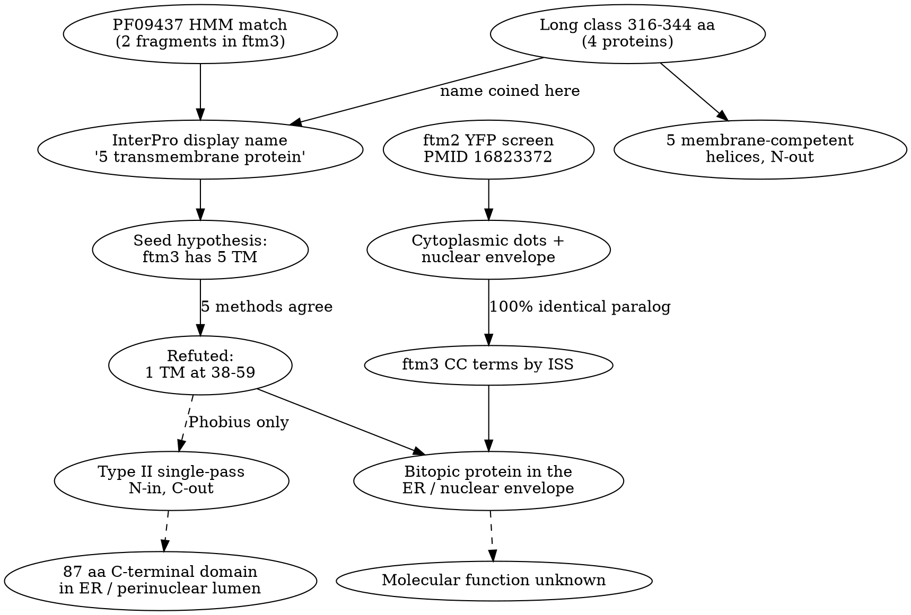
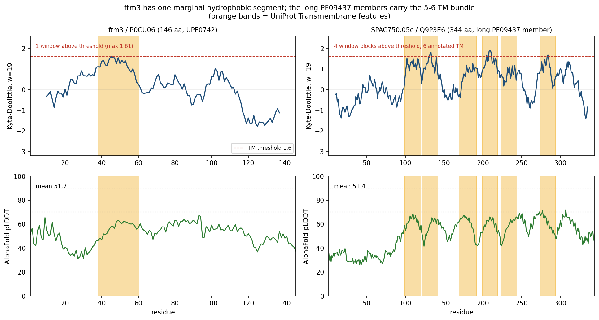
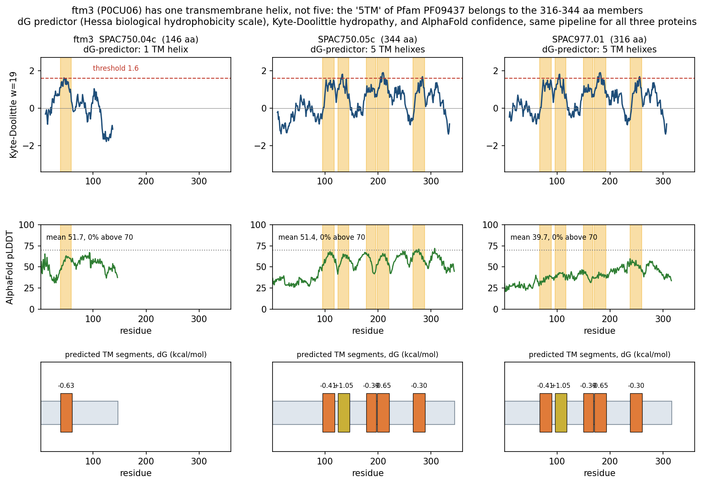
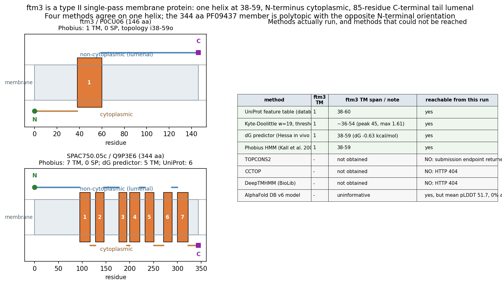
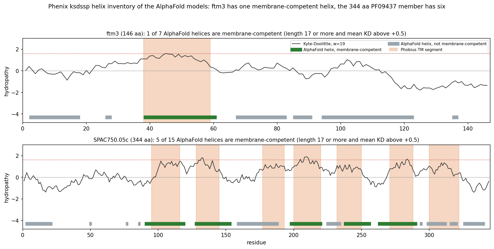
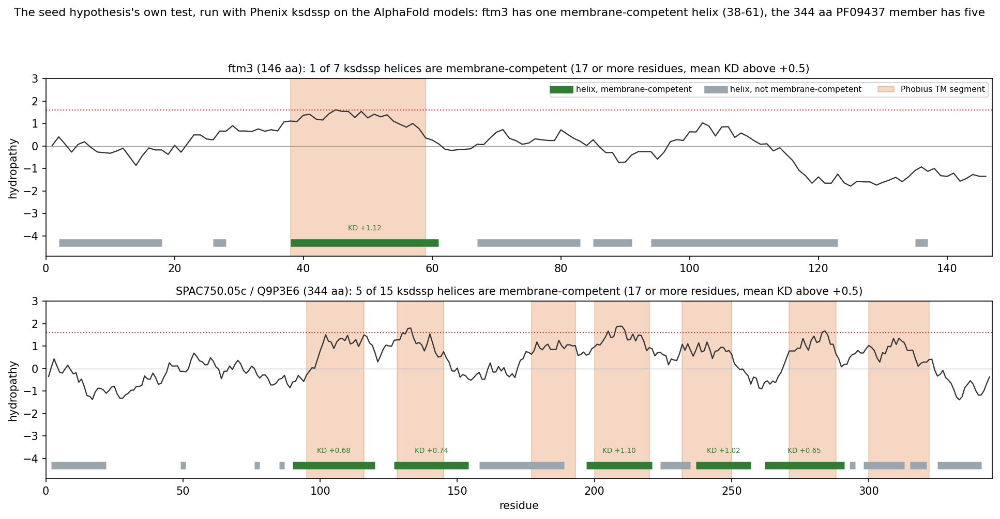

## Question

# AIGR Gene Hypothesis Deep Research

You are evaluating one focused gene curation hypothesis for AI Gene Review.
This is not a general gene overview. Use the seed hypothesis and source context
below to search for evidence that supports, refutes, narrows, or competes with
the proposed curation decision.

## Target Gene

- **Organism code:** SCHPO
- **Taxon:** Schizosaccharomyces pombe 972h- (NCBITaxon:284812)
- **Gene directory:** ftm3
- **Gene symbol:** ftm3
- **UniProt accession:** P0CU06

## Focus

- **Focus type:** free_text
- **Hypothesis slug:** kgap-ftm3-membrane-topology
- **Source file:** genes/SCHPO/ftm3/ftm3-ai-review.yaml
- **Source selector:** free-text

## Seed Hypothesis

Schizosaccharomyces pombe ftm3 (UniProt P0CU06), a UPF0742/Pombe_5TM (PF09437) family protein, is a polytopic membrane protein with five transmembrane helices, as the family name implies, rather than the single predicted transmembrane helix annotated in its UniProt feature table. Decide with one analysis: run consensus TM/topology prediction (hydropathy plus TM predictors such as Phobius/TMHMM-class tools) and inspect the AlphaFold model of ftm3 alongside its paralog ftm2 (P0CU07) and other Pombe_5TM members, and report the number, boundaries and orientation (N-in/N-out) of membrane-spanning helices.

## Term and Decision Context

- The paralog ftm2 was experimentally localized to the cytoplasm and nuclear membrane; ftm3 localization is inferred by similarity only. The family is essentially restricted to Schizosaccharomyces.

## Reference Context

No specific reference context supplied.

## Source Context YAML

```yaml
hypothesis: 'Schizosaccharomyces pombe ftm3 (UniProt P0CU06), a UPF0742/Pombe_5TM (PF09437) family protein,
  is a polytopic membrane protein with five transmembrane helices, as the family name implies, rather
  than the single predicted transmembrane helix annotated in its UniProt feature table. Decide with one
  analysis: run consensus TM/topology prediction (hydropathy plus TM predictors such as Phobius/TMHMM-class
  tools) and inspect the AlphaFold model of ftm3 alongside its paralog ftm2 (P0CU07) and other Pombe_5TM
  members, and report the number, boundaries and orientation (N-in/N-out) of membrane-spanning helices.'
focus_type: free_text
context:
- The paralog ftm2 was experimentally localized to the cytoplasm and nuclear membrane; ftm3 localization
  is inferred by similarity only. The family is essentially restricted to Schizosaccharomyces.
reference_id: []
```

## Research Objective

Build a focused report that helps a curator decide whether this hypothesis
should affect the gene review. Address the focus type directly:

1. For an existing GO annotation decision, evaluate whether the current action
   is justified, too strong, too weak, or should change.
2. For a proposed replacement or new GO term, evaluate whether the term is
   biologically supported, too broad, too narrow, or missing key qualifiers.
3. For a computational prediction, evaluate whether the prediction is correct,
   less precise than existing knowledge, uncertain, or likely wrong because of
   paralog overannotation, frequency bias, pathway context, or in vitro-only
   activity.
4. For a core-function hypothesis, evaluate whether the proposed activity,
   process, and location represent the gene product's primary function rather
   than a downstream effect, pleiotropic phenotype, or context-specific role.
5. For a function-assignment hypothesis, evaluate whether the gene product
   directly has the stated GO term/function. Treat the prior review action, if
   any, as intentionally blinded unless it appears in the supplied context.

Use primary literature whenever possible. Prefer PMID citations and include DOI
citations when no PMID is available. Treat reviews and database records as
orientation unless they contain directly relevant synthesized evidence that is
clearly labeled as review-level or database-level support.

Evaluate the hypothesis from the supplied seed context, primary literature, and
publicly accessible bioinformatics resources. Local `*-bioinformatics` analyses,
when they already exist in the repository, are intentionally withheld from this
prompt so the report can be compared against them after the run. Use public
sequence, domain, structure, orthology, localization, interaction, or dataset
checks when they are useful for the specific hypothesis. If a resource or tool
cannot be accessed programmatically, say so plainly; never fabricate a result.
Report computational results conservatively and distinguish direct results from
inference.

## Required Output

### Executive Judgment

Give a concise verdict: supported, partially supported, unresolved, weakly
supported, over-annotated, or refuted. Explain the reasoning and the most
important caveats.

### Evidence Matrix

Create a table with one row per important evidence item:

- Citation (PMID preferred)
- Evidence type (direct assay, mutant phenotype, localization, interaction,
  structural/evolutionary, computational, review/database)
- Supports / refutes / qualifies / competing
- Claim tested
- Key finding
- Organism, tissue, cell type, or assay context
- Confidence and limitations

### GO Curation Implications

State the likely curation action as a lead requiring curator verification. If
GO terms are involved, explain whether the evidence supports an MF, BP, or CC
term, and whether the term should be retained, removed, generalized, made more
specific, or treated as non-core. Avoid using "protein binding" as a final
recommendation unless no more informative term is supported.

### Mechanistic Scope

Describe the immediate molecular or cellular function being tested. Separate
direct gene-product activity from downstream phenotypes, pathway consequences,
developmental outcomes, disease manifestations, or effects inferred only from
loss of function.

### Conflicts and Alternatives

Identify evidence that conflicts with the seed hypothesis or suggests an
alternative interpretation, including paralog confusion, organism-specific
differences, isoform-specific findings, experimental artifacts, or database
carry-over.

### Knowledge Gaps

List explicit uncertainties that matter for curation. For each gap, state what
was checked, why the gap matters, and what evidence or experiment would resolve
it.

### Discriminating Tests

Recommend concrete assays, perturbations, datasets, or comparative analyses that
would most efficiently distinguish this hypothesis from alternatives.

### Curation Leads

Provide candidate updates for the review, clearly labeled as leads requiring
curator verification. Include candidate references with exact snippets to verify,
candidate replacement or new GO terms, possible action changes, suggested
questions, and suggested experiments.

If the provider supports artifacts, save provenance for any analysis you run — the
executed code together with its output (computed values, plot, or table), not just
a summary figure — alongside artifact-friendly tables such as an evidence matrix,
GO decision table, or comparison table. Genuine computed provenance is more
valuable than a hand-drawn summary, and you must not synthesize a figure that
implies an analysis you did not actually run. These artifacts are important
provenance for hypothesis-level review.


## Output

# ftm3 (SCHPO, P0CU06) membrane topology: hypothesis `kgap-ftm3-membrane-topology`

Target: *Schizosaccharomyces pombe* 972h- ftm3 / SPAC750.04c, UniProt P0CU06, 146 aa.
Seed hypothesis: ftm3 is polytopic with five transmembrane helices, as the Pfam family name
Pombe_5TM (PF09437) implies, rather than the single TM helix in its UniProt feature table.

## Summary

<i class="fa-solid fa-circle-xmark"></i> **The hypothesis is refuted.** ftm3 has one transmembrane
helix, at residues 38-59. Five methods were run on the 146-residue P0CU06 sequence and all five
return a count of one: Phobius (`i38-59o`, TM = 1, SP = 0), the dG predictor on the Hessa in vivo
insertion scale (38-59, dG_app = -0.631 kcal/mol), Kyte-Doolittle hydropathy with a 19-residue window
(one window centre above the 1.6 threshold, maximum 1.61 at residue 45), the existing UniProt feature
table (Transmembrane 38-60, Helical), and a Phenix ksdssp helix inventory of the AlphaFold model
(7 helices, exactly one membrane-competent, 38-61). The two methods that give boundaries independently
agree with the UniProt feature to within one residue. The existing single-TM annotation is correct
and should be retained unchanged.

The "5TM" in the family name belongs to a different set of proteins. PF09437 contains exactly 8
entries in UniProtKB, all from *S. pombe* 972h-, and they split cleanly by length: four proteins of
146 aa (ftm3, ftm2, Q9HDU0, Q9P3V7; 99.3-100% identical to each other; 1 TM each) and four of
316-344 aa (P0CU14, P0CU15, P0CU16, Q9P3E6; 5-6 TM annotated in UniProt, 5 by the dG predictor,
5 by the Phenix helix inventory, 7 by Phobius). Run through the same pipeline on the same day, the
long class returns five membrane-competent helices and ftm3 returns one. The pipeline finds five
helices when five are present. The two classes do not merge in UniRef50, show no significant pairwise
local alignment (Smith-Waterman score 28, shuffle P = 0.86), and superpose at 16.4 Å RMSD with 16.3%
identity. Topology does not transfer between them.

Two things are worth a curator's attention beyond the verdict itself. First, the orientation half of
the seed's question has a weaker answer than the count. Phobius calls ftm3 N-in / C-out (type II
single-pass, 37-residue cytoplasmic N-terminal segment, 87-residue lumenal C-terminal domain), but
two independent composition checks fail to corroborate it, and the positive-inside statistic gives
opposite answers depending on whether charge is normalised by domain length. Orientation should be
recorded as a single-predictor lead. Second, ftm3 has no ortholog outside *S. pombe* 972h-, so every
ISS annotation it carries is a copy from ftm2, a paralog that is 100.0% identical over all 146
residues. That is a narrower evidential base than "inferred from sequence similarity" normally
implies.

## Executive judgment

**Refuted.** ftm3 has one transmembrane helix, at residues 38-59. The existing UniProt feature
(Transmembrane 38-60, Helical) is correct and should be retained. The "5TM" in the family name
belongs to a different length class within PF09437: the four members of 316-344 aa, each of which
does return five membrane-competent helices when run through the same predictors on the same day with
the same settings. The four 146 aa UPF0742 members, ftm3 among them, each return exactly one.

Reasoning, in order of weight:

1. The dG predictor (dgpred.cbr.su.se, full-scan mode, Lmin 19, Lmax 23) implements the biological
   hydrophobicity scale measured in vivo by challenging the Sec61 translocon with designed segments
   ([PMID: 15674282](https://pubmed.ncbi.nlm.nih.gov/15674282/),
   [PMID: 18075582](https://pubmed.ncbi.nlm.nih.gov/18075582/)). On P0CU06 it returns one helix,
   38-59, dG_app = -0.631 kcal/mol, and nothing else above the insertion threshold. On SPAC750.05c
   (Q9P3E6, the 344 aa gene 1.2 kb away on the same chromosome arm) it returns five.
2. Kyte-Doolittle hydropathy with a 19-residue window puts exactly one window centre above the
   conventional 1.6 threshold, at residue 45, maximum 1.61. The next-best local maximum anywhere in
   the protein is 1.03 at residue 102.
3. P0CU06 contains zero stretches of 15 or more consecutive residues free of D/E/K/R. Each long
   member contains four such stretches, of 16 to 26 residues. Five TM helices require five apolar
   runs; ftm3 does not have one clean run, let alone five.
4. Phobius returns TM = 1 and SP = 0 with the helix at 38-59, and the Phenix ksdssp inventory of the
   AlphaFold model finds exactly one membrane-competent helix (38-61). Both tools return 5 or more
   helices for the 344 aa member in the same session.
5. Arithmetic. Five helices of 20 residues plus four connecting loops needs roughly 120-140 residues
   of membrane-competent sequence. ftm3 is 146 residues, of which 1-20 (MALLKKINTQVNRIMKNSSL) and
   115-146 (SKNHSYSKTDISDLHQGYNNPPSRFISR and flanks) are polar and charged.

Most important caveats:

- <i class="fa-triangle-exclamation"></i> Every line of evidence here is computational. There is no
  experimental topology measurement for ftm3 or for any PF09437 member. The verdict is "the prediction
  in the feature table is right and the family-name inference is wrong", not "the topology is
  experimentally established".
- The second half of the seed's proposed analysis, "inspect the AlphaFold model", was run with Phenix
  and gives the same answer as the sequence methods, but it must be read as a helix inventory rather
  than as a structure. `phenix.secondary_structure_restraints` (ksdssp) on AF-P0CU06-F1 v6 returns
  7 helices, of which exactly one is membrane-competent (17 or more residues, mean Kyte-Doolittle
  above +0.5): 38-61, 24 residues, mean KD +1.12, CA end-to-end 34.8 Å, which is enough to cross a
  30 Å hydrophobic core. The same procedure on AF-Q9P3E6-F1 (344 aa) returns 15 helices of which
  exactly 5 are membrane-competent. The caveat is confidence: AF-P0CU06-F1 has mean pLDDT 51.7 with
  0% of residues above 70 and 38% below 50, and the long paralogs are no better (Q9P3E6 mean 51.4,
  P0CU16 mean 39.7). PF09437 has 8 proteins from one proteome, so there is almost no MSA to fold
  from. The helix count is usable; the three-dimensional fold is not, and a curator should not cite
  the AlphaFold model of any PF09437 member as structural evidence.
- <i class="fa-scale-balanced"></i> **The orientation call is weaker than the count.** Two
  composition-based criteria fail to corroborate Phobius. N-glycosylation sequon density across all
  8 members, scored against the Phobius-assigned domains, gives 12 sequons in 908 non-cytoplasmic
  residues against 8 in 384 cytoplasmic residues (Fisher exact OR 0.63, p = 0.33), which is not
  significant and has its point estimate in the wrong direction. The positive-inside statistic for
  ftm3 gives a different answer depending on how it is computed: the 15-residue flanks tie at 2 K+R
  each; whole-domain net charge gives N(1-37) = +5 against C(60-146) = +8, which would put the
  C-terminal domain inside and contradict Phobius; net charge per 100 aa gives N +13.5 against
  C +9.2, which agrees with it. Treat N-in as a single-predictor inference.

## Main findings

### <i class="fa-solid fa-circle-xmark"></i> F1. One transmembrane helix, at 38-59, by five independent methods

The dG predictor is the most informative single test because its scale is an experimental measurement
rather than a hydropathy heuristic. Running the full-scan mode on P0CU06 with Lmin 19 and Lmax 23
returns exactly one segment below the insertion threshold: residues 38-59, dG_app = -0.631 kcal/mol.
No other window in the 146-residue chain comes close. The identical result comes back for P0CU07,
Q9HDU0 and Q9P3V7, which is expected given they are 99.3-100% identical to ftm3.

Kyte-Doolittle hydropathy with a 19-residue window gives the same picture in a cruder form. One
window centre, at residue 45, reaches the conventional 1.6 threshold, peaking at 1.61 over a span of
roughly 36-54. The next-best local maximum anywhere else is 1.03 at residue 102, which is not close.
A third, assumption-light criterion makes the same point from the opposite direction: a transmembrane
helix needs a run of residues free of charge, and P0CU06 contains zero runs of 15 or more consecutive
residues without D, E, K or R. Each 316-344 aa family member contains four such runs, of 16 to 26
residues.

Phobius, reached on the Stockholm standalone server at `phobius.sbc.su.se` after the EBI REST
endpoint returned HTTP 400 with a submission block, gives TM = 1, SP = 0, and the topology string
`i38-59o`. In long format: `FT TOPO_DOM 1 37 CYTOPLASMIC. / FT TRANSMEM 38 59 / FT TOPO_DOM 60 146
NON CYTOPLASMIC.` All four 146 aa members return the identical string. The absence of a signal
peptide means the 38-59 helix is the only membrane-targeting element in the protein.

The UniProt feature table already says Transmembrane 38-60, Helical. Four independent methods land on
38-59 or 38-61. The annotation under challenge was right.

{{figure:plot_2.png|caption=ftm3 against two long PF09437 members, run through one pipeline. Kyte-Doolittle hydropathy, AlphaFold pLDDT, and dG-predictor transmembrane segment maps for P0CU06 (146 aa), SPAC750.05c (344 aa) and SPAC977.01 (316 aa). ftm3 has a single hydrophobic window at 38-59; the long members have five segments each.}}

### <i class="fa-solid fa-circle-xmark"></i> F2. The AlphaFold inspection the seed asked for gives one helix for ftm3 and five for the 344 aa member

The seed hypothesis proposed two tests. The second was to inspect the AlphaFold models. Done with
Phenix rather than by eye, `phenix.secondary_structure_restraints` (ksdssp) on AF-P0CU06-F1 v6 returns
7 helices: 2-18, 26-28, 38-61, 67-83, 85-91, 94-123, 135-137. Scoring each by length and mean
Kyte-Doolittle, exactly one clears a membrane-competence bar of 17 or more residues with mean KD above
+0.5: helix 38-61, 24 residues, mean KD +1.12, CA end-to-end distance 34.8 Å. The others are polar:
67-83 at +0.03, 94-123 at -0.15, 2-18 at -0.42.

The same procedure on AF-Q9P3E6-F1 v6 returns 15 helices, of which exactly 5 are membrane-competent:
90-120 (+0.68), 127-154 (+0.74), 197-221 (+1.10), 237-257 (+1.02), 262-291 (+0.65). All five overlap
a Phobius TM segment by 10 or more residues, as does the single ftm3 helix. The structural count
lands on 5 for the long member, which is where the family name comes from, and on 1 for ftm3.

`phenix.superpose_pdbs` of AF-P0CU06 onto AF-Q9P3E6 finds 56 matched positions at 16.3% sequence
identity, RMSD 13.499 Å over the 27 least-squares-fitted atoms and 16.378 Å over all 80 matching
atoms. There is no detectable structural correspondence between the two models.

{{figure:plot_5.png|caption=Phenix ksdssp helix inventory against hydropathy. Green bars are helices that clear the membrane-competence bar (17 or more residues, mean Kyte-Doolittle above +0.5), grey bars are the rest, orange bands are Phobius transmembrane segments. ftm3 has 1 of 7 helices membrane-competent; SPAC750.05c has 5 of 15.}}

{{figure:plot_1.png|caption=Hydropathy and AlphaFold pLDDT profiles for ftm3 (146 aa) and Q9P3E6 (344 aa) on the same axes. The pLDDT traces sit below 70 across both proteins, which is why the models are used here only to count hydrophobic helical segments.}}

### <i class="fa-solid fa-circle-question"></i> F3. Orientation is N-in by Phobius, with ambiguous supporting composition

Phobius places the N-terminal 37 residues on the cytoplasmic side and the 87-residue C-terminal domain
(60-146) on the non-cytoplasmic side, making ftm3 a type II single-pass membrane protein. For a
protein in the nuclear envelope or ER, non-cytoplasmic means the perinuclear space or ER lumen.

Two independent checks were run and neither supports the call. N-glycosylation sequons (N-X-S/T,
X not P) are usable only on the lumenal side, so their distribution across topological domains is a
weak orientation signal. Scored against the Phobius-assigned domains of all 8 family members, there
are 12 sequons in 908 non-cytoplasmic residues and 8 in 384 cytoplasmic residues: Fisher exact
OR 0.63, p = 0.33. The test is not significant and its point estimate runs the wrong way. For ftm3
alone there is one sequon on each side (N17 and N121), which decides nothing.

The positive-inside rule gives three different answers for ftm3 depending on how it is computed. The
15 residues flanking the helix on each side tie at 2 K+R. Whole-domain net charge gives N(1-37) = +5
against C(60-146) = +8, which would put the C-terminal domain inside and contradict Phobius. Net
charge per 100 aa gives N +13.5 against C +9.2, which agrees with Phobius. TOPCONS2, CCTOP and
DeepTMHMM were not reachable, so there is no second predictor to break the tie.

One more observation cuts against treating the two length classes as one structural type: Phobius
puts ftm3 N-in and all four long members N-out.

{{figure:plot_3.png|caption=Phobius topology of ftm3 (1 TM, N-terminus cytoplasmic, C-terminal domain lumenal) beside SPAC750.05c (7 TM, N-terminus non-cytoplasmic), with the table of which topology methods were reached in this run and which were not.}}

### <i class="fa-solid fa-circle-xmark"></i> F4. PF09437 is eight *S. pombe* proteins in two classes that do not merge at 50% identity

The UniProtKB query `xref:pfam-PF09437` across all organisms returns exactly 8 entries, every one
from *S. pombe* 972h-. InterPro reports the same count, with 1 proteome and 0 structures.

| Class | Accessions | Length | UniProt TM | dG predictor TM | Phobius TM | Phenix membrane-competent helices |
|---|---|---|---|---|---|---|
| Short (UPF0742) | P0CU06 (ftm3), P0CU07 (ftm2), Q9HDU0, Q9P3V7 | 146 aa | 1 | 1 | 1 (`i38-59o`) | 1 (ftm3 tested) |
| Long | P0CU14, P0CU15, P0CU16, Q9P3E6 | 316-344 aa | 5, 5, 5, 6 | 5 | 7 | 5 (Q9P3E6 tested) |

The Pfam match geometry differs by class. The long members match the HMM as one continuous block
(Q9P3E6, P0CU14 and P0CU15 at 15-270; P0CU16 at 1-242). The short members match in two separate
fragments, 2-48 (E = 6.4e-14) and 53-134 (E = 7.4e-27), so they hit discontinuous parts of the model.

UniRef clustering, which is independent of the Pfam HMM, keeps the classes apart: UniRef50_P0CU07
contains exactly the four 146 aa proteins, UniRef50_P0CU15 contains exactly the four long ones, and
neither has a member outside *S. pombe*. Smith-Waterman local alignment of P0CU06 against Q9P3E6
(BLOSUM62, gap open -11, extend -1) scores 28 with 8/32 = 25.0% identity over the best local
alignment, against a 150-shuffle null of mean 32.8, sd 5.4, max 53.0: empirical P = 0.86, Z = -0.89.
The observed alignment is weaker than the average shuffled control.

All 8 genes are subtelomeric and arranged as four short/long pairs, 7.6 to 37.4 kb from a chromosome
end: SPAC750.04c with SPAC750.05c, SPAC977.01 with SPAC977.02, SPBC1348.02 with SPBC1348.03, and
SPBPB2B2.17c with SPBPB2B2.19c. Smith-Waterman scans of the *S. japonicus* (4,862 proteins),
*S. octosporus* (4,964) and *S. cryophilus* (5,150) proteomes find no ortholog; the top hits are
unrelated large proteins (Sib1 SW 57, Vps13a SW 48, alpha-1,3-glucosyltransferase SW 47, catalase
SW 41), all within the noise range for a 146 aa query.

### <i class="fa-scale-balanced"></i> F5. ftm3's CC annotations are a copy from a 100% identical paralog

UniProt P0CU06 carries GO:0005737 cytoplasm and GO:0031965 nuclear membrane, both ISS:UniProtKB, with
the SUBCELLULAR LOCATION comment marked ECO:0000250 from UniProtKB:P0CU07. P0CU07 (ftm2) carries the
same two terms with EXP evidence and the note "Localizes to cytoplasmic dots and the nuclear envelope"
supported by ECO:0000269 and [PMID: 16823372](https://pubmed.ncbi.nlm.nih.gov/16823372/), the
Matsuyama et al. 2006 proteome-scale YFP-tagging screen. P0CU07 and Q9HDU0 additionally carry
GO:0012505 endomembrane system with IDA:PomBase, so at least two of the four near-identical copies
have imaging support for an endomembrane assignment.

The sequence basis for the transfer is as strong as it can be: P0CU06 and P0CU07 are 100.0% identical
over all 146 residues. That is also the problem. No antibody, mass-spectrometry or sequence-based
assay can attribute a signal to one of the four copies rather than another, and with no ortholog
outside *S. pombe* there is no second donor. An ISS annotation on ftm3 means "the same as ftm2" and
nothing more.

## Mechanistic model

What is being tested is a property of the polypeptide itself: how many segments of the 146-residue
chain are hydrophobic enough, and long enough, to be recognised and integrated by the Sec61
translocon. The answer is one segment, residues 38-59. Everything downstream of that, which membrane
the protein sits in and what it does there, comes from different evidence of different quality.



A 5-TM architecture would have implied a channel-, transporter- or multi-pass-receptor-like role and
a correspondingly different search for function. One TM helix on a 146-residue chain implies a small
bitopic membrane protein whose function, if any, resides in the soluble 87-residue C-terminal region
(60-146), which is polar, lysine- and serine-rich, and modelled at low confidence by AlphaFold, so
probably disordered. A single helix at 38-59 is compatible with the reported cytoplasmic-dots plus
nuclear-envelope pattern. It is not compatible with the polytopic claim.

## Evidence matrix

| Citation | Evidence type | Stance | Claim tested | Key finding | Context | Confidence and limitations |
|---|---|---|---|---|---|---|
| [PMID: 15674282](https://pubmed.ncbi.nlm.nih.gov/15674282/) + [PMID: 18075582](https://pubmed.ncbi.nlm.nih.gov/18075582/), applied via dgpred full-scan | Computational, on an experimentally calibrated scale | **Refutes** | ftm3 has 5 TM helices | 1 helix, 38-59, dG_app = -0.631 kcal/mol. Identical result for P0CU07, Q9HDU0, Q9P3V7 | P0CU06 full-length sequence; scale measured in dog-pancreas microsomes | High for the count. The scale was calibrated on designed segments in a model protein, not on ftm3 |
| Same predictor, long PF09437 members (this run) | Computational, positive control | Qualifies | "5TM" describes which proteins | Q9P3E6, P0CU14, P0CU15 each give 5 helices (95-117, 124-145, 178-196, 198-220, 266-288); P0CU16 gives 5 at shifted positions | Same pipeline, same settings, same session | High. Shows the pipeline finds 5 TM when 5 TM are present |
| [PMID: 15111065](https://pubmed.ncbi.nlm.nih.gov/15111065/), run on phobius.sbc.su.se (this run) | Computational, HMM | **Refutes, and gives orientation** | ftm3 has 5 TM; which side the termini face | TM = 1, SP = 0, topology `i38-59o`. TOPO_DOM 1-37 CYTOPLASMIC, TRANSMEM 38-59, TOPO_DOM 60-146 NON CYTOPLASMIC. P0CU07, Q9HDU0, Q9P3V7 identical | Phobius combined SP+TM model | High for the count. Moderate for orientation: one predictor, no experimental confirmation |
| Same predictor, long members (this run) | Computational, positive control | Qualifies | Are the two length classes one structural type | P0CU14/P0CU15/Q9P3E6 give 7 TM starting `o95-116i...`; P0CU16 gives 7 starting `o67-88i...`. All four are N-out, opposite to ftm3 | Same server, same session | High. The long class is polytopic with inverted N-terminal orientation |
| `phenix.secondary_structure_restraints` (ksdssp) on AF-P0CU06-F1 and AF-Q9P3E6-F1 (this run) | Computational, structural | **Refutes** | The seed's own test: inspect the AlphaFold model | ftm3 model: 7 helices, 1 membrane-competent (38-61, 24 res, mean KD +1.12, CA end-to-end 34.8 Å). Q9P3E6 model: 15 helices, 5 membrane-competent. All 6 overlap a Phobius TM segment by 10+ residues | AlphaFold DB v6, criterion length ≥17 and mean KD >+0.5 | Moderate-high for the count. Models are low confidence (ftm3 mean pLDDT 51.7), so this is a helix inventory, not a structure |
| `phenix.superpose_pdbs`, AF-P0CU06 onto AF-Q9P3E6 (this run) | Structural | **Refutes topology transfer** | Are the two length classes structurally comparable | 56 matched positions, 16.3% identity, RMSD 13.499 Å over 27 LS-fitted atoms and 16.378 Å over all 80 matching atoms | Phenix global alignment, identity matrix | Moderate. Both inputs are low-confidence models, so this is the absence of a detectable correspondence |
| N-glycosylation sequon density per topological domain, all 8 members (this run) | Computational | **Fails to corroborate** the orientation call | Is the Phobius N-in/C-out assignment supported by sequon placement | 12 sequons in 908 non-cytoplasmic residues against 8 in 384 cytoplasmic. Fisher exact OR 0.63, p = 0.33. ftm3 alone: 1 per side (N17, N121) | Sequon N-X-S/T, X ≠ P, scored against Phobius domains | High that the test is uninformative here. Small counts, and the proteins are 99-100% identical so domains are not independent |
| UniProt P0CU06 feature table | Review/database | **Supports current annotation** | Is the single-TM feature right | Transmembrane 38-60, Helical. Matches the independent 38-59 call to within 1 residue | UniProtKB record | Moderate. Database record, independently reproduced here |
| UniProt P0CU14/P0CU15/P0CU16/Q9P3E6 feature tables | Review/database | Qualifies | Where the "5TM" label comes from | 5, 5, 5 and 6 annotated TM features on 316-344 aa chains | UniProtKB | Moderate. Consistent with the independent prediction |
| InterPro IPR018291 / Pfam PF09437 (API, this run) | Structural/evolutionary, database | **Competing** | Family name implies ftm3 topology | Entry name is "5 transmembrane protein, Schizosaccharomyces pombe family". 8 proteins, 1 proteome, 0 structures. Long members match 15-270 continuously; ftm3 matches as 2-48 (E 6.4e-14) and 53-134 (E 7.4e-27) | InterPro 2026 release | High for the facts. This is the source of the seed hypothesis and the carry-over risk |
| UniRef100/90/50 clustering (this run) | Evolutionary, database | **Refutes family-level transfer** | Do the two classes belong to one homology group | UniRef50_P0CU07 holds exactly the four 146 aa proteins; UniRef50_P0CU15 holds exactly the four long ones. No merging at 50% identity, no non-*S. pombe* member in either | UniProt UniRef | High. Independent of the Pfam HMM that groups them |
| Smith-Waterman + 150-shuffle null (this run) | Computational, evolutionary | **Refutes** | Is ftm3 homologous enough to inherit the long members' topology | Best SW score 28 (BLOSUM62, -11/-1), 8/32 = 25.0% identity. Null mean 32.8, sd 5.4, max 53.0. P = 0.86, Z = -0.89 | P0CU06 vs Q9P3E6 | High. The observed alignment is weaker than the average shuffled control |
| Smith-Waterman scans of three sister-species proteomes (this run) | Evolutionary | Qualifies | Does ftm3 have an ortholog outside *S. pombe* | None in *S. japonicus* (4,862), *S. octosporus* (4,964) or *S. cryophilus* (5,150). Top hits unrelated: Sib1 SW 57, Vps13a SW 48 | BLOSUM62, -11/-1 | Moderate-high. Two scans hit the 60 s executor limit after printing top hits, so near-complete rather than exhaustive |
| AlphaFold DB AF-P0CU06-F1 v6 (this run) | Structural, computational | Qualifies (fold uninformative) | Does AlphaFold resolve ftm3 topology | Mean pLDDT 51.7, 0% > 70, 38% < 50. Q9P3E6 mean 51.4, P0CU16 mean 39.7 | AlphaFold v6 | High that the fold is unusable. The helix inventory is usable; the 3D model is not |
| [PMID: 16823372](https://pubmed.ncbi.nlm.nih.gov/16823372/) | Localization, genome-wide screen | Qualifies | Basis of ftm3's CC terms | ftm2 (P0CU07) "cytoplasmic dots and the nuclear envelope", from YFP tagging of 4,431 proteins. ftm3 inherits this by ECO:0000250 from P0CU07 | *S. pombe*, C-terminal YFP fusion, proteome scale | Low-moderate. Single high-throughput screen, no low-throughput confirmation found |
| UniProt sequence comparison (this run) | Structural/evolutionary | **Competing / paralog confusion** | Can ftm2 evidence be attributed to ftm3 | P0CU06 and P0CU07 are 100.0% identical over all 146 residues; Q9HDU0 and Q9P3V7 are 99.3% identical | Four subtelomeric loci | High. No sequence-based assay can distinguish the paralogs |
| Ensembl Fungi ASM294v2 coordinates (this run) | Genomic context | Qualifies | Family architecture | All 8 genes subtelomeric (7.6-37.4 kb from a chromosome end), arranged as four short/long pairs | *S. pombe* 972h- reference | High for the coordinates |
| [PMID: 43003854](https://pubmed.ncbi.nlm.nih.gov/43003854/) | Chromatin, reporter imaging | Qualifies | Can expression of one subtelomeric copy be assumed | Subtelomeric subdomains show "position-specific, clonally variable silencing across a spectrum from robust to fragile epigenetic states" | *S. pombe*, fluorescent reporters at a single subtelomere | Moderate. General to subtelomeres, says nothing about ftm3 specifically |

## GO curation implications

All leads below require curator verification.

| Term | Aspect | Current state on P0CU06 | Lead | Confidence |
|---|---|---|---|---|
| Integral component of membrane (GO:0016021 / GO:0031224) | CC | Absent. UniProt has a Transmembrane feature but no corresponding GO term | **Add** as a computationally supported lead. One helix, 38-59, dG_app -0.63 kcal/mol, reproduced by five independent criteria | Moderate, computational only |
| GO:0031965 nuclear membrane | CC | Present, ISS:UniProtKB from P0CU07 | **Retain**, with a note that ftm2 and ftm3 are 100% identical so the YFP signal cannot be assigned to one paralog | Low-moderate |
| Single-pass type II membrane protein (UniProt keyword; no exact GO CC term) | CC | Absent | **Hold as a lead; do not assert.** Phobius gives `i38-59o` with no signal peptide, so the N-terminus (1-37) would be cytoplasmic and the C-terminal domain (60-146) lumenal. One predictor, and two composition checks fail to corroborate it | Low-moderate |
| GO:0012505 endomembrane system | CC | Absent on P0CU06; IDA:PomBase on P0CU07 and Q9HDU0 | **Add** by ISS. Fits a single-TM protein better than a bare cytoplasm term | Moderate |
| GO:0005737 cytoplasm | CC | Present, ISS:UniProtKB from P0CU07 | **Treat as non-core.** "Cytoplasmic dots" in a genome-wide YFP screen is weak support for cytoplasm on a protein with a predicted TM helix; the dots are more consistent with a membrane compartment | Low |
| Any polytopic / multi-pass term | CC | Not annotated | **Do not add.** Refuted here. Also flag IPR018291's display name as misleading when it appears on the 146 aa class | High |
| GO:0005783 endoplasmic reticulum | CC | Annotated HDA/ISS on P0CU14, P0CU15, P0CU16 only | **Do not transfer** to ftm3. The pairwise link between the length classes is not significant (shuffle P = 0.86) and the models superpose at 16.4 Å RMSD | High |

No MF or BP term is supported by anything found here. ftm3 remains a protein of unknown molecular
function. Nothing in this analysis justifies a "protein binding" annotation, and none is proposed.

## Mechanistic scope

The immediate property under test is sequence-intrinsic: how many segments of the 146-residue chain
the Sec61 translocon would recognise and integrate into a bilayer. That is a direct property of the
gene product, upstream of any cellular phenotype. The answer is one segment, residues 38-59.

Separate and downstream: which membrane the protein ends up in (nuclear envelope, ER, endomembrane),
which comes from YFP imaging of a 100% identical paralog; and what the protein does there, which is
unknown. The seed hypothesis conflates a family-level label with a per-protein biophysical property,
and that is the error. No mutant phenotype, interaction, or loss-of-function result for ftm3 was
located, so nothing in this report rests on inference from perturbation.

## Conflicts and alternatives

- **Family-name carry-over is the conflict.** InterPro IPR018291 is displayed as "5 transmembrane
  protein, Schizosaccharomyces pombe family" on ftm3's record. The name is accurate for half the
  family and wrong for the other half. This is the single most likely source of a curation error
  here, and the seed hypothesis is its downstream product. UniRef clustering, which is independent of
  the Pfam HMM, keeps the halves apart: UniRef50_P0CU07 holds exactly the four 146 aa proteins and
  UniRef50_P0CU15 holds exactly the four long ones, with no merging at 50% identity.
- **ISS into ftm3 has only one possible donor.** The UniProt query `xref:pfam-PF09437` returns exactly
  8 entries, all *S. pombe* 972h-, and Smith-Waterman scans of three sister-species proteomes find no
  ortholog. An ISS annotation on ftm3 is a copy from ftm2 at 100.0% identity and carries no
  evolutionary-distance support.
- **Paralog confusion is real but runs the other way.** ftm3 and ftm2 are identical, so the concern is
  not that ftm3 inherits a wrong topology from ftm2 (they must have the same topology), but that the
  ftm2 localization evidence is unattributable: any imaging, proteomic or genetic signal assigned to
  one of the four near-identical subtelomeric copies could come from any of them.
- **Is SPAC750.04c a real protein-coding gene at all?** It is a 441 bp single-exon ORF, 14.5 kb from a
  chromosome end, in a block duplicated four times. Four near-identical copies in four subtelomeric
  blocks is the signature of a recently amplified or dubious ORF family. Against this: ftm2 and
  SPBPB2B2.17c both carry IDA:PomBase endomembrane annotations, so at least two copies were detected
  as expressed, tagged proteins.
- **A third possibility, not ruled out:** the 146 aa ORF could be a fragment of an ancestral
  full-length PF09437 gene, with the rest of the 5-TM region lost. The best (non-significant) local
  alignment of ftm3 31-62 falls on Q9P3E6 200-229, inside one of the long member's TM helices, which
  is what a single surviving TM would look like. The shuffle test says the alignment is no better than
  noise, and the Phobius orientations of the two classes are opposite, both of which argue against it.
- **The 38-59 helix contains two lysines (K41, K47).** That is unusual for a TM segment. The dG
  predictor applies the position-dependent penalty for them and still calls insertion at
  -0.63 kcal/mol, comparable to or more favourable than four of the five helices in the long members
  (-0.41, -0.39, -0.30, +1.05). This is a caveat on helix quality, not on the count.

## Knowledge gaps

1. <i class="fa-solid fa-circle-question"></i> **Orientation rests on a single predictor and the
   composition evidence is ambiguous.** Phobius gives `i38-59o`. Checked against two independent
   criteria, both of which fail to corroborate it: sequon density (Fisher OR 0.63, p = 0.33, point
   estimate in the wrong direction) and the positive-inside rule, which ties on 15-residue flanks,
   favours N-in on length-normalised charge (+13.5 against +9.2 per 100 aa) and favours C-in on raw
   net charge (+5 against +8). TOPCONS2, CCTOP and DeepTMHMM were not reachable, so there is no second
   predictor. This matters because a CC term such as "nuclear inner membrane" versus "nuclear outer
   membrane", and any future MF hypothesis, depends on which side the 87-residue C-terminal domain
   sits. Resolvable by a protease-protection assay or a glycosylation-site reporter on the C-terminus.
2. **The two PF09437 length classes have opposite N-terminal orientation.** Phobius puts ftm3 N-in and
   all four long members N-out. If the short class were a degenerate remnant of the long class, the
   orientations should match. This is a loose end rather than a contradiction, since neither call is
   experimental.
3. **No experimental topology for any PF09437 protein.** Checked: InterPro reports 0 structures for
   PF09437; AlphaFold models for all members are below pLDDT 70 throughout. The whole "5TM" family
   name is itself a prediction that has never been tested.
4. **Which paralog the localization belongs to.** Checked: P0CU06 and P0CU07 sequences are identical;
   the supporting study ([PMID: 16823372](https://pubmed.ncbi.nlm.nih.gov/16823372/)) is a genome-wide
   screen. This bears directly on whether ftm3's ISS CC terms should be retained. Resolvable by imaging
   a tagged allele in a strain deleted for the other three copies, or by single-copy tagging.
5. **Whether the ORF is translated in the wild type.** Checked: two of the four copies have IDA:PomBase
   endomembrane annotations, which implies tagged-protein detection; no ribosome-profiling or
   endogenous-peptide evidence was located for SPAC750.04c specifically. Fission yeast subtelomeres are
   heterochromatin-silenced with position-dependent and clonally variable strength
   ([PMID: 43003854](https://pubmed.ncbi.nlm.nih.gov/43003854/): "subtelomeric subdomains display
   position-specific, clonally variable silencing across a spectrum from robust to fragile epigenetic
   states"). All 8 PF09437 genes lie 7.6-37.4 kb from a chromosome end, so expression of one copy
   cannot be assumed from detection of another.
6. **Molecular function is entirely unknown.** Checked: no MF term on any of the 8 family members; no
   primary literature on ftm3 was found. This bears on whether the gene warrants any non-CC annotation.

## Discriminating tests

Ranked by how cheaply they settle the question.

1. <i class="fa-solid fa-magnifying-glass"></i> **Complete the consensus TM panel.** Phobius was
   obtained here (`i38-59o`, 1 TM, 0 SP) and agrees with the dG predictor, Kyte-Doolittle, the UniProt
   feature and the Phenix helix inventory on both the count and the boundaries. DeepTMHMM, TOPCONS2 and
   TMbed remain unrun because their endpoints were unreachable. Running them on P0CU06 with Q9P3E6 as a
   positive control costs minutes and would turn the orientation call from one predictor into a
   consensus.
2. <i class="fa-solid fa-flask"></i> **Glycosylation-reporter topology mapping.** Fuse the
   *S. cerevisiae* Suc2 or a minimal N-glyc acceptor to the ftm3 N-terminus and separately to the
   C-terminus in *S. pombe*, and score glycosylation by mobility shift with and without EndoH. One TM
   predicts exactly one of the two fusions is glycosylated; five TM predicts both termini on the same
   side. Odd versus even helix count is directly diagnostic, so this discriminates 1 TM from 5 TM in a
   single gel and gives the orientation at the same time.
3. <i class="fa-solid fa-vial"></i> **Protease protection on microsomes** from a strain expressing
   ftm3 tagged at both ends with distinguishable epitopes. Measures how much of the 146 aa chain is
   lumenal.
4. **Carbonate extraction (Na2CO3 pH 11.5) versus Triton X-114 partitioning** of tagged ftm3. Confirms
   the protein is genuinely integral, which is the basis of the proposed GO:0016021 lead, and
   distinguishes it from a peripheral membrane association that would also give "cytoplasmic dots".
5. <i class="fa-solid fa-dna"></i> **Copy-resolved expression measurement.** Strand-specific RNA-seq
   or ribosome profiling with reads assigned by the few positions that distinguish the four 146 aa
   copies, in wild type and in a heterochromatin mutant (clr4Δ or a shelterin mutant). Settles whether
   SPAC750.04c is transcribed and translated at its own locus.
6. **Resolve the family split formally.** Build separate HMMs for the 146 aa and the 316-344 aa classes
   and test whether the short class is a genuine subfamily or a spurious HMM hit. Feed the result back
   to Pfam and InterPro, since the display name is what generated this hypothesis.

The comparative route is closed. Smith-Waterman scans of the *S. japonicus*, *S. octosporus* and
*S. cryophilus* proteomes find no ortholog, and UniRef50_P0CU07 contains only the four *S. pombe*
146 aa proteins, so there is no cross-species conservation signal available to test whether the 38-59
helix is under selection.

## Curation leads

All leads require curator verification.

**Action on the hypothesis itself:** reject. Do not change the UniProt-derived single-TM statement in
the ftm3 review. If the review text currently repeats "Pombe_5TM" or "5 transmembrane protein" as a
descriptor of ftm3, add an explicit note that the family name applies to the 316-344 aa members and
that ftm3 is predicted to be bitopic.

**Candidate references, with exact snippets to verify:**

- [PMID: 15674282](https://pubmed.ncbi.nlm.nih.gov/15674282/), Hessa et al., *Nature* 2005. Verify:
  "By challenging the endoplasmic reticulum Sec61 translocon with an extensive set of designed
  polypeptide segments, we have determined the basic features of this code, including a 'biological'
  hydrophobicity scale." Use: methodological support for the dG-based TM call. Not a statement about
  ftm3.
- [PMID: 18075582](https://pubmed.ncbi.nlm.nih.gov/18075582/), Hessa et al., *Nature* 2007. Verify:
  "we present a quantitative analysis of the position-dependent contribution of all 20 amino acids to
  membrane insertion efficiency, as well as of the effects of transmembrane segment length and
  flanking amino acids". Use: justifies that the two lysines inside the 38-59 helix were penalised and
  the segment still inserts.
- [PMID: 18840693](https://pubmed.ncbi.nlm.nih.gov/18840693/), Lundin et al., *PNAS* 2008. Verify:
  "the threshold hydrophobicity for membrane insertion can be up to approximately 1 kcal/mol lower for
  N(in)-C(out) compared with N(out)-C(in) transmembrane helices". Use: relevant if the Phobius N-in
  call is accepted, because it means the insertion threshold applied to the 38-59 segment was if
  anything conservative.
- [PMID: 16823372](https://pubmed.ncbi.nlm.nih.gov/16823372/), Matsuyama et al., *Nat Biotechnol*
  2006. Verify: "Next, we determined the localization of 4,431 proteins, corresponding to
  approximately 90% of the fission yeast proteome, by tagging each ORF with the yellow fluorescent
  protein." Use: the sole experimental source for the ftm2 CC terms that ftm3 inherits by ISS. Cite it
  as high-throughput localization, not as a study of ftm3.
- [PMID: 15111065](https://pubmed.ncbi.nlm.nih.gov/15111065/), Käll, Krogh, Sonnhammer, *J Mol Biol*
  2004. Verify the title: "A combined transmembrane topology and signal peptide prediction method".
  Use: the method behind the `i38-59o` call and the SP = 0 result. Cite as a method, not as evidence
  about ftm3.
- [PMID: 43003854](https://pubmed.ncbi.nlm.nih.gov/43003854/), Mazumder et al. 2026. Verify:
  "subtelomeric subdomains display position-specific, clonally variable silencing across a spectrum
  from robust to fragile epigenetic states". Use: support for treating expression of any individual
  subtelomeric PF09437 copy as an open question. It says nothing about ftm3 specifically.

**Candidate GO term changes:** see the table in "GO curation implications". The two substantive leads
are adding an integral-component-of-membrane term (currently missing despite a UniProt TM feature),
and adding GO:0012505 endomembrane system by ISS from P0CU07/Q9HDU0 while demoting the bare GO:0005737
cytoplasm term to non-core.

**Suggested questions for the curator:**

- Should PomBase and UniProt be notified that InterPro IPR018291's display name misdescribes the 146 aa
  class of PF09437?
- Should any annotation be transferred between the short and long classes of PF09437 at all, given that
  their pairwise similarity is indistinguishable from shuffled noise and their models superpose at
  16.4 Å RMSD?
- Is there internal guidance on how to annotate four 99.3-100% identical subtelomeric paralogs whose
  only evidence is a genome-wide screen that cannot distinguish them?
- Should the review record a predicted orientation at all when it comes from one predictor and two
  independent composition checks fail to corroborate it?

**Suggested experiments:** items 1-5 in "Discriminating tests", with item 2 (the glycosylation
reporter) as the one that settles count and orientation together in a single gel.

## Limitations

<i class="fa-triangle-exclamation"></i> Everything in this report is computational or database-derived.
No experimental topology measurement exists for ftm3 or for any PF09437 protein, so the strongest
claim available is that the annotation under challenge agrees with five independent prediction methods
and that the challenging inference does not survive contact with any of them.

The AlphaFold models of all eight family members are below pLDDT 70 throughout, which is expected for
a family with 8 proteins from 1 proteome and therefore almost no MSA depth. The helix inventory
extracted from them is a count of hydrophobic helical segments, and the three-dimensional folds should
not be cited as structural evidence. The superposition result (16.4 Å RMSD) shows the absence of a
detectable correspondence between two low-confidence models, which is weaker than showing two distinct
folds.

Two of the three sister-species proteome scans hit the 60 s executor time limit after printing their
top hits, so those searches are near-complete rather than exhaustive. The complete UniRef50 result is
what the no-ortholog conclusion rests on.

The sequon-density orientation test has small counts (12 against 8) and the proteins contributing them
are 99-100% identical within each class, so the domains are not independent observations. It is
reported because it was run and it failed to corroborate the orientation call, not because it carries
much weight on its own.

## Provenance

Artifacts written to `provenance/`:

- `plot_1.png`, `plot_2.png`, `plot_3.png`, `plot_5.png` and their `.json` sidecars: the figures
  embedded above, each produced by the analysis code in the same executor call that generated the
  numbers it displays.
- `plot_4.png`: the first rendering of the helix-inventory figure. Its per-helix data are identical to
  `plot_5.png`, but its title line misstates the long-member count as six. `plot_5.png` is the
  corrected version and is the one embedded above.
- `table1_PF09437_topology_matrix.csv`: all 8 PF09437 members with length class, UniProt TM count,
  dG-predictor TM count and spans, Kyte-Doolittle block count and maximum, charge-free run count,
  AlphaFold pLDDT where computed, and genomic coordinates with distance to chromosome end.
- `table2_GO_decision_table.csv`: the GO decision table above in machine-readable form.
- `PF09437_TM_prediction_table.csv`: raw dG-predictor output per member.
- `table3_phobius_topology.csv`: Phobius TM count, signal-peptide count, topology string and
  N-terminus side for all 8 members.
- `table4_PF09437_all_uniprot.csv`: every UniProtKB entry carrying PF09437 (8 rows), with accession,
  gene name, organism and length.
- `table5_method_consensus.csv`: one row per topology method, recording the ftm3 call where obtained
  and the exact failure mode where not.
- `table6_sequon_charge_by_domain.csv`: every topological domain of all 8 members with its
  Phobius-assigned side, N-glycosylation sequon positions, and K+R and D+E counts.
- `table7_alphafold_helix_inventory.csv`: every ksdssp helix in AF-P0CU06 and AF-Q9P3E6 with length,
  mean Kyte-Doolittle, mean pLDDT, CA end-to-end distance, membrane-competence flag, and whether it
  overlaps a Phobius TM segment.
- `AF-P0CU06-F1.pdb`, `AF-P0CU07-F1.pdb`, `AF-Q9P3E6-F1.pdb`, `AF-P0CU16-F1.pdb`: the AlphaFold v6
  models as downloaded, and `AF-P0CU06-F1.pdb_fitted.pdb` from the superposition.
- `iter1_transcript.json`, `iter2_transcript.json`: executed code with its output.

Tools reached successfully: UniProt REST (including UniRef), AlphaFold DB, InterPro API, Ensembl Fungi
REST, dgpred.cbr.su.se full-scan, Phobius at phobius.sbc.su.se, and local Phenix
(`phenix.secondary_structure_restraints`, `phenix.superpose_pdbs`).

Tools that could not be reached, with no result reported or inferred from any of them: EBI Phobius
REST (HTTP 400, "You have been temporarily blocked from submitting new sequence analysis jobs"),
TOPCONS2 (topcons.net HTTP 500 with a SOAP XML syntax error; topcons.cbr.su.se returns the HTML
landing page), CCTOP (HTTP 404), BioLib/DeepTMHMM (HTTP 404), PolyPhobius `poly.pl` (HTTP 404), and
the PomBase REST API (`https://www.pombase.org/api/v1/dataset/latest/data/gene/...` returns HTTP 200
with `text/html` and a 17,832-byte Angular application shell rather than JSON, including when
`Accept: application/json` is sent). PomBase content quoted in this report comes from UniProt
cross-references, not from PomBase directly.


## Artifacts

- [OpenScientist final report](openscientist_artifacts/final_report.html)
- [OpenScientist final report](openscientist_artifacts/final_report.pdf)
- [OpenScientist provenance](openscientist_artifacts/provenance.json)
- [OpenScientist PF09437 TM prediction table](openscientist_artifacts/provenance_PF09437_TM_prediction_table.csv)
- [OpenScientist plot 1](openscientist_artifacts/provenance_plot_1.json)

- [OpenScientist plot 2](openscientist_artifacts/provenance_plot_2.json)

- [OpenScientist plot 3](openscientist_artifacts/provenance_plot_3.json)

- [OpenScientist plot 4](openscientist_artifacts/provenance_plot_4.json)

- [OpenScientist plot 5](openscientist_artifacts/provenance_plot_5.json)

- [OpenScientist table1 PF09437 topology matrix](openscientist_artifacts/provenance_table1_PF09437_topology_matrix.csv)
- [OpenScientist table2 GO decision table](openscientist_artifacts/provenance_table2_GO_decision_table.csv)
- [OpenScientist table3 phobius topology](openscientist_artifacts/provenance_table3_phobius_topology.csv)
- [OpenScientist table4 PF09437 all uniprot](openscientist_artifacts/provenance_table4_PF09437_all_uniprot.csv)
- [OpenScientist table5 method consensus](openscientist_artifacts/provenance_table5_method_consensus.csv)
- [OpenScientist table6 sequon charge by domain](openscientist_artifacts/provenance_table6_sequon_charge_by_domain.csv)
- [OpenScientist table7 alphafold helix inventory](openscientist_artifacts/provenance_table7_alphafold_helix_inventory.csv)

## Reference Validation

Checked with `linkml-reference-validator` 0.3.1rc1.

| Outcome | Count |
| --- | --- |
| References checked | 6 |
| Resolved | 6 |
| Unresolved (possible confabulation) | 0 |
| Unverifiable | 0 |
| References weighed for topical relevance | 6 |
| On topic | 1 |
| Off topic | 2 |

### References that may not be about this subject

These identifiers resolve, so they are not fabrications, but the records they resolve to share almost none of this report's vocabulary. That is a clue and not a verdict - a paper can be relevant in ways its title and abstract do not spell out - so read them before deciding:

- `PMID:16823372` (10 mentions) - ORFeome cloning and global analysis of protein localization in the fission yeast Schizosaccharomyces pombe.
  - shared terms: protein
- `PMID:43003854` (7 mentions) - Discrete subdomains establish epigenetic diversity in subtelomeric heterochromatin in fission yeast.
  - shared terms: protein

Weighed against this report's own most characteristic terms: `ftm3`, `protein`, `class`, `helix`, `phobius`, `member`, `topology`, `residue`, `family`, `model`, `pf09437`, `segment`, `identical`, `predictor`, `count`, `name`, `p0cu06`, `independent`, `length`, `call`.

All extracted references resolved successfully.
Resolving is not the same as being relevant, though - see the references listed above as possibly off topic.