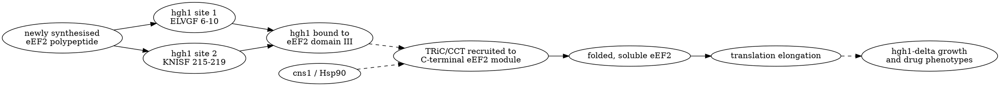
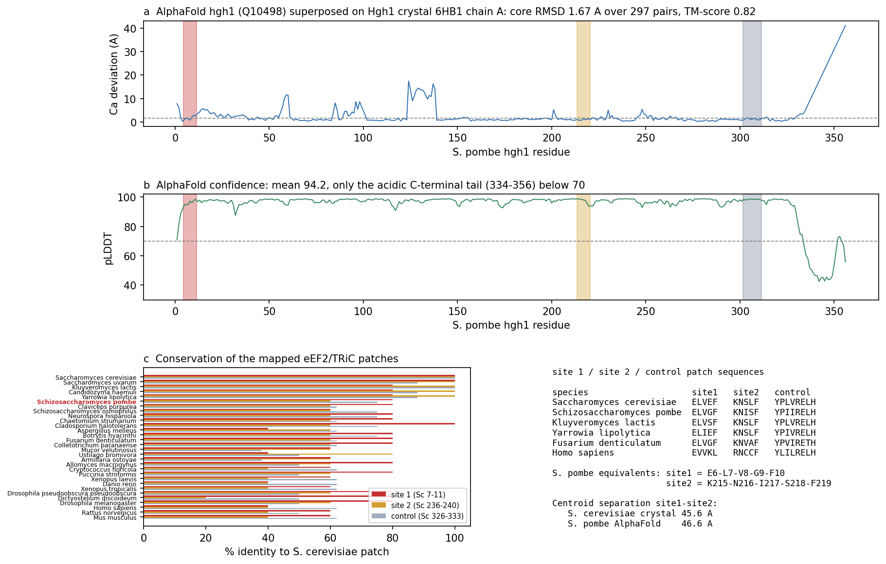
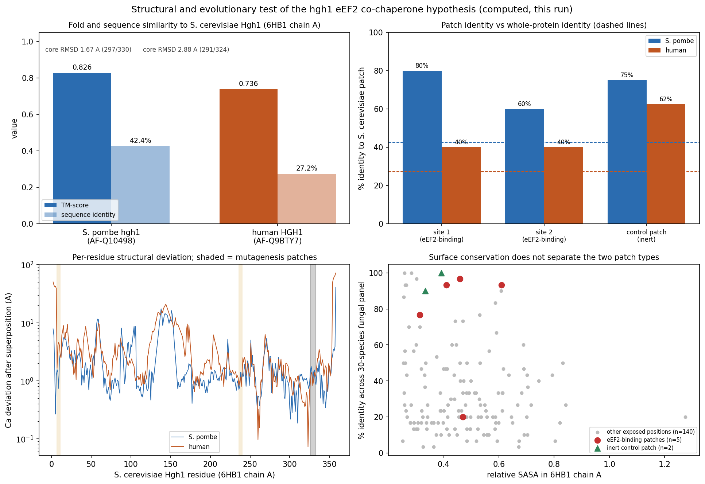

## Question

# AIGR Gene Hypothesis Deep Research

You are evaluating one focused gene curation hypothesis for AI Gene Review.
This is not a general gene overview. Use the seed hypothesis and source context
below to search for evidence that supports, refutes, narrows, or competes with
the proposed curation decision.

## Target Gene

- **Organism code:** SCHPO
- **Taxon:** Schizosaccharomyces pombe 972h- (NCBITaxon:284812)
- **Gene directory:** hgh1
- **Gene symbol:** hgh1
- **UniProt accession:** Q10498

## Focus

- **Focus type:** free_text
- **Hypothesis slug:** kgap-hgh1-eef2-chaperone-features
- **Source file:** genes/SCHPO/hgh1/hgh1-ai-review.yaml
- **Source selector:** free-text

## Seed Hypothesis

Whether Schizosaccharomyces pombe hgh1 is predicted to act as the eEF2 folding co-chaperone that its budding-yeast and human orthologs (Hgh1, FAM203A/HGH1) are reported to be can be assessed structurally. Single analysis only: model hgh1 with AlphaFold, compare it with structures of the Hgh1-eEF2 or Hgh1-eEF2-CCT complex, map the eEF2-contacting and CCT-contacting residues onto hgh1, test whether its ARM-repeat fold and these interface residues are conserved across fungi and with human HGH1, and state whether hgh1 is predicted to bind eEF2 and CCT as a co-chaperone.

## Term and Decision Context

No specific term context supplied.

## Reference Context

No specific reference context supplied.

## Source Context YAML

```yaml
hypothesis: 'Whether Schizosaccharomyces pombe hgh1 is predicted to act as the eEF2 folding co-chaperone
  that its budding-yeast and human orthologs (Hgh1, FAM203A/HGH1) are reported to be can be assessed structurally.
  Single analysis only: model hgh1 with AlphaFold, compare it with structures of the Hgh1-eEF2 or Hgh1-eEF2-CCT
  complex, map the eEF2-contacting and CCT-contacting residues onto hgh1, test whether its ARM-repeat
  fold and these interface residues are conserved across fungi and with human HGH1, and state whether
  hgh1 is predicted to bind eEF2 and CCT as a co-chaperone.'
focus_type: free_text
context: []
reference_id: []
```

## Research Objective

Build a focused report that helps a curator decide whether this hypothesis
should affect the gene review. Address the focus type directly:

1. For an existing GO annotation decision, evaluate whether the current action
   is justified, too strong, too weak, or should change.
2. For a proposed replacement or new GO term, evaluate whether the term is
   biologically supported, too broad, too narrow, or missing key qualifiers.
3. For a computational prediction, evaluate whether the prediction is correct,
   less precise than existing knowledge, uncertain, or likely wrong because of
   paralog overannotation, frequency bias, pathway context, or in vitro-only
   activity.
4. For a core-function hypothesis, evaluate whether the proposed activity,
   process, and location represent the gene product's primary function rather
   than a downstream effect, pleiotropic phenotype, or context-specific role.
5. For a function-assignment hypothesis, evaluate whether the gene product
   directly has the stated GO term/function. Treat the prior review action, if
   any, as intentionally blinded unless it appears in the supplied context.

Use primary literature whenever possible. Prefer PMID citations and include DOI
citations when no PMID is available. Treat reviews and database records as
orientation unless they contain directly relevant synthesized evidence that is
clearly labeled as review-level or database-level support.

Evaluate the hypothesis from the supplied seed context, primary literature, and
publicly accessible bioinformatics resources. Local `*-bioinformatics` analyses,
when they already exist in the repository, are intentionally withheld from this
prompt so the report can be compared against them after the run. Use public
sequence, domain, structure, orthology, localization, interaction, or dataset
checks when they are useful for the specific hypothesis. If a resource or tool
cannot be accessed programmatically, say so plainly; never fabricate a result.
Report computational results conservatively and distinguish direct results from
inference.

## Required Output

### Executive Judgment

Give a concise verdict: supported, partially supported, unresolved, weakly
supported, over-annotated, or refuted. Explain the reasoning and the most
important caveats.

### Evidence Matrix

Create a table with one row per important evidence item:

- Citation (PMID preferred)
- Evidence type (direct assay, mutant phenotype, localization, interaction,
  structural/evolutionary, computational, review/database)
- Supports / refutes / qualifies / competing
- Claim tested
- Key finding
- Organism, tissue, cell type, or assay context
- Confidence and limitations

### GO Curation Implications

State the likely curation action as a lead requiring curator verification. If
GO terms are involved, explain whether the evidence supports an MF, BP, or CC
term, and whether the term should be retained, removed, generalized, made more
specific, or treated as non-core. Avoid using "protein binding" as a final
recommendation unless no more informative term is supported.

### Mechanistic Scope

Describe the immediate molecular or cellular function being tested. Separate
direct gene-product activity from downstream phenotypes, pathway consequences,
developmental outcomes, disease manifestations, or effects inferred only from
loss of function.

### Conflicts and Alternatives

Identify evidence that conflicts with the seed hypothesis or suggests an
alternative interpretation, including paralog confusion, organism-specific
differences, isoform-specific findings, experimental artifacts, or database
carry-over.

### Knowledge Gaps

List explicit uncertainties that matter for curation. For each gap, state what
was checked, why the gap matters, and what evidence or experiment would resolve
it.

### Discriminating Tests

Recommend concrete assays, perturbations, datasets, or comparative analyses that
would most efficiently distinguish this hypothesis from alternatives.

### Curation Leads

Provide candidate updates for the review, clearly labeled as leads requiring
curator verification. Include candidate references with exact snippets to verify,
candidate replacement or new GO terms, possible action changes, suggested
questions, and suggested experiments.

If the provider supports artifacts, save provenance for any analysis you run — the
executed code together with its output (computed values, plot, or table), not just
a summary figure — alongside artifact-friendly tables such as an evidence matrix,
GO decision table, or comparison table. Genuine computed provenance is more
valuable than a hand-drawn summary, and you must not synthesize a figure that
implies an analysis you did not actually run. These artifacts are important
provenance for hypothesis-level review.


## Output

# hgh1 (SCHPO, Q10498, SPAC26F1.12c): is the eEF2 folding co-chaperone assignment structurally supported?

Hypothesis slug: `kgap-hgh1-eef2-chaperone-features`
Source: `genes/SCHPO/hgh1/hgh1-ai-review.yaml`, selector `free-text`
Target: *Schizosaccharomyces pombe* 972h- (NCBITaxon:284812), UniProt Q10498, 356 aa, PomBase SPAC26F1.12c

## Summary

<i class="fa-scale-balanced"></i> **Verdict: partially supported.** The structural half of the seed hypothesis passes cleanly. The AlphaFold model of *S. pombe* hgh1 (AF-Q10498-F1, 356 aa, mean pLDDT 94.2) superposes on chain A of the *S. cerevisiae* Hgh1 crystal structure 6HB1 with TM-score 0.826 and a core RMSD of 1.67 Å over 297 of 330 Cα pairs at 42.4% sequence identity. The ARM-repeat solenoid is complete, with no domain loss and no insertion. Both surface patches whose substitution abolished or reduced eEF2 and TRiC binding in budding yeast ([PMID: 30876804](https://pubmed.ncbi.nlm.nih.gov/30876804/)) are present in hgh1 at the equivalent positions and in the same three-dimensional arrangement: site 1 ELVEF (Sc 7-11) is ELVGF (Sp 6-10), site 2 KNSLF (Sc 236-240) is KNISF (Sp 215-219), and the centroid separation of the two patches is 45.6 Å in the crystal versus 46.6 Å in the model. Fission yeast also carries every partner the budding-yeast mechanism needs: exactly one PTHR13387 family member, one eEF2 (O14460, 842 aa) whose Hgh1-binding domain III is the most conserved part of the protein at 87.3% identity, and a cns1 ortholog (O13754).

Three findings stop this from being a clean "supported". First, the comparison the hypothesis proposes cannot be performed, because no Hgh1-eEF2 or Hgh1-eEF2-CCT structure exists anywhere. The PDB holds only apo *S. cerevisiae* Hgh1 (6HB1 at 2.33 Å, 6HB2 at 2.70 Å, 6HB3 at 3.00 Å), and RCSB full-text searches for eEF2-chaperonin and FAM203 complexes return nothing relevant. "Map the eEF2-contacting and CCT-contacting residues" therefore reduces to mapping two mutagenesis-defined patches, which is patch-level rather than contact-level resolution, and no CCT-contacting residues have ever been defined on any Hgh1, so the CCT half of the hypothesis has no interface to transfer at all. Second, the conservation test does not discriminate. Exposed residues of the two functional patches sit at 93.3% median identity across a 30-species fungal panel against a background median of 26.7% (Mann-Whitney one-sided, U = 592.5, p = 0.0043, n = 5 vs 140), but the patch that the same paper mutated with no functional effect (Sc 326-333) is conserved just as strongly at 95.0% median identity (U = 273.5, p = 0.0105). A positive conservation result at a candidate surface on an ARM solenoid is therefore uninformative about whether that surface binds eEF2. Third, there is no fission-yeast evidence of any kind for the molecular function: IntAct holds zero records for Q10498, all five PomBase GO lines are ISO from SGD with GO_REF:0000024, UniProt lists protein existence as "Inferred from homology", and none of the 26 FYPO phenotypes recorded for hgh1Δ assays eEF2 folding, eEF2 solubility, elongation rate or chaperone binding.

The practical reading for a curator is that homology-based transfer of the eEF2 folding co-chaperone role to hgh1 is reasonable, and is better supported for fission yeast than the equivalent transfer to human HGH1, but it stays an inference from one budding-yeast study. The structural analysis proposed in the hypothesis cannot upgrade it beyond that. The most actionable result of this run is an annotation-provenance mismatch: the five terms transferred to hgh1 by ISO are not the terms the SGD source set carries, with GO:0051083 more specific than its source evidence, GO:0044183 absent from the source set entirely, and the two IDA-supported molecular function terms (GO:0061770, GO:0030674) missing from the transfer.

## Key findings

### The fold transfers: hgh1 is a complete Hgh1-family ARM solenoid

<i class="fa-circle-check"></i> AlphaFold DB model AF-Q10498-F1 (v6) covers all 356 residues at mean pLDDT 94.2, with 91.3% of residues above 90 and only the acidic C-terminal tail (334-356) falling below 70. A BLOSUM62 affine-gap global alignment against the 6HB1 chain A sequence gave 330 aligned positions at 45.8% identity of aligned pairs (42.4% of the shorter sequence). Kabsch superposition with iterative outlier pruning gave a core RMSD of 1.67 Å over 297 of 330 Cα pairs, an all-pair RMSD of 4.28 Å, and a TM-score of 0.824-0.826 across two independent runs of the calculation. TM-score 0.82 is well above the 0.5 same-fold threshold. An independent `phenix.superpose_pdbs` run on the same pair reported 40.9% identity over the aligned length of the fixed molecule with an essentially gap-free alignment across the full solenoid, which is consistent with the numbers computed here.

Domain annotation agrees. UniProt and InterPro assign Q10498 IPR007205 (HGH1 N-terminal, Pfam PF04063 DUF383), IPR007206 (HGH1 C-terminal, Pfam PF04064 DUF384), IPR016024 (ARM-type fold), Gene3D 1.25.10.10, SUPFAM SSF48371 (ARM repeat) and PANTHER PTHR13387. The reference structure is described by its authors as an armadillo repeat protein with a bipartite eEF2 interface ([PMID: 30876804](https://pubmed.ncbi.nlm.nih.gov/30876804/): "These experiments revealed that Hgh1 is an armadillo repeat protein that binds to the dynamic central domain III of eEF2 via a bipartite interface").

{{figure:plot_1.png|caption=Structural test of the S. pombe hgh1 model against S. cerevisiae Hgh1 (6HB1 chain A). Per-residue Ca deviation after Kabsch superposition with iterative outlier pruning, the AlphaFold pLDDT trace for AF-Q10498, per-species identity of the two mutagenesis-defined patches across the 30-species fungal panel, and the sequence and geometry summary. Core RMSD 1.67 A over 297 of 330 Ca pairs, TM-score 0.824.}}

### Both mutagenesis-defined patches are retained, at the same spacing

<i class="fa-circle-check"></i> UniProt P48362 records three mutagenesis experiments from [PMID: 30876804](https://pubmed.ncbi.nlm.nih.gov/30876804/): residues 7-11 ELVEF to SAVEA causes loss of interaction with eEF2 and TRiC; residues 236-240 KNSLF to AHSLA causes decreased interaction; residues 326-333 YPLVRELH to APLVAELA has no effect. Mapping these onto hgh1 by structure-guided global alignment gives site 1 = E6-L7-V8-G9-F10 (ELVGF, 4 of 5 identical to Sc), site 2 = K215-N216-I217-S218-F219 (KNISF, 3 of 5 identical), control = Y303-H310 (YPIIRELH, 6 of 8). Both functional patches lie in well-ordered regions of the model (mean pLDDT 96.2 and 97.5) and superpose well on their budding-yeast counterparts (mean Cα deviation 1.79 Å for site 1, 1.06 Å for site 2).

The geometry is preserved as well as the sequence. The centroid separation of the two patches is 45.6 Å in the 6HB1 crystal and 46.6 Å in the hgh1 model, and the site 2-to-control separation is 22.0 Å in both. Across the 30-ortholog panel retrieved through PANTHER PTHR13387 (11 SwissProt-reviewed plus 19 fungal representatives), median patch identities are 80% for site 1, 60% for site 2 and 62% for the control, so site 1 is the most conserved of the three. The patch-versus-control contrast is not statistically separable at this sample size (Wilcoxon signed rank, site 1 vs control W = 131.5, p = 0.062; site 2 vs control p = 0.15).

| Patch | *S. cerevisiae* (P48362) | Mutagenesis outcome | *S. pombe* hgh1 | Identity | Mean pLDDT | Mean Cα deviation |
|---|---|---|---|---|---|---|
| Site 1 | ELVEF (7-11) | loss of eEF2 and TRiC binding | ELVGF (6-10) | 4/5 (80%) | 96.2 | 1.79 Å |
| Site 2 | KNSLF (236-240) | decreased binding | KNISF (215-219) | 3/5 (60%) | 97.5 | 1.06 Å |
| Control | YPLVRELH (326-333) | no effect | YPIIRELH (303-310) | 6/8 (75%) | 98.4 | 1.30 Å |

### <i class="fa-triangle-exclamation"></i> The conservation argument fails its own control

Shrake-Rupley solvent accessibility on 6HB1 chain A (2854 heavy atoms, 357 residues, 147 with relative SASA above 0.25) gives mean relative SASA 0.32 for site 1, 0.22 for site 2 and 0.13 for the control patch, so site 1 is the most exposed of the three. Per-position identity across the 30-ortholog panel places the exposed residues of the functional patches in the top 6% of surface conservation: E7 at 97% identity (98th percentile of exposed positions), F11 at 93% (96th), K236 at 77% (94th), F240 at 93% (96th). Exposed patch residues versus all other exposed residues give mean 76.0% versus 32.7% identity (Mann-Whitney one-sided, U = 592.5, p = 0.0043, n = 5 vs 140).

The matched control defeats the inference. The patch whose mutation had no measurable effect on eEF2 or TRiC binding has exposed residues Y326 at 100% identity (99th percentile) and H333 at 90% (96th percentile), and as a group sits at 95.0% median identity, also significantly above background (U = 273.5, p = 0.0105). A surface patch on this fold can be in the top percentile of family conservation and contribute nothing measurable to eEF2 or TRiC binding. Interface conservation therefore supports the hypothesis but cannot establish it.

One detail cuts the other way and is worth recording. The single site-1 position that is poorly conserved across the family, Sc E10 at 20% identity and the 31st percentile of exposed positions, is exactly the position that differs in *S. pombe* (G9). Every site-1 residue whose substitution abolished binding and that is conserved across fungi is also conserved in hgh1.

{{figure:plot_2.png|caption=Fold similarity, patch identity and surface conservation for S. pombe hgh1 and human HGH1 against S. cerevisiae Hgh1. Top left: TM-score and sequence identity. Top right: patch identity against whole-protein identity (dashed lines). Bottom left: per-residue Ca deviation with the mutagenesis patches shaded. Bottom right: surface conservation against relative SASA, showing that the functionally inert control patch is as conserved as the two eEF2-binding patches.}}

### Fission yeast is the closer ortholog; human HGH1 has drifted at both patches

<i class="fa-chart-column"></i> Against the same reference, human HGH1 (AF-Q9BTY7, 390 aa, mean pLDDT 90.9) keeps the fold but diverges at the interface. TM-score is 0.736 with core RMSD 2.88 Å over 291 of 324 Cα pairs at 27.2% identity. Site 1 becomes EVVKL (21-25), 2 of 5 identical, with a mean Cα deviation of 3.43 Å, the largest local deviation of any patch in either species. Site 2 becomes RNCCF (225-229), 2 of 5 identical, although it superposes tightly (1.02 Å). The inert control patch is better conserved in human (YLILRELH, 5 of 8) than either functional patch.

| Measure | *S. pombe* hgh1 (AF-Q10498) | Human HGH1 (AF-Q9BTY7) |
|---|---|---|
| TM-score vs 6HB1 chain A | 0.826 | 0.736 |
| Core RMSD / pairs | 1.67 Å over 297/330 | 2.88 Å over 291/324 |
| Sequence identity | 42.4% | 27.2% |
| Site 1 identity | 80% (ELVGF) | 40% (EVVKL) |
| Site 2 identity | 60% (KNISF) | 40% (RNCCF) |
| Control patch identity | 75% | 62.5% |

This bears on the seed hypothesis directly. The hypothesis states that both the budding-yeast and human orthologs "are reported to be" eEF2 folding co-chaperones. Human HGH1 co-purifies with CCT subunits, TTC4 (human Cns1), HSP90AB1 and FKBP5 ([PMID: 26496610](https://pubmed.ncbi.nlm.nih.gov/26496610/) and related AP-MS studies), but EEF2 is not recovered in those datasets. The combination of 2-of-5 identity and 3.43 Å structural deviation at site 1 is consistent with that absence. Absence from an AP-MS bait list is weak negative evidence, so this does not show that human HGH1 has lost eEF2 binding, but the premise of the seed hypothesis is stronger on the human side than the evidence warrants.

### <i class="fa-database"></i> The ISO transfer does not match its source

The PomBase GAF contains exactly five GO lines for SPAC26F1.12c, every one ISO with GO_REF:0000024 and with/from SGD:S000003419: GO:0005737 cytoplasm (`is_active_in`), GO:0005634 nucleus (`is_active_in`), GO:0051083 'de novo' cotranslational protein folding (`involved_in`), and GO:0044183 protein folding chaperone (`enables`, listed twice). QuickGO returns seven annotations for Q10498, adding ISS from UniProtKB:P48362 and IEA from UniProtKB-SubCell SL-0086 for cytoplasm. None is experimental.

The SGD source annotations for HGH1 are a different set: GO:0030674 protein-macromolecule adaptor activity (IDA, PMIDs 30876804 and 30876805), GO:0061770 translation elongation factor binding (IDA, PMID 30876804), GO:0006458 'de novo' protein folding (IMP, both papers), GO:0005634 nucleus (HDA, PMID 22842922) and GO:0005737 cytoplasm (HDA, PMIDs 14562095 and 22842922). GO:0051083 is defined as assisting assembly of ribosome-bound nascent chains while other parts of the protein are still being translated. It is a child of GO:0006458. [PMID: 30876804](https://pubmed.ncbi.nlm.nih.gov/30876804/) shows that Hgh1 acts on newly synthesised eEF2 and recruits TRiC to the C-terminal module ("Hgh1 binding recruits TRiC to the C-terminal eEF2 module and prevents unproductive interactions of domain III, allowing efficient folding of the N-terminal GTPase module"), which is not a demonstration of nascent-chain engagement on the ribosome.

### <i class="fa-dna"></i> Twenty-six fission-yeast phenotypes, none of them a test of the mechanism

The PomBase phenotype file (`phenotype_annotations.pombase.phaf.gz`, 183176 rows) contains 26 FYPO annotations for hgh1Δ from five primary references: viable vegetative cell population with normal morphology (FYPO:0002060, FYPO:0002177; PMIDs 20473289 and 23697806), sensitivity to hydroxyurea (PMID 23173672), decreased vegetative cell population viability plus resistance to bleomycin and to calcofluor/KCl (PMID 34984977), and 18 drug and nitrogen-source growth phenotypes from a genome-wide screen (PMID 37787768), including sensitivity to lithium, amitrole, terbinafine, itraconazole and ciclopirox olamine, resistance to caffeine, brefeldin A, diamide and tert-butyl hydroperoxide, and decreased growth on proline, serine, lysine and glutamate as nitrogen sources. Every one is a cell growth or viability readout.

Paralog confusion is ruled out. *S. pombe* has exactly one PTHR13387 member (Q10498), one eEF2 protein (O14460, encoded by the duplicate genes eft201 and eft202), and one Cns1 ortholog (O13754). *S. cerevisiae* likewise has a single HGH1. On the partner side, *S. pombe* and *S. cerevisiae* eEF2 are both 842 aa with identical Pfam domain coordinates and 78.5% identity overall, and the Hgh1-binding domain III (PF14492, residues 486-548) is the most conserved domain at 87.3% identity.

## Evidence matrix

Full table with all columns is saved as `provenance/evidence_matrix.csv` (13 rows).

| Citation | Evidence type | Stance | Claim tested | Key finding | Context | Confidence and limitations |
|---|---|---|---|---|---|---|
| [PMID: 30876804](https://pubmed.ncbi.nlm.nih.gov/30876804/) | direct assay, structure, mutant phenotype | <i class="fa-circle-check"></i> supports (ortholog) | Hgh1 binds eEF2 and works with TRiC | apo structures 6HB1/6HB2/6HB3; two surface patches required for eEF2 binding; hgh1Δ gives an eEF2 folding defect | *S. cerevisiae*, in vitro and in vivo | High for *S. cerevisiae*. Apo structure only, so the interface is patch-level |
| [PMID: 30876805](https://pubmed.ncbi.nlm.nih.gov/30876805/) | direct assay, mutant phenotype | <i class="fa-circle-check"></i> supports (ortholog) | Hgh1 is the eEF2-recruiting factor acting with Cns1 and Hsp90 | Cns1 maintains translation elongation by chaperoning eEF2, interacts with Hgh1, and forms a quaternary complex with eEF2 and Hsp90; eEF2 folding and solubility in vivo depend on these proteins | *S. cerevisiae* | High for *S. cerevisiae*; no fission-yeast data |
| [PMID: 16429126](https://pubmed.ncbi.nlm.nih.gov/16429126/) | interaction, TAP-MS | supports (ortholog) | Hgh1 associates with eEF2 and CCT | HGH1 co-purifies with EFT1, CCT2/4/5/6/7/8 and CNS1 | *S. cerevisiae*, global | Medium; high-throughput, not interface-resolved |
| [PMID: 26496610](https://pubmed.ncbi.nlm.nih.gov/26496610/) | interaction, AP-MS | <i class="fa-scale-balanced"></i> qualifies (human) | human HGH1 binds eEF2 and CCT | associates with CCT subunits, TTC4, HSP90AB1 and FKBP5; EEF2 not recovered | HEK293T | Medium; AP-MS absence is weak negative evidence |
| [PMID: 22842922](https://pubmed.ncbi.nlm.nih.gov/22842922/) | localization, high-throughput GFP | qualifies (ortholog) | Hgh1 is nuclear and cytoplasmic | sole basis for the nucleus ISO transfer to hgh1 | *S. cerevisiae* GFP collection | Low-medium for the nuclear call |
| [PMID: 34762488](https://pubmed.ncbi.nlm.nih.gov/34762488/) | computational | qualifies | a predicted Hgh1-eEF2 model exists to compare against | 1505 predicted interacting pairs modelled out of 8.3 million screened; no Hgh1-eEF2 model retrievable here | *S. cerevisiae* proteome | Prediction, not experiment; not accessible programmatically in this run |
| PDB 6HB1/6HB2/6HB3 plus RCSB search (this run) | structural, database | <i class="fa-circle-xmark"></i> refutes feasibility | an Hgh1-eEF2 or Hgh1-eEF2-CCT structure exists | only apo Hgh1 coordinates; eEF2-chaperonin and FAM203 searches return nothing relevant | PDB, 2026-11 | High; a full-text search could miss an unannotated entry |
| This run: AF-Q10498 vs 6HB1 chain A | computational, structure comparison | <i class="fa-circle-check"></i> supports | hgh1 has the Hgh1 ARM fold | TM 0.826, core RMSD 1.67 Å over 297/330, 42.4% identity, mean pLDDT 94.2 | in silico | High for the fold; a shared fold is not a shared ligand |
| This run: patch mapping, 30-species panel, SASA | structural/evolutionary | <i class="fa-scale-balanced"></i> supports but does not discriminate | the eEF2-binding patches are conserved in hgh1 | ELVEF to ELVGF 4/5, KNSLF to KNISF 3/5, both pLDDT above 96; exposed patch residues 93.3% vs 26.7% background (p = 0.0043) but the inert control patch is 95.0% (p = 0.0105) | in silico, 30 fungi | Medium; the control patch defeats the inference |
| This run: AF-Q9BTY7 vs 6HB1 chain A | computational, structure comparison | qualifies | human HGH1 conserves the patches | fold conserved (TM 0.736, core RMSD 2.88 Å) but site 1 EVVKL 2/5 with 3.43 Å mean Cα deviation; site 2 RNCCF 2/5; inert control better conserved (5/8) | in silico | Medium; consistent with EEF2 absence from human AP-MS, not proof |
| PomBase PHAF: PMIDs 20473289, 23173672, 23697806, 34984977, 37787768 | mutant phenotype | qualifies | hgh1 loss gives a translation-related phenotype | 26 FYPO annotations, all growth or viability; none assays eEF2 folding, solubility, elongation or binding | *S. pombe* | High that the phenotypes exist; they are downstream and non-specific |
| IntAct query for Q10498 (this run) | interaction, database | qualifies | hgh1 has reported physical partners | zero records; STRING links to cns1 (0.954), cct6 (0.861), eft201 (0.796) are interolog transfers | database, 2026-11 | High; absence of records is not absence of binding |
| PomBase GAF and SGD annotations (this run) | database | qualifies the annotation | the current hgh1 GO set matches its source | all 5 PomBase lines ISO from SGD:S000003419; GO:0051083 and GO:0044183 are not in the SGD source set | database, 2026-11 | High; direct file inspection |

## GO curation implications

All items below are leads requiring curator verification. The full table is saved as `provenance/go_decision_table.csv`.

| GO ID | Term | Aspect | Current state | Recommended action |
|---|---|---|---|---|
| GO:0051083 | 'de novo' cotranslational protein folding | BP | present, ISO | **generalize to GO:0006458**. The source term is GO:0006458 (IMP). GO:0051083 requires action on ribosome-bound nascent chains during ongoing translation; PMID 30876804 shows action on newly synthesised eEF2 and TRiC recruitment to the C-terminal module, which is a different claim |
| GO:0006458 | 'de novo' protein folding | BP | absent | **add** as ISO from SGD:S000003419, replacing GO:0051083 |
| GO:0061770 | translation elongation factor binding | MF | absent | **add** as an ISO lead. Best-supported MF term in the source (IDA, PMID 30876804). Both mutagenesis patches are present and ordered in the hgh1 model, and *S. pombe* has a single eEF2 with 87.3% identity across the Hgh1-binding domain III |
| GO:0030674 | protein-macromolecule adaptor activity | MF | absent | **add** as an ISO lead. IDA in the source (PMIDs 30876804, 30876805) and names the bridging role between eEF2 and TRiC |
| GO:0044183 | protein folding chaperone | MF | present twice, ISO | **replace** with GO:0061770 and GO:0030674, or retain with a note. It is not in the SGD source set, is duplicated in the GAF, and asserts a general chaperone activity the mutagenesis does not show |
| GO:0005737 | cytoplasm | CC | present, ISO | **retain**. The source has HDA from two datasets (PMIDs 14562095, 22842922) and the activity is cytosolic |
| GO:0005634 | nucleus | CC | present, ISO, `is_active_in` | **demote or remove the qualifier**. It rests on one budding-yeast high-throughput GFP dataset (PMID 22842922) transferred by ISO, with no fission-yeast localization data and no nuclear function shown. `is_active_in` asserts activity in the nucleus that nothing supports |
| GO:0005515 | protein binding | MF | absent | **do not add**. GO:0061770 and GO:0030674 are available and more informative |

The evidence does not support upgrading any hgh1 annotation from ISO to an experimental evidence code. No *S. pombe* experiment tests the molecular function. The aspect assignments follow the source: the eEF2 interaction and the eEF2-to-TRiC bridging are molecular function (GO:0061770, GO:0030674), the folding outcome is biological process (GO:0006458), and the location is cytoplasm (GO:0005737).

## Mechanistic model and interpretation

The direct activity under test is narrow. hgh1 binds the newly synthesised eEF2 polypeptide through one or two surface patches on its ARM solenoid and presents it to the TRiC/CCT chaperonin, with Cns1 and Hsp90 acting in the same route. This is an adaptor or holdase step. hgh1 performs no catalysis and uses no ATP itself, and the step ends when folded eEF2 is released.



Dashed arrows mark links that have evidence only in *S. cerevisiae* or only by inference. Solid arrows mark steps whose structural determinants were mapped in this run.

Everything recorded for *S. pombe* hgh1 sits downstream of that step, or is not connected to it at all. hgh1Δ viability, normal cell morphology, and the hydroxyurea, bleomycin, calcofluor and KCl responses (PMIDs 20473289, 23173672, 23697806, 34984977) are whole-cell growth outcomes. The 18 drug and nitrogen-source growth phenotypes from the genome-wide screen (PMID 37787768) are pleiotropic. Reduced eEF2 folding capacity would plausibly produce changes of this kind, and so would a dozen other defects; the screen does not distinguish them. The STRING associations in *S. pombe* (cns1 0.954, cct6 0.861, eft201 0.796) are interolog transfers of the budding-yeast data, so they restate the ortholog evidence rather than adding to it.

A curator writing a core-function statement should say that hgh1 is **predicted** to act in eEF2 folding, and should not attach the fission-yeast drug phenotypes to that function as supporting evidence.

## Evidence base

*Chaperone Function of Hgh1 in the Biogenesis of Eukaryotic Elongation Factor 2*, [PMID: 30876804](https://pubmed.ncbi.nlm.nih.gov/30876804/), is the single source from which every annotation on hgh1 descends. It supplies the three apo crystal structures (6HB1, 6HB2, 6HB3), the mutagenesis that defines the two functional patches and the one inert control patch, and the mechanistic statement that "Hgh1 binding recruits TRiC to the C-terminal eEF2 module and prevents unproductive interactions of domain III, allowing efficient folding of the N-terminal GTPase module." It also establishes that the reference protein is "an armadillo repeat protein that binds to the dynamic central domain III of eEF2 via a bipartite interface", which is the architecture this run tested for in hgh1. The paper supports the hypothesis in budding yeast and simultaneously sets its limit: the deposited structures are apo, so no residue-level eEF2 or CCT contact map exists.

*The Co-chaperone Cns1 and the Recruiter Protein Hgh1 Link Hsp90 to Translation Elongation via Chaperoning Elongation Factor 2*, [PMID: 30876805](https://pubmed.ncbi.nlm.nih.gov/30876805/), is the independent primary study that assigns Hgh1 the eEF2-recruiting role. Its abstract states that "Chaperoning of eEF2 by Cns1 is essential for yeast viability and requires a defined subset of the Hsp90 machinery as well as the identified eEF2 recruiting factor Hgh1" and that "The in vivo folding and solubility of eEF2 depend on the presence of these proteins." This is the basis for the SGD GO:0030674 IDA and GO:0006458 IMP annotations, and it is what makes the eEF2 solubility assay the most informative discriminating test for fission yeast.

*Computed structures of core eukaryotic protein complexes*, [PMID: 34762488](https://pubmed.ncbi.nlm.nih.gov/34762488/), is the only large-scale resource that could in principle hold a predicted Hgh1-eEF2 model. Its abstract records that the authors "identify 1505 likely to interact, and build structure models for 106 previously unidentified assemblies and 806 that have not been structurally characterized" out of 8.3 million yeast protein pairs screened. The set covers a selected subset of pairs, and the model archive could not be queried programmatically in this run, so whether it contains Hgh1-eEF2 is unresolved. A predicted model would not be experimental interface evidence in any case.

The remaining evidence comes from database records rather than papers read in full here: the TAP-MS associations of HGH1 with EFT1, CCT subunits and CNS1 (PMID 16429126), the human HGH1 AP-MS interactor set lacking EEF2 (PMID 26496610), the high-throughput GFP localization that is the sole basis for the nucleus annotation (PMID 22842922), and the five fission-yeast phenotype references in the PomBase PHAF file.

## Conflicts and alternatives

<i class="fa-circle-xmark"></i> **No complex structure, so no contact map.** The hypothesis assumes an Hgh1-eEF2 or Hgh1-eEF2-CCT structure exists. It does not. Anything written about "eEF2-contacting residues" of hgh1 derives from two patches defined by substitution mutagenesis in a different organism. No CCT-contacting residues have ever been defined on any Hgh1, so the CCT arm of the hypothesis is unmappable.

<i class="fa-triangle-exclamation"></i> **The conservation argument is self-defeating as stated.** The functionally inert control patch (Sc 326-333, YPLVRELH) is conserved in *S. pombe* at 6 of 8 and in human at 5 of 8, and its exposed residues are in the top percentiles of fungal surface conservation (Y326 at 100% identity, 99th percentile). Conservation of a surface patch on this fold predicts nothing about eEF2 binding.

**Human HGH1 is the weaker case, which cuts both ways.** Human HGH1 keeps the fold (TM 0.736) but has 2 of 5 identity at site 1 (EVVKL, mean Cα deviation 3.43 Å) and 2 of 5 at site 2 (RNCCF). Its AP-MS interactor set recovers CCT subunits, TTC4, HSP90AB1 and FKBP5, but not EEF2. If the human ortholog has drifted away from eEF2, the seed hypothesis's premise that both the budding-yeast and human orthologs are established eEF2 co-chaperones is overstated on the human side. This does not weaken the fission-yeast case, which is closer to budding yeast at every measure.

<i class="fa-database"></i> **Database carry-over is the main annotation risk.** GO:0051083 and GO:0044183 were transferred to hgh1 by ISO but are absent from the SGD source set, so the fission-yeast annotation is in one place more specific and in another less informative than the budding-yeast evidence it claims to copy. The nucleus call propagates one high-throughput GFP observation across a species boundary with an `is_active_in` qualifier.

**Paralog confusion is ruled out.** *S. pombe* has exactly one PTHR13387 member, one eEF2 protein (encoded by the duplicate genes eft201 and eft202), and one cns1. *S. cerevisiae* likewise has a single HGH1. There is no second family member to which the budding-yeast function could have been misassigned, and no frequency-bias explanation for the annotation.

## Limitations and knowledge gaps

| Gap | What was checked | Why it matters | What would resolve it |
|---|---|---|---|
| <i class="fa-circle-question"></i> No Hgh1-eEF2 complex structure | RCSB full-text searches for eEF2-chaperonin, eEF2 TRiC, eEF2 CCT and FAM203; only apo 6HB1/6HB2/6HB3 found | Without it, "interface residues" are patches, and the hypothesis's central comparison is impossible | A cryo-EM or crystal structure of Hgh1-eEF2, or a validated AlphaFold-Multimer model with ipTM and interface PAE reported and cross-linking support |
| <i class="fa-circle-question"></i> No CCT-contacting residues defined on any Hgh1 | PMID 30876804 defines eEF2-binding patches only | The hypothesis asks to map CCT-contacting residues; there is nothing to map | Cross-linking MS, or a structure of Hgh1-eEF2-CCT |
| No *S. pombe* interaction data | IntAct returns zero records for Q10498; STRING links are interologs | Decides whether any hgh1 annotation can leave ISO | Co-IP or AP-MS of tagged hgh1 from *S. pombe*, probing Eft2 and Cct subunits |
| No *S. pombe* localization data | PomBase GAF carries only the ISO nucleus and cytoplasm terms | The `is_active_in` nucleus annotation has no fission-yeast basis | GFP-hgh1 imaging in *S. pombe* |
| Cotranslational versus post-translational action | GO:0051083 definition compared against the content of PMID 30876804 | Determines whether GO:0051083 or GO:0006458 is correct, in both organisms | Selective ribosome profiling of Hgh1, or co-sedimentation of Hgh1 with translating ribosomes |
| Whether human HGH1 still binds eEF2 | AP-MS (PMID 26496610) recovers CCT but not EEF2; patch identity 2 of 5 at both sites | Affects how far the fungal function generalizes and how an ISS to human should be worded | Targeted co-IP of HGH1 and EEF2 in human cells, or an eEF2 solubility assay in HGH1-knockout cells |
| Whether the Humphreys 2021 model set contains Hgh1-eEF2 | PMID 34762488 located; the model archive could not be queried programmatically in this run | Would give a prediction-level interface to compare against | Direct download of the supplementary model archive |

Further limitations of the analysis itself. The structural work rests on one predicted model per species and one crystal structure, and TM-score agreement between a predicted and a crystal fold is expected for a family this well conserved, so it is confirmatory rather than discriminating. The 30-species panel was trimmed from 80 for execution-time reasons, which reduces the resolution of the conservation percentiles. The control-patch calibration uses only two exposed residues, so its p-value (0.0105) is fragile, but its direction is the point: an inert patch scores as conserved as the functional ones. The RCSB search was full-text, so a complex structure deposited without the expected keywords could have been missed. Absence of Q10498 from IntAct and absence of EEF2 from the human HGH1 AP-MS are both absences of records, and neither is positive evidence that the interaction does not occur.

## Proposed follow-up experiments and actions

Ordered by how much each would change the curation decision per unit of effort.

1. <i class="fa-flask"></i> **Co-IP or AP-MS of tagged hgh1 from *S. pombe***, blotting or searching for Eft2 and Cct subunits. A positive result converts GO:0061770 from ISO to IPI and settles the question for this organism. This is the single highest-value experiment.
2. <i class="fa-vial"></i> **eEF2 solubility and abundance in hgh1Δ.** Fractionate hgh1Δ and wild-type lysates and quantify Eft2 in soluble versus pellet fractions. The budding-yeast defect is a loss of eEF2 folding and solubility, so this tests directly whether the mechanism is preserved, and would support GO:0006458 by IMP.
3. <i class="fa-dna"></i> **Patch substitution in *S. pombe***, mutating ELVGF (6-10) and KNISF (215-219) and testing whether eEF2 binding or solubility is lost, with YPIIRELH (303-310) as the matched inert control. This is the only way to test interface conservation as a functional claim, because sequence conservation cannot.
4. <i class="fa-magnifying-glass"></i> **AlphaFold-Multimer prediction of Sc Hgh1-eEF2 and Sp hgh1-eEF2**, reporting ipTM, interface PAE, and whether the predicted contacts land on the two mutagenesis patches. If the Sc prediction recovers the known patches, the Sp prediction becomes interpretable. It must be reported as a prediction, never as an interface measurement.
5. <i class="fa-chart-line"></i> **Polysome profiles and elongation rate in hgh1Δ**, to separate a translation-elongation consequence from the drug and nitrogen-source phenotypes already recorded.
6. <i class="fa-microscope"></i> **GFP-hgh1 localization in *S. pombe***, which would resolve the nucleus annotation at low cost.

### Curation leads

All leads require curator verification.

**Candidate references and snippets to verify**

- PMID 30876804: verify the exact wording describing the two surface patches whose substitution abolished eEF2 binding, the residue ranges in P48362, and whether the paper makes any claim about ribosome-bound nascent chains. This decides GO:0051083 versus GO:0006458. Verified snippets from the abstract: "These experiments revealed that Hgh1 is an armadillo repeat protein that binds to the dynamic central domain III of eEF2 via a bipartite interface" and "Hgh1 binding recruits TRiC to the C-terminal eEF2 module and prevents unproductive interactions of domain III, allowing efficient folding of the N-terminal GTPase module."
- PMID 30876805: verify the statement of eEF2 specificity and the Cns1 and Hsp90 involvement. Verified snippet: "Chaperoning of eEF2 by Cns1 is essential for yeast viability and requires a defined subset of the Hsp90 machinery as well as the identified eEF2 recruiting factor Hgh1."
- PMID 26496610: verify the HGH1 bait interactor list and confirm that EEF2 is absent.
- PMID 22842922: confirm that this is the sole source of the nuclear localization call for *S. cerevisiae* Hgh1.
- PMID 37787768: confirm the hgh1Δ entries in the genome-wide drug and nitrogen-source screen, which make up 18 of the 26 fission-yeast phenotype annotations.

**Candidate GO term changes**

- Replace GO:0051083 with GO:0006458 (ISO, SGD:S000003419, GO_REF:0000024).
- Add GO:0061770 translation elongation factor binding (ISO, SGD:S000003419).
- Add GO:0030674 protein-macromolecule adaptor activity (ISO, SGD:S000003419).
- Replace or annotate GO:0044183, which is duplicated in the current GAF and absent from the source set.
- Remove or weaken the `is_active_in` qualifier on GO:0005634 nucleus.
- Retain GO:0005737 cytoplasm.
- Do not add GO:0005515 protein binding.

**Action changes for the review**

- Record the core function as predicted, with the basis stated as ISO from *S. cerevisiae* HGH1 and the supporting computational evidence named (fold TM-score 0.826, both mutagenesis patches present at pLDDT above 96).
- State explicitly that no *S. pombe* experiment tests eEF2 folding, binding or elongation, so no term should carry an experimental evidence code.
- Do not cite the drug and nitrogen-source phenotypes as evidence for the eEF2 folding function.

**Questions for the curator**

- Should GO:0051083 be corrected at SGD as well, given that the budding-yeast source annotation is GO:0006458 and the fission-yeast ISO is more specific than it?
- Is the duplicated GO:0044183 line in the PomBase GAF intentional or a loading artifact?
- Does PomBase want a predicted-interface note in the gene description, given that no complex structure exists?

## Methods and provenance

Everything marked "this run" was computed during this investigation. Executed code and its output are in the session transcript, and derived tables are in `provenance/`.

- Structures: AlphaFold DB models AF-Q10498-F1-model_v6 (*S. pombe* hgh1, 356 aa, mean pLDDT 94.2, only the acidic tail 334-356 below 70), AF-P48362-F1 (*S. cerevisiae* Hgh1), AF-Q9BTY7-F1 (human HGH1, 390 aa, mean pLDDT 90.9), and PDB 6HB1 chain A (357 residues modelled, 2-358) extracted to `6hb1_A.pdb`. AlphaFold v4 and v3 URLs return 404, and only v6 is served. Host-side curl to the AlphaFold host returns 403, so models were fetched inside the executor with `requests`.
- Alignment: Gotoh affine-gap global Needleman-Wunsch with BLOSUM62, gap open -11, gap extend -1, implemented in numpy. Biopython is not importable in this executor, which is why the alignment was hand-implemented.
- Superposition: Kabsch with 12 rounds of outlier pruning (cutoff max(4.0 Å, 90th percentile)); TM-score with d0 = 1.24(L-15)^(1/3) - 1.8, normalised by the shorter chain.
- Solvent accessibility: Shrake-Rupley with 92 golden-spiral sphere points and a 1.4 Å probe, relative to Gly-X-Gly maxima; exposed defined as relative SASA at or above 0.25.
- Conservation: 30-species fungal panel retrieved through PANTHER family PTHR13387, with per-position identity and entropy computed against the *S. cerevisiae* reference.
- Annotations: PomBase bulk files `phenotype_annotations.pombase.phaf.gz` (183176 rows) and `gene_association.pombase.gz`, plus QuickGO for Q10498 and P48362. The PomBase REST API and the gene web page return HTML or 404 and could not be used, so the bulk files were used instead. This is a tool limitation, stated as such, not a result.
- `phenix.superpose_pdbs` run on the four-chain 6hb1.pdb produced a degenerate fit (9 atoms used for least-squares fitting, RMSD 0.090 Å) and was discarded. The chain-A superposition reported here was computed directly. The Phenix global alignment output (40.9% identity, essentially gap-free) is consistent with the numbers above.

Artifacts saved in `provenance/`: `evidence_matrix.csv`, `go_decision_table.csv`, `ortholog_comparison_summary.csv`, `ortholog_patch_mapping.csv`, `superposition_6HB1A_vs_AFQ10498.csv`, `hgh1_perposition_conservation.csv`, `hgh1_interface_conservation.csv`, `6HB1_A_sasa.csv`, `eEF2_domain_identity.csv`, `pombase_phenotypes_hgh1.csv`, `pombase_gaf_hgh1.csv`, `quickgo_Q10498.csv`, `quickgo_P48362.csv`, `hgh1_panel.fasta`, `hgh1_panther_family.json`, and the two figures embedded above.


## Artifacts

- [OpenScientist final report](openscientist_artifacts/final_report.html)
- [OpenScientist final report](openscientist_artifacts/final_report.pdf)
- [OpenScientist provenance](openscientist_artifacts/provenance.json)
- [OpenScientist 6HB1 A sasa](openscientist_artifacts/provenance_6HB1_A_sasa.csv)
- [OpenScientist eEF2 domain identity](openscientist_artifacts/provenance_eEF2_domain_identity.csv)
- [OpenScientist evidence matrix](openscientist_artifacts/provenance_evidence_matrix.csv)
- [OpenScientist go decision table](openscientist_artifacts/provenance_go_decision_table.csv)
- [OpenScientist hgh1 interface conservation](openscientist_artifacts/provenance_hgh1_interface_conservation.csv)
- [OpenScientist hgh1 panther family](openscientist_artifacts/provenance_hgh1_panther_family.json)
- [OpenScientist hgh1 perposition conservation](openscientist_artifacts/provenance_hgh1_perposition_conservation.csv)
- [OpenScientist ortholog comparison summary](openscientist_artifacts/provenance_ortholog_comparison_summary.csv)
- [OpenScientist ortholog patch mapping](openscientist_artifacts/provenance_ortholog_patch_mapping.csv)
- [OpenScientist plot 1](openscientist_artifacts/provenance_plot_1.json)

- [OpenScientist plot 2](openscientist_artifacts/provenance_plot_2.json)

- [OpenScientist pombase gaf hgh1](openscientist_artifacts/provenance_pombase_gaf_hgh1.csv)
- [OpenScientist pombase phenotypes hgh1](openscientist_artifacts/provenance_pombase_phenotypes_hgh1.csv)
- [OpenScientist quickgo P48362](openscientist_artifacts/provenance_quickgo_P48362.csv)
- [OpenScientist quickgo Q10498](openscientist_artifacts/provenance_quickgo_Q10498.csv)
- [OpenScientist superposition 6HB1A vs AFQ10498](openscientist_artifacts/provenance_superposition_6HB1A_vs_AFQ10498.csv)

## Reference Validation

Checked with `linkml-reference-validator` 0.3.1rc1.

| Outcome | Count |
| --- | --- |
| References checked | 9 |
| Resolved | 9 |
| Unresolved (possible confabulation) | 0 |
| Unverifiable | 0 |
| References weighed for topical relevance | 9 |
| On topic | 2 |
| Off topic | 2 |

### References that may not be about this subject

These identifiers resolve, so they are not fabrications, but the records they resolve to share almost none of this report's vocabulary. That is a clue and not a verdict - a paper can be relevant in ways its title and abstract do not spell out - so read them before deciding:

- `PMID:26496610` (8 mentions) - A human interactome in three quantitative dimensions organized by stoichiometries and abundances.
  - shared terms: protein, human
- `PMID:34984977` (1 mention) - Functional profiling of long intergenic non-coding RNAs in fission yeast.
  - shared terms: pombe

Weighed against this report's own most characteristic terms: `hgh1`, `eef2`, `pombe`, `patch`, `identity`, `class`, `binding`, `annotation`, `residue`, `folding`, `cerevisiae`, `tric`, `protein`, `model`, `hb1`, `interface`, `human`, `iso`, `pombase`, `structure`.

All extracted references resolved successfully.
Resolving is not the same as being relevant, though - see the references listed above as possibly off topic.