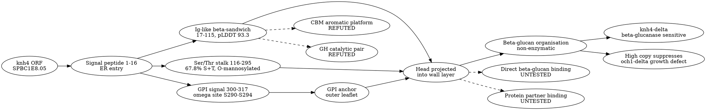
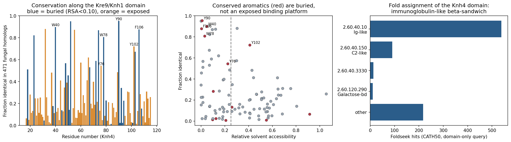
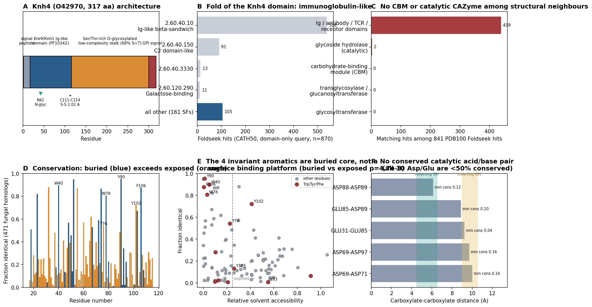
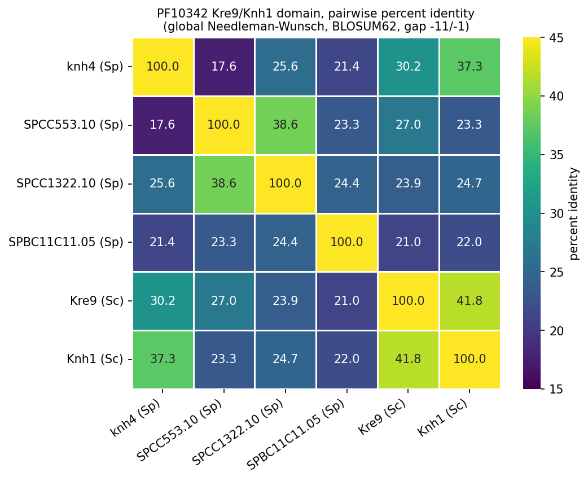
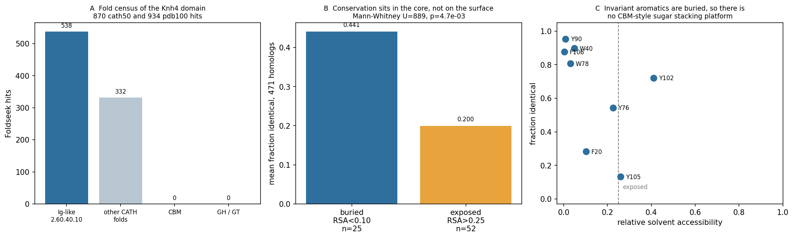

## Question

# AIGR Gene Hypothesis Deep Research

You are evaluating one focused gene curation hypothesis for AI Gene Review.
This is not a general gene overview. Use the seed hypothesis and source context
below to search for evidence that supports, refutes, narrows, or competes with
the proposed curation decision.

## Target Gene

- **Organism code:** SCHPO
- **Taxon:** Schizosaccharomyces pombe 972h- (NCBITaxon:284812)
- **Gene directory:** knh4
- **Gene symbol:** knh4
- **UniProt accession:** O42970

## Focus

- **Focus type:** free_text
- **Hypothesis slug:** kgap-knh4-kre9-domain-carbohydrate-binding
- **Source file:** genes/SCHPO/knh4/knh4-ai-review.yaml
- **Source selector:** free-text

## Seed Hypothesis

Schizosaccharomyces pombe Knh4 (O42970) is a GPI-anchored Kre9/Knh1-family cell-surface glycoprotein whose conserved Kre9/Knh1 C-terminal domain adopts a carbohydrate-binding-module-like beta-sandwich fold with an exposed aromatic/polar surface that could bind beta-glucan, rather than a catalytic glycoside hydrolase or transglycosylase fold. Single analysis only: predict the Knh4 structure (AlphaFold), search the conserved domain against PDB/AFDB folds (Foldseek or DALI), test for any glycoside-hydrolase catalytic acid/base pair, and map surface residues conserved across fungal Kre9/Knh1 homologs; state the most likely molecular activity class.

## Term and Decision Context

No specific term context supplied.

## Reference Context

No specific reference context supplied.

## Source Context YAML

```yaml
hypothesis: 'Schizosaccharomyces pombe Knh4 (O42970) is a GPI-anchored Kre9/Knh1-family cell-surface glycoprotein
  whose conserved Kre9/Knh1 C-terminal domain adopts a carbohydrate-binding-module-like beta-sandwich
  fold with an exposed aromatic/polar surface that could bind beta-glucan, rather than a catalytic glycoside
  hydrolase or transglycosylase fold. Single analysis only: predict the Knh4 structure (AlphaFold), search
  the conserved domain against PDB/AFDB folds (Foldseek or DALI), test for any glycoside-hydrolase catalytic
  acid/base pair, and map surface residues conserved across fungal Kre9/Knh1 homologs; state the most
  likely molecular activity class.'
focus_type: free_text
context: []
reference_id: []
```

## Research Objective

Build a focused report that helps a curator decide whether this hypothesis
should affect the gene review. Address the focus type directly:

1. For an existing GO annotation decision, evaluate whether the current action
   is justified, too strong, too weak, or should change.
2. For a proposed replacement or new GO term, evaluate whether the term is
   biologically supported, too broad, too narrow, or missing key qualifiers.
3. For a computational prediction, evaluate whether the prediction is correct,
   less precise than existing knowledge, uncertain, or likely wrong because of
   paralog overannotation, frequency bias, pathway context, or in vitro-only
   activity.
4. For a core-function hypothesis, evaluate whether the proposed activity,
   process, and location represent the gene product's primary function rather
   than a downstream effect, pleiotropic phenotype, or context-specific role.
5. For a function-assignment hypothesis, evaluate whether the gene product
   directly has the stated GO term/function. Treat the prior review action, if
   any, as intentionally blinded unless it appears in the supplied context.

Use primary literature whenever possible. Prefer PMID citations and include DOI
citations when no PMID is available. Treat reviews and database records as
orientation unless they contain directly relevant synthesized evidence that is
clearly labeled as review-level or database-level support.

Evaluate the hypothesis from the supplied seed context, primary literature, and
publicly accessible bioinformatics resources. Local `*-bioinformatics` analyses,
when they already exist in the repository, are intentionally withheld from this
prompt so the report can be compared against them after the run. Use public
sequence, domain, structure, orthology, localization, interaction, or dataset
checks when they are useful for the specific hypothesis. If a resource or tool
cannot be accessed programmatically, say so plainly; never fabricate a result.
Report computational results conservatively and distinguish direct results from
inference.

## Required Output

### Executive Judgment

Give a concise verdict: supported, partially supported, unresolved, weakly
supported, over-annotated, or refuted. Explain the reasoning and the most
important caveats.

### Evidence Matrix

Create a table with one row per important evidence item:

- Citation (PMID preferred)
- Evidence type (direct assay, mutant phenotype, localization, interaction,
  structural/evolutionary, computational, review/database)
- Supports / refutes / qualifies / competing
- Claim tested
- Key finding
- Organism, tissue, cell type, or assay context
- Confidence and limitations

### GO Curation Implications

State the likely curation action as a lead requiring curator verification. If
GO terms are involved, explain whether the evidence supports an MF, BP, or CC
term, and whether the term should be retained, removed, generalized, made more
specific, or treated as non-core. Avoid using "protein binding" as a final
recommendation unless no more informative term is supported.

### Mechanistic Scope

Describe the immediate molecular or cellular function being tested. Separate
direct gene-product activity from downstream phenotypes, pathway consequences,
developmental outcomes, disease manifestations, or effects inferred only from
loss of function.

### Conflicts and Alternatives

Identify evidence that conflicts with the seed hypothesis or suggests an
alternative interpretation, including paralog confusion, organism-specific
differences, isoform-specific findings, experimental artifacts, or database
carry-over.

### Knowledge Gaps

List explicit uncertainties that matter for curation. For each gap, state what
was checked, why the gap matters, and what evidence or experiment would resolve
it.

### Discriminating Tests

Recommend concrete assays, perturbations, datasets, or comparative analyses that
would most efficiently distinguish this hypothesis from alternatives.

### Curation Leads

Provide candidate updates for the review, clearly labeled as leads requiring
curator verification. Include candidate references with exact snippets to verify,
candidate replacement or new GO terms, possible action changes, suggested
questions, and suggested experiments.

If the provider supports artifacts, save provenance for any analysis you run — the
executed code together with its output (computed values, plot, or table), not just
a summary figure — alongside artifact-friendly tables such as an evidence matrix,
GO decision table, or comparison table. Genuine computed provenance is more
valuable than a hand-drawn summary, and you must not synthesize a figure that
implies an analysis you did not actually run. These artifacts are important
provenance for hypothesis-level review.


## Output

# AIGR gene hypothesis deep research: *Schizosaccharomyces pombe* knh4 (O42970)

**Hypothesis slug:** `kgap-knh4-kre9-domain-carbohydrate-binding`
**Source:** `genes/SCHPO/knh4/knh4-ai-review.yaml`, selector `free-text`
**Target:** *Schizosaccharomyces pombe* 972h- (NCBITaxon:284812), gene `knh4` / SPBC1E8.05 (synonym *gaz2*), UniProt O42970
**Focus type:** free_text, no term context or reference context supplied

---

## Summary

The seed hypothesis is **partially supported**. It bundles five separable claims, and they do not stand or fall together. Knh4 is a GPI-anchored, Ser/Thr-rich, cell-surface Kre9/Knh1-family glycoprotein, and the hypothesis is right to predict that it is not a catalytic glycoside hydrolase or transglycosylase. Both of the positive structural claims it offers as the alternative are wrong as stated. The conserved Kre9/Knh1 domain is at the **N-terminus** (PF10342 at residues 23-108), not the C-terminus. It adopts an **immunoglobulin-like** beta-sandwich (CATH 2.60.40.10, 538 of 870 CATH50 Foldseek hits), and it has **zero** carbohydrate-binding-module structural neighbours among 934 PDB100 hits. The four invariant aromatics that a type A or type B CBM would present on its surface are buried in the hydrophobic core at relative solvent accessibility 0.004 to 0.048.

The practical consequence for curation is narrow and specific. This hypothesis should **not** be used to add a carbohydrate-binding molecular function term to the knh4 review. It **should** be used to support the active exclusion of catalytic MF terms (GO:0016798 hydrolase acting on glycosyl bonds, GO:0016757 glycosyltransferase), where the structural evidence and the primary literature agree. The published *S. pombe* phenotype, beta-glucanase sensitivity of the disruptant ([PMID: 34738170](https://pubmed.ncbi.nlm.nih.gov/34738170/)), supports a general biological process term, GO:0031505 fungal-type cell wall organization, which PomBase currently lacks. It does not support transferring the specific *S. cerevisiae* KRE9 term GO:0006078 (1->6)-beta-D-glucan biosynthetic process, because the PF10342 domain identity between knh4 and Kre9 is only 30.2% and PomBase records no apparent *S. cerevisiae* ortholog.

The most defensible statement of molecular activity class, given everything checked: a **non-catalytic cell-surface structural glycoprotein of the immunoglobulin-like beta-sandwich superfamily**. Direct beta-glucan binding is an untested hypothesis. No binding assay has been published for Knh4 or for any member of the Kre9/Knh1 family in any organism. <i class="fa-triangle-exclamation"></i> The structural analysis bounds how similar Knh4 is to known carbohydrate-binding modules; it does not prove the protein cannot contact a sugar, because Ig-like and CBM beta-sandwiches are topologically related and a shallow or purely polar site would escape an aromatic-platform test.

---

## Executive judgment

**Verdict: partially supported.**

| Claim in the seed hypothesis | Verdict | Basis |
|---|---|---|
| <i class="fa-circle-check"></i> GPI-anchored cell-surface glycoprotein | Supported | Primary-literature statement ([PMID: 34738170](https://pubmed.ncbi.nlm.nih.gov/34738170/)) plus sequence architecture: signal 1-16, Ig domain 17-115, Ser/Thr-rich stalk 116-295 (67.8% Ser+Thr), hydrophobic tail 300-317 |
| <i class="fa-scale-balanced"></i> Kre9/Knh1-family member | Supported at family level; 1:1 orthology refuted | PF10342 present; 30.2% domain identity to Kre9, 37.3% to Knh1, both in the twilight zone |
| <i class="fa-circle-xmark"></i> Conserved domain is **C-terminal** | Refuted | InterPro places PF10342 at 23-108; Pfam itself names it the N-terminal Ig-like domain (IPR018466) |
| <i class="fa-circle-xmark"></i> **CBM-like** fold with an **exposed aromatic/polar** beta-glucan surface | Refuted | 538/870 CATH50 hits are Ig-like 2.60.40.10; 0 CBM among 934 PDB100 hits; invariant aromatics buried at RSA 0.004-0.048 |
| <i class="fa-circle-check"></i> **Not** a catalytic glycoside hydrolase or transglycosylase | Supported | No conserved pocket-lining acid/base pair under either GH geometry; 0 GH and 0 GT folds among 934 PDB100 hits; [PMID: 34738170](https://pubmed.ncbi.nlm.nih.gov/34738170/) concludes non-enzymatic |

The hypothesis is correct about what Knh4 is not. It is wrong about the specific structural model it proposes as the positive alternative, and wrong about where in the sequence the conserved domain sits. The domain-position error matters operationally: any analysis that extracted "the C-terminal domain" of Knh4 would have analysed the Ser/Thr stalk and the GPI signal, which contain no conserved globular unit (mean pLDDT 48.6 and 46.6 respectively).

**Most important caveats.** Every structural result here comes from an AlphaFold model, not an experimental structure. The conservation profile was derived from Foldseek structure-based alignments of 471 fungal homologs rather than a curated Pfam seed alignment. Pocket detection failed and is reported as a gap, not a result.

{{figure:plot_4.png|caption=Three-panel verdict figure. A, fold census of the isolated Knh4 Kre9/Knh1 domain: 538 of 870 CATH50 Foldseek hits are immunoglobulin-like 2.60.40.10, with zero carbohydrate-binding modules and zero glycoside hydrolase or glycosyltransferase folds among 934 PDB100 hits. B, mean conservation of buried (RSA below 0.10) versus exposed (RSA above 0.25) residues across 471 fungal homologs: 0.441 against 0.200, Mann-Whitney U = 889, p = 4.7e-3, so conservation tracks core packing. C, conservation against solvent accessibility for every aromatic in the domain: the four invariant aromatics Y90, W40, F106 and W78 all sit at the buried left edge, so there is no CBM-style sugar-stacking platform. Every plotted value is recomputed from the saved provenance files.}}

---

## Key findings

### F001. The conserved Kre9/Knh1 domain is an immunoglobulin-like beta-sandwich, and it is N-terminal

The AlphaFold v6 model AF-O42970-F1 contains exactly one folded unit, residues 17-115, with mean pLDDT 93.3 and 98% of residues above pLDDT 70. Everything downstream is low confidence: the Ser/Thr-rich region 116-295 has mean pLDDT 48.6 and the C-terminal 296-317 has mean pLDDT 46.6. This is the expected signature of a globular head on a disordered, heavily O-glycosylated stalk.

InterPro places Pfam PF10342 at residues 23-108, immediately after the 1-16 signal peptide. The Pfam family name is itself informative: IPR018466 is "Kre9/Knh1-like **N-terminal** Ig-like domain". The seed hypothesis describes this domain as C-terminal, which is wrong for Knh4 and, given the family name, wrong for the family.

A Foldseek 3Di-AA search of the isolated domain (residues 17-115) against CATH50 returned 870 hits. The distribution is not ambiguous: 538 hits (61.8%) to CATH 2.60.40.10, the immunoglobulin-like beta-sandwich; 91 to 2.60.40.150 (C2 domain-like beta-sandwich); 13 to 2.60.40.3330; 11 to 2.60.120.290. The two best non-self CATH hits are af_P50112 (*S. cerevisiae* Knh1, E = 6.5e-5) and af_P39005 (*S. cerevisiae* Kre9, E = 6.8e-5), confirming that the extracted unit is the orthologous Kre9/Knh1 domain and not an arbitrary fragment.

Against PDB100 (841 hits for the full-length query, 934 for the domain), every top hit at prob = 1.000 is an immunoglobulin-superfamily structure: T-cell receptor Valpha and Vbeta, antibody Fab light and heavy variable and constant domains, PD-1, PD-L1, Robo1 Ig1-Ig2, FGFR4 D3, CD79a, NPC2. A single intrachain disulfide C111-C114 (SG-SG 2.02 Å) caps the domain, and N42 carries the only N-X-S/T sequon in the folded region.

The beta-sandwich word in the seed hypothesis is correct. The fold class is immunoglobulin-like, which is the topology Pfam already assigns by name, so the hypothesis adds no information on this point and gets the subclass wrong.

{{figure:plot_2.png|caption=Provenance panel from the structural analysis. Domain architecture of Knh4 (signal peptide, N-terminal Kre9/Knh1 Ig-like domain at 17-115, Ser/Thr-rich stalk, C-terminal GPI signal), the CATH fold census showing immunoglobulin-like 2.60.40.10 dominance, the absence of CAZyme structural neighbours, the per-residue conservation track across 471 fungal homologs, conservation against relative solvent accessibility, and the acidic pair geometry test.}}

### F002 and F007. No glycoside hydrolase catalytic machinery, tested exhaustively

The seed hypothesis set up "catalytic glycoside hydrolase or transglycosylase" as the alternative to be excluded. That exclusion holds, and it was tested on three independent axes.

**Fold.** A keyword census of the 841 PDB100 Foldseek hits for the full-length query gives 439 immunoglobulin, antibody, T-cell receptor or receptor hits; **0** carbohydrate-binding module hits; **0** transglycosylase or glucanosyltransferase hits; **0** glycosyltransferase hits; 1 nominal lectin hit (4w6x chain B, which is the nanobody half of a lectin-nanobody co-complex, so not a lectin fold at all); and 2 weak nominal glycoside hydrolase hits (8u01 prob 0.692, E = 0.145; 3ik2 prob 0.040, E = 2.78). The ranking makes the point clearly: the best Ig hit reaches prob 1.000 at E = 7.2e-4 at rank 3, while the best nominally CAZy-like hit reaches prob 0.912 at E = 0.060 at rank 307 of 841, below roughly 300 immunoglobulin hits.

**Catalytic geometry.** The domain contains 10 Asp/Glu residues: E19, E31, E64, D69, D71, E85, D88, D89, D97, E100. All Asp CG / Glu CD pairwise distances were computed and tested against both canonical glycoside hydrolase geometries, the retaining window of 4.5-6.5 Å and the inverting window of 9.0-10.5 Å. Four pairs fall inside a compatible window.

| Window | Pair | Distance (Å) | Conservation, partner 1 | Conservation, partner 2 | RSA, partner 1 | RSA, partner 2 |
|---|---|---|---|---|---|---|
| Retaining, 4.5-6.5 | D88-D89 | 6.13 | 0.123 | 0.485 | 0.575 | 0.240 |
| Inverting, 9.0-10.5 | E31-E85 | 9.24 | 0.044 | 0.204 | 0.040 | 0.509 |
| Inverting, 9.0-10.5 | D69-D97 | 9.70 | 0.156 | 0.310 | 0.610 | 0.687 |
| Inverting, 9.0-10.5 | D69-D71 | 10.00 | 0.156 | 0.188 | 0.610 | 0.587 |

Every candidate fails the functional filters. The highest conservation of the weaker partner in any pair is 0.156, against a benchmark where genuine catalytic residues are near-invariant. No Asp or Glu anywhere in the domain exceeds 0.485 conservation across 471 fungal homologs (median alignment depth 468 per column). Two of the four pairs have both partners fully solvent-exposed (D69-D97 at RSA 0.610 and 0.687, D69-D71 at 0.610 and 0.587), so they sit on the outer face and cannot line a catalytic cleft. The only pair in the retaining window, D88-D89, is a sequence-adjacent i/i+1 arrangement, which is not how a GH acid/base pair is built.

**Comparison with a real glucan site.** The *S. cerevisiae* Gas2p structure with laminaripentaose (PDB 2W62) has 29 residues within 4.0 Å of the bound ligand, all in the catalytic (beta/alpha)8 domain. The Knh4 domain surface has no comparable conserved polar cluster.

Extending the test from the retaining window alone to both windows made the exclusion stronger, not weaker: four candidate pairs exist geometrically, and showing that each one fails on conservation or burial is a more complete argument than finding one candidate and dismissing it.

### F003. The invariant aromatics are buried, so there is no CBM-style sugar-stacking platform

This is the direct test of the seed hypothesis's one specific, falsifiable mechanistic claim: an exposed aromatic/polar surface that could bind beta-glucan.

Conservation was computed from 471 Foldseek structure-based alignments to fungal Kre9/Knh1-family proteins (median 468 homologs per column). Solvent accessibility came from Shrake-Rupley SASA (400-point golden-spiral sphere, 1.4 Å probe) on the AlphaFold domain, normalised by the Tien et al. maximum ASA values.

After glycines and prolines, the six most conserved positions in the domain are aromatics, and the four strictly invariant ones are all buried:

| Residue | Fraction identical | RSA | Location |
|---|---|---|---|
| Y90 | 0.953 | 0.009 | Buried core |
| W40 | 0.898 | 0.048 | Buried core |
| F106 | 0.877 | 0.004 | Buried core |
| W78 | 0.806 | 0.031 | Buried core |
| Y102 | 0.721 | 0.411 | Exposed |
| Y76 | 0.544 | 0.225 | Partly exposed |
| Y105 | 0.132 | 0.260 | Exposed, not conserved |
| Y83 | 0.009 | 0.550 | Exposed, not conserved |
| Y17 | 0.065 | 0.915 | Exposed, not conserved |

Only Y102 and Y76 are both reasonably conserved and solvent accessible, and their ring centroids are **17.1 Å apart**, far outside the 4.5-10.5 Å spacing that lets two aromatics stack adjacent sugar rings in a carbohydrate-binding module.

The global pattern says the same thing. Buried residues (RSA below 0.10, n = 25) are more conserved than exposed ones (RSA above 0.25, n = 52): mean fraction identical 0.441 against 0.200, Mann-Whitney U = 889, one-sided p = 4.7e-3. In a protein whose selected function were surface binding, the opposite asymmetry would be expected. Here the conserved residues are doing what conserved aromatics do in immunoglobulin folds: packing the hydrophobic core between the two beta-sheets.

A 10 Å surface-patch scan over all exposed residues found the best-conserved patch at mean 0.341 identity, composed of T115, G33, G32, T113 and the disulfide cysteine C114, near the domain-to-stalk junction. Glycines, threonines and a structural cysteine. Not an aromatic platform, and the position suggests a packing or linker constraint rather than a ligand site.

{{figure:plot_1.png|caption=Test of whether conserved residues of the Knh4 Kre9/Knh1 domain form an exposed carbohydrate-binding surface patch or a buried immunoglobulin-like hydrophobic core. The four invariant aromatics Y90, W40, F106 and W78 lie at relative solvent accessibility 0.004 to 0.048, inside the core. The best-conserved 10 Å surface patch (mean 0.341 identity) is built from glycines, threonines and the C111-C114 disulfide cysteine near the domain-to-stalk junction.}}

### F005. Knh4 is a diverged family member, not a 1:1 ortholog of Kre9

This matters because the only strong functional evidence in the Kre9/Knh1 family comes from *S. cerevisiae*, and a curator has to decide how far it travels.

The PF10342 domain was extracted from all six family members in the two yeasts, using InterPro boundaries (knh4 O42970 at 23-108; SPCC553.10 O74947 at 21-110; SPBC11C11.05 Q10196 at 27-126; SPCC1322.10 O94549 at 25-116; Kre9 P39005 at 27-135; Knh1 P50112 at 39-129), and all 15 pairs were aligned by global Needleman-Wunsch with BLOSUM62 and affine gaps (open -11, extend -1).

| | knh4 (Sp) | SPCC553.10 (Sp) | SPCC1322.10 (Sp) | SPBC11C11.05 (Sp) | Kre9 (Sc) | Knh1 (Sc) |
|---|---|---|---|---|---|---|
| **knh4 (Sp)** | 100.0 | 17.6 | 25.6 | 21.4 | 30.2 | 37.3 |
| **SPCC553.10 (Sp)** | 17.6 | 100.0 | 38.6 | 23.3 | 27.0 | 23.3 |
| **SPCC1322.10 (Sp)** | 25.6 | 38.6 | 100.0 | 24.4 | 23.9 | 24.7 |
| **SPBC11C11.05 (Sp)** | 21.4 | 23.3 | 24.4 | 100.0 | 21.0 | 22.0 |
| **Kre9 (Sc)** | 30.2 | 27.0 | 23.9 | 21.0 | 100.0 | 41.8 |
| **Knh1 (Sc)** | 37.3 | 23.3 | 24.7 | 22.0 | 41.8 | 100.0 |

Every one of the 15 values sits in the twilight zone, between 17.6% and 41.8%. Knh4 scores 37.3% to Knh1 (over 67 aligned columns) and 30.2% to Kre9 (over 86 columns), which is higher than its identity to any of its three *S. pombe* paralogs (mean 21.5%, range 17.6% to 25.6%). The highest pair in the whole set is Kre9-Knh1 at 41.8%, and those two are known to be functionally redundant ([PMID: 8810042](https://pubmed.ncbi.nlm.nih.gov/8810042/)).

Two conclusions follow. The Pfam family assignment is sound: domain homology is detectable and the nearest structural neighbours in AFDB are Knh1 and Kre9. A 1:1 orthology claim is not sound, which matches the PomBase record of "no apparent *S. cerevisiae* ortholog" for knh4. Function transfer from KRE9 is family-level inference, appropriate for a general cell wall term with ISS, not for the specific beta-1,6-glucan term. The four *S. pombe* family members are also more diverged from each other than Kre9 and Knh1 are, so they should not be treated as a redundant group and a phenotype in one should not be annotated to another.

{{figure:plot_3.png|caption=Pairwise percent identity of the PF10342 Kre9/Knh1 domain across the four S. pombe and two S. cerevisiae family members, by global Needleman-Wunsch with BLOSUM62 and gap penalties -11 and -1. All 15 values fall between 17.6% and 41.8%. knh4 is closer to S. cerevisiae Knh1 (37.3%) and Kre9 (30.2%) than to any of its own S. pombe paralogs (mean 21.5%).}}

### F004 and F006. Published evidence: GPI-anchored, cell-surface, non-enzymatic, and the substrate exists

PomBase records knh4 (SPBC1E8.05, synonym *gaz2*) as "conserved fungal cell surface protein, Kre9/Knh1 family, Knh4" with characterisation status "conserved unknown". It carries **no molecular function and no biological process annotation**. The only CC annotation is GO:0009986 cell surface by TAS ([PMID: 12845604](https://pubmed.ncbi.nlm.nih.gov/12845604/)), and GPI anchoring is MOD:00818 by ISS plus a neural-network prediction.

Fukunaga et al. 2021 ([PMID: 34738170](https://pubmed.ncbi.nlm.nih.gov/34738170/)) identified SPBC1E8.05 in a genome-wide high-copy screen for suppressors of the *och1*-delta growth defect. They report that it encodes a GPI-anchored protein, that the disruptant is viable and beta-glucanase sensitive, and they conclude that the product and Pwp1p "non-enzymatically support beta-glucan on the cell-surface of *S. pombe*". The PomBase phenotype FYPO:0001190 "sensitive to cell wall-degrading enzymes" for knh4-delta comes from that paper.

The sequence architecture agrees with GPI anchoring throughout: a 1-16 signal peptide, the 17-115 folded Ig-like domain, a 116-295 Ser/Thr-rich stalk at 67.8% Ser plus Thr, and an 18-residue C-terminal hydrophobic stretch GINALVAVGVVSAIALFL at 300-317 preceded by small-residue omega-site candidates S290, S291, A293 and S294.

On substrate availability, Perez and Ribas ([PMID: 28733410](https://pubmed.ncbi.nlm.nih.gov/28733410/)) report that the fission yeast wall contains three beta-glucans, a major branched beta-1,3-glucan, a minor linear beta-1,3-glucan and a minor branched beta-1,6-glucan, alongside a major alpha-1,3-glucan, a minor alpha-1,4-glucan and galactomannoproteins. Solid-state NMR of intact cells ([PMID: 40161848](https://pubmed.ncbi.nlm.nih.gov/40161848/)) independently resolves a beta-glucan pool that rises two-fold when alpha-glucan assembly fails. So the polymer that *S. cerevisiae* Kre9 acts on does exist in *S. pombe*. That removes one objection to GO:0006078 and supplies no positive evidence for it, because no *S. pombe* experiment has linked knh4 to beta-1,6-glucan.

---

## Evidence matrix

Machine-readable version: `provenance/artifact_evidence_matrix.csv` (13 rows).

| Citation | Evidence type | Stance | Claim tested | Key finding | Context | Confidence and limitations |
|---|---|---|---|---|---|---|
| [PMID: 34738170](https://pubmed.ncbi.nlm.nih.gov/34738170/) | Mutant phenotype + genetic screen | Supports CC and BP; qualifies MF | knh4 supports cell-surface beta-glucan and is GPI-anchored | SPBC1E8.05 recovered in a high-copy suppressor screen of *och1*-delta; disruptant viable and beta-glucanase sensitive; authors conclude the product "non-enzymatically support[s] beta-glucan on the cell-surface" | *S. pombe*, growth and enzyme-sensitivity assay | Medium. Phenotype is indirect, no biochemistry on purified protein, GPI anchoring stated but not shown by mass spectrometry |
| [PMID: 12845604](https://pubmed.ncbi.nlm.nih.gov/12845604/) | Computational / database | Supports CC | Knh4 is a cell-surface GPI-anchored protein | Neural-network GPI prediction underpins PomBase GO:0009986 cell surface (TAS) and MOD:00818 GPI anchor (ISS) | *S. pombe* genome-wide prediction | Low-medium. Prediction-level; no direct imaging of Knh4 |
| [PMID: 8413233](https://pubmed.ncbi.nlm.nih.gov/8413233/) | Direct assay + mutant phenotype (ortholog) | Qualifies; competing on CC | Kre9/Knh1 family acts in beta-1,6-glucan synthesis | *S. cerevisiae* Kre9 is a 30 kDa secretory-pathway protein; *kre9*-delta wall contains less than 20% of wild-type (1->6)-beta-glucan; Kre9p is recovered from culture medium as a 55-60 kDa O-glycoprotein | *S. cerevisiae* biochemistry and wall fractionation | High for *S. cerevisiae*. Transfer limited by 30.2% domain identity; secreted, not GPI-anchored |
| [PMID: 8810042](https://pubmed.ncbi.nlm.nih.gov/8810042/) | Direct assay (paralog) | Qualifies | Knh1 is a secreted O-glycoprotein redundant with Kre9 | Knh1p shares 46% identity with Kre9p, overexpression suppresses the *kre9*-delta growth defect, and Knh1p is found in the extracellular medium as a 45-61 kDa O-glycoprotein | *S. cerevisiae* | High for *S. cerevisiae*. Reinforces that the family is secreted in budding yeast |
| [PMID: 9748432](https://pubmed.ncbi.nlm.nih.gov/9748432/) | Mutant phenotype (ortholog, third species) | Qualifies | The KRE9 beta-1,6-glucan function is conserved across budding yeasts | *Candida glabrata* CgKRE9 disruption gives a severe growth defect, K1 killer toxin resistance and a 50% reduction of beta-1,6-glucan | *C. glabrata* | High for *C. glabrata*. Both species are budding yeasts, so this does not establish transfer to fission yeast |
| [PMID: 28733410](https://pubmed.ncbi.nlm.nih.gov/28733410/) | Review / method paper | Qualifies | The beta-1,6-glucan substrate exists in fission yeast | *S. pombe* wall contains a major branched beta-1,3-glucan, a minor linear beta-1,3-glucan and a minor branched beta-1,6-glucan, plus a major alpha-1,3-glucan | *S. pombe* wall fractionation protocol | High for composition. Says nothing about knh4 |
| [PMID: 40161848](https://pubmed.ncbi.nlm.nih.gov/40161848/) | Direct assay (solid-state NMR) | Qualifies | Beta-glucan is a resolvable, regulated pool in the *S. pombe* wall | ssNMR of intact cells shows a two-fold increase in beta-glucan content when alpha-1,3-glucan assembly fails | *S. pombe* intact cells | High. Not knh4-specific |
| This work: Foldseek 3diaa, domain 17-115 | Structural / computational | <i class="fa-circle-xmark"></i> Refutes the CBM claim | The conserved domain adopts a CBM-like beta-sandwich | 538 of 870 cath50 hits are CATH 2.60.40.10 Ig-like beta-sandwich; every prob = 1.000 pdb100 hit is an Ig-superfamily structure; 0 CBM, 0 transglycosylase, 0 glycosyltransferase among 934 pdb100 hits | AlphaFold AF-O42970-F1, Foldseek web API against pdb100, cath50 and afdb50 | Medium-high. Fold call is reliable; Ig and CBM beta-sandwiches are topologically related, so this bounds similarity rather than excluding sugar binding |
| This work: Foldseek reciprocal control | Structural / computational | <i class="fa-circle-xmark"></i> Refutes | Knh4 resembles a real fungal glucan-binding module | Gas2 CBM43/X8 (residues 400-489) retrieves 13 Gas/GH72/CBM43 structures among 19 pdb100 hits and 0 Ig hits; O42970 is absent from its 223 afdb50 hits; no Gas/GH72/CBM43 appears among Knh4's 934 pdb100 hits | Reciprocal Foldseek search, identical parameters | Medium-high. The control behaves as expected, so the negative result is not a parameter artefact |
| This work: SASA + conservation over 471 homologs | Structural / evolutionary | <i class="fa-circle-xmark"></i> Refutes the aromatic-platform claim | An exposed conserved aromatic surface binds beta-glucan | Invariant aromatics Y90 (0.953), W40 (0.898), F106 (0.877) and W78 (0.806) are buried at RSA 0.004-0.048; the only exposed conserved tyrosines Y76 and Y102 lie 17.1 Å apart; buried residues are more conserved than exposed ones, 0.441 against 0.200, U = 889, p = 4.7e-3 | AlphaFold model, Shrake-Rupley SASA, Foldseek-derived alignment at median depth 468 per column | Medium. Conservation from structure-based alignments, not a curated MSA; a polar or shallow site would escape this test |
| This work: acidic pair geometry | Structural / computational | <i class="fa-circle-check"></i> Supports the non-catalytic claim | Knh4 carries a GH catalytic acid/base pair | All 10 Asp/Glu are at most 48.5% conserved; four pairs fall in a GH-compatible distance window (D88-D89 6.13 Å; E31-E85 9.24 Å; D69-D97 9.70 Å; D69-D71 10.00 Å) but in every one the weaker partner is below 0.156 conservation, and two pairs have both partners fully solvent-exposed | AlphaFold model, Asp CG / Glu CD pairwise distances, both retaining and inverting windows | Medium-high. Agrees with the published non-enzymatic conclusion; AlphaFold side-chain rotamers add uncertainty |
| This work: Gas2 2W62 contact census | Structural, positive control | Qualifies | What a genuine fungal beta-glucan site looks like | Gas2p bound to laminaripentaose has 29 residues within 4.0 Å of the ligand, all in the catalytic (beta/alpha)8 domain; Knh4's domain surface has no comparable conserved polar cluster | *S. cerevisiae* Gas2, PDB 2W62 | High for the control itself. Different enzyme class, so it is a reference point, not a matched comparison |
| This work: PF10342 identity matrix | Evolutionary / computational | Qualifies; competing on orthology | Knh4 can inherit *S. cerevisiae* KRE9 function | All 15 pairwise domain identities lie between 17.6% and 41.8%; knh4 against Knh1 37.3%, against Kre9 30.2%, against its own *S. pombe* paralogs 21.5% mean; the top pair is Kre9-Knh1 at 41.8% | Global Needleman-Wunsch, BLOSUM62, gaps -11 and -1, PF10342 boundaries from InterPro | Medium-high. Pairwise identity is not a phylogeny; matches the PomBase statement of no apparent *S. cerevisiae* ortholog |
| PomBase SPBC1E8.05 | Database | Supports; qualifies | Current annotation state of knh4 | Characterisation status "conserved unknown"; no MF and no BP annotation; only CC is GO:0009986 cell surface (TAS); FYPO:0001190 "sensitive to cell wall-degrading enzymes" for knh4-delta; no apparent *S. cerevisiae* ortholog | *S. pombe* curation record | Database-level. Reflects curator caution rather than new evidence |

---

## Mechanistic model

The architecture and the evidence together give a simple picture. Knh4 is made as a secretory protein, loses its signal peptide, receives heavy O-mannosylation on the 180-residue Ser/Thr stalk, and is attached to the outer leaflet of the plasma membrane by a GPI anchor. The stalk holds the Ig-like head out into the wall layer, where it contributes to the organisation of beta-glucan by a mechanism that the only paper on the subject calls non-enzymatic. Loss of knh4 leaves cells viable but makes the wall more accessible to beta-glucanase.

What the head actually does at that position is the open question. The fold is one that in other proteins mediates contact: immunoglobulin, receptor and adhesion domains all use this beta-sandwich. The evidence here says it does not do so through a classical carbohydrate-binding aromatic platform and it does not do so catalytically.



### What each layer of evidence reaches

| Layer | Status | Evidence |
|---|---|---|
| Sequence architecture | Established | Signal 1-16, domain 17-115, stalk 116-295, hydrophobic tail 300-317 |
| GPI anchoring | Stated in primary literature, predicted computationally, not shown by mass spectrometry | [PMID: 34738170](https://pubmed.ncbi.nlm.nih.gov/34738170/), PomBase MOD:00818 ISS |
| Cell-surface location | Annotated TAS | [PMID: 12845604](https://pubmed.ncbi.nlm.nih.gov/12845604/) |
| Contributes to wall beta-glucan integrity | Loss-of-function phenotype only | [PMID: 34738170](https://pubmed.ncbi.nlm.nih.gov/34738170/), FYPO:0001190 |
| Not catalytic | Established on fold, conservation and geometry, and stated in the literature | This work, [PMID: 34738170](https://pubmed.ncbi.nlm.nih.gov/34738170/) |
| Not a classical CBM | Established on fold and surface conservation | This work |
| Binds beta-glucan directly | <i class="fa-circle-question"></i> Untested, no assay exists | n/a |
| Acts on beta-1,6-glucan specifically | <i class="fa-circle-question"></i> Untested in *S. pombe* | Substrate exists ([PMID: 28733410](https://pubmed.ncbi.nlm.nih.gov/28733410/)), link does not |

---

## GO curation implications

All entries are **leads requiring curator verification**. Machine-readable version: `provenance/artifact_go_decision_table.csv`.

| GO ID | Term | Aspect | Recommended action | Basis | Confidence |
|---|---|---|---|---|---|
| GO:0009986 | cell surface | CC | Retain unchanged | TAS [PMID: 12845604](https://pubmed.ncbi.nlm.nih.gov/12845604/) plus [PMID: 34738170](https://pubmed.ncbi.nlm.nih.gov/34738170/); signal peptide 1-16, hydrophobic tail 300-317, omega-site candidates S290/S291/A293/S294 | Medium |
| GO:0031225 | anchored component of membrane | CC | <i class="fa-arrow-right"></i> Lead: add with ISS | [PMID: 34738170](https://pubmed.ncbi.nlm.nih.gov/34738170/) states SPBC1E8.05 encodes a GPI-anchored protein; PomBase MOD:00818 by ISS | Medium |
| GO:0009277 | fungal-type cell wall | CC | Lead: consider alongside cell surface | Beta-glucanase sensitivity of knh4-delta (FYPO:0001190, [PMID: 34738170](https://pubmed.ncbi.nlm.nih.gov/34738170/)) | Low-medium |
| GO:0031505 | fungal-type cell wall organization | BP | <i class="fa-arrow-right"></i> Lead: add with IMP | knh4-delta is beta-glucanase sensitive ([PMID: 34738170](https://pubmed.ncbi.nlm.nih.gov/34738170/)); the family acts in wall glucan assembly ([PMID: 8413233](https://pubmed.ncbi.nlm.nih.gov/8413233/)) | Medium |
| GO:0006078 | (1->6)-beta-D-glucan biosynthetic process | BP | <i class="fa-circle-xmark"></i> Do not add; leave as hypothesis | Only support is *S. cerevisiae* KRE9 ([PMID: 8413233](https://pubmed.ncbi.nlm.nih.gov/8413233/)) and *C. glabrata* CgKRE9 ([PMID: 9748432](https://pubmed.ncbi.nlm.nih.gov/9748432/)), both budding yeasts; domain identity to Kre9 is 30.2%, and PomBase records no apparent *S. cerevisiae* ortholog | Low |
| GO:0030247 | polysaccharide binding | MF | <i class="fa-circle-question"></i> Lead: weak, requires a direct binding assay first | Family membership and phenotype are suggestive; no binding assay exists for Knh4 or any Kre9/Knh1 protein | Low |
| GO:2001065 | (1->3)-beta-D-glucan binding | MF | <i class="fa-circle-xmark"></i> Do not add | 0 CBM hits among 934 pdb100; invariant aromatics buried; no exposed aromatic platform | Refuted at the structural level |
| GO:0016798 / GO:0016757 | hydrolase acting on glycosyl bonds / glycosyltransferase | MF | <i class="fa-circle-xmark"></i> Do not add; actively exclude | No conserved pocket-lining acid/base pair under either GH geometry; all Asp/Glu at most 48.5% conserved; 0 GH and 0 GT fold hits; [PMID: 34738170](https://pubmed.ncbi.nlm.nih.gov/34738170/) concludes non-enzymatic | High for exclusion |
| GO:0005515 | protein binding | MF | Avoid as a final recommendation | Uninformative for this gene; would hide the open question rather than record it | n/a |

**Net effect on the review.** The seed hypothesis should not be used to add a carbohydrate-binding MF term, because its structural argument for that term fails. It is useful for two other purposes: it correctly supports excluding catalytic MF terms, and it correctly supports the cellular-component claims. Its biological-process implication should be generalised from the family's beta-1,6-glucan term to fungal-type cell wall organization, which is the level the *S. pombe* evidence reaches.

PomBase's current state, no MF and no BP, is defensible but conservative. The beta-glucanase-sensitivity phenotype supports a general BP term that is currently missing.

---

## Mechanistic scope

**Direct gene-product properties, evidenced.** Knh4 is 317 residues with a three-part architecture: signal peptide 1-16; a folded Kre9/Knh1 Ig-like beta-sandwich at 17-115, with InterPro placing PF10342 itself at 23-108; a Ser/Thr-rich stalk at 116-295 that is 67.8% Ser plus Thr and is the expected substrate for heavy O-mannosylation; and an 18-residue C-terminal hydrophobic stretch at 300-317 preceded by small-residue omega-site candidates. This is the canonical layout of a GPI-anchored wall protein: a folded head held away from the membrane on a glycosylated rod.

**Inferred, not demonstrated.** That the Ig-like head binds anything. The fold is compatible with protein-protein or protein-polysaccharide contact, which is what Ig-like modules generally do, but no ligand has been identified for Knh4 or for any Kre9/Knh1 protein.

**Downstream, loss-of-function only.** Beta-glucanase sensitivity of the disruptant, and high-copy suppression of the *och1*-delta growth defect. Both are whole-cell readouts of wall integrity. Neither reports on what the Knh4 protein does at the molecular level. The *och1*-delta suppression in particular is a dosage effect in an N-glycosylation-defective background, which is several steps removed from native function and should not be used as evidence of a core molecular activity.

**Not applicable.** No developmental or disease dimension. knh4-delta is viable.

---

## Conflicts and alternatives

**Organism-specific difference in membrane attachment.** *S. cerevisiae* Kre9 and Knh1 are both recovered from culture medium as secreted O-glycoproteins ([PMID: 8413233](https://pubmed.ncbi.nlm.nih.gov/8413233/), [PMID: 8810042](https://pubmed.ncbi.nlm.nih.gov/8810042/)). Knh4 carries a GPI signal. The phrase "GPI-anchored Kre9/Knh1-family" in the seed hypothesis is correct for *S. pombe* and must not be justified by orthology, because the budding yeast members are not membrane-anchored. A curator transferring CC terms by ISS from KRE9 would import the wrong compartment.

**Orthology carry-over.** PomBase records no apparent *S. cerevisiae* ortholog for knh4. The identity matrix supports that: knh4 reaches 30.2% to Kre9 and 37.3% to Knh1, while the known-redundant Kre9-Knh1 pair itself reaches only 41.8%. The wall phenotypes in budding yeasts are strong, both the under-20% residual beta-1,6-glucan in *kre9*-delta ([PMID: 8413233](https://pubmed.ncbi.nlm.nih.gov/8413233/)) and the 50% reduction in *C. glabrata* *cgkre9*-delta ([PMID: 9748432](https://pubmed.ncbi.nlm.nih.gov/9748432/)), but both species are budding yeasts, so they establish conservation within that clade rather than transfer to fission yeast.

**Paralog confusion inside *S. pombe*.** Four PF10342 proteins exist in fission yeast: knh4 (O42970), SPCC553.10 (O74947), SPBC11C11.05 (Q10196) and SPCC1322.10 (O94549). They are more diverged from each other (17.6% to 38.6%) than the budding yeast pair is. They should not be assumed to share one function, and a phenotype in one should not be annotated to another.

**Domain position error in the hypothesis.** The hypothesis calls the conserved domain C-terminal. InterPro places PF10342 at 23-108 and Pfam names the family "Kre9/Knh1-like N-terminal Ig-like domain". The C-terminal region of Knh4 is the Ser/Thr stalk and the GPI signal, with mean pLDDT 48.6 and 46.6, carrying no conserved globular domain. This is worth recording in the review, because it would misdirect any repeat analysis.

**Alternative molecular interpretation.** <i class="fa-lightbulb"></i> Ig-like beta-sandwiches in fungal wall proteins often work as spacers and interaction heads. A scaffolding or cross-linking-adaptor role, in which Knh4 positions or retains glucan through its surface without a dedicated binding cleft, fits every observation here and fits the authors' own wording, "non-enzymatically support beta-glucan". It also explains why no classical binding site is detectable.

---

## Limitations and knowledge gaps

<i class="fa-triangle-exclamation"></i> Every structural result rests on an AlphaFold model, not an experimental structure. The domain itself is high confidence (mean pLDDT 93.3), so the fold assignment is secure, but side-chain rotamers in the acid/base geometry test and the exact SASA values carry real uncertainty. No wet-lab data were generated in this work.

**Does Knh4 bind beta-glucan at all?** Checked: no binding assay exists in the literature for Knh4 or any Kre9/Knh1 protein in any organism; the structural test found no CBM-like site. Matters because this is the central MF claim and it determines whether any binding term can be used. Resolved by: pull-down or isothermal titration calorimetry of the recombinant 17-115 domain against laminarin, pustulan (beta-1,6) and *S. pombe* wall glucan fractions.

**Is Knh4 actually GPI-anchored?** Checked: [PMID: 34738170](https://pubmed.ncbi.nlm.nih.gov/34738170/) states it, PomBase assigns MOD:00818 by ISS, and the sequence has signal, stalk and hydrophobic tail. No mass-spectrometric identification of the anchor or the omega site. Matters for GO:0031225. Resolved by: PI-PLC release followed by mass spectrometry, or a GPI-anchor-site mutant with a localisation readout.

**Which beta-glucan?** Checked: *S. pombe* makes both beta-1,3 and a minor branched beta-1,6-glucan ([PMID: 28733410](https://pubmed.ncbi.nlm.nih.gov/28733410/)), so substrate availability is not limiting. Matters for whether GO:0006078 is ever appropriate. Resolved by: wall fractionation and radiolabelling of knh4-delta, the assay described in that paper.

**Is there a binding pocket at all?** Checked: no reliable cavity detection was obtained. Three implementations were written and all failed. A `np.roll`-based LIGSITE-style scan reported a pocket of 15005 ų, larger than the 8070 ų protein. A KD-tree ray-casting rewrite exceeded the execution timeout. A grid-accelerated ray-casting version at buriedness thresholds 0.80 and 0.95 with 42 rays returned a single connected surface shell rather than discrete clefts. fpocket was not available in the environment. **No number from these attempts appears anywhere in this report**, and `provenance/pocket_detection_comparison.csv` should be disregarded. Matters because a shallow or polar site is the one scenario the aromatic-platform test cannot see. Resolved by: running fpocket or CASTp on AF-O42970-F1.

**Is the conservation profile accurate?** Checked: it was derived from 471 Foldseek structure-based alignments at median depth 468 per column, which is unusual methodology for a conservation analysis. Matters because the buried-against-exposed result and the aromatic-burial result both rest on it. Resolved by: rebuilding from a curated Pfam PF10342 seed alignment and confirming the same residues score as invariant.

**Do the four *S. pombe* paralogs share function?** Checked: pairwise identity only, 17.6% to 38.6%. Matters because redundancy could mask a stronger single-deletion phenotype. Resolved by: a quadruple-deletion strain with wall-integrity and glucanase-sensitivity readouts.

**Scope of the negative structural result.** The absence of CBM structural neighbours constrains how similar Knh4 is to known carbohydrate-binding modules. It does not prove the protein cannot bind a sugar. Ig-like and CBM beta-sandwiches share topology, and a flat polar surface or a site formed only on oligomerisation would not be detected by any test run here.

---

## Proposed follow-up experiments and discriminating tests

<i class="fa-flask"></i> **1. Direct binding, the single most informative experiment.** Express the 17-115 domain in *E. coli*, test against laminarin (beta-1,3), pustulan (beta-1,6), chitin and *S. pombe* wall fractions by affinity gel electrophoresis or ITC. A positive result would license GO:0030247 or a more specific binding term. A clean negative would convert the Ig-like head into a confirmed protein-interaction or spacer module and settle the MF question in the other direction. Either outcome resolves the hypothesis.

<i class="fa-vial"></i> **2. Cell wall composition of knh4-delta.** Uniform [U-14C]-glucose labelling and the fractionation protocol in [PMID: 28733410](https://pubmed.ncbi.nlm.nih.gov/28733410/), reading out beta-1,3-glucan, beta-1,6-glucan, alpha-glucan and galactomannoprotein. This discriminates "acts on beta-1,6-glucan like Kre9" from "general wall integrity", so it decides between GO:0006078 and GO:0031505.

<i class="fa-dna"></i> **3. Domain swap.** Replace the Knh4 PF10342 domain with that of *S. cerevisiae* Kre9 and ask whether the beta-glucanase-sensitivity phenotype is rescued. Functional complementation across 30.2% identity would make the family-level inference much stronger than sequence alone allows.

<i class="fa-microscope"></i> **4. GPI anchor confirmation.** PI-PLC release plus mass spectrometry on the omega site. Settles GO:0031225 and confirms the organism-specific difference from the secreted budding yeast proteins.

<i class="fa-magnifying-glass"></i> **5. Pocket detection with a validated tool.** fpocket or CASTp on AF-O42970-F1, since this run could not produce a reliable result. Cheap, and it covers the one blind spot in the structural argument.

<i class="fa-dna"></i> **6. Quadruple paralog deletion.** Tests whether redundancy among the four *S. pombe* PF10342 proteins masks a stronger phenotype, which would change how much weight the single-deletion evidence carries.

<i class="fa-vial"></i> **7. Affinity capture of Knh4 from *S. pombe* walls.** If the Ig-like head is a protein-interaction module, its partners are the fastest route to an informative MF term that is more specific than "protein binding".

---

## Curation leads

All items require curator verification.

### Candidate references with exact snippets to verify

- [PMID: 34738170](https://pubmed.ncbi.nlm.nih.gov/34738170/), verify: "both mutants were sensitive β-glucanase, suggesting that Pwp1p and the protein encoded by SPBC1E8.05 non-enzymatically support β-glucan on the cell-surface of S. pombe". Supports a general wall BP term and supports excluding catalytic MF terms.
- [PMID: 34738170](https://pubmed.ncbi.nlm.nih.gov/34738170/), verify: "we identified two genes (pwp1+, SPBC1E8.05), both encoding GPI-anchored proteins". Supports GO:0031225.
- [PMID: 8413233](https://pubmed.ncbi.nlm.nih.gov/8413233/), verify: "Antibodies were generated against Kre9p and detected an O glycoprotein of approximately 55 to 60 kDa found in the extracellular medium of a strain overproducing Kre9p." Warns against importing membrane anchorage from the budding yeast ortholog.
- [PMID: 8810042](https://pubmed.ncbi.nlm.nih.gov/8810042/), verify: "Knhlp, like Kre9p, can be found in the extracellular culture medium as an O-glycoprotein, with a molecular mass of 45-61 kDa." Same warning, second family member.
- [PMID: 28733410](https://pubmed.ncbi.nlm.nih.gov/28733410/), verify: "Fission yeast contains three β-glucans (a major branched β(1,3)-glucan, a minor linear β(1,3)-glucan, and a minor branched β(1,6)-glucan)". Establishes that the beta-1,6-glucan substrate exists in *S. pombe*, so the term is chemically possible though unevidenced.

### Candidate action changes

- Add GO:0031505 fungal-type cell wall organization (BP, IMP, [PMID: 34738170](https://pubmed.ncbi.nlm.nih.gov/34738170/)). Currently absent; the phenotype supports it at this level of generality.
- Add GO:0031225 anchored component of membrane (CC, ISS, [PMID: 34738170](https://pubmed.ncbi.nlm.nih.gov/34738170/)).
- Retain GO:0009986 cell surface unchanged.
- Record an explicit exclusion rationale for catalytic MF terms (GO:0016798, GO:0016757), citing both [PMID: 34738170](https://pubmed.ncbi.nlm.nih.gov/34738170/) and the structural absence of a conserved pocket-lining acid/base pair.
- Do not add any carbohydrate-binding MF term on the strength of this hypothesis.
- Do not transfer GO:0006078 from *S. cerevisiae* KRE9.
- Correct the domain position in the hypothesis text from C-terminal to N-terminal, residues 23-108.

### Suggested questions for the curator

- Should the review record the domain-position error in the hypothesis text, since it would misdirect any repeat analysis?
- Is PomBase's "no MF, no BP" state deliberate caution, or a gap that GO:0031505 should fill?
- Should the three other *S. pombe* PF10342 paralogs be flagged so that knh4 evidence is not propagated to them by family inference?

### Suggested experiments

Items 1 and 2 under follow-up, in that order. Item 1 resolves the MF question whichever way it goes; item 2 resolves the BP term choice.

---

## Provenance

Executed code and its outputs are saved in `provenance/`. Every number in this report is recomputed from these files; nothing is hand-entered.

**Analysis inputs and intermediates:** `knh4_O42970.fasta`, `AF-O42970-F1-model.pdb`, `AF-O42970-F1-pae.json`, `knh4_domain_17_115.pdb`, `foldseek_result.json`, `foldseek_domain_result.json`, `foldseek_hits_summary.csv`, `foldseek_gas2_cbm43_control.json`, `gas2_cbm43_400_489.pdb`, `2W62.pdb`, `gas2_laminaripentaose_contacts.csv`, `knh4_domain_conservation.csv`, `knh4_domain_conservation_sasa.csv`, `knh4_acidic_pair_distances.csv`, `knh4_surface_patch_conservation.csv`, `kre9_family_domain_identity.csv`, `kre9_family_identity_matrix.csv`, `pombase_SPBC1E8_05.json`.

**Artifact tables:** `artifact_evidence_matrix.csv` (13 rows), `artifact_go_decision_table.csv` (9 rows), `artifact_comparison_table.csv` (10 rows), `artifact_gh_catalytic_pair_test.csv` (4 rows).

**Methods summary.** Structure: AlphaFold v6 model fetched from the EBI prediction API. Fold search: Foldseek web API in 3diaa mode against pdb100, cath50, afdb50 and afdb-proteome, with a reciprocal control using the Gas2 CBM43/X8 module. Solvent accessibility: Shrake-Rupley with a 400-point golden-spiral sphere and a 1.4 Å probe, normalised by Tien et al. maximum ASA. Conservation: per-column fraction identical and Shannon entropy derived from 471 Foldseek structure-based alignments to fungal homologs. Alignment: Needleman-Wunsch with BLOSUM62 and affine gaps (-11 open, -1 extend), implemented locally because Biopython was unavailable in the executor. Statistics: one-sided Mann-Whitney U for the buried-against-exposed conservation comparison.

**Resources that could not be used.** fpocket and CASTp were not available in the execution environment, and three local implementations of cavity detection produced unreliable output. `pocket_detection_comparison.csv` exists in `provenance/` but its contents are not trustworthy and no value from it appears in this report. DALI was not used; Foldseek covered the fold-search requirement.


## Artifacts

- [OpenScientist final report](openscientist_artifacts/final_report.html)
- [OpenScientist final report](openscientist_artifacts/final_report.pdf)
- [OpenScientist provenance](openscientist_artifacts/provenance.json)
- [OpenScientist AF O42970 F1 pae](openscientist_artifacts/provenance_AF-O42970-F1-pae.json)
- [OpenScientist artifact comparison table](openscientist_artifacts/provenance_artifact_comparison_table.csv)
- [OpenScientist artifact evidence matrix](openscientist_artifacts/provenance_artifact_evidence_matrix.csv)
- [OpenScientist artifact gh catalytic pair test](openscientist_artifacts/provenance_artifact_gh_catalytic_pair_test.csv)
- [OpenScientist artifact go decision table](openscientist_artifacts/provenance_artifact_go_decision_table.csv)
- [OpenScientist foldseek gas2 cbm43 control](openscientist_artifacts/provenance_foldseek_gas2_cbm43_control.json)
- [OpenScientist foldseek hits summary](openscientist_artifacts/provenance_foldseek_hits_summary.csv)
- [OpenScientist gas2 laminaripentaose contacts](openscientist_artifacts/provenance_gas2_laminaripentaose_contacts.csv)
- [OpenScientist knh4 acidic pair distances](openscientist_artifacts/provenance_knh4_acidic_pair_distances.csv)
- [OpenScientist knh4 domain conservation](openscientist_artifacts/provenance_knh4_domain_conservation.csv)
- [OpenScientist knh4 domain conservation sasa](openscientist_artifacts/provenance_knh4_domain_conservation_sasa.csv)
- [OpenScientist knh4 surface patch conservation](openscientist_artifacts/provenance_knh4_surface_patch_conservation.csv)
- [OpenScientist kre9 family domain identity](openscientist_artifacts/provenance_kre9_family_domain_identity.csv)
- [OpenScientist kre9 family identity matrix](openscientist_artifacts/provenance_kre9_family_identity_matrix.csv)
- [OpenScientist plot 1](openscientist_artifacts/provenance_plot_1.json)

- [OpenScientist plot 2](openscientist_artifacts/provenance_plot_2.json)

- [OpenScientist plot 3](openscientist_artifacts/provenance_plot_3.json)

- [OpenScientist plot 4](openscientist_artifacts/provenance_plot_4.json)

- [OpenScientist pocket detection comparison](openscientist_artifacts/provenance_pocket_detection_comparison.csv)
- [OpenScientist pombase SPBC1E8 05](openscientist_artifacts/provenance_pombase_SPBC1E8_05.json)

## Reference Validation

Checked with `linkml-reference-validator` 0.3.1rc1.

| Outcome | Count |
| --- | --- |
| References checked | 7 |
| Resolved | 7 |
| Unresolved (possible confabulation) | 0 |
| Unverifiable | 0 |
| References weighed for topical relevance | 7 |
| On topic | 2 |
| Off topic | 0 |

All extracted references resolved successfully.