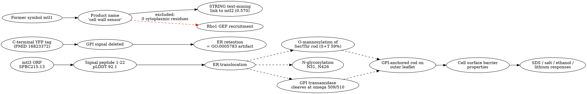
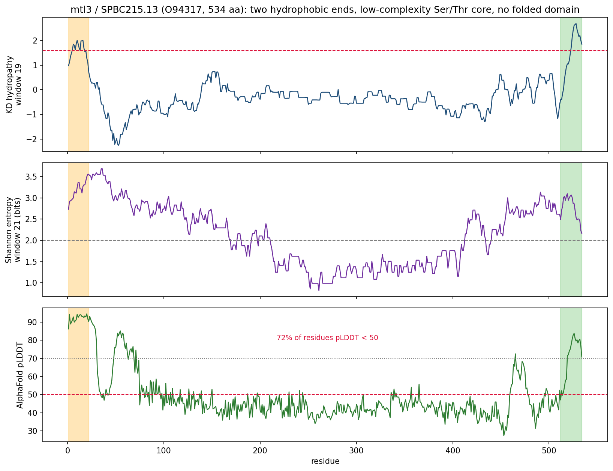
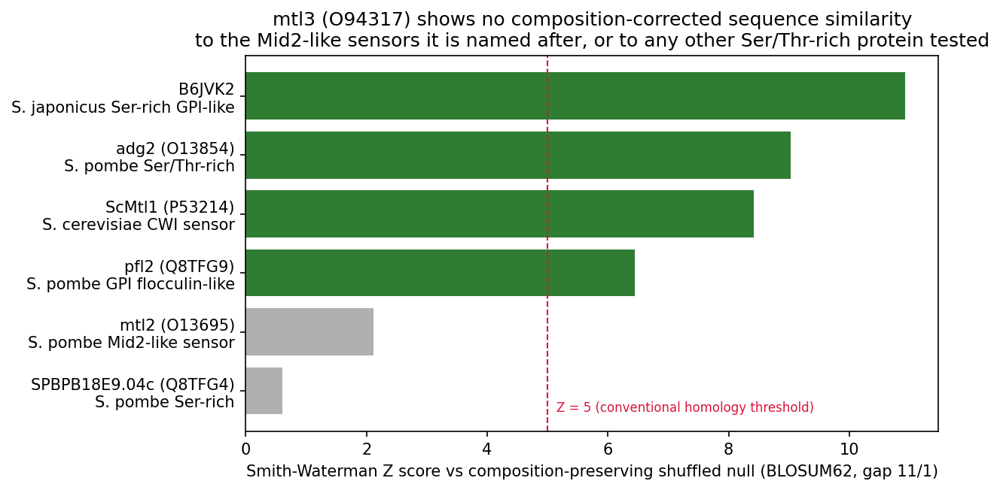
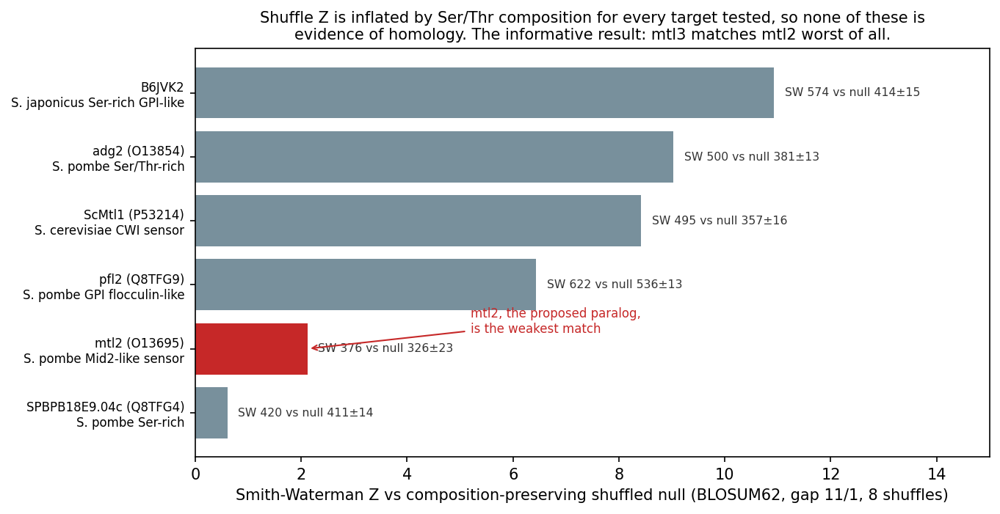
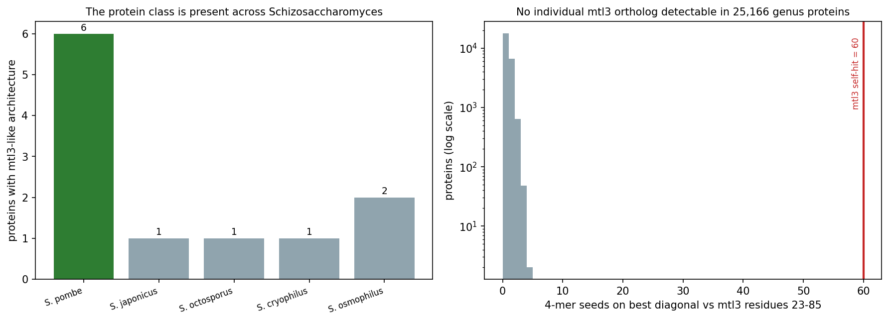
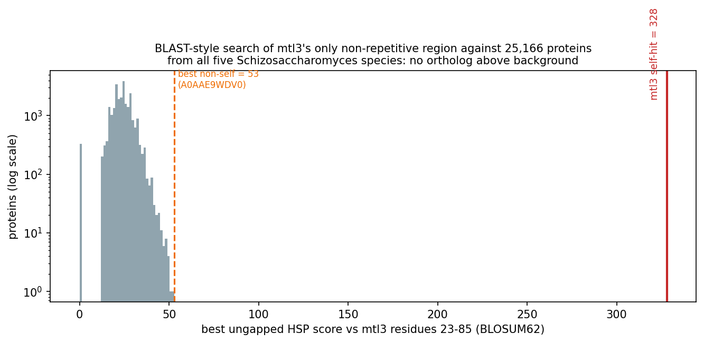
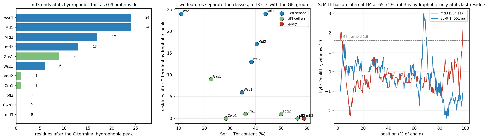

## Question

# AIGR Gene Hypothesis Deep Research

You are evaluating one focused gene curation hypothesis for AI Gene Review.
This is not a general gene overview. Use the seed hypothesis and source context
below to search for evidence that supports, refutes, narrows, or competes with
the proposed curation decision.

## Target Gene

- **Organism code:** SCHPO
- **Taxon:** Schizosaccharomyces pombe 972h- (NCBITaxon:284812)
- **Gene directory:** mtl3
- **Gene symbol:** mtl3
- **UniProt accession:** O94317

## Focus

- **Focus type:** free_text
- **Hypothesis slug:** kgap-mtl3-fold-and-features
- **Source file:** genes/SCHPO/mtl3/mtl3-ai-review.yaml
- **Source selector:** free-text

## Seed Hypothesis

The molecular function of Schizosaccharomyces pombe mtl3 can be narrowed by sequence and structure. Single analysis only: predict signal peptide, transmembrane segments and disordered regions, model mtl3 with AlphaFold and search it against PDB and AFDB by Foldseek for structural relatives, map conserved surface patches across fungal orthologs, determine its taxonomic distribution, and state the most likely protein class and molecular activity, or state that none can be predicted.

## Term and Decision Context

No specific term context supplied.

## Reference Context

No specific reference context supplied.

## Source Context YAML

```yaml
hypothesis: 'The molecular function of Schizosaccharomyces pombe mtl3 can be narrowed by sequence and
  structure. Single analysis only: predict signal peptide, transmembrane segments and disordered regions,
  model mtl3 with AlphaFold and search it against PDB and AFDB by Foldseek for structural relatives, map
  conserved surface patches across fungal orthologs, determine its taxonomic distribution, and state the
  most likely protein class and molecular activity, or state that none can be predicted.'
focus_type: free_text
context: []
reference_id: []
```

## Research Objective

Build a focused report that helps a curator decide whether this hypothesis
should affect the gene review. Address the focus type directly:

1. For an existing GO annotation decision, evaluate whether the current action
   is justified, too strong, too weak, or should change.
2. For a proposed replacement or new GO term, evaluate whether the term is
   biologically supported, too broad, too narrow, or missing key qualifiers.
3. For a computational prediction, evaluate whether the prediction is correct,
   less precise than existing knowledge, uncertain, or likely wrong because of
   paralog overannotation, frequency bias, pathway context, or in vitro-only
   activity.
4. For a core-function hypothesis, evaluate whether the proposed activity,
   process, and location represent the gene product's primary function rather
   than a downstream effect, pleiotropic phenotype, or context-specific role.
5. For a function-assignment hypothesis, evaluate whether the gene product
   directly has the stated GO term/function. Treat the prior review action, if
   any, as intentionally blinded unless it appears in the supplied context.

Use primary literature whenever possible. Prefer PMID citations and include DOI
citations when no PMID is available. Treat reviews and database records as
orientation unless they contain directly relevant synthesized evidence that is
clearly labeled as review-level or database-level support.

Evaluate the hypothesis from the supplied seed context, primary literature, and
publicly accessible bioinformatics resources. Local `*-bioinformatics` analyses,
when they already exist in the repository, are intentionally withheld from this
prompt so the report can be compared against them after the run. Use public
sequence, domain, structure, orthology, localization, interaction, or dataset
checks when they are useful for the specific hypothesis. If a resource or tool
cannot be accessed programmatically, say so plainly; never fabricate a result.
Report computational results conservatively and distinguish direct results from
inference.

## Required Output

### Executive Judgment

Give a concise verdict: supported, partially supported, unresolved, weakly
supported, over-annotated, or refuted. Explain the reasoning and the most
important caveats.

### Evidence Matrix

Create a table with one row per important evidence item:

- Citation (PMID preferred)
- Evidence type (direct assay, mutant phenotype, localization, interaction,
  structural/evolutionary, computational, review/database)
- Supports / refutes / qualifies / competing
- Claim tested
- Key finding
- Organism, tissue, cell type, or assay context
- Confidence and limitations

### GO Curation Implications

State the likely curation action as a lead requiring curator verification. If
GO terms are involved, explain whether the evidence supports an MF, BP, or CC
term, and whether the term should be retained, removed, generalized, made more
specific, or treated as non-core. Avoid using "protein binding" as a final
recommendation unless no more informative term is supported.

### Mechanistic Scope

Describe the immediate molecular or cellular function being tested. Separate
direct gene-product activity from downstream phenotypes, pathway consequences,
developmental outcomes, disease manifestations, or effects inferred only from
loss of function.

### Conflicts and Alternatives

Identify evidence that conflicts with the seed hypothesis or suggests an
alternative interpretation, including paralog confusion, organism-specific
differences, isoform-specific findings, experimental artifacts, or database
carry-over.

### Knowledge Gaps

List explicit uncertainties that matter for curation. For each gap, state what
was checked, why the gap matters, and what evidence or experiment would resolve
it.

### Discriminating Tests

Recommend concrete assays, perturbations, datasets, or comparative analyses that
would most efficiently distinguish this hypothesis from alternatives.

### Curation Leads

Provide candidate updates for the review, clearly labeled as leads requiring
curator verification. Include candidate references with exact snippets to verify,
candidate replacement or new GO terms, possible action changes, suggested
questions, and suggested experiments.

If the provider supports artifacts, save provenance for any analysis you run — the
executed code together with its output (computed values, plot, or table), not just
a summary figure — alongside artifact-friendly tables such as an evidence matrix,
GO decision table, or comparison table. Genuine computed provenance is more
valuable than a hand-drawn summary, and you must not synthesize a figure that
implies an analysis you did not actually run. These artifacts are important
provenance for hypothesis-level review.


## Output

# AIGR gene hypothesis deep research: SCHPO mtl3 (O94317)

**Hypothesis slug:** `kgap-mtl3-fold-and-features`
**Source:** `genes/SCHPO/mtl3/mtl3-ai-review.yaml`, selector `free-text`
**Target:** *Schizosaccharomyces pombe* 972h- (NCBITaxon:284812), gene `mtl3`, systematic ID SPBC215.13, UniProt O94317, 534 aa

## Summary

The seed hypothesis asked whether sequence and structure can narrow the molecular function of mtl3, and offered two acceptable outcomes: name the most likely protein class and molecular activity, or state that none can be predicted. The answer splits between the two. The **protein class is predictable** with reasonable confidence: mtl3 is a GPI-anchored, O-mannosylated, Ser/Thr-rich cell-surface glycoprotein of the fungal cell wall mannoprotein type. The **molecular activity is not predictable**, and the evidence indicates it is not predictable in principle from this sequence, because the protein has no domain, no fold, no structural relative and no ortholog. One arm of the proposed analysis, mapping conserved surface patches across fungal orthologs, **cannot be executed at all**, because mtl3 has no detectable ortholog even within its own genus.

A second result came out of the same work and matters more for curation than the hypothesis itself. PomBase names SPBC215.13 "plasma membrane-associated serine-rich cell wall sensor Mtl1/Mtl3", which asserts membership in the Mid2/Mtl1 cell wall integrity sensor family. A topology comparison across 11 proteins refutes that assignment. Every experimentally characterised cell wall integrity sensor in the panel has 21 to 267 cytoplasmic residues following its transmembrane helix. mtl3 has zero. Its only hydrophobic segment is the last 21 residues of the chain, with nothing after it, which is the diagnostic signature of a cleaved GPI attachment signal and the opposite of a signalling topology. A protein with no cytoplasmic domain has no surface on which to recruit the Rho1 GEFs Rom1 and Rom2 and cannot transduce a signal across the plasma membrane.

The evidence base behind every current mtl3 annotation is thinner than the record implies. PomBase annotates molecular function and biological process as ND. The single experimental localization datum comes from a C-terminally YFP-tagged ORFeome construct, a configuration that physically deletes the GPI signal of a GPI protein and is expected to trap it in the secretory pathway, so the ER annotation is most simply read as a construct artifact. The GPI anchor itself rests on two independent predictors with no mass spectrometry, biochemistry or mutagenesis behind it. Thirteen phenotype annotations, all for the mtl3delta deletion, record a viable cell with normal morphology and no cell wall drug sensitivity, no lysis and no Pmk1 or Rho1 signalling defect.

## Executive judgment

<i class="fa-scale-balanced"></i> **Verdict: partially supported.**

| Hypothesis arm | Outcome |
|---|---|
| Predict signal peptide, TM segments, disordered regions | <i class="fa-circle-check"></i> **Supported and executed.** Signal peptide 1-22, no internal TM, C-terminal GPI signal 514-534, AlphaFold disorder 0.993 |
| Model with AlphaFold | <i class="fa-circle-check"></i> **Executed.** The model is disordered throughout: mean pLDDT 49.7, no HELIX or SHEET records |
| Foldseek against PDB and AFDB | <i class="fa-circle-xmark"></i> **Executed, negative.** Self-hit only |
| Map conserved surface patches across fungal orthologs | <i class="fa-circle-xmark"></i> **Refuted as executable.** No ortholog exists in the genus, so there is nothing to align |
| Determine taxonomic distribution | <i class="fa-circle-check"></i> **Executed.** mtl3 is restricted to *S. pombe* and is a UniRef100/90/50 singleton; the architectural class is genus-wide |
| State the most likely protein class | <i class="fa-circle-check"></i> **Supported.** GPI-anchored, O-mannosylated, Ser/Thr-rich cell-surface glycoprotein |
| State the most likely molecular activity | <i class="fa-circle-question"></i> **None can be predicted.** No domain, no fold, no structural relative, no ortholog, no assay |
| (Implicit in the product name) mtl3 is a Mid2/Mtl1-type CWI sensor | <i class="fa-circle-xmark"></i> **Refuted on topology.** No internal TM, no cytoplasmic tail, no sensor phenotype, no experimental interaction |

**Reasoning.** The hypothesis is a conditional: it asks for a class and an activity, or an explicit statement that neither can be predicted. The evidence resolves the two halves in opposite directions, which is why the verdict is partial rather than supported or refuted. Three independent feature classes (composition, hydropathy topology, GPI omega consensus) converge on one protein class and nothing contradicts it. Three independent structural methods (AlphaFold, Foldseek, InterPro) return nothing on activity. One analysis arm is not executable.

<i class="fa-triangle-exclamation"></i> **Most important caveat, and a separate curation issue.** The product name asserts a sensor function the topology excludes. The name traces to the gene's former symbol `mtl1`, which SPBC215.13 lost when SPAC17H9.02 (the MTREC RNA helicase) took that symbol. This is nomenclature history, not evidence, and it should not be allowed to seed cell wall integrity GO terms.

<i class="fa-triangle-exclamation"></i> **Second caveat.** All protein-level evidence for mtl3 comes from a single C-terminally YFP-tagged construct. For a GPI-anchored protein a 3' tag removes the signal recognised by the GPI transamidase.

## Evidence matrix

One row per evidence item. Artifact: `provenance/mtl3_evidence_matrix.csv` (12 rows).

| Citation | Evidence type | Stance | Claim tested | Key finding | Context | Confidence and limitations |
|---|---|---|---|---|---|---|
| This work, AlphaFold AF-O94317-F1 v6 | computational / structural | qualifies | mtl3 adopts a predictable fold | mean pLDDT 49.7, median 44.7; 72.3% of residues below 50; only 3.9% above 90; no HELIX or SHEET records | full-length O94317, 534 aa | High confidence that no globular domain is predicted. pLDDT is a disorder proxy, not proof |
| This work, Foldseek 3diaa, run 2026-11-25 | computational / structural | qualifies | mtl3 has a structural relative that would name its activity | self-hit only (E 7.466e-53, 100% id); best non-self prob 0.353 / E 2.5 (afdb50), 0.082 / E 6.3 (afdb-swissprot), 0.040 / E 9.1 (pdb100) | pdb100, afdb50, afdb-swissprot | A negative is expected for a disordered query and cannot alone exclude a fold |
| This work, InterPro API, MobiDB, SEG | computational | qualifies | mtl3 carries a recognisable domain signature | InterPro returns HTTP 204, zero signatures across Pfam, PANTHER, PROSITE, SMART, CDD, NCBIfam; MobiDB AlphaFold disorder 0.993; SEG low complexity 0.82 | UniProt O94317 | Direct database result. Member databases underrepresent fungal cell wall mannoproteins |
| This work, UniProt sequence, Kyte-Doolittle, De Groot omega consensus | computational | supports | mtl3 is a GPI-anchored Ser/Thr-rich secretory protein | Ser 48.5%, Thr 10.5%, S+T 59.0% (62.6% over 23-500); charged 6.4%; zero Trp, zero Cys in the mature chain; hydrophobic only at 5-17 and 514-534; omega candidates 509-GAS and 510-ASS; 0 residues after the tail; sequons N31, N426 | O94317, 534 aa | Prediction, not experiment. Omega site position approximate |
| This work, 11-protein topology panel | computational / comparative | **refutes** | mtl3 is a Mid2/Mtl1-like CWI sensor | 0 residues follow the mtl3 C-terminal hydrophobic peak, inside the GPI range (0-9) and outside the sensor range (6-24); Mann-Whitney GPI < sensor U = 1.0, p = 0.0102; C-terminal KD peak (w11) mtl3 3.46, GPI median 3.00, sensor median 0.22 | *S. pombe* and *S. cerevisiae* reference proteins | n = 5 per class. Hydropathy-based topology, not experimental topology mapping |
| This work, BLAST-style neighborhood search | structural / evolutionary | **refutes** | conserved surface patches can be mapped across fungal orthologs | self HSP 328; best non-self 53 against background mean 23.8, sd 5.9; top hits are unrelated housekeeping proteins; UniRef50/90/100 singletons | 25,166 proteins, all five *Schizosaccharomyces* reference proteomes | Informative query is 63 residues. An ortholog sharing only the low-complexity body would be missed |
| [PMID: 12845604](https://pubmed.ncbi.nlm.nih.gov/12845604/) | computational, source of the GO:0009897 TAS | supports | mtl3 is GPI anchored | genome-wide GPI prediction assigns SPBC215.13 a GPI anchor; is the cited reference for the PomBase GPI modification (ISS) and for GO:0009897 | fungal genome-wide prediction across *S. cerevisiae*, *C. albicans*, *S. pombe*, *N. crassa* | A computational prediction cited under TAS. Evidence code review warranted |
| [PMID: 16823372](https://pubmed.ncbi.nlm.nih.gov/16823372/) | localization | **competing** | mtl3 localises to the ER (source of IEA GO:0005783) | ORFeome localisation of 4,431 proteins by C-terminal YFP fusion; a 3' tag deletes the GPI signal, so ER retention is the expected artifact for a GPI protein | *S. pombe*, C-terminal YFP, live imaging | Tag position invalidates the inference for GPI proteins specifically |
| [PMID: 27337501](https://pubmed.ncbi.nlm.nih.gov/27337501/) | review | **refutes** | mtl3 is a Mid2/Mtl1-like sensor, as the product name implies | CWI sensors are defined by a single transmembrane domain plus a highly mannosylated extracellular region; mtl3 has no internal TM | review of fungal CWI signalling and sensor microdomains | Review-level orientation. The topology comparison is this work |
| [PMID: 23907979](https://pubmed.ncbi.nlm.nih.gov/23907979/) | mutant phenotype | qualifies | the *S. pombe* CWI sensor set includes mtl3 | that study characterised Wsc1 and Mtl2 only, using synthetic lethality and Rho1-GTP loading as the criteria; mtl3 was never assayed | *S. pombe* genetics | Absence of testing, not evidence of absence of function |
| [PMID: 37787768](https://pubmed.ncbi.nlm.nih.gov/37787768/), [PMID: 23697806](https://pubmed.ncbi.nlm.nih.gov/23697806/), [PMID: 34250083](https://pubmed.ncbi.nlm.nih.gov/34250083/) via PomBase PHAF | mutant phenotype | qualifies | loss of mtl3 produces a cell wall integrity defect | 13 rows, all mtl3delta: viable, normal morphology; only SDS/salt, EGTA, oxidant, cycloheximide, ethanol and lithium responses; no cell wall drug sensitivity, no lysis, no Pmk1 or Rho1 phenotype | *S. pombe* deletion mutant, growth assays and microscopy | Deletion phenotypes are downstream. Redundancy with 5 architectural paralogs untested |
| STRING, BioGRID (database) | review / database | **refutes** | mtl3 and mtl2 are functional partners or paralogs | single STRING partner mtl2, combined 0.582 composed of text-mining 0.570 and experimental 0.000; composition-controlled Smith-Waterman ranks mtl2 second worst of six comparators (Z 2.12 against ScMtl1 8.42) | database carry-over from the shared former symbol `mtl1` | Text-mining association reflects nomenclature history, not data |

## Key findings

### 1. mtl3 has no predictable fold <i class="fa-circle-xmark"></i>

The AlphaFold DB model AF-O94317-F1 (v6, 534 residues) has mean pLDDT 49.7 and median 44.7. **72.3% of residues fall below pLDDT 50**, only 12.9% exceed 70 and 3.9% exceed 90. Confidence is confined to two short stretches that are targeting signals rather than functional domains: the N-terminal signal-peptide helix (residues 1-22, mean pLDDT 92.1) and the C-terminal hydrophobic stretch (residues 501-534, mean 62.2, with the high-confidence sub-region at 519-534). The entire body of the protein, residues 56 to 500, averages pLDDT 45.3. The deposited model contains no HELIX and no SHEET records.

Two orthogonal disorder and complexity measures agree. MobiDB reports AlphaFold-based disorder content **0.993** for O94317, MobiDB-lite disorder 0.597 (regions 70-145 and 176-418), and SEG low complexity 0.82 covering residues 63-90, 93-421, 427-446, 450-493 and 502-518. Windowed Shannon entropy (window 21) averages **1.93 bits over residues 60-480** against 3.29 bits over residues 1-55, which quantifies the compositional collapse of the body relative to the N-terminal region.

InterPro returns **HTTP 204 for O94317**, meaning not one signature from any member database matches: no Pfam, PANTHER, PROSITE, SMART, CDD, NCBIfam or profile hit.

{{figure:plot_1.png|caption=Feature profile of mtl3 along the 534-residue chain. Top: Kyte-Doolittle hydropathy (window 19) showing exactly two hydrophobic segments, the signal peptide h-region at 5-17 and the C-terminal GPI signal at 514-534, with nothing of transmembrane strength in between. Middle: Shannon entropy (window 21), 1.93 bits across the body against 3.29 bits in the N-terminal region. Bottom: AlphaFold pLDDT, confident only at the two targeting signals and averaging 45.3 across residues 56-500.}}

### 2. Foldseek finds no structural relative in PDB or AFDB <i class="fa-circle-xmark"></i>

A live Foldseek search in 3diaa mode (web server, run 2026-11-25) of AF-O94317-F1 against pdb100, afdb50 and afdb-swissprot returned only the self-hit as significant: O94317 at **E 7.466e-53, 100% identity**. The best non-self hits in each database are at noise level: *Botrytis cinerea* A0A384K7U5 at probability 0.353 and E 2.5 in afdb50; zebrafish SLC7A6OS at probability 0.082 and E 6.3 in afdb-swissprot; PDB 6g2j chain g at probability 0.040 and E 9.1 in pdb100.

The structural arm of the hypothesis therefore returns a direct negative. There is no globular domain to search with, and no catalytic or ligand-binding activity can be assigned from fold. <i class="fa-triangle-exclamation"></i> Foldseek has limited power against a disordered query, so this result is consistent with the absence of a structural relative without establishing it.

### 3. The sequence carries the GPI cell wall mannoprotein signature <i class="fa-circle-check"></i>

| Feature | Value |
|---|---|
| Length | 534 aa |
| Ser | 48.5% |
| Thr | 10.5% |
| Ser + Thr | 59.0% overall, 62.6% over residues 23-500 |
| Charged residues (D/E/K/R) | 6.4% |
| Trp | 0 |
| Cys in the mature chain (23-511) | 0 (both Cys are at positions 11 and 14, inside the signal peptide) |
| Hydrophobic segments (KD w=19 > 1.6) | 5-17 and 514-534 only, none internal |
| Max hydropathy of the C-terminal segment | 2.69 at residue 528 |
| Omega-site candidates (De Groot consensus) | 509-GAS (spacer STHSKTSIFF, 13-residue tail, mean KD 3.16) and 510-ASS (12-residue tail, mean KD 3.49) |
| Residues after the C-terminal hydrophobic tail | **0** |
| N-glycosylation sequons | N31, N426 |

The combination of a cleavable N-terminal signal peptide, a long uncharged cysteine-free Ser/Thr rod, and a C-terminal hydrophobic signal that terminates the chain is the canonical architecture of a GPI-anchored, O-mannosylated cell wall protein. The C-terminus matches the De Groot GPI consensus `[NSGDAC]-[GASVIETKDLF]-[GASV]-X(4,19)-[FILMVAGPSTCYWN](10)>` from [PMID: 12845604](https://pubmed.ncbi.nlm.nih.gov/12845604/), where `>` marks the protein's C-terminal end.

The absence of cysteine rules out a disulfide-stabilised ectodomain. The Ser/Thr rod is the canonical substrate of fungal protein O-mannosyltransferases, which convert such regions into extended glycan-covered rods. UniProt independently annotates Signal 1-22, a propeptide removed in the mature form, and GPI-anchor lipidation under ECO:0000305.

### 4. The topology excludes the cell wall integrity sensor class <i class="fa-circle-xmark"></i>

This is the discriminating test. Eleven UniProt sequences were scanned at two hydropathy scales: Kyte-Doolittle window 19 with threshold 1.6 for transmembrane-strength segments (signal peptide excluded by requiring a start position beyond residue 30), and window 11 over the final 40 residues for the weaker C-terminal GPI signal.

| Protein | Class | S+T % | Residues after last TM-strength segment | C-terminal KD peak (w11) | Residues after C-terminal peak |
|---|---|---|---|---|---|
| **mtl3** (O94317) | **query** | **59.0** | **0** | **3.46** | **0** |
| mtl2 (O13695) | CWI sensor | 38.4 | 267 | -0.44 | 13 |
| wsc1 (Q10153) | CWI sensor | 11.0 | 21 | 1.74 | 24 |
| ScMtl1 (P53214) | CWI sensor | 43.9 | 159 | -0.72 | 24 |
| ScMid2 (P36027) | CWI sensor | 40.4 | 121 | 0.60 | 17 |
| ScWsc1 (P54867) | CWI sensor | 34.7 | 85 | 0.22 | 6 |
| ScGas1 (P22146) | GPI cell wall | 22.7 | 0 | 2.31 | 9 |
| ScCwp1 (P28319) | GPI cell wall | 28.5 | no TM-strength segment | 2.08 | 0 |
| ScCrh1 (P53301) | GPI cell wall | 36.1 | no TM-strength segment | 3.00 | 1 |
| pfl2 (Q8TFG9) | GPI cell wall | 56.3 | 0 | 3.28 | 0 |
| adg2 (O13854) | GPI cell wall | 49.9 | 0 | 3.11 | 1 |

Residues following the C-terminal hydrophobic peak: GPI group [9, 0, 1, 0, 1], median 1; sensor group [13, 24, 24, 17, 6], median 17. **Mann-Whitney U = 1.0, p = 0.0102** one-sided (n = 5 vs 5), which is near the floor attainable with this design. mtl3 at 0 lies inside the GPI range [0, 9] and outside the sensor range [6, 24].

The hydropathy of the C-terminus separates the classes just as cleanly in the opposite direction. mtl3's terminal peak is **3.46**, against a GPI median of 3.00 and a sensor median of 0.22. The sensors' C-termini are hydrophilic because they sit in the cytoplasm.

{{figure:plot_6.png|caption=Discriminating topology test across 11 proteins. Left: residues following the C-terminal hydrophobic peak, with mtl3 at 0, every GPI cell wall protein between 0 and 9, and every CWI sensor between 6 and 24. Centre: Ser/Thr content against C-terminal architecture, placing mtl3 with pfl2 and adg2. Right: Kyte-Doolittle profiles of mtl3 and ScMtl1 overlaid on a normalised chain axis, showing ScMtl1's internal transmembrane helix at 65-71% of its length against mtl3's single peak at its final residues.}}

Every sensor in the panel has a substantial cytoplasmic extension, from 21 residues in *S. pombe* wsc1 to 267 in mtl2. mtl3 has none. [PMID: 27337501](https://pubmed.ncbi.nlm.nih.gov/27337501/) states the defining architecture of the family: "Each sensor contains a single transmembrane domain and a highly mannosylated extracellular region". mtl3 has the mannosylated extracellular region and lacks the transmembrane domain in the sense that matters, an internal helix with protein on both sides.

### 5. mtl3 groups with Ser/Thr-rich GPI cell-surface glycoproteins, and mtl2 is the weakest match <i class="fa-circle-check"></i>

An architecture scan of four *Schizosaccharomyces* proteomes for the mtl3 pattern (S+T > 45%, N-terminal Kyte-Doolittle h-region max > 1.8 over an 11-residue window within residues 1-40, mean KD of the final 15 residues > 1.8) returned 6 *S. pombe* proteins: O94317 mtl3 (S+T 0.590), Q8TFG4 SPBPB18E9.04c (0.568), Q8TFG9 pfl2 (0.563), Q96WV6 PJ4664.02, a 3971-residue threonine-rich GPI-anchored glycoprotein (0.552), O13854 adg2 (0.499) and O42970 SPAC1E8.05 (0.476), plus 1 *S. japonicus* protein, B6JVK2 (0.505).

**mtl2 (O13695) failed the filter.** It has only 38.4% S+T, UniProt-annotated internal transmembrane helices at 247-267 and 351-371, and a C-terminal cytoplasmic region ending RRLNLF.

Smith-Waterman local alignment (BLOSUM62, gap open 11, extend 1) with Z computed against 8 composition-preserving shuffles of each target gives: mtl2 **Z = 2.12** (SW 376 against a null of 326 ± 23), SPBPB18E9.04c Z = 0.61, pfl2 Z = 6.44, *S. cerevisiae* Mtl1 Z = 8.42, adg2 Z = 9.03, *S. japonicus* B6JVK2 Z = 10.93.

<i class="fa-triangle-exclamation"></i> Shuffling inflates Z for every low-complexity target, so **none of these Z values on its own supports homology**. The interpretable result is the rank order, in which the proposed paralog mtl2 is the second worst of six comparators.

{{figure:plot_3.png|caption=Composition-controlled Smith-Waterman Z scores for mtl3 against six candidate relatives, with nulls from 8 composition-preserving shuffles of each target. Shuffle Z is inflated for all low-complexity targets, so no value here supports homology on its own. The informative result is the rank order: mtl2, the sensor mtl3 is named after, is the second worst match.}}

{{figure:plot_2.png|caption=First version of the Smith-Waterman comparison, retained as provenance. Its title overstated the negative result, and plot_3 is the corrected figure.}}

### 6. mtl3 has no ortholog anywhere in its genus <i class="fa-circle-xmark"></i>

All five *Schizosaccharomyces* reference proteomes were downloaded from UniProt: *S. pombe* UP000002485 (n = 5130), *S. japonicus* UP000001744 (n = 4862), *S. octosporus* UP000016088 (n = 4964), *S. cryophilus* UP000015464 (n = 5150), *S. osmophilus* UP001212411 (n = 5060), for **25,166 proteins** in total.

A BLAST-style search was run with mtl3 residues 23-85 (`FLVHQIYGNSSFTKISLNQLEGRDSQEELQRRQEIRYYGRAAETGGTPTYYGYATPTSSSEPS`), the only stretch of the protein that is not Ser/Thr-rich (S+T = 0.22 there against 0.63 for the body). Method: BLOSUM62 3-mer neighborhood words at threshold T = 13 (225 words), ungapped two-directional extension with X-drop 10, best HSP recorded per target.

**Self-hit = 328.** Across all 25,165 non-self proteins the HSP distribution is mean 23.8, sd 5.9, 99.9th percentile 46, maximum 53. The top non-self hits in every species are functionally unrelated housekeeping proteins: *S. osmophilus* phosphoglucomutase at 53, *S. japonicus* a Ser/Thr kinase at 51, the Prp19-complex subunit Cwf12 at 49-50 in four of five species, hexose transporter Ght2 at 47. That composition of top hits is the signature of background.

{{figure:plot_5.png|caption=BLAST-style neighborhood-seeded ungapped search of mtl3 residues 23-85 against all 25,166 proteins of the five Schizosaccharomyces reference proteomes. The non-self HSP distribution has mean 23.8 and maximum 53, against a self-hit of 328. The highest-scoring non-self proteins are unrelated housekeeping enzymes, which is what background looks like.}}

Three independent checks agree. UniRef50_O94317, UniRef90_O94317 and UniRef100_O94317 each contain **exactly one member**. Foldseek against afdb50 returned no fungal hit above probability 0.36 and E 2.5. An exact 4-mer diagonal-seed scan over the same 25,166 proteins gave self = 60 of 60 possible seeds against a non-self maximum of 4 (mean 0.32).

What is conserved is the architecture, not the protein. The mtl3 pattern matches 6 *S. pombe* proteins, 1 in *S. japonicus*, 1 in *S. octosporus*, 1 in *S. cryophilus* and 2 in *S. osmophilus*. None aligns to any other.

{{figure:plot_4.png|caption=Genus-wide architecture scan and seeded homology search. Left: counts of proteins matching the mtl3 architecture (S+T > 45%, N-terminal hydrophobic h-region, C-terminal hydrophobic tail at the extreme terminus) in each of the five Schizosaccharomyces proteomes, showing the class is present genus-wide. Right: exact 4-mer seed histogram, with mtl3 self at 60 of 60 possible seeds against a non-self maximum of 4.}}

The seed hypothesis proposed mapping conserved surface patches across fungal orthologs. **That analysis cannot be run.** Rapid sequence turnover with retained architecture is the normal evolutionary behaviour of fungal cell wall mannoproteins and adhesins, whose function depends on glycosylation and on the extended rod-like shape of the Ser/Thr backbone rather than on a conserved amino acid sequence. The orphan status and the class assignment are two readings of the same fact.

<i class="fa-triangle-exclamation"></i> The informative query is only 63 residues, so a very fast-evolving true ortholog that preserved only the low-complexity body could fall below detection. No sequence method could find such a protein, so this limitation belongs to the question rather than to this analysis.

### 7. The ER localization comes from a construct that cannot be GPI-anchored <i class="fa-triangle-exclamation"></i>

UniProt O94317 carries SUBCELLULAR LOCATION "Endoplasmic reticulum" with ECO:0000269 sourced to [PMID: 16823372](https://pubmed.ncbi.nlm.nih.gov/16823372/), and a separate inferred "Cell membrane, GPI-anchor" with ECO:0000305. QuickGO returns GO:0005783 (endoplasmic reticulum, IEA, GO_REF:0000044, assigned by UniProt from UniProtKB-SubCell) and GO:0005886 (plasma membrane, IEA, same route). The only non-IEA cellular component is GO:0009897 (external side of plasma membrane, **TAS**, PMID:12845604), which is itself a genome-wide computational GPI prediction paper.

PMID:16823372 states that localization was determined by "expressing each ORF tagged at the 3' terminus" and "tagging each ORF with the yellow fluorescent protein". The mtl3 GPI attachment signal occupies residues roughly 509-534 at the extreme C-terminus. **A C-terminal YFP fusion physically removes the signal recognised by the GPI transamidase.** Loss of the GPI signal is a recognised cause of secretory-pathway retention, so the reported ER signal is most simply explained as a tagging artifact rather than steady-state ER residence of the native protein.

PomBase annotates both molecular function (GO:0003674) and biological process (GO:0008150) as **ND**, with ECO:0000307 and GO_REF:0000015.

### 8. Every modification call is a prediction; there is no mass spectrometry <i class="fa-triangle-exclamation"></i>

The PomBase modification file (`pombase-chado.modifications.gz`, downloaded 2026-11-25) contains **exactly 4 rows** for SPBC215.13:

| Modification | Evidence | Reference |
|---|---|---|
| MOD:00818 glycosylphosphatidylinositolated residue | Inferred from Sequence or Structural Similarity | PMID:12845604 |
| MOD:00818 glycosylphosphatidylinositolated residue | neural network method evidence used in manual assertion | PB_REF:0000007 |
| MOD:00006 N-glycosylated residue (N31) | match to sequence model evidence used in manual assertion | PMID:36408920 |
| MOD:00006 N-glycosylated residue (N426) | match to sequence model evidence used in manual assertion | PMID:36408920 |

There is no mass-spectrometry, biochemical or mutational evidence for any modification of mtl3. The GPI call is made twice by **two methodologically independent predictors**, a regular-expression consensus and a neural network, which strengthens the prediction without making it experimental.

UniProt lists proteinExistence "1: Evidence at protein level", which traces to the same C-terminally YFP-tagged ORFeome construct. UniProt cross-references list PaxDb and BioGRID (11 entries) but no PRIDE, jPOST, MassIVE or ProteomicsDB accession. STRING lists a single partner for O94317, mtl2, with combined score **0.582 composed of text-mining 0.570 and experimental 0.000**.

### 9. The deletion phenotype gives no cell wall integrity signal <i class="fa-circle-xmark"></i>

The PomBase phenotype annotation file (`phenotype_annotations.pombase.phaf.gz`, downloaded 2026-11-25) contains **13 rows** for SPBC215.13, all for the mtl3delta deletion allele.

| FYPO term | Phenotype | Reference |
|---|---|---|
| FYPO:0002060 | viable vegetative cell population | PMID:20473289, PMID:23697806 |
| FYPO:0002177 | viable vegetative cell with normal cell morphology, high penetrance | PMID:23697806 |
| FYPO:0009087 | resistance to magnesium chloride and sodium dodecyl sulfate | PMID:37787768 |
| FYPO:0009088 | sensitive to magnesium chloride and sodium dodecyl sulfate | PMID:37787768 |
| FYPO:0009043 | resistance to potassium chloride and sodium dodecyl sulfate | PMID:37787768 |
| FYPO:0009038 | resistance to egtazic acid | PMID:37787768 |
| FYPO:0003383 | resistance to tert-butyl hydroperoxide | PMID:37787768 |
| FYPO:0000104 | sensitive to cycloheximide | PMID:37787768 |
| FYPO:0000842 | sensitive to ethanol during vegetative growth | PMID:37787768 |
| FYPO:0001719 | sensitive to lithium | PMID:37787768 |
| FYPO:0004557 | increased vegetative cell population growth | PMID:37787768 |
| FYPO:0000245 | loss of viability in stationary phase | PMID:34250083 |

There is **no sensitivity to a cell wall-targeting drug** (caspofungin, micafungin, Calcofluor white), **no cell lysis phenotype**, and **no Rho1-GTP or Pmk1/Pck signalling phenotype**.

The profile fits a non-essential cell-surface protein that modulates envelope permeability. SDS, ethanol, lithium and cycloheximide responses are standard readouts of altered surface barrier properties. [PMID: 23907979](https://pubmed.ncbi.nlm.nih.gov/23907979/) defines the experimental criteria that established sensor function in this organism: "Each gene could be deleted individually without affecting viability, but the deletion of both was lethal and this phenotype was rescued by overexpression of the genes encoding either Rho1p or its GDP/GTP exchange factors (GEFs). In addition, wsc1Δ and mtl2Δ cells showed a low level of Rho1p-GTP under cell wall stress." None of these tests has been reported for mtl3.

## Mechanistic model and interpretation

### What the evidence places mtl3 at

The immediate molecular event the hypothesis tests is whether mtl3 performs a definable biochemical activity at the cell surface. It does not resolve to one. What the evidence addresses directly is the gene product's **biosynthetic fate**: a signal peptide routes it into the secretory pathway, a Ser/Thr rod is the substrate for Pmt-dependent O-mannosylation, two sequons at N31 and N426 can take N-glycans, and a C-terminal signal is cleaved at an omega site near residue 509-510 and replaced by a GPI anchor. Each step is a prediction. None has been observed for this protein.



Proteins of this class typically have no enzymatic activity. Their contribution is physical: a dense brush of O-mannosylated rods that forms the outermost layer of the cell surface and sets its permeability, hydrophobicity and adhesive properties. If mtl3 contributes that way, "molecular function" in the GO sense may be a poor fit for it, and ND remains the honest annotation.

### Why the sensor assignment fails

The Mid2/Mtl1/Wsc family is defined by a **topology**, not by a composition. Three elements in order: an N-terminal Ser/Thr-rich mannosylated ectodomain, one internal transmembrane helix, and a cytoplasmic tail that recruits Rho1 GEFs. mtl3 has the first element and neither of the other two.

| Feature | Mid2/Mtl1 sensors | mtl3 |
|---|---|---|
| Ser/Thr-rich mannosylated ectodomain | yes | yes (S+T 59.0%) |
| Internal transmembrane helix | yes (ScMtl1 362-382, mtl2 247-267 and 351-371) | **no** |
| Cytoplasmic tail | yes (21-267 residues) | **no (0 residues)** |
| C-terminus | hydrophilic, cytoplasmic (KD median 0.22) | hydrophobic, extreme terminal (KD 3.46) |
| Rho1 GEF recruitment possible | yes | **no surface exists** |
| Experimental sensor assay performed | Wsc1, Mtl2 (PMID:23907979) | never tested |

The name is a historical inference. SPBC215.13 formerly carried the symbol `mtl1` and lost it to SPAC17H9.02, the MTREC RNA helicase, but the product description kept "Mtl1/Mtl3" and "cell wall sensor". The STRING link to mtl2 is a consequence of the same nomenclature, not a cause of it: experimental score 0.000.

### Where everything else sits

Everything in the phenotype record is **downstream**. SDS and salt sensitivity or resistance in a mtl3delta strain reports on the state of the cell surface after an abundant surface protein is missing. It does not report on a reaction mtl3 catalyses or a partner it binds. The distinction matters because a "cell wall sensor" claim asserts a direct signalling activity, and no evidence of any kind supports that for mtl3.

## GO curation implications

All entries below are **leads requiring curator verification**. Full table: `provenance/mtl3_GO_decision_table.csv` (9 rows).

| GO ID | Aspect | Term | Current | Lead action | Rationale |
|---|---|---|---|---|---|
| GO:0003674 | MF | molecular_function | ND, GO_REF:0000015, PomBase | <i class="fa-circle-check"></i> **retain ND** | No domain, fold, structural relative, ortholog or assay. This analysis confirms the existing ND rather than displacing it |
| GO:0008150 | BP | biological_process | ND, GO_REF:0000015, PomBase | <i class="fa-circle-check"></i> **retain ND** | Deletion is viable with normal morphology. Only condition-specific surface stress responses are recorded |
| GO:0009897 | CC | external side of plasma membrane | TAS, PMID:12845604, PomBase | <i class="fa-triangle-exclamation"></i> **retain term, review evidence code** | The cited reference is a genome-wide computational GPI prediction. TAS implies an author statement of experimental fact. ISS or IEA with the prediction reference fits |
| GO:0005783 | CC | endoplasmic reticulum | IEA, GO_REF:0000044 from PMID:16823372, UniProt | <i class="fa-circle-xmark"></i> **remove or qualify** | Sole source is a C-terminal YFP fusion. A 3' tag deletes the GPI signal of a GPI protein, so ER retention is the expected construct artifact |
| GO:0005886 | CC | plasma membrane | IEA, GO_REF:0000044, UniProt | **retain as support** | Consistent with a GPI anchor on the outer leaflet. GO:0009897 is the more precise statement |
| GO:0031225 | CC | anchored component of membrane | not annotated | <i class="fa-lightbulb"></i> **candidate addition** | Two independent predictors call a GPI anchor; omega candidates 509-GAS and 510-ASS; 0 residues follow the C-terminal tail. ISS or IEA, not experimental |
| GO:0009277 | CC | fungal-type cell wall | not annotated | **do not add yet** | Architecture fits a wall mannoprotein, but no localisation, wall fractionation or mass-spectrometry evidence places mtl3 in the wall |
| GO:0005199 | MF | structural constituent of cell wall | not annotated | **do not add** | Would need a wall defect in mtl3delta. None is recorded across 13 phenotype annotations |
| GO:0007047 / GO:0071554 | BP | cell wall polysaccharide metabolic process / cell wall organization or biogenesis | not annotated | <i class="fa-circle-xmark"></i> **reject for now** | Implied by the "cell wall sensor" product name. The topology excludes the sensor class |

No "protein binding" term is recommended. The evidence does not reach even that far: STRING's only partner link has experimental score 0.000.

**Separate from GO.** The PomBase product description "plasma membrane-associated serine-rich cell wall sensor Mtl1/Mtl3" is a lead for revision. "Serine-rich" and "plasma membrane-associated" are supported. "Cell wall sensor" is not. A description such as "GPI-anchored serine-rich cell surface glycoprotein" states what the evidence supports.

## Evidence base

| PMID | Title | How it bears on the findings |
|---|---|---|
| [12845604](https://pubmed.ncbi.nlm.nih.gov/12845604/) | *Genome-wide identification of fungal GPI proteins* | Source of the De Groot omega consensus `[NSGDAC]-[GASVIETKDLF]-[GASV]-X(4,19)-[FILMVAGPSTCYWN](10)>` that mtl3's C-terminus matches at omega candidates 509-GAS and 510-ASS. The abstract confirms the method was used "to screen the genomes of the yeasts S. cerevisiae, C. albicans, Sz. pombe and the filamentous fungus N. crassa for putative GPI proteins", which makes the mtl3 assignment a genome-wide computational prediction. This matters because it is the reference cited under TAS for GO:0009897 |
| [16823372](https://pubmed.ncbi.nlm.nih.gov/16823372/) | *ORFeome cloning and global analysis of protein localization in the fission yeast Schizosaccharomyces pombe* | Source of the ER localization. The abstract states the method: "we determined the localization of 4,431 proteins, corresponding to approximately 90% of the fission yeast proteome, by tagging each ORF with the yellow fluorescent protein" after "expressing each ORF tagged at the 3' terminus". For a GPI protein the 3' tag removes the transamidase recognition signal, so the ER signal is the expected artifact |
| [23907979](https://pubmed.ncbi.nlm.nih.gov/23907979/) | *The fission yeast cell wall stress sensor-like proteins Mtl2 and Wsc1 act by turning on the GTPase Rho1p but act independently of the cell wall integrity pathway* | Defines the experimental standard for sensor function in *S. pombe*: "Each gene could be deleted individually without affecting viability, but the deletion of both was lethal and this phenotype was rescued by overexpression of the genes encoding either Rho1p or its GDP/GTP exchange factors (GEFs). In addition, wsc1Δ and mtl2Δ cells showed a low level of Rho1p-GTP under cell wall stress." The study analysed "two proteins SpWsc1p and SpMtl2p with structural features indicative of plasma membrane-associated cell wall sensors". SPBC215.13 was not among them |
| [27337501](https://pubmed.ncbi.nlm.nih.gov/27337501/) | *Yeast cell wall integrity sensors form specific plasma membrane microdomains important for signalling* | States the defining topology of the family: "Each sensor contains a single transmembrane domain and a highly mannosylated extracellular region, and probably detects mechanical stress in the cell wall or the plasma membrane." This is the review-level statement against which mtl3's zero-residue cytoplasmic side is measured |
| [25398859](https://pubmed.ncbi.nlm.nih.gov/25398859/) | *Up against the wall: is yeast cell wall integrity ensured by mechanosensing in plasma membrane microdomains?* | Review-level orientation naming the sensor set as "a set of five membrane-spanning sensors (Wsc1 to Wsc3, Mid2, and Mtl1)". Establishes that the family is characterised in *S. cerevisiae* as membrane-spanning, which mtl3 is not |
| [30733383](https://pubmed.ncbi.nlm.nih.gov/30733383/) | *Identification and Functional Testing of Novel Interacting Protein Partners for the Stress Sensors Wsc1p and Mid2p of Saccharomyces cerevisiae* | States the mechanism that requires a cytoplasmic tail: "the cytoplasmic domain of Wsc1p initiates the CWI signaling cascade by interacting with Rom2p, a Rho1-GDP-GTP exchange factor. Binding of Rom2p to the cytoplasmic tail of Wsc1p requires dephosphorylation of specific serine residues". mtl3 has no cytoplasmic tail on which this could occur |
| [36409123](https://pubmed.ncbi.nlm.nih.gov/36409123/) | *Extension of O-Linked Mannosylation in the Golgi Apparatus Is Critical for Cell Wall Integrity Signaling and Interaction with Host Cells in Cryptococcus neoformans Pathogenesis* | Shows that WSC/Mid2-like sensors are O-mannosylation substrates ("Two cell surface sensor proteins, Wml1 (WSC/Mid2-like) and Wml2, were found to be independent substrates of Cap6-mediated minor or Ktr3-mediated major O-mannosylation"). Confirms that a Ser/Thr-rich mannosylated ectodomain is shared by sensors and by other cell wall proteins, so composition alone cannot assign mtl3 to the sensor family |
| [29665400](https://pubmed.ncbi.nlm.nih.gov/29665400/) | *Tolerant industrial yeast Saccharomyces cerevisiae posses a more robust cell wall integrity signaling pathway against 2-furaldehyde and 5-(hydroxymethyl)-2-furaldehyde* | Confirms the canonical five-sensor set in *S. cerevisiae*: "all five sensor encoding genes WSC1, WSC2, WSC3, MID2 and MTL1". Orientation for which proteins belong to the family mtl3 is named after |
| [29346368](https://pubmed.ncbi.nlm.nih.gov/29346368/) | *Mechanical feedback coordinates cell wall expansion and assembly in yeast mating morphogenesis* | Describes the functional output of sensors: "cell wall stress sensors Wsc1 and Mid2 increasingly activating membrane-localized cell wall synthases Fks1/2 upon faster cell wall expansion". This output requires signal transmission across the membrane, which mtl3's topology does not permit |
| [34947031](https://pubmed.ncbi.nlm.nih.gov/34947031/), [26362500](https://pubmed.ncbi.nlm.nih.gov/26362500/), [25346786](https://pubmed.ncbi.nlm.nih.gov/25346786/), [35887245](https://pubmed.ncbi.nlm.nih.gov/35887245/) | Four further CWI pathway studies | Orientation on sensor biology in *S. cerevisiae*. In each, sensor function is demonstrated through a cytoplasmic interaction (Rom1, Pkc1, Apm4) or a downstream MAPK readout (Slt2/Mpk1 phosphorylation). None of these readouts has been tested for mtl3, and none is available to a protein with no cytoplasmic domain |

The phenotype references PMID:37787768, PMID:23697806, PMID:34250083 and PMID:20473289 are cited through the PomBase PHAF file rather than from their abstracts, and the modification reference PMID:36408920 through the PomBase modifications file.

## Limitations and knowledge gaps

### Analysis limitations

<i class="fa-triangle-exclamation"></i> The ortholog search used residues 23-85, the only region of mtl3 with enough compositional complexity to score meaningfully. A diverged ortholog preserving only the low-complexity body would escape it. No sequence method could find such a protein, so this limitation applies to the question rather than only to this analysis.

<i class="fa-triangle-exclamation"></i> The topology comparison uses 5 proteins per class and hydropathy-based prediction, not experimental topology mapping. The separation is clean and the direction unambiguous, but p = 0.0102 is close to the floor attainable with n = 5 against n = 5, so the statistic adds little beyond the visible separation.

<i class="fa-triangle-exclamation"></i> Foldseek has limited power against a disordered query. Its negative is consistent with the absence of a structural relative and does not establish it.

<i class="fa-triangle-exclamation"></i> Composition-preserving shuffle nulls inflate Z for every low-complexity target. The Smith-Waterman Z values are interpretable only as a rank order.

### Resources that could not be accessed

Reported plainly rather than substituted:

- **EBI Phobius REST** returned HTTP 400 with a message stating that submission was temporarily blocked. Transmembrane prediction was done with Kyte-Doolittle hydropathy and cross-checked against UniProt's own feature annotations.
- **NCBI BLASTP RID GCA4SW98014** (nr restricted to txid4751, submitted in iteration 1) returned Status=WAITING at every poll across all three iterations and never completed. No result from it is used anywhere in this report.
- **PomBase JSON API** endpoints returned the application's HTML shell regardless of the Accept header. All PomBase data here comes from the bulk TSV and GZ downloads taken on 2026-11-25.
- **FYECO condition terms** in the PomBase phenotype file could not be resolved through OLS4 and are reported by their source identifiers.
- **AFDB MSA a3m** for O94317 returned HTTP 404, so that line of evidence was dropped.

### Knowledge gaps that matter for curation

| Gap | What was checked | Why it matters | What would resolve it |
|---|---|---|---|
| <i class="fa-circle-question"></i> Is mtl3 actually GPI anchored? | PomBase modifications (2 independent predictions, no experiment), UniProt, sequence omega consensus | Determines whether GO:0031225 and GO:0009897 are correct, and whether the ER annotation is an artifact | Phospholipase C sensitivity of the membrane-bound form, or mass spectrometry of the GPI peptide |
| <i class="fa-circle-question"></i> Where does untagged mtl3 localise? | PMID:16823372 (C-terminal YFP only); no other localisation data found | GO:0005783 and GO:0005886 both rest on this one construct | N-terminal tag inserted after the signal peptide, or immunodetection of the native protein, or an internal tag placed before the omega site |
| <i class="fa-circle-question"></i> Is mtl3 in the cell wall or on the plasma membrane? | No cell wall fractionation data found for mtl3 | Decides GO:0009277 | SDS extraction then HF-pyridine or glucanase release of cell wall fractions, analysed by mass spectrometry |
| <i class="fa-circle-question"></i> Is mtl3 O-mannosylated? | Sequence predicts it; no experimental data | The Ser/Thr rod's function depends on it | Mass spectrometry of the purified protein, or a mobility shift in an *oma1*, *oma2* or *oma4* mutant background |
| <i class="fa-circle-question"></i> Is mtl3 expressed under standard conditions, and when? | PaxDb cross-reference exists; no condition-resolved analysis run here | A protein expressed only under a specific condition would explain the thin phenotype record | Condition-resolved proteomics or ribosome profiling across stress and stationary phase |
| <i class="fa-circle-question"></i> Is mtl3 redundant with its 5 architectural paralogs? | 13 single-deletion phenotypes, all near-normal | A single deletion of one of six similar surface proteins would be expected to show little | Multiple deletion of mtl3 with pfl2, adg2, PJ4664.02, SPBPB18E9.04c and SPAC1E8.05, assayed for wall drug sensitivity and lysis |
| <i class="fa-circle-question"></i> Does mtl3 affect CWI signalling at all? | PHAF holds no Pmk1 or Rho1 phenotype | Would be the only direct test of the sensor claim | Pmk1 phosphorylation blot and Rho1-GTP pulldown in mtl3delta under wall stress |

## Discriminating tests

Ranked by how efficiently each separates the competing interpretations.

1. <i class="fa-flask"></i> **Tag mtl3 internally, not at the C-terminus.** Insert a tag immediately after the signal peptide or just before residue 509. If the protein then reaches the cell surface rather than the ER, the GO:0005783 annotation is confirmed as a construct artifact and the GPI prediction gains direct support. This single experiment settles two annotations.

2. <i class="fa-vial"></i> **Phospholipase C release.** Treat a membrane fraction with PI-PLC and test whether mtl3 is released. A positive result converts the GPI anchor from a double prediction into an observation and justifies GO:0031225 with experimental evidence.

3. <i class="fa-microscope"></i> **Cell wall fractionation plus mass spectrometry.** Separate SDS-extractable, glucanase-released and HF-pyridine-released fractions. Finding mtl3 in the HF-pyridine fraction would place it as a GPI-modified wall protein and justify GO:0009277. It would also provide the first mass-spectrometry evidence of any kind for this protein.

4. <i class="fa-dna"></i> **Combinatorial deletion of the architectural paralogs.** Delete mtl3 together with pfl2, adg2, PJ4664.02, SPBPB18E9.04c and SPAC1E8.05, then assay caspofungin and Calcofluor white sensitivity, cell lysis and Pmk1 phosphorylation. A wall defect in the sextuple mutant that no single mutant shows would place mtl3 in a redundant structural group and explain the near-normal single phenotype.

5. <i class="fa-flask"></i> **Direct test of the sensor claim.** Measure Pmk1 phosphorylation and Rho1-GTP loading in mtl3delta under cell wall stress, side by side with mtl2delta and wsc1delta, using the assays of PMID:23907979. The topology predicts no effect for mtl3 and effects for the other two. A clean negative closes the sensor hypothesis on experimental grounds, which is stronger than closing it on topology alone.

6. <i class="fa-vial"></i> **Pmt dependence.** Compare mtl3 mobility in wild type against *oma1*, *oma2* and *oma4* backgrounds. A shift confirms O-mannosylation and supports the mannoprotein class assignment.

## Curation leads

Each item below is a lead for curator verification, not a finished call.

### Candidate references with exact text to verify

- <i class="fa-book-open"></i> [PMID: 16823372](https://pubmed.ncbi.nlm.nih.gov/16823372/), the ORFeome localisation study. Verify in the methods: "we determined the localization of 4,431 proteins, corresponding to approximately 90% of the fission yeast proteome, by tagging each ORF with the yellow fluorescent protein" and "expressing each ORF tagged at the 3' terminus". For a GPI-anchored protein a 3' tag removes the GPI signal sequence. Confirm this before accepting GO:0005783.
- <i class="fa-book-open"></i> [PMID: 12845604](https://pubmed.ncbi.nlm.nih.gov/12845604/). Verify: "This consensus sequence, which recognized known GPI proteins from various fungi, was used to screen the genomes of the yeasts S. cerevisiae, C. albicans, Sz. pombe and the filamentous fungus N. crassa for putative GPI proteins." Then reconsider the TAS code on GO:0009897.
- <i class="fa-book-open"></i> PMID:36408920 and PB_REF:0000007. Verify these as the sources of the N-glycosylation and neural network GPI calls, both predictive.
- <i class="fa-book-open"></i> [PMID: 27337501](https://pubmed.ncbi.nlm.nih.gov/27337501/). Review-level orientation: "Each sensor contains a single transmembrane domain and a highly mannosylated extracellular region."
- <i class="fa-book-open"></i> [PMID: 23907979](https://pubmed.ncbi.nlm.nih.gov/23907979/). Verify that the *S. pombe* sensor characterisation covered Wsc1 and Mtl2 only: "we studied two proteins SpWsc1p and SpMtl2p with structural features indicative of plasma membrane-associated cell wall sensors." mtl3 was never assayed.

### Candidate GO term changes

- <i class="fa-arrow-right"></i> GO:0005783 endoplasmic reticulum: remove, or add a qualifier noting the C-terminal tag.
- <i class="fa-arrow-right"></i> GO:0009897 external side of plasma membrane: retain the term, change TAS to a code appropriate to a computational prediction.
- <i class="fa-arrow-right"></i> GO:0031225 anchored component of membrane: add as ISS or IEA citing PMID:12845604 and PB_REF:0000007.
- <i class="fa-arrow-right"></i> GO:0003674 and GO:0008150: keep ND. This analysis supports the existing ND rather than replacing it.

### Candidate non-GO change

- <i class="fa-arrow-right"></i> Revise the product description. "Plasma membrane-associated serine-rich cell wall sensor Mtl1/Mtl3" asserts a sensor function the topology excludes. "GPI-anchored serine-rich cell surface glycoprotein" fits the evidence.

### Questions for the curator

- Is there any unpublished or PomBase-internal evidence placing mtl3 in the cell wall or on the cell surface?
- Was the "cell wall sensor" product name assigned by sequence similarity to Mid2/Mtl1, or did it follow the former `mtl1` symbol? If the former, which alignment supports it?
- Should an architecture-based family (GPI Ser/Thr-rich surface proteins: mtl3, pfl2, adg2, PJ4664.02, SPBPB18E9.04c, SPAC1E8.05) be recorded for this gene in place of orthology, given that no ortholog exists?

### Suggested experiments

Items 1, 2 and 5 in the discriminating tests section are the highest-value additions to the record. Items 1 and 2 would convert the central class assignment from prediction into observation. Item 5 would close the sensor question experimentally.

## Proposed follow-up actions

The most informative next step is not a larger computational search. Sequence and structure have been pushed to their limit on this protein and have returned everything they can: a class, and a clear negative on activity. The record needs its first piece of direct evidence. An internally tagged construct and a PI-PLC release assay would, between them, convert four annotations from prediction to observation and settle whether the ER localization currently in the record is real.

For the wider curation problem, mtl3 is a useful example of a protein where ND is the correct molecular function annotation and is likely to stay correct. Orphan low-complexity surface proteins with no fold and no ortholog are common in fungal genomes. Treating them as annotation failures invites name-driven inference of the kind that produced this gene's product description.

## Provenance artifacts

Written to `provenance/`:

| Artifact | Contents |
|---|---|
| `mtl3_evidence_matrix.csv` | 12 rows: citation, evidence type, stance, claim tested, key finding, context, confidence and limitations |
| `mtl3_GO_decision_table.csv` | 9 rows: GO ID, aspect, term, current evidence, reference, assigned by, recommended action, rationale |
| `mtl3_feature_table.csv` | 26 rows: feature, value, source, covering length, composition, signal peptide, transmembrane scan, GPI omega candidates, InterPro, pLDDT, MobiDB, Foldseek, UniRef, genus search, architecture counts |
| `mtl3_topology_comparison.csv` | 11 rows: accession, symbol, organism, class, length, S+T %, transmembrane-strength segments, residues after the last segment, C-terminal hydropathy peak and residues following it |
| `plot_1.png` | Three-panel mtl3 feature profile: hydropathy, entropy, pLDDT |
| `plot_2.png` | First Smith-Waterman Z chart, retained as provenance; superseded by plot_3 |
| `plot_3.png` | Composition-controlled Smith-Waterman Z scores against six comparators |
| `plot_4.png` | Genus architecture counts and 4-mer seed histogram |
| `plot_5.png` | BLAST-style HSP score distribution across 25,166 genus proteins |
| `plot_6.png` | Topology discriminator across 11 proteins |


## Artifacts

- [OpenScientist final report](openscientist_artifacts/final_report.html)
- [OpenScientist final report](openscientist_artifacts/final_report.pdf)
- [OpenScientist provenance](openscientist_artifacts/provenance.json)
- [OpenScientist mtl3 GO decision table](openscientist_artifacts/provenance_mtl3_GO_decision_table.csv)
- [OpenScientist mtl3 evidence matrix](openscientist_artifacts/provenance_mtl3_evidence_matrix.csv)
- [OpenScientist mtl3 feature table](openscientist_artifacts/provenance_mtl3_feature_table.csv)
- [OpenScientist mtl3 topology comparison](openscientist_artifacts/provenance_mtl3_topology_comparison.csv)
- [OpenScientist plot 1](openscientist_artifacts/provenance_plot_1.json)

- [OpenScientist plot 2](openscientist_artifacts/provenance_plot_2.json)

- [OpenScientist plot 3](openscientist_artifacts/provenance_plot_3.json)

- [OpenScientist plot 4](openscientist_artifacts/provenance_plot_4.json)

- [OpenScientist plot 5](openscientist_artifacts/provenance_plot_5.json)

- [OpenScientist plot 6](openscientist_artifacts/provenance_plot_6.json)


## Reference Validation

Checked with `linkml-reference-validator` 0.3.1rc1.

| Outcome | Count |
| --- | --- |
| References checked | 18 |
| Resolved | 18 |
| Unresolved (possible confabulation) | 0 |
| Unverifiable | 0 |
| References weighed for topical relevance | 18 |
| On topic | 9 |
| Off topic | 0 |

All extracted references resolved successfully.