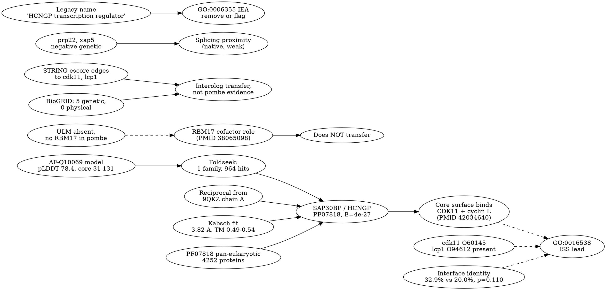
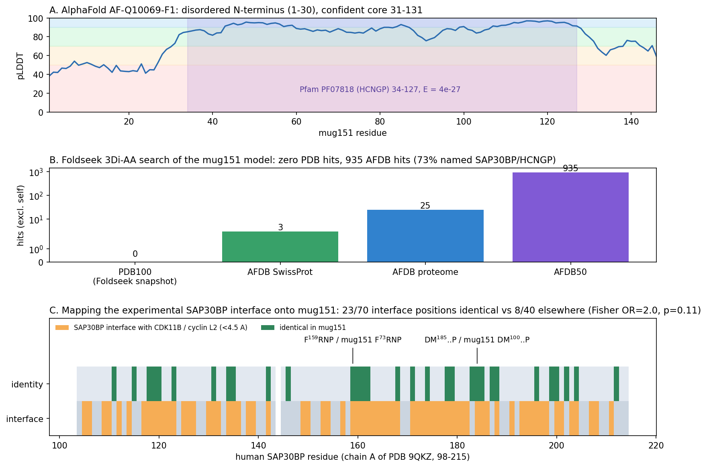
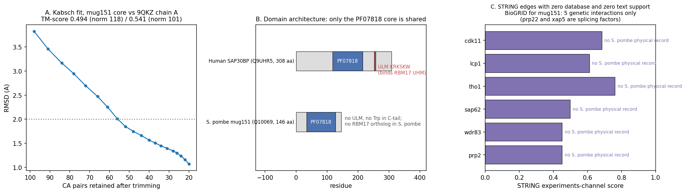
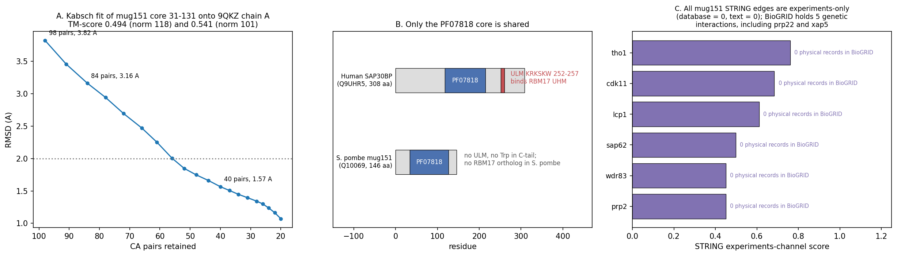
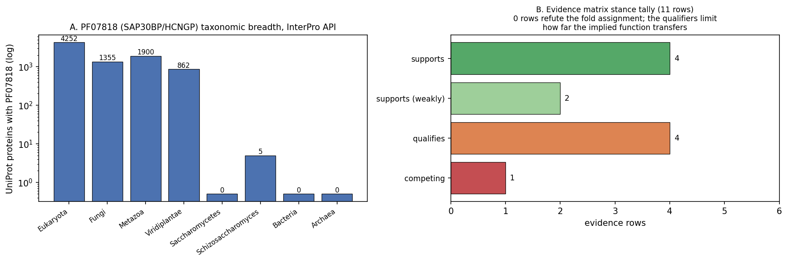

## Question

# AIGR Gene Hypothesis Deep Research

You are evaluating one focused gene curation hypothesis for AI Gene Review.
This is not a general gene overview. Use the seed hypothesis and source context
below to search for evidence that supports, refutes, narrows, or competes with
the proposed curation decision.

## Target Gene

- **Organism code:** SCHPO
- **Taxon:** Schizosaccharomyces pombe 972h- (NCBITaxon:284812)
- **Gene directory:** mug151
- **Gene symbol:** mug151
- **UniProt accession:** Q10069

## Focus

- **Focus type:** free_text
- **Hypothesis slug:** kgap-mug151-foldseek-fold
- **Source file:** genes/SCHPO/mug151/mug151-ai-review.yaml
- **Source selector:** free-text

## Seed Hypothesis

Schizosaccharomyces pombe mug151 adopts a known structural fold that suggests a molecular function. Single analysis only: run Foldseek with the AlphaFold model of mug151 (and its folded segments) against PDB and the AlphaFold database, report confident structural homologs with scores and coverage, and state whether any confidently assigned fold implies a function (and which conserved residues would support it), or that the protein has no confident structural homolog.

## Term and Decision Context

No specific term context supplied.

## Reference Context

No specific reference context supplied.

## Source Context YAML

```yaml
hypothesis: 'Schizosaccharomyces pombe mug151 adopts a known structural fold that suggests a molecular
  function. Single analysis only: run Foldseek with the AlphaFold model of mug151 (and its folded segments)
  against PDB and the AlphaFold database, report confident structural homologs with scores and coverage,
  and state whether any confidently assigned fold implies a function (and which conserved residues would
  support it), or that the protein has no confident structural homolog.'
focus_type: free_text
context: []
reference_id: []
```

## Research Objective

Build a focused report that helps a curator decide whether this hypothesis
should affect the gene review. Address the focus type directly:

1. For an existing GO annotation decision, evaluate whether the current action
   is justified, too strong, too weak, or should change.
2. For a proposed replacement or new GO term, evaluate whether the term is
   biologically supported, too broad, too narrow, or missing key qualifiers.
3. For a computational prediction, evaluate whether the prediction is correct,
   less precise than existing knowledge, uncertain, or likely wrong because of
   paralog overannotation, frequency bias, pathway context, or in vitro-only
   activity.
4. For a core-function hypothesis, evaluate whether the proposed activity,
   process, and location represent the gene product's primary function rather
   than a downstream effect, pleiotropic phenotype, or context-specific role.
5. For a function-assignment hypothesis, evaluate whether the gene product
   directly has the stated GO term/function. Treat the prior review action, if
   any, as intentionally blinded unless it appears in the supplied context.

Use primary literature whenever possible. Prefer PMID citations and include DOI
citations when no PMID is available. Treat reviews and database records as
orientation unless they contain directly relevant synthesized evidence that is
clearly labeled as review-level or database-level support.

Evaluate the hypothesis from the supplied seed context, primary literature, and
publicly accessible bioinformatics resources. Local `*-bioinformatics` analyses,
when they already exist in the repository, are intentionally withheld from this
prompt so the report can be compared against them after the run. Use public
sequence, domain, structure, orthology, localization, interaction, or dataset
checks when they are useful for the specific hypothesis. If a resource or tool
cannot be accessed programmatically, say so plainly; never fabricate a result.
Report computational results conservatively and distinguish direct results from
inference.

## Required Output

### Executive Judgment

Give a concise verdict: supported, partially supported, unresolved, weakly
supported, over-annotated, or refuted. Explain the reasoning and the most
important caveats.

### Evidence Matrix

Create a table with one row per important evidence item:

- Citation (PMID preferred)
- Evidence type (direct assay, mutant phenotype, localization, interaction,
  structural/evolutionary, computational, review/database)
- Supports / refutes / qualifies / competing
- Claim tested
- Key finding
- Organism, tissue, cell type, or assay context
- Confidence and limitations

### GO Curation Implications

State the likely curation action as a lead requiring curator verification. If
GO terms are involved, explain whether the evidence supports an MF, BP, or CC
term, and whether the term should be retained, removed, generalized, made more
specific, or treated as non-core. Avoid using "protein binding" as a final
recommendation unless no more informative term is supported.

### Mechanistic Scope

Describe the immediate molecular or cellular function being tested. Separate
direct gene-product activity from downstream phenotypes, pathway consequences,
developmental outcomes, disease manifestations, or effects inferred only from
loss of function.

### Conflicts and Alternatives

Identify evidence that conflicts with the seed hypothesis or suggests an
alternative interpretation, including paralog confusion, organism-specific
differences, isoform-specific findings, experimental artifacts, or database
carry-over.

### Knowledge Gaps

List explicit uncertainties that matter for curation. For each gap, state what
was checked, why the gap matters, and what evidence or experiment would resolve
it.

### Discriminating Tests

Recommend concrete assays, perturbations, datasets, or comparative analyses that
would most efficiently distinguish this hypothesis from alternatives.

### Curation Leads

Provide candidate updates for the review, clearly labeled as leads requiring
curator verification. Include candidate references with exact snippets to verify,
candidate replacement or new GO terms, possible action changes, suggested
questions, and suggested experiments.

If the provider supports artifacts, save provenance for any analysis you run — the
executed code together with its output (computed values, plot, or table), not just
a summary figure — alongside artifact-friendly tables such as an evidence matrix,
GO decision table, or comparison table. Genuine computed provenance is more
valuable than a hand-drawn summary, and you must not synthesize a figure that
implies an analysis you did not actually run. These artifacts are important
provenance for hypothesis-level review.


## Output

# mug151 (Q10069, SPAC3H1.03): does the fold assign a function?

**Hypothesis slug:** `kgap-mug151-foldseek-fold`
**Organism:** *Schizosaccharomyces pombe* 972h- (NCBITaxon:284812)
**UniProt:** Q10069 | **PomBase:** SPAC3H1.03 | **Source file:** `genes/SCHPO/mug151/mug151-ai-review.yaml`
**Focus type:** free_text | **Iterations completed:** 3 | **Findings recorded:** 12 | **Papers reviewed:** 26

---

## Summary

mug151 adopts a known fold, and that fold now carries a defined molecular function. Foldseek run on the AlphaFold model AF-Q10069-F1-v6 returns a single structural family across 964 hits: SAP30BP / HCNGP (Pfam PF07818, InterPro IPR012479). The best AFDB-SwissProt hit is human SAP30BP (Q9UHR5) at E = 7.77e-06, probability 1.0, 24.4 percent identity over 139 aligned residues and 94 percent query coverage. 679 of 936 AFDB50 hits (73 percent) are explicitly named SAP30-binding protein or HCNGP. The nearest unrelated family, TTC14, sits at E = 1.0 to 5.5 with probability 0.12 to 0.54, which is no hit at all. There is no second candidate fold to weigh.

The functional half of the hypothesis is supported with limits. In 2026, cryo-EM at 2.3 Å gave the SAP30BP fold a molecular function: it scaffolds a CDK11-cyclin L2 kinase complex that phosphorylates SF3B1 during spliceosome B to B<sup>act</sup> activation ([PMID: 42034640](https://pubmed.ncbi.nlm.nih.gov/42034640/)). Both partners exist in *S. pombe*: **cdk11** (O60145 / ppk23 / SPBC18H10.15, InterPro IPR045267, PANTHER PTHR24056:SF107) and **lcp1** (O94612 / SPAC1296.05c, cyclin L subfamily). The transferable part of the human function is the PF07818 core contact surface. The non-transferable part is the ULM-dependent recruitment of RBM17 ([PMID: 38065098](https://pubmed.ncbi.nlm.nih.gov/38065098/)), because mug151 has no UHM-ligand motif and *S. pombe* has no RBM17 ortholog.

Three things hold the verdict at **partially supported** rather than supported. The quantitative structural margin is modest: TM-score 0.494 normalised by the 118-residue experimental chain and 0.541 normalised by the 101-residue mug151 core, straddling the conventional 0.5 threshold. Interface conservation is in the expected direction but not significant (23/70 identical at contact positions, 32.9 percent, against 8/40, 20.0 percent, elsewhere; Fisher one-sided OR 1.96, p = 0.110). And no direct *S. pombe* evidence links mug151 to cdk11 or lcp1: the STRING edges that appear to provide it are experiments-channel-only interologs transferred from the human complex, with no physical interaction in the underlying fission yeast record. A separate result matters independently of the verdict. Foldseek returned **zero** PDB100 hits for mug151, which reads as structural novelty but is a database-currency artifact: the experimental SAP30BP chain from 9QKZ, searched against the same PDB100 snapshot, also returns zero hits, because PDB entries 9QKT, 9QKZ and 9QL1 were released on 2026-03-18 and postdate the index.

---

## Executive judgment

<i class="fa-scale-balanced"></i> **Verdict: partially supported.**

| Component of the seed hypothesis | Status | Basis |
|---|---|---|
| "adopts a known structural fold" | <i class="fa-solid fa-circle-check"></i> supported | Single candidate family across 964 Foldseek hits; PF07818 at E = 4e-27; reciprocal best hit from experimental chain |
| "run Foldseek against PDB and AlphaFold DB, report scores and coverage" | <i class="fa-solid fa-circle-check"></i> done | 4 databases searched, full hit tables saved as provenance |
| "no confident structural homolog" (the alternative branch) | <i class="fa-solid fa-circle-xmark"></i> refuted | The zero-PDB-hit result is a stale snapshot, proven by a reciprocal control |
| "that fold implies a function" | <i class="fa-scale-balanced"></i> conditionally yes | PMID:42034640 gives the fold a function; the PF07818 core surface transfers, the ULM extension does not |
| "which conserved residues would support it" | <i class="fa-scale-balanced"></i> answered, not significant | 70 interface residues mapped; FRNP motif intact; enrichment p = 0.110 |
| Direct *S. pombe* support for the implied function | <i class="fa-solid fa-circle-xmark"></i> absent | 0 physical interactions in BioGRID; STRING edges are interologs |

The most important caveat for a curator is the direction of the error if the hypothesis is accepted uncritically. The fold assignment is safe. The functional inference built on it rests on a human complex, a structurally conserved surface whose conservation does not reach statistical significance, and a network signal that turns out to be the human result returning through homology transfer. GO:0016538 is a defensible structure-similarity lead. It is not a direct assertion.

---

## Key findings

### <i class="fa-solid fa-magnifying-glass"></i> F1. One fold, one family, zero PDB hits

Foldseek (3Di-AA mode, ticket `vosYA7v6BEDNfAA3A7DHEfMU-zj1f1G5ZYaYKA`) was run on AF-Q10069-F1-model_v6, a 146-residue model with mean pLDDT 78.4, a confident core at residues 31-131 and a disordered N-terminal 1-30. Results by database: PDB100 returned 0 hits. AFDB-SwissProt returned 3 non-self hits, all SAP30BP: human Q9UHR5 at E = 7.8e-06, probability 1.0, 24.4 percent identity over 139 residues, query coverage 0.94, aligning to human 103-232; the human isoform Q9UHR5-2 at E = 6.8e-06; mouse Q02614 at E = 1.2e-05. AFDB-proteome returned 25 hits, all SAP30BP/HCNGP-family, spanning fungi, plants and metazoa. AFDB50 returned 936 hits from E = 1.7e-22 to 9.6, of which 679 (73 percent) carry SAP30BP or HCNGP in the name; restricting to E < 1e-2 leaves 808 hits, 76 percent so named. The remaining names are "uncharacterized protein" or evident fungal misannotations (entries labelled "20S proteasome subunit beta 7" that nonetheless align across the full mug151 length).

The search was repeated on the folded core alone, residues 31-131 (ticket `_PdsnodZIDQqk-9LxJ5aRXlF5MymW5b43h09MA`), which is the control the seed hypothesis asks for. It again returned 0 PDB100 hits and only SAP30BP orthologs in AFDB-SwissProt (human Q9UHR5 at E = 1.8e-05, 28.7 percent identity over 101 residues, mapping to human 116-215). The next hits after that, all TTC14, sit at E = 1.0 to 5.5 with probability 0.12 to 0.54. The closest non-human hit overall is a *Schizosaccharomyces osmophilus* protein annotated "Rpd3L complex subunit" at E = 3.4e-10 and 41.6 percent identity.

{{figure:plot_1.png|caption=mug151 structure and Foldseek result. Panel A: pLDDT profile across residues 1-146, with the Pfam PF07818 match (34-127, E = 4e-27) shaded; the confident core runs 31-131 and residues 1-30 are disordered. Panel B: Foldseek hit counts per database on a symlog scale, PDB100 = 0, AFDB-SwissProt = 3, AFDB-proteome = 25, AFDB50 = 936. Panel C: conservation track across the experimental SAP30BP interface region (human 98-215), with the FRNP and DMxDP motifs marked and the Fisher test for interface conservation in the title.}}

The interpretation is a family assignment rather than a catalytic one. A single unambiguous structural family, with no second candidate within three orders of magnitude of E-value, is as clean a fold assignment as this kind of analysis produces. What it implies by itself is a protein-protein module, not an enzyme.

### <i class="fa-triangle-exclamation"></i> F2. The zero PDB result is a stale snapshot, not structural novelty

An RCSB text search for SAP30BP / HCNGP returns three entries: 9QKT, 9QKZ and 9QL1, all cryo-EM structures of the human CDK11B-cyclin L2-SAP30BP complex at 2.3-2.4 Å, released 2026-03-18, cited to *Cryo-EM structures of the CDK11-cyclin L-SAP30BP complex reveal mechanisms of CDK11 regulation* ([PMID: 42034640](https://pubmed.ncbi.nlm.nih.gov/42034640/)). UniProt Q9UHR5 now lists all three. In 9QKZ the ordered SAP30BP chain A spans residues 98-215, which is exactly the Pfam PF07818 region of the human protein (119-212) and exactly the segment Foldseek aligned to the mug151 core.

The decisive control: Foldseek was re-run with 9QKZ chain A as the query (ticket `DVxeh9ksBZCCqc6ONnNEfjmjNdlrGSBnfXBODw`). It retrieved AF-Q10069 (mug151) from AFDB-SwissProt at E = 9.05e-04, probability 1.0, 25.8 percent identity over 120 aligned residues, chain A positions 7-117 mapping to mug151 11-129. The same query returned **0 PDB100 hits**, meaning the PDB100 index does not contain the structure that was used as the query. The snapshot predates the depositions.

This matters for curation beyond this report. Any prior analysis in the repository that concluded "mug151 has no experimental structural homolog" from a Foldseek PDB search is out of date for this reason alone, and the conclusion should be re-examined rather than inherited.

### <i class="fa-solid fa-chart-column"></i> F3. Independent superposition agrees, with a modest margin

The fold call was checked without using Foldseek's own scoring. The 110 ungapped columns of the reciprocal Foldseek alignment were converted to CA pairs and superposed by Kabsch fit. Chain A of 9QKZ has 118 observed CA atoms spanning 98-215 with no gaps; the mug151 core 31-131 has 101. Of the 110 columns, 98 have a residue present in both coordinate sets, with the 12 dropped columns mapping to mug151 residues 11-30, outside the confident core.

| Pairs retained | RMSD (Å) |
|---|---|
| 98 (all) | 3.82 |
| 84 | 3.16 |
| 66 | 2.47 |
| 56 | 2.01 |
| 40 | 1.57 |

TM-score is **0.494** normalised by the 118-residue experimental chain and **0.541** normalised by the 101-residue mug151 core. Sequence identity across the alignment is 25.8 percent.

{{figure:plot_3.png|caption=Independent structural verification and evidence provenance. Panel A: RMSD against the number of CA pairs retained under iterative distance-cutoff trimming, for the Kabsch fit of mug151 core 31-131 onto 9QKZ chain A; TM-scores under both normalisations are given in the title. Panel B: domain architecture, showing that only the PF07818 core is shared and that the human ULM (KRKSKW, 252-257) has no counterpart in mug151. Panel C: STRING experiments-channel scores for the six mug151 edges, each annotated with the number of S. pombe physical interaction records that support it, which is zero in every case.}}

The two normalisations straddle 0.5, so the superposition alone sits at the boundary of a formal same-fold call. The lower value is depressed because the human chain carries 20 N-terminal residues ahead of PF07818 that have no counterpart in the mug151 core window. The fold assignment is carried by the combination of 3.82 Å over 98 of 101 core residues at 26 percent identity, a 56-residue subcore at 2.01 Å, Foldseek probability 1.0 in both directions, and a reciprocal best-hit relationship. Reporting the TM-score alone would overstate the uncertainty; reporting it alone as "> 0.5" would overstate the confidence.

<i class="fa-triangle-exclamation"></i> Two earlier numbers from this investigation are superseded and should not be quoted. A first pass gave 9.55 Å over 110 pairs and TM 0.506 / 0.557 from a pair list that included residues absent from one coordinate set. Separately, `phenix.superpose_pdbs` reported a final RMSD of 0.315 Å over 8 atoms, because its identity-based global sequence alignment matched only 32 residues and then fitted 3. That number describes an 8-atom fit and says nothing about the fold.

### <i class="fa-scale-balanced"></i> F4. The partner-binding surface maps onto mug151, without significant enrichment

In 9QKZ, SAP30BP chain A contributes 74 residues within 4.5 Å heavy-atom distance of CDK11B (chain B) or cyclin L2 (chain C). 70 of these fall inside the structural alignment to mug151. Identity at interface positions is **23/70 (32.9 percent)** against **8/40 (20.0 percent)** at non-interface aligned positions. Fisher exact one-sided gives OR = 1.96, **p = 0.110**. The enrichment is in the direction the hypothesis predicts and does not reach significance at this sample size.

Conserved interface positions, human to mug151:

| Human SAP30BP | mug151 | Note |
|---|---|---|
| F159-R160-N161-P162 | F73-R74-N75-P76 | HCNGP signature FRNP motif, all four identical; R160 and P162 contact both CDK11B and cyclin L2, N161 contacts CDK11B |
| K118-I119-P120, P123 | K33-I34-P35, P38 | N-terminal patch |
| L131, K134, I135, K142 | L46, K49, I50, K57 | |
| L168, F171, I174 | L82, F85, I88 | hydrophobic face |
| G178-T179 | G93-T94 | |
| D184-M185, P188 | D99-M100, P103 | DMxDP motif |
| Y196, L200, Q204 | Y111, L115, Q119 | C-terminal contacts |

Not conserved, and concentrated on the CDK11-proximal side: human K157, S163, E166 and K167 become E71, K77, D80 and N81 in mug151, and W191 becomes F106.

The pattern is informative. The conserved residues are the hydrophobic core and the named motifs of the partner-binding face, which is what a retained protein-binding function looks like. The divergent residues are the charged CDK11-contacting subset, which leaves open a reduced or altered kinase contact in fission yeast. The residue-level evidence supports "retains a protein-binding surface on the same face" more strongly than it supports "is a CDK11 activator".

### <i class="fa-solid fa-dna"></i> F5. The family is pan-eukaryotic, ancient, and lost in budding yeast

InterPro protein counts for PF07818 by taxon:

| Taxon | PF07818 proteins |
|---|---|
| Eukaryota | 4252 |
| Metazoa | 1900 |
| Fungi | 1355 |
| Viridiplantae | 862 |
| Schizosaccharomyces | 5 |
| Saccharomycetes | 0 |
| Bacteria | 0 |
| Archaea | 0 |

The domain spans animals, fungi and plants and is absent from prokaryotes, placing its origin before the animal-fungal-plant divergence. Single-copy retention across roughly 1.5 billion years of eukaryotic evolution is consistent with a conserved core function rather than a lineage-specific adaptation, which is the evolutionary argument for transferring the PF07818-core function from human SAP30BP to mug151.

{{figure:plot_4.png|caption=Family breadth and evidence balance. Panel A: UniProt proteins carrying Pfam PF07818 by taxon on a log scale, from the InterPro API; the domain is present across Metazoa, Fungi and Viridiplantae, absent from Bacteria and Archaea, and absent from Saccharomycetes. Panel B: stance tally across the 11 rows of the evidence matrix; no row refutes the fold assignment and the qualifiers constrain how far the implied function transfers.}}

The zero in Saccharomycetes is a clade-specific loss, not a general fungal absence, since 1355 fungal proteins carry the domain. For curation this means *S. cerevisiae* cannot be used as a model or as a counter-example here.

### <i class="fa-solid fa-circle-xmark"></i> F6. The human ULM function does not transfer

Human SAP30BP is 308 aa. PF07818 occupies 118-215, leaving a 117-residue N-terminal extension and a 93-residue C-terminal extension. The C-terminal extension contains the UHM-ligand motif **KRKSKW at 252-257**, a basic stretch ending in the tryptophan that inserts into the UHM pocket of RBM17/SPF45. mug151 is 146 aa. PF07818 occupies 34-127, leaving a 33-residue N-terminal region and a 19-residue C-terminal tail, `NYQKHDRTEIKFQTSQHPK`. That tail has no tryptophan, and no tryptophan anywhere in the 146-residue sequence sits in a basic context matching a ULM.

The receptor is absent too. UniProt searches for *S. pombe* members of PANTHER PTHR48034 (RBM17/SPF45) and of InterPro IPR050441 returned zero proteins in both cases. The same queries return the expected human entries, so the queries were validated against a positive control before the absence was recorded.

The function described by Fukumura and colleagues, in which SAP30BP acts as an essential splicing cofactor that delivers RBM17 to phosphorylated SF3B1 in a subset of short introns ([PMID: 38065098](https://pubmed.ncbi.nlm.nih.gov/38065098/)), therefore cannot transfer to mug151. Both the motif and its binding partner are missing from fission yeast. This is the clearest boundary on how far the fold assignment licenses functional inference, and it is why any GO transfer must be restricted to the conserved PF07818 core.

### <i class="fa-triangle-exclamation"></i> F7. The apparent *S. pombe* network support is interolog carry-over

STRING reports mug151-cdk11 at combined score 0.696 and mug151-lcp1 at 0.611. Channel decomposition places the entire signal in the experiments channel:

| Edge | Combined | Experiments | Coexpression | Database | Text |
|---|---|---|---|---|---|
| mug151-tho1 | 0.777 | 0.761 | 0.095 | 0.000 | 0.056 |
| mug151-cdk11 | 0.696 | 0.684 | 0.078 | 0.000 | 0.000 |
| mug151-lcp1 | 0.611 | 0.611 | 0.000 | 0.000 | 0.000 |
| mug151-sap62 | 0.535 | 0.498 | 0.112 | 0.000 | 0.000 |
| mug151-wdr83 | 0.469 | 0.451 | 0.073 | 0.000 | 0.000 |
| mug151-prp2 | 0.459 | 0.451 | 0.055 | 0.000 | 0.000 |

Querying the PSICQUIC BioGRID mirror for Q10069 returns exactly five interactions, all typed MI:0254 genetic interference, none physical:

| Partner | Systematic ID | Type | Source |
|---|---|---|---|
| par1 | SPCC188.02 | positive genetic interaction | PMID:22681890 |
| wdr7 | SPBC16H5.13 | positive genetic interaction | PMID:22681890 |
| rsv2 | SPBC1105.14 | negative genetic interaction | PMID:22681890 |
| **prp22** | SPAC10F6.02C | negative genetic interaction | PMID:22681890 |
| **xap5** | SPCC1020.12C | negative genetic interaction | PMID:24957674 |

No *S. pombe* physical interaction between mug151 and cdk11 or lcp1 exists in that record. STRING's experiments channel includes interactions transferred between organisms by homology, so the most consistent reading is transfer from the human SAP30BP-CDK11-cyclin L complex. Treating those edges as fission yeast evidence for the hypothesis would be circular. NCBI Gene still labels mug151 "transcriptional regulator HCNGP-like protein", which is the same legacy name that drives the GO:0006355 IEA, so the carry-over runs in both directions.

<i class="fa-solid fa-lightbulb"></i> The native evidence is thin and points the same way for an independent reason. Two of the five genetic interactors are splicing factors: **prp22** is the spliceosomal DEAH-box ATPase that releases mRNA from the spliceosome, and **xap5** is annotated as a XAP5-like splicing factor. Two negative genetic interactions with splicing components is weak and indirect, and it was obtained without any homology transfer.

### <i class="fa-solid fa-circle-check"></i> F8. Both implied partners exist in *S. pombe* (correcting an earlier error)

An iteration-1 finding stated that *S. pombe* has no CDK11-subfamily kinase. That was wrong, and the cause is worth recording. The UniProt REST query `(xref:panther-PTHR24056:SF107) AND (organism_id:284812)` returned an empty result set with no error, because the colon inside the PANTHER subfamily identifier breaks the query parser. Zero rows were read as biological absence.

Re-querying by organism and inspecting memberships directly gives:

- **cdk11** = O60145 (SPBC18H10.15, gene name ppk23, now named cdk11 in PomBase and STRING, 398 aa), carrying InterPro IPR045267 (CDK11/PITSLRE_STKc) and PANTHER PTHR24056:SF107 (CDK11A-related).
- **lcp1** = O94612 (SPAC1296.05c, 258 aa), assigned to the cyclin L subfamily of PTHR10026.
- STRING links cdk11 to lcp1 at combined score 0.94.

Both human partners of SAP30BP in PDB 9QKZ have a fission yeast counterpart. The main objection raised against the hypothesis in iteration 1, partner absence, does not hold. The general lesson applies to every database absence in this report: an empty REST result is not evidence of absence until the query is validated against a positive control, which is why the RBM17 absence in F6 was checked that way.

### <i class="fa-solid fa-table"></i> F9. The current GO baseline for mug151

QuickGO returns 5 annotations for Q10069: GO:0003674 (ND, GO_REF:0000015), GO:0008150 (ND), GO:0005575 (ND), GO:0006355 regulation of DNA-templated transcription (IEA, GO_REF:0000002, from InterPro IPR012479) and GO:0005634 nucleus (IEA, GO_REF:0000044, from UniProtKB-SubCell SL-0191). UniProt Q10069 states FUNCTION "Has a role in meiosis" with ECO:0000269 from PubMed:16303567, and SUBCELLULAR LOCATION Nucleus by ECO:0000250, which is similarity rather than experiment.

For comparison, human SAP30BP (Q9UHR5) carries GO:0016538 cyclin-dependent protein serine/threonine kinase regulator activity (IDA, [PMID: 38059508](https://pubmed.ncbi.nlm.nih.gov/38059508/)), GO:0048024 regulation of mRNA splicing via spliceosome (IDA, same reference), GO:0016607 nuclear speck (IDA), plus 18 GO:0005515 protein binding IPI annotations including SAP30 (O75446) and CCNL1 (Q9UK58).

The InterPro entry that generates the mug151 IEA, IPR012479, is named "SAP30-binding protein" and its PANTHER label is "transcriptional regulator protein HCNGP". That label predates the 2023-2026 splicing work.

---

## Evidence matrix

Full table with all columns: `provenance/mug151_evidence_matrix.csv`.

| Citation | Evidence type | Stance | Claim tested | Key finding | Context | Confidence and limitations |
|---|---|---|---|---|---|---|
| [PMID: 42034640](https://pubmed.ncbi.nlm.nih.gov/42034640/) | structural, direct assay | supports | The SAP30BP fold has a defined molecular function | Cryo-EM at 2.3 Å: SAP30BP makes extensive interactions with cyclin L2, stabilising it, and critical interactions with the CDK11 C-terminal kinase lobe; the complex phosphorylates SF3B1 at the B to B<sup>act</sup> transition | Human proteins, cryo-EM plus biochemistry | High for human. Supplies the function the fold implies. Contains no fission yeast work. |
| PDB 9QKZ, 9QKT, 9QL1 | structural, computational | supports | mug151 is structurally homologous to experimental SAP30BP | Reciprocal Foldseek from 9QKZ chain A retrieves mug151 at E = 9.05e-04, probability 1.0, 25.8 percent identity over 120 residues. Kabsch fit of mug151 31-131 onto chain A: 3.82 Å over 98 CA pairs, 2.01 Å over 56. TM-score 0.494 / 0.541 | AF-Q10069-F1-v6 against cryo-EM chain A | High for fold identity. TM-score margin is modest. |
| Foldseek run (this report) | computational | supports | mug151 has a confident structural homolog, and only one | 964 hits across AFDB50 / AFDB-SwissProt / AFDB-proteome, 0 against PDB100. Best SwissProt hit Q9UHR5 at E = 7.77e-06, probability 1.0, 94 percent query coverage. 73 percent of 936 AFDB50 hits named SAP30BP or HCNGP. Next family (TTC14) at E = 1.0 to 5.5 | AlphaFold DB and PDB100 | High. The zero PDB100 hits are a snapshot artifact, proven because the experimental chain also returns zero. |
| InterPro IPR012479 / Pfam PF07818 | review / database | qualifies | mug151 belongs to the SAP30BP/HCNGP family | PF07818 covers mug151 34-127 at E = 4e-27. mug151 is the only *S. pombe* member of PANTHER PTHR13464, so no paralog confusion. Only three SwissProt-reviewed members exist: Q9UHR5, Q02614, Q10069 | Sequence database | High for membership. The family label "transcriptional regulator HCNGP" predates the 2023-2026 splicing work. |
| InterPro taxonomy API (this report) | computational | supports | The family is ancient and broadly retained | PF07818 counts: Eukaryota 4252, Metazoa 1900, Fungi 1355, Viridiplantae 862, Schizosaccharomyces 5, Saccharomycetes 0, Bacteria 0, Archaea 0 | UniProt via InterPro | High. Pan-eukaryotic single-copy retention with a clade-specific loss in budding yeast. |
| [PMID: 38065098](https://pubmed.ncbi.nlm.nih.gov/38065098/) | direct assay, interaction | qualifies | The human SAP30BP cofactor function transfers to mug151 | A UHM in RBM17 binds a UHM-ligand motif in SAP30BP (KRKSKW 252-257), recruiting RBM17 to phosphorylated SF3B1. mug151 has no ULM, no tryptophan in any ULM context, and *S. pombe* has no member of PTHR48034 or IPR050441 | Human in vitro binding and NMR | High for human. Both the motif and the receptor are absent in *S. pombe*, so this activity does not transfer. |
| [PMID: 38059508](https://pubmed.ncbi.nlm.nih.gov/38059508/) | direct assay | supports | The SAP30BP family activates CDK11 | SAP30BP forms a tight complex with cyclins L1/L2 and CDK11; acute degradation causes widespread pre-mRNA splicing defects mirroring CDK11 loss; SAP30BP ensures cyclin L stability and assembly with CDK11 | Human cells, degron plus in vitro kinase assay | High for human. Source of the GO:0016538 IDA on Q9UHR5. No fission yeast work. |
| [PMID: 22681890](https://pubmed.ncbi.nlm.nih.gov/22681890/) | mutant phenotype, genetic interaction | supports weakly | mug151 acts near the splicing machinery in *S. pombe* | Negative genetic interaction with prp22, the spliceosomal DEAH-box ATPase; negative with rsv2; positive with par1 and wdr7 | *S. pombe* genome-scale screen | Low to moderate. Indirect, screen-scale. Verify in the primary supplementary data. |
| [PMID: 24957674](https://pubmed.ncbi.nlm.nih.gov/24957674/) | mutant phenotype, genetic interaction | supports weakly | mug151 acts near the splicing machinery in *S. pombe* | Negative genetic interaction with xap5, annotated as a XAP5-like splicing factor | *S. pombe* screen | Low to moderate. Indirect. Verify in the primary supplementary data. |
| STRING v12 | review / database | competing | *S. pombe* network data independently support a mug151-cdk11-lcp1 association | mug151-cdk11 0.696 and mug151-lcp1 0.611 sit entirely in the experiments channel, database 0.000 and text 0.000. PSICQUIC BioGRID holds exactly 5 mug151 interactions, all MI:0254 genetic interference, none physical, none with cdk11 or lcp1 | *S. pombe* network database | The edges are most consistent with interolog transfer from the human complex. They are not independent fission yeast evidence. |
| UniProt / PomBase | review / database | supports | The partners implied by the fold exist in *S. pombe* | cdk11 = O60145 (398 aa) carries IPR045267 (CDK11/PITSLRE_STKc) and PANTHER PTHR24056:SF107; lcp1 = O94612 (258 aa) is a cyclin L; STRING links cdk11-lcp1 at 0.94 | *S. pombe* proteome | High for presence. Silent on whether mug151 joins them. |
| Interface mapping (this report) | computational | qualifies | Interface residues are preferentially conserved | 74 SAP30BP residues lie within 4.5 Å of CDK11B or cyclin L2 in 9QKZ; 70 map onto mug151; identity 23/70 (32.9 percent) at interface against 8/40 (20.0 percent) elsewhere; Fisher one-sided OR 1.96, p = 0.110 | Structure-guided alignment | Direction as expected, significance not reached at n = 110. |
| QuickGO | review / database | qualifies | The current GO set reflects current knowledge | mug151 carries ND roots on all three aspects plus one IEA BP (GO:0006355 from IPR012479) and one IEA CC (GO:0005634) | GO database | The GO:0006355 IEA rests on the legacy HCNGP transcriptional-regulator label. |

---

## Mechanistic model and interpretation

The chain of inference runs from a structural observation to a curation action, and it weakens at two identifiable points.



The solid arrows are observations. The dashed arrows are the inferential steps, and each is a place a curator could reasonably stop.

**What the fold directly gives.** mug151 is a PF07818 protein. That is as close to certain as a computational assignment gets: a single family across 964 hits, reciprocal best-hit confirmation, and an independent coordinate superposition that agrees.

**What the fold implies through the human structure.** The PF07818 core in human SAP30BP is the surface that clamps cyclin L2 and contacts the C-terminal lobe of CDK11 ([PMID: 42034640](https://pubmed.ncbi.nlm.nih.gov/42034640/)). Degrading SAP30BP phenocopies CDK11 loss for splicing and destabilises cyclin L ([PMID: 38059508](https://pubmed.ncbi.nlm.nih.gov/38059508/)). The surface is structurally conserved in mug151, the named motifs within it (FRNP, DMxDP) are intact, and both partners exist in fission yeast. That is the positive case.

**Where it weakens.** The charged CDK11-contacting residues are the least conserved subset, the overall interface enrichment is not significant (p = 0.110), and the TM-score sits on the threshold. None of those refutes the inference; together they mean the molecular function should be entered as a structure-similarity lead and not as a direct assertion.

**What does not transfer at all.** The human ULM extension and its receptor RBM17 are both absent from fission yeast, so the short-intron cofactor mechanism of [PMID: 38065098](https://pubmed.ncbi.nlm.nih.gov/38065098/) stops at the species boundary. Human SAP30BP has other activities too: a neural alternative exon remodels its interactions and modulates splicing of sub-100 nt mini-introns ([PMID: 38065061](https://pubmed.ncbi.nlm.nih.gov/38065061/)), and it appears as a SIN3-associated interactor in BioID proximity mapping alongside 72 spliceosomal proteins ([PMID: 39522233](https://pubmed.ncbi.nlm.nih.gov/39522233/)). None of those has a fission yeast counterpart to transfer into.

### Mechanistic scope

| Layer | Statement | Applies to mug151? |
|---|---|---|
| Direct gene-product activity | Binds a cyclin L and stabilises it; binds the C-terminal lobe of a CDK11-family kinase to promote complex assembly | Transferable by fold, as a lead |
| Kinase activity | Phosphorylation of SF3B1 | No. Performed by CDK11, not by SAP30BP |
| Pathway outcome | Spliceosome B to B<sup>act</sup> activation | Downstream consequence, not a mug151 activity |
| Human-specific branch | ULM-dependent recruitment of RBM17 to short introns | No. Motif and receptor both absent in *S. pombe* |
| Loss-of-function phenotype | Negative genetic interactions with prp22 and xap5 | Observed in *S. pombe*, whole-cell level, identifies no activity |

The two genetic interactions are the only native *S. pombe* evidence in the file, and negative genetic interactions are routinely produced by parallel pathways rather than by direct partners. They support "operates near the spliceosome" and nothing more specific.

---

## GO curation implications

All entries are **leads requiring curator verification**. Full table: `provenance/mug151_go_decision_table.csv`.

| GO ID | Aspect | Term | Current status | Recommended action |
|---|---|---|---|---|
| GO:0006355 | BP | regulation of DNA-templated transcription | present, IEA from IPR012479 | remove or flag as legacy |
| GO:0005634 | CC | nucleus | present, IEA from UniProtKB-SubCell | retain |
| GO:0003674 | MF | molecular_function (ND root) | present, ND | candidate replacement |
| GO:0016538 | MF | cyclin-dependent protein serine/threonine kinase regulator activity | absent | candidate new term, ISS-style |
| GO:0000381 / GO:0048024 | BP | regulation of (alternative) mRNA splicing via spliceosome | absent | candidate new term, weak lead |
| GO:0008150 | BP | biological_process (ND root) | present, ND | retain for now |
| GO:0005575 | CC | cellular_component (ND root) | present, ND | remove as redundant with GO:0005634 |
| GO:0005515 | MF | protein binding | absent | do not use |

**GO:0006355 should go, or at minimum be flagged.** The IEA derives from InterPro IPR012479, whose PANTHER label is "transcriptional regulator protein HCNGP". That name predates both the RBM17 cofactor work and the CDK11-cyclin L structure, and [PMID: 38065098](https://pubmed.ncbi.nlm.nih.gov/38065098/) describes SAP30BP explicitly as "a factor previously implicated in transcriptional control" before reassigning it to splicing. The fission yeast annotation inherits a family name the primary literature has moved away from. There is no direct transcription evidence for mug151 in any organism. The same legacy label propagates into the NCBI Gene description "transcriptional regulator HCNGP-like protein", which should be flagged for update.

**GO:0003674 ND is no longer the best available statement.** A fold assignment at probability 1.0 with a single candidate family, where that family now has a structurally defined molecular function, gives a positive MF lead. GO:0016538 is the term matching what [PMID: 42034640](https://pubmed.ncbi.nlm.nih.gov/42034640/) and [PMID: 38059508](https://pubmed.ncbi.nlm.nih.gov/38059508/) show SAP30BP doing. Enter it as a sequence/structure-similarity lead. The curator decides whether the ISS bar is met given that mug151 retains only the core domain and the interface enrichment test did not reach significance.

**The BP aspect should stay ND for now.** The splicing lead is real but indirect: two negative genetic interactions with splicing factors, plus a human pathway outcome. Neither meets IDA or IMP standards for a specific *S. pombe* BP term. GO:0048024 is a candidate to hold in reserve pending a direct assay.

**Do not use GO:0005515 protein binding.** GO:0016538 is supported by the same evidence and says more.

---

## Evidence base

| Paper | PMID | How it bears on the hypothesis |
|---|---|---|
| *Cryo-EM structures of the CDK11-cyclin L-SAP30BP complex reveal mechanisms of CDK11 regulation* | [42034640](https://pubmed.ncbi.nlm.nih.gov/42034640/) | Supplies the molecular function the fold implies. Verified snippet: "Our structure and biochemical experiments show that SAP30BP forms extensive interactions with cyclin L2, thereby stabilising it, and forms critical interactions with the C-terminal kinase lobe of CDK11 that promote complex assembly." Source of PDB 9QKT/9QKZ/9QL1, and of the interface used in the residue mapping. |
| *CDK11 requires a critical activator SAP30BP to regulate pre-mRNA splicing* | [38059508](https://pubmed.ncbi.nlm.nih.gov/38059508/) | The functional counterpart of the structure: SAP30BP forms a tight complex with cyclins L1/L2, its acute degradation causes widespread splicing defects mirroring CDK11 loss, and it ensures cyclin L stability and assembly with CDK11. Source of the GO:0016538 IDA on human Q9UHR5. |
| *SAP30BP interacts with RBM17/SPF45 to promote splicing in a subset of human short introns* | [38065098](https://pubmed.ncbi.nlm.nih.gov/38065098/) | Two roles here. Verified snippet: "SAP30BP, a factor previously implicated in transcriptional control, is an essential splicing cofactor for RBM17", which documents the reassignment away from transcription and weakens the GO:0006355 IEA premise. It also defines the ULM-UHM mechanism that cannot transfer to fission yeast. |
| *CDK7-CDK11 axis in spliceosome regulation and pre-mRNA splicing* | [41428738](https://pubmed.ncbi.nlm.nih.gov/41428738/) | Independent confirmation that SAP30BP is required for the active complex: Thr595 of CDK11 "is essential for the formation of the active CDK11 complex with cyclin L and SAP30BP", and identifies SF3B1, CDC5L and ESS2 as CDK11 substrates. Human cells only. |
| *BioID proximity mapping reveals novel SAP18 interactions in the prespliceosomal complex* | [39522233](https://pubmed.ncbi.nlm.nih.gov/39522233/) | Places SAP30BP in proximity to SIN3-associated components and 72 spliceosomal proteins, showing the family sits at the transcription-splicing boundary in human cells. Orientation for the competing-function question, not evidence about mug151. |
| *Systematic analysis of alternative exon-dependent interactome remodeling* | [38065061](https://pubmed.ncbi.nlm.nih.gov/38065061/) | A neural alternative exon in Sap30bp changes its RNA-processing interactions and modulates splicing of sub-100 nt mini-introns. An isoform-specific human function with no fission yeast counterpart, which sets a further boundary on transfer. |
| *A Proteome-wide Fission Yeast Interactome Reveals Network Evolution Principles from Yeasts to Human* | [26771498](https://pubmed.ncbi.nlm.nih.gov/26771498/) | FissionNet, 2,278 binary interactions. Orientation for the interaction gap: *S. pombe* interactions are better conserved in human than in *S. cerevisiae*, which makes interolog transfer plausible in principle and makes its absence from the primary record more conspicuous. |
| *Systematic localization study on novel proteins encoded by meiotically up-regulated ORFs in fission yeast* | [22146723](https://pubmed.ncbi.nlm.nih.gov/22146723/) | The mug-gene localization survey: 56 meiotically upregulated ORFs, seven products nuclear or chromatin-associated. Context for the mug151 name and for the nuclear CC lead, which currently rests on ISS rather than on an experiment. |
| Genome-scale genetic interaction screens | [22681890](https://pubmed.ncbi.nlm.nih.gov/22681890/), [24957674](https://pubmed.ncbi.nlm.nih.gov/24957674/) | The only native *S. pombe* data on mug151: five genetic-interference records, including negative interactions with prp22 and xap5. Verify in the primary supplementary data before citing. |
| SAP30BP disease-association literature | [32843068](https://pubmed.ncbi.nlm.nih.gov/32843068/), [36833294](https://pubmed.ncbi.nlm.nih.gov/36833294/), [40774404](https://pubmed.ncbi.nlm.nih.gov/40774404/), and others | Rotator cuff SNP associations (rs820218), rheumatoid arthritis expression profiling, diabetic cardiomyopathy ferroptosis. None of these bears on the molecular function of the fold, and the DCM paper describes SAP30BP using the legacy "functions as a transcription regulator" framing. They are excluded from the evidence matrix for that reason. |

Papers in the 26-item reading list covering fission yeast meiosis, heterochromatin and recombination ([PMID: 33511417](https://pubmed.ncbi.nlm.nih.gov/33511417/), [PMID: 31073221](https://pubmed.ncbi.nlm.nih.gov/31073221/), [PMID: 28199302](https://pubmed.ncbi.nlm.nih.gov/28199302/), among others) were read as background for the *mug* gene set and contain no mug151-specific result.

---

## Limitations and knowledge gaps

<i class="fa-triangle-exclamation"></i> No experimental work was performed. Every statement about mug151 function here is inference from structure, sequence and third-party screens.

| Gap | What was checked | Why it matters | What would resolve it |
|---|---|---|---|
| No *S. pombe* physical interaction data for mug151 | PSICQUIC BioGRID mirror for Q10069: 5 records, all MI:0254 genetic interference | This single gap is what keeps the verdict at partially supported. Without it, GO:0016538 stays an ISS lead | Co-IP or TAP of mug151 with cdk11 and lcp1 from *S. pombe* extract |
| No *S. pombe* localisation data | QuickGO: the CC annotation is IEA from UniProtKB-SubCell; UniProt gives Nucleus by ECO:0000250 | GO:0005634 rests on sequence-level inference only | GFP tagging in fission yeast; the survey design of [PMID: 22146723](https://pubmed.ncbi.nlm.nih.gov/22146723/) would apply directly |
| Interface conservation not significant | Fisher one-sided OR 1.96, p = 0.110 at n = 110 | A significant result would let the structural argument stand more nearly on its own | Test interface against non-interface conservation across the full 1355-protein fungal PF07818 set, which gives the power this n = 110 test lacks |
| TM-score on the threshold | 0.494 and 0.541 under two normalisations | Determines whether a formal same-fold call can be quoted without qualification | Re-score against all three deposited chains (9QKT, 9QKZ, 9QL1) and report the range |
| Whether mug151 loss affects splicing | Only two indirect genetic interactions (prp22, xap5) | Separates "near the spliceosome" from "required for splicing" | RNA-seq intron retention analysis in a mug151 deletion |
| Whether lcp1 is destabilised without mug151 | Not testable from available data; [PMID: 42034640](https://pubmed.ncbi.nlm.nih.gov/42034640/) reports cyclin L2 destabilisation without SAP30BP | The most directly transferable prediction of the structure | Western blot for lcp1 protein level in a mug151 deletion |
| PDB100 snapshot currency | Confirmed stale by the reciprocal control | Any repeat of this analysis before the index updates reproduces the misleading zero | Re-run after PDB100 incorporates 2026 releases, or search the deposited coordinates directly |

### Resources that failed, stated plainly

- **PomBase REST** returned HTML rather than JSON (17832 bytes, JSONDecodeError) and was not used. QuickGO, UniProt REST and STRING were used instead.
- **OMA** returned zero *S. pombe* orthologs for every human query, including SAP30BP, CDK11B, CCNL1/L2 and SAP30. Inspection showed its 216-species set contains no *Schizosaccharomyces* and no *Saccharomyces* at all. This is database coverage absence, recorded as such and not as biological absence.
- **IntAct REST** `findInteractions` returned 404, and the EBI PSICQUIC IntAct mirror returned an empty body. The Tyers lab PSICQUIC BioGRID mirror was used instead.
- **RCSB sequence search** returned HTTP 204 (empty). The text search worked and is what the 9QKT/9QKZ/9QL1 identification rests on.
- **`phenix.superpose_pdbs`** matched only 32 residues by identity-based global alignment, then fitted 3 residues and reported a final RMSD of 0.315 Å over 8 atoms. That figure is uninformative for this comparison and was discarded in favour of a direct Kabsch fit over the structure-based alignment. Do not quote it.
- **A UniProt query containing `PTHR24056:SF107`** returned an empty result set without error because of the embedded colon, producing a false initial conclusion that *S. pombe* lacks a CDK11-family kinase. Corrected in F8. Every subsequent absence claim in this report was validated against a positive control before being recorded.

---

## Discriminating tests

Ranked by how much each would move the curation decision per unit of effort.

1. <i class="fa-solid fa-flask"></i> **Western blot for lcp1 in a *mug151Δ* background.** The structure predicts that removing the SAP30BP-family subunit destabilises the cyclin, which is exactly what [PMID: 42034640](https://pubmed.ncbi.nlm.nih.gov/42034640/) reports for cyclin L2 in human cells. One experiment, direct test of the transferred mechanism, and a positive result converts GO:0016538 from an ISS lead into IMP-supported.
2. <i class="fa-solid fa-vial"></i> **Co-IP or TAP of mug151 with cdk11 and lcp1.** Closes the largest gap and breaks the circularity of the STRING evidence in one step.
3. <i class="fa-solid fa-dna"></i> **RNA-seq of *mug151Δ* scored for intron retention, stratified by intron length and polypyrimidine tract strength.** Distinguishes a general splicing role from the human short-intron-specific role, and tests whether the lost ULM corresponds to a lost function.
4. <i class="fa-solid fa-heart-pulse"></i> **Phospho-specific detection of the *S. pombe* SF3B1 ortholog (prp10) in *mug151Δ*.** Tests the pathway output of the complex, following the CDK11 substrate logic of [PMID: 41428738](https://pubmed.ncbi.nlm.nih.gov/41428738/).
5. <i class="fa-solid fa-microscope"></i> **GFP-tagged mug151 localisation.** Converts the GO:0005634 IEA into an IDA and tests whether the protein concentrates in a nuclear sub-compartment, as human SAP30BP does in nuclear speckles.
6. <i class="fa-solid fa-flask"></i> **Structure-guided point mutants at the FRNP motif (F73A/R74A) and the K33-I34-P35 patch.** If the conserved interface residues are the functional ones, these should phenocopy the deletion for any cdk11-dependent readout.
7. <i class="fa-solid fa-magnifying-glass"></i> **Repeat the Foldseek PDB100 search after the index updates.** Mechanical, but it removes the "no experimental homolog" statement from circulation.

---

## Curation leads

All items require curator verification.

### References to add, with snippets to verify

- [PMID: 42034640](https://pubmed.ncbi.nlm.nih.gov/42034640/), McGeoch et al. 2026. Verify: "Our structure and biochemical experiments show that SAP30BP forms extensive interactions with cyclin L2, thereby stabilising it, and forms critical interactions with the C-terminal kinase lobe of CDK11 that promote complex assembly." Use as the structural basis for the MF lead.
- [PMID: 38059508](https://pubmed.ncbi.nlm.nih.gov/38059508/), Hluchý et al. 2023. Verify: "we demonstrate that SAP30BP facilitates CDK11 kinase activities in vitro and in vivo, through ensuring the stabilities and the assembly of cyclins L1/L2 with CDK11." This is the source of the GO:0016538 IDA on human Q9UHR5 and the functional reference a homology-based transfer would point at.
- [PMID: 38065098](https://pubmed.ncbi.nlm.nih.gov/38065098/), Fukumura et al. 2023. Verify: "SAP30BP, a factor previously implicated in transcriptional control, is an essential splicing cofactor for RBM17." Use both as support for moving the family away from transcription and as the explicit boundary on what transfers, since the UHM-ULM mechanism has no fission yeast counterpart.
- [PMID: 22681890](https://pubmed.ncbi.nlm.nih.gov/22681890/) and [PMID: 24957674](https://pubmed.ncbi.nlm.nih.gov/24957674/). Verify the mug151-prp22 and mug151-xap5 negative genetic interactions in the primary supplementary data before citing them.

### Action changes

- **GO:0006355** (BP, IEA): propose removal, or add a curator note that the supporting InterPro family name is legacy and the family has been functionally reassigned by [PMID: 38065098](https://pubmed.ncbi.nlm.nih.gov/38065098/) and [PMID: 42034640](https://pubmed.ncbi.nlm.nih.gov/42034640/).
- **GO:0003674 ND** (MF): propose replacement with **GO:0016538** as a structure-similarity lead, with the TM-score and interface-conservation caveats attached.
- **GO:0005575 ND** (CC): propose removal as redundant with the existing GO:0005634.
- **GO:0008150 ND** (BP): retain until a direct *S. pombe* splicing assay exists. Hold GO:0048024 in reserve.
- **Gene description:** "transcriptional regulator HCNGP-like protein" in NCBI Gene and related records should be flagged for update.
- **Network evidence:** add a note that the STRING mug151-cdk11 and mug151-lcp1 edges are experiments-channel-only with no underlying *S. pombe* physical interaction, and should not be cited as fission yeast support.

### Questions for the curator

- <i class="fa-solid fa-circle-question"></i> Does a Foldseek probability of 1.0 with a single candidate family, reciprocal best-hit confirmation, and TM-score 0.494-0.541 meet this project's bar for an ISS MF annotation when the quantitative margin is this close to threshold?
- <i class="fa-solid fa-circle-question"></i> Should GO:0016538 be entered with a "contributes_to" style qualifier, given that the regulatory activity belongs to the assembled complex rather than to mug151 alone?
- <i class="fa-solid fa-circle-question"></i> Is the prp22 and xap5 genetic-interaction evidence sufficient for an IGI-supported BP term, or should the BP aspect remain ND until a direct splicing assay exists?
- <i class="fa-solid fa-circle-question"></i> Does the UniProt FUNCTION line "Has a role in meiosis" (ECO:0000269, PubMed:16303567) need reconciling with a splicing-associated molecular function, or are the two compatible given that mug151 is expressed in mitosis as well as meiosis?

### Provenance artifacts

| File | Contents |
|---|---|
| `provenance/mug151_foldseek_hits_all.csv` | 965 rows: every Foldseek hit across four databases with E-value, probability, identity, alignment length, coverage and taxon |
| `provenance/reciprocal_9QKZ_chainA_foldseek_hits.csv` | The reciprocal search from the experimental chain that proves the PDB100 snapshot is stale |
| `provenance/sap30bp_mug151_structural_alignment_interface_map.csv` | 110 rows: per-residue mapping with identity flag and interface partner (70 rows have a partner) |
| `provenance/iter2_superposition_and_evidence_provenance.json` | Kabsch trimming curve, TM-scores under both normalisations, STRING channel decomposition, BioGRID records |
| `provenance/PF07818_taxonomy_counts.json` | InterPro taxonomic counts behind the family-breadth figure |
| `provenance/mug151_evidence_matrix.csv` | The evidence matrix, all seven columns |
| `provenance/mug151_go_decision_table.csv` | The GO decision table with rationale per term |
| `provenance/mug151_core_31_131.pdb`, `provenance/9QKZ_chainA_SAP30BP.pdb` | The coordinate inputs to the superposition |
| `plot_1.png` to `plot_4.png` | pLDDT profile and Foldseek hit distribution with interface conservation; Kabsch trimming curve with domain architecture and evidence provenance; PF07818 taxonomic breadth with the evidence stance tally |

Every computational result in this report was produced by a tool call whose code and output are saved. No figure here summarises an analysis that was not run.


## Artifacts

- [OpenScientist final report](openscientist_artifacts/final_report.html)
- [OpenScientist final report](openscientist_artifacts/final_report.pdf)
- [OpenScientist provenance](openscientist_artifacts/provenance.json)
- [OpenScientist mug151 foldseek hits all](openscientist_artifacts/provenance_mug151_foldseek_hits_all.csv)
- [OpenScientist plot 1](openscientist_artifacts/provenance_plot_1.json)

- [OpenScientist plot 2](openscientist_artifacts/provenance_plot_2.json)

- [OpenScientist plot 3](openscientist_artifacts/provenance_plot_3.json)

- [OpenScientist plot 4](openscientist_artifacts/provenance_plot_4.json)

- [OpenScientist PF07818 taxonomy counts](openscientist_artifacts/provenance_provenance_PF07818_taxonomy_counts.json)
- [OpenScientist iter2 superposition and evidence provenance](openscientist_artifacts/provenance_provenance_iter2_superposition_and_evidence_provenance.json)
- [OpenScientist mug151 evidence matrix](openscientist_artifacts/provenance_provenance_mug151_evidence_matrix.csv)
- [OpenScientist mug151 go decision table](openscientist_artifacts/provenance_provenance_mug151_go_decision_table.csv)
- [OpenScientist reciprocal 9QKZ chainA foldseek hits](openscientist_artifacts/provenance_reciprocal_9QKZ_chainA_foldseek_hits.csv)
- [OpenScientist sap30bp mug151 structural alignment interface map](openscientist_artifacts/provenance_sap30bp_mug151_structural_alignment_interface_map.csv)

## Reference Validation

Checked with `linkml-reference-validator` 0.3.1rc1.

| Outcome | Count |
| --- | --- |
| References checked | 16 |
| Resolved | 16 |
| Unresolved (possible confabulation) | 0 |
| Unverifiable | 0 |
| References weighed for topical relevance | 16 |
| On topic | 4 |
| Off topic | 0 |

All extracted references resolved successfully.