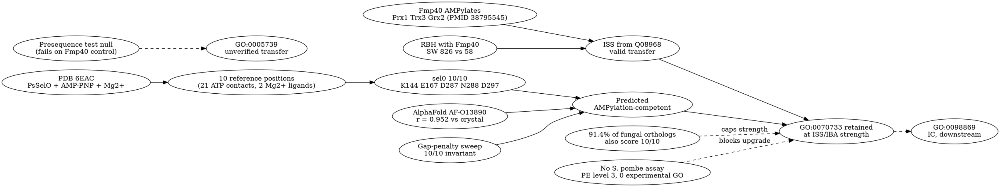
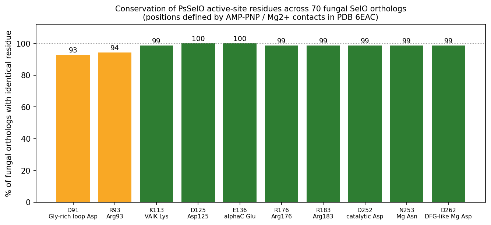
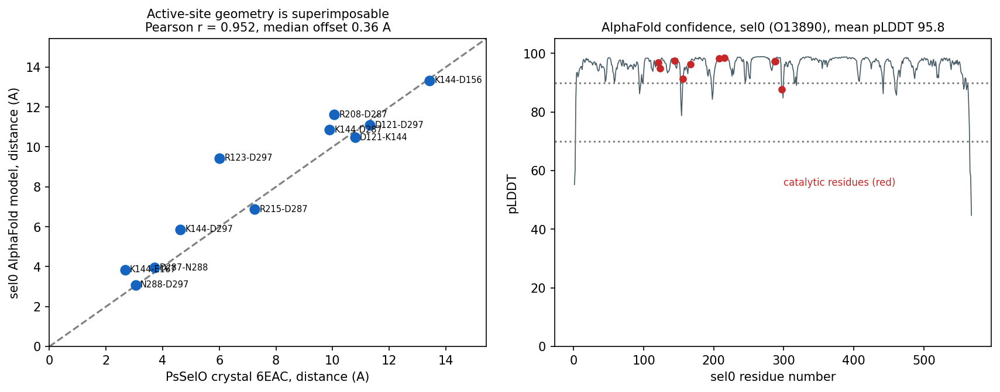
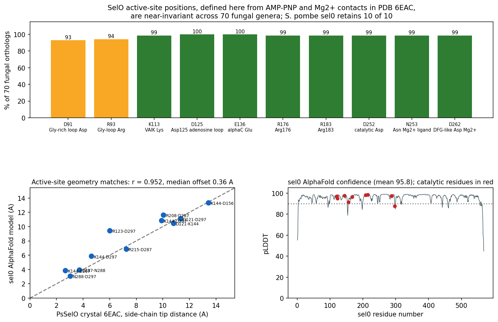
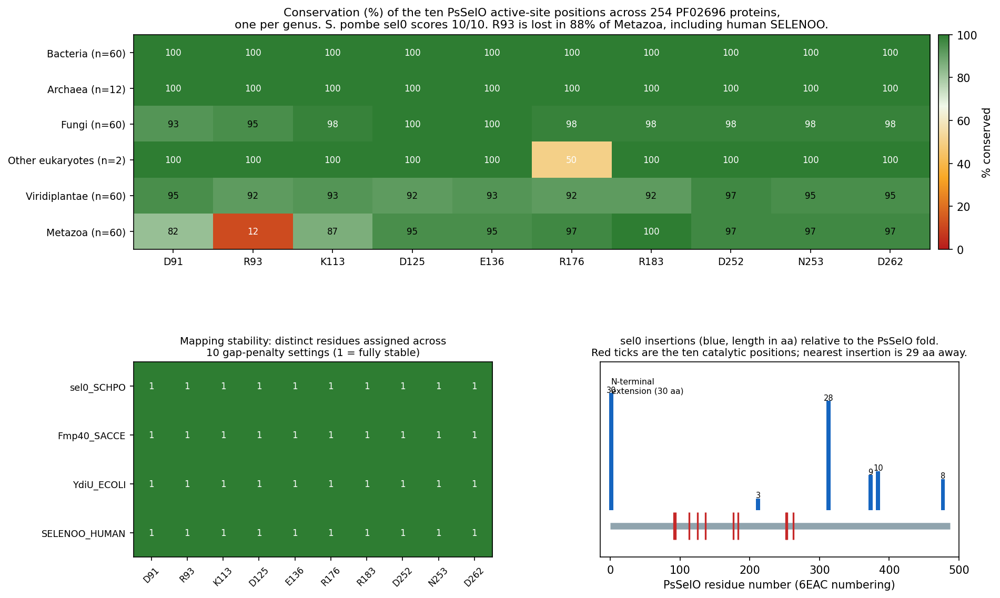
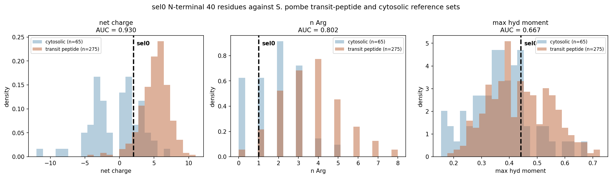
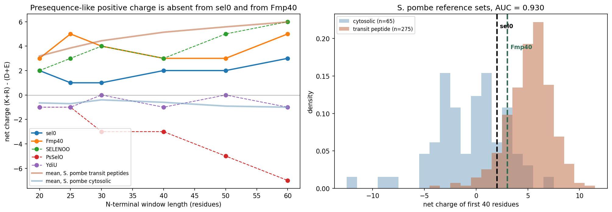
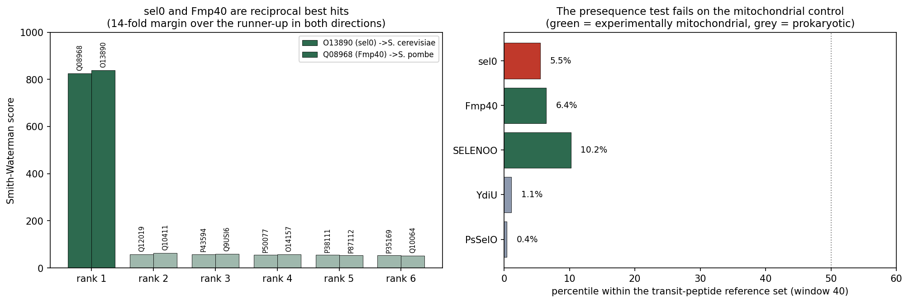

## Question

# AIGR Gene Hypothesis Deep Research

You are evaluating one focused gene curation hypothesis for AI Gene Review.
This is not a general gene overview. Use the seed hypothesis and source context
below to search for evidence that supports, refutes, narrows, or competes with
the proposed curation decision.

## Target Gene

- **Organism code:** SCHPO
- **Taxon:** Schizosaccharomyces pombe 972h- (NCBITaxon:284812)
- **Gene directory:** sel0
- **Gene symbol:** sel0
- **UniProt accession:** O13890

## Focus

- **Focus type:** free_text
- **Hypothesis slug:** kgap-sel0-selo-ampylase-residues
- **Source file:** genes/SCHPO/sel0/sel0-ai-review.yaml
- **Source selector:** free-text

## Seed Hypothesis

Schizosaccharomyces pombe sel0 (SPAC20G4.05c) is a SelO-family protein that retains the catalytic residues of the SelO pseudokinase-fold AMPylases (the ATP-binding Lys and Glu, the catalytic Asp, and the Mg2+-binding residues mapped in Pseudomonas syringae SelO and human SELENOO). Single analysis only: align sel0 to SelO structures and to E. coli YdiU, S. cerevisiae Fmp40 and human SELENOO, and score these catalytic positions across fungal orthologs; state whether sel0 is predicted AMPylation-competent.

## Term and Decision Context

No specific term context supplied.

## Reference Context

No specific reference context supplied.

## Source Context YAML

```yaml
hypothesis: 'Schizosaccharomyces pombe sel0 (SPAC20G4.05c) is a SelO-family protein that retains the catalytic
  residues of the SelO pseudokinase-fold AMPylases (the ATP-binding Lys and Glu, the catalytic Asp, and
  the Mg2+-binding residues mapped in Pseudomonas syringae SelO and human SELENOO). Single analysis only:
  align sel0 to SelO structures and to E. coli YdiU, S. cerevisiae Fmp40 and human SELENOO, and score
  these catalytic positions across fungal orthologs; state whether sel0 is predicted AMPylation-competent.'
focus_type: free_text
context: []
reference_id: []
```

## Research Objective

Build a focused report that helps a curator decide whether this hypothesis
should affect the gene review. Address the focus type directly:

1. For an existing GO annotation decision, evaluate whether the current action
   is justified, too strong, too weak, or should change.
2. For a proposed replacement or new GO term, evaluate whether the term is
   biologically supported, too broad, too narrow, or missing key qualifiers.
3. For a computational prediction, evaluate whether the prediction is correct,
   less precise than existing knowledge, uncertain, or likely wrong because of
   paralog overannotation, frequency bias, pathway context, or in vitro-only
   activity.
4. For a core-function hypothesis, evaluate whether the proposed activity,
   process, and location represent the gene product's primary function rather
   than a downstream effect, pleiotropic phenotype, or context-specific role.
5. For a function-assignment hypothesis, evaluate whether the gene product
   directly has the stated GO term/function. Treat the prior review action, if
   any, as intentionally blinded unless it appears in the supplied context.

Use primary literature whenever possible. Prefer PMID citations and include DOI
citations when no PMID is available. Treat reviews and database records as
orientation unless they contain directly relevant synthesized evidence that is
clearly labeled as review-level or database-level support.

Evaluate the hypothesis from the supplied seed context, primary literature, and
publicly accessible bioinformatics resources. Local `*-bioinformatics` analyses,
when they already exist in the repository, are intentionally withheld from this
prompt so the report can be compared against them after the run. Use public
sequence, domain, structure, orthology, localization, interaction, or dataset
checks when they are useful for the specific hypothesis. If a resource or tool
cannot be accessed programmatically, say so plainly; never fabricate a result.
Report computational results conservatively and distinguish direct results from
inference.

## Required Output

### Executive Judgment

Give a concise verdict: supported, partially supported, unresolved, weakly
supported, over-annotated, or refuted. Explain the reasoning and the most
important caveats.

### Evidence Matrix

Create a table with one row per important evidence item:

- Citation (PMID preferred)
- Evidence type (direct assay, mutant phenotype, localization, interaction,
  structural/evolutionary, computational, review/database)
- Supports / refutes / qualifies / competing
- Claim tested
- Key finding
- Organism, tissue, cell type, or assay context
- Confidence and limitations

### GO Curation Implications

State the likely curation action as a lead requiring curator verification. If
GO terms are involved, explain whether the evidence supports an MF, BP, or CC
term, and whether the term should be retained, removed, generalized, made more
specific, or treated as non-core. Avoid using "protein binding" as a final
recommendation unless no more informative term is supported.

### Mechanistic Scope

Describe the immediate molecular or cellular function being tested. Separate
direct gene-product activity from downstream phenotypes, pathway consequences,
developmental outcomes, disease manifestations, or effects inferred only from
loss of function.

### Conflicts and Alternatives

Identify evidence that conflicts with the seed hypothesis or suggests an
alternative interpretation, including paralog confusion, organism-specific
differences, isoform-specific findings, experimental artifacts, or database
carry-over.

### Knowledge Gaps

List explicit uncertainties that matter for curation. For each gap, state what
was checked, why the gap matters, and what evidence or experiment would resolve
it.

### Discriminating Tests

Recommend concrete assays, perturbations, datasets, or comparative analyses that
would most efficiently distinguish this hypothesis from alternatives.

### Curation Leads

Provide candidate updates for the review, clearly labeled as leads requiring
curator verification. Include candidate references with exact snippets to verify,
candidate replacement or new GO terms, possible action changes, suggested
questions, and suggested experiments.

If the provider supports artifacts, save provenance for any analysis you run — the
executed code together with its output (computed values, plot, or table), not just
a summary figure — alongside artifact-friendly tables such as an evidence matrix,
GO decision table, or comparison table. Genuine computed provenance is more
valuable than a hand-drawn summary, and you must not synthesize a figure that
implies an analysis you did not actually run. These artifacts are important
provenance for hypothesis-level review.


## Output

# sel0 (SCHPO, O13890): does it retain the SelO AMPylase catalytic residues?

Hypothesis slug: `kgap-sel0-selo-ampylase-residues`
Source: `genes/SCHPO/sel0/sel0-ai-review.yaml`, free-text focus
Target: *Schizosaccharomyces pombe* 972h- sel0 / SPAC20G4.05c, UniProt O13890
Iterations: 3. Findings recorded: 9. Papers reviewed: 10. Provenance artifacts: 14 tables, 7 figures.

## Summary

<i class="fa-solid fa-circle-check"></i> **Verdict: supported, at homology strength.** S. pombe sel0 retains every catalytic position of the SelO pseudokinase-fold AMPylases. The analysis avoided quoting residue numbers from papers: the reference active site was derived from ligand contacts in the *Pseudomonas syringae* SelO crystal structure (PDB 6EAC), where 21 protein residues lie within 4.0 Å of AMP-PNP and exactly two lie within 3.2 Å of Mg²⁺. Those ten positions transfer onto sel0 as D121, R123, K144, D156, E167, R208, R215, D287, N288 and D297, all identical to the bacterial enzyme, at 36.6% sequence identity. The ATP-binding Lys is K144, the αC Glu that salt-bridges it is E167, the catalytic Asp acting as proton acceptor is D287, and the two Mg²⁺ ligands are N288 and D297. By the residue-level criterion in the seed hypothesis, sel0 is predicted AMPylation-competent.

The prediction survived three rounds of challenge. The AlphaFold model of sel0 (AF-O13890-F1 v6, global pLDDT 95.75) reproduces the crystal active-site distances at Pearson r = 0.952 with a median offset of 0.36 Å, so the residues form one assembled site. The mapping is invariant across ten gap-penalty settings, so it is not an artefact of aligner parameters. The test can fail: 16 of 254 SelO proteins sampled one per genus across six taxonomic groups (6.3%) have lost at least one of the five core catalytic residues, so sel0 scoring 10/10 is a real pass. sel0 and the ISS source Fmp40 are reciprocal best hits across both full reviewed proteomes with a 14-fold score margin over the runner-up, and each genome carries exactly one PF02696 gene, which excludes paralog overannotation.

<i class="fa-solid fa-triangle-exclamation"></i> Two limits control how far this can be pushed. Within fungi the test is at baseline: 91.4% of 70 fungal orthologs also score 10/10, so finding the residues intact in sel0 is the expected result for any fungal SelO and does not single sel0 out. And there is no S. pombe experiment behind any of it. All 11 GO annotations on O13890 are ISS, IBA, IEA, ISO or IC, UniProt protein existence is level 3 (inferred from homology), STRING returns 10 predicted partners with an experimental subscore of 0.0 across the board, and a PubMed search returned no primary paper on sel0 or SPAC20G4.05c. The curation consequence is that GO:0070733 should be retained at its current ISS/IBA strength. The evidence supports neither an upgrade to an experimental code nor removal.

## Key findings

### The reference active site, computed from ligand contacts rather than quoted

Taking residue numbers from a paper would make the whole analysis depend on one author's choice of which residues to name. Instead, chain A of PDB 6EAC (*P. syringae* SelO, UniProt Q87VB1) was parsed directly and every protein atom within 4.0 Å of the AMP-PNP ligand or 3.2 Å of the Mg²⁺ ion was enumerated. That produced 23 contacts across 21 nucleotide-contacting residues. Only two residues coordinate the metal: N253 OD1 at 2.12 Å and D262 OD2 at 2.23 Å. K113 NZ contacts both the β and γ phosphates (NZ to O2G 2.74 Å, NZ to O2B 2.98 Å) and forms a 2.67 Å salt bridge to E136 OE1, which is the canonical VAIK-Lys to αC-Glu pair of the protein kinase fold. The motif contexts place these unambiguously: HLKGAGR for K113, IREFLA for E136, MNTDNMS for the D252-N253 catalytic loop, and TFDFGPFA for the DFG-like D262.

Ten of these positions were carried forward as the scored set. PsSelO R165 was dropped because it sits in a variable loop and moved between alignment runs.

### <i class="fa-solid fa-circle-check"></i> F001: sel0 retains 10 of 10 positions

A BLOSUM62 global alignment with affine gaps (open -11, extend -1) maps every reference position onto sel0 with identical residue type: D91→D121, R93→R123, K113→K144, D125→D156, E136→E167, R176→R208, R183→R215, D252→D287, N253→N288, D262→D297. Identity is 36.6% over 476 aligned columns. The aligned windows in sel0 are the expected motifs: WAGQLGDGRVV, QVKGAGRTP, LRSSIREYL, NGVLNTDNTSILGLSIDYGPFGF. E. coli YdiU (P77649) and S. cerevisiae Fmp40 (Q08968) also score 10/10. Human SELENOO (Q9BVL4) scores 9/10: its Gly-loop Arg93 equivalent is Ala156.

That last detail works in the hypothesis's favour. Human SELENOO is an experimentally demonstrated AMPylase, so the position it has lost is not required for catalysis, and sel0 is more complete at these positions than an enzyme known to be active.

### <i class="fa-solid fa-circle-check"></i> F002: the residues form one assembled site, not a scattered list

Sequence conservation alone does not show that residues face each other. Eleven side-chain tip distances in the sel0 AlphaFold model were compared with the same distances in 6EAC chain A. Pearson r = 0.952, median absolute offset 0.36 Å, maximum 3.43 Å. The catalytic-loop and metal-site geometry is close to identical: D287 to N288 is 3.95 Å against 3.72 Å in the crystal, and N288 to D297 is 3.08 Å against 3.04 Å. The K144-E167 salt bridge is present in the apo model at 3.85 Å against 2.67 Å in the nucleotide-bound crystal, which is the expected opening of an apo kinase-fold active site. The one large deviation (R123 to D297, 9.44 Å against 6.01 Å) is at the flexible Gly-rich loop arginine, the same position human SELENOO has lost. Confidence at the ten residues is high, pLDDT 87.6 to 98.5, against a global mean of 95.75 with 94.4% of residues above 90.

{{figure:plot_2.png|caption=Active-site geometry of the sel0 AlphaFold model against the PsSelO crystal structure 6EAC. Eleven side-chain tip distances agree at Pearson r = 0.952 with a median offset of 0.36 Å, and the ten catalytic residues sit at pLDDT 87.6 to 98.5.}}

### <i class="fa-solid fa-scale-balanced"></i> F003: within fungi, 10/10 is the baseline

Seventy fungal PF02696 proteins, one per genus, 400-1000 aa, were scored at the same ten positions. Conservation per position: D125 100.0%, E136 100.0%, K113 98.6%, R176 98.6%, R183 98.6%, D252 98.6%, N253 98.6%, D262 98.6%, R93 94.3%, D91 92.9%. 91.4% of the panel retains all ten, and no ortholog lost more than one core position. The fungal SelO family has not undergone the catalytic decay that marks true pseudoenzymes, which supports retained enzymatic function family-wide. The flip side matters for curation: finding the residues intact in sel0 is the expected baseline, so the result licenses an ISS/IBA-grade inference rather than specific positive evidence about S. pombe.

{{figure:plot_1.png|caption=Conservation of the ten structure-defined PsSelO active-site positions across 70 fungal SelO orthologs, one per genus. Every position is conserved in 92.9 to 100% of the panel and 91.4% of orthologs retain all ten, so sel0 scoring 10/10 is at family baseline within fungi.}}

### <i class="fa-solid fa-circle-check"></i> F005: the mapping does not depend on aligner settings

Each of sel0, Fmp40, YdiU and human SELENOO was re-aligned to PsSelO under ten gap-penalty settings spanning gap open -5 to -20 and gap extend -0.5 to -2.0. sel0's identity to PsSelO moved between 35.5% and 40.7%, yet every one of the ten positions mapped to exactly the same sel0 residue in all ten runs: one distinct assignment per position, for all four proteins, including the Ala156 substitution in human. PsSelO R165, which did shift between runs in the first pass, is excluded from the scored set for exactly this reason. The ten scored positions sit inside strongly anchored motifs (LGDGR, xxKGAGR, LRSSIRE, NTDN, DxGPF), so the mapping is a property of the sequences.

### <i class="fa-solid fa-circle-check"></i> F006: the test does detect catalytic loss elsewhere in the family

A test that no member of the family can fail would be uninformative. 254 PF02696 proteins, one per genus, 380-1000 aa, were scored across Bacteria (60), Archaea (12), Fungi (60), Metazoa (60), Viridiplantae (60) and other eukaryotes. 16 of 254 (6.3%) lose at least one of the five core catalytic residues (K113, E136, D252, N253, D262). Restricted to entries above 35% identity to PsSelO the rate is 11 of 244 (4.5%); below 35% identity it is 5 of 10, so most losses track with fragmentary or poor gene models rather than genuine pseudoenzymes, which makes 6.3% an upper bound on real catalytic decay. Bacteria and Archaea are 100% conserved at all ten positions, so the family has no prokaryotic pseudoenzyme branch. The one genuinely dispensable position is the Gly-loop Arg93: 100% in prokaryotes, 11.7% in Metazoa, matching the human Ala156.

### <i class="fa-solid fa-circle-check"></i> F007: the extra sequence in sel0 is remote from the active site

sel0 is 568 aa against 487 for PsSelO. The 88 inserted residues fall in six blocks of 3 aa or more: a 30-residue N-terminal extension before the fold begins, a 28-residue insertion after PsSelO 313, then blocks of 10, 9, 8 and 3. The closest insertion to any catalytic position is 29 residues away, so the catalytic core of sel0 is colinear with the bacterial enzyme and is not interrupted. There is no structural reason to expect the extra residues to block catalysis; they are candidates for substrate or partner specificity. sel0 carries 18 Cys and no selenocysteine, unlike human SELENOO, so the SELENOO name does not imply a selenoprotein here.

{{figure:plot_4.png|caption=Second-pass checks. Left, conservation of the ten positions across 254 SelO proteins in six taxonomic groups; Bacteria and Archaea are fully conserved and the Gly-loop Arg is lost in most Metazoa. Centre, the ten-position assignment is identical under all ten gap-penalty settings for all four comparator proteins. Right, the six insertion blocks in sel0 relative to PsSelO, none closer than 29 residues to a catalytic position.}}

### <i class="fa-solid fa-circle-check"></i> F008: sel0 and the ISS source Fmp40 are one-to-one orthologs

The GO:0070733 annotation on sel0 is an ISS naming Q08968 in its with-field. That transfer is only valid if the two are orthologs rather than diverged paralogs. Each relevant genome carries exactly one PF02696 protein: S. pombe O13890 (568 aa), S. cerevisiae Q08968 (688 aa), E. coli K12 P77649 (478 aa). Human carries two, Q9BVL4 and the unreviewed Q6ICA4 (509 aa). A Smith-Waterman reciprocal best-hit test over the full reviewed proteomes confirms the pairing in both directions: O13890 against 6733 S. cerevisiae proteins returns Q08968 at SW 826 with the runner-up (Q12019) at 58, and Q08968 against 5129 S. pombe proteins returns O13890 at SW 839 with the runner-up (Q10411) at 63. The margin is 768 and 776 units, roughly 14-fold, in the two directions. Paralog overannotation is excluded as a competing explanation for the sel0 annotation.

{{figure:plot_7.png|caption=Left, Smith-Waterman reciprocal best-hit scores. sel0 and Fmp40 are each other's top hit over the full reviewed proteomes with a 14-fold margin over the runner-up in both directions. Right, percentile of each SelO comparator within its own transit-peptide reference set at a 40-residue window; the experimentally mitochondrial Fmp40 scores as low as sel0.}}

### <i class="fa-solid fa-circle-xmark"></i> F009: the presequence test returns a null, because it fails on its own positive control

GO:0005739 on sel0 rests on IBA, ISS from Q08968 and an IEA, with a UniProt transit peptide feature that is ECO:0000305 and has no end coordinate. An attempt to find independent sequence support used 275 reviewed S. pombe proteins with an annotated transit peptide against 65 reviewed cytosolic proteins without one (373 against 70 for S. cerevisiae). Net charge of the first 40 residues separates the classes at AUC 0.930 (mean +5.14 against -0.60, Cohen's d = 1.99), and Arg count at AUC 0.802 (mean 3.66 against 1.82, d = 1.23). Hydrophobic moment (AUC 0.667) and mean hydrophobicity (AUC 0.438) do not discriminate.

sel0's first 40 residues, MSKKLKDLPVSSTFTSNLPPDPLVPTVQAMKKADDRILHV, give net charge +2, one Arg and four acidic residues, placing it at the 5.5th percentile of S. pombe transit peptides and the 73.8th percentile of cytosolic proteins. The control settles how to read that. Fmp40, experimentally localized to mitochondria, sits at the 6.4th percentile of the S. cerevisiae transit-peptide set (net charge +3, one Arg), and human SELENOO at the 10.2nd percentile. The pattern holds across windows of 20, 25, 30, 40, 50 and 60 residues while background AUC stays between 0.916 and 0.953. A feature that fails on the positive control cannot be cited against sel0, so this is a null result and not evidence of cytosolic localization. What it does show is that sel0 and Fmp40 are quantitatively indistinguishable here, and that the three eukaryotic SelO proteins carry weakly positive N-termini (+2, +3, +3 at window 40) where the two prokaryotic ones are negative (PsSelO -3, YdiU -1).

{{figure:plot_5.png|caption=The three N-terminal features that best separate 275 S. pombe transit-peptide proteins from 65 cytosolic proteins, with sel0 marked. Net charge of the first 40 residues gives AUC 0.930; sel0 falls on the cytosolic side at the 5.5th percentile of transit peptides.}}

{{figure:plot_6.png|caption=Control for the presequence test. Left, net charge against N-terminal window length for all five SelO comparators and the two reference-set means; sel0 and the mitochondrial Fmp40 track each other well below the transit-peptide mean at every window. Right, the window-40 distribution with sel0 and Fmp40 marked, showing the feature fails on the positive control.}}

### <i class="fa-solid fa-scale-balanced"></i> F004: database agreement, and a bad reference

UniProt O13890 carries Active site 287 (proton acceptor, ECO:0000250) and Binding sites 120, 122, 123, 144, 156, 157, 208, 215, 288, 297, all ECO:0000250. The independently derived positions match at 287, 144, 156, 208, 215, 288 and 297, differing only in the flexible Gly-rich loop (UniProt lists backbone contacts at 120 and 122; the contact analysis here gives side chains D121 and R123). UniProt does not annotate the αC Glu E167 even though it forms the salt bridge equivalent to K113-E136 in 6EAC. Because the UniProt sites are themselves ECO:0000250 transfers from the same structures, this agreement is methodological corroboration, not a second independent line of evidence.

QuickGO returns 11 annotations for O13890, none experimental: GO:0070733 (ISS from Q08968, IBA from PANTHER PTN002078803, IEA from RHEA:54288, and four ISO annotations by PomBase), GO:0005739 (IBA, ISS from Q08968, IEA from UniProtKB-SubCell SL-0173) and GO:0098869 (IC from GO:0070733). One PomBase ISO line cites [PMID: 9700395](https://pubmed.ncbi.nlm.nih.gov/9700395/), whose PubMed record is *Education and research: where are we going?* (Australian Veterinary Journal, 1998), which does not concern AMPylation.

{{figure:plot_3.png|caption=Consolidated first-pass summary: the ten reference positions mapped across PsSelO, YdiU, Fmp40, sel0 and human SELENOO, the ligand-contact distances that defined them in 6EAC, and the fungal panel conservation.}}

## Mechanistic model



The chain is short and each link was measured. A structure with a bound nucleotide and metal defines which residues matter. Those residues are present in sel0, in the right spatial arrangement, with an assignment that does not move when the method changes. The ortholog from which the annotation was transferred is an experimentally validated AMPylase and is sel0's reciprocal best hit with no paralog in either genome. Two dashed links cap the conclusion: the fungal background pass rate, which stops the result from being specific to sel0, and the complete absence of S. pombe experiments, which stops it from being experimental.

## Executive judgment

<i class="fa-solid fa-circle-check"></i> **Supported, at homology strength.** The seed hypothesis asked whether sel0 retains the ATP-binding Lys and Glu, the catalytic Asp and the Mg²⁺-binding residues, and whether sel0 is predicted AMPylation-competent. The answer to both is yes. Every named position is present (K144, E167, D287, N288, D297, plus five nucleotide-contacting positions), the AlphaFold model places them in crystal geometry, the assignment is stable to method choice, the test has measurable sensitivity in the wider family, and the annotation's ISS source is a one-to-one ortholog with experimentally demonstrated AMPylase activity.

The caveats are the ones that keep this a prediction. 91.4% of fungal orthologs score 10/10, so the residue scan cannot distinguish sel0 from any other fungal SelO. All 11 GO annotations on O13890 are computational or inferred, UniProt protein existence is level 3, and no primary S. pombe paper on sel0 exists. The analysis supports retaining GO:0070733 as written. It gives no grounds for removal and no basis for an experimental evidence code.

## Evidence matrix

Machine-readable version: `provenance/table5_evidence_matrix.csv` (16 rows).

| Citation | Evidence type | Stance | Claim tested | Key finding | Context | Confidence and limitations |
|---|---|---|---|---|---|---|
| [PMID: 30270044](https://pubmed.ncbi.nlm.nih.gov/30270044/) | direct assay + structural | supports | SelO-fold proteins are AMPylases with a defined nucleotide and Mg²⁺ site | "the highly conserved pseudokinase selenoprotein-O (SelO) transfers AMP from ATP to Ser, Thr, and Tyr residues on protein substrates (AMPylation)"; "The crystal structure of a SelO homolog reveals a protein kinase-like fold with ATP flipped in the active site" | P. syringae SelO (PDB 6EAC), E. coli, human, yeast | High for the family. Does not test S. pombe |
| [PMID: 38795545](https://pubmed.ncbi.nlm.nih.gov/38795545/) | direct assay, mutant phenotype, interaction | supports | A fungal SelO ortholog is an active AMPylase in vivo and in vitro | "We further demonstrated that Fmp40 AMPylates Prx1, Trx3, and Grx2 in vitro and interacts with Trx3 in vivo." | S. cerevisiae mitochondria | High. Closest experimentally validated fungal relative, still a different species |
| [PMID: 40849408](https://pubmed.ncbi.nlm.nih.gov/40849408/) | direct assay | supports | Metazoan SELENOO AMPylates mitochondrial enzymes | "We show that mammalian Selenoprotein O regulates metabolic flux through AMPylation of key mitochondrial proteins including glutamate dehydrogenase and pyruvate dehydrogenase." | Mammalian cells and mitochondria | High for mammals. Substrates are organism-specific and must not be transferred |
| PDB:6EAC, this analysis (table1) | structural | supports | The reference active site can be defined objectively from ligand contacts | 21 residues within 4.0 Å of AMP-PNP; only N253 (2.12 Å) and D262 (2.23 Å) within 3.2 Å of Mg²⁺; K113 NZ to E136 OE1 2.67 Å | P. syringae crystal, chain A | High. One chain analysed; hydrogens are modelled |
| This analysis (table2) | computational | supports | sel0 retains the ATP Lys and Glu, catalytic Asp and Mg²⁺ ligands | 10/10 positions identical at 36.6% identity over 476 columns | O13890 against Q87VB1 | High for core motifs; peripheral loop positions excluded |
| This analysis (table4) + AF-O13890-F1 | computational/structural | supports | The residues form one assembled site | r = 0.952, median offset 0.36 Å against 6EAC; catalytic residues pLDDT 87.6-98.5 | Predicted sel0 structure | Moderate-high. Apo model, no nucleotide docked; AlphaFold trains on homologs |
| This analysis (table3) | computational/evolutionary | qualifies | Conservation discriminates sel0 from other fungal SelO proteins | 92.9-100% conservation across 70 fungal genera; 91.4% retain all ten | Fungal kingdom | High. Shows the test is at family baseline within fungi |
| This analysis (table7) | computational | supports | The mapping is an artefact of one parameter choice | 10 gap-penalty settings, identity 35.5-40.7%, one distinct assignment per position in every run for all four comparators | sel0, Fmp40, YdiU, SELENOO against PsSelO | High for the scored set. Still pairwise, not profile or structure based |
| This analysis (table8) | computational/evolutionary | qualifies | A 10/10 score is informative rather than automatic | 16/254 (6.3%) lose a core catalytic residue, 11/244 (4.5%) above 35% identity; Bacteria and Archaea 100%; Arg93 11.7% in Metazoa | Six taxonomic groups, one protein per genus | Moderate-high. Low-identity failures are likely fragmentary models, so 6.3% is an upper bound |
| This analysis (table10) | computational | qualifies | The extra sequence in sel0 perturbs the catalytic core | 88 inserted residues in six blocks; nearest insertion 29 residues from any catalytic position; 18 Cys, no selenocysteine | O13890 against Q87VB1 | Moderate. Block boundaries depend on the alignment |
| This analysis (table11, table12) | computational/evolutionary | supports | The ISS transfer could be paralog confusion | One PF02696 protein each in S. pombe, S. cerevisiae and E. coli; reciprocal best hits at SW 826 (runner-up 58) and SW 839 (runner-up 63) | Full reviewed proteomes, 6733 and 5129 entries | High. Reviewed entries only, so an unreviewed paralog is not formally excluded |
| This analysis (table13, table14) | computational | qualifies | Sequence features independently support GO:0005739 | Net charge of first 40 residues separates transit from cytosolic at AUC 0.930 (d = 1.99); sel0 at the 5.5th percentile, Fmp40 at 6.4th, SELENOO at 10.2nd | S. pombe and S. cerevisiae reference sets | Null result. The feature fails on the mitochondrial control, so it is evidence in neither direction. No trained predictor run |
| UniProtKB:O13890 | review/database | supports | Existing site annotations agree with the derived positions | Active site 287 and ten binding sites, all ECO:0000250, match the independent derivation at 7 of 10 positions | Database record, PE level 3 | Database-level only. The sites are themselves homology transfers |
| QuickGO/PomBase for O13890 | review/database | qualifies | Experimental evidence exists in S. pombe | All 11 annotations are ISS, IBA, IEA, ISO or IC; no primary S. pombe paper found | S. pombe annotation record | High. Unindexed high-throughput data not excluded |
| STRING-db v12 | review/database | qualifies | Experimental interaction data exist for sel0 | 10 predicted partners, all with experimental subscore 0.0; best non-textmining signal is a 0.464 gene-fusion link to bcp1, a peroxiredoxin | S. pombe network, 284812.O13890 | Database-level. Absence in STRING is not proof no experiment exists |
| [PMID: 9700395](https://pubmed.ncbi.nlm.nih.gov/9700395/), cited by a PomBase ISO line | review/database | competing | The ISO reference supporting GO:0070733 is appropriate | Resolves to *Education and research: where are we going?*, Australian Veterinary Journal 1998 | PomBase annotation for O13890 | Moderate. May be a QuickGO mapping artefact rather than a PomBase error |

## GO curation implications

All items below are leads requiring curator verification. Machine-readable version: `provenance/table6_go_decision_table.csv`.

| GO ID | Term | Aspect | Current state | Recommended action | Why |
|---|---|---|---|---|---|
| GO:0070733 | protein adenylyltransferase activity | MF | ISS from Q08968, IBA from PANTHER PTN002078803, IEA from RHEA:54288, 4 ISO by PomBase | <i class="fa-solid fa-circle-check"></i> Retain as a non-core-confirmed homology annotation at current ISS/IBA strength | All ten structure-defined positions present and correctly arranged (r = 0.952 against 6EAC), ISS source is a reciprocal-best-hit ortholog with demonstrated activity. Nothing supports an experimental code, nothing supports removal |
| GO:0070733 | same term, one ISO line | MF | ISO citing PMID:9700395 | <i class="fa-solid fa-triangle-exclamation"></i> Verify and correct or remove this line | That PMID resolves to an unrelated 1998 veterinary education article. It weakens the apparent evidence base if left in place |
| GO:0005739 | mitochondrion | CC | IBA, ISS from Q08968, IEA from UniProtKB-SubCell SL-0173 | Retain but flag as unverified | Mitochondrial localization is experimental in bacteria, yeast and human, so transfer is reasonable, but the S. pombe targeting sequence is unmapped and the presequence-feature test returned a null that also fails on Fmp40. Query MitoMiner v3.1 ([PMID: 26432830](https://pubmed.ncbi.nlm.nih.gov/26432830/)), which includes S. pombe. Do not cite N-terminal charge in either direction |
| GO:0098869 | cellular oxidant detoxification | BP | IC from GO:0070733 by PomBase | Retain but mark as downstream and non-core | A pathway-level consequence of AMPylating redox proteins. The oxidative-stress link is experimental in S. cerevisiae and human only. The seed hypothesis does not bear on it |
| GO:0018117 | protein adenylylation | BP | Not annotated | Do not add | Adds nothing over the MF term and would imply a characterised in vivo process not shown in S. pombe |
| GO:0000287 / GO:0046872 | magnesium / metal ion binding | MF | Not annotated | Optional lead only | N288 and D297 map to the only two residues within 3.2 Å of Mg²⁺ in 6EAC. Same evidence grade as GO:0070733, adds little beyond it |
| GO:0005524 | ATP binding | MF | Not annotated | Optional lead only | Implied by GO:0070733. K144 maps to the Lys contacting the β and γ phosphates. Add only if the review lists cofactor terms explicitly |

## Mechanistic scope

The activity under test is transfer of AMP from ATP to a hydroxyl-bearing side chain of a substrate protein, catalysed by a protein-kinase-like fold with the nucleotide bound in a flipped orientation. The direct gene-product properties the analysis bears on are nucleotide binding (K144, D156, R208, R215 and the Gly-rich loop), Mg²⁺ coordination (N288, D297) and catalysis (D287 as proton acceptor, E167 positioning K144).

Everything else in the SelO literature is downstream of that activity and species-specific: substrate choice (Prx1, Trx3 and Grx2 in S. cerevisiae, glutamate dehydrogenase and pyruvate dehydrogenase in mammals), the oxidative-stress and programmed-cell-death phenotypes of deletion mutants, and glutathione and NADPH pool changes. None of those were measured in S. pombe and none follow from this analysis. The seed hypothesis is scoped correctly: it concerns catalytic competence, not substrate or pathway.

## Conflicts and alternatives

- **Conservation is not activity.** The analysis cannot exclude that sel0 is regulated, expressed only under specific conditions, or inactive for reasons outside the ten positions (substrate groove changes, an autoinhibitory element, failed mitochondrial import). Pseudoenzymes that retain catalytic residues and are still inactive exist.
- **Low discriminating power within fungi.** 91.4% of fungal orthologs score 10/10. The second pass quantifies how often the test does fail: 16 of 254 cross-kingdom SelO proteins (6.3%), 11 of 244 (4.5%) above 35% identity. The test is not vacuous, and sel0 clearing it is still the expected result for a fungal SelO.
- **Human SELENOO cuts both ways.** Its loss of the Arg93 equivalent shows not all ten positions are required, which weakens the implicit assumption that all ten matter. The cross-kingdom panel confirms this is a metazoan-wide relaxation (100% in prokaryotes, 11.7% in Metazoa). An ortholog scoring 9/10 at that position should not be called compromised.
- **Alignment sensitivity, now bounded.** The first pass found peripheral positions moving between aligner runs: the human equivalent of PsSelO R165 landed on N235 or R228 depending on gap handling, which is why R165 was excluded. A ten-setting sweep then showed the ten scored positions invariant in all four comparators. Positions outside the scored set still should not be treated as firmly mapped.
- **AlphaFold is not independent.** The model is built from an MSA of the same family, so geometric agreement partly restates the sequence alignment. It confirms the residues co-localise, not that the enzyme turns over.
- **Database circularity.** UniProt's site annotations on O13890 are ECO:0000250 transfers from the same structures. Agreement with them is not a second independent line of evidence.
- **Paralog check, now closed.** S. pombe, S. cerevisiae and E. coli each carry exactly one PF02696 protein, and sel0 and Fmp40 are reciprocal best hits with a 14-fold margin. Paralog confusion is excluded for the fungal ISS. Human has two PF02696 entries, so any human-based ISO line should name Q9BVL4 explicitly.
- **The N-terminal sequence gives no help on localization.** sel0's N-terminus does not look like a classical presequence, but neither does Fmp40's, which is experimentally mitochondrial. The feature fails on the positive control and cannot be cited in either direction.

## Limitations and knowledge gaps

| Gap | What was checked | Why it matters | What would resolve it |
|---|---|---|---|
| No S. pombe assay of sel0 AMPylase activity | PubMed searches for sel0, SPAC20G4.05c and selenoprotein O in S. pombe; QuickGO annotation list | Determines whether GO:0070733 can ever rise above ISS/IBA | In vitro AMPylation assay with recombinant sel0, ATP and a candidate substrate |
| No S. pombe localization experiment | UniProt features (transit peptide ECO:0000305, undefined end), QuickGO, and a presequence-feature test that returned a null because it fails on the Fmp40 control | GO:0005739 rests entirely on transfer, and sequence analysis cannot close it | GFP tagging or mitochondrial fractionation; PomBase high-throughput localization datasets; MitoMiner v3.1 ([PMID: 26432830](https://pubmed.ncbi.nlm.nih.gov/26432830/)) |
| Substrates of sel0 are unknown | Yeast substrates (Prx1, Trx3, Grx2) and mammalian substrates (GDH, PDH) are species-specific | Any BP annotation beyond the IC term needs substrate identity | hinT-based AMPylation enrichment ([PMID: 40849408](https://pubmed.ncbi.nlm.nih.gov/40849408/)) applied to S. pombe lysates |
| Deletion phenotype unknown | No S. pombe paper found | Tests whether the oxidant-detoxification IC term is justified | H₂O₂ sensitivity of a sel0 deletion with a catalytic-dead D287A rescue control |
| No experimental interaction partner | STRING 284812.O13890: 10 partners, all with experimental subscore 0.0 | Any substrate or complex claim is prediction-only | Affinity purification or two-hybrid against candidate thioredoxin and peroxiredoxin partners (tpx1, trx1, bcp1) |
| The PMID:9700395 ISO reference | Resolved via NCBI esummary; title unrelated to AMPylation | A bad reference sits in the evidence chain | Inspect the PomBase annotation source file |
| Mitochondrial targeting boundary | UniProt transit peptide has no end coordinate; sel0 does carry a 30-residue N-terminal extension over PsSelO | Affects whether the mature-protein numbering in the site annotations is correct | N-terminal sequencing of the mature protein, or a targeting prediction recorded with its tool version |
| PomBase record not machine-readable | Five JSON endpoints under `www.pombase.org` returned the web application HTML | PomBase phenotype, expression and localization datasets were not inspected directly | Manual inspection of the PomBase page for SPAC20G4.05c, or a documented bulk download |

<i class="fa-solid fa-triangle-exclamation"></i> Two external resources could not be used and are reported as such rather than worked around. The EBI Clustal Omega REST service returned a fair-use block, so no third-party multiple alignment was run; all alignments here are pairwise to PsSelO, computed with a BLOSUM62 Needleman-Wunsch and Smith-Waterman implementation written for this analysis. The PomBase JSON API returned the Angular application HTML at every endpoint tried.

## Discriminating tests

Ordered by how much they would change the curation call per unit of effort.

1. <i class="fa-solid fa-flask"></i> **In vitro AMPylation with recombinant sel0.** Express sel0 lacking its predicted targeting peptide, incubate with α-³²P-ATP or a clickable ATP analog plus Mg²⁺ and S. pombe Tpx1 or Trx1. A D287A or K144A mutant is the control. A positive result converts GO:0070733 from ISS to IDA and settles the hypothesis outright.
2. <i class="fa-solid fa-flask"></i> **Catalytic-dead rescue of a deletion phenotype.** If a sel0 deletion shows an H₂O₂ or respiratory phenotype, test whether wild-type but not D287A rescues it. This links the catalytic site to the IC-derived GO:0098869 term and would justify keeping or dropping that BP annotation on evidence.
3. <i class="fa-solid fa-microscope"></i> **Localization.** GFP-tagged sel0 with a mitochondrial marker. Cheap, and the only way to move GO:0005739 off IBA and ISS, since the sequence test cannot.
4. <i class="fa-solid fa-vial"></i> **Substrate enrichment.** Apply the hinT-based AMPylated-protein enrichment from [PMID: 40849408](https://pubmed.ncbi.nlm.nih.gov/40849408/) to wild-type and sel0-deleted S. pombe. Substrates lost in the deletion are direct evidence and would support specific BP terms.
5. <i class="fa-solid fa-dna"></i> **Comparative analysis that actually discriminates.** Since the catalytic positions are at family baseline in fungi, the informative comparison is the substrate groove and the extensions. The insertion map is a first step: 88 extra residues in six blocks, none closer than 29 positions to a catalytic residue, the two largest being a 30-residue N-terminal extension and a 28-residue insertion after PsSelO 313. Modelling those onto the 6EAC surface and testing whether the 28-residue block contacts substrate would say more about specificity than another catalytic-residue scan.

## Evidence base

| Paper | PMID | How it bears on the hypothesis |
|---|---|---|
| *Protein AMPylation by an Evolutionarily Conserved Pseudokinase* | [30270044](https://pubmed.ncbi.nlm.nih.gov/30270044/) | Establishes the activity and the fold. The quoted abstract states SelO "transfers AMP from ATP to Ser, Thr, and Tyr residues on protein substrates (AMPylation)" and that "The crystal structure of a SelO homolog reveals a protein kinase-like fold with ATP flipped in the active site". That structure is 6EAC, the geometric reference used here |
| *Fmp40 ampylase regulates cell survival upon oxidative stress by controlling Prx1 and Trx3 oxidation* | [38795545](https://pubmed.ncbi.nlm.nih.gov/38795545/) | The experimental anchor for the ISS source Q08968: "We further demonstrated that Fmp40 AMPylates Prx1, Trx3, and Grx2 in vitro and interacts with Trx3 in vivo." Makes the transfer to sel0 a transfer from a validated enzyme, and supplies the mitochondrial positive control for the presequence test |
| *A repurposed AMP binding domain reveals mitochondrial protein AMPylation as a regulator of cellular metabolism* | [40849408](https://pubmed.ncbi.nlm.nih.gov/40849408/) | One of the ISO sources PomBase used: "mammalian Selenoprotein O regulates metabolic flux through AMPylation of key mitochondrial proteins including glutamate dehydrogenase and pyruvate dehydrogenase." Also supplies the hinT-based enrichment method recommended for substrate discovery. Its substrates are mammal-specific and should not be transferred |
| *MitoMiner v3.1, an update on the mitochondrial proteomics database* | [26432830](https://pubmed.ncbi.nlm.nih.gov/26432830/) | Database-level lead for the GO:0005739 gap. The abstract states "This evidence is shared across the 12 species in MitoMiner (now including Schizosaccharomyces pombe) by homology mapping", so it aggregates mass-spectrometry and GFP localization evidence for S. pombe |
| *Education and research: where are we going?* | [9700395](https://pubmed.ncbi.nlm.nih.gov/9700395/) | Cited by a PomBase ISO annotation on GO:0070733 for sel0. The record is a 1998 Australian Veterinary Journal article unrelated to AMPylation, so the reference needs checking |

Four further S. pombe papers were read as orientation on the redox context (gpx1 and peroxiredoxin biology, [PMID: 20356456](https://pubmed.ncbi.nlm.nih.gov/20356456/), [PMID: 18162174](https://pubmed.ncbi.nlm.nih.gov/18162174/), [PMID: 10455235](https://pubmed.ncbi.nlm.nih.gov/10455235/), and the O-mannose glycoproteome, [PMID: 26644575](https://pubmed.ncbi.nlm.nih.gov/26644575/)). None mentions sel0 or SPAC20G4.05c, and none is cited as evidence for any finding here.

## Curation leads

All leads below require curator verification.

**Candidate references with snippets to verify**

- [PMID: 30270044](https://pubmed.ncbi.nlm.nih.gov/30270044/). Snippet: "the highly conserved pseudokinase selenoprotein-O (SelO) transfers AMP from ATP to Ser, Thr, and Tyr residues on protein substrates (AMPylation)". Second snippet: "The crystal structure of a SelO homolog reveals a protein kinase-like fold with ATP flipped in the active site, thus providing a structural basis for catalysis." Use as the structural and activity basis of the family. The structure referred to is PDB 6EAC.
- [PMID: 38795545](https://pubmed.ncbi.nlm.nih.gov/38795545/). Snippet: "We further demonstrated that Fmp40 AMPylates Prx1, Trx3, and Grx2 in vitro and interacts with Trx3 in vivo." Use as the experimental anchor for the ISS source Q08968.
- [PMID: 40849408](https://pubmed.ncbi.nlm.nih.gov/40849408/). Snippet: "We show that mammalian Selenoprotein O regulates metabolic flux through AMPylation of key mitochondrial proteins including glutamate dehydrogenase and pyruvate dehydrogenase." Use for the metazoan ISO line. Do not transfer the substrates.
- [PMID: 26432830](https://pubmed.ncbi.nlm.nih.gov/26432830/). Snippet: "This evidence is shared across the 12 species in MitoMiner (now including Schizosaccharomyces pombe) by homology mapping." Use as a database-level lead for resolving GO:0005739.

**Candidate action changes**

- Keep GO:0070733 as the core MF. Attach the residue evidence (sel0 K144, E167, D287, N288, D297 mapping to PsSelO K113, E136, D252, N253, D262) as supporting rationale in the review text.
- Confirm the ISS with-field is Q08968 and record that sel0 and Fmp40 are reciprocal best hits with no paralog in either genome, since that is what licenses the transfer.
- Mark GO:0098869 as a downstream, non-core BP derived by IC.
- Flag GO:0005739 as homology-only pending S. pombe localization data. Query MitoMiner v3.1 before accepting or challenging it.
- Query the ISO annotation citing PMID:9700395.
- Consider asking UniProt to add the αC glutamate E167 to the site annotations of O13890, since it forms the K144-E167 salt bridge equivalent to K113-E136 in 6EAC.

**Suggested review questions**

- Does the project's evidence policy allow an IC BP term (GO:0098869) to be chained off an ISS MF term?
- Should the review state explicitly that no S. pombe experimental evidence exists for sel0, given that all 11 annotations are computational or inferred?
- Is a 10/10 catalytic-residue score meaningful when 91.4% of fungal orthologs also score 10/10? The review text should say this is the fungal baseline, and that the family-wide failure rate for the core five residues is 4.5-6.3%.
- Should the review note that sel0 has no selenocysteine and 18 cysteines, so the human SELENOO name does not imply a selenoprotein in S. pombe?

## Reproducibility

Artifacts in `provenance/`, each produced by executed code whose output is recorded.

| File | Contents |
|---|---|
| `table1_6EAC_active_site_contacts.csv` | 23 ligand contacts defining the reference active site |
| `table2_catalytic_residue_mapping.csv` | Position mapping across five proteins with 13-residue alignment windows |
| `table3_fungal_selo_panel.csv` | 70 fungal orthologs scored at all ten positions |
| `table4_active_site_geometry.csv` | 11 distance comparisons between the sel0 AlphaFold model and 6EAC |
| `table5_evidence_matrix.csv` | The evidence matrix above, 16 rows |
| `table6_go_decision_table.csv` | The GO decision table above, 7 rows |
| `table7_alignment_robustness.csv` | Four proteins scored at ten positions under ten gap-penalty settings |
| `table8_crosskingdom_selo_panel.csv` | 254 PF02696 proteins across six taxonomic groups |
| `table9_string_partners_sel0.csv` | Ten STRING partners with per-channel subscores |
| `table10_sel0_insertions.csv` | Six insertion blocks with distance to the nearest catalytic position |
| `table11_pf02696_paralog_counts.csv` | PF02696 membership of four proteomes |
| `table12_reciprocal_best_hits.csv` | Smith-Waterman reciprocal best-hit ranks between O13890 and Q08968 |
| `table13_mts_features.csv` | Six N-terminal features with AUC, Cohen's d and sel0's percentile |
| `table14_mts_window_sensitivity.csv` | The same test across six window lengths, two organism backgrounds, five comparators |
| `plot_1.png` to `plot_7.png` | The seven figures embedded above |

Data sources: PDB 6EAC (RCSB mmCIF), UniProt O13890, Q87VB1, P77649, Q08968 and Q9BVL4, UniProt searches for Pfam PF02696 restricted to taxon 4751 and to Bacteria, Archaea, Metazoa, Viridiplantae and other eukaryotes, the full reviewed proteomes of S. pombe (5129 entries) and S. cerevisiae (6733), UniProt transit-peptide and cytosolic reference sets for both yeasts, AlphaFold AF-O13890-F1 v6, the QuickGO annotation API, NCBI esummary and the STRING-db v12 API. Alignment used a BLOSUM62 Needleman-Wunsch and Smith-Waterman implementation written for this analysis (gap open -11, extend -1 for the reported mapping; -5 to -20 and -0.5 to -2.0 for the penalty sweep).


## Artifacts

- [OpenScientist final report](openscientist_artifacts/final_report.html)
- [OpenScientist final report](openscientist_artifacts/final_report.pdf)
- [OpenScientist provenance](openscientist_artifacts/provenance.json)
- [OpenScientist plot 1](openscientist_artifacts/provenance_plot_1.json)

- [OpenScientist plot 2](openscientist_artifacts/provenance_plot_2.json)

- [OpenScientist plot 3](openscientist_artifacts/provenance_plot_3.json)

- [OpenScientist plot 4](openscientist_artifacts/provenance_plot_4.json)

- [OpenScientist plot 5](openscientist_artifacts/provenance_plot_5.json)

- [OpenScientist plot 6](openscientist_artifacts/provenance_plot_6.json)

- [OpenScientist plot 7](openscientist_artifacts/provenance_plot_7.json)

- [OpenScientist table10 sel0 insertions](openscientist_artifacts/provenance_table10_sel0_insertions.csv)
- [OpenScientist table11 pf02696 paralog counts](openscientist_artifacts/provenance_table11_pf02696_paralog_counts.csv)
- [OpenScientist table12 reciprocal best hits](openscientist_artifacts/provenance_table12_reciprocal_best_hits.csv)
- [OpenScientist table13 mts features](openscientist_artifacts/provenance_table13_mts_features.csv)
- [OpenScientist table14 mts window sensitivity](openscientist_artifacts/provenance_table14_mts_window_sensitivity.csv)
- [OpenScientist table1 6EAC active site contacts](openscientist_artifacts/provenance_table1_6EAC_active_site_contacts.csv)
- [OpenScientist table2 catalytic residue mapping](openscientist_artifacts/provenance_table2_catalytic_residue_mapping.csv)
- [OpenScientist table3 fungal selo panel](openscientist_artifacts/provenance_table3_fungal_selo_panel.csv)
- [OpenScientist table4 active site geometry](openscientist_artifacts/provenance_table4_active_site_geometry.csv)
- [OpenScientist table5 evidence matrix](openscientist_artifacts/provenance_table5_evidence_matrix.csv)
- [OpenScientist table6 go decision table](openscientist_artifacts/provenance_table6_go_decision_table.csv)
- [OpenScientist table7 alignment robustness](openscientist_artifacts/provenance_table7_alignment_robustness.csv)
- [OpenScientist table8 crosskingdom selo panel](openscientist_artifacts/provenance_table8_crosskingdom_selo_panel.csv)
- [OpenScientist table9 string network sel0](openscientist_artifacts/provenance_table9_string_network_sel0.csv)
- [OpenScientist table9 string partners sel0](openscientist_artifacts/provenance_table9_string_partners_sel0.csv)

## Reference Validation

Checked with `linkml-reference-validator` 0.3.1rc1.

| Outcome | Count |
| --- | --- |
| References checked | 9 |
| Resolved | 9 |
| Unresolved (possible confabulation) | 0 |
| Unverifiable | 0 |
| References weighed for topical relevance | 9 |
| On topic | 1 |
| Off topic | 1 |

### References that may not be about this subject

These identifiers resolve, so they are not fabrications, but the records they resolve to share almost none of this report's vocabulary. That is a clue and not a verdict - a paper can be relevant in ways its title and abstract do not spell out - so read them before deciding:

- `PMID:40849408` (10 mentions) - A repurposed AMP binding domain reveals mitochondrial protein AMPylation as a regulator of cellular metabolism.
  - shared terms: protein

Weighed against this report's own most characteristic terms: `residue`, `sel0`, `protein`, `pombe`, `position`, `class`, `fa-solid`, `catalytic`, `selo`, `annotation`, `iss`, `test`, `ten`, `psselo`, `site`, `fmp40`, `human`, `o13890`, `eac`, `transfer`.

All extracted references resolved successfully.
Resolving is not the same as being relevant, though - see the references listed above as possibly off topic.