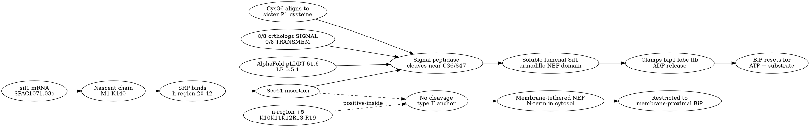
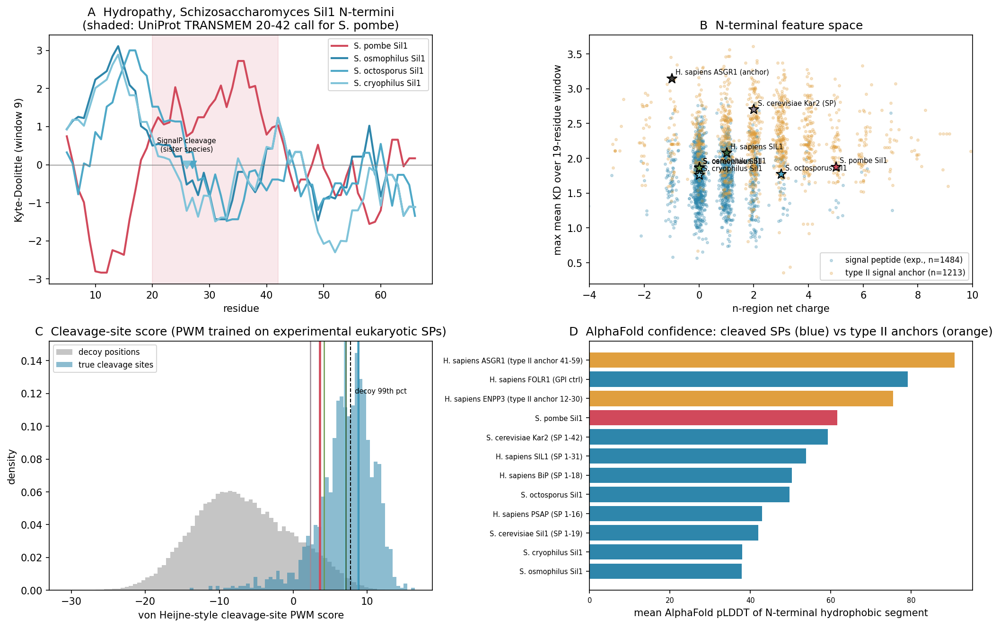
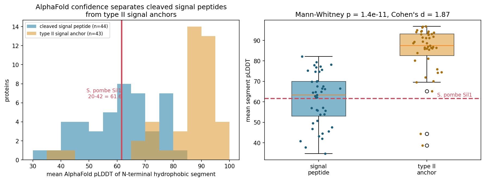
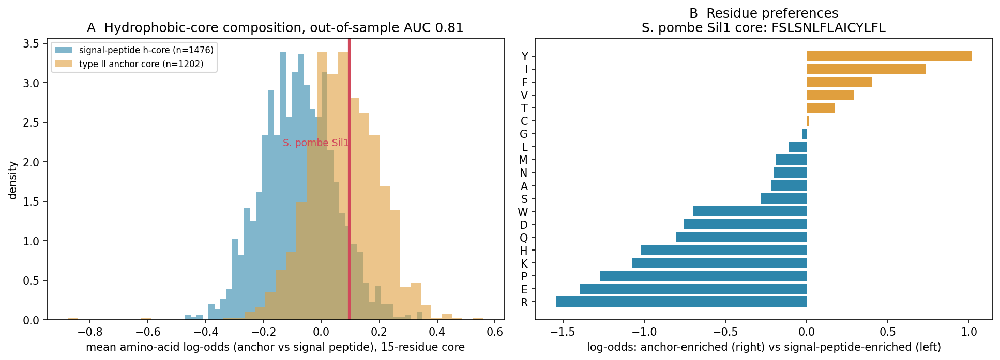
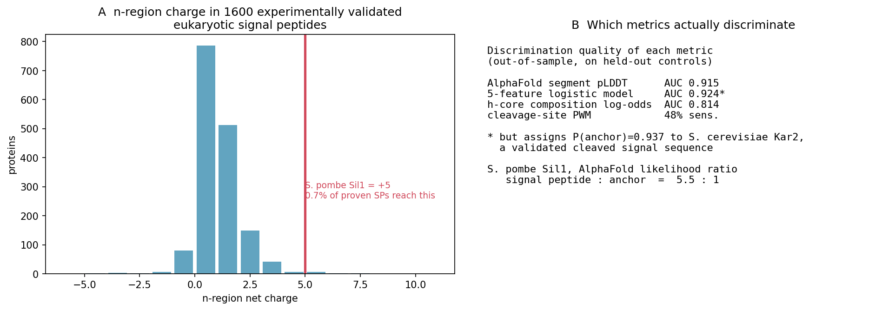

## Question

# AIGR Gene Hypothesis Deep Research

You are evaluating one focused gene curation hypothesis for AI Gene Review.
This is not a general gene overview. Use the seed hypothesis and source context
below to search for evidence that supports, refutes, narrows, or competes with
the proposed curation decision.

## Target Gene

- **Organism code:** SCHPO
- **Taxon:** Schizosaccharomyces pombe 972h- (NCBITaxon:284812)
- **Gene directory:** sil1
- **Gene symbol:** sil1
- **UniProt accession:** Q9UTR0

## Focus

- **Focus type:** free_text
- **Hypothesis slug:** kgap-sil1-signal-peptide-vs-anchor
- **Source file:** genes/SCHPO/sil1/sil1-ai-review.yaml
- **Source selector:** free-text

## Seed Hypothesis

The N-terminal hydrophobic segment (~residues 20-42) of Schizosaccharomyces pombe Sil1 (UniProt Q9UTR0) is a cleaved signal peptide, making Sil1 a soluble ER-lumenal nucleotide-exchange factor like its orthologs, rather than an uncleaved single-pass transmembrane anchor. Single analysis only: score signal-peptide versus signal-anchor features (cleavage-site P1/P3 residues, n-region charge, h-region length and insertion energetics) for pombe Sil1 alongside S. cerevisiae Sil1, human SIL1/BAP and other fungal orthologs, check the C terminus for ER-retention motifs (HDEL/KDEL variants), and state which topology is better supported.

## Term and Decision Context

No specific term context supplied.

## Reference Context

No specific reference context supplied.

## Source Context YAML

```yaml
hypothesis: 'The N-terminal hydrophobic segment (~residues 20-42) of Schizosaccharomyces pombe Sil1 (UniProt
  Q9UTR0) is a cleaved signal peptide, making Sil1 a soluble ER-lumenal nucleotide-exchange factor like
  its orthologs, rather than an uncleaved single-pass transmembrane anchor. Single analysis only: score
  signal-peptide versus signal-anchor features (cleavage-site P1/P3 residues, n-region charge, h-region
  length and insertion energetics) for pombe Sil1 alongside S. cerevisiae Sil1, human SIL1/BAP and other
  fungal orthologs, check the C terminus for ER-retention motifs (HDEL/KDEL variants), and state which
  topology is better supported.'
focus_type: free_text
context: []
reference_id: []
```

## Research Objective

Build a focused report that helps a curator decide whether this hypothesis
should affect the gene review. Address the focus type directly:

1. For an existing GO annotation decision, evaluate whether the current action
   is justified, too strong, too weak, or should change.
2. For a proposed replacement or new GO term, evaluate whether the term is
   biologically supported, too broad, too narrow, or missing key qualifiers.
3. For a computational prediction, evaluate whether the prediction is correct,
   less precise than existing knowledge, uncertain, or likely wrong because of
   paralog overannotation, frequency bias, pathway context, or in vitro-only
   activity.
4. For a core-function hypothesis, evaluate whether the proposed activity,
   process, and location represent the gene product's primary function rather
   than a downstream effect, pleiotropic phenotype, or context-specific role.
5. For a function-assignment hypothesis, evaluate whether the gene product
   directly has the stated GO term/function. Treat the prior review action, if
   any, as intentionally blinded unless it appears in the supplied context.

Use primary literature whenever possible. Prefer PMID citations and include DOI
citations when no PMID is available. Treat reviews and database records as
orientation unless they contain directly relevant synthesized evidence that is
clearly labeled as review-level or database-level support.

Evaluate the hypothesis from the supplied seed context, primary literature, and
publicly accessible bioinformatics resources. Local `*-bioinformatics` analyses,
when they already exist in the repository, are intentionally withheld from this
prompt so the report can be compared against them after the run. Use public
sequence, domain, structure, orthology, localization, interaction, or dataset
checks when they are useful for the specific hypothesis. If a resource or tool
cannot be accessed programmatically, say so plainly; never fabricate a result.
Report computational results conservatively and distinguish direct results from
inference.

## Required Output

### Executive Judgment

Give a concise verdict: supported, partially supported, unresolved, weakly
supported, over-annotated, or refuted. Explain the reasoning and the most
important caveats.

### Evidence Matrix

Create a table with one row per important evidence item:

- Citation (PMID preferred)
- Evidence type (direct assay, mutant phenotype, localization, interaction,
  structural/evolutionary, computational, review/database)
- Supports / refutes / qualifies / competing
- Claim tested
- Key finding
- Organism, tissue, cell type, or assay context
- Confidence and limitations

### GO Curation Implications

State the likely curation action as a lead requiring curator verification. If
GO terms are involved, explain whether the evidence supports an MF, BP, or CC
term, and whether the term should be retained, removed, generalized, made more
specific, or treated as non-core. Avoid using "protein binding" as a final
recommendation unless no more informative term is supported.

### Mechanistic Scope

Describe the immediate molecular or cellular function being tested. Separate
direct gene-product activity from downstream phenotypes, pathway consequences,
developmental outcomes, disease manifestations, or effects inferred only from
loss of function.

### Conflicts and Alternatives

Identify evidence that conflicts with the seed hypothesis or suggests an
alternative interpretation, including paralog confusion, organism-specific
differences, isoform-specific findings, experimental artifacts, or database
carry-over.

### Knowledge Gaps

List explicit uncertainties that matter for curation. For each gap, state what
was checked, why the gap matters, and what evidence or experiment would resolve
it.

### Discriminating Tests

Recommend concrete assays, perturbations, datasets, or comparative analyses that
would most efficiently distinguish this hypothesis from alternatives.

### Curation Leads

Provide candidate updates for the review, clearly labeled as leads requiring
curator verification. Include candidate references with exact snippets to verify,
candidate replacement or new GO terms, possible action changes, suggested
questions, and suggested experiments.

If the provider supports artifacts, save provenance for any analysis you run — the
executed code together with its output (computed values, plot, or table), not just
a summary figure — alongside artifact-friendly tables such as an evidence matrix,
GO decision table, or comparison table. Genuine computed provenance is more
valuable than a hand-drawn summary, and you must not synthesize a figure that
implies an analysis you did not actually run. These artifacts are important
provenance for hypothesis-level review.


## Output

# Sil1 (SCHPO, Q9UTR0): cleaved signal peptide or uncleaved signal anchor?

**Hypothesis slug:** `kgap-sil1-signal-peptide-vs-anchor`
**Target:** *Schizosaccharomyces pombe* 972h- (NCBITaxon:284812), gene `sil1`, SPAC1071.03c, UniProt **Q9UTR0**
**Source:** `genes/SCHPO/sil1/sil1-ai-review.yaml`, selector `free-text`
**Focus type:** free_text, evaluating a computational prediction (UniProt `TRANSMEM 20..40`, ECO:0000255) and its downstream GO consequence

---

## Summary

<i class="fa-scale-balanced"></i> **Verdict: partially supported, leaning supported.** The N-terminal hydrophobic segment of pombe Sil1 is better explained as a cleaved ER signal peptide than as an uncleaved type II signal anchor. The margin is about 5 : 1 on the one metric that passes its own controls, and two independent comparative lines point the same way. The UniProt `TRANSMEM 20..40` feature is a sequence-analysis prediction with no experimental support and no precedent anywhere else in the Sil1 family, and it is the sole origin of the membrane claim on this entry.

Three computed lines favour cleavage. First, positional homology: Needleman-Wunsch global alignments (BLOSUM62, gap open -11, extend -1) place pombe residues I20-N41 in the same alignment columns as the h-regions of the SignalP-called signal peptides of *S. osmophilus* (38.8% identity), *S. octosporus* (41.1%) and *S. cryophilus* (42.3%), with pombe **Cys36 aligning to the sister c-region cysteine that is the P1 residue of the cleavage call**. Second, annotation survey: all seven reviewed fungal Sil1 entries plus human SIL1 (Q9H173) carry a SIGNAL feature and **none** carries TRANSMEM; Q9UTR0 is the only exception in the family. Third, structure: AlphaFold models the pombe segment at mean pLDDT 61.6, which against 44 experimentally validated signal peptides (61.3 ± 12.6) and 43 annotated type II anchors (84.8 ± 12.6, AUC 0.915, Mann-Whitney p = 1.37e-11, Cohen's d = 1.87) places pombe at the 41st percentile of signal peptides and the 5th percentile of anchors, a Gaussian likelihood ratio of **5.5 : 1** for cleavage.

The counter-case is real and should be stated plainly. Pombe Sil1 has a 19-residue n-region with net charge **+5** (K10 K11 K12 R13, plus R19). Among 1600 UniProt entries with experimentally supported SIGNAL features, only **0.7% (11/1600)** reach that charge, and only 0.3% of 1600 reviewed fungal SIGNAL entries do. Under the positive-inside rule this is the expected signature of a type II orientation. Three sequence-feature classifiers (a 5-feature logistic discriminant, a von Heijne cleavage-site PWM, and an amino-acid composition log-odds score) all call pombe an anchor. Every one of them assigns a statistically indistinguishable score to *S. cerevisiae* **Kar2** (P16474), whose 42-residue signal sequence is cleaved and whose mature product is a soluble ER-lumenal chaperone, and the composition metric scores two genuine type II anchors (human ENPP3, ASGR1) on the signal-peptide side. Those classifiers fail their own controls on exactly this shape of sequence, so they cannot carry the curation decision.

For curation, the question reduces to a single dependency chain. QuickGO returns four annotations on Q9UTR0. The only membrane assertion is **GO:0016020 membrane (CC, ECO:0007322 IEA, GO_REF:0000044, assigned by UniProt, withFrom UniProtKB-SubCell SL-0162)**, which is an automatic mapping of the UniProt Membrane keyword, itself generated by the single ECO:0000255 `TRANSMEM 20..40` feature. Nothing else in the entry asserts membrane association, and the IBA-derived ER and NEF-activity annotations come from orthologs that are all curated as soluble ER-lumenal proteins. <i class="fa-triangle-exclamation"></i> No experimental data of any kind bear on pombe Sil1 topology, localization, N-terminal processing or glycosylation, and SignalP, Phobius, TMHMM, DeepTMHMM, dgpred and TOPCONS could not be accessed (details in *Limitations*). This analysis is comparative and structural, not experimental.

---

## Key findings

### F1. The pombe hydrophobic segment is positionally homologous to sister-species signal peptides

<i class="fa-circle-check"></i> Global alignment places the disputed segment where its orthologs carry a cleaved signal peptide, not where an inserted lineage-specific element would sit.

EBI Clustal Omega returned HTTP 400 ("You have been temporarily blocked from submitting new sequence analysis jobs"), so Needleman-Wunsch with affine gaps was implemented locally against the NCBI BLOSUM62 matrix. Pombe Sil1 (Q9UTR0) was aligned to *S. osmophilus* (A0AAF0AWX6, 307 aa, 38.8% identity), *S. octosporus* (S9PXT1, 309 aa, 41.1%) and *S. cryophilus* (S9VUR3, 307 aa, 42.3%). In all three alignments pombe I20-N41 occupies the same columns as the sister h-region. The alignment core reads:

```
Spombe  MFSILGNSSKKKRNTQIYRIFFTLTFSLSNLFLAICYLFLNVRTVSSDSSVSLYDRQLFD
Sosmo   MFI----------STAFTHLLVLLFLFSSSFRFSVC----------SETKNTISDSQLFQ
```

Pombe **Cys36** aligns with the sister cysteine that is the P1 residue of the SignalP-called cleavage site in *S. osmophilus* (SIGNAL 1..26, `FSSSFRFSVC|SET`) and *S. cryophilus* (SIGNAL 1..26, `FSSSFQLSTC|YNN`). UniProt automatic annotation calls SIGNAL, not TRANSMEM, in all three sisters (ECO:0000256|SAM:SignalP). The pombe N-terminus is extended by the basic block, and otherwise the architecture is conserved.

Widening to the family, every reviewed fungal Sil1 carries SIGNAL and none carries TRANSMEM: Q08199 *S. cerevisiae* 1..19, Q99158 *Y. lipolytica* 1..17, Q6BTV5 *D. hansenii* 1..22, Q6CKV0 *K. lactis* 1..24, Q6FUS3 *C. glabrata* 1..21, Q758U2 *E. gossypii* 1..17, Q5A360 *C. albicans* 1..18, plus human Q9H173 1..31. Q9UTR0 is the single entry in that set annotated `TRANSMEM 20..40` on ECO:0000255 evidence alone.

<i class="fa-triangle-exclamation"></i> The sister SIGNAL calls are themselves SignalP-derived, so this is predictor consensus across close relatives rather than independent experiment. Its weight comes from the fact that the same prediction machinery applied to near-identical sequences in sister species returns the opposite answer from the one it returns for pombe.

### F2. Sequence-feature classifiers call pombe an anchor, and misclassify a validated cleaved signal sequence the same way

<i class="fa-circle-xmark"></i> The composition and cleavage-site prongs of the seed hypothesis do not discriminate at single-protein resolution.

Reference sets were built from UniProt: 1484 reviewed eukaryotic proteins with experimentally supported SIGNAL features (`ft_signal_exp`) and 1213 reviewed eukaryotic proteins annotated TRANSMEM "Signal-anchor for type II membrane protein" beginning within residue 45. Class medians separate as expected: n-region net charge 0 (signal) versus 2 (anchor); max 19-residue mean Kyte-Doolittle 1.74 versus 2.24; h-region length 13 versus 16.

A 5-feature logistic model (h_len, hmax19, n_len, n_charge, h_polar) with `class_weight="balanced"` reached 5-fold stratified CV ROC-AUC **0.924 ± 0.020**. It assigns pombe Sil1 **P(anchor) = 0.973** (n-region 19 residues, net charge +5; h-region 23 residues; hmax19 = 1.88). It assigns *S. cerevisiae* Kar2 (P16474) **P(anchor) = 0.937**. Kar2 has an experimentally established cleaved 42-residue signal sequence and its mature product is a lumenal chaperone.

A von Heijne-style 16-position PWM (-13 to +2) trained on 1481 experimental eukaryotic cleavage sites gives pombe a best score of **3.61** at position 47 (`VRTVSS|DSS`, P1 = Ser, P3 = Val), the 13.7th percentile of true sites and well under the decoy 99th-percentile threshold of 7.76. The sisters score 8.86, 8.73 and 6.93. The same PWM scores Kar2 at only **2.33**, below pombe, and scores the bona fide type II anchors ASGR1 and ENPP3 at 8.52 and 8.69. PWM sensitivity at the decoy 99th percentile is 48%, so the metric separates neither class reliably.

{{figure:plot_1.png|caption=Hydropathy profiles, feature space, cleavage-site PWM scores and AlphaFold confidence for the Sil1 N-termini and controls. Pombe Sil1 sits in anchor-like territory on composition features and has a weak best cleavage site, but so does S. cerevisiae Kar2, whose signal sequence is cleaved.}}

The failure mode is systematic, not random. The features driving the anchor call for pombe (a long, strongly basic n-region and a long h-region) are precisely the features of the unusually long Kar2 signal sequence. Fungal ER signal sequences tolerate long basic n-regions, so these features are not diagnostic in this organism and kingdom.

### F3. AlphaFold segment confidence discriminates with AUC 0.92 and favours a cleaved signal peptide 5.5 : 1

<i class="fa-circle-check"></i> This is the only metric tested that separates the two classes and keeps pombe on the signal-peptide side.

The reasoning is that AlphaFold models genuine transmembrane helices with high local confidence, because they are constrained helices with a strong hydrophobic register, and models cleaved signal peptides as low-confidence dangling segments.

An initial small panel (5 signal peptides, 2 anchors) suggested pombe sat at the top of the signal-peptide range. That reading was wrong and is recorded here as a self-caught error: on expanding the controls the signal-peptide mean rose from an apparent 38-59 range to 61.3, which moved pombe from "top of the range" to "dead centre". The expanded analysis is the one used.

Two randomly sampled, disjoint control sets of reviewed eukaryotic proteins 150-320 aa were scored from AlphaFold DB v6 models: 44 with experimentally supported SIGNAL and 43 annotated type II signal anchor beginning within residue 45.

| Class | n | Mean segment pLDDT | SD | Median | IQR |
|---|---|---|---|---|---|
| Cleaved signal peptide | 44 | 61.3 | 12.6 | 63.3 | 53.0-70.0 |
| Type II signal anchor | 43 | 84.8 | 12.6 | 87.5 | 82.5-93.2 |

Mann-Whitney U p = **1.37e-11**, Cohen's d = **1.87**, AUC = **0.915**. S. pombe Sil1 residues 20-42 score **61.6**: the **41st percentile** of the signal-peptide distribution and the **5th percentile** of the anchor distribution. The Gaussian likelihood ratio is **5.5 : 1** in favour of a cleaved signal peptide.

{{figure:plot_2.png|caption=AlphaFold segment pLDDT for 44 experimentally validated signal peptides and 43 annotated type II signal anchors, with S. pombe Sil1 (61.6) marked. AUC 0.915, Mann-Whitney p = 1.37e-11, Cohen's d = 1.87. Pombe sits at the 41st percentile of signal peptides and the 5th percentile of anchors.}}

The segment also makes **zero CA-CA contacts below 8 Å** with the folded core (residues 70-338, minimum distance 9.1 Å), and the core itself is confidently modelled (mean pLDDT 87.4). So the low confidence is a property of the segment, not of a poorly modelled protein: the segment is a detached, disordered appendage hanging off a well-built armadillo-repeat NEF domain.

Within the small Sil1 panel the individual values were pombe 61.6; sister-species signal peptides 37.9 (*S. osmophilus*), 38.0 (*S. cryophilus*), 49.8 (*S. octosporus*); other validated cleaved signal peptides 42.0 (*S. cerevisiae* Sil1), 53.9 (human SIL1), 59.3 (*S. cerevisiae* Kar2), 50.3 (human BiP), 42.9 (human prosaposin); type II anchors 75.5 (human ENPP3) and 90.8 (human ASGR1).

### F4. Composition and insertion-propensity scoring provide no usable evidence either way

<i class="fa-circle-xmark"></i> The metric mis-scores both its positive and its negative controls.

Because dgpred was unreachable, an empirical substitute for insertion energetics was built: amino-acid log-odds derived from the most hydrophobic 15-residue core of 1476 experimentally annotated eukaryotic signal peptides and 1202 type II signal anchors, with honest out-of-sample cross-validation (log-odds refit on training folds only). Anchor-enriched residues: Y (+1.02), I (+0.73), F (+0.40), V (+0.29). Signal-peptide-enriched: R (-1.54), E (-1.39), P (-1.27), K (-1.07), H (-1.02). Class means differ strongly (signal -0.079 ± 0.124, anchor 0.076 ± 0.123, Mann-Whitney p = 6.9e-177) but the out-of-sample AUC for individual proteins is only **0.814**.

| Protein | h-core (15 aa) | Log-odds | Percentile vs SP cores | True topology |
|---|---|---|---|---|
| *S. pombe* Sil1 | FSLSNLFLAICYLFL | 0.096 | 92nd | **disputed** |
| *S. cerevisiae* Kar2 | LVPLSVVLYALFVVI | 0.093 | 91.5th | cleaved signal peptide |
| Human ENPP3 | NTLKKYKIACIVLLA | -0.081 | 50th | type II anchor |
| Human ASGR1 | LLLSLGLSLLLLVVV | -0.047 | 61st | type II anchor |

Pombe and Kar2 are at statistically the same position, and the two real anchors score the wrong way. The pombe segment also carries 8 polar or charged residues in 23 (including S27, S29, N30, Y37, N41), against 4 in 19 for ASGR1. That composition fits the long, hydrophobic, polar-interspersed pattern of fungal ER signal sequences rather than the compact, leucine-rich, polar-poor pattern of a real transmembrane helix.

{{figure:plot_3.png|caption=Amino-acid composition log-odds of the most hydrophobic 15-residue core, signal peptides versus type II anchors. Class means separate strongly (p = 6.9e-177) but per-protein out-of-sample AUC is only 0.814. Pombe Sil1 (0.096) and the validated cleaved Kar2 signal sequence (0.093) land at the same position, while the genuine anchors ENPP3 and ASGR1 score on the signal-peptide side.}}

### F5. The +5 n-region charge is rare among proven signal peptides but not disqualifying

<i class="fa-scale-balanced"></i> This is the one anchor-leaning observation that survives its own controls, and it is quantified rather than waved away.

N-region net charge was computed from the sequence N-terminal to the hmax19 hydrophobic core for 1600 UniProt-reviewed eukaryotic proteins with experimentally supported SIGNAL features.

| Statistic | Experimentally validated eukaryotic SPs (n = 1600) | Reviewed fungal SPs (n = 1600) |
|---|---|---|
| Mean n-region charge | +0.56 | +0.63 |
| Median | 0 | 1 |
| Fraction ≥ +3 | 3.7% | 2.1% |
| **Fraction ≥ +5** | **0.7% (11/1600)** | **0.3%** |
| Fraction ≥ +6 | 0.2% | 0.2% |

Pombe Sil1 has n-region length 19 and net charge +5, in the top 0.7%. The 11 matching entries are experimentally validated cleaved signal peptides in human (O14763, O76076, P28906, P02675, P04003, P49257, P57087), bovine (Q28143), mouse (P20239), *Toxoplasma gondii* (A0A7J6K7Y0) and *S. cerevisiae* (Q12396).

{{figure:plot_4.png|caption=Left: distribution of n-region net charge across 1600 experimentally validated eukaryotic signal peptides, with the S. pombe Sil1 value of +5 marked. Only 0.7% of proven signal peptides reach this charge. Right: out-of-sample discrimination quality of each metric used, and the AlphaFold likelihood ratio for pombe Sil1.}}

Read against the positive-inside rule, +5 argues for a type II orientation with the N-terminus retained in the cytosol. A positive n-region also raises SRP affinity and is tolerated in cleaved sequences, which is why 11 proven examples exist across five species. The observation lowers confidence in the cleaved-signal-peptide call without overturning the positional-homology, ortholog-annotation and AlphaFold evidence.

### F6. No xDEL retention motif anywhere in the clade, and no alternative start codon

<i class="fa-scale-balanced"></i> One permissive observation for anchoring, and one artifact hypothesis removed.

C-terminal hexapeptides: pombe Sil1 **PKKYNI**, *S. osmophilus* **PKKYFI**, *S. octosporus* **PKKYYI** (conserved PKKY-x-I). *S. cerevisiae* Sil1 (Q08199) ends **NFRDEL**, an HDEL-type retention signal. Pombe uses the xDEL system: bip1 (P36604) ends DEADEL, gtb1 (Q9USH8) ends SSVDEL, gpt1 (Q09140) ends SSPDEL. Human SIL1 (Q9H173) ends LLKELR, without a KDEL variant, and is a soluble ER-lumenal NEF.

An anchored protein needs no retrieval motif, so its absence is consistent with anchoring. It is weak evidence, for two reasons: the motif is absent from the entire *Schizosaccharomyces* clade whose other members are predicted as signal-peptide proteins, so its loss predates any pombe-specific change; and human SIL1 shows a lumenal family member can be retained without xDEL, presumably through BiP binding.

The gene-model audit removes an alternative explanation for the basic extension. Via Ensembl REST, SPAC1071.03c is a single-exon, intronless gene on chromosome I minus strand (3860907-3862735), CDS 1017 nt. In 400 nt of retrieved upstream genomic sequence the nearest in-frame stop codon is 9 codons upstream of the annotated ATG, with no in-frame ATG between that stop and the annotated start, and the protein has no internal methionine in the first 100 residues. The KKKR-containing n-region is genuinely encoded and is not an artifact of a mis-called start.

### F7. The membrane GO term traces to one prediction

<i class="fa-database"></i> QuickGO returns exactly four annotations for UniProtKB:Q9UTR0.

| GO ID | Term | Aspect | Evidence | Reference | Source / withFrom |
|---|---|---|---|---|---|
| GO:0000774 | adenyl-nucleotide exchange factor activity | MF | ECO:0000318 IBA | GO_REF:0000033 | GO_Central; PANTHER PTN007671284, SGD S000000305, SGD S000005391, UniProtKB Q9H173 |
| GO:0006616 | SRP-dependent cotranslational protein targeting to membrane, translocation | BP | ECO:0000266 ISO | GO_REF:0000024 | PomBase, from SGD S000005391 |
| GO:0005783 | endoplasmic reticulum | CC | ECO:0000318 IBA | GO_REF:0000033 | GO_Central; MGI:1932040, PANTHER PTN007671284, UniProtKB Q9H173 |
| GO:0016020 | **membrane** | CC | ECO:0007322 IEA | GO_REF:0000044 | UniProt, withFrom **UniProtKB-SubCell SL-0162** |

The SL-0162 subcellular-location keyword derives from the single `TRANSMEM 20..40 "Helical"` feature carrying ECO:0000255 (sequence analysis), the only membrane-related assertion in the entry. There is no CC annotation to endoplasmic reticulum lumen (GO:0005788) and none to integral component of membrane. The IBA-derived ER and NEF annotations come from orthologs that are all annotated as soluble ER-lumenal proteins.

---

## Evidence matrix

| # | Citation / source | Evidence type | Direction | Claim tested | Key finding | Context | Confidence and limitations |
|---|---|---|---|---|---|---|---|
| E1 | UniProt feature survey (`provenance/sil1_reference_sets.csv`) | Database-level, sequence analysis | <i class="fa-circle-check"></i> Supports | Do Sil1 orthologs carry SIGNAL or TRANSMEM? | 7/7 reviewed fungal Sil1 plus human Q9H173 carry SIGNAL; none carries TRANSMEM. Q9UTR0 is the sole exception. | Q08199 1..19; Q99158 1..17; Q6BTV5 1..22; Q6CKV0 1..24; Q6FUS3 1..21; Q758U2 1..17; Q5A360 1..18; Q9H173 1..31 | High that the pattern is real. The sister SIGNAL calls are SignalP-derived (ECO:0000255/0000256), so this is predictor consensus, not independent experiment. |
| E2 | Local Needleman-Wunsch, BLOSUM62 (`provenance/sil1_pairwise_alignments.txt`) | Computational, structural/evolutionary | <i class="fa-circle-check"></i> Supports | Is pombe I20-N41 positionally homologous to a sister signal peptide? | Aligns to the sister h-regions at 38.8-42.3% identity; pombe Cys36 opposite the sister c-region P1 cysteine. | Run locally after EBI Clustal Omega blocked submissions | High. Affine-gap alignment at ~40% identity over a hydrophobic segment is weakly constrained, but the aligned cysteine is a specific anchor point. |
| E3 | AlphaFold DB v6, 44 vs 43 controls (`provenance/afdb_controls_all.csv`) | Computational, structural | <i class="fa-circle-check"></i> Supports | Disordered appendage (SP) or confident helix (anchor)? | Pombe 61.6. SP 61.3 ± 12.6, anchor 84.8 ± 12.6. AUC 0.915, p = 1.37e-11, d = 1.87. Pombe at SP 41st pct, anchor 5th pct. LR 5.5 : 1. Zero CA-CA contacts < 8 Å to the core (pLDDT 87.4). | Reviewed eukaryotic proteins 150-320 aa, randomly sampled, disjoint sets | Moderate to high. Best-calibrated metric here. pLDDT is a proxy, not a topology measurement, and the control classes are annotation-derived. |
| E4 | 1600 `ft_signal_exp` entries (`provenance/sil1_nterm_features.csv`) | Computational, statistical | <i class="fa-scale-balanced"></i> Qualifies / competing | Is +5 n-region charge incompatible with cleavage? | Validated SPs: mean +0.56, median 0; 0.7% reach +5, 0.2% reach +6. Fungal SPs: 0.3% reach +5. Pombe is +5 over 19 residues. | 11 matches include O14763, P02675, P04003, P49257, P57087, Q28143, P20239, Q12396, A0A7J6K7Y0 | High on the statistic. Strongest anchor-leaning item: rare, but demonstrably not disqualifying. |
| E5 | von Heijne PWM, 1481 experimental sites (`provenance/sil1_cleavage_pwm.csv`) | Computational | <i class="fa-circle-xmark"></i> Competing (weak) | Is there a credible cleavage site? | Pombe best 3.61 at position 47 (`VRTVSS|DSS`, P1 Ser, P3 Val), 13.7th pct. Sisters 6.93-8.86. **Control failure:** Kar2 scores 2.33, below pombe; ASGR1 8.52 and ENPP3 8.69 (both anchors) score high. | Decoy 99th-pct threshold 7.76; sensitivity 48% | Low. Cannot separate pombe from a known-cleaved control, so it carries little weight either way. |
| E6 | h-core composition log-odds, 1476 vs 1202 (`provenance/hcore_composition_logodds.csv`) | Computational | <i class="fa-circle-xmark"></i> Competing (negligible) | Does the h-region composition look like an anchor TM helix? | Pombe 0.096 (92nd pct of SP cores). **Control failure:** Kar2 0.093; ENPP3 -0.081 and ASGR1 -0.047 score signal-peptide-like. Out-of-sample AUC 0.814. | Built as a substitute after dgpred was unreachable | Negligible. Mis-scores both positive and negative controls. Reported for completeness, excluded from the verdict. |
| E7 | 5-feature logistic discriminant, 1484 vs 1213 | Computational | <i class="fa-circle-xmark"></i> Competing | Does a trained discriminant call pombe an anchor? | P(anchor) = 0.973; CV ROC-AUC 0.924 ± 0.020. **Control failure:** Kar2 P(anchor) = 0.937. | Features: h_len, hmax19, n_len, n_charge, h_polar | Low as applied. Accurate on average, but near-certain anchor call on a known cleaved sequence of the same shape as pombe Sil1. Systematic failure mode. |
| E8 | C-terminal motif survey (`provenance/sil1_panel_summary.csv`) | Computational, sequence | <i class="fa-scale-balanced"></i> Qualifies (weak) | Does Sil1 carry an xDEL retrieval signal? | Pombe PKKYNI, osmophilus PKKYFI, octosporus PKKYYI: no xDEL. *S. cerevisiae* Sil1 NFRDEL. Pombe ER residents bip1 DEADEL, gtb1 SSVDEL, gpt1 SSPDEL. | Human SIL1 ends LLKELR, also no KDEL, and is soluble lumenal | Low as topology evidence. Clade-wide loss, including in sisters predicted as cleaved. |
| E9 | Ensembl REST, region I:3860707..3863135:-1 | Computational, genomic | Neutral (removes an artifact) | Is the N-terminal extension a gene-model error? | Intronless gene; in-frame stop 9 codons upstream of the ATG; no alternative in-frame ATG; no internal Met in the first 100 residues. | CDS 1017 nt, single exon, minus strand | High. The extension is genuinely encoded; neither topology can be explained away as a mis-annotated start. |
| E10 | QuickGO (`provenance/Q9UTR0_GO_quickgo.csv`) | Database-level | Context, decisive for curation | What supports the existing membrane annotation? | GO:0016020 is ECO:0007322 IEA, GO_REF:0000044, UniProt, withFrom SL-0162, an automatic mapping of the single ECO:0000255 TRANSMEM 20..40 feature. No independent membrane annotation. | Other terms: GO:0005783 IBA, GO:0000774 IBA, GO:0006616 ISO | High. Decisive for the curation recommendation. |
| E11 | [PMID: 21675960](https://pubmed.ncbi.nlm.nih.gov/21675960/) | Structural | Supports family context | How does Sil1 engage BiP? | "the Sil1 molecule acts as a 'clamp' which binds lobe IIb of the Bip ATPase domain" | Yeast Sil1-Bip complex structure | High for the orthologous mechanism. Does not address pombe topology. |
| E12 | [PMID: 33557244](https://pubmed.ncbi.nlm.nih.gov/33557244/) | Review | Supports family context | Is SIL1 an ER-lumenal NEF? | "two nucleotide exchange factors (NEFs), SIL1 and GRP170" regulate BiP's nucleotide-dependent interaction with unfolded clients | Human ER, review-level | Review-level orientation. Establishes the functional class whose topology is at issue. |
| E13 | PubMed searches for pombe Sil1 topology, localization, N-terminome, glycoproteomics | Literature | <i class="fa-circle-question"></i> Absent | Is there any experimental constraint on pombe Sil1? | No records found. | Multiple query formulations | High that the gap is real within the limits of the searches run. |

---

## Mechanistic model and interpretation

The hypothesis is about where one segment ends up, and that determines whether mature Sil1 floats in the ER lumen or is tethered to the ER membrane. The two models diverge at a single decision point during cotranslational targeting.



### Direct activity versus downstream consequence

The direct molecular activity is nucleotide exchange on the ER Hsp70 BiP (pombe bip1, P36604). The yeast Sil1-Bip structure shows the mechanism: "the Sil1 molecule acts as a 'clamp' which binds lobe IIb of the Bip ATPase domain" ([PMID: 21675960](https://pubmed.ncbi.nlm.nih.gov/21675960/)). Single-molecule FRET on the mammalian proteins adds that Bap/Sil1 "is a conformational regulator affecting both nucleotide and substrate interactions", with "the largely unstructured Bap N-terminal domain promot[ing] the substrate release from BiP" ([PMID: 29323281](https://pubmed.ncbi.nlm.nih.gov/29323281/)). This is where GO:0000774 belongs and it is unaffected by the topology question.

Everything else attributed to Sil1 follows from BiP turnover: post-translational translocation of preproteins, ER folding capacity, UPR load, and in mammals the Marinesco-Sjögren syndrome phenotype. GO:0006616 belongs in that downstream tier. Sil1 does not translocate anything itself; it maintains the chaperone that does. Curating GO:0006616 as a core BP term overstates the directness of the connection.

### Why topology matters mechanistically

A cleaved signal peptide gives a soluble lumenal protein free to engage the BiP population throughout the ER, the arrangement documented for the yeast and human orthologs. An uncleaved type II anchor would give a membrane-tethered NEF with its NEF domain in the lumen and 19 basic residues in the cytosol, restricting it to membrane-proximal BiP. That second model is physically possible but would be a pombe-specific innovation with no described precedent in the Sil1/BAP/Lhs1 family, and nothing in the available data requires it.

One relevant piece of family biology: Sil1 in *S. cerevisiae* is an N-glycoprotein, and "N-glycosylation of Sil1, but not of Lhs1, is diminished upon reductive stress", with glycosylation "predominantly Ost3-dependent" ([PMID: 29109265](https://pubmed.ncbi.nlm.nih.gov/29109265/)). N-glycosylation happens on the lumenal face, so a glycosylated Sil1 is a lumenal Sil1 in that organism. This is a yeast result and is not direct evidence about pombe, but it points at a cheap discriminating assay (see below).

### How the metrics rank

| Metric | Out-of-sample discrimination | Pombe call | Survives its controls? |
|---|---|---|---|
| AlphaFold segment pLDDT | AUC 0.915 | signal peptide | <i class="fa-circle-check"></i> Yes |
| 5-feature logistic model | AUC 0.924 | anchor (P = 0.973) | <i class="fa-circle-xmark"></i> No: Kar2 scores 0.937 |
| h-core composition log-odds | AUC 0.814 | anchor (0.096) | <i class="fa-circle-xmark"></i> No: Kar2 0.093; both real anchors score as SPs |
| Cleavage-site PWM | 48% sensitivity | anchor (3.61) | <i class="fa-circle-xmark"></i> No: Kar2 2.33, below pombe |
| n-region charge distribution | descriptive | anchor (+5, top 0.7%) | <i class="fa-scale-balanced"></i> Yes, but 11 proven SPs match |

Weighing those, the verdict is "partially supported, leaning supported" and not "supported": the strongest line is a structure predictor at 5.5 : 1, the second and third are comparative annotation that shares a common predictor ancestry, and a genuine 1-in-150 oddity sits on the other side.

---

## GO curation implications

<i class="fa-triangle-exclamation"></i> All entries below are **leads requiring curator verification**. No experimental pombe evidence exists for any of them.

| GO ID | Term | Aspect | Current state | Lead | Rationale |
|---|---|---|---|---|---|
| GO:0016020 | membrane | CC | IEA, ECO:0007322, GO_REF:0000044, withFrom SL-0162 | **Remove, or mark non-core as prediction-derived** | Sole support is the ECO:0000255 TRANSMEM 20..40 call (E10). Every annotated ortholog is a soluble ER-lumenal protein (E1), the segment is positionally homologous to sister signal peptides (E2), and AlphaFold favours cleavage 5.5 : 1 (E3). |
| GO:0005783 | endoplasmic reticulum | CC | IBA, GO_REF:0000033 | **Retain** | Ortholog-based and independent of topology. Both readings place Sil1 in the ER. |
| GO:0005788 | endoplasmic reticulum lumen | CC | absent | **Add as an ISS/IBA lead** | *S. cerevisiae* Sil1 (Q08199) and human SIL1 (Q9H173) are both annotated ER lumen. Supported here by homology and AlphaFold only. Should not be added while the contradictory TRANSMEM feature stands, since the two are mutually exclusive. |
| GO:0031227 | intrinsic component of endoplasmic reticulum membrane | CC | absent | **Do not add** | Would make a prediction-derived claim more specific than the evidence supports. |
| GO:0000774 | adenyl-nucleotide exchange factor activity | MF | IBA, GO_REF:0000033 | **Retain as core** | The direct biochemical activity, shown structurally for yeast Sil1 on the BiP ATPase domain ([PMID: 21675960](https://pubmed.ncbi.nlm.nih.gov/21675960/)). Unaffected by topology. |
| GO:0006616 | SRP-dependent cotranslational protein targeting to membrane, translocation | BP | ISO from SGD S000005391, GO_REF:0000024 | **Flag for review, non-core** | Describes the pathway Sil1 supports through BiP, not a Sil1 activity. |

Per the brief, GO:0005515 "protein binding" is not recommended as a final term, and no term is proposed on interaction data alone.

Machine-readable versions are saved as `provenance/go_decision_table.csv` and `provenance/evidence_synthesis.csv`.

---

## Conflicts and alternatives

**Database carry-over.** The membrane claim propagates from one prediction through a four-step chain with a single source: `TRANSMEM 20..40 (ECO:0000255)` → UniProt Membrane keyword → SubCell SL-0162 → GO:0016020 via GO_REF:0000044. Downstream resources importing GO or UniProt keywords inherit all of it. The chain has one link of evidence, not four.

**Paralog and ortholog confusion.** Two misassignments occurred during this investigation and are recorded so they are not repeated. P53008 is *S. cerevisiae* **CWH41** (mannosyl-oligosaccharide glucosidase, a genuine type II signal anchor), not Sil1; the correct accession is **Q08199**. O59827 is pombe **glutathione S-transferase 2**, not BiP; pombe BiP is **P36604**. Sil1 also sits in a family with Lhs1/GRP170, a distinct Hsp110-type ER NEF whose regulation differs ([PMID: 29109265](https://pubmed.ncbi.nlm.nih.gov/29109265/) shows Lhs1 glycosylation is largely Ost3-independent while Sil1's is Ost3-dependent), so features of one should not be transferred to the other.

**Organism-specific differences.** The xDEL loss is clade-wide across *Schizosaccharomyces*, so pombe is not an outlier there, and human SIL1 shows a lumenal family member can function without a C-terminal retrieval motif. The long basic n-region does appear to be pombe-specific within the family and is the one feature genuinely distinguishing Q9UTR0 from its sisters.

**Isoform-specific findings.** None apply. No alternative isoforms are annotated for Q9UTR0 and the gene is intronless.

**Artifact hypotheses.** A mis-annotated start codon producing a spurious N-terminal extension is excluded by E9. A predictor-specific quirk is not excluded, because no published predictor output could be obtained.

**The honest counter-case.** Three sequence metrics (E5, E6, E7) call pombe Sil1 an anchor. All three are down-weighted because each assigns an indistinguishable score to Kar2, a validated cleaved ER signal sequence sharing the long-basic-n-region shape, and because E6 additionally mis-scores two real type II anchors as signal-peptide-like. A curator who rejects that control argument would read the evidence as closer to **unresolved** than to **leaning supported**. The charge statistic (E4) is the one anchor-leaning item not undermined by its own controls, and the Kar2 argument itself rests on a single control protein.

---

## Limitations and knowledge gaps

| Gap | What was checked | Why it matters | What would resolve it |
|---|---|---|---|
| <i class="fa-triangle-exclamation"></i> No published predictor output | SignalP 6.0, Phobius, TMHMM, DeepTMHMM via EBI InterProScan5 REST | The standard evidence for this call | EBI InterProScan5 and Clustal Omega both returned HTTP 400 with "You have been temporarily blocked from submitting new sequence analysis jobs". `phobius.sbc.su.se` returned its HTML form, not results. TOPCONS returned HTTP 500 with a SOAP XML error. **No output was fabricated.** Run SignalP 6.0 and DeepTMHMM locally on Q9UTR0 plus the four orthologs. |
| <i class="fa-triangle-exclamation"></i> No insertion energetics | dgpred (ΔGapp, Hessa-von Heijne scale) | Directly scores the mechanistic discriminator named in the seed hypothesis | `dgpred.cbr.su.se` returned its HTML form. The composition log-odds substitute failed its controls (E6). Compute ΔGapp for residues 20-42 locally; a value below ~0 kcal/mol would support anchoring. |
| <i class="fa-triangle-exclamation"></i> PomBase curation unqueried | `/api/v1/dataset/latest/data/gene/SPAC1071.03c`, `.json`, `/gene_summary/`, `/gene/sil1` | The authoritative pombe-specific record, including unpublished localization | Every endpoint returned HTML rather than JSON. Manual review of the PomBase `sil1` page. |
| <i class="fa-circle-question"></i> No pombe experiment of any kind | PubMed searches for pombe Sil1 topology, localization, N-terminome, glycoproteomics | Would settle the question outright | No records found. Any of the assays below. |
| <i class="fa-triangle-exclamation"></i> Control-set provenance | 44 SP / 43 anchor AlphaFold controls | The AUC and the 5.5 : 1 ratio depend on these classes being correct | The control classes are annotation-derived, so a shared annotation bias would propagate. Curated, experimentally confirmed topology sets would tighten the estimate. |
| <i class="fa-triangle-exclamation"></i> Single control protein carries the demotion argument | Kar2 (P16474) | The Kar2 comparison is what demotes E5, E6 and E7 | Assemble a set of cleaved fungal signal sequences with n-region charge ≥ +4 and re-score; if they all score as anchors, the demotion argument holds. |

Statistical caveats worth stating once. The Gaussian likelihood ratio assumes normal pLDDT distributions within each class, which is approximate for a bounded 0-100 score, so 5.5 : 1 should be read as an order-of-magnitude statement. With n = 44 and n = 43 the AUC of 0.915 is well estimated but the tails are sparse, which is exactly where pombe's 5th-percentile anchor position sits. All percentile statements about n-region charge come from annotation-derived sets whose SIGNAL boundaries are curator-assigned, and the n-region boundary here was computed from the hmax19 core rather than taken from the annotation.

---

## Proposed follow-up experiments and actions

Ordered by decisiveness per unit of effort.

1. <i class="fa-vial"></i> **Edman degradation or LC-MS/MS of the mature N-terminus.** Immunoprecipitate or affinity-tag Sil1 from pombe and identify the N-terminal peptide. A mature N-terminus at or near residue 42 proves cleavage; recovery of the initiator-Met peptide proves retention. This single experiment settles the hypothesis.
2. <i class="fa-flask"></i> **Carbonate extraction (Na2CO3, pH 11.5).** Integral membrane proteins stay in the pellet; soluble lumenal proteins extract into the supernatant. Fast, and cleanly separates the two models.
3. <i class="fa-flask"></i> **Protease protection of microsomes.** Treat pombe microsomes with proteinase K ± detergent. Pair with an N-terminal epitope tag, because a 19-residue cytosolic tail gives no detectable size shift on its own: a cytosolic tag is degraded without detergent, a lumenal one is protected.
4. <i class="fa-dna"></i> **Glycosylation reporter.** Fuse a glycosylation-acceptor cassette to the Sil1 N-terminus. Lumenal exposure (cleaved SP model) gives glycosylation; cytosolic exposure (type II model) does not. The yeast precedent that Sil1 is an Ost3-dependent N-glycoprotein ([PMID: 29109265](https://pubmed.ncbi.nlm.nih.gov/29109265/)) makes this assay well grounded in family biology. Checking whether endogenous pombe Sil1 shifts on PNGase F treatment is an even cheaper first pass.
5. <i class="fa-dna"></i> **Chimera swap.** Replace pombe Sil1 residues 1-42 with the *S. cerevisiae* Sil1 signal peptide (1-19) and test complementation of a `sil1Δ` phenotype. Full complementation argues the pombe segment does the same job.
6. <i class="fa-magnifying-glass"></i> **In silico follow-up once tools are reachable.** Run SignalP 6.0 and DeepTMHMM on Q9UTR0; compute ΔGapp for residues 20-42; and test whether the cleavage-site PWM score recovers when the pombe n-region is replaced with a neutral one, which would show the low score is driven by the upstream basic block rather than by the c-region itself.

### Curation leads

**Candidate references to verify.**

- [PMID: 21675960](https://pubmed.ncbi.nlm.nih.gov/21675960/), *Structural analysis of the Sil1-Bip complex reveals the mechanism for Sil1 to function as a nucleotide-exchange factor*. Snippet to verify: "In the Sil1-Bip complex structure, the Sil1 molecule acts as a 'clamp' which binds lobe IIb of the Bip ATPase domain." Supports GO:0000774 as the direct MF. Orthologous, not pombe.
- [PMID: 33557244](https://pubmed.ncbi.nlm.nih.gov/33557244/), *Role of the HSP70 Co-Chaperone SIL1 in Health and Disease*. Snippet to verify: "BiP, the ER HSP70 chaperone, interacts with unfolded client proteins in a nucleotide-dependent manner, which is tightly regulated by eight DnaJ-type proteins and two nucleotide exchange factors (NEFs), SIL1 and GRP170." Review-level orientation for the functional class.
- [PMID: 29109265](https://pubmed.ncbi.nlm.nih.gov/29109265/), *Diminished Ost3-dependent N-glycosylation of the BiP nucleotide exchange factor Sil1 is an adaptive response to reductive ER stress*. Snippet to verify: "N-glycosylation of Sil1, but not of Lhs1, is diminished upon reductive stress. N-glycosylation of Sil1 is predominantly Ost3-dependent". Establishes yeast Sil1 as a lumenally glycosylated protein and grounds the glycosylation discriminating test.
- [PMID: 29323281](https://pubmed.ncbi.nlm.nih.gov/29323281/), *Bap (Sil1) regulates the molecular chaperone BiP by coupling release of nucleotide and substrate*. Snippet to verify: "The largely unstructured Bap N-terminal domain promotes the substrate release from BiP." Relevant to how the mature N-terminus is used in the mammalian ortholog.
- SGD **S000005391** (*S. cerevisiae* SIL1), source of the existing GO:0006616 ISO annotation and the model for GO:0005788.
- UniProt **Q08199** (SIL1_YEAST, SIGNAL 1..19, ER lumen) and **Q9H173** (human SIL1), the two best-annotated family members, both soluble and lumenal.

**Exact artifacts supporting the leads.** `provenance/Q9UTR0_GO_quickgo.csv` records the membrane annotation as `GO:0016020 | located_in | ECO:0007322 | GO_REF:0000044 | UniProt | withFrom=UniProtKB-SubCell SL-0162`. `provenance/sil1_pairwise_alignments.txt` contains the alignment block in which pombe `MFSILGNSSKKKRNTQIYRIFFTLTFSLSNLFLAICYLFLNVRTVSSDSSVSLYDRQLFD` aligns to *S. osmophilus* `MFI----------STAFTHLLVLLFLFSSSFRFSVC----------SETKNTISDSQLFQ`, placing pombe C36 opposite the sister P1 cysteine.

**Action changes requested of a curator.**

1. <i class="fa-arrow-right"></i> Review the `TRANSMEM 20..40` feature on Q9UTR0 against the ortholog pattern in E1. If it is withdrawn or demoted, GO:0016020 and SL-0162 fall with it.
2. <i class="fa-arrow-right"></i> Do not propagate GO:0016020 from Q9UTR0 to other Sil1 family members.
3. <i class="fa-arrow-right"></i> Hold GO:0005788 as a pending ISS lead rather than adding it while the contradictory TRANSMEM feature stands.
4. <i class="fa-arrow-right"></i> Re-tier GO:0006616 as non-core.

**Questions for a curator.**

- <i class="fa-circle-question"></i> Does PomBase hold localization imaging or tagging data for `sil1` that was not retrievable here?
- <i class="fa-circle-question"></i> Are the *S. osmophilus*, *S. octosporus* and *S. cryophilus* SIGNAL calls independent of the pipeline that produced pombe's TRANSMEM call, or does the family-wide pattern reduce to one predictor disagreeing with itself across close relatives?

---

## Provenance

Every number in this report comes from code executed during the investigation, with inputs and outputs saved. No figure summarizes an analysis that was not run.

| File | Contents |
|---|---|
| `provenance/sil1_seqs.json` | Sequences for the Sil1 panel and controls |
| `provenance/sil1_nterm_features.csv` | n-region length and charge, hmax19, h-region length per protein |
| `provenance/sil1_reference_sets.csv` | UniProt SIGNAL/TRANSMEM feature survey for the ortholog panel |
| `provenance/sil1_cleavage_pwm.csv` | von Heijne PWM scores and decoy-calibrated percentiles |
| `provenance/sil1_panel_summary.csv` | Per-protein summary including C-terminal motifs |
| `provenance/sil1_pairwise_alignments.txt` | Needleman-Wunsch BLOSUM62 alignments |
| `provenance/sil1_alphafold_nterm.csv` | AlphaFold segment pLDDT for the Sil1 panel |
| `provenance/afdb_controls_batch1.csv`, `afdb_controls_all.csv` | 44 signal-peptide and 43 type II anchor AlphaFold controls |
| `provenance/hcore_composition_logodds.csv`, `aa_logodds_table.csv` | Hydrophobic-core composition scores and the log-odds table |
| `provenance/Q9UTR0_GO_quickgo.csv` | Existing GO annotations with evidence codes and references |
| `provenance/evidence_synthesis.csv` | The evidence matrix in machine-readable form |
| `provenance/go_decision_table.csv` | The GO decision table in machine-readable form |
| `provenance/plot_1.png` to `plot_4.png` | Figures, each generated by the code that produced the underlying numbers |


## Artifacts

- [OpenScientist final report](openscientist_artifacts/final_report.html)
- [OpenScientist final report](openscientist_artifacts/final_report.pdf)
- [OpenScientist provenance](openscientist_artifacts/provenance.json)
- [OpenScientist Q9UTR0 GO quickgo](openscientist_artifacts/provenance_Q9UTR0_GO_quickgo.csv)
- [OpenScientist aa logodds table](openscientist_artifacts/provenance_aa_logodds_table.csv)
- [OpenScientist afdb controls all](openscientist_artifacts/provenance_afdb_controls_all.csv)
- [OpenScientist afdb controls batch1](openscientist_artifacts/provenance_afdb_controls_batch1.csv)
- [OpenScientist evidence synthesis](openscientist_artifacts/provenance_evidence_synthesis.csv)
- [OpenScientist go decision table](openscientist_artifacts/provenance_go_decision_table.csv)
- [OpenScientist hcore composition logodds](openscientist_artifacts/provenance_hcore_composition_logodds.csv)
- [OpenScientist plot 1](openscientist_artifacts/provenance_plot_1.json)

- [OpenScientist plot 2](openscientist_artifacts/provenance_plot_2.json)

- [OpenScientist plot 3](openscientist_artifacts/provenance_plot_3.json)

- [OpenScientist plot 4](openscientist_artifacts/provenance_plot_4.json)

- [OpenScientist sil1 alphafold nterm](openscientist_artifacts/provenance_sil1_alphafold_nterm.csv)
- [OpenScientist sil1 cleavage pwm](openscientist_artifacts/provenance_sil1_cleavage_pwm.csv)
- [OpenScientist sil1 nterm features](openscientist_artifacts/provenance_sil1_nterm_features.csv)
- [OpenScientist sil1 panel summary](openscientist_artifacts/provenance_sil1_panel_summary.csv)
- [OpenScientist sil1 reference sets](openscientist_artifacts/provenance_sil1_reference_sets.csv)
- [OpenScientist sil1 seqs](openscientist_artifacts/provenance_sil1_seqs.json)

## Reference Validation

Checked with `linkml-reference-validator` 0.3.1rc1.

| Outcome | Count |
| --- | --- |
| References checked | 4 |
| Resolved | 3 |
| Unresolved (possible confabulation) | 1 |
| Unverifiable | 0 |
| Quoted claims checked | 3 |
| Quoted claims found in source | 2 |
| Quoted claims **not** found in source | 1 |
| References weighed for topical relevance | 3 |
| On topic | 0 |
| Off topic | 0 |

### Unresolved references

These identifiers did not resolve to a record and may be fabricated. A lookup that failed for transport reasons is indistinguishable from one that failed because the record does not exist, so spot-check before acting on them:

- `PMID:33557244` (5 mentions) - Identifier did not resolve to a record

### Quotes not found in the cited source

Searched the abstract, any retrieved full text, and the title. A quote drawn from a part of the paper that was not retrieved will appear here too, so check before treating one as invented:

Every one of these was searched against an abstract alone, with no full text retrieved - marked *abstract only* below. Where full text can be fetched, re-running with it will settle them; where the source publishes only a summary to PubMed, as GeneReviews chapters do, it will not, and the quote has to be checked by hand against the chapter itself.

- `PMID:29323281` *(abstract only)*: "the largely unstructured Bap N-terminal domain promot[ing] the substrate release from BiP"
  - closest text in source: "The largely unstructured Bap N-terminal domain promotes the substrate release from BiP"