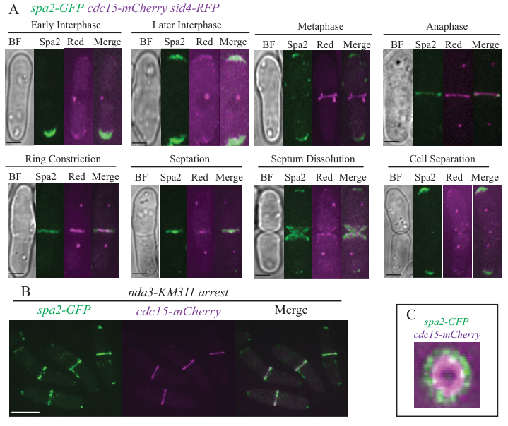

## Question

# Gene Research for Functional Annotation

## ⚠️ CRITICAL: Gene/Protein Identification Context

**BEFORE YOU BEGIN RESEARCH:** You MUST verify you are researching the CORRECT gene/protein. Gene symbols can be ambiguous, especially for less well-characterized genes from non-model organisms.

### Target Gene/Protein Identity (from UniProt):
- **UniProt Accession:** O42869
- **Protein Description:** RecName: Full=Scaffold protein spa2 {ECO:0000305};
- **Gene Information:** Name=spa2 {ECO:0000312|PomBase:SPAC3G9.05}; ORFNames=SPAC3G9.05;
- **Organism (full):** Schizosaccharomyces pombe (strain 972 / ATCC 24843) (Fission yeast).
- **Protein Family:** Not specified in UniProt
- **Key Domains:** GIT_SHD. (IPR013724); Spa2/Sph1. (IPR039892); VBS_C3G9. (IPR056439); GIT_SHD (PF08518); VBS_C3G9 (PF23742)

### MANDATORY VERIFICATION STEPS:

1. **Check if the gene symbol "spa2" matches the protein description above**
2. **Verify the organism is correct:** Schizosaccharomyces pombe (strain 972 / ATCC 24843) (Fission yeast).
3. **Check if protein family/domains align with what you find in literature**
4. **If you find literature for a DIFFERENT gene with the same or similar symbol, STOP**

### If Gene Symbol is Ambiguous or You Cannot Find Relevant Literature:

**DO NOT PROCEED WITH RESEARCH ON A DIFFERENT GENE.** Instead:
- State clearly: "The gene symbol 'spa2' is ambiguous or literature is limited for this specific protein"
- Explain what you found (e.g., "Found extensive literature on a different gene with the same symbol in a different organism")
- Describe the protein based ONLY on the UniProt information provided above
- Suggest that the protein function can be inferred from domain/family information

### Research Target:

Please provide a comprehensive research report on the gene **spa2** (gene ID: spa2, UniProt: O42869) in SCHPO.

The research report should be a detailed narrative explaining the function, biological processes, and localization of the gene product. Citations should be given for all claims.

You should prioritize authoritative reviews and primary scientific literature when conducting research. You can supplement
this with annotations you find in gene/protein databases, but these can be outdated or inaccurate.

We are specifically interested in the primary function of the gene - for enzymes, what reaction is catalyzed, and what is the substrate specificity? For transporters, what is the substrate? For structural proteins or adapters, what is the broader structural role? For signaling molecules, what is the role in the pathway.

We are interested in where in or outside the cell the gene product carries out its function.

We are also interested in the signaling or biochemical pathways in which the gene functions. We are less interested in broad pleiotropic effects, except where these elucidate the precise role.

Include evidence where possible. We are interested in both experimental evidence as well as inference from structure, evolution, or bioinformatic analysis. Precise studies should be prioritized over high-throughput, where available.

## Output

Question: You are an expert researcher providing comprehensive, well-cited information.

Provide detailed information focusing on:
1. Key concepts and definitions with current understanding
2. Recent developments and latest research (prioritize 2023-2024 sources)
3. Current applications and real-world implementations
4. Expert opinions and analysis from authoritative sources
5. Relevant statistics and data from recent studies

Format as a comprehensive research report with proper citations. Include URLs and publication dates where available.
Always prioritize recent, authoritative sources and provide specific citations for all major claims.

# Gene Research for Functional Annotation

## ⚠️ CRITICAL: Gene/Protein Identification Context

**BEFORE YOU BEGIN RESEARCH:** You MUST verify you are researching the CORRECT gene/protein. Gene symbols can be ambiguous, especially for less well-characterized genes from non-model organisms.

### Target Gene/Protein Identity (from UniProt):
- **UniProt Accession:** O42869
- **Protein Description:** RecName: Full=Scaffold protein spa2 {ECO:0000305};
- **Gene Information:** Name=spa2 {ECO:0000312|PomBase:SPAC3G9.05}; ORFNames=SPAC3G9.05;
- **Organism (full):** Schizosaccharomyces pombe (strain 972 / ATCC 24843) (Fission yeast).
- **Protein Family:** Not specified in UniProt
- **Key Domains:** GIT_SHD. (IPR013724); Spa2/Sph1. (IPR039892); VBS_C3G9. (IPR056439); GIT_SHD (PF08518); VBS_C3G9 (PF23742)

### MANDATORY VERIFICATION STEPS:

1. **Check if the gene symbol "spa2" matches the protein description above**
2. **Verify the organism is correct:** Schizosaccharomyces pombe (strain 972 / ATCC 24843) (Fission yeast).
3. **Check if protein family/domains align with what you find in literature**
4. **If you find literature for a DIFFERENT gene with the same or similar symbol, STOP**

### If Gene Symbol is Ambiguous or You Cannot Find Relevant Literature:

**DO NOT PROCEED WITH RESEARCH ON A DIFFERENT GENE.** Instead:
- State clearly: "The gene symbol 'spa2' is ambiguous or literature is limited for this specific protein"
- Explain what you found (e.g., "Found extensive literature on a different gene with the same symbol in a different organism")
- Describe the protein based ONLY on the UniProt information provided above
- Suggest that the protein function can be inferred from domain/family information

### Research Target:

Please provide a comprehensive research report on the gene **spa2** (gene ID: spa2, UniProt: O42869) in SCHPO.

The research report should be a detailed narrative explaining the function, biological processes, and localization of the gene product. Citations should be given for all claims.

You should prioritize authoritative reviews and primary scientific literature when conducting research. You can supplement
this with annotations you find in gene/protein databases, but these can be outdated or inaccurate.

We are specifically interested in the primary function of the gene - for enzymes, what reaction is catalyzed, and what is the substrate specificity? For transporters, what is the substrate? For structural proteins or adapters, what is the broader structural role? For signaling molecules, what is the role in the pathway.

We are interested in where in or outside the cell the gene product carries out its function.

We are also interested in the signaling or biochemical pathways in which the gene functions. We are less interested in broad pleiotropic effects, except where these elucidate the precise role.

Include evidence where possible. We are interested in both experimental evidence as well as inference from structure, evolution, or bioinformatic analysis. Precise studies should be prioritized over high-throughput, where available.

# Functional annotation report: *Schizosaccharomyces pombe* spa2 (O42869)

## Identity and scope

The target is **Spa2 encoded by *S. pombe* spa2/SPAC3G9.05**, not a protein sharing the SPA2 name in budding yeast or another fungus. The supplied UniProt record describes it as a scaffold protein and lists Spa2/Sph1, GIT_SHD and VBS_C3G9 domain signatures. An experimental study explicitly identifies and characterizes *S. pombe* Spa2 as a partner in a cortical protein-interaction network, supporting the scaffold assignment. The domain labels are sequence-based annotations; they do not, by themselves, establish a biochemical activity for this protein. (ren2015thecdc15and pages 1-2, ren2015thecdc15and pages 5-7, ren2015thecdc15and pages 11-12)

**Primary functional conclusion.** Spa2 is a **nonenzymatic, cell-cycle-regulated cortical scaffold** that helps position a protein complex at sites of polarized growth and cell division. Its best-demonstrated output is recruitment or retention of its partner Pos1 at these sites. Spa2 also participates in a Cdc15–Imp2 SH3-domain interaction network associated with cytokinesis and is particularly important for invasive, sustained polarized growth. No catalytic reaction, transported substrate, or experimentally established substrate specificity applies to Spa2. (ren2015thecdc15and pages 8-9, ren2015thecdc15and pages 4-5, ren2015thecdc15and pages 11-12)

## Localization and molecular mechanism

Live imaging of endogenously tagged Spa2 found **bright cortical arcs at the old cell end during early interphase and at both ends after new-end takeoff**. During mitosis it relocates to the medial division site, where it overlaps with Cdc15 and Imp2. Some Spa2 moves with the constricting contractile ring, but much of the signal lies around the Cdc15 ring and along the forming septum. These observations locate its apparent action at the **cell cortex and division plane**, rather than outside the cell. The published microscopy panels provide direct visual evidence of the tip arcs and division-site signal. (ren2015thecdc15and pages 5-7, ren2015thecdc15and pages 4-5, ren2015thecdc15and media 86af0c03)

Measured from spindle-pole-body separation, Spa2 first appeared at the contractile ring at **23.9 ± 3.4 minutes** (*n* = 8), after Imp2 at **19.8 ± 6.2 minutes** (*n* = 11) and near Pos1 at **24.7 ± 2.7 minutes** (*n* = 6). This timing places Spa2 comparatively late in ring maturation, before completion of anaphase B in the reported assay. (ren2015thecdc15and pages 5-7, ren2015thecdc15and pages 4-5, ren2015thecdc15and media 128ae17b)

The strongest mapped recruitment interaction is with the **SH3 domains of the F-BAR proteins Cdc15 and Imp2**. Cdc15-SH3 pull-downs recovered Spa2, Spa2 affinity purification recovered Cdc15 and Imp2, and yeast two-hybrid assays mapped Cdc15-SH3 binding to a Spa2 N-terminal fragment containing a proline-rich motif at residues **188–194**. Substituting alanine for **Pro191** abolished that two-hybrid interaction. Compared in the same microscopy fields with wild-type Spa2, Spa2-P191A accumulated significantly less at tips and rings without an overall decrease in protein abundance; the localization analysis used three biological replicates and at least 200 tip/ring observations. Residual ring localization shows that SH3 binding is an important but **not exclusive** targeting mechanism. (ren2015thecdc15and pages 3-4, ren2015thecdc15and pages 7-8, ren2015thecdc15and pages 5-7, ren2015thecdc15and pages 4-5)

**Pos1 is the clearest demonstrated scaffold client.** Proteomics identified the previously uncharacterized *S. pombe* protein Pos1 (SPAC16E8.08) in Spa2 purifications, and reciprocal tagged-protein purifications supported their association. Pos1 normally occupies tip cortex and the division site; in `spa2Δ` cells, its GFP signal was instead seen only on mitochondria. Conversely, deleting `pos1` did not disrupt Spa2 localization. These results support a directional role for Spa2 in placing Pos1 at morphogenetic sites, although copurification does not by itself prove that the two purified proteins bind directly. (ren2015thecdc15and pages 8-9, ren2015thecdc15and pages 4-5, ren2015thecdc15and pages 11-12)

The following evidence table separates experimentally established findings from a signaling hypothesis.

| Evidence tier | Finding for *S. pombe* Spa2 (O42869) | Experimental basis | Interpretation / limitation |
|---|---|---|---|
| **Direct, strong** | Spa2 occupies bright cortical arcs at one or both cell tips during interphase, then relocates to the division site during cytokinesis and septation. It arrived **23.9 ± 3.4 min after spindle-pole-body separation** (*n* = 8), shortly before Pos1 (**24.7 ± 2.7 min**). | Endogenous Spa2–GFP/mCherry live-cell imaging, cell-cycle markers, time-lapse microscopy, and colocalization with Cdc15 and Imp2. (ren2015thecdc15and pages 5-7, ren2015thecdc15and pages 4-5, ren2015thecdc15and media 86af0c03) | Establishes cell-cycle-regulated localization at sites of polarized growth and division; most Spa2 surrounds the Cdc15 ring and lines the forming septum rather than constricting fully with the ring. |
| **Direct, strong** | Spa2 contains a Cdc15/Imp2-SH3-binding motif at residues **188–194**. Full-length Spa2 and residues 1–219 bound Cdc15-SH3; substituting **P191A** abolished the yeast two-hybrid interaction. | Yeast two-hybrid mapping, Cdc15-SH3 pull-downs, Spa2-TAP proteomics, and reciprocal copurification of Cdc15 and Imp2. (ren2015thecdc15and pages 3-4, ren2015thecdc15and pages 5-7, ren2015thecdc15and pages 4-5) | Supports direct integration of Spa2 into the Cdc15/Imp2 cytokinetic scaffold network. |
| **Direct, strong** | Spa2-P191A retained the correct spatial pattern but accumulated significantly less at cell tips and contractile rings, with the larger effect at tips; total cellular abundance was unchanged. | Wild-type and P191A GFP signals compared in the same fields using reciprocal lectin labeling; **three biological replicates**, *n* ≥ 200 for tip/ring measurements and *n* ≥ 30 per whole-cell condition; localization differences reached **p < 0.0001**. (ren2015thecdc15and pages 7-8, ren2015thecdc15and pages 5-7) | The SH3 interaction is a major localization determinant, but residual ring localization shows that additional, probably indirect, recruitment mechanisms exist. |
| **Direct, strong** | The sequence-orphan protein Pos1 (SPAC16E8.08) is a Spa2-associated protein. Pos1 and Spa2 reciprocally copurified, arrived at the division site nearly simultaneously, and Pos1 localization to tips and the division site required Spa2; in `spa2Δ`, Pos1–GFP remained only on mitochondria. | Spa2-TAP proteomics, reciprocal immunoprecipitation/coproteomics, endogenous fluorescence imaging, and `spa2Δ` dependency tests. (ren2015thecdc15and pages 8-9, ren2015thecdc15and pages 4-5, ren2015thecdc15and pages 11-12) | Provides the clearest evidence that Spa2 functions as a cortical scaffold: it recruits or retains Pos1 at morphogenetic sites. Pos1 is not required for normal Spa2 localization. |
| **Direct phenotype, contextual** | `spa2Δ` abolished agar-invasive pseudohyphal growth and suppressed invasion by `fic1Δ` and `cyk3Δ`; Spa2 overexpression depolarized the actin cytoskeleton and altered growth patterns. | Twenty-day invasion assays on 2% agar and Crn1–GFP imaging after Spa2 overexpression. (ren2015thecdc15and pages 8-9, ren2015thecdc15and pages 11-12) | Spa2 is important when cells adopt sustained unipolar/invasive growth, consistent with a role in focusing morphogenesis rather than catalysis. |
| **Direct negative evidence** | Under routine conditions (25–36°C), `spa2Δ` cells were viable, morphologically normal, established bipolar growth normally, and showed normal F-actin organization; defects appeared in some cells at 19°C. | Deletion-mutant growth, morphology, mating, polarity, and F-actin assays across temperatures. (ren2015thecdc15and pages 10-11, ren2015thecdc15and pages 8-9) | Spa2 is nonessential and partly redundant during ordinary vegetative growth; broad claims that it is universally required for polarity would overstate the evidence. |
| **Candidate only** | Spa2 was among proteins whose phosphopeptides decreased more than twofold after acute inhibition of analog-sensitive Kin1, making it a **candidate Kin1 substrate**. | Four-replicate quantitative phosphoproteomic screen that identified >1,400 Kin1-dependent phosphopeptides. (lee2018mechanismsconnectingthe pages 1-3, lee2018mechanismsconnectingthe pages 3-4) | Direct Kin1 phosphorylation of Spa2, responsible sites, and functional consequences were **not validated**; direct biochemical validation in that study was limited to Pal1, Tea4, and Mod5. |

*Table: Species-restricted evidence for *Schizosaccharomyces pombe* Spa2 (O42869), separating direct localization, interaction, and phenotype results from the unvalidated Kin1-substrate hypothesis.*

## Biological processes and pathway context

**Polarized growth.** Spa2 is not universally required to establish a growth axis. At **25–36 °C**, deletion strains were viable and showed approximately normal cell morphology, bipolar growth and F-actin distribution; some polarity and septation abnormalities emerged at **19 °C**. In contrast, deleting `spa2` prevented agar-invasive pseudohyphal growth and suppressed invasive growth in two otherwise invasion-proficient mutant backgrounds. Spa2 overexpression altered growth patterns and depolarized the actin cytoskeleton. The restrained interpretation is that Spa2 helps **organize or focus growth under demanding morphogenetic conditions**, while other mechanisms can support routine vegetative polarity. The invasion experiment used **2% agar** and assessed colonies after **20 days**; it is a yeast research assay, not a clinical or industrial implementation. (ren2015thecdc15and pages 7-8, ren2015thecdc15and pages 8-9, ren2015thecdc15and pages 11-12)

**Cytokinesis and cell-wall organization.** Spa2 is a component of the interaction network assembled by membrane-associated Cdc15 and Imp2 at the contractile ring, but it should not be equated with the enzymes that synthesize septal wall material. A genetic interaction between `spa2Δ` and `fic1Δ` impaired cell separation, consistent with partially overlapping contributions to cytokinesis. The investigators proposed that this network helps coordinate cell-wall metabolism or membrane trafficking during division; a specific Spa2-dependent cell-wall-synthesis reaction was **not** established. Spa2-dependent Pos1 positioning, rather than an enzyme activity, remains the most precise directly demonstrated Spa2 function. (ren2015thecdc15and pages 1-2, ren2015thecdc15and pages 10-11, ren2015thecdc15and pages 9-10, ren2015thecdc15and pages 8-9)

**Polarisome terminology and evolutionary inference.** Spa2 is related by sequence and localization to Spa2-family proteins in other fungi, and the conserved N-terminal SHD provides a plausible protein-interaction module. However, the 2015 *S. pombe* study did **not** detect appreciable copurification of the customary budding-yeast polarisome components or report interactions with the corresponding fission-yeast formin, Bud6 or MAP kinases. It is therefore reasonable to call this protein a **polarity scaffold**, but not to import the defined composition or enzymatic mechanisms of the *Saccharomyces cerevisiae* polarisome into *S. pombe*. (ren2015thecdc15and pages 8-9, ren2015thecdc15and pages 11-12)

**Possible kinase regulation: lower confidence.** A 2018 *S. pombe* phosphoproteomic screen identified Spa2 among **candidate** proteins with Kin1-dependent phosphopeptides. Across four experiments, the screen found more than **1,400 phosphopeptides** reduced more than twofold upon Kin1 inhibition. The authors biochemically validated direct Kin1 phosphorylation of **Pal1, Tea4 and Mod5**, not Spa2. Thus a connection to the Ssp1–Kin1 polarity pathway is plausible, but **direct phosphorylation of Spa2 by Kin1 and its functional consequences remain unproven** in the examined evidence. (lee2018mechanismsconnectingthe pages 1-3, lee2018mechanismsconnectingthe pages 3-4)

## Research status and limitations

The detailed, species-matched mechanistic evidence above derives principally from **Ren and colleagues’ 2015 primary study**, supplemented by the **2018** kinase screen. Searches for **2023–2024** Spa2 work also retrieved reports on *S. cerevisiae* and other fungi; those reports cannot establish properties of O42869. A **2025** article specifically titled *Oligomerization and exocyst coupling underlie spa2-mediated focusing of polarized growth in fission yeast* was identified, but its full text was unavailable in this research retrieval. Its title signals a potentially important later development, **not independently verified evidence for a particular Spa2–exocyst interaction or mechanism here**. Accordingly, neither exocyst coupling nor oligomerization is presented as an established experimental finding in this report. (ren2015thecdc15and pages 8-9, ren2015thecdc15and pages 11-12, lee2018mechanismsconnectingthe pages 3-4)

### Principal sources and record links

- Ren L. *et al.* **15 January 2015**. “The Cdc15 and Imp2 SH3 domains cooperatively scaffold a network of proteins that redundantly ensure efficient cell division in fission yeast.” *Molecular Biology of the Cell* **26**, 256–269. Published online **26 November 2014**. https://doi.org/10.1091/mbc.e14-10-1451. (ren2015thecdc15and pages 1-2, ren2015thecdc15and pages 4-5)
- Lee M. E. *et al.* **8 January 2018**. “Mechanisms Connecting the Conserved Protein Kinases Ssp1, Kin1, and Pom1 in Fission Yeast Cell Polarity and Division.” *Current Biology* **28**, 84–92.e4. https://doi.org/10.1016/j.cub.2017.11.034. (lee2018mechanismsconnectingthe pages 1-3, lee2018mechanismsconnectingthe pages 3-4)
- Protein records supplied for identity and domain cross-reference: UniProt **O42869**, https://www.uniprot.org/uniprotkb/O42869/entry; PomBase **SPAC3G9.05**, https://www.pombase.org/gene/SPAC3G9.05. The accession, ORF name and domain signatures in this report come from the target information supplied with the question; their individual database annotations were not independently validated as experimental mechanisms. (ren2015thecdc15and pages 1-2, ren2015thecdc15and pages 11-12)
- Later paper **identified but not assessed from full text**: Ren L., Willet A. H. and Gould K. L., **September 2025**, “Oligomerization and exocyst coupling underlie spa2-mediated focusing of polarized growth in fission yeast.” *Journal of Cell Science*. https://doi.org/10.1242/jcs.264071.

References

1. (ren2015thecdc15and pages 1-2): Liping Ren, Alaina H. Willet, Rachel H. Roberts-Galbraith, Nathan A. McDonald, Anna Feoktistova, Jun-Song Chen, Haiming Huang, Rodrigo Guillen, Charles Boone, Sachdev S. Sidhu, Janel R. Beckley, and Kathleen L. Gould. The cdc15 and imp2 sh3 domains cooperatively scaffold a network of proteins that redundantly ensure efficient cell division in fission yeast. Molecular Biology of the Cell, 26:256-269, Jan 2015. URL: https://doi.org/10.1091/mbc.e14-10-1451, doi:10.1091/mbc.e14-10-1451. This article has 74 citations and is from a domain leading peer-reviewed journal.

2. (ren2015thecdc15and pages 5-7): Liping Ren, Alaina H. Willet, Rachel H. Roberts-Galbraith, Nathan A. McDonald, Anna Feoktistova, Jun-Song Chen, Haiming Huang, Rodrigo Guillen, Charles Boone, Sachdev S. Sidhu, Janel R. Beckley, and Kathleen L. Gould. The cdc15 and imp2 sh3 domains cooperatively scaffold a network of proteins that redundantly ensure efficient cell division in fission yeast. Molecular Biology of the Cell, 26:256-269, Jan 2015. URL: https://doi.org/10.1091/mbc.e14-10-1451, doi:10.1091/mbc.e14-10-1451. This article has 74 citations and is from a domain leading peer-reviewed journal.

3. (ren2015thecdc15and pages 11-12): Liping Ren, Alaina H. Willet, Rachel H. Roberts-Galbraith, Nathan A. McDonald, Anna Feoktistova, Jun-Song Chen, Haiming Huang, Rodrigo Guillen, Charles Boone, Sachdev S. Sidhu, Janel R. Beckley, and Kathleen L. Gould. The cdc15 and imp2 sh3 domains cooperatively scaffold a network of proteins that redundantly ensure efficient cell division in fission yeast. Molecular Biology of the Cell, 26:256-269, Jan 2015. URL: https://doi.org/10.1091/mbc.e14-10-1451, doi:10.1091/mbc.e14-10-1451. This article has 74 citations and is from a domain leading peer-reviewed journal.

4. (ren2015thecdc15and pages 8-9): Liping Ren, Alaina H. Willet, Rachel H. Roberts-Galbraith, Nathan A. McDonald, Anna Feoktistova, Jun-Song Chen, Haiming Huang, Rodrigo Guillen, Charles Boone, Sachdev S. Sidhu, Janel R. Beckley, and Kathleen L. Gould. The cdc15 and imp2 sh3 domains cooperatively scaffold a network of proteins that redundantly ensure efficient cell division in fission yeast. Molecular Biology of the Cell, 26:256-269, Jan 2015. URL: https://doi.org/10.1091/mbc.e14-10-1451, doi:10.1091/mbc.e14-10-1451. This article has 74 citations and is from a domain leading peer-reviewed journal.

5. (ren2015thecdc15and pages 4-5): Liping Ren, Alaina H. Willet, Rachel H. Roberts-Galbraith, Nathan A. McDonald, Anna Feoktistova, Jun-Song Chen, Haiming Huang, Rodrigo Guillen, Charles Boone, Sachdev S. Sidhu, Janel R. Beckley, and Kathleen L. Gould. The cdc15 and imp2 sh3 domains cooperatively scaffold a network of proteins that redundantly ensure efficient cell division in fission yeast. Molecular Biology of the Cell, 26:256-269, Jan 2015. URL: https://doi.org/10.1091/mbc.e14-10-1451, doi:10.1091/mbc.e14-10-1451. This article has 74 citations and is from a domain leading peer-reviewed journal.

6. (ren2015thecdc15and media 86af0c03): Liping Ren, Alaina H. Willet, Rachel H. Roberts-Galbraith, Nathan A. McDonald, Anna Feoktistova, Jun-Song Chen, Haiming Huang, Rodrigo Guillen, Charles Boone, Sachdev S. Sidhu, Janel R. Beckley, and Kathleen L. Gould. The cdc15 and imp2 sh3 domains cooperatively scaffold a network of proteins that redundantly ensure efficient cell division in fission yeast. Molecular Biology of the Cell, 26:256-269, Jan 2015. URL: https://doi.org/10.1091/mbc.e14-10-1451, doi:10.1091/mbc.e14-10-1451. This article has 74 citations and is from a domain leading peer-reviewed journal.

7. (ren2015thecdc15and media 128ae17b): Liping Ren, Alaina H. Willet, Rachel H. Roberts-Galbraith, Nathan A. McDonald, Anna Feoktistova, Jun-Song Chen, Haiming Huang, Rodrigo Guillen, Charles Boone, Sachdev S. Sidhu, Janel R. Beckley, and Kathleen L. Gould. The cdc15 and imp2 sh3 domains cooperatively scaffold a network of proteins that redundantly ensure efficient cell division in fission yeast. Molecular Biology of the Cell, 26:256-269, Jan 2015. URL: https://doi.org/10.1091/mbc.e14-10-1451, doi:10.1091/mbc.e14-10-1451. This article has 74 citations and is from a domain leading peer-reviewed journal.

8. (ren2015thecdc15and pages 3-4): Liping Ren, Alaina H. Willet, Rachel H. Roberts-Galbraith, Nathan A. McDonald, Anna Feoktistova, Jun-Song Chen, Haiming Huang, Rodrigo Guillen, Charles Boone, Sachdev S. Sidhu, Janel R. Beckley, and Kathleen L. Gould. The cdc15 and imp2 sh3 domains cooperatively scaffold a network of proteins that redundantly ensure efficient cell division in fission yeast. Molecular Biology of the Cell, 26:256-269, Jan 2015. URL: https://doi.org/10.1091/mbc.e14-10-1451, doi:10.1091/mbc.e14-10-1451. This article has 74 citations and is from a domain leading peer-reviewed journal.

9. (ren2015thecdc15and pages 7-8): Liping Ren, Alaina H. Willet, Rachel H. Roberts-Galbraith, Nathan A. McDonald, Anna Feoktistova, Jun-Song Chen, Haiming Huang, Rodrigo Guillen, Charles Boone, Sachdev S. Sidhu, Janel R. Beckley, and Kathleen L. Gould. The cdc15 and imp2 sh3 domains cooperatively scaffold a network of proteins that redundantly ensure efficient cell division in fission yeast. Molecular Biology of the Cell, 26:256-269, Jan 2015. URL: https://doi.org/10.1091/mbc.e14-10-1451, doi:10.1091/mbc.e14-10-1451. This article has 74 citations and is from a domain leading peer-reviewed journal.

10. (ren2015thecdc15and pages 10-11): Liping Ren, Alaina H. Willet, Rachel H. Roberts-Galbraith, Nathan A. McDonald, Anna Feoktistova, Jun-Song Chen, Haiming Huang, Rodrigo Guillen, Charles Boone, Sachdev S. Sidhu, Janel R. Beckley, and Kathleen L. Gould. The cdc15 and imp2 sh3 domains cooperatively scaffold a network of proteins that redundantly ensure efficient cell division in fission yeast. Molecular Biology of the Cell, 26:256-269, Jan 2015. URL: https://doi.org/10.1091/mbc.e14-10-1451, doi:10.1091/mbc.e14-10-1451. This article has 74 citations and is from a domain leading peer-reviewed journal.

11. (lee2018mechanismsconnectingthe pages 1-3): Mid Eum Lee, Scott F. Rusin, Nicole Jenkins, Arminja N. Kettenbach, and James B. Moseley. Mechanisms connecting the conserved protein kinases ssp1, kin1, and pom1 in fission yeast cell polarity and division. Current Biology, 28:84-92.e4, Jan 2018. URL: https://doi.org/10.1016/j.cub.2017.11.034, doi:10.1016/j.cub.2017.11.034. This article has 44 citations and is from a highest quality peer-reviewed journal.

12. (lee2018mechanismsconnectingthe pages 3-4): Mid Eum Lee, Scott F. Rusin, Nicole Jenkins, Arminja N. Kettenbach, and James B. Moseley. Mechanisms connecting the conserved protein kinases ssp1, kin1, and pom1 in fission yeast cell polarity and division. Current Biology, 28:84-92.e4, Jan 2018. URL: https://doi.org/10.1016/j.cub.2017.11.034, doi:10.1016/j.cub.2017.11.034. This article has 44 citations and is from a highest quality peer-reviewed journal.

13. (ren2015thecdc15and pages 9-10): Liping Ren, Alaina H. Willet, Rachel H. Roberts-Galbraith, Nathan A. McDonald, Anna Feoktistova, Jun-Song Chen, Haiming Huang, Rodrigo Guillen, Charles Boone, Sachdev S. Sidhu, Janel R. Beckley, and Kathleen L. Gould. The cdc15 and imp2 sh3 domains cooperatively scaffold a network of proteins that redundantly ensure efficient cell division in fission yeast. Molecular Biology of the Cell, 26:256-269, Jan 2015. URL: https://doi.org/10.1091/mbc.e14-10-1451, doi:10.1091/mbc.e14-10-1451. This article has 74 citations and is from a domain leading peer-reviewed journal.

## Artifacts

- [Edison artifact artifact-00](spa2-deep-research-falcon_artifacts/artifact-00.md)

## Citations

1. lee2018mechanismsconnectingthe pages 1-3
2. lee2018mechanismsconnectingthe pages 3-4
3. https://doi.org/10.1091/mbc.e14-10-1451.
4. https://doi.org/10.1016/j.cub.2017.11.034.
5. https://www.uniprot.org/uniprotkb/O42869/entry;
6. https://www.pombase.org/gene/SPAC3G9.05.
7. https://doi.org/10.1242/jcs.264071.
8. https://doi.org/10.1091/mbc.e14-10-1451,
9. https://doi.org/10.1016/j.cub.2017.11.034,