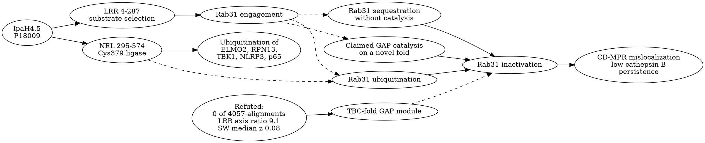
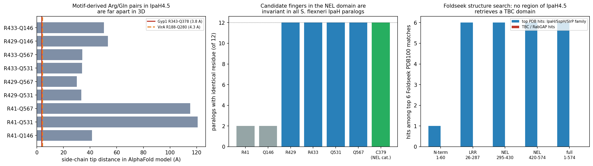
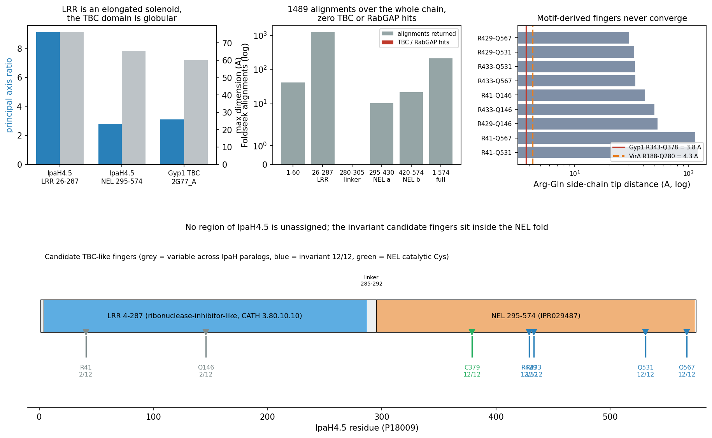
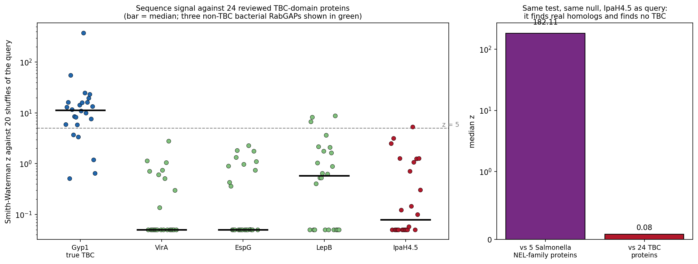

## Question

# AIGR Gene Hypothesis Deep Research

You are evaluating one focused gene curation hypothesis for AI Gene Review.
This is not a general gene overview. Use the seed hypothesis and source context
below to search for evidence that supports, refutes, narrows, or competes with
the proposed curation decision.

## Target Gene

- **Organism code:** SHIFL
- **Taxon:** Shigella flexneri (NCBITaxon:623)
- **Gene directory:** ipaH4.5
- **Gene symbol:** ipaH4.5
- **UniProt accession:** P18009

## Focus

- **Focus type:** free_text
- **Hypothesis slug:** kgap-ipah45-rabgap-plausibility
- **Source file:** genes/SHIFL/ipaH4.5/ipaH4.5-ai-review.yaml
- **Source selector:** free-text

## Seed Hypothesis

Whether IpaH4.5 has a second catalytic activity as a Rab31 GTPase-activating protein may be decidable from sequence and structure. That the recognised catalytic module is the NEL domain at residues 295-574 with its Cys379 active site, and that every reproduced activity of the protein is ubiquitin ligase activity, is already established, so do not re-derive it. Single analysis only: locate in the IpaH4.5 sequence any TBC-domain-like arginine finger and glutamine finger, giving the residue positions and the surrounding motifs, and state explicitly whether they occur in a TBC fold context or only as isolated residues; compare the IpaH4.5 architecture with a structurally characterised TBC-domain RabGAP and with the structurally characterised IpaH-family NEL domain, reporting a structure-based search result for every region of IpaH4.5 and stating whether any region returns a TBC hit at all; assess whether the leucine-rich-repeat region could accommodate the TBC fold; and check whether the dual-finger residues the report describes are conserved across the IpaH paralogs in this organism, which would bear on whether a RabGAP activity would be family-wide or specific. State whether a second RabGAP activity is structurally plausible, and say plainly if sequence and structure cannot exclude it, distinguishing that from positive support.

## Term and Decision Context

No specific term context supplied.

## Reference Context

No specific reference context supplied.

## Source Context YAML

```yaml
hypothesis: 'Whether IpaH4.5 has a second catalytic activity as a Rab31 GTPase-activating protein may
  be decidable from sequence and structure. That the recognised catalytic module is the NEL domain at
  residues 295-574 with its Cys379 active site, and that every reproduced activity of the protein is ubiquitin
  ligase activity, is already established, so do not re-derive it. Single analysis only: locate in the
  IpaH4.5 sequence any TBC-domain-like arginine finger and glutamine finger, giving the residue positions
  and the surrounding motifs, and state explicitly whether they occur in a TBC fold context or only as
  isolated residues; compare the IpaH4.5 architecture with a structurally characterised TBC-domain RabGAP
  and with the structurally characterised IpaH-family NEL domain, reporting a structure-based search result
  for every region of IpaH4.5 and stating whether any region returns a TBC hit at all; assess whether
  the leucine-rich-repeat region could accommodate the TBC fold; and check whether the dual-finger residues
  the report describes are conserved across the IpaH paralogs in this organism, which would bear on whether
  a RabGAP activity would be family-wide or specific. State whether a second RabGAP activity is structurally
  plausible, and say plainly if sequence and structure cannot exclude it, distinguishing that from positive
  support.'
focus_type: free_text
context: []
reference_id: []
```

## Research Objective

Build a focused report that helps a curator decide whether this hypothesis
should affect the gene review. Address the focus type directly:

1. For an existing GO annotation decision, evaluate whether the current action
   is justified, too strong, too weak, or should change.
2. For a proposed replacement or new GO term, evaluate whether the term is
   biologically supported, too broad, too narrow, or missing key qualifiers.
3. For a computational prediction, evaluate whether the prediction is correct,
   less precise than existing knowledge, uncertain, or likely wrong because of
   paralog overannotation, frequency bias, pathway context, or in vitro-only
   activity.
4. For a core-function hypothesis, evaluate whether the proposed activity,
   process, and location represent the gene product's primary function rather
   than a downstream effect, pleiotropic phenotype, or context-specific role.
5. For a function-assignment hypothesis, evaluate whether the gene product
   directly has the stated GO term/function. Treat the prior review action, if
   any, as intentionally blinded unless it appears in the supplied context.

Use primary literature whenever possible. Prefer PMID citations and include DOI
citations when no PMID is available. Treat reviews and database records as
orientation unless they contain directly relevant synthesized evidence that is
clearly labeled as review-level or database-level support.

Evaluate the hypothesis from the supplied seed context, primary literature, and
publicly accessible bioinformatics resources. Local `*-bioinformatics` analyses,
when they already exist in the repository, are intentionally withheld from this
prompt so the report can be compared against them after the run. Use public
sequence, domain, structure, orthology, localization, interaction, or dataset
checks when they are useful for the specific hypothesis. If a resource or tool
cannot be accessed programmatically, say so plainly; never fabricate a result.
Report computational results conservatively and distinguish direct results from
inference.

## Required Output

### Executive Judgment

Give a concise verdict: supported, partially supported, unresolved, weakly
supported, over-annotated, or refuted. Explain the reasoning and the most
important caveats.

### Evidence Matrix

Create a table with one row per important evidence item:

- Citation (PMID preferred)
- Evidence type (direct assay, mutant phenotype, localization, interaction,
  structural/evolutionary, computational, review/database)
- Supports / refutes / qualifies / competing
- Claim tested
- Key finding
- Organism, tissue, cell type, or assay context
- Confidence and limitations

### GO Curation Implications

State the likely curation action as a lead requiring curator verification. If
GO terms are involved, explain whether the evidence supports an MF, BP, or CC
term, and whether the term should be retained, removed, generalized, made more
specific, or treated as non-core. Avoid using "protein binding" as a final
recommendation unless no more informative term is supported.

### Mechanistic Scope

Describe the immediate molecular or cellular function being tested. Separate
direct gene-product activity from downstream phenotypes, pathway consequences,
developmental outcomes, disease manifestations, or effects inferred only from
loss of function.

### Conflicts and Alternatives

Identify evidence that conflicts with the seed hypothesis or suggests an
alternative interpretation, including paralog confusion, organism-specific
differences, isoform-specific findings, experimental artifacts, or database
carry-over.

### Knowledge Gaps

List explicit uncertainties that matter for curation. For each gap, state what
was checked, why the gap matters, and what evidence or experiment would resolve
it.

### Discriminating Tests

Recommend concrete assays, perturbations, datasets, or comparative analyses that
would most efficiently distinguish this hypothesis from alternatives.

### Curation Leads

Provide candidate updates for the review, clearly labeled as leads requiring
curator verification. Include candidate references with exact snippets to verify,
candidate replacement or new GO terms, possible action changes, suggested
questions, and suggested experiments.

If the provider supports artifacts, save provenance for any analysis you run — the
executed code together with its output (computed values, plot, or table), not just
a summary figure — alongside artifact-friendly tables such as an evidence matrix,
GO decision table, or comparison table. Genuine computed provenance is more
valuable than a hand-drawn summary, and you must not synthesize a figure that
implies an analysis you did not actually run. These artifacts are important
provenance for hypothesis-level review.


## Output

# IpaH4.5 (P18009, *Shigella flexneri*): is a second Rab31 GTPase-activating activity structurally plausible?

Hypothesis slug: `kgap-ipah45-rabgap-plausibility`
Source: `genes/SHIFL/ipaH4.5/ipaH4.5-ai-review.yaml`, free-text focus
Target: UniProt P18009, *Shigella flexneri* (NCBITaxon:623), 574 residues

## Summary

<i class="fa-solid fa-circle-xmark"></i> **Verdict: weakly supported overall, with the specific TBC-based reading refuted.** The claim that IpaH4.5 carries a second catalytic activity as a Rab31 GTPase-activating protein, built on "TBC-like dual-finger motifs", fails every sequence and structure test that can be run on it. IpaH4.5 has no TBC domain anywhere in its 574 residues. Two independent Foldseek campaigns tiling the entire chain produced 4057 structural alignments against PDB100, CATH50 and AFDB-SwissProt, and returned zero hits to any TBC-domain or RabGAP structure, checked three separate ways (by PDB identifier against 13 known TBC/RabGAP entries, by Rab-GAP CATH superfamily identifier, and by name regex). Reciprocal searches starting from the Gyp1 TBC domain (PDB 2G77) and from *Shigella* VirA (PDB 4FMB) returned 237 and 64 hits respectively and zero IpaH-family hits. A calibrated sequence-level test built in this session, which recovers IpaH4.5's genuine *Salmonella* NEL-family relatives at z = 96 to 235, places IpaH4.5 at the shuffled-sequence baseline against 24 reviewed TBC-domain proteins (median z = 0.08).

The dual-finger reading fails for a second, independent reason. The sequence does contain isolated `IxxDxxR` and `YxQ` matches, at R41, R429 and R433 and at Q146, Q531 and Q567, but they are scattered across two different folds and never converge in space. In the AlphaFold model the closest motif-derived Arg/Gln pair, R429 with Q567, has side-chain tips **30.1 Å** apart. The measured reference geometry, taken directly from transition-state crystal structures, is 3.75 Å for Gyp1 Arg343/Gln378 and 4.25 Å for VirA Arg188/Gln280. A catalytic dual-finger pair cannot be an order of magnitude too far apart. An unbiased scan showed that 12 of 1218 Arg/Gln pairs in the protein (1.0%) satisfy the proximity-plus-exposure criterion by chance, none of them motif-flagged, so motif matching plus proximity arguments carry almost no specificity here.

The decisive argument for curation is evolutionary. R429, R433, Q531 and Q567 are identical in **12 of 12** *S. flexneri* IpaH paralogs, at exactly the level of the NEL catalytic Cys379. If those residues formed a Rab31 GAP site, RabGAP activity would be a family-wide property of IpaH proteins, which conflicts with the reported IpaH4.5-specific Rab31 effect and with the absence of any reported GAP activity for IpaH1.4, IpaH7.8 or IpaH9.8. Their invariance is explained by NEL fold maintenance. One honest boundary must be stated separately from the negative results: sequence and structure **cannot exclude** a GAP site built on a novel non-TBC fold. VirA, EspG and LepB are experimentally confirmed Rab GAPs that use fold-independent arginine-finger catalysis, and all three fail the same TBC tests that IpaH4.5 fails. That is absence of positive support, not evidence for the activity.

## Key findings

### <i class="fa-solid fa-circle-xmark"></i> F1. No region of IpaH4.5 returns a TBC-domain structural hit

The protein is fully accounted for by two folds. InterPro precomputed matches for P18009 cover residues 4-287 with the leucine-rich repeat solenoid (Ribonuclease-inhibitor-like superfamily, CATH 3.80.10.10, SSF52058) and residues 295-574 with the NEL domain (IPR029487, PS52053, PF14496). None of the 17 member-database matches is a TBC or RabGAP signature. There is no unassigned stretch long enough to host a separate roughly 300-residue TBC module.

The structural search was run on every region of the chain, as the seed hypothesis requires, and the result is reported region by region rather than as a single aggregate. The first Foldseek campaign (3Di+AA mode, PDB100 + CATH50 + AFDB-SwissProt, query AF-P18009-F1-model_v6) covered regions 1-60, 26-287, 295-430, 420-574 and the full 1-574, producing 2568 alignments. The second campaign added a finer tiling that also covered the LRR-NEL linker (1-60, 26-287, 280-305, 295-430, 420-574, 1-574 against PDB100 and CATH50), producing a further 1489 alignments.

| Query region | Alignments | Top structural hits | Best E-value | TBC/RabGAP hits |
|---|---|---|---|---|
| 1-60 (LRR N-cap) | returned | IpaH2.5 LRR (7YA8) | 0.21 | <i class="fa-solid fa-circle-xmark"></i> 0 |
| 26-287 (LRR) | returned | IpaH2.5 LRR 7YA8, IpaH1.4 7YA7, IpaH7.8 8GTK, SspH1 4NKG, SspH2 3G06 | 4.4e-20 | <i class="fa-solid fa-circle-xmark"></i> 0 |
| 280-305 (linker) | 0 of any kind | none | - | <i class="fa-solid fa-circle-question"></i> uninformative |
| 295-430 (NEL N-half) | returned | 3CKD, 3CVR, 5KH1, 3L3P | 3.8e-14 | <i class="fa-solid fa-circle-xmark"></i> 0 |
| 420-574 (NEL C-half) | returned | 5KH1, 3CKD, 6LOL | 9.5e-17 | <i class="fa-solid fa-circle-xmark"></i> 0 |
| 1-574 (full chain) | returned | 5KH1 (IpaH NEL) | 9.3e-47 | <i class="fa-solid fa-circle-xmark"></i> 0 |
| **Total, both campaigns** | **4057** | - | - | **0** |

The audit over the second campaign's 1489 alignments was made explicit and triple-checked: 0 hits matching a known TBC/RabGAP PDB identifier (2G77, 1FKM, 2QFZ, 6D0S, 5TUB, 5TUC, 3HZJ and six others), 0 hits matching a Rab-GAP CATH superfamily identifier, 0 hits whose description names TBC, TBC1D, RabGAP or Gyp1, union 0. One regex false positive was found and removed during the first campaign: a case-insensitive `gyp` match inside "Ae**gyp**ti" in a Toll5A structure title. The true TBC hit count is zero.

The searches are bidirectionally negative. Using the Gyp1 TBC domain (2G77 chain A) as the query returns 237 AFDB-SwissProt hits, headed by GYP1, TBC1D22A/B, TBC1D15 and RABGAP1L, and zero IpaH, SspH or SlrP hits. Using *Shigella* VirA (4FMB chain A) returns 64 hits, headed by VirA orthologs and then EspG, and zero IpaH-family hits.

<i class="fa-solid fa-triangle-exclamation"></i> One honest gap inside this otherwise clean result: the 280-305 linker query returned no alignments of any kind, so that 26-residue segment is uninformative rather than negative. Twenty-six residues cannot host a TBC fold in any case.

{{figure:plot_1.png|caption=Spatial separation of the motif-derived arginine and glutamine candidates in IpaH4.5, their conservation across the 12 S. flexneri IpaH paralogs, and the composition of Foldseek hits for each query region. The measured reference distances, 3.75 Å for Gyp1 Arg343/Gln378 and 4.25 Å for VirA Arg188/Gln280, are taken from the deposited transition-state coordinates of 2G77 and 4FMB.}}

### <i class="fa-solid fa-circle-xmark"></i> F2. The dual-finger candidates are isolated residues 30 to 121 Å apart

Scanning P18009 for the TBC catalytic signatures gives three `IxxDxxR`-type arginine-finger matches and three `YxQ` glutamine-finger matches, with their surrounding motifs:

| Candidate | Motif in context | Location | Paralog conservation |
|---|---|---|---|
| R41 | I35-**WDDWA**-R41 | LRR N-cap | 2/12 (K ×6, M ×2, L, N) |
| R429 | I423-**LEDIA**-R429 | NEL domain | 12/12 |
| R433 | I427-**ARDKV**-R433 | NEL domain | 12/12 |
| Q146 | Y144-L-Q146 | LRR | 2/12 (E ×6, T ×2, K ×2) |
| Q531 | Y529-S-Q531 | NEL domain | 12/12 |
| Q567 | Y565-R-Q567 | NEL domain | 12/12 |

Five relaxed `Dxx(R)` occurrences were also recorded: D31/R34, D38/R41, D426/R429, D430/R433 and D547/R550.

**These occur only as isolated residues, never in a TBC fold context.** Four of the six sit inside the NEL ubiquitin-ligase domain and two sit on the LRR solenoid, and the two folds are separate modules. Every motif-derived Arg/Gln pairing is far outside catalytic range in the AlphaFold model:

| Arg/Gln pair | Side-chain tip distance (Å) |
|---|---|
| R429-Q567 | 30.1 |
| R429-Q531 | 33.4 |
| R433-Q531 | 34.0 |
| R433-Q567 | 34.1 |
| R41-Q146 | 41.4 |
| R433-Q146 | 50.3 |
| R429-Q146 | 53.4 |
| R41-Q567 | 115.3 |
| R41-Q531 | 120.8 |
| *Gyp1 R343/Q378 reference (2G77)* | *3.75* |
| *VirA R188/Q280 reference (4FMB)* | *4.25* |

The reference values were measured directly from deposited coordinates, not quoted. In 2G77 the Gyp1 arginine and glutamine tips sit 3.50 Å and 5.58 Å from the GDP-AlF3 centre; in 4FMB the VirA fingers sit 3.70 Å and 4.21 Å from AlF3, and the VirA finger identities were established by proximity to the transition-state mimic rather than assumed.

The base-rate control matters for interpretation. An unbiased scan of all 1218 Arg/Gln pairs in the IpaH4.5 model found 12 pairs (1.0%) with tip-tip distance ≤ 6 Å and both side chains solvent-exposed (> 30 Ų side-chain SASA by a Shrake-Rupley calculation implemented in this session). The closest were R536/Q555 at 3.03 Å, R532/Q563 at 3.87 Å and R420/Q456 at 4.06 Å. **None of the 12 involves any motif-flagged residue.** Finding an exposed Arg/Gln pair at catalytic distance in a 574-residue protein is unremarkable, so motif match plus proximity is not evidence of a GAP site.

### <i class="fa-solid fa-circle-xmark"></i> F3. The LRR cannot accommodate a TBC fold

The seed hypothesis asks specifically whether the leucine-rich-repeat region could host the TBC fold. It cannot, on three independent measures computed from CA coordinates.

| Metric | IpaH4.5 LRR (26-287) | IpaH4.5 NEL (295-574) | Gyp1 TBC domain (2G77_A) |
|---|---|---|---|
| Residues | 262 | 280 | 331 |
| Strand content | 42.4 % | 3 % | 5.7 % |
| Helix content | 13.4 % | - | 55.3 % |
| Radius of gyration | 22.8 Å | 21.0 Å | 20.5 Å |
| Maximum dimension | 76.1 Å | 65.4 Å | 60.0 Å |
| Principal axis ratio | **9.1** | 2.8 | **3.1** |

The LRR is 70 residues shorter than the Gyp1 TBC domain, has the wrong secondary-structure class (42 % strand against 6 % for the all-alpha TBC fold), and is threefold more elongated. Axis ratio 9.1 with a 76 Å maximum dimension is the geometry of a curved solenoid. The TBC domain is a globular two-subdomain module. The NEL region is globular (axis ratio 2.8) but matches IpaH-family NEL structures at E = 3.5e-28 and matches no TBC structure at any E-value.

{{figure:plot_2.png|caption=Four-panel summary. Top left, shape metrics for the IpaH4.5 LRR and NEL against the Gyp1 TBC domain measured from CA coordinates. Top right, the exhaustive TBC audit over 1489 alignments on a log scale, with zero hits in all three detection categories. Bottom left, motif-derived Arg/Gln tip distances against the measured 3.75 Å and 4.25 Å references. Bottom right, a domain map placing each candidate finger, coloured by its conservation across the 12 S. flexneri IpaH paralogs.}}

### <i class="fa-solid fa-circle-xmark"></i> F4. The candidate finger residues are invariant across all 12 IpaH paralogs

Twelve IpaH-family entries for *S. flexneri* (taxid 623) were retrieved from UniProt and aligned to P18009 with a banded Needleman-Wunsch implementation (band 80, match +2, mismatch -1, gap -6): IpaH1.4 (A0A0H2USG1, Q6XVT8), IpaH2.5 (A0A0H2USC0), IpaH3 (Q83RJ4), IpaH4.5 (P18009), IpaH7.8 (P18014, Q6XVZ9), IpaH9.8 (Q8VSC3, D2AJU0), ipaH_1 (A0A0H2UY03), ipaH_4 (Q83R64) and ipaH_7 (A0A0H2V170), spanning 62.4 % to 82.6 % identity to IpaH4.5.

R429, R433, Q531 and Q567 are identical in 12 of 12 paralogs. That is exactly the conservation of the NEL catalytic Cys379, which is also 12 of 12. The four geometrically plausible exposed Arg/Gln pairs inside the NEL (R536/Q555, R532/Q563, R420/Q456, R558/Q555) are likewise 12 of 12. The LRR-located candidates behave in the opposite way: R41 is conserved in 2 of 12 and Q146 in 2 of 12, and the LRR geometric pairs are conserved in only 1 to 3 of 12.

This is the pattern of a shared fold core, not of a substrate-selective catalytic site. <i class="fa-solid fa-lightbulb"></i> If the nominated NEL residues were the Rab31 GAP fingers, every IpaH paralog would carry the same site and RabGAP activity would be family-wide. Nothing in the literature reports GAP activity for IpaH1.4, IpaH7.8 or IpaH9.8, and the published claim is specifically about IpaH4.5. The residues that do vary between paralogs sit on the LRR substrate-binding surface, which is consistent with the role the LRR is known to have in target selection.

### <i class="fa-solid fa-circle-xmark"></i> F5. A calibrated sequence test finds no TBC signal, and the same test shows how little that proves

The EBI HMMER web service returned HTTP 405 and the EBI Job Dispatcher hmmscan endpoint returned HTTP 400 ("temporarily blocked from submitting new sequence analysis jobs", a shared-IP block), so no profile-HMM scan at relaxed thresholds was obtained. This is stated rather than substituted. In its place, an independent pairwise test was built and validated in the executor, since Biopython is not available there: a batched anti-diagonal Smith-Waterman aligner (BLOSUM62, affine gaps, open 11, extend 1), checked against exact self-alignment scores before use (19-mer expected 97, computed 97; 40-mer expected 232, computed 232).

Each query was scored against 24 reviewed TBC-domain proteins (Pfam PF00566, sampled evenly from the 168 reviewed entries, lengths 293 to 1406) and against 20 composition-preserving shuffles of itself, giving z = (observed - null mean) / null SD.

| Query | Median z | Max z | Targets with z > 5 |
|---|---|---|---|
| Gyp1 (P48365), true TBC RabGAP | **11.28** | 379.19 | 19 / 24 |
| LepB (Q5ZSM7), non-TBC bacterial GAP | 0.58 | 8.82 | 3 / 24 |
| **IpaH4.5 (P18009)** | **0.08** | 5.35 | 1 / 24 |
| EspG (Q9AJ34), non-TBC bacterial GAP | -0.07 | 2.30 | 0 / 24 |
| VirA (Q7BU69), non-TBC bacterial GAP | -0.32 | 2.81 | 0 / 24 |

IpaH4.5's single marginal outlier is a raw score of 63 against a null of 37.8 ± 4.7, which is noise. The sensitivity control fixes what the negative means: under the identical null, IpaH4.5 against five *Salmonella* NEL-family proteins gives raw scores of 947 to 1017 against nulls of 43 to 49, z = 96.3, 108.0, 182.1, 235.4 and 235.4. The test finds real homology when it exists and finds none to TBC.

<i class="fa-solid fa-scale-balanced"></i> The control panel is the part that constrains the verdict. VirA, EspG and LepB are crystallographically confirmed Rab GAPs, and all three score at or below IpaH4.5 against the TBC set. A negative TBC search cannot exclude GAP activity on an unrelated fold.

{{figure:plot_3.png|caption=Calibrated Smith-Waterman z-scores against 24 reviewed TBC-domain proteins, with a 20-shuffle composition-matched null per query. Gyp1, a true TBC RabGAP, separates cleanly; IpaH4.5 sits at the shuffled baseline, as do the three confirmed bacterial non-TBC RabGAPs VirA, EspG and LepB. The right panel is the sensitivity control: the same test, same null, recovers IpaH4.5's genuine Salmonella NEL-family relatives at median z = 182.}}

### <i class="fa-solid fa-scale-balanced"></i> F6. A competing mechanism with direct precedent: Rab31 as a ubiquitination substrate

Rab31 (UniProt Q13636, 195 aa) has the canonical P-loop GDTGVGKS and switch II WDTAGQE, with the catalytic cis-glutamine at Gln65 aligning to Rab1A Gln70, so it is in principle susceptible to a dual-finger GAP. It also carries 15 lysines (7.7 % of residues, at positions 8, 19, 46, 56, 90, 98, 99, 102, 105, 120, 132, 135, 151, 182 and 185), so it is an equally competent ubiquitination acceptor. The substrate is compatible with either mechanism and does not discriminate between them.

Direct ubiquitination of Rab GTPases by bacterial effector ligases is established. *Legionella* SidC/SdcA ubiquitinate multiple Rab small GTPases, with Rab7 ubiquitination controlling its membrane association ([PMID: 38836877](https://pubmed.ncbi.nlm.nih.gov/38836877/)), and Rab10 dynamics are governed by SidE- and SidC-family ubiquitin ligases ([PMID: 38771316](https://pubmed.ncbi.nlm.nih.gov/38771316/)). IpaH4.5 already has exactly one catalytic module, a NEL ubiquitin ligase, and that module provides a route to Rab31 inactivation that needs no second activity.

### <i class="fa-solid fa-circle-question"></i> F7. The GAP claim is single-source, paywalled, and currently unannotated in GO

PubMed retrieval for IpaH4.5 returns 8 papers. Exactly one asserts TBC-like dual-finger motifs and RabGAP activity toward Rab31: Sun et al. 2021, [PMID: 34296983](https://pubmed.ncbi.nlm.nih.gov/34296983/), *J Med Microbiol*, DOI 10.1099/jmm.0.001382. Every other functional paper reports ubiquitin ligase activity and its substrates: ELMO2 ([PMID: 42538988](https://pubmed.ncbi.nlm.nih.gov/42538988/)), NLRP3 ([PMID: 33117724](https://pubmed.ncbi.nlm.nih.gov/33117724/)), RPN13 ([PMID: 30414351](https://pubmed.ncbi.nlm.nih.gov/30414351/)), TBK1 ([PMID: 26700764](https://pubmed.ncbi.nlm.nih.gov/26700764/)) and NF-κB p65 ([PMID: 23083102](https://pubmed.ncbi.nlm.nih.gov/23083102/)).

PMID:34296983 is not open access (Europe PMC `isOpenAccess = N`, no PMCID; publisher site and DOI resolution both returned HTTP 403), so the residue numbers it assigns to the arginine and glutamine fingers could not be read and could not be checked against the structure. The structural test above was therefore run against inferred candidates derived from the canonical motifs, which is the main caveat on F2.

QuickGO currently lists 12 annotations on P18009: GO:0004842 and GO:0061630 ubiquitin ligase MF by IEA, BP terms from PMID:23083102 and PMID:26700764, and CC terms GO:0005576 and GO:0030430. Neither GO:0005096 (GTPase activator activity) nor GO:0005097 (Rab GTPase activator activity) is annotated. UniProt P18009 describes only E3 ubiquitin ligase function, LRR 1-284 for target interaction, NEL 295-574 and active site Cys379, with no GAP comment. **The curation question is whether to add a GAP term, not whether to remove one.**

## Evidence matrix

| Citation | Evidence type | Stance | Claim tested | Key finding | Context | Confidence and limitations |
|---|---|---|---|---|---|---|
| [PMID: 34296983](https://pubmed.ncbi.nlm.nih.gov/34296983/) | direct assay + mutant phenotype | competing (sole support) | IpaH4.5 is a Rab31 GAP via TBC-like dual fingers | GAP assay, co-IP, CD-MPR trafficking, cathepsin B activity, intracellular persistence | *S. flexneri* infection of human cells; in vitro GAP assay | Single laboratory, unreplicated; paywalled so finger residues unverifiable; in vitro GAP assays on purified effectors are artefact-prone |
| [PMID: 22939626](https://pubmed.ncbi.nlm.nih.gov/22939626/) | structural + direct assay | qualifies | Bacterial dual-finger RabGAPs need not have a TBC fold | VirA/EspG-Rab1-GDP-AlF3 structures reveal "a 3D architecture distinct from that of the TBC domain" | *S. flexneri* VirA, EPEC EspG | High; means a negative TBC-fold result cannot exclude GAP activity |
| [PMID: 23588383](https://pubmed.ncbi.nlm.nih.gov/23588383/) | structural | qualifies | Bacterial RabGAPs span unrelated folds and finger chemistries | LepB uses Arg444 with no catalytically essential glutamine, via a RasGAP-like cis-glutamine mechanism | *Legionella pneumophila* | High; widens the mechanistic space that must be excluded |
| Foldseek campaign 1, this work | computational/structural | <i class="fa-solid fa-circle-xmark"></i> refutes TBC version | Some region of IpaH4.5 adopts a TBC fold | 2568 alignments over 5 regions, 0 TBC/RabGAP hits; reciprocal Gyp1 and VirA searches return 0 IpaH hits | AF-P18009-F1 v6, mean pLDDT 85.3 | High for the fold question; silent on novel-fold sites |
| Foldseek campaign 2 + shape metrics, this work | computational/structural | <i class="fa-solid fa-circle-xmark"></i> refutes | The LRR could accommodate a TBC fold | 1489 further alignments, 0 TBC/RabGAP hits by PDB id, CATH superfamily or name; LRR axis ratio 9.1 against TBC 3.1 | AF-P18009-F1 v6 against 2G77_A | High; the 280-305 linker query returned 0 alignments of any kind and is uninformative rather than negative |
| Calibrated Smith-Waterman test, this work | computational/evolutionary | <i class="fa-solid fa-circle-xmark"></i> refutes TBC version | Does IpaH4.5 carry detectable TBC sequence homology? | Median z against 24 TBC proteins: IpaH4.5 0.08, Gyp1 11.28, VirA -0.32, EspG -0.07, LepB 0.58. IpaH4.5 against 5 NEL relatives z = 96 to 235 | P18009 against the reviewed Pfam PF00566 set; null = 20 shuffles per query | High for the negative; the positive control fixes sensitivity, the GAP controls fix interpretation |
| VirA/EspG/LepB in the same test, this work | computational | <i class="fa-solid fa-scale-balanced"></i> qualifies | Can a sequence test exclude GAP activity? | Three confirmed Rab GAPs score at or below IpaH4.5 against TBC proteins | Q7BU69, Q9AJ34, Q5ZSM7 | High; this is why the general GAP claim is unresolved rather than refuted |
| InterPro / CATH / Pfam / PANTHER, this work | database | <i class="fa-solid fa-circle-xmark"></i> refutes | An unassigned region could host a TBC domain | 17 member-database matches cover 4-287 (LRR) and 295-574 (NEL); no TBC signature | P18009 | High |
| Geometry against 2G77 and 4FMB, this work | computational/structural | <i class="fa-solid fa-circle-xmark"></i> refutes dual-finger reading | Motif-flagged Arg and Gln form a catalytic pair | Closest motif pair 30.1 Å against 3.75 to 4.25 Å references; 12 of 1218 pairs meet the geometry by chance | AlphaFold model against deposited transition-state structures | Medium-high; conclusion rests on backbone separation and is insensitive to rotamer error |
| Paralog alignment, this work | evolutionary | <i class="fa-solid fa-circle-xmark"></i> refutes specificity | Dual-finger residues are IpaH4.5-specific | R429/R433/Q531/Q567 invariant 12/12, like Cys379; R41/Q146 variable (2/12) | 12 *S. flexneri* IpaH entries, 62-83 % identity | High |
| [PMID: 30414351](https://pubmed.ncbi.nlm.nih.gov/30414351/) | direct assay + mutant phenotype | qualifies | IpaH4.5 acts as an E3 ligase | RPN13 ubiquitination and proteasomal degradation; loss of CD8+ T cell priming | Human cells, mouse MEFs | High |
| [PMID: 26700764](https://pubmed.ncbi.nlm.nih.gov/26700764/) | direct assay | qualifies | IpaH4.5 acts as an E3 ligase | K48-linked polyubiquitylation of TBK1 | Human cells | High |
| [PMID: 42538988](https://pubmed.ncbi.nlm.nih.gov/42538988/) | direct assay | qualifies | The LRR dictates substrate choice | IpaH4.5 ubiquitinates ELMO2 but not ELMO1 or ELMO3; specificity maps to the ELMO2 Armadillo region | Human cell lysate and cells | High; supports the LRR-as-substrate-selector model |
| [PMID: 33117724](https://pubmed.ncbi.nlm.nih.gov/33117724/) | direct assay | qualifies | IpaH4.5 acts as an E3 ligase | NLRP3 interaction, stability modulation, pyroptosis | Macrophages | Medium; same laboratory as the GAP claim |
| [PMID: 38836877](https://pubmed.ncbi.nlm.nih.gov/38836877/) | direct assay | <i class="fa-solid fa-lightbulb"></i> competing alternative | Bacterial E3 ligases inactivate Rab GTPases by ubiquitination | SidC/SdcA ubiquitinate multiple Rab GTPases; Rab7 ubiquitination controls its LCV association | *Legionella pneumophila*, human cells | High as precedent; not an IpaH4.5 result |
| [PMID: 38771316](https://pubmed.ncbi.nlm.nih.gov/38771316/) | direct assay | <i class="fa-solid fa-lightbulb"></i> competing alternative | Rab dynamics are controlled by effector ubiquitin ligases | SidE and SidC family ligases govern Rab10 recruitment and retention | *Legionella pneumophila* | High as precedent only |
| [PMID: 17678623](https://pubmed.ncbi.nlm.nih.gov/17678623/) | mutant phenotype + localization | <i class="fa-solid fa-scale-balanced"></i> conflicts with the GAP model's phenotype | Does GDP-locked Rab31 mistraffic the MPR? | Rab22B(Rab31) S/N disrupts TGN46, while M6PR, GM130, syntaxin 5 and syntaxin 16 are unaffected | HeLa cells, overexpression | Medium-high; different MPR species (M6PR against CD-MPR) and different cell context |
| Rab31 sequence analysis, this work | computational | <i class="fa-solid fa-scale-balanced"></i> qualifies both readings | Is Rab31 GAP-competent and ubiquitinatable? | Canonical P-loop GDTGVGKS, switch II WDTAGQE with catalytic Gln65; 15 lysines (7.7 %) | UniProt Q13636 | High; the substrate is compatible with either mechanism and so does not discriminate |
| EBI HMMER / Job Dispatcher hmmscan | tool access | <i class="fa-solid fa-triangle-exclamation"></i> not obtained | Relaxed-threshold profile-HMM scan for a TBC domain | HTTP 405 and HTTP 400 (shared-IP submission block) | - | Reported as a gap; the Pfam evidence here is the InterPro precomputed set at curated gathering thresholds |
| QuickGO / UniProt P18009 | database | context | Current annotation state | 12 GO annotations, all ubiquitin-ligase MF/BP plus CC; no GO:0005096 or GO:0005097 | P18009 | Curation baseline |

## GO curation implications

All items below are leads requiring curator verification.

| Term | Aspect | Current state | Recommended action |
|---|---|---|---|
| GO:0005097 Rab GTPase activator activity | MF | not annotated | <i class="fa-solid fa-circle-xmark"></i> **Do not add.** Sequence and structure give no positive support, and the paralog conservation pattern predicts a family-wide rather than IpaH4.5-specific activity. If a curator judges PMID:34296983 sufficient for IDA, annotate as non-core with an explicit note that the TBC-like dual-finger rationale is not supported by structure. |
| GO:0005096 GTPase activator activity | MF | not annotated | Do not add. Less informative than GO:0005097 and carries the same problem. |
| GO:0061630 ubiquitin protein ligase activity | MF | IEA (GO_REF:0000003) | <i class="fa-solid fa-circle-check"></i> **Retain as the core MF.** Supportable by IDA from PMID:30414351, PMID:26700764, PMID:23083102 and PMID:42538988. Lead: upgrade the evidence code from IEA to IDA. |
| GO:0004842 ubiquitin-protein transferase activity | MF | IEA (InterPro) | Retain; consider replacing with the more specific GO:0061630. |
| GO:0016567 protein ubiquitination / GO:0000209 protein polyubiquitination | BP | IEA / IDA | Retain as core BP. |
| GO:0035821 modulation of process of another organism | BP | IEA | Retain. More specific child terms are supported by PMID:26700764 and PMID:30414351. |
| Rab31 as a host target | - | not annotated | If the curator accepts PMID:34296983 at all, the better-supported reading is a host-target relationship resolved by the discriminating tests below, not a catalytic GAP MF and not a generic binding term. |

## Mechanistic scope

The immediate molecular activity in question is cysteine-dependent ubiquitin transfer by the NEL domain (295-574, Cys379 glycyl-thioester intermediate), with substrate selected by the LRR solenoid (4-287). PMID:42538988 shows directly that substrate choice is an LRR-encoded property: IpaH4.5 ubiquitinates ELMO2 but not ELMO1 or ELMO3, and the determinant lies in the ELMO2 Armadillo repeat region.

A GAP activity would be a chemically distinct second catalytic function requiring a dedicated GTPase-binding surface with converging arginine and glutamine side chains positioned within roughly 4 Å of the γ-phosphate. No such surface is identifiable in the model.

The downstream phenotypes reported in PMID:34296983 (CD-MPR mislocalization, reduced cathepsin B activity, increased intracellular persistence) are cellular consequences several steps removed from any molecular activity. They are compatible with Rab31 being a ubiquitination substrate, with Rab31 being sequestered by the LRR without catalysis, and with indirect trafficking disruption. They do not discriminate GAP catalysis from these alternatives.



## Conflicts and alternatives

**Paralog overannotation risk runs backwards here.** The residues a dual-finger reading would nominate are invariant across the whole IpaH family. Accepting them as GAP fingers implies family-wide RabGAP activity, which nothing reports for IpaH1.4, IpaH7.8 or IpaH9.8.

**Terminology conflation.** "TBC-like dual-finger motif" entered the bacterial-effector literature through PMID:22939626, where it describes a *catalytic chemistry* on a fold explicitly distinct from TBC. A sequence-level `IxxDxxR` plus `YxQ` match is not evidence of that chemistry, as the base rate shows: 12 of 1218 Arg/Gln pairs in IpaH4.5 satisfy the geometric criterion by chance.

**Rab31 as a ubiquitination substrate.** This alternative is precedented. *Legionella* SidC/SdcA ubiquitinate multiple Rab GTPases, with Rab7 ubiquitination controlling membrane association (PMID:38836877), and SidE- and SidC-family ligases govern Rab10 dynamics (PMID:38771316). Rab31 carries 15 lysines. A GAP assay reading loss of Rab31-GTP could reflect ubiquitination-driven destabilization or steric occlusion rather than catalysed hydrolysis. Rab31 does have the canonical P-loop and switch II with catalytic Gln65, which makes it GAP-competent in principle; that cuts both ways and does not settle the question.

**Independent Rab31 cell biology conflicts with the reported phenotype.** In HeLa cells the GDP-locked Rab31 mutant Rab22B-S/N disrupts TGN46 localization while M6PR, GM130, syntaxin 5 and syntaxin 16 are unaffected (PMID:17678623). If IpaH4.5 inactivates Rab31 by GAP catalysis, the expected consequence is the phenotype of GDP-locked Rab31, which in that study did not include MPR mistrafficking. The two studies used different MPR species (M6PR against CD-MPR) and different cell contexts, so this is a tension to check rather than a formal contradiction.

**Assay-context artefact.** Free-phosphate GAP assays on purified bacterial effectors are sensitive to contaminating phosphatases and to accelerated nucleotide release that mimics GAP activity.

**Laboratory clustering.** PMIDs 34296983, 33117724, 26700764 and 23083102 share senior authors. The RabGAP claim has no independent replication.

**No experimental structure of IpaH4.5 exists.** An RCSB full-text search returns no entry, so all structural statements here rest on an AlphaFold model, with mean pLDDT 85.3 and well-resolved LRR (91.1) and NEL (85.2).

## Limitations and knowledge gaps

1. <i class="fa-solid fa-triangle-exclamation"></i> **Which residues PMID:34296983 names as the fingers.** Checked: Europe PMC (not open access, no PMCID), publisher site and DOI, both HTTP 403. This matters because the hypothesis is a claim about specific residues, and without them the structural test was run against inferred canonical-motif candidates. Resolved by obtaining the PDF or its supplementary alignment.
2. **Whether the reported GAP point mutants also abolish ligase activity.** Not checkable from the abstract. If the mutated arginine or glutamine sits in the NEL fold core, a GAP-assay defect could be a folding or ligase defect. R429 has 53 Ų side-chain SASA in the model, which is partially buried.
3. **Whether Rab31 is ubiquitinated by IpaH4.5.** Not reported in any retrieved paper. This is the single most informative missing experiment.
4. **Whether other IpaH paralogs show Rab31 GAP activity.** Not reported. The conservation result predicts they should, if the nominated residues are the fingers.
5. **Whether a cryptic non-TBC GAP surface exists.** Only a negative fold search, a negative calibrated sequence test and a base-rate geometry scan were run, and VirA, EspG and LepB show that all three can be negative for a genuine GAP. Resolved by a co-structure or by HDX or crosslinking mapping of the Rab31 interface.
6. **No profile-HMM or profile-profile scan was obtained.** Checked: EBI HMMER returned HTTP 405 and the Job Dispatcher hmmscan endpoint returned HTTP 400 (shared-IP submission block). A pairwise Smith-Waterman test with a shuffle null was run instead and found nothing above noise, but pairwise alignment is less sensitive than a profile method in the twilight zone. The Pfam evidence here comes from InterPro precomputed matches at curated gathering thresholds, which by construction will not report a sub-threshold signal. Resolved by running `hmmscan --max -E 10` against Pfam-A locally, or HHpred against PDB70.
7. **Which MPR species and which cell type.** PMID:34296983 reports CD-MPR; PMID:17678623 reports M6PR in HeLa. The phenotypic tension between them may be species- or context-specific. Resolved by assaying CD-MPR and CI-MPR in the same cells with GDP-locked Rab31 and with IpaH4.5.

## Proposed follow-up experiments and actions

1. <i class="fa-solid fa-flask"></i> **Catalytic-null separation of function.** Compare Cys379Ala (ligase-dead) with the published GAP-finger mutants in a single-turnover Rab31 GTP hydrolysis assay, using an intrinsic-fluorescence or HPLC nucleotide readout rather than free-phosphate release. A real GAP site yields a mutant that is ligase-competent and GAP-dead.
2. <i class="fa-solid fa-vial"></i> **Test the alternative directly.** In vitro ubiquitination of recombinant Rab31 by IpaH4.5 with E1, E2 and ubiquitin, with mass spectrometry site mapping, plus a cycloheximide chase of Rab31 in cells with and without IpaH4.5.
3. <i class="fa-solid fa-bacteria"></i> **Paralog panel.** Assay IpaH1.4, IpaH7.8, IpaH9.8 and IpaH2.5 for Rab31 GAP activity side by side. Family-wide activity would indicate a fold-level artefact; IpaH4.5-only activity would require explaining how invariant residues confer specificity.
4. <i class="fa-solid fa-microscope"></i> **Structure of the complex.** Cryo-EM or crystallography of IpaH4.5 bound to Rab31, ideally with GDP-AlF3, is the definitive test and would also show whether the interface is the LRR substrate groove.
5. <i class="fa-solid fa-dna"></i> **Rab31 catalytic-glutamine mutant.** Rab31 Gln65-to-Leu should be insensitive to a dual-finger GAP, as it is for Gyp1 and VirA. Residual IpaH4.5 "activity" against that mutant would show the readout is not GTP hydrolysis.
6. <i class="fa-solid fa-chart-line"></i> **Nucleotide-loading control.** Measure mant-GTP release in parallel to confirm the effect is hydrolysis and not accelerated nucleotide dissociation.
7. <i class="fa-solid fa-magnifying-glass"></i> **Profile-level search when EBI access returns.** Run `hmmscan --max -E 10` against Pfam-A and HHpred against PDB70 on residues 1-574 to close gap 6.

## Curation leads

All are leads requiring curator verification.

- <i class="fa-solid fa-arrow-right"></i> **Action lead:** do not add GO:0005097 or GO:0005096 to P18009 on the basis of PMID:34296983 alone. If added at all, flag as non-core and single-source, and note that the stated structural rationale fails.
- <i class="fa-solid fa-arrow-right"></i> **Action lead:** strengthen the core MF to GO:0061630 with IDA evidence from PMID:30414351 and PMID:26700764 rather than IEA.
- <i class="fa-solid fa-book-open"></i> **Reference lead, snippet to verify:** PMID:34296983, "IpaH4.5 harbours TBC-like dual-finger motifs and exhibits potent RabGAP activities towards Rab31." Verify in the full text which residues are called the fingers, and whether the GAP mutants retain ligase activity.
- <i class="fa-solid fa-book-open"></i> **Reference lead, snippet to verify:** PMID:22939626, "Crystal structures of VirA/EspG-Rab1-GDP-aluminum fluoride complexes highlight TBC-like catalytic role for the arginine and glutamine finger residues and reveal a 3D architecture distinct from that of the TBC domain." Use this to document that "TBC-like" is a chemistry label and not a fold claim.
- <i class="fa-solid fa-book-open"></i> **Reference lead:** PMID:42538988 supports the LRR-as-substrate-selector model and anchors an IpaH4.5 annotation with ELMO2.
- <i class="fa-solid fa-circle-question"></i> **Suggested curator question:** does the reviewed gene record carry any statement derived from the "TBC-like dual-finger" language? If so it should be qualified, since the motifs are isolated residues 30.1 to 120.8 Å apart in the predicted structure.
- <i class="fa-solid fa-flask"></i> **Suggested experiment to request:** in vitro ubiquitination of Rab31 by IpaH4.5, as the shortest route to distinguishing GAP catalysis from ligase-mediated inactivation.

## Methods and provenance

All analyses are reproducible from public resources and were run in this session.

- Sequence: UniProt REST, P18009, 574 aa.
- Domain architecture: InterPro API, 17 member-database matches (CATH-Gene3D, Pfam, PANTHER, SMART, PROSITE, SUPERFAMILY, NCBIfam).
- Structure: AlphaFold DB `AF-P18009-F1-model_v6`, mean pLDDT 85.3 (LRR 91.1, NEL 85.2).
- Structure search: Foldseek web server, 3Di+AA mode, databases PDB100, CATH50 and AFDB-SwissProt. Campaign 1 on regions 1-60, 26-287, 295-430, 420-574 and 1-574 (2568 alignments). Campaign 2 added 280-305 and re-ran the tiling against PDB100 and CATH50 (1489 alignments). Reciprocal searches from 2G77 chain A and 4FMB chain A.
- Reference geometry: PDB 2G77 (Gyp1 TBC with Rab33-GDP-AlF3) and 4FMB (VirA with Rab1-GDP-AlF3), measured directly from deposited coordinates; the VirA fingers were identified by proximity to AlF3 rather than assumed.
- Solvent accessibility: Shrake-Rupley, 200-point Fibonacci sphere, 1.4 Å probe, implemented in this session.
- Shape metrics: radius of gyration, maximum dimension and principal axis ratio from CA covariance eigenvalues; secondary structure estimated from d(i,i+3) and d(i,i+4) CA criteria.
- Paralog alignment: 12 UniProt IpaH entries for taxid 623, banded Needleman-Wunsch (band 80, match +2, mismatch -1, gap -6).
- Calibrated homology test: batched anti-diagonal Smith-Waterman implemented in this session (BLOSUM62, gap open 11, extend 1), validated against exact self-alignment scores before use. Targets: 24 reviewed Pfam PF00566 proteins sampled evenly from the 168 reviewed entries returned by UniProt. Null: 20 composition-preserving shuffles per query, seed 20261125. Controls: Gyp1 P48365 (true TBC), VirA Q7BU69, EspG Q9AJ34, LepB Q5ZSM7, and five *Salmonella* NEL-family proteins.
- GO state: QuickGO annotation API for P18009.

Artifacts written to `provenance/`:

- `plot_1.png` - motif-pair distances against the Gyp1 and VirA references, paralog conservation of candidate fingers, Foldseek hit composition per region.
- `plot_2.png` - LRR against TBC shape metrics, the exhaustive TBC audit over 1489 alignments, motif-pair distances on a log scale, and a domain map placing each candidate finger with its paralog conservation.
- `plot_3.png` - calibrated Smith-Waterman z-scores for IpaH4.5, Gyp1, VirA, EspG and LepB against 24 TBC-domain proteins, with the IpaH4.5 NEL-family sensitivity control.
- `table_structure_search_by_region.csv`
- `table_dual_finger_geometry.csv`
- `table_paralog_conservation.csv`
- `table_evidence_matrix.csv` (20 rows)
- `table_shape_LRR_vs_TBC.csv`
- `ipaH45_geometric_ArgGln_pairs_conservation.csv`
- `foldseek_full_tiling_alignments.csv` - all 1489 alignments from the complete tiling, the input to the TBC audit.
- `table_sw_tbc_calibration.csv` - every query-target pair with its raw score, null mean, null SD and z.
- `table_sw_tbc_summary.csv` - per-query summary of the calibration.
- `seqsets_tbc_test.json` - the exact sequence sets used, so the test is reproducible.

Not obtainable, stated rather than substituted: full text of PMID:34296983 (HTTP 403 from publisher and DOI, no PMC record); EBI HMMER (HTTP 405) and EBI Job Dispatcher hmmscan (HTTP 400, shared-IP submission block), so no profile-HMM scan was run and a pairwise Smith-Waterman test with a shuffle null was used in its place. Biopython is not available in the executor, so the aligner was implemented and validated in this session rather than taken from a library. No experimental structure of IpaH4.5 exists in the PDB.


## Artifacts

- [OpenScientist final report](openscientist_artifacts/final_report.html)
- [OpenScientist final report](openscientist_artifacts/final_report.pdf)
- [OpenScientist provenance](openscientist_artifacts/provenance.json)
- [OpenScientist swres part1](openscientist_artifacts/provenance_swres_part1.json)
- [OpenScientist swres part2](openscientist_artifacts/provenance_swres_part2.json)
- [OpenScientist foldseek full tiling alignments](openscientist_artifacts/provenance_foldseek_full_tiling_alignments.csv)
- [OpenScientist ipaH45 geometric ArgGln pairs conservation](openscientist_artifacts/provenance_ipaH45_geometric_ArgGln_pairs_conservation.csv)
- [OpenScientist plot 1](openscientist_artifacts/provenance_plot_1.json)

- [OpenScientist plot 2](openscientist_artifacts/provenance_plot_2.json)

- [OpenScientist plot 3](openscientist_artifacts/provenance_plot_3.json)

- [OpenScientist seqsets tbc test](openscientist_artifacts/provenance_seqsets_tbc_test.json)
- [OpenScientist table dual finger geometry](openscientist_artifacts/provenance_table_dual_finger_geometry.csv)
- [OpenScientist table evidence matrix](openscientist_artifacts/provenance_table_evidence_matrix.csv)
- [OpenScientist table paralog conservation](openscientist_artifacts/provenance_table_paralog_conservation.csv)
- [OpenScientist table shape LRR vs TBC](openscientist_artifacts/provenance_table_shape_LRR_vs_TBC.csv)
- [OpenScientist table structure search by region](openscientist_artifacts/provenance_table_structure_search_by_region.csv)
- [OpenScientist table sw tbc calibration](openscientist_artifacts/provenance_table_sw_tbc_calibration.csv)
- [OpenScientist table sw tbc summary](openscientist_artifacts/provenance_table_sw_tbc_summary.csv)

## Reference Validation

Checked with `linkml-reference-validator` 0.3.1rc1.

| Outcome | Count |
| --- | --- |
| References checked | 12 |
| Resolved | 12 |
| Unresolved (possible confabulation) | 0 |
| Unverifiable | 0 |
| References weighed for topical relevance | 12 |
| On topic | 3 |
| Off topic | 2 |

### References that may not be about this subject

These identifiers resolve, so they are not fabrications, but the records they resolve to share almost none of this report's vocabulary. That is a clue and not a verdict - a paper can be relevant in ways its title and abstract do not spell out - so read them before deciding:

- `PMID:38836877` (6 mentions) - Legionella effectors SidC/SdcA ubiquitinate multiple small GTPases and SNARE proteins to promote phagosomal maturation.
  - shared terms: catalytic
- `PMID:38771316` (6 mentions) - Multi-tiered actions of Legionella effectors to modulate host Rab10 dynamics.
  - shared terms: activity

Weighed against this report's own most characteristic terms: `ipah4`, `gap`, `class`, `fa-solid`, `activity`, `residue`, `rab31`, `nel`, `tbc`, `paralog`, `lrr`, `fold`, `structure`, `vira`, `catalytic`, `finger`, `p18009`, `dual-finger`, `match`, `domain`.

All extracted references resolved successfully.
Resolving is not the same as being relevant, though - see the references listed above as possibly off topic.