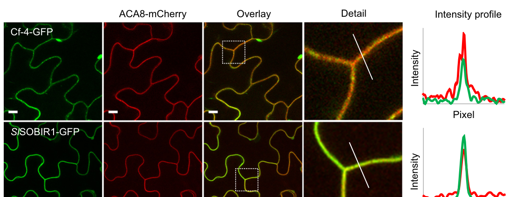
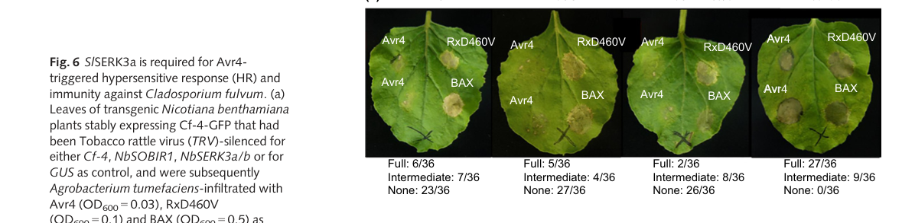

## Question

# Gene Research for Functional Annotation

## ⚠️ CRITICAL: Gene/Protein Identification Context

**BEFORE YOU BEGIN RESEARCH:** You MUST verify you are researching the CORRECT gene/protein. Gene symbols can be ambiguous, especially for less well-characterized genes from non-model organisms.

### Target Gene/Protein Identity (from UniProt):
- **UniProt Accession:** O50025
- **Protein Description:** SubName: Full=Cf-4 {ECO:0000313|EMBL:CAA05268.1};
- **Gene Information:** Name=Cf-4 {ECO:0000313|EMBL:CAA05268.1};
- **Organism (full):** Solanum habrochaites (Wild tomato) (Lycopersicon hirsutum).
- **Protein Family:** Belongs to the RLP family. .
- **Key Domains:** Leu-rich_rpt. (IPR001611); Leu-rich_rpt_typical-subtyp. (IPR003591); LRR_dom_sf. (IPR032675); LRR_N_plant-typ. (IPR013210); RLP23-like. (IPR046956)

### MANDATORY VERIFICATION STEPS:

1. **Check if the gene symbol "Cf-4" matches the protein description above**
2. **Verify the organism is correct:** Solanum habrochaites (Wild tomato) (Lycopersicon hirsutum).
3. **Check if protein family/domains align with what you find in literature**
4. **If you find literature for a DIFFERENT gene with the same or similar symbol, STOP**

### If Gene Symbol is Ambiguous or You Cannot Find Relevant Literature:

**DO NOT PROCEED WITH RESEARCH ON A DIFFERENT GENE.** Instead:
- State clearly: "The gene symbol 'Cf-4' is ambiguous or literature is limited for this specific protein"
- Explain what you found (e.g., "Found extensive literature on a different gene with the same symbol in a different organism")
- Describe the protein based ONLY on the UniProt information provided above
- Suggest that the protein function can be inferred from domain/family information

### Research Target:

Please provide a comprehensive research report on the gene **Cf-4** (gene ID: Cf-4, UniProt: O50025) in SOLHA.

The research report should be a detailed narrative explaining the function, biological processes, and localization of the gene product. Citations should be given for all claims.

You should prioritize authoritative reviews and primary scientific literature when conducting research. You can supplement
this with annotations you find in gene/protein databases, but these can be outdated or inaccurate.

We are specifically interested in the primary function of the gene - for enzymes, what reaction is catalyzed, and what is the substrate specificity? For transporters, what is the substrate? For structural proteins or adapters, what is the broader structural role? For signaling molecules, what is the role in the pathway.

We are interested in where in or outside the cell the gene product carries out its function.

We are also interested in the signaling or biochemical pathways in which the gene functions. We are less interested in broad pleiotropic effects, except where these elucidate the precise role.

Include evidence where possible. We are interested in both experimental evidence as well as inference from structure, evolution, or bioinformatic analysis. Precise studies should be prioritized over high-throughput, where available.

## Output

Question: You are an expert researcher providing comprehensive, well-cited information.

Provide detailed information focusing on:
1. Key concepts and definitions with current understanding
2. Recent developments and latest research (prioritize 2023-2024 sources)
3. Current applications and real-world implementations
4. Expert opinions and analysis from authoritative sources
5. Relevant statistics and data from recent studies

Format as a comprehensive research report with proper citations. Include URLs and publication dates where available.
Always prioritize recent, authoritative sources and provide specific citations for all major claims.

# Gene Research for Functional Annotation

## ⚠️ CRITICAL: Gene/Protein Identification Context

**BEFORE YOU BEGIN RESEARCH:** You MUST verify you are researching the CORRECT gene/protein. Gene symbols can be ambiguous, especially for less well-characterized genes from non-model organisms.

### Target Gene/Protein Identity (from UniProt):
- **UniProt Accession:** O50025
- **Protein Description:** SubName: Full=Cf-4 {ECO:0000313|EMBL:CAA05268.1};
- **Gene Information:** Name=Cf-4 {ECO:0000313|EMBL:CAA05268.1};
- **Organism (full):** Solanum habrochaites (Wild tomato) (Lycopersicon hirsutum).
- **Protein Family:** Belongs to the RLP family. .
- **Key Domains:** Leu-rich_rpt. (IPR001611); Leu-rich_rpt_typical-subtyp. (IPR003591); LRR_dom_sf. (IPR032675); LRR_N_plant-typ. (IPR013210); RLP23-like. (IPR046956)

### MANDATORY VERIFICATION STEPS:

1. **Check if the gene symbol "Cf-4" matches the protein description above**
2. **Verify the organism is correct:** Solanum habrochaites (Wild tomato) (Lycopersicon hirsutum).
3. **Check if protein family/domains align with what you find in literature**
4. **If you find literature for a DIFFERENT gene with the same or similar symbol, STOP**

### If Gene Symbol is Ambiguous or You Cannot Find Relevant Literature:

**DO NOT PROCEED WITH RESEARCH ON A DIFFERENT GENE.** Instead:
- State clearly: "The gene symbol 'Cf-4' is ambiguous or literature is limited for this specific protein"
- Explain what you found (e.g., "Found extensive literature on a different gene with the same symbol in a different organism")
- Describe the protein based ONLY on the UniProt information provided above
- Suggest that the protein function can be inferred from domain/family information

### Research Target:

Please provide a comprehensive research report on the gene **Cf-4** (gene ID: Cf-4, UniProt: O50025) in SOLHA.

The research report should be a detailed narrative explaining the function, biological processes, and localization of the gene product. Citations should be given for all claims.

You should prioritize authoritative reviews and primary scientific literature when conducting research. You can supplement
this with annotations you find in gene/protein databases, but these can be outdated or inaccurate.

We are specifically interested in the primary function of the gene - for enzymes, what reaction is catalyzed, and what is the substrate specificity? For transporters, what is the substrate? For structural proteins or adapters, what is the broader structural role? For signaling molecules, what is the role in the pathway.

We are interested in where in or outside the cell the gene product carries out its function.

We are also interested in the signaling or biochemical pathways in which the gene functions. We are less interested in broad pleiotropic effects, except where these elucidate the precise role.

Include evidence where possible. We are interested in both experimental evidence as well as inference from structure, evolution, or bioinformatic analysis. Precise studies should be prioritized over high-throughput, where available.

# Cf-4 functional annotation: *Solanum habrochaites* (UniProt O50025)

## Identity and scope

The supplied UniProt record identifies **Cf-4 (O50025; EMBL protein CAA05268.1)** from *Solanum habrochaites*, formerly *Lycopersicon hirsutum*. This assignment is consistent with primary genetic literature identifying *L. hirsutum* as the source of the Cf-4 resistance locus introgressed into cultivated tomato. The protein is an extracellular leucine-rich-repeat **receptor-like protein (LRR-RLP)**, consistent with the supplied LRR and RLP-family annotations. It must not be confused with **Cf-4A/Hcr9-4E**, a neighboring, homologous locus product deposited as *L. esculentum* Cf-4A (EMBL Y12640): disrupting Cf-4A impaired resistance to a fungal race but did **not** abolish the Avr4-specific response. The retrieved papers do not themselves provide an explicit sequence-level cross-reference from CAA05268.1 to the Cf-4 construct used in every later experiment; mechanistic findings below concern the experimentally studied Avr4-responsive **Cf-4**, not Cf-4A. (takken1998identificationanddstagged pages 1-2, takken1998identificationanddstagged pages 7-8, takken1998identificationanddstagged pages 11-11)

## Primary function and specificity

**Cf-4 is a cell-surface immune sensor for the secreted fungal effector Avr4.** Its principal biological role is to initiate resistance to Avr4-producing *Fulvia fulva* (syn. *Cladosporium fulvum*), the agent of tomato leaf mold. This is a specific recognition relationship: Cf-2 responds to Avr2 and Cf-9 to Avr9, rather than Avr4. Avr4 expression elicits a hypersensitive, localized cell-death response in Cf-4 plants; the Avr4-responsive Cf-4 gene was reported to confer resistance in transgenic plants. Cf-4 is **not an enzyme or transporter**: no catalytic reaction or transported substrate is assigned to it. Avr4 is its recognized extracellular signal, not a metabolic substrate. (takken1998identificationanddstagged pages 7-8, postma2016avr4promotescf4 pages 1-2, cai2024receptorlikeproteinsdecisionmakers pages 7-9)

The fungal protein Avr4 binds chitin and helps shield the fungal cell wall against host chitinases. That **chitin-binding activity belongs to Avr4, not Cf-4**. Cf-4 also responds to Avr4 homologues from other fungi, but recognizing these homologues does not establish broad protection against those fungi. Although genetic specificity and receptor-complex responses strongly support Avr4 perception by Cf-4, the evidence examined here does not establish a purified-protein binding constant or a resolved direct Cf-4–Avr4 structure. The proposal that a chitin-binding-region feature of Avr4 contacts Cf-4 remains a mechanistic hypothesis; notably, an Avr4 proline implicated in elicitation can be dispensable for chitin binding. (postma2016avr4promotescf4 pages 11-12)

## Structure and site of action

Cf-4 has an N-terminal extracellular LRR-containing recognition region, a membrane-spanning segment and a short intracellular region **without its own kinase domain**. The supplied InterPro assignments—plant-type LRRs, an LRR superfamily domain and an RLP23-like family annotation—accord with this architecture; the RLP23-like classification **does not establish that Cf-4 recognizes RLP23’s nlp20 ligand**. Comparative analysis of Cf-4 and Cf-9 places much of their different recognition specificity in the divergent N-terminal extracellular region rather than their conserved membrane-proximal signaling architecture. A later review describes 25 extracellular LRRs for Cf-4, versus 27 for Cf-9; the separately characterized Cf-4A also has 25 predicted LRRs, so repeat count alone cannot distinguish the neighboring genes. (cai2024receptorlikeproteinsdecisionmakers pages 1-3, takken1998identificationanddstagged pages 1-2, budak2026cf4andcf5triggered pages 4-8, huang2025immunesignalingreceptorlike pages 5-7)

**The functional site is the plant plasma membrane, facing the leaf apoplast.** This placement matches the pathogen’s extracellular growth and secretion of Avr4 into the apoplast. In live-cell experiments, fluorescent Cf-4 localized with a plasma-membrane marker and with its associated signaling kinase SOBIR1. Following Avr4—but not the nonmatching Avr2—Cf-4 entered intracellular ARA6/ARA7-positive late-endosomal compartments with SOBIR1; trafficking toward vacuolar degradation is the proposed subsequent fate. Thus, endosomes are an observed **post-activation trafficking compartment**, whereas extracellular recognition occurs at the cell surface. These imaging experiments used Cf-4 expressed in *Nicotiana benthamiana*; the species is an experimental host, not the stated wild-tomato source of the gene. **Visual evidence:** the cropped plasma-membrane localization panels from Postma *et al.* Figure 1 support the localization assignment. (postma2016avr4promotescf4 pages 1-2, postma2016avr4promotescf4 pages 4-5, postma2016avr4promotescf4 pages 2-3, postma2016avr4promotescf4 media 0537866a)

## Signaling pathway and experimental evidence

Cf-4 constitutively associates with the transmembrane kinase **SOBIR1**, which supplies signaling capacity that Cf-4 lacks. Recognition of matching Avr4 promotes association of the receptor system with **BAK1/SERK3**; SERK1 also participates. Co-immunoprecipitation detected SOBIR1 with Cf-4 irrespective of treatment, but detected Cf-4–SERK3a association specifically after Avr4 rather than Avr2 or flg22 treatment. SERK3 silencing reduced Avr4-induced Cf-4 endocytosis, while functional BAK1—but not a kinase-inactive BAK1 variant—restored it. A Cf-4–SOBIR1–SERK signaling complex is therefore well supported, although the original co-immunoprecipitation experiments did not alone prove the exact simultaneous stoichiometry of a three-protein complex. (postma2016avr4promotescf4 pages 8-9, postma2016avr4promotescf4 pages 11-12)

**Recent mechanistic advance (May 2024):** Huang *et al.* demonstrated reciprocal *in-vitro* phosphorylation between SOBIR1 and BAK1 and used *N. benthamiana* expressing Cf-4 to dissect downstream signaling. NbSOBIR1 **Thr522** was required for intrinsic kinase activity and Avr4/Cf-4-associated immune outputs. **Tyr469** had a distinct role: it was required for MAP-kinase activation and the hypersensitive response, but not for the tested ROS response or intrinsic kinase activity. Knockouts of receptor-like cytoplasmic kinase groups **RLCK-VII-6, -7 and -8** affected different components of the *biphasic* Avr4-triggered reactive-oxygen-species burst; VII-7 members were also important for hypersensitive cell death. These experiments identify routes from the surface kinase complex to ROS, MAPK and cell-death signaling; their phosphorylation and knockout results should not be read as demonstrating that Cf-4 itself is a kinase. A specialist review further identifies the intracellular helper NLR **NRC3** as important downstream of Cf-4-mediated cell death in solanaceous experimental systems, an additional signaling requirement rather than a change in Cf-4’s cell-surface identity. (huang2024receptorlikecytoplasmickinases pages 1-2, huang2023receptorlikecytoplasmickinases pages 18-20, huang2025immunesignalingreceptorlike pages 7-9)

The resistance phenotype is supported by pathogen assays, not only by visible cell death. In Postma *et al.*’s Cf-4 tomato experiment, successful fungal-colonization spots were reported as **12 across 44 sampled leaves** after control silencing, versus **364 across 36 leaves** after SlSERK3a silencing and **more than 500 across 32 leaves** after Cf-4 silencing; these are spot counts and leaf counts, **not percentages of infected leaves**. In a separate *N. benthamiana* assay, full Avr4-induced hypersensitive responses occurred in **27/36** control infiltrations, compared with **2/36** after NbSERK3a/b silencing. Together, the results support a requirement for Cf-4 and its signaling partners in restricting Avr4-producing fungus. **Visual evidence:** cropped Postma *et al.* Figure 6 panels show the response scores and colonization assays. (postma2016avr4promotescf4 pages 10-11, postma2016avr4promotescf4 media a5de3b70, postma2016avr4promotescf4 media 0205d2f7)

## Application and limits of inference

Cf-4 is a defined source of **race-specific leaf-mold resistance** that has been transferred from wild-tomato germplasm into cultivated tomato and is useful both in resistance breeding and as an experimental model for extracellular immune-receptor signaling. It is not expected to protect against every *F. fulva* isolate: receptor-mediated protection depends on a recognizable fungal effector. An effector-screening study illustrates the broader breeding approach, identifying **70** apoplastic, infection-induced fungal small secreted proteins and testing **41** for recognition; **nine** elicited responses in at least one wild-tomato accession. These screening numbers describe discovery of *additional* candidate specificities, **not** a measured success rate for Cf-4 deployment. Reports of resistance-breaking fungal strains motivate combining and monitoring complementary Cf specificities, rather than assuming single-gene durability. (takken1998identificationanddstagged pages 1-2, mesarich2018specifichypersensitiveresponse–associated pages 7-9, mesarich2018specifichypersensitiveresponse–associated pages 5-7, mesarich2018specifichypersensitiveresponse–associated pages 26-28)

**Evidence boundary:** the strongest direct support for localization, co-receptor recruitment and fungal restriction comes from cultivated Cf-4 tomato and transgenic *N. benthamiana*. The 2024 kinase/RLCK results principally use the latter system. They support functional annotation of the *S. habrochaites*-origin Cf-4 receptor, but do not constitute separate measurements of every signaling step in unmodified wild *S. habrochaites*. Direct Avr4-binding kinetics and a receptor–effector structure are not established by the sources assessed here. (takken1998identificationanddstagged pages 1-2, postma2016avr4promotescf4 pages 8-9, huang2024receptorlikecytoplasmickinases pages 1-2, postma2016avr4promotescf4 pages 11-12)

### Principal sources and dates

- Takken *et al.*, **May 1998**, *The Plant Journal*, “Identification and Ds-tagged isolation of a new gene at the Cf-4 locus…” https://doi.org/10.1046/j.1365-313x.1998.00135.x — locus origin and the essential Cf-4/Cf-4A distinction. (takken1998identificationanddstagged pages 1-2, takken1998identificationanddstagged pages 7-8, takken1998identificationanddstagged pages 11-11)
- Postma *et al.*, **April 2016** volume publication, *New Phytologist*, “Avr4 promotes Cf-4 receptor-like protein association with the BAK1/SERK3 receptor-like kinase…” https://doi.org/10.1111/nph.13802 — localization, receptor interactions, trafficking and fungal assays. (postma2016avr4promotescf4 pages 1-2, postma2016avr4promotescf4 pages 8-9, postma2016avr4promotescf4 pages 10-11)
- Mesarich *et al.*, **January 2018**, *Molecular Plant-Microbe Interactions*, “Specific Hypersensitive Response–Associated Recognition of New Apoplastic Effectors…” https://doi.org/10.1094/mpmi-05-17-0114-fi — wild-germplasm effector screening and breeding context. (mesarich2018specifichypersensitiveresponse–associated pages 7-9, mesarich2018specifichypersensitiveresponse–associated pages 5-7)
- Huang *et al.*, **May 2024**, *Nature Communications*, “Receptor-like cytoplasmic kinases of different subfamilies differentially regulate SOBIR1/BAK1-mediated immune responses…” https://doi.org/10.1038/s41467-024-48313-1 — recent kinase and downstream-RLCK experiments. (huang2024receptorlikecytoplasmickinases pages 1-2, huang2024receptorlikecytoplasmickinases pages 2-3)
- Cai *et al.*, **November 2024**, *Phytopathology Research*, “Receptor-like proteins: decision-makers of plant immunity,” https://doi.org/10.1186/s42483-024-00279-0; Huang and Joosten, **January 2025** issue, *Trends in Plant Science*, “Immune signaling: receptor-like proteins make the difference,” https://doi.org/10.1016/j.tplants.2024.03.012 — authoritative syntheses of receptor classification and signaling. (cai2024receptorlikeproteinsdecisionmakers pages 1-3, huang2025immunesignalingreceptorlike pages 7-9, cai2024receptorlikeproteinsdecisionmakers pages 7-9)

References

1. (takken1998identificationanddstagged pages 1-2): F. Takken, D. Schipper, H. Nijkamp, and J. Hille. Identification and ds-tagged isolation of a new gene at the cf-4 locus of tomato involved in disease resistance to cladosporium fulvum race 5. The Plant journal : for cell and molecular biology, 14 4:401-11, May 1998. URL: https://doi.org/10.1046/j.1365-313x.1998.00135.x, doi:10.1046/j.1365-313x.1998.00135.x. This article has 111 citations.

2. (takken1998identificationanddstagged pages 7-8): F. Takken, D. Schipper, H. Nijkamp, and J. Hille. Identification and ds-tagged isolation of a new gene at the cf-4 locus of tomato involved in disease resistance to cladosporium fulvum race 5. The Plant journal : for cell and molecular biology, 14 4:401-11, May 1998. URL: https://doi.org/10.1046/j.1365-313x.1998.00135.x, doi:10.1046/j.1365-313x.1998.00135.x. This article has 111 citations.

3. (takken1998identificationanddstagged pages 11-11): F. Takken, D. Schipper, H. Nijkamp, and J. Hille. Identification and ds-tagged isolation of a new gene at the cf-4 locus of tomato involved in disease resistance to cladosporium fulvum race 5. The Plant journal : for cell and molecular biology, 14 4:401-11, May 1998. URL: https://doi.org/10.1046/j.1365-313x.1998.00135.x, doi:10.1046/j.1365-313x.1998.00135.x. This article has 111 citations.

4. (postma2016avr4promotescf4 pages 1-2): Jelle Postma, Thomas W. H. Liebrand, Guozhi Bi, Alexandre Evrard, Ruby R. Bye, Malick Mbengue, Hannah Kuhn, Matthieu H. A. J. Joosten, and Silke Robatzek. Avr4 promotes cf-4 receptor-like protein association with the bak1/serk3 receptor-like kinase to initiate receptor endocytosis and plant immunity. The New phytologist, 210 2:627-42, Apr 2016. URL: https://doi.org/10.1111/nph.13802, doi:10.1111/nph.13802. This article has 191 citations.

5. (cai2024receptorlikeproteinsdecisionmakers pages 7-9): Minrui Cai, Hongqiang Yu, E. Sun, and Cunwu Zuo. Receptor-like proteins: decision-makers of plant immunity. Phytopathology Research, Nov 2024. URL: https://doi.org/10.1186/s42483-024-00279-0, doi:10.1186/s42483-024-00279-0. This article has 24 citations and is from a peer-reviewed journal.

6. (postma2016avr4promotescf4 pages 11-12): Jelle Postma, Thomas W. H. Liebrand, Guozhi Bi, Alexandre Evrard, Ruby R. Bye, Malick Mbengue, Hannah Kuhn, Matthieu H. A. J. Joosten, and Silke Robatzek. Avr4 promotes cf-4 receptor-like protein association with the bak1/serk3 receptor-like kinase to initiate receptor endocytosis and plant immunity. The New phytologist, 210 2:627-42, Apr 2016. URL: https://doi.org/10.1111/nph.13802, doi:10.1111/nph.13802. This article has 191 citations.

7. (cai2024receptorlikeproteinsdecisionmakers pages 1-3): Minrui Cai, Hongqiang Yu, E. Sun, and Cunwu Zuo. Receptor-like proteins: decision-makers of plant immunity. Phytopathology Research, Nov 2024. URL: https://doi.org/10.1186/s42483-024-00279-0, doi:10.1186/s42483-024-00279-0. This article has 24 citations and is from a peer-reviewed journal.

8. (budak2026cf4andcf5triggered pages 4-8): Esranur Budak, Henrique Aguiar Canha, and Matthieu H.A.J. Joosten. Cf-4- and cf-5-triggered plant immunity: similarities and differences. Jun 2026. URL: https://doi.org/10.64898/2026.06.10.731257, doi:10.64898/2026.06.10.731257. This article has 0 citations.

9. (huang2025immunesignalingreceptorlike pages 5-7): Wen R.H. Huang and Matthieu H.A.J. Joosten. Immune signaling: receptor-like proteins make the difference. Trends in Plant Science, 30:54-68, Jan 2025. URL: https://doi.org/10.1016/j.tplants.2024.03.012, doi:10.1016/j.tplants.2024.03.012. This article has 67 citations and is from a domain leading peer-reviewed journal.

10. (postma2016avr4promotescf4 pages 4-5): Jelle Postma, Thomas W. H. Liebrand, Guozhi Bi, Alexandre Evrard, Ruby R. Bye, Malick Mbengue, Hannah Kuhn, Matthieu H. A. J. Joosten, and Silke Robatzek. Avr4 promotes cf-4 receptor-like protein association with the bak1/serk3 receptor-like kinase to initiate receptor endocytosis and plant immunity. The New phytologist, 210 2:627-42, Apr 2016. URL: https://doi.org/10.1111/nph.13802, doi:10.1111/nph.13802. This article has 191 citations.

11. (postma2016avr4promotescf4 pages 2-3): Jelle Postma, Thomas W. H. Liebrand, Guozhi Bi, Alexandre Evrard, Ruby R. Bye, Malick Mbengue, Hannah Kuhn, Matthieu H. A. J. Joosten, and Silke Robatzek. Avr4 promotes cf-4 receptor-like protein association with the bak1/serk3 receptor-like kinase to initiate receptor endocytosis and plant immunity. The New phytologist, 210 2:627-42, Apr 2016. URL: https://doi.org/10.1111/nph.13802, doi:10.1111/nph.13802. This article has 191 citations.

12. (postma2016avr4promotescf4 media 0537866a): Jelle Postma, Thomas W. H. Liebrand, Guozhi Bi, Alexandre Evrard, Ruby R. Bye, Malick Mbengue, Hannah Kuhn, Matthieu H. A. J. Joosten, and Silke Robatzek. Avr4 promotes cf-4 receptor-like protein association with the bak1/serk3 receptor-like kinase to initiate receptor endocytosis and plant immunity. The New phytologist, 210 2:627-42, Apr 2016. URL: https://doi.org/10.1111/nph.13802, doi:10.1111/nph.13802. This article has 191 citations.

13. (postma2016avr4promotescf4 pages 8-9): Jelle Postma, Thomas W. H. Liebrand, Guozhi Bi, Alexandre Evrard, Ruby R. Bye, Malick Mbengue, Hannah Kuhn, Matthieu H. A. J. Joosten, and Silke Robatzek. Avr4 promotes cf-4 receptor-like protein association with the bak1/serk3 receptor-like kinase to initiate receptor endocytosis and plant immunity. The New phytologist, 210 2:627-42, Apr 2016. URL: https://doi.org/10.1111/nph.13802, doi:10.1111/nph.13802. This article has 191 citations.

14. (huang2024receptorlikecytoplasmickinases pages 1-2): Wen R. H. Huang, Ciska Braam, Carola Kretschmer, Sergio Landeo Villanueva, Huan Liu, Filiz Ferik, Aranka M. Burgh, Jinbin Wu, Lisha Zhang, Thorsten Nürnberger, Yuluan Wang, Michael F. Seidl, Edouard Evangelisti, Johannes Stuttmann, and Matthieu H. A. J. Joosten. Receptor-like cytoplasmic kinases of different subfamilies differentially regulate sobir1/bak1-mediated immune responses in nicotiana benthamiana. Nature Communications, May 2024. URL: https://doi.org/10.1038/s41467-024-48313-1, doi:10.1038/s41467-024-48313-1. This article has 28 citations and is from a highest quality peer-reviewed journal.

15. (huang2023receptorlikecytoplasmickinases pages 18-20): Wen R.H. Huang, Ciska Braam, Carola Kretschmer, Huan Liu, Filiz Ferik, Aranka M. van der Burgh, Max Pluis, Agnes Omabour Hagan, Sergio Landeo Villanueva, Jinbin Wu, Amber van Loosbroek, Yulu Wang, Michael F. Seidl, Johannes Stuttmann, and Matthieu H.A.J. Joosten. Receptor-like cytoplasmic kinases belonging to different subfamilies mediate immune responses downstream of the cf-4 resistance protein in nicotiana benthamiana. bioRxiv, Apr 2023. URL: https://doi.org/10.1101/2023.04.25.538242, doi:10.1101/2023.04.25.538242. This article has 4 citations.

16. (huang2025immunesignalingreceptorlike pages 7-9): Wen R.H. Huang and Matthieu H.A.J. Joosten. Immune signaling: receptor-like proteins make the difference. Trends in Plant Science, 30:54-68, Jan 2025. URL: https://doi.org/10.1016/j.tplants.2024.03.012, doi:10.1016/j.tplants.2024.03.012. This article has 67 citations and is from a domain leading peer-reviewed journal.

17. (postma2016avr4promotescf4 pages 10-11): Jelle Postma, Thomas W. H. Liebrand, Guozhi Bi, Alexandre Evrard, Ruby R. Bye, Malick Mbengue, Hannah Kuhn, Matthieu H. A. J. Joosten, and Silke Robatzek. Avr4 promotes cf-4 receptor-like protein association with the bak1/serk3 receptor-like kinase to initiate receptor endocytosis and plant immunity. The New phytologist, 210 2:627-42, Apr 2016. URL: https://doi.org/10.1111/nph.13802, doi:10.1111/nph.13802. This article has 191 citations.

18. (postma2016avr4promotescf4 media a5de3b70): Jelle Postma, Thomas W. H. Liebrand, Guozhi Bi, Alexandre Evrard, Ruby R. Bye, Malick Mbengue, Hannah Kuhn, Matthieu H. A. J. Joosten, and Silke Robatzek. Avr4 promotes cf-4 receptor-like protein association with the bak1/serk3 receptor-like kinase to initiate receptor endocytosis and plant immunity. The New phytologist, 210 2:627-42, Apr 2016. URL: https://doi.org/10.1111/nph.13802, doi:10.1111/nph.13802. This article has 191 citations.

19. (postma2016avr4promotescf4 media 0205d2f7): Jelle Postma, Thomas W. H. Liebrand, Guozhi Bi, Alexandre Evrard, Ruby R. Bye, Malick Mbengue, Hannah Kuhn, Matthieu H. A. J. Joosten, and Silke Robatzek. Avr4 promotes cf-4 receptor-like protein association with the bak1/serk3 receptor-like kinase to initiate receptor endocytosis and plant immunity. The New phytologist, 210 2:627-42, Apr 2016. URL: https://doi.org/10.1111/nph.13802, doi:10.1111/nph.13802. This article has 191 citations.

20. (mesarich2018specifichypersensitiveresponse–associated pages 7-9): Carl H. Mesarich, Bilal Ӧkmen, Hanna Rovenich, Scott A. Griffiths, Changchun Wang, Mansoor Karimi Jashni, Aleksandar Mihajlovski, Jérôme Collemare, Lukas Hunziker, Cecilia H. Deng, Ate van der Burgt, Henriek G. Beenen, Matthew D. Templeton, Rosie E. Bradshaw, and Pierre J. G. M. de Wit. Specific hypersensitive response–associated recognition of new apoplastic effectors from <i>cladosporium fulvum</i> in wild tomato. Molecular Plant-Microbe Interactions®, 31:145-162, Jan 2018. URL: https://doi.org/10.1094/mpmi-05-17-0114-fi, doi:10.1094/mpmi-05-17-0114-fi. This article has 81 citations.

21. (mesarich2018specifichypersensitiveresponse–associated pages 5-7): Carl H. Mesarich, Bilal Ӧkmen, Hanna Rovenich, Scott A. Griffiths, Changchun Wang, Mansoor Karimi Jashni, Aleksandar Mihajlovski, Jérôme Collemare, Lukas Hunziker, Cecilia H. Deng, Ate van der Burgt, Henriek G. Beenen, Matthew D. Templeton, Rosie E. Bradshaw, and Pierre J. G. M. de Wit. Specific hypersensitive response–associated recognition of new apoplastic effectors from <i>cladosporium fulvum</i> in wild tomato. Molecular Plant-Microbe Interactions®, 31:145-162, Jan 2018. URL: https://doi.org/10.1094/mpmi-05-17-0114-fi, doi:10.1094/mpmi-05-17-0114-fi. This article has 81 citations.

22. (mesarich2018specifichypersensitiveresponse–associated pages 26-28): Carl H. Mesarich, Bilal Ӧkmen, Hanna Rovenich, Scott A. Griffiths, Changchun Wang, Mansoor Karimi Jashni, Aleksandar Mihajlovski, Jérôme Collemare, Lukas Hunziker, Cecilia H. Deng, Ate van der Burgt, Henriek G. Beenen, Matthew D. Templeton, Rosie E. Bradshaw, and Pierre J. G. M. de Wit. Specific hypersensitive response–associated recognition of new apoplastic effectors from <i>cladosporium fulvum</i> in wild tomato. Molecular Plant-Microbe Interactions®, 31:145-162, Jan 2018. URL: https://doi.org/10.1094/mpmi-05-17-0114-fi, doi:10.1094/mpmi-05-17-0114-fi. This article has 81 citations.

23. (huang2024receptorlikecytoplasmickinases pages 2-3): Wen R. H. Huang, Ciska Braam, Carola Kretschmer, Sergio Landeo Villanueva, Huan Liu, Filiz Ferik, Aranka M. Burgh, Jinbin Wu, Lisha Zhang, Thorsten Nürnberger, Yuluan Wang, Michael F. Seidl, Edouard Evangelisti, Johannes Stuttmann, and Matthieu H. A. J. Joosten. Receptor-like cytoplasmic kinases of different subfamilies differentially regulate sobir1/bak1-mediated immune responses in nicotiana benthamiana. Nature Communications, May 2024. URL: https://doi.org/10.1038/s41467-024-48313-1, doi:10.1038/s41467-024-48313-1. This article has 28 citations and is from a highest quality peer-reviewed journal.

## Artifacts

## Citations

1. takken1998identificationanddstagged pages 1-2
2. takken1998identificationanddstagged pages 7-8
3. takken1998identificationanddstagged pages 11-11
4. cai2024receptorlikeproteinsdecisionmakers pages 7-9
5. cai2024receptorlikeproteinsdecisionmakers pages 1-3
6. huang2025immunesignalingreceptorlike pages 5-7
7. huang2024receptorlikecytoplasmickinases pages 1-2
8. huang2023receptorlikecytoplasmickinases pages 18-20
9. huang2025immunesignalingreceptorlike pages 7-9
10. huang2024receptorlikecytoplasmickinases pages 2-3
11. https://doi.org/10.1046/j.1365-313x.1998.00135.x
12. https://doi.org/10.1111/nph.13802
13. https://doi.org/10.1094/mpmi-05-17-0114-fi
14. https://doi.org/10.1038/s41467-024-48313-1
15. https://doi.org/10.1186/s42483-024-00279-0;
16. https://doi.org/10.1016/j.tplants.2024.03.012
17. https://doi.org/10.1046/j.1365-313x.1998.00135.x,
18. https://doi.org/10.1111/nph.13802,
19. https://doi.org/10.1186/s42483-024-00279-0,
20. https://doi.org/10.64898/2026.06.10.731257,
21. https://doi.org/10.1016/j.tplants.2024.03.012,
22. https://doi.org/10.1038/s41467-024-48313-1,
23. https://doi.org/10.1101/2023.04.25.538242,
24. https://doi.org/10.1094/mpmi-05-17-0114-fi,