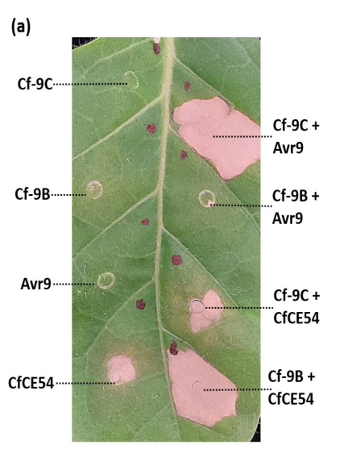

## Question

# Gene Research for Functional Annotation

## ⚠️ CRITICAL: Gene/Protein Identification Context

**BEFORE YOU BEGIN RESEARCH:** You MUST verify you are researching the CORRECT gene/protein. Gene symbols can be ambiguous, especially for less well-characterized genes from non-model organisms.

### Target Gene/Protein Identity (from UniProt):
- **UniProt Accession:** Q40235
- **Protein Description:** RecName: Full=Receptor-like protein Cf-9 {ECO:0000305}; Flags: Precursor;
- **Gene Information:** Name=CF-9 {ECO:0000312|EMBL:AAA65235.1, ECO:0000312|EMBL:CAA05274.1};
- **Organism (full):** Solanum pimpinellifolium (Currant tomato) (Lycopersicon pimpinellifolium).
- **Protein Family:** Belongs to the RLP family. .
- **Key Domains:** Leu-rich_rpt. (IPR001611); Leu-rich_rpt_typical-subtyp. (IPR003591); LRR_dom_sf. (IPR032675); LRR_N_plant-typ. (IPR013210); RLP23-like. (IPR046956)

### MANDATORY VERIFICATION STEPS:

1. **Check if the gene symbol "CF-9" matches the protein description above**
2. **Verify the organism is correct:** Solanum pimpinellifolium (Currant tomato) (Lycopersicon pimpinellifolium).
3. **Check if protein family/domains align with what you find in literature**
4. **If you find literature for a DIFFERENT gene with the same or similar symbol, STOP**

### If Gene Symbol is Ambiguous or You Cannot Find Relevant Literature:

**DO NOT PROCEED WITH RESEARCH ON A DIFFERENT GENE.** Instead:
- State clearly: "The gene symbol 'CF-9' is ambiguous or literature is limited for this specific protein"
- Explain what you found (e.g., "Found extensive literature on a different gene with the same symbol in a different organism")
- Describe the protein based ONLY on the UniProt information provided above
- Suggest that the protein function can be inferred from domain/family information

### Research Target:

Please provide a comprehensive research report on the gene **CF-9** (gene ID: CF-9, UniProt: Q40235) in SOLPI.

The research report should be a detailed narrative explaining the function, biological processes, and localization of the gene product. Citations should be given for all claims.

You should prioritize authoritative reviews and primary scientific literature when conducting research. You can supplement
this with annotations you find in gene/protein databases, but these can be outdated or inaccurate.

We are specifically interested in the primary function of the gene - for enzymes, what reaction is catalyzed, and what is the substrate specificity? For transporters, what is the substrate? For structural proteins or adapters, what is the broader structural role? For signaling molecules, what is the role in the pathway.

We are interested in where in or outside the cell the gene product carries out its function.

We are also interested in the signaling or biochemical pathways in which the gene functions. We are less interested in broad pleiotropic effects, except where these elucidate the precise role.

Include evidence where possible. We are interested in both experimental evidence as well as inference from structure, evolution, or bioinformatic analysis. Precise studies should be prioritized over high-throughput, where available.

## Output

Question: You are an expert researcher providing comprehensive, well-cited information.

Provide detailed information focusing on:
1. Key concepts and definitions with current understanding
2. Recent developments and latest research (prioritize 2023-2024 sources)
3. Current applications and real-world implementations
4. Expert opinions and analysis from authoritative sources
5. Relevant statistics and data from recent studies

Format as a comprehensive research report with proper citations. Include URLs and publication dates where available.
Always prioritize recent, authoritative sources and provide specific citations for all major claims.

# Gene Research for Functional Annotation

## ⚠️ CRITICAL: Gene/Protein Identification Context

**BEFORE YOU BEGIN RESEARCH:** You MUST verify you are researching the CORRECT gene/protein. Gene symbols can be ambiguous, especially for less well-characterized genes from non-model organisms.

### Target Gene/Protein Identity (from UniProt):
- **UniProt Accession:** Q40235
- **Protein Description:** RecName: Full=Receptor-like protein Cf-9 {ECO:0000305}; Flags: Precursor;
- **Gene Information:** Name=CF-9 {ECO:0000312|EMBL:AAA65235.1, ECO:0000312|EMBL:CAA05274.1};
- **Organism (full):** Solanum pimpinellifolium (Currant tomato) (Lycopersicon pimpinellifolium).
- **Protein Family:** Belongs to the RLP family. .
- **Key Domains:** Leu-rich_rpt. (IPR001611); Leu-rich_rpt_typical-subtyp. (IPR003591); LRR_dom_sf. (IPR032675); LRR_N_plant-typ. (IPR013210); RLP23-like. (IPR046956)

### MANDATORY VERIFICATION STEPS:

1. **Check if the gene symbol "CF-9" matches the protein description above**
2. **Verify the organism is correct:** Solanum pimpinellifolium (Currant tomato) (Lycopersicon pimpinellifolium).
3. **Check if protein family/domains align with what you find in literature**
4. **If you find literature for a DIFFERENT gene with the same or similar symbol, STOP**

### If Gene Symbol is Ambiguous or You Cannot Find Relevant Literature:

**DO NOT PROCEED WITH RESEARCH ON A DIFFERENT GENE.** Instead:
- State clearly: "The gene symbol 'CF-9' is ambiguous or literature is limited for this specific protein"
- Explain what you found (e.g., "Found extensive literature on a different gene with the same symbol in a different organism")
- Describe the protein based ONLY on the UniProt information provided above
- Suggest that the protein function can be inferred from domain/family information

### Research Target:

Please provide a comprehensive research report on the gene **CF-9** (gene ID: CF-9, UniProt: Q40235) in SOLPI.

The research report should be a detailed narrative explaining the function, biological processes, and localization of the gene product. Citations should be given for all claims.

You should prioritize authoritative reviews and primary scientific literature when conducting research. You can supplement
this with annotations you find in gene/protein databases, but these can be outdated or inaccurate.

We are specifically interested in the primary function of the gene - for enzymes, what reaction is catalyzed, and what is the substrate specificity? For transporters, what is the substrate? For structural proteins or adapters, what is the broader structural role? For signaling molecules, what is the role in the pathway.

We are interested in where in or outside the cell the gene product carries out its function.

We are also interested in the signaling or biochemical pathways in which the gene functions. We are less interested in broad pleiotropic effects, except where these elucidate the precise role.

Include evidence where possible. We are interested in both experimental evidence as well as inference from structure, evolution, or bioinformatic analysis. Precise studies should be prioritized over high-throughput, where available.

# Functional annotation report: CF-9 (UniProt Q40235)

## Identity and principal function

**CF-9/Q40235 is the Cf-9 immune receptor of currant tomato, *Solanum pimpinellifolium* (formerly *Lycopersicon pimpinellifolium*)**, not a similarly named gene from another organism. In current descriptions of its five-gene resistance locus, the historically named *Cf-9* gene is designated **Cf-9C**. It must not be confused with the neighboring *Cf-9B* gene: Cf-9C mediates recognition of the fungal effector **Avr9**, whereas Cf-9B responds to **Avr9B**. Cf-4 is another related receptor but responds to Avr4. These distinctions are supported by matched and mismatched effector–receptor expression tests. (hoorn2005structure–functionanalysisof pages 1-2, rosa2023sequentialbreakdownof pages 1-4, rosa2023sequentialbreakdownof pages 7-10, rosa2023sequentialbreakdownof media 465dc95a)

Cf-9’s **primary molecular function** is to initiate resistance to tomato leaf mould when it senses the presence of Avr9 secreted by *Fulvia fulva* (also called *Cladosporium fulvum*). This is a **cell-surface immune-signaling function**, not an enzymatic reaction or transport activity. Recognition initiates localized defense, including a hypersensitive response (HR; localized cell death), that restricts fungal colonization. Cf-9C-associated resistance operates throughout plant development, unlike the principally mature-plant resistance supplied by Cf-9B. (thomas1998geneticandmolecular pages 1-2, rosa2023sequentialbreakdownof pages 1-4, rosa2023sequentialbreakdownof pages 4-7)

| Topic | Established experimentally | Limitation or distinction | Source DOI URL and year |
|---|---|---|---|
| Identity and architecture | Q40235 corresponds to the wild currant-tomato *Cf-9* product from *Lycopersicon pimpinellifolium* (now *Solanum pimpinellifolium*): an 863-aa extracellular LRR receptor-like protein with 27 LRRs, a single transmembrane segment and a short cytoplasmic tail. Cf-9 has two more LRRs than Cf-4. (thomas1998geneticandmolecular pages 5-6, kruijt2005receptorlikeproteinsinvolved pages 6-7, hoorn2005structure–functionanalysisof pages 1-2) | This is a non-enzymatic immune receptor without an intracellular kinase domain; it must signal through associated kinases. | [10.1098/rstb.1998.0296](https://doi.org/10.1098/rstb.1998.0296), 1998; [10.1105/tpc.104.028118](https://doi.org/10.1105/tpc.104.028118), 2005 |
| Avr9 specificity | Genetic and transient-expression evidence establishes that Cf-9—designated Cf-9C in the five-gene locus—specifically recognizes apoplastic Avr9 from *Fulvia fulva* (syn. *Cladosporium fulvum*) and initiates hypersensitive cell death and resistance. (thomas1998geneticandmolecular pages 1-2, rosa2023sequentialbreakdownof pages 1-4, rosa2023sequentialbreakdownof pages 7-10, rosa2023sequentialbreakdownof media 465dc95a) | Direct physical Cf-9–Avr9 binding has not been demonstrated. Radiolabeled Avr9 binds a high-affinity plasma-membrane site even in plants lacking Cf-9, indicating that recognition may be indirect or require another host component. (thomas1998geneticandmolecular pages 9-10, karimijashni2024glycosylationanalysisof pages 1-2) | [10.1098/rstb.1998.0296](https://doi.org/10.1098/rstb.1998.0296), 1998; [10.1111/nph.19925](https://doi.org/10.1111/nph.19925), 2024 |
| Structure–function and glycosylation | A study of 66 site-directed Cf-9 mutants tested Avr9 recognition and protein stability. Of 22 predicted N-glycosylation sites, all but one were experimentally glycosylated; many supported activity, and sites in predicted LRR α-helices were essential. Added glycans on the predicted concave β-sheet recognition surface blocked activity. (hoorn2005structure–functionanalysisof pages 1-2) | These results map surfaces necessary for receptor folding or recognition but do not identify a direct Avr9-binding interface. | [10.1105/tpc.104.028118](https://doi.org/10.1105/tpc.104.028118), 2005 |
| Cellular localization | Functional Cf-9 was detected at the plasma membrane, consistent with perception of an effector in the leaf apoplast. Mutation of its putative C-terminal dilysine ER-retrieval motif did not abolish receptor function. (kruijt2005receptorlikeproteinsinvolved pages 7-7) | Overexpressed Cf-9 has also accumulated in the ER; this likely reflects unmasked retrieval motifs or secretory-pathway overload. The functional signaling pool is therefore best assigned to the plasma membrane, while ER localization reflects biogenesis or overexpression. | [10.1111/j.1364-3703.2004.00264.x](https://doi.org/10.1111/j.1364-3703.2004.00264.x), 2005 |
| SOBIR1 coreceptor | Co-immunopurification showed that tomato SOBIR1 and SOBIR1-like associate with Cf-family RLPs, including Cf-9. The association is constitutive and provides the intracellular kinase function absent from Cf-9; SOBIR1 is also required for Cf-9C/Avr9-triggered cell death. (liebrand2013receptorlikekinasesobir1evr pages 3-4, rosa2023sequentialbreakdownof pages 7-10, postma2015thecf4receptorlike pages 4-7) | The most detailed stability, kinase-dependence and resistance experiments in the 2013 study used Cf-4 or other RLPs; these should not all be attributed directly to Cf-9. | [10.1073/pnas.1220015110](https://doi.org/10.1073/pnas.1220015110), 2013; [10.1111/nph.19925](https://doi.org/10.1111/nph.19925), 2024 |
| SERK1 and SERK3/BAK1 recruitment | After Avr9 elicitation, both tomato SERK1 and SERK3a/BAK1 strongly co-immunoprecipitated with Cf-9–GFP; the nonmatching Avr4 control did not produce significant recruitment. This supports an activated Cf-9–SOBIR1–SERK signaling complex. (postma2019understandingtherole pages 60-63, postma2016avr4promotescf4 pages 10-11) | Endocytosis, kinase-silencing and fungal-colonization experiments in the same publication were primarily performed with Cf-4/Avr4; only ligand-dependent SERK recruitment was directly confirmed for Cf-9/Avr9. | [10.1111/nph.13802](https://doi.org/10.1111/nph.13802), 2016 |
| CITRX regulation | The thioredoxin CITRX interacts with the final 33 residues of Cf-9, encompassing its cytoplasmic tail and part of the transmembrane region. CITRX silencing accelerated Cf-9/Avr9 hypersensitive cell death and increased ROS and CDPK activity, whereas overexpression delayed cell death, supporting receptor-proximal negative regulation. (rivas2004citrxthioredoxininteracts pages 4-5, rivas2004citrxthioredoxininteracts pages 6-7, rivas2004citrxthioredoxininteracts pages 1-1) | CITRX silencing reduced rather than increased MAPK activity, indicating differential regulation of CDPK and MAPK branches. Comparable negative regulation was not observed for Cf-2. | [10.1038/sj.emboj.7600224](https://doi.org/10.1038/sj.emboj.7600224), 2004 |
| Exact locus assignment | The introgressed Cf-9 locus contains five paralogous RLP genes, Cf-9A–Cf-9E. Q40235 corresponds to the historically named Cf-9 receptor, now termed Cf-9C, which recognizes Avr9 and protects throughout plant development. Cf-9B is a distinct paralog recognizing Avr9B and principally conferring mature-plant resistance. (rosa2023sequentialbreakdownof pages 1-4, rosa2023sequentialbreakdownof pages 7-10) | Avr9B recognition and Cf-9B phenotypes must not be assigned to Q40235/Cf-9C. Specificity assays showed matched Cf-9C–Avr9 and Cf-9B–Avr9B responses but not the mismatched combinations. (rosa2023sequentialbreakdownof pages 7-10, rosa2023sequentialbreakdownof media 465dc95a) | [10.1111/nph.19925](https://doi.org/10.1111/nph.19925), 2024 |
| Resistance durability and isolate statistics | Among 190 geographically diverse *F. fulva* isolates, 93 lacked *Avr9*, including every isolate obtained from Cf-9/Ff:A–E cultivars. Of 76 race-9 isolates collected during or after 2005, 75 also carried resistance-breaking *Avr9B* mutations; by contrast, 9 of 11 pre-1990 race-9 isolates retained an unmutated *Avr9B* coding sequence. (rosa2023sequentialbreakdownof pages 14-18) | These population data demonstrate sequential breakdown of the two-gene locus: loss of Avr9 first defeats Q40235/Cf-9C, followed by mutation of Avr9B to defeat the separate Cf-9B specificity. They do not alter Q40235’s molecular annotation. | [10.1111/nph.19925](https://doi.org/10.1111/nph.19925), 2024 |

*Table: Evidence-calibrated functional annotation of the exact wild-tomato Cf-9/Cf-9C receptor, separating direct findings from homolog-based inference. It also distinguishes Q40235 from the adjacent Cf-9B resistance gene and summarizes recent resistance-breakdown statistics.*

## Molecular architecture, recognition and localization

Cf-9 is an approximately **863-amino-acid, membrane-anchored receptor-like protein (RLP)** with **27 extracellular leucine-rich repeats (LRRs)** and a short intracellular tail. Its LRR and plant-type LRR domain annotations supplied for Q40235 fit this experimentally studied architecture. Unlike a receptor-like *kinase*, Cf-9 has no intracellular kinase domain; its extracellular repeat region supplies recognition specificity, while signaling requires other proteins. Cf-4, by comparison, has 25 LRRs. (thomas1998geneticandmolecular pages 5-6, kruijt2005receptorlikeproteinsinvolved pages 6-7, rosa2023sequentialbreakdownof pages 1-4)

Structure–function experiments tested **66 site-directed Cf-9 mutants** for Avr9 responsiveness and protein stability. Among **22 predicted N-linked glycosylation sites**, all but one showed glycosylation by the methods used. Many supported receptor activity; sites in modeled LRR α-helices were particularly important. Introducing glycans onto the modeled concave β-sheet surface blocked activity. These findings implicate ectodomain structure and glycosylation in function, but **do not establish an atomic-resolution Avr9-binding interface**. (hoorn2005structure–functionanalysisof pages 1-2)

The **functional receptor pool is best assigned to the plant plasma membrane**, where its ectodomain faces the leaf **apoplast**—the extracellular space occupied by the fungus and its secreted Avr9. Some overexpression experiments also detected Cf-9 in the endoplasmic reticulum (ER); importantly, its proposed C-terminal ER-retrieval motif is dispensable for function, and functional plasma-membrane Cf-9 has been observed. ER detection therefore should not be mistaken for evidence that Avr9 is sensed inside the ER. (kruijt2005receptorlikeproteinsinvolved pages 7-7, rosa2023sequentialbreakdownof pages 1-4)

**“Recognizes Avr9” does not mean direct binding has been proved.** Experiments did not establish a physical Cf-9–Avr9 interaction. Radiolabeled Avr9 binds a high-affinity site in plant plasma membranes **even without Cf-9**, indicating a potentially distinct host binding component; its molecular identity and precise relationship to Cf-9 remain unresolved. An indirect or multi-component recognition mechanism remains possible. It would be inappropriate to annotate Q40235 as a biochemically confirmed direct Avr9-binding protein or to assign it a known Avr9-binding constant. (thomas1998geneticandmolecular pages 9-10, kruijt2005receptorlikeproteinsinvolved pages 6-7, karimijashni2024glycosylationanalysisof pages 1-2)

## Signaling pathway and strength of evidence

Tomato **SOBIR1 and SOBIR1-like** co-purify with Cf-9 and other Cf receptors. This is consistent with a pre-existing receptor–kinase association that supplies signaling capacity absent from Cf-9 itself. A Cf-9C/Avr9 cell-death assay also failed in *Nicotiana benthamiana* lacking SOBIR1, supporting a functional requirement in that experimental system. The extensive receptor-stability and fungal-resistance tests in the original SOBIR1 study, however, chiefly examined **Cf-4 and other RLPs**, not Q40235 individually. (liebrand2013receptorlikekinasesobir1evr pages 3-4, rosa2023sequentialbreakdownof pages 7-10, postma2015thecf4receptorlike pages 4-7)

There is more direct Cf-9-specific evidence for the next receptor-complex step: after **Avr9**, but not nonmatching **Avr4**, tomato **SERK1 and SERK3a/BAK1** strongly co-immunoprecipitated with Cf-9 in transient-expression experiments. This supports an Avr9-responsive **Cf-9–SOBIR1–SERK signaling complex**. Kinase-dependent endocytosis and several loss-of-resistance experiments reported in the same study were performed on **Cf-4/Avr4** and should not be asserted as experimentally established trafficking steps for Cf-9. Likewise, a 2024 study of reciprocal SOBIR1–BAK1 phosphorylation and downstream RLCK-VII kinases focused on Cf-4; it provides a useful mechanistic comparator, **not direct proof that the same named RLCKs act downstream of Cf-9**. (liebrand2013receptorlikekinasesobir1evr pages 3-4, postma2016avr4promotescf4 pages 10-11, huang2023receptorlikecytoplasmickinases pages 42-44, huang2023receptorlikecytoplasmickinases pages 1-3)

A Cf-9-specific regulatory connection is **CITRX**, a thioredoxin identified through its interaction with the receptor’s C-terminal region. CITRX silencing accelerated Avr9/Cf-9-dependent HR and increased reactive oxygen species and calcium-dependent protein-kinase activity; overexpression delayed HR. MAP-kinase activity changed differently after CITRX silencing, indicating distinct downstream branches rather than a simple linear cascade. This supports CITRX as a **negative regulator** of Cf-9-associated defense, not as Cf-9’s fungal ligand. More broadly, receptor activation can produce oxidative and transcriptional responses and localized cell death, but HR intensity should not automatically be equated with the degree of disease resistance: silencing the downstream F-box protein ACIF1 attenuated Cf-9-dependent HR without eliminating Cf-9-mediated resistance in the reported tomato assay. (rivas2004citrxthioredoxininteracts pages 4-5, rivas2004citrxthioredoxininteracts pages 6-7, rosa2023sequentialbreakdownof pages 1-4)

## Recent research and agricultural relevance

**2024 effector biochemistry.** Karimi-Jashni found that fungal-secreted Avr9 can carry an N-linked glycan containing **two N-acetylglucosamine and six mannose residues**; culture-filtrate peptides differed in both processing and glycosylation. Infiltration of the compared glycosylated and less-glycosylated fractions produced **no clear difference in Cf-9-dependent HR** under the assay conditions. These are modifications of the **fungal Avr9 effector**, distinct from the glycosylation sites characterized on the **plant Cf-9 receptor**. Neither the normal virulence function of Avr9 nor its putative host target was established by this result. (karimijashni2024glycosylationanalysisof pages 1-2, karimijashni2024glycosylationanalysisof pages 4-6)

**2023–2024 resistance surveillance.** A study available in full as a **2023 preprint** and subsequently published in *New Phytologist* in **2024** examined resistance breakdown at the introgressed *Cf-9* locus. Among **190 geographically diverse fungal isolates**, **93 lacked *Avr9***, including all isolates identified as originating from Cf-9/Ff:A–E cultivars. Of **76 Avr9-negative isolates collected during or after 2005**, **75 also had *Avr9B* mutations**; by contrast, **9 of 11** Avr9-negative isolates collected before 1990 retained an unmutated *Avr9B* coding sequence. These are **sample counts, not estimates of worldwide prevalence**. They support sequential escape: loss of Avr9 defeats **Q40235/Cf-9C**, then alteration of Avr9B defeats the **separate Cf-9B** specificity. The authors conclude that the widely deployed locus has limited present-day value when used alone and point toward additional resistance specificities for breeding. (rosa2023sequentialbreakdownof pages 1-4, rosa2023sequentialbreakdownof pages 14-18, rosa2023sequentialbreakdownof pages 18-21, rosa2023sequentialbreakdownof pages 23-26)

**Annotation conclusion.** The evidence supports annotating Q40235 as an **apoplast-facing, plasma-membrane LRR immune receptor that mediates specific detection of *F. fulva* Avr9 and activates SOBIR1/SERK-associated defense signaling**. The important qualification is that its **direct molecular ligand-binding mechanism remains unproven**; the resistance contributed by Cf-9B against Avr9B belongs to a *different protein*. (karimijashni2024glycosylationanalysisof pages 1-2, liebrand2013receptorlikekinasesobir1evr pages 3-4, rosa2023sequentialbreakdownof pages 1-4, postma2016avr4promotescf4 pages 10-11)

### Selected primary sources and accessible links

- van der Hoorn *et al.*, **March 2005**, *The Plant Cell*, Cf-9 structure–function analysis: https://doi.org/10.1105/tpc.104.028118. (hoorn2005structure–functionanalysisof pages 1-2)
- Rivas *et al.*, **May 2004**, *The EMBO Journal*, CITRX and Cf-9 regulation: https://doi.org/10.1038/sj.emboj.7600224. (rivas2004citrxthioredoxininteracts pages 4-5)
- Liebrand *et al.*, **2013**, *PNAS*, SOBIR1–Cf receptor association: https://doi.org/10.1073/pnas.1220015110. (liebrand2013receptorlikekinasesobir1evr pages 3-4)
- Postma *et al.*, **April 2016**, *New Phytologist*, Avr9-dependent SERK recruitment to Cf-9 alongside Cf-4 experiments: https://doi.org/10.1111/nph.13802. (postma2016avr4promotescf4 pages 10-11)
- de la Rosa *et al.*, **2024**, *New Phytologist*, sequential breakdown of the Cf-9 locus: https://doi.org/10.1111/nph.19925; **accessible 2023 full-text preprint used to check detailed counts and specificity experiments:** https://doi.org/10.1101/2023.08.27.554972. (rosa2023sequentialbreakdownof pages 7-10, rosa2023sequentialbreakdownof pages 14-18)
- Karimi-Jashni, **2024**, *Agrotechniques in Industrial Crops* **4**:180–188, Avr9 glycosylation: https://doi.org/10.22126/ATIC.2024.10751.1150. (karimijashni2024glycosylationanalysisof pages 1-2, karimijashni2024glycosylationanalysisof pages 4-6)

References

1. (hoorn2005structure–functionanalysisof pages 1-2): Renier A.L. van der Hoorn, Brande B.H. Wulff, Susana Rivas, Marcus C. Durrant, Anke van der Ploeg, Pierre J.G.M. de Wit, and Jonathan D.G. Jones. Structure–function analysis of cf-9, a receptor-like protein with extracytoplasmic leucine-rich repeatsw⃞. The Plant Cell, 17:1000-1015, Mar 2005. URL: https://doi.org/10.1105/tpc.104.028118, doi:10.1105/tpc.104.028118. This article has 177 citations.

2. (rosa2023sequentialbreakdownof pages 1-4): Silvia de la Rosa, Christiaan R. Schol, Ángeles Ramos Peregrina, David J. Winter, Anne M. Hilgers, Kazuya Maeda, Yuichiro Iida, Mariana Tarallo, Ruifang Jia, Henriek G. Beenen, Mercedes Rocafort, Pierre J.G.M. de Wit, Joanna K. Bowen, Rosie E. Bradshaw, Matthieu H.A.J. Joosten, Yuling Bai, and Carl H. Mesarich. Sequential breakdown of the complex cf-9 leaf mould resistance locus in tomato by fulvia fulva. bioRxiv, Aug 2023. URL: https://doi.org/10.1101/2023.08.27.554972, doi:10.1101/2023.08.27.554972. This article has 2 citations.

3. (rosa2023sequentialbreakdownof pages 7-10): Silvia de la Rosa, Christiaan R. Schol, Ángeles Ramos Peregrina, David J. Winter, Anne M. Hilgers, Kazuya Maeda, Yuichiro Iida, Mariana Tarallo, Ruifang Jia, Henriek G. Beenen, Mercedes Rocafort, Pierre J.G.M. de Wit, Joanna K. Bowen, Rosie E. Bradshaw, Matthieu H.A.J. Joosten, Yuling Bai, and Carl H. Mesarich. Sequential breakdown of the complex cf-9 leaf mould resistance locus in tomato by fulvia fulva. bioRxiv, Aug 2023. URL: https://doi.org/10.1101/2023.08.27.554972, doi:10.1101/2023.08.27.554972. This article has 2 citations.

4. (rosa2023sequentialbreakdownof media 465dc95a): Silvia de la Rosa, Christiaan R. Schol, Ángeles Ramos Peregrina, David J. Winter, Anne M. Hilgers, Kazuya Maeda, Yuichiro Iida, Mariana Tarallo, Ruifang Jia, Henriek G. Beenen, Mercedes Rocafort, Pierre J.G.M. de Wit, Joanna K. Bowen, Rosie E. Bradshaw, Matthieu H.A.J. Joosten, Yuling Bai, and Carl H. Mesarich. Sequential breakdown of the complex cf-9 leaf mould resistance locus in tomato by fulvia fulva. bioRxiv, Aug 2023. URL: https://doi.org/10.1101/2023.08.27.554972, doi:10.1101/2023.08.27.554972. This article has 2 citations.

5. (thomas1998geneticandmolecular pages 1-2): Colwyn M. Thomas, Mark S. Dixon, Martin Parniske, Catherine Golstein, and Jonathan D. G. Jones. Genetic and molecular analysis of tomato cf genes for resistance to cladosporium fulvum. Philosophical transactions of the Royal Society of London. Series B, Biological sciences, 353 1374:1413-24, Sep 1998. URL: https://doi.org/10.1098/rstb.1998.0296, doi:10.1098/rstb.1998.0296. This article has 137 citations.

6. (rosa2023sequentialbreakdownof pages 4-7): Silvia de la Rosa, Christiaan R. Schol, Ángeles Ramos Peregrina, David J. Winter, Anne M. Hilgers, Kazuya Maeda, Yuichiro Iida, Mariana Tarallo, Ruifang Jia, Henriek G. Beenen, Mercedes Rocafort, Pierre J.G.M. de Wit, Joanna K. Bowen, Rosie E. Bradshaw, Matthieu H.A.J. Joosten, Yuling Bai, and Carl H. Mesarich. Sequential breakdown of the complex cf-9 leaf mould resistance locus in tomato by fulvia fulva. bioRxiv, Aug 2023. URL: https://doi.org/10.1101/2023.08.27.554972, doi:10.1101/2023.08.27.554972. This article has 2 citations.

7. (thomas1998geneticandmolecular pages 5-6): Colwyn M. Thomas, Mark S. Dixon, Martin Parniske, Catherine Golstein, and Jonathan D. G. Jones. Genetic and molecular analysis of tomato cf genes for resistance to cladosporium fulvum. Philosophical transactions of the Royal Society of London. Series B, Biological sciences, 353 1374:1413-24, Sep 1998. URL: https://doi.org/10.1098/rstb.1998.0296, doi:10.1098/rstb.1998.0296. This article has 137 citations.

8. (kruijt2005receptorlikeproteinsinvolved pages 6-7): MARCO KRUIJT, MAARTEN J. D. DE KOCK, and PIERRE J. G. M. DE WIT. Receptor-like proteins involved in plant disease resistance. Molecular plant pathology, 6 1:85-97, Jan 2005. URL: https://doi.org/10.1111/j.1364-3703.2004.00264.x, doi:10.1111/j.1364-3703.2004.00264.x. This article has 175 citations and is from a peer-reviewed journal.

9. (thomas1998geneticandmolecular pages 9-10): Colwyn M. Thomas, Mark S. Dixon, Martin Parniske, Catherine Golstein, and Jonathan D. G. Jones. Genetic and molecular analysis of tomato cf genes for resistance to cladosporium fulvum. Philosophical transactions of the Royal Society of London. Series B, Biological sciences, 353 1374:1413-24, Sep 1998. URL: https://doi.org/10.1098/rstb.1998.0296, doi:10.1098/rstb.1998.0296. This article has 137 citations.

10. (karimijashni2024glycosylationanalysisof pages 1-2): M Karimi-Jashni. Glycosylation analysis of the avr9 effector of cladosporium fulvum, the fungal pathogen of solanum lycopersicum. Unknown journal, 2024.

11. (kruijt2005receptorlikeproteinsinvolved pages 7-7): MARCO KRUIJT, MAARTEN J. D. DE KOCK, and PIERRE J. G. M. DE WIT. Receptor-like proteins involved in plant disease resistance. Molecular plant pathology, 6 1:85-97, Jan 2005. URL: https://doi.org/10.1111/j.1364-3703.2004.00264.x, doi:10.1111/j.1364-3703.2004.00264.x. This article has 175 citations and is from a peer-reviewed journal.

12. (liebrand2013receptorlikekinasesobir1evr pages 3-4): Thomas W. H. Liebrand, Grardy C. M. van den Berg, Zhao Zhang, Patrick Smit, Jan H. G. Cordewener, Antoine H. P. America, Jan Sklenar, Alexandra M. E. Jones, Wladimir I. L. Tameling, Silke Robatzek, Bart P. H. J. Thomma, and Matthieu H. A. J. Joosten. Receptor-like kinase sobir1/evr interacts with receptor-like proteins in plant immunity against fungal infection. Proceedings of the National Academy of Sciences, 110:10010-10015, May 2013. URL: https://doi.org/10.1073/pnas.1220015110, doi:10.1073/pnas.1220015110. This article has 418 citations and is from a highest quality peer-reviewed journal.

13. (postma2015thecf4receptorlike pages 4-7): Jelle Postma, Thomas W. H. Liebrand, Guozhi Bi, Alexandre Evrard, Ruby R. Bye, Malick Mbengue, Matthieu H. A. J. Joosten, and Silke Robatzek. The cf-4 receptor-like protein associates with the bak1 receptor-like kinase to initiate receptor endocytosis and plant immunity. bioRxiv, May 2015. URL: https://doi.org/10.1101/019471, doi:10.1101/019471. This article has 9 citations.

14. (postma2019understandingtherole pages 60-63): J Postma. Understanding the role of rab gtpases in plant immunity. Unknown journal, 2019.

15. (postma2016avr4promotescf4 pages 10-11): Jelle Postma, Thomas W. H. Liebrand, Guozhi Bi, Alexandre Evrard, Ruby R. Bye, Malick Mbengue, Hannah Kuhn, Matthieu H. A. J. Joosten, and Silke Robatzek. Avr4 promotes cf-4 receptor-like protein association with the bak1/serk3 receptor-like kinase to initiate receptor endocytosis and plant immunity. The New phytologist, 210 2:627-42, Apr 2016. URL: https://doi.org/10.1111/nph.13802, doi:10.1111/nph.13802. This article has 191 citations.

16. (rivas2004citrxthioredoxininteracts pages 4-5): Susana Rivas, Alejandra Rougon-Cardoso, Matthew Smoker, Leif Schauser, Hirofumi Yoshioka, and Jonathan D G Jones. Citrx thioredoxin interacts with the tomato cf-9 resistance protein and negatively regulates defence. The EMBO journal, 23 10:2156-65, May 2004. URL: https://doi.org/10.1038/sj.emboj.7600224, doi:10.1038/sj.emboj.7600224. This article has 158 citations.

17. (rivas2004citrxthioredoxininteracts pages 6-7): Susana Rivas, Alejandra Rougon-Cardoso, Matthew Smoker, Leif Schauser, Hirofumi Yoshioka, and Jonathan D G Jones. Citrx thioredoxin interacts with the tomato cf-9 resistance protein and negatively regulates defence. The EMBO journal, 23 10:2156-65, May 2004. URL: https://doi.org/10.1038/sj.emboj.7600224, doi:10.1038/sj.emboj.7600224. This article has 158 citations.

18. (rivas2004citrxthioredoxininteracts pages 1-1): Susana Rivas, Alejandra Rougon-Cardoso, Matthew Smoker, Leif Schauser, Hirofumi Yoshioka, and Jonathan D G Jones. Citrx thioredoxin interacts with the tomato cf-9 resistance protein and negatively regulates defence. The EMBO journal, 23 10:2156-65, May 2004. URL: https://doi.org/10.1038/sj.emboj.7600224, doi:10.1038/sj.emboj.7600224. This article has 158 citations.

19. (rosa2023sequentialbreakdownof pages 14-18): Silvia de la Rosa, Christiaan R. Schol, Ángeles Ramos Peregrina, David J. Winter, Anne M. Hilgers, Kazuya Maeda, Yuichiro Iida, Mariana Tarallo, Ruifang Jia, Henriek G. Beenen, Mercedes Rocafort, Pierre J.G.M. de Wit, Joanna K. Bowen, Rosie E. Bradshaw, Matthieu H.A.J. Joosten, Yuling Bai, and Carl H. Mesarich. Sequential breakdown of the complex cf-9 leaf mould resistance locus in tomato by fulvia fulva. bioRxiv, Aug 2023. URL: https://doi.org/10.1101/2023.08.27.554972, doi:10.1101/2023.08.27.554972. This article has 2 citations.

20. (huang2023receptorlikecytoplasmickinases pages 42-44): Wen R.H. Huang, Ciska Braam, Carola Kretschmer, Huan Liu, Filiz Ferik, Aranka M. van der Burgh, Max Pluis, Agnes Omabour Hagan, Sergio Landeo Villanueva, Jinbin Wu, Amber van Loosbroek, Yulu Wang, Michael F. Seidl, Johannes Stuttmann, and Matthieu H.A.J. Joosten. Receptor-like cytoplasmic kinases belonging to different subfamilies mediate immune responses downstream of the cf-4 resistance protein in nicotiana benthamiana. bioRxiv, Apr 2023. URL: https://doi.org/10.1101/2023.04.25.538242, doi:10.1101/2023.04.25.538242. This article has 4 citations.

21. (huang2023receptorlikecytoplasmickinases pages 1-3): Wen R.H. Huang, Ciska Braam, Carola Kretschmer, Huan Liu, Filiz Ferik, Aranka M. van der Burgh, Max Pluis, Agnes Omabour Hagan, Sergio Landeo Villanueva, Jinbin Wu, Amber van Loosbroek, Yulu Wang, Michael F. Seidl, Johannes Stuttmann, and Matthieu H.A.J. Joosten. Receptor-like cytoplasmic kinases belonging to different subfamilies mediate immune responses downstream of the cf-4 resistance protein in nicotiana benthamiana. bioRxiv, Apr 2023. URL: https://doi.org/10.1101/2023.04.25.538242, doi:10.1101/2023.04.25.538242. This article has 4 citations.

22. (karimijashni2024glycosylationanalysisof pages 4-6): M Karimi-Jashni. Glycosylation analysis of the avr9 effector of cladosporium fulvum, the fungal pathogen of solanum lycopersicum. Unknown journal, 2024.

23. (rosa2023sequentialbreakdownof pages 18-21): Silvia de la Rosa, Christiaan R. Schol, Ángeles Ramos Peregrina, David J. Winter, Anne M. Hilgers, Kazuya Maeda, Yuichiro Iida, Mariana Tarallo, Ruifang Jia, Henriek G. Beenen, Mercedes Rocafort, Pierre J.G.M. de Wit, Joanna K. Bowen, Rosie E. Bradshaw, Matthieu H.A.J. Joosten, Yuling Bai, and Carl H. Mesarich. Sequential breakdown of the complex cf-9 leaf mould resistance locus in tomato by fulvia fulva. bioRxiv, Aug 2023. URL: https://doi.org/10.1101/2023.08.27.554972, doi:10.1101/2023.08.27.554972. This article has 2 citations.

24. (rosa2023sequentialbreakdownof pages 23-26): Silvia de la Rosa, Christiaan R. Schol, Ángeles Ramos Peregrina, David J. Winter, Anne M. Hilgers, Kazuya Maeda, Yuichiro Iida, Mariana Tarallo, Ruifang Jia, Henriek G. Beenen, Mercedes Rocafort, Pierre J.G.M. de Wit, Joanna K. Bowen, Rosie E. Bradshaw, Matthieu H.A.J. Joosten, Yuling Bai, and Carl H. Mesarich. Sequential breakdown of the complex cf-9 leaf mould resistance locus in tomato by fulvia fulva. bioRxiv, Aug 2023. URL: https://doi.org/10.1101/2023.08.27.554972, doi:10.1101/2023.08.27.554972. This article has 2 citations.

## Artifacts

- [Edison artifact artifact-00](CF-9-deep-research-falcon_artifacts/artifact-00.md)

## Citations

1. kruijt2005receptorlikeproteinsinvolved pages 7-7
2. rosa2023sequentialbreakdownof pages 14-18
3. rivas2004citrxthioredoxininteracts pages 4-5
4. rosa2023sequentialbreakdownof pages 1-4
5. rosa2023sequentialbreakdownof pages 7-10
6. thomas1998geneticandmolecular pages 1-2
7. rosa2023sequentialbreakdownof pages 4-7
8. thomas1998geneticandmolecular pages 5-6
9. kruijt2005receptorlikeproteinsinvolved pages 6-7
10. thomas1998geneticandmolecular pages 9-10
11. karimijashni2024glycosylationanalysisof pages 1-2
12. postma2019understandingtherole pages 60-63
13. rivas2004citrxthioredoxininteracts pages 6-7
14. rivas2004citrxthioredoxininteracts pages 1-1
15. huang2023receptorlikecytoplasmickinases pages 42-44
16. huang2023receptorlikecytoplasmickinases pages 1-3
17. karimijashni2024glycosylationanalysisof pages 4-6
18. rosa2023sequentialbreakdownof pages 18-21
19. rosa2023sequentialbreakdownof pages 23-26
20. 10.1098/rstb.1998.0296
21. 10.1105/tpc.104.028118
22. 10.1111/nph.19925
23. 10.1111/j.1364-3703.2004.00264.x
24. 10.1073/pnas.1220015110
25. 10.1111/nph.13802
26. 10.1038/sj.emboj.7600224
27. https://doi.org/10.1098/rstb.1998.0296
28. https://doi.org/10.1105/tpc.104.028118
29. https://doi.org/10.1111/nph.19925
30. https://doi.org/10.1111/j.1364-3703.2004.00264.x
31. https://doi.org/10.1073/pnas.1220015110
32. https://doi.org/10.1111/nph.13802
33. https://doi.org/10.1038/sj.emboj.7600224
34. https://doi.org/10.1105/tpc.104.028118.
35. https://doi.org/10.1038/sj.emboj.7600224.
36. https://doi.org/10.1073/pnas.1220015110.
37. https://doi.org/10.1111/nph.13802.
38. https://doi.org/10.1111/nph.19925;
39. https://doi.org/10.1101/2023.08.27.554972.
40. https://doi.org/10.22126/ATIC.2024.10751.1150.
41. https://doi.org/10.1105/tpc.104.028118,
42. https://doi.org/10.1101/2023.08.27.554972,
43. https://doi.org/10.1098/rstb.1998.0296,
44. https://doi.org/10.1111/j.1364-3703.2004.00264.x,
45. https://doi.org/10.1073/pnas.1220015110,
46. https://doi.org/10.1101/019471,
47. https://doi.org/10.1111/nph.13802,
48. https://doi.org/10.1038/sj.emboj.7600224,
49. https://doi.org/10.1101/2023.04.25.538242,