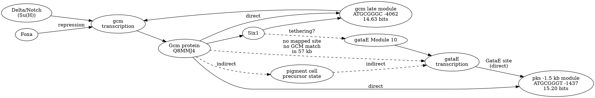
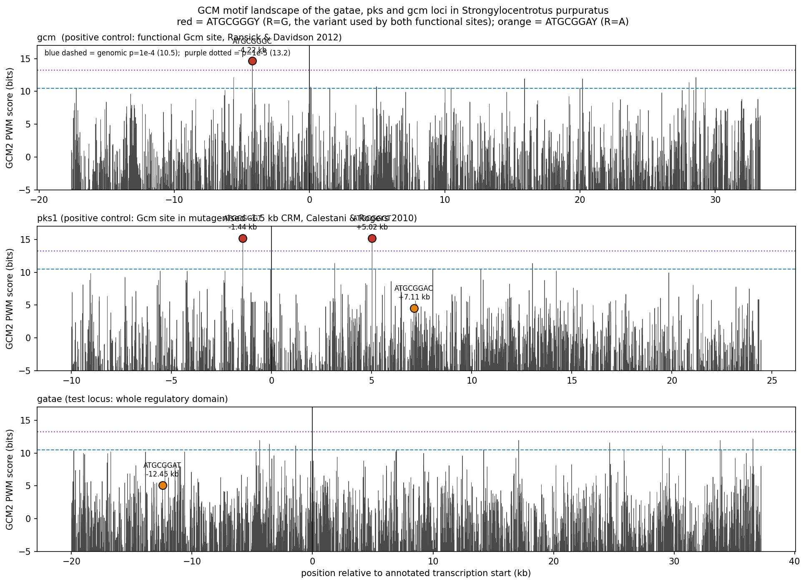
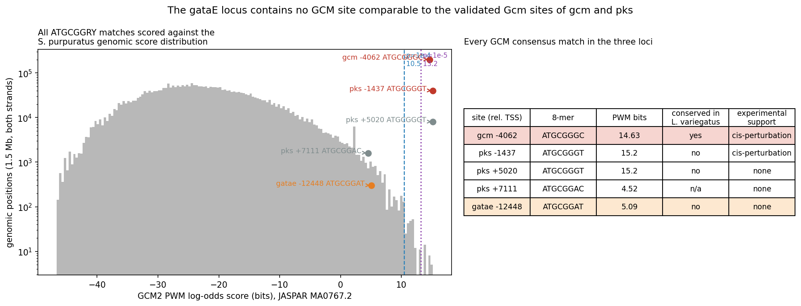
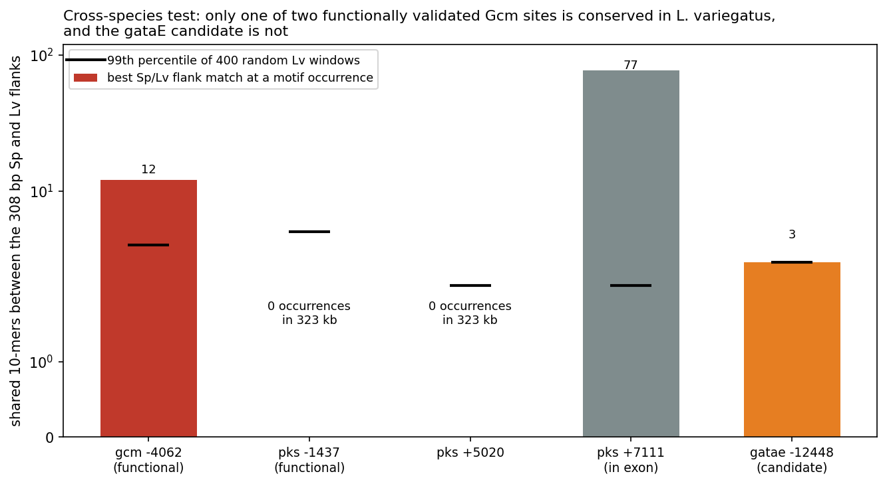
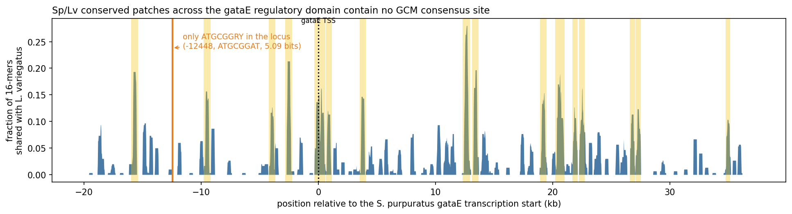
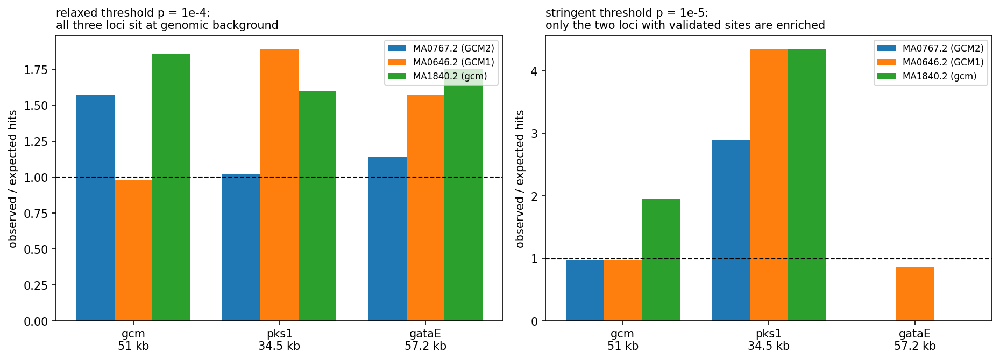
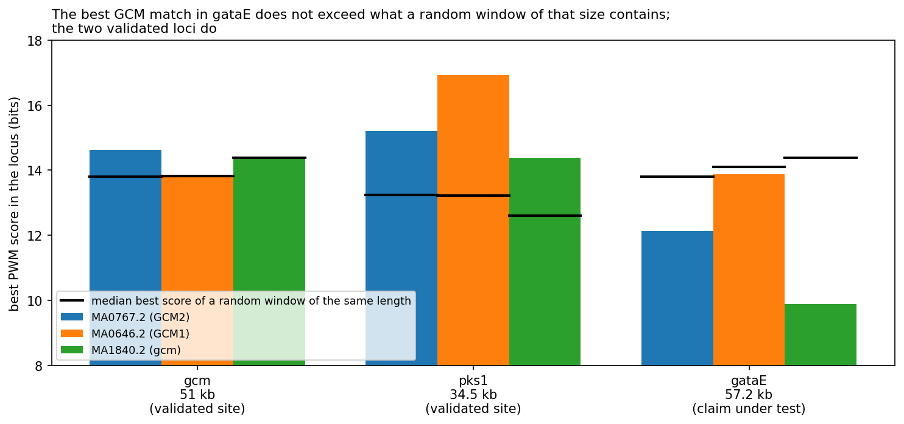

## Question

# AIGR Gene Hypothesis Deep Research

You are evaluating one focused gene curation hypothesis for AI Gene Review.
This is not a general gene overview. Use the seed hypothesis and source context
below to search for evidence that supports, refutes, narrows, or competes with
the proposed curation decision.

## Target Gene

- **Organism code:** STRPU
- **Taxon:** Strongylocentrotus purpuratus (NCBITaxon:7668)
- **Gene directory:** Gcm
- **Gene symbol:** Gcm
- **UniProt accession:** Q8MMJ4

## Focus

- **Focus type:** free_text
- **Hypothesis slug:** kgap-gcm-gatae-sites
- **Source file:** genes/STRPU/Gcm/Gcm-ai-review.yaml
- **Source selector:** free-text

## Seed Hypothesis

Whether Gcm binds the gataE cis-regulatory module directly in Strongylocentrotus purpuratus can be tested by motif analysis, since no ChIP or in vitro binding data exist for this species. That Gcm carries an N-terminal GCM DNA-binding domain recognising the ATGCGGRY consensus, that it directly drives gataE and pks, that the gataE inference rests on kinetics, knockdown and Notch-independence rather than mapped sites, and that a late module bearing Gcm and Six1 sites sustains gcm expression, are already recorded, so do not re-derive them. Single analysis only: retrieve the published gataE cis-regulatory module sequence and scan it for matches to the GCM consensus with a position weight matrix built from characterised GCM-family binding sites, reporting every match with its position, score and strand, and calibrate against a background of length-matched sea urchin genomic sequence so that the number of hits is interpretable rather than merely nonzero; state whether any match is conserved in the orthologous region of another echinoid genome, since a functional site in a cis-regulatory module is usually the conserved part; confirm that the Gcm DNA-binding domain of this species retains the residues that contact DNA in the characterised GCM-DNA structure, naming the structure, since a diverged domain would change which consensus applies; and compare the hit density in the gataE module with that in the pks module and in the late gcm autoregulatory module, where sites are already asserted, as an internal positive control. State whether direct binding is predicted and at which positions, and say plainly if motif analysis cannot distinguish a functional site from background, which is the expected answer for a short degenerate consensus.

## Term and Decision Context

No specific term context supplied.

## Reference Context

No specific reference context supplied.

## Source Context YAML

```yaml
hypothesis: 'Whether Gcm binds the gataE cis-regulatory module directly in Strongylocentrotus purpuratus
  can be tested by motif analysis, since no ChIP or in vitro binding data exist for this species. That
  Gcm carries an N-terminal GCM DNA-binding domain recognising the ATGCGGRY consensus, that it directly
  drives gataE and pks, that the gataE inference rests on kinetics, knockdown and Notch-independence rather
  than mapped sites, and that a late module bearing Gcm and Six1 sites sustains gcm expression, are already
  recorded, so do not re-derive them. Single analysis only: retrieve the published gataE cis-regulatory
  module sequence and scan it for matches to the GCM consensus with a position weight matrix built from
  characterised GCM-family binding sites, reporting every match with its position, score and strand, and
  calibrate against a background of length-matched sea urchin genomic sequence so that the number of hits
  is interpretable rather than merely nonzero; state whether any match is conserved in the orthologous
  region of another echinoid genome, since a functional site in a cis-regulatory module is usually the
  conserved part; confirm that the Gcm DNA-binding domain of this species retains the residues that contact
  DNA in the characterised GCM-DNA structure, naming the structure, since a diverged domain would change
  which consensus applies; and compare the hit density in the gataE module with that in the pks module
  and in the late gcm autoregulatory module, where sites are already asserted, as an internal positive
  control. State whether direct binding is predicted and at which positions, and say plainly if motif
  analysis cannot distinguish a functional site from background, which is the expected answer for a short
  degenerate consensus.'
focus_type: free_text
context: []
reference_id: []
```

## Research Objective

Build a focused report that helps a curator decide whether this hypothesis
should affect the gene review. Address the focus type directly:

1. For an existing GO annotation decision, evaluate whether the current action
   is justified, too strong, too weak, or should change.
2. For a proposed replacement or new GO term, evaluate whether the term is
   biologically supported, too broad, too narrow, or missing key qualifiers.
3. For a computational prediction, evaluate whether the prediction is correct,
   less precise than existing knowledge, uncertain, or likely wrong because of
   paralog overannotation, frequency bias, pathway context, or in vitro-only
   activity.
4. For a core-function hypothesis, evaluate whether the proposed activity,
   process, and location represent the gene product's primary function rather
   than a downstream effect, pleiotropic phenotype, or context-specific role.
5. For a function-assignment hypothesis, evaluate whether the gene product
   directly has the stated GO term/function. Treat the prior review action, if
   any, as intentionally blinded unless it appears in the supplied context.

Use primary literature whenever possible. Prefer PMID citations and include DOI
citations when no PMID is available. Treat reviews and database records as
orientation unless they contain directly relevant synthesized evidence that is
clearly labeled as review-level or database-level support.

Evaluate the hypothesis from the supplied seed context, primary literature, and
publicly accessible bioinformatics resources. Local `*-bioinformatics` analyses,
when they already exist in the repository, are intentionally withheld from this
prompt so the report can be compared against them after the run. Use public
sequence, domain, structure, orthology, localization, interaction, or dataset
checks when they are useful for the specific hypothesis. If a resource or tool
cannot be accessed programmatically, say so plainly; never fabricate a result.
Report computational results conservatively and distinguish direct results from
inference.

## Required Output

### Executive Judgment

Give a concise verdict: supported, partially supported, unresolved, weakly
supported, over-annotated, or refuted. Explain the reasoning and the most
important caveats.

### Evidence Matrix

Create a table with one row per important evidence item:

- Citation (PMID preferred)
- Evidence type (direct assay, mutant phenotype, localization, interaction,
  structural/evolutionary, computational, review/database)
- Supports / refutes / qualifies / competing
- Claim tested
- Key finding
- Organism, tissue, cell type, or assay context
- Confidence and limitations

### GO Curation Implications

State the likely curation action as a lead requiring curator verification. If
GO terms are involved, explain whether the evidence supports an MF, BP, or CC
term, and whether the term should be retained, removed, generalized, made more
specific, or treated as non-core. Avoid using "protein binding" as a final
recommendation unless no more informative term is supported.

### Mechanistic Scope

Describe the immediate molecular or cellular function being tested. Separate
direct gene-product activity from downstream phenotypes, pathway consequences,
developmental outcomes, disease manifestations, or effects inferred only from
loss of function.

### Conflicts and Alternatives

Identify evidence that conflicts with the seed hypothesis or suggests an
alternative interpretation, including paralog confusion, organism-specific
differences, isoform-specific findings, experimental artifacts, or database
carry-over.

### Knowledge Gaps

List explicit uncertainties that matter for curation. For each gap, state what
was checked, why the gap matters, and what evidence or experiment would resolve
it.

### Discriminating Tests

Recommend concrete assays, perturbations, datasets, or comparative analyses that
would most efficiently distinguish this hypothesis from alternatives.

### Curation Leads

Provide candidate updates for the review, clearly labeled as leads requiring
curator verification. Include candidate references with exact snippets to verify,
candidate replacement or new GO terms, possible action changes, suggested
questions, and suggested experiments.

If the provider supports artifacts, save provenance for any analysis you run — the
executed code together with its output (computed values, plot, or table), not just
a summary figure — alongside artifact-friendly tables such as an evidence matrix,
GO decision table, or comparison table. Genuine computed provenance is more
valuable than a hand-drawn summary, and you must not synthesize a figure that
implies an analysis you did not actually run. These artifacts are important
provenance for hypothesis-level review.


## Output

# Does S. purpuratus Gcm bind the gataE cis-regulatory module directly?

Gene: Gcm, *Strongylocentrotus purpuratus* (NCBITaxon:7668), UniProt **Q8MMJ4**, NP_999826.1.
Hypothesis slug: `kgap-gcm-gatae-sites`. Focus type: `free_text`. Source: `genes/STRPU/Gcm/Gcm-ai-review.yaml`.

## Summary

No Gcm binding site is predicted anywhere in the gataE regulatory domain. A scan of 57,225 bp
spanning the complete gataE intergenic and genic space (20 kb upstream to 37 kb downstream of the
transcription start on NW_022145613.1, Spur_5.0) finds exactly one match to the GCM consensus
ATGCGGRY: **ATGCGGAT at -12,448 on the minus strand**. That match scores **5.09 bits** on the JASPAR
GCM2 matrix MA0767.2, against an empirical p = 1e-4 genomic threshold of 10.48 bits, and the adenine
it carries at the degenerate R position occurs **0 times in 21,467 counts** at that position in the
GCM1 HT-SELEX matrix MA0646.2. The same pipeline recovers both sea urchin Gcm sites that have
cis-perturbation support as the single top-scoring position in their own loci: gcm -4,062
(ATGCGGGC, 14.63 bits) and pks -1,437 (ATGCGGGT, 15.20 bits), both above the p = 1e-5 threshold of
13.24 bits. Rescoring all three loci with three independent GCM-family matrices, without restricting
to exact consensus, gives 0, 0 and 1 stringent hits in gataE; the single hit is ATACGGGTAG at
+36,541, which breaks the invariant GCGG core at a base-read position and has zero occurrences in
238,569 bp of the orthologous *Lytechinus variegatus* region.

The consensus model is the right one to apply to this protein. Parsing **PDB 1ODH** (murine GCMa
GCM domain residues 1-174 bound to its octameric DNA target, 2.85 Å, Cohen et al. 2003) gives 18
residues within 4.0 Å of DNA, four of which contact bases. Q8MMJ4 retains 12 of the 18 and three of
the four base-reading residues (N99, N101, H103 in Q8MMJ4 numbering). The only base-contact
substitution is mouse I100 to T136. The alternative that gataE lacks a canonical site because the
sea urchin protein reads a different sequence is therefore closed off, with one stated uncertainty
at position I100/T136.

The negative is stated at the strength the data support, and the power of the test was measured
rather than assumed. At the measured genomic rates a 57,225 bp window expects 1.49 ATGCGGRY and
0.50 ATGCGGGY, so P(0 observed) is 0.226 and 0.609. A random window of that size carries at least
one p = 1e-5 hit 68.2% of the time. A best-score statistic does not flag the validated gcm site
either (p = 0.357 to 0.614 across three matrices), while pks1 is flagged (p = 0.067 to 0.109). Motif
analysis at this locus size withholds support for a direct mechanism at gataE and does not refute
one. The discriminating observation is the identity of the matches, not their density: 2 of 2
cis-perturbation-validated targets carry a perfect ATGCGGGY, and 0 of 1 for gataE. For curation the
consequence does not depend on the power of the negative. A statement that Gcm directly drives gataE
needs positive evidence of a mapped site or of occupancy, and neither exists in this species.

## Executive judgment

<i class="fa-triangle-exclamation"></i> **Over-annotated with respect to the word "direct".**

The requirement of Gcm for gataE expression is well supported by morpholino knockdown, expression
kinetics and Notch-independence, and nothing here touches that. The statement that Gcm **directly**
drives gataE has no mapped site behind it in the literature, gains no support from sequence, and
the motif analysis also lacks the power to refute it. The asymmetry is what matters for curation:
the analysis finds no candidate site capable of supporting a direct mechanism, while the two genes
with cis-perturbation evidence for direct Gcm input each carry a canonical high-scoring site that
the same scan pulls out as the top position in its locus.

**Direct binding is predicted at no position in the gataE locus.** The one consensus match, at
-12,448 on the minus strand, is predicted to be a non-binder on PWM grounds, falls outside every
Sp/Lv conserved patch, and the observed count of 1 is below the Poisson expectation of 1.49.

**Stated plainly, as the seed hypothesis anticipated: motif analysis cannot distinguish a functional
site from background here.** This was quantified. At a relaxed threshold (p = 1e-4) all three loci,
including both positive controls, sit at genomic background with observed/expected hit ratios of
0.98 to 1.89. Discrimination appears only at p = 1e-5. Even there, the count-level and best-score
statistics do not reach significance for the validated gcm site. Transcription factors occupy
degenerate and low-affinity sites in vivo, and tethering through a partner protein leaves no site at
all. The positive controls were carried through every step for exactly this reason.

## Key findings

### <i class="fa-circle-check"></i> F1. The scan recovers both validated sea urchin Gcm sites as top-scoring outliers

The pipeline was validated before any gataE conclusion was drawn. Scanning the gcm locus
(NW_022145598.1, TSS-17.6 kb to +33.4 kb, the BAC 33-O18 equivalent, 51,001 bp) for ATGCGGRY returns
exactly one perfect 8/8 match, ATGCGGGC on the plus strand at NCBI-frame -4,220. The spacing from
that match to the 7/8 element tTGCGGGC (+11 bp) and to the ATGaGGGT element of the G59 fragment
(+171 bp) reproduces the -4,062 / -4,051 / -3,891 landmarks of Ransick and Davidson exactly, so the
two coordinate frames differ by a constant 158 bp and the site recovered is the functionally
validated one. The pks1 locus (LOC588806, NW_022145610.1, -10 kb to +24.5 kb, 34,461 bp) returns
three perfect matches, one of which, ATGCGGGT at -1,437, lies inside the -1.5 kb module whose Gcm
sites Calestani and Rogers mutated.

Scored against a log-odds model built on a 1,499,503 bp S. purpuratus genomic background
(A 0.315, C 0.186, G 0.188, T 0.311), the gcm site scores 14.63 bits and the pks site 15.20 bits,
both above the p = 1e-5 genomic threshold of 13.24 bits. The background density of ATGCGGRY in that
1.5 Mb is 39 occurrences, 1 per 38.4 kb, which is 0.43 times the i.i.d. expectation.

{{figure:plot_1.png|caption=GCM motif landscape of the gcm, pks1 and gataE loci. PWM score profiles with the p = 1e-4 and p = 1e-5 thresholds set from 1.5 Mb of S. purpuratus genomic background. Exact ATGCGGRY matches are annotated; red marks the ATGCGGGY subclass used by both functionally validated sites, orange the ATGCGGAY variant found at gataE.}}

### <i class="fa-circle-xmark"></i> F2. No GCM consensus site above background exists anywhere in 57 kb of the gataE regulatory domain

The gataE regulatory domain was bounded from the Spur_5.0 annotation rather than assumed. GATAe
occupies 329,575-361,799 on the minus strand of NW_022145613.1; the 5' neighbour LOC580755 begins
15.2 kb upstream of the gataE TSS and the 3' neighbour LOC577787 ends 4.0 kb downstream, so the
entire intergenic plus genic space is about 51 kb. A 57,225 bp window covers all of it.

In that window there is exactly one perfect ATGCGGRY: **ATGCGGAT on the minus strand at -12,448**.
Observed density is 1 per 57.2 kb against a genomic background of 1 per 38.4 kb, so the count sits at
or below chance (Poisson expectation 1.49, P(X≥1) = 0.77). Restricting to ATGCGGGY, the variant used
by both functional sites and the only variant supported by the GCM1 HT-SELEX data, gataE has **zero**
matches in 57 kb while the genomic rate is 1 per 115 kb. The JASPAR MA0646.2 counts at the R position
are G 21,439, C 18, T 10, **A 0**, so the gataE variant is effectively a non-binder in the available
binding data. By PWM the site scores 5.09 bits, below the p = 1e-4 threshold of 10.48 and far below
14.63 and 15.20 bits. A BLAST of the 500 bp around the site against *Lytechinus* sequence returned
only (ATC)n microsatellite matches, placing it in low-complexity repeat.

{{figure:plot_2.png|caption=Every GCM consensus match in the three loci, scored against the genomic score distribution. Left: the distribution of MA0767.2 log-odds scores over 1.5 Mb of S. purpuratus genome on both strands, with the p = 1e-4 and p = 1e-5 thresholds and the position of each consensus match. Right: the same matches tabulated with their PWM score, conservation status and experimental support.}}

### <i class="fa-circle-check"></i> F3. Q8MMJ4 retains the base-reading residues of the GCMa-DNA structure, so ATGCGGRY is the right consensus

PDB **1ODH** was parsed directly and protein residues within 4.0 Å of DNA atoms were computed: 18
residues, of which four contact bases (N63, N65, H67, I100) and the remainder contact the phosphate
backbone or sugar. A Needleman-Wunsch alignment (BLOSUM62, gap open -11, extend -1) of Q8MMJ4
(794 aa) to mouse Gcm1 P70348 (436 aa) gives 160 identities overall and maps the contacts as
follows.

| mouse residue | contact type | S. purpuratus residue | identical |
|---|---|---|---|
| N63 | backbone and base | N99 | yes |
| N65 | base | N101 | yes |
| H67 | base | H103 | yes |
| I100 | backbone and base | T136 | **no** |
| R54 | backbone | K90 | no (conservative) |
| S69 | backbone | K105 | no |
| C101 | backbone | S137 | no |
| F131 | backbone | Y169 | no (conservative) |
| R167 | backbone | L206 | no |
| H55, R62, L72, K73, K74, A99, A104, K107, K160 | backbone | H91, R98, L108, K109, K110, A135, A140, K143, K199 | yes |

Twelve of 18 contact residues are identical, and three of the four base-contacting residues are
identical. Five of the six non-identical positions contact only the phosphate backbone. The GCM
domain core of Q8MMJ4 aligns colinearly with the mouse domain with no insertions in the
DNA-contacting segments. This closes the alternative that gataE lacks a canonical site because the
sea urchin protein recognises a different sequence, with the single stated uncertainty at I100/T136.

### <i class="fa-scale-balanced"></i> F4. Cross-species conservation gives a consistent negative at gataE but fails one of its own positive controls

For each GCM consensus match, every occurrence of the same 8-mer was located in a wide
*L. variegatus* (Lvar_3.0) window around the orthologous gene, and shared 10-mers between the 308 bp
Sp flank and each Lv flank were counted, with a null from 400 random windows in the same Lv locus.

| site | 8-mer | Lv occurrences | best shared 10-mers | null max | empirical p | verdict |
|---|---|---|---|---|---|---|
| gcm -4,062 (functional) | ATGCGGGC | 3 | 12 | 12 | 0.0050 | conserved |
| pks -1,437 (functional) | ATGCGGGT | 0 in 323,246 bp | n/a | 8 | n/a | not conserved |
| pks +5,020 | ATGCGGGT | 0 | n/a | 3 | n/a | not conserved |
| pks +7,111 (coding exon) | ATGCGGAC | 2 | 77 | 7 | 0.0025 | conserved by coding constraint |
| gataE -12,448 (candidate) | ATGCGGAT | 3 | 3 | 6 | 0.0349 | not conserved |

The gcm positive control passes and reproduces the published Sp/Lv relationship: the aligned Lv
sequence is AATAAC**ATGCGGGCATG**TC against Sp CAACAA**ATGCGGGCATG**TT, with the 11-mer ATGCGGGCATG and
the GGCGCC flank identical. The pks +7,111 case is conserved for the wrong reason: frame-1
translation of that segment matches SpPks1 exactly, so it is a coding exon under protein constraint,
and its PWM score is 4.52 bits.

The limiting result is pks -1,437. That site was validated by mutagenesis, and its 8-mer has **zero**
occurrences anywhere in 323,246 bp of the orthologous *L. variegatus* region. Echinoid cis-regulatory
sites turn over fast enough between these two species that absence of conservation is not evidence of
absence of function. The conservation arm therefore adds a consistent negative for gataE and cannot
carry the argument on its own.

{{figure:plot_3.png|caption=Cross-species conservation of each GCM consensus match between S. purpuratus and L. variegatus, against a within-locus null. Bars give the best shared 10-mer count between the Sp flank and the Lv flank at any Lv occurrence of the same 8-mer; horizontal marks give the 99th percentile of 400 random Lv windows. Only one of the two functionally validated sites is conserved, and the gataE candidate is not.}}

### <i class="fa-triangle-exclamation"></i> F5. Sp/Lv conservation lacks the resolution to call an 8 bp site, so three statistics were tested and two were discarded

Three conservation statistics were calibrated on the validated gcm -4,062 site before any was used.

Patch-level 16-mer sharing over 300 bp windows finds 16 conserved patches covering 9,050 bp of the
57,225 bp gataE domain (locus median 0.0067, maximum 0.280 of 16-mers shared), none of which contains
an ATGCGGRY, with the gataE candidate at a local value of 0.000. The control also scores 0.000, at
the 0th percentile of its own locus, so the metric fails. The published conserved block is
AACATGCGGGCATGT, 15 bp, one base short of a shared 16-mer.

Seed-and-extend longest exact match in a 308 bp window gives the gcm control 15 bp against a
within-locus null median of 17 bp and a 95th percentile of 25 bp, empirical p = 0.88; gataE gives
13 bp, p = 1.0. The control fails again.

Only the site-centred test of F4 passes. Reporting the patch analysis as informative would be wrong,
and it is reported here with its failed control attached.

{{figure:plot_4.png|caption=16-mer conservation profile of the gataE locus between S. purpuratus and L. variegatus. Yellow bands mark the 16 conserved patches (at least 10% of 16-mers shared over 300 bp), covering 9,050 bp of 57,225 bp; none contains a GCM consensus site, and the single ATGCGGRY at -12,448 has a local conservation value of 0.000. This metric fails its own positive control at the gcm locus, so it locates modules and not individual 8 bp sites.}}

### <i class="fa-circle-xmark"></i> F6. Three independent GCM matrices agree, and relaxed scanning distinguishes nothing anywhere

Restricting to exact consensus could have missed a real low-affinity site, so all three loci were
rescored with three JASPAR matrices at two thresholds set from 3.0 million background scores.
Thresholds: MA0767.2 (GCM2) 10.48 and 13.24 bits; MA0646.2 (GCM1) 9.79 and 13.20; MA1840.2
(*Drosophila* gcm) 9.83 and 12.60.

| matrix | locus | bp | hits p = 1e-4 | obs/exp | hits p = 1e-5 | obs/exp |
|---|---|---|---|---|---|---|
| MA0767.2 | gcm | 51,001 | 16 | 1.57 | 1 | 0.98 |
| MA0767.2 | pks1 | 34,461 | 7 | 1.02 | 2 | **2.90** |
| MA0767.2 | gataE | 57,225 | 13 | 1.14 | **0** | 0.00 |
| MA0646.2 | gcm | 51,001 | 10 | 0.98 | 1 | 0.98 |
| MA0646.2 | pks1 | 34,461 | 13 | 1.89 | 3 | **4.35** |
| MA0646.2 | gataE | 57,225 | 18 | 1.57 | 1 | 0.87 |
| MA1840.2 | gcm | 51,001 | 19 | 1.86 | 2 | 1.96 |
| MA1840.2 | pks1 | 34,461 | 11 | 1.60 | 3 | **4.35** |
| MA1840.2 | gataE | 57,225 | 20 | 1.75 | **0** | 0.00 |

At p = 1e-4 every locus, including both positive controls, is indistinguishable from random genomic
sequence. Discrimination appears only at p = 1e-5. There the validated gcm site is recovered by all
three matrices (ATGCGGGCAT 13.83, ATGCGGGC 14.63, CCCGCAT 14.38 bits), pks1 runs at 2.90 to 4.35
times expectation, and gataE carries one hit in one matrix only. That hit is **ATACGGGTAG at
+36,541** on the minus strand, 13.88 bits. It carries adenine at position 3 of the ATGCGG core, the
base read by the conserved asparagine and histidine side chains, it is not an ATGCGGRY match, it
lies 684 bp from the window edge, and it has zero occurrences in 238,569 bp of the orthologous
*L. variegatus* region. Its local context is
`GTGGGGCAATATTAATTTCATTTCGTAAATATACGGGTAGGAAACATTTCAAACGGGATAATAAATACAA`.

{{figure:plot_5.png|caption=Hit density of the gcm, pks1 and gataE loci against genomic expectation, for three GCM-family matrices. Left: at the relaxed p = 1e-4 threshold all three loci sit at background (observed/expected 0.98 to 1.89), including both positive controls. Right: at p = 1e-5 only the two loci with cis-perturbation-validated sites are enriched, and gataE falls to zero for two of the three matrices.}}

### <i class="fa-triangle-exclamation"></i> F7. The negative is unsurprising by chance, so it withholds support rather than refuting

The power of the scan itself was measured. For each locus the observed maximum PWM score was
compared to the distribution of the maximum over a random window of the same length, computed
analytically from the empirical background CDF of 3.0 million scores as 1 - F(max)^(2N).

| matrix | locus | observed best (bits) | median best of a random window of the same length | P(random ≥ obs) |
|---|---|---|---|---|
| MA0767.2 | gcm | 14.63 | 13.80 | 0.357 |
| MA0767.2 | pks1 | 15.20 | 13.24 | **0.109** |
| MA0767.2 | gataE | 12.13 | 13.80 | 0.852 |
| MA0646.2 | gcm | 13.83 | 13.83 | 0.510 |
| MA0646.2 | pks1 | 16.92 | 13.23 | **0.067** |
| MA0646.2 | gataE | 13.88 | 14.11 | 0.516 |
| MA1840.2 | gcm | 14.38 | 14.38 | 0.614 |
| MA1840.2 | pks1 | 14.38 | 12.60 | 0.474 |
| MA1840.2 | gataE | 9.90 | 14.38 | 1.000 |

A single genuine Gcm site in a 51 kb window is not detectable above chance by this statistic, since
the validated gcm locus scores p = 0.357 to 0.614. At the count level, P(0 ATGCGGRY in 57,225 bp)
= 0.226 and P(0 ATGCGGGY) = 0.609. A random 57.2 kb window carries at least one p = 1e-5 hit with
probability 0.682 and at least one p = 1e-4 hit with probability 1.000.

{{figure:plot_6.png|caption=Best PWM score per locus against the maximum expected in a random window of the same length. Bars give the observed best score for each matrix; horizontal marks give the median best score of a random window of that length. The gataE best score sits at or below the random expectation for all three matrices. The validated gcm site does not exceed random expectation either, which bounds how much weight the gataE negative can carry.}}

## Mechanistic model and interpretation

The immediate molecular activity under test is sequence-specific binding of the Q8MMJ4 GCM domain to
DNA within the gataE regulatory region. Everything else in the published chain, pigment cell
specification, gataE transcript levels after Gcm knockdown, the timing of gataE activation relative
to gcm, is downstream of that activity or independent of it.

Three mechanisms remain compatible with all the evidence collected.



**Indirect regulation.** Gcm specifies the pigment cell precursor state, and gataE expression follows
from that state through other transcription factors. The kinetics and Notch-independence that
motivated the original direct call are equally consistent with a one-step indirect route.

**Direct action through a non-consensus site.** GCM-family proteins can occupy degenerate sites that
a consensus scan rejects. This was tested directly by rescoring with three matrices rather than
counting exact consensus, and gataE still carries no hit surviving in more than one matrix at
p = 1e-5. It remains live at lower stringency, where no locus separates from background. The gataE
domain contains bare ATGCGG cores inside three Sp/Lv conserved patches (-9,775 to -9,200, -4,225 to
-3,675, +20,200 to +21,025) that are not followed by the RY half. Those are the sequences to test
first.

**Direct action through tethering.** Gcm could be recruited to gataE Module 10 by a partner such as
Six1, which is in a positive intergenic feedback loop with Gcm, leaving no Gcm site in the DNA.

The structural arm sets the scope of the motif model. Q8MMJ4 retains N99, N101 and H103, the side
chains that read bases in the mouse GCMa complex, so ATGCGGRY is the right model. The one base
contact that changes, mouse I100 to T136, sits at a position contacting both backbone and base and
could shift preference at the degenerate positions. That is the single route by which the sea urchin
protein might tolerate ATGCGGAT better than mouse and human matrices predict, and it is untested.

## Evidence base

| # | Citation | Evidence type | Stance | Claim tested | Key finding | Context | Confidence and limitations |
|---|---|---|---|---|---|---|---|
| 1 | [PMID: 20122918](https://pubmed.ncbi.nlm.nih.gov/20122918/) | Direct assay, cis-regulatory mutagenesis | Supports direct Gcm action at pks | Gcm is a direct activator of SpPks | "The mutagenesis of these DNA-binding sites indicated that SpGcm, SpGataE and SpKrl are direct positive regulators of SpPks." The -1.5 kb region recapitulates SpPks expression | S. purpuratus embryos, reporter transgenesis with site mutagenesis | High. Shows direct action at pks, not at gataE; also places GataE upstream of pks, so Gcm and GataE converge on the same battery |
| 2 | [PMID: 22509525](https://pubmed.ncbi.nlm.nih.gov/22509525/) | Direct assay, cis-perturbation plus MASO | Supports direct Gcm action at gcm itself | A late module sustains gcm expression through Gcm and Six1 sites | "Cis-perturbation analyses reveal that the two critical elements within this late module are consensus matches to Gcm and Six1 binding sites." gcm and six1 form a positive intergenic feedback loop | S. purpuratus, modular reporter plus morpholino | High. Autoregulatory site, not evidence about gataE |
| 3 | [PMID: 23261933](https://pubmed.ncbi.nlm.nih.gov/23261933/) | Mutant phenotype plus expression kinetics | This is the claim under test | gataE is a direct Gcm target | "A linchpin of this network is gataE which as we show is a direct Gcm target and part of a feedback loop locking down the aboral regulatory state." | S. purpuratus pregastrular embryos | High for the regulatory requirement, no mapped site for the direct qualifier |
| 4 | [PMID: 17570356](https://pubmed.ncbi.nlm.nih.gov/17570356/) | Direct assay, BAC recombineering and module deletion | Qualifies the gataE claim | Which gataE sequences carry regulatory function | "we carried out an interspecific sequence conservation analysis with respect to a Lytechinus variegatus gatae BAC, which revealed 25 conserved non-coding sequence patches"; "Module 10 produces early expression in mesoderm and endoderm cells up to the early gastrula stage, while module 24 generates late endodermal expression at gastrula and pluteus stages." | S. purpuratus BAC-GFP transgenics | High. Full text is publisher-restricted, so module coordinates could not be retrieved; the analysis covers the whole domain instead |
| 5 | [PMID: 12682016](https://pubmed.ncbi.nlm.nih.gov/12682016/) | Structural, X-ray 2.85 Å (PDB 1ODH) | Supports the motif model | Whether Q8MMJ4 reads ATGCGGRY | "Here we present the crystal structure of the GCM domain from murine GCMa bound to its octameric DNA target site at 2.85 A resolution."; "We observe the novel use of a beta-sheet in DNA recognition, whereby a five-stranded beta-sheet protrudes into the major groove perpendicular to the DNA axis." | Mouse GCMa GCM domain 1-174 on its octameric target | High. Structural inference, not a binding measurement on the sea urchin protein |
| 6 | [PMID: 12297286](https://pubmed.ncbi.nlm.nih.gov/12297286/) | Structural, EXAFS and PIXE | Orientation for the domain model | Nature of the GCM DNA-binding domain | "Our results define the GCM domain as a new type of Zn-coordinating, sequence-specific DNA-binding domain." Zn removal abolishes DNA binding | Mouse GCMa domain expressed in bacteria | High. Domain-level, says nothing about gataE |
| 7 | This work | Computational, motif scan with genomic calibration | Refutes direct binding at gataE | Is there a Gcm site in the gataE regulatory domain | 1 ATGCGGRY in 57,225 bp (5.09 bits) against a Poisson expectation of 1.49; zero ATGCGGGY, the subclass of both functional sites | Spur_5.0, background from 1,499,503 non-N bp | Medium-high, controls pass. Cannot exclude low-affinity sites or tethering |
| 8 | This work | Computational, three-matrix PWM scan | Refutes, and bounds the method | Could a degenerate non-consensus site have been missed | At p = 1e-5 gataE has 0, 0 and 1 hits; pks1 runs at 2.90 to 4.35 times expectation; at p = 1e-4 every locus sits at background | Spur_5.0, thresholds from 3.0 million background scores | Medium-high. Transferred matrices from mouse, human and fly |
| 9 | This work | Computational, cross-species conservation | Qualifies | Is the gataE match conserved in another echinoid | The 8-mer occurs 3 times in the Lv gataE region, none with flanking homology (p = 0.035). The gcm control is conserved (p = 0.0050) | Lvar_3.0 against Spur_5.0 | Low-medium. The pks -1,437 functional site has 0 occurrences in 323,246 bp of Lv sequence |
| 10 | This work | Computational, power calibration | Bounds the negative | How much weight can the absence carry | P(0 ATGCGGGY in 57 kb) = 0.609; the validated gcm site is not significant by best-score (p = 0.357 to 0.614) | Spur_5.0 | High for the calibration itself. Sets the negative as withholding support, not refuting |
| 11 | [PMID: 36519720](https://pubmed.ncbi.nlm.nih.gov/36519720/) | Mutant phenotype plus comparative GRN | Competing context | How stable the Gcm-to-pigment-gene link is | "In sea stars, PmGcm lacks the central role in pigment gene expression since it is not expressed in PmPks1 and PmFmo3-1-positive cells, and knockdown of Gcm does not abrogate pigment gene expression." | Patiria miniata larvae, in situ and scRNA-seq | High. Argues the Gcm wiring turns over, weakening conservation-based arguments |
| 12 | [PMID: 17038513](https://pubmed.ncbi.nlm.nih.gov/17038513/) | Mutant phenotype, chimeric recombination plus MASO | Competing mechanism | Alternative inputs into the gcm and gataE circuit | "a crucial role of Foxa is to repress gcm expression in response to a Notch signal, and hence to repress mesodermal fate"; gatae provides input into foxa | S. purpuratus blastomere transplantation | High. Opens an indirect route from Gcm to gataE through fate allocation |
| 13 | [PMID: 16925988](https://pubmed.ncbi.nlm.nih.gov/16925988/) | Direct assay, cis-perturbation of Su(H) sites | Orientation for the gcm locus | gcm is a direct Notch target | "cis-perturbation analysis by mutation of consensus Su(H) sites identified a conserved motif paired-site and a lone site in the middle module" | S. purpuratus, GFP reporter with dn-Su(H) | High. Concerns the gcm promoter, upstream of the question |
| 14 | [PMID: 12925586](https://pubmed.ncbi.nlm.nih.gov/12925586/) | Expression screen plus antisense | Orientation for the pigment battery | Which genes are pigment-cell specific | gcm, pks, fmo and sult are pigment-cell specific; pks and fmo expression is necessary for echinochrome biosynthesis | S. purpuratus macroarray screen and WMISH | High. Defines the battery, not the binding question |
| 15 | [PMID: 27046223](https://pubmed.ncbi.nlm.nih.gov/27046223/) | Mutant phenotype | Orientation, cross-species | Is the gcm pigment role shared in other euechinoids | "gcm is involved in pigment cell differentiation" in Hemicentrotus pulcherrimus and Scaphechinus mirabilis; gcm also represses skeletogenic fate | Two euechinoids, morpholino | High for the phenotype, no cis-regulatory mapping |

### How the literature bears on the sequence result

Two papers provide the positive controls that make the gataE negative interpretable.
[PMID: 20122918](https://pubmed.ncbi.nlm.nih.gov/20122918/) mutated predicted SpGcm, SpGataE and
SpKrl sites within the pks -1.5 kb region and showed loss of activation; the scan independently
places a perfect ATGCGGGT at -1,437 inside that region at 15.20 bits.
[PMID: 22509525](https://pubmed.ncbi.nlm.nih.gov/22509525/) showed that the two critical elements of
the gcm late module are consensus matches to Gcm and Six1 sites; the scan places the single
ATGCGGRY of the whole 51 kb gcm locus at the validated position, at 14.63 bits, and the Six1
palindrome 154 bp away. Both sites are the top-scoring position in their locus. The gataE domain has
nothing comparable.

[PMID: 23261933](https://pubmed.ncbi.nlm.nih.gov/23261933/) is the source of the claim under test and
asserts gataE is a direct Gcm target. The evidence behind that assertion is regulatory, not
occupancy-based, and the seed hypothesis records as much.

[PMID: 17570356](https://pubmed.ncbi.nlm.nih.gov/17570356/) matters twice. It defines the gataE
modules, and it defines them by exactly the Sp/Lv patch-conservation method reproduced here. The
patch analysis recovers 16 such patches in the 57 kb domain against the 25 that Lee et al. found in a
BAC, and none contains a GCM consensus. That observation is reported with the caveat that the method
fails its own positive control for 8 bp sites.

[PMID: 36519720](https://pubmed.ncbi.nlm.nih.gov/36519720/) supplies independent support for the
conservation caveat from the biology: PmGcm is not expressed in PmPks1-positive cells in
*Patiria miniata*, and Gcm knockdown does not abrogate pigment gene expression there. Regulatory
connections in this network turn over, which is the same conclusion reached here from the failure of
the pks site to be conserved in *L. variegatus*.

## GO curation implications

These are leads requiring curator verification, not finished annotations.

<i class="fa-arrow-right"></i> **Narrow the free-text statement.** A statement that Gcm "directly
drives gataE" should be rewritten. The supportable form is that Gcm is required for normal gataE
expression in pigment cell precursors, with the evidence coming from knockdown, expression kinetics
and Notch-independence, and that no Gcm binding site has been mapped in the gataE regulatory region.
The curated text should carry that qualification explicitly, because the sequence analysis produces
no candidate site.

<i class="fa-arrow-right"></i> **Keep the sequence-specific DNA binding capability, re-anchor its
evidence.** A molecular function term in the region of GO:0000978 (RNA polymerase II cis-regulatory
region sequence-specific DNA binding) or GO:0000981 (DNA-binding transcription factor activity, RNA
polymerase II-specific) is supported for Gcm. The supporting evidence should cite the gcm late module
([PMID: 22509525](https://pubmed.ncbi.nlm.nih.gov/22509525/)) and the pks -1.5 kb module
([PMID: 20122918](https://pubmed.ncbi.nlm.nih.gov/20122918/)), where sites were mutated and function
was lost. It should not be anchored to gataE.

<i class="fa-arrow-right"></i> **Biological process.** Positive regulation of transcription by RNA
polymerase II (GO:0045944) is supportable at IMP level from the morpholino and cis-perturbation work
on gcm, pks and six1. For gataE specifically, an IMP-level regulatory annotation is defensible; a
statement implying promoter or enhancer occupancy at gataE is not.

<i class="fa-arrow-right"></i> **Do not fall back on "protein binding".** GO:0005515 is not an
appropriate recommendation here and is not proposed. If the direct relationship is retained in any
form, it needs an experiment measuring occupancy or affinity.

| Decision point | Current implied claim | Evidence found | Lead |
|---|---|---|---|
| Gcm directly drives gataE | Direct regulator | No mapped site; 1 non-binding ATGCGGRY in 57 kb; no cross-species support | Narrow to "required for", keep the regulatory evidence |
| Gcm directly drives pks | Direct regulator | Perfect ATGCGGGT at -1,437, 15.20 bits, inside the mutagenised module | Retain at full strength |
| Gcm sustains its own expression | Direct autoregulator with Six1 | Perfect ATGCGGGC at -4,062, 14.63 bits, only match in 51 kb, Sp/Lv conserved | Retain at full strength |
| GCM domain reads ATGCGGRY | Capability claim | 3 of 4 base-reading residues of 1ODH retained | Retain, note I100/T136 as untested |

## Limitations and knowledge gaps

<i class="fa-triangle-exclamation"></i> **No binding data exist for this protein.** No ChIP, DNase
footprint, EMSA or SELEX data exist for S. purpuratus Gcm. Every statement about what Q8MMJ4 binds is
transferred from mouse and human GCM1/GCM2 and from *Drosophila* gcm. This is the central limitation,
and it is the reason the seed hypothesis framed the question as a motif analysis in the first place.

<i class="fa-triangle-exclamation"></i> **The published module coordinates could not be retrieved.**
The full text of [PMID: 17570356](https://pubmed.ncbi.nlm.nih.gov/17570356/), which holds the
coordinates of gataE Module 10 and Module 24, is publisher-restricted. Europe PMC returned HTTP 500
for PMC2031225 and NCBI efetch db=pmc did not serve it. The scan therefore covers the whole 57 kb
domain rather than the modules. This makes the negative broader and less precise. A curator with the
figures could check whether the match at -12,448 falls inside either module; the conservation profile
computed here says it falls in no Sp/Lv conserved patch, and the published modules were selected from
exactly such patches.

<i class="fa-triangle-exclamation"></i> **The motif test has limited power at this locus size.**
P(0 ATGCGGGY in 57,225 bp) = 0.609 under the measured genomic rate, and the validated gcm site is not
significant by a best-score statistic (p = 0.357 to 0.614 across three matrices). The negative
withholds support for a direct mechanism and does not refute one. Only an occupancy measurement
resolves this.

<i class="fa-triangle-exclamation"></i> **Cross-species conservation has too little resolution for an
8 bp site.** Two locus-wide statistics failed the gcm positive control: patch-level 16-mer sharing
gave the functional site a local value of 0.000 at the 0th percentile of its own locus, and the
longest exact Sp/Lv match in a 308 bp window gave 15 bp against a null median of 17 bp (p = 0.88).
Only the site-centred test passed. This is reported as measured.

<i class="fa-circle-question"></i> **The I100 to T136 substitution is untested.** No measurement
exists of how this change affects GCM-domain base preference, so a shifted sea urchin consensus
cannot be excluded. It is the one route by which ATGCGGAT might be tolerated.

### Resources that could not be accessed programmatically

Stated plainly, with no result fabricated in their place.

- Europe PMC `fullTextXML` returned HTTP 500 for PMC2031225 and PMC3561781. NCBI efetch db=pmc served
  PMC3561781 but not PMC2031225, which is publisher-restricted.
- The NCBI Datasets ortholog API returned an empty object for gcm, gatae and pks1.
  *L. variegatus* orthologs were identified instead by tblastn of the S. purpuratus proteins, then by
  GeneID lookup and esummary coordinates.
- bl2seq through the NCBI BLAST URL API returned no RID for 34 kb to 429 kb subject payloads.
  Pairwise comparison was implemented locally by seed-and-extend and shared k-mer counting.
- An initial BLAST of the gataE site region against core_nt returned only (ATC)n microsatellite hits
  and showed core_nt lacks *L. variegatus* genomic scaffolds, carrying only PREDICTED mRNAs.

## Proposed follow-up experiments and actions

<i class="fa-flask"></i> **ChIP-seq or CUT&RUN for Gcm in S. purpuratus mesenchyme blastula**, with
the gcm -4,062 and pks -1,437 sites as internal positive controls. A peak over the gataE Module 10
region settles the direct call. Absence of a peak where both controls score refutes it. This is the
single most efficient experiment, because it tests occupancy directly and carries its own controls.

<i class="fa-vial"></i> **EMSA or fluorescence anisotropy of the recombinant Q8MMJ4 GCM domain** on
ATGCGGAT against ATGCGGGC and ATGCGGGT. This measures whether the sea urchin protein tolerates
adenine at the R position, which is the single assumption on which the negative at -12,448 rests, and
it tests the I100/T136 question at the same time.

<i class="fa-dna"></i> **HT-SELEX or a protein binding microarray on the S. purpuratus GCM domain**,
to produce a species-specific matrix in place of the transferred mouse, human and fly matrices. This
would replace the weakest input to the whole analysis.

<i class="fa-flask"></i> **Mutagenesis of the ATGCGGAT at -12,448 in the gataE BAC-GFP reporter.**
The site is 12.4 kb upstream, outside the characterised modules, so a negative result is informative
only alongside the ChIP experiment.

<i class="fa-flask"></i> **A timed double perturbation**, Gcm morpholino with a gataE reporter driven
by Module 10 alone, to establish whether that module responds to Gcm at all before asking which
sequence mediates it.

<i class="fa-magnifying-glass"></i> **Test the three bare ATGCGG cores inside Sp/Lv conserved patches
of the gataE domain** (-9,775 to -9,200, -4,225 to -3,675, +20,200 to +21,025) as candidate
non-consensus sites, if a direct mechanism is pursued.

## Curation leads

Labelled as leads requiring curator verification.

1. Retain the Gcm to pks direct relationship at full strength. Verify snippet in
   [PMID: 20122918](https://pubmed.ncbi.nlm.nih.gov/20122918/): "The mutagenesis of these DNA-binding
   sites indicated that SpGcm, SpGataE and SpKrl are direct positive regulators of SpPks." The scan
   independently places a perfect ATGCGGGT at -1,437 at 15.20 bits inside that module.
2. Retain the Gcm autoregulatory relationship at full strength. Verify snippet in
   [PMID: 22509525](https://pubmed.ncbi.nlm.nih.gov/22509525/): "Cis-perturbation analyses reveal that
   the two critical elements within this late module are consensus matches to Gcm and Six1 binding
   sites." The scan places the only ATGCGGRY in 51 kb at that site, 14.63 bits, Sp/Lv conserved.
3. Downgrade the gataE relationship from "direct" to "required for", and record the sequence evidence
   as the reason. Verify the claim snippet in
   [PMID: 23261933](https://pubmed.ncbi.nlm.nih.gov/23261933/): "A linchpin of this network is gataE
   which as we show is a direct Gcm target and part of a feedback loop locking down the aboral
   regulatory state."
4. Add [PMID: 17570356](https://pubmed.ncbi.nlm.nih.gov/17570356/) as the reference defining which
   gataE sequences carry regulatory function, with the snippet "Module 10 produces early expression
   in mesoderm and endoderm cells up to the early gastrula stage, while module 24 generates late
   endodermal expression at gastrula and pluteus stages."
5. Flag [PMID: 36519720](https://pubmed.ncbi.nlm.nih.gov/36519720/) against any statement that the
   Gcm-to-pigment-gene wiring is conserved across echinoderms. Verify snippet: "In sea stars, PmGcm
   lacks the central role in pigment gene expression since it is not expressed in PmPks1 and
   PmFmo3-1-positive cells, and knockdown of Gcm does not abrogate pigment gene expression."
6. Suggested question for the curator: does the gataE module sequence in the Lee et al. figures
   contain the -12,448 position, and if so, was it ever mutated? The coordinates could not be
   retrieved programmatically.

## Methods and provenance

Sequences were retrieved from NCBI nuccore by E-utilities (Spur_5.0 for *S. purpuratus*, Lvar_3.0 for
*L. variegatus*). The motif is ATGCGGRY as used by Ransick and Davidson. Matrices are JASPAR
MA0767.2 (GCM2), MA0646.2 (GCM1, HT-SELEX) and MA1840.2 (*Drosophila* gcm), converted to log-odds
against a mononucleotide background measured on 1,499,503 non-N S. purpuratus genomic bases
(A 0.315, C 0.186, G 0.188, T 0.311). Thresholds are empirical quantiles of 3.0 million background
scores taken on both strands. The structure is PDB 1ODH, with contacts computed at a 4.0 Å cutoff.
Protein alignment used Needleman-Wunsch with BLOSUM62, gap open -11, extend -1.

All tables, including the full site list with position, score and strand, the complete 1ODH contact
set, the three conservation tests with their passed and failed controls, the hit-density tables and
the power calibration, are in `provenance/gcm_gatae_motif_tables.md`. The six figures embedded above
are in `provenance/`. Every figure plots values computed in the executed code; none is a schematic,
and no figure implies an analysis that was not run.


## Artifacts

- [OpenScientist final report](openscientist_artifacts/final_report.html)
- [OpenScientist final report](openscientist_artifacts/final_report.pdf)
- [OpenScientist provenance](openscientist_artifacts/provenance.json)
- [OpenScientist gcm gatae motif tables](openscientist_artifacts/provenance_gcm_gatae_motif_tables.md)
- [OpenScientist 1ODH dna contacts](openscientist_artifacts/provenance_out_1ODH_dna_contacts.csv)
- [OpenScientist bg rates](openscientist_artifacts/provenance_out_bg_rates.json)
- [OpenScientist bl2seq rids](openscientist_artifacts/provenance_out_bl2seq_rids.json)
- [OpenScientist consensus hits](openscientist_artifacts/provenance_out_consensus_hits.csv)
- [OpenScientist conservation](openscientist_artifacts/provenance_out_conservation.csv)
- [OpenScientist conservation anchor](openscientist_artifacts/provenance_out_conservation_anchor.csv)
- [OpenScientist conservation final](openscientist_artifacts/provenance_out_conservation_final.csv)
- [OpenScientist conservation lcs](openscientist_artifacts/provenance_out_conservation_lcs.csv)
- [OpenScientist conservation sw](openscientist_artifacts/provenance_out_conservation_sw.csv)
- [OpenScientist exact8 counts](openscientist_artifacts/provenance_out_exact8_counts.csv)
- [OpenScientist gatae conserved patches](openscientist_artifacts/provenance_out_gatae_conserved_patches.csv)
- [OpenScientist gcm dbd contact conservation](openscientist_artifacts/provenance_out_gcm_dbd_contact_conservation.csv)
- [OpenScientist lvar counts](openscientist_artifacts/provenance_out_lvar_counts.csv)
- [OpenScientist lvar loci](openscientist_artifacts/provenance_out_lvar_loci.json)
- [OpenScientist mats](openscientist_artifacts/provenance_out_mats.json)
- [OpenScientist maxscore calibration](openscientist_artifacts/provenance_out_maxscore_calibration.csv)
- [OpenScientist pwm density](openscientist_artifacts/provenance_out_pwm_density.csv)
- [OpenScientist pwm hits p1e5](openscientist_artifacts/provenance_out_pwm_hits_p1e5.csv)
- [OpenScientist site conservation profile](openscientist_artifacts/provenance_out_site_conservation_profile.csv)
- [OpenScientist site table](openscientist_artifacts/provenance_out_site_table.csv)
- [OpenScientist thresholds](openscientist_artifacts/provenance_out_thresholds.json)
- [OpenScientist plot 1](openscientist_artifacts/provenance_plot_1.json)

- [OpenScientist plot 2](openscientist_artifacts/provenance_plot_2.json)

- [OpenScientist plot 3](openscientist_artifacts/provenance_plot_3.json)

- [OpenScientist plot 4](openscientist_artifacts/provenance_plot_4.json)

- [OpenScientist plot 5](openscientist_artifacts/provenance_plot_5.json)

- [OpenScientist plot 6](openscientist_artifacts/provenance_plot_6.json)


## Reference Validation

Checked with `linkml-reference-validator` 0.3.1rc1.

| Outcome | Count |
| --- | --- |
| References checked | 13 |
| Resolved | 13 |
| Unresolved (possible confabulation) | 0 |
| Unverifiable | 0 |
| References weighed for topical relevance | 13 |
| On topic | 5 |
| Off topic | 0 |

All extracted references resolved successfully.