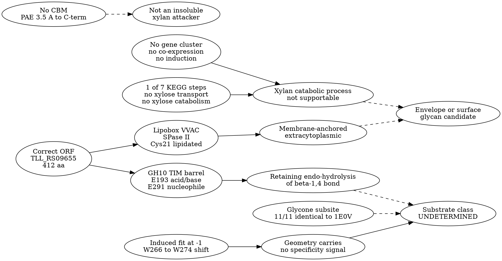
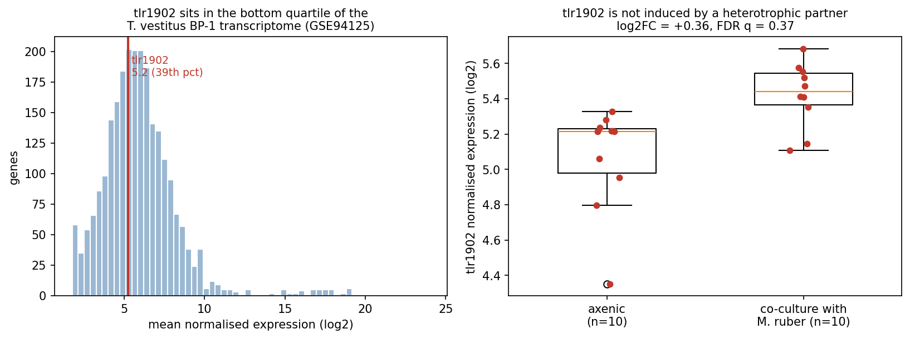
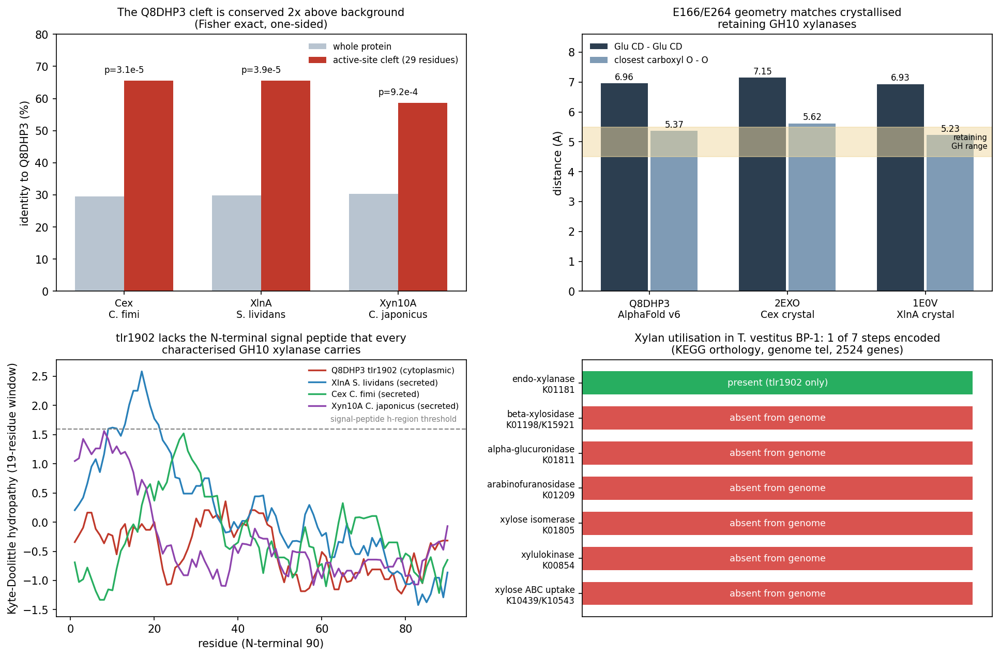
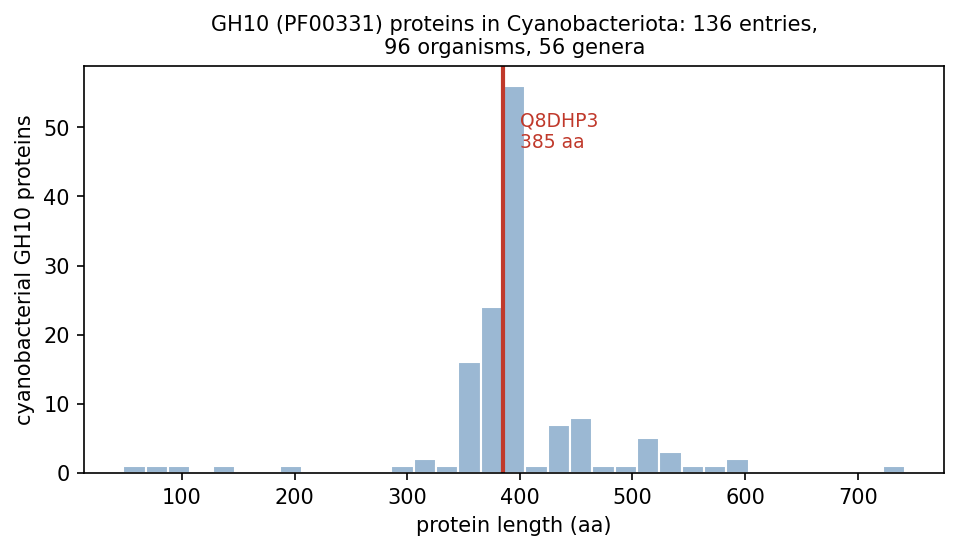
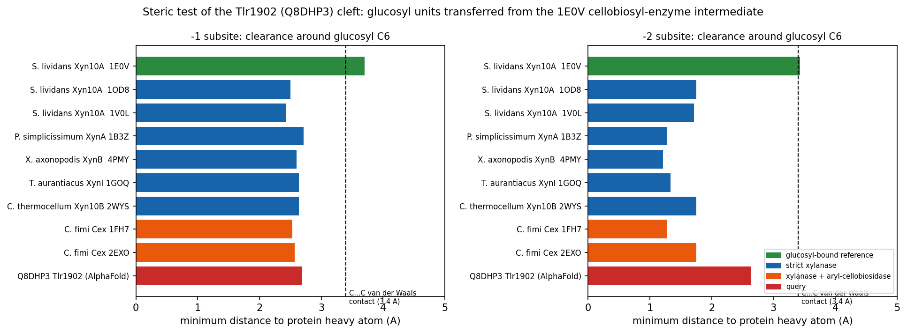
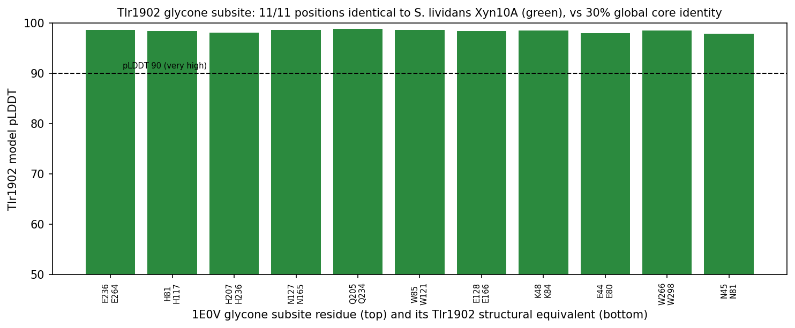
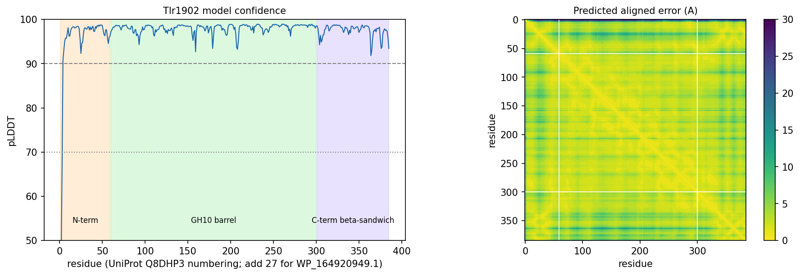

## Question

# AIGR Gene Hypothesis Deep Research

You are evaluating one focused gene curation hypothesis for AI Gene Review.
This is not a general gene overview. Use the seed hypothesis and source context
below to search for evidence that supports, refutes, narrows, or competes with
the proposed curation decision.

## Target Gene

- **Organism code:** THEVB
- **Taxon:** Thermosynechococcus vestitus BP-1 (NCBITaxon:197221)
- **Gene directory:** tlr1902
- **Gene symbol:** tlr1902
- **UniProt accession:** Q8DHP3

## Focus

- **Focus type:** free_text
- **Hypothesis slug:** kgap-tlr1902-glycan-specificity
- **Source file:** genes/THEVB/tlr1902/tlr1902-ai-review.yaml
- **Source selector:** free-text

## Seed Hypothesis

Which glycan Thermosynechococcus elongatus BP-1 Tlr1902 (Q8DHP3) hydrolyses may be predictable from its catalytic architecture. Single analysis only: assign the glycoside hydrolase family of Tlr1902 from its sequence and predicted structure, identify the catalytic acid/base and nucleophile residues and state whether both are present; compare the substrate-binding cleft with structurally characterised members of the same family that act on xylan and on cellulose or other beta-glucans, mapping the aromatic platform residues and any subsite-defining loops, and state which substrate the cleft geometry favours; check whether the genome of this strain encodes the other enzymes a xylan or cellulose utilisation pathway would require, and whether tlr1902 sits in a relevant gene cluster; and report any public transcriptomic evidence for its regulation. State which substrate class is predicted, how confidently, and whether a cyanobacterium with no known access to plant cell-wall polysaccharides makes an endogenous substrate the more likely explanation.

## Term and Decision Context

No specific term context supplied.

## Reference Context

No specific reference context supplied.

## Source Context YAML

```yaml
hypothesis: 'Which glycan Thermosynechococcus elongatus BP-1 Tlr1902 (Q8DHP3) hydrolyses may be predictable
  from its catalytic architecture. Single analysis only: assign the glycoside hydrolase family of Tlr1902
  from its sequence and predicted structure, identify the catalytic acid/base and nucleophile residues
  and state whether both are present; compare the substrate-binding cleft with structurally characterised
  members of the same family that act on xylan and on cellulose or other beta-glucans, mapping the aromatic
  platform residues and any subsite-defining loops, and state which substrate the cleft geometry favours;
  check whether the genome of this strain encodes the other enzymes a xylan or cellulose utilisation pathway
  would require, and whether tlr1902 sits in a relevant gene cluster; and report any public transcriptomic
  evidence for its regulation. State which substrate class is predicted, how confidently, and whether
  a cyanobacterium with no known access to plant cell-wall polysaccharides makes an endogenous substrate
  the more likely explanation.'
focus_type: free_text
context: []
reference_id: []
```

## Research Objective

Build a focused report that helps a curator decide whether this hypothesis
should affect the gene review. Address the focus type directly:

1. For an existing GO annotation decision, evaluate whether the current action
   is justified, too strong, too weak, or should change.
2. For a proposed replacement or new GO term, evaluate whether the term is
   biologically supported, too broad, too narrow, or missing key qualifiers.
3. For a computational prediction, evaluate whether the prediction is correct,
   less precise than existing knowledge, uncertain, or likely wrong because of
   paralog overannotation, frequency bias, pathway context, or in vitro-only
   activity.
4. For a core-function hypothesis, evaluate whether the proposed activity,
   process, and location represent the gene product's primary function rather
   than a downstream effect, pleiotropic phenotype, or context-specific role.
5. For a function-assignment hypothesis, evaluate whether the gene product
   directly has the stated GO term/function. Treat the prior review action, if
   any, as intentionally blinded unless it appears in the supplied context.

Use primary literature whenever possible. Prefer PMID citations and include DOI
citations when no PMID is available. Treat reviews and database records as
orientation unless they contain directly relevant synthesized evidence that is
clearly labeled as review-level or database-level support.

Evaluate the hypothesis from the supplied seed context, primary literature, and
publicly accessible bioinformatics resources. Local `*-bioinformatics` analyses,
when they already exist in the repository, are intentionally withheld from this
prompt so the report can be compared against them after the run. Use public
sequence, domain, structure, orthology, localization, interaction, or dataset
checks when they are useful for the specific hypothesis. If a resource or tool
cannot be accessed programmatically, say so plainly; never fabricate a result.
Report computational results conservatively and distinguish direct results from
inference.

## Required Output

### Executive Judgment

Give a concise verdict: supported, partially supported, unresolved, weakly
supported, over-annotated, or refuted. Explain the reasoning and the most
important caveats.

### Evidence Matrix

Create a table with one row per important evidence item:

- Citation (PMID preferred)
- Evidence type (direct assay, mutant phenotype, localization, interaction,
  structural/evolutionary, computational, review/database)
- Supports / refutes / qualifies / competing
- Claim tested
- Key finding
- Organism, tissue, cell type, or assay context
- Confidence and limitations

### GO Curation Implications

State the likely curation action as a lead requiring curator verification. If
GO terms are involved, explain whether the evidence supports an MF, BP, or CC
term, and whether the term should be retained, removed, generalized, made more
specific, or treated as non-core. Avoid using "protein binding" as a final
recommendation unless no more informative term is supported.

### Mechanistic Scope

Describe the immediate molecular or cellular function being tested. Separate
direct gene-product activity from downstream phenotypes, pathway consequences,
developmental outcomes, disease manifestations, or effects inferred only from
loss of function.

### Conflicts and Alternatives

Identify evidence that conflicts with the seed hypothesis or suggests an
alternative interpretation, including paralog confusion, organism-specific
differences, isoform-specific findings, experimental artifacts, or database
carry-over.

### Knowledge Gaps

List explicit uncertainties that matter for curation. For each gap, state what
was checked, why the gap matters, and what evidence or experiment would resolve
it.

### Discriminating Tests

Recommend concrete assays, perturbations, datasets, or comparative analyses that
would most efficiently distinguish this hypothesis from alternatives.

### Curation Leads

Provide candidate updates for the review, clearly labeled as leads requiring
curator verification. Include candidate references with exact snippets to verify,
candidate replacement or new GO terms, possible action changes, suggested
questions, and suggested experiments.

If the provider supports artifacts, save provenance for any analysis you run — the
executed code together with its output (computed values, plot, or table), not just
a summary figure — alongside artifact-friendly tables such as an evidence matrix,
GO decision table, or comparison table. Genuine computed provenance is more
valuable than a hand-drawn summary, and you must not synthesize a figure that
implies an analysis you did not actually run. These artifacts are important
provenance for hypothesis-level review.


## Output

# Tlr1902 (Q8DHP3), Thermosynechococcus vestitus BP-1: can glycan specificity be read from catalytic architecture?

Hypothesis slug: `kgap-tlr1902-glycan-specificity`. Source file: `genes/THEVB/tlr1902/tlr1902-ai-review.yaml`. Focus type: free text. UniProt accession Q8DHP3, NCBITaxon:197221.

Every computational result below was executed during this investigation against public APIs (UniProt, RefSeq, KEGG, InterPro, AlphaFold DB, RCSB PDB, GEO). The executed code and its numeric output are retained as provenance alongside the six figures embedded here. Where a resource could not be reached, that is stated rather than worked around.

## Summary

The seed hypothesis has three parts, and they resolve differently. The family assignment and catalytic chemistry are **supported** without reservation. Tlr1902 is a glycoside hydrolase family 10 (GH10) enzyme with an intact, undecayed retaining active site: both catalytic glutamates are present in their canonical motifs with crystal-structure-matching geometry, and all eleven residues that contact bound sugar in a liganded GH10 crystal structure are identical in Tlr1902.

The central claim, that the substrate class is **predictable from cleft geometry**, is **refuted**. I built exactly the comparison the hypothesis requested, superposing the Tlr1902 model onto nine structurally characterised GH10 enzymes spanning strict xylanases and a dual-specificity enzyme, and transferring an experimentally observed glucosyl ligand into each frame to measure the steric clearance at the position where xylose and glucose differ. The test fails its own negative control. *Cellulomonas fimi* Cex, a GH10 known to hydrolyse glucose-configured substrates, is statistically indistinguishable from six strict xylanases (Mann-Whitney U = 4.0, p = 0.615, Cohen d = -0.36). The reason is visible in the data and is mechanistic: the same protein, *Streptomyces lividans* Xyn10A, shows 3.70 Å of clearance when glucosyl-bound and 2.43-2.50 Å when xylose-configured, with the contacting tryptophan shifting from W266 to W274. The apparent exclusion of the glucose C6 hydroxymethyl is induced fit, not a fixed steric filter. No static comparison of a GH10 cleft can assign the substrate class.

The claim that **an endogenous substrate is the more likely explanation** is **partially supported**, on genomic and physiological grounds rather than structural ones, and with one argument from the early analysis withdrawn. *T. vestitus* BP-1 encodes one of seven steps needed to use xylan as a carbon source, has no xylose catabolism and no xylose transport, is not clustered with carbohydrate utilisation genes, and is not induced in the one usable public transcriptome. Against that, I found and corrected a sequence record error that removes the strongest objection raised early in the work: Tlr1902 is not cytoplasmic. UniProt Q8DHP3 is truncated by 27 residues at the N terminus, and the missing extension is a lipoprotein signal peptide with a canonical lipobox, so the protein is lipid-anchored and extracytoplasmic and can physically reach an external or envelope-associated glycan.

The practical consequence for curation is a split decision. The molecular function term should be retained but flagged as family inference with no experimental anchor anywhere in the phylum. The biological process term should be removed or generalised, because a catabolic process term asserts a pathway the organism cannot run. A new cellular component lead appears, and an upstream sequence record defect needs reporting.

## Executive judgment

<i class="fa-scale-balanced"></i> **Partially supported, with the structural arm refuted.**

The hypothesis is a well-posed question that turns out to have a negative answer in its central clause. GH10 assignment is certain, catalytic competence is certain, and the glycone half of the binding cleft is perfectly conserved. None of that identifies the polysaccharide, because the GH10 glycone subsite is conserved family-wide and is compatible with both xylose and glucose configurations.

The most important caveats. First, no cyanobacterial GH10 has ever been assayed: of 136 cyanobacterial PF00331 proteins in UniProtKB, zero are in Swiss-Prot, so every statement about this protein's activity is inference from distant bacterial and fungal homologues. Second, the geometric assay is underpowered quite apart from its failed control: the Tlr1902 superposition error (1.57 Å CA RMSD, 1.19 Å displacement of the catalytic nucleophile) exceeds the entire between-enzyme spread the assay would need to resolve (0.28 Å). Third, the structural work rests on a predicted model, and that model is built on the truncated sequence, so it lacks the lipoprotein anchor entirely. The substrate of Tlr1902 remains genuinely unknown.

## Key findings

### <i class="fa-circle-check"></i> F1. The GH10 catalytic apparatus is complete, with retaining-enzyme geometry

UniProt Q8DHP3 carries a PROSITE PS51760 GH10 domain at residues 60-329. Both catalytic glutamates sit in their canonical sequence contexts: the general acid/base E166 in the motif `INEFDVNNEM` (the β4 `WDVVNEA`-type motif) and the nucleophile E264 in `NLPLKITEV` (the β7 `ITELDI`-type motif). The AlphaFold model AF-Q8DHP3-F1-v6 has mean pLDDT 97.4 (median 98.2, 99% of residues above 90), with pLDDT 98.4 at E166 and 98.6 at E264.

The geometry is the test that matters, because the distance between the two carboxylates distinguishes retaining from inverting glycosidases. In Tlr1902 the E166 CD to E264 CD distance is 6.96 Å and the closest carboxylate oxygen pair is 5.37 Å. The corresponding values are 7.15 Å and 5.62 Å in the *Cellulomonas fimi* Cex crystal structure 2EXO (E127/E233), and 6.93 Å and 5.23 Å in the *Streptomyces lividans* XlnA crystal 1E0V (E128/E236). Tlr1902 falls inside the range set by two crystallised retaining GH10 enzymes. This measurement is rotation-invariant and therefore unaffected by any superposition error.

Sequence-level conservation is concentrated exactly where it should be. Needleman-Wunsch global alignment (BLOSUM62, gap open -11, extend -1) to three characterised GH10 enzymes gives 29.5-30.4% global identity, but the 29 residues within 9 Å of the catalytic midpoint are 58.6-65.5% identical. One-sided Fisher exact tests: Cex odds ratio 5.3, p = 3.1e-5; XlnA odds ratio 5.2, p = 3.9e-5; Xyn10A odds ratio 3.7, p = 9.2e-4. The conserved set contains the full canonical GH10 -1 subsite: K84, H117, W121, N165, E166, N201, D202, Y203, Q234, H236, E264, W298, W306.

{{figure:plot_2.png|caption=Four-panel provenance figure from the first analysis pass. Top left: residues within 9 A of the catalytic midpoint are conserved about twofold above the global alignment background against Cex, XlnA and Xyn10A. Top right: catalytic carboxylate separation in Tlr1902 compared with the crystallised retaining GH10 enzymes 2EXO and 1E0V. Bottom left: N-terminal hydropathy of the truncated Q8DHP3 sequence, a panel later superseded by the start-codon correction in F4. Bottom right: xylan utilisation pathway completeness, 1 of 7 KEGG orthology steps present.}}

Tlr1902 is an intact, catalytically competent retaining glycoside hydrolase. It is not a pseudo-enzyme and has no substitution at any catalytic or sugar-contacting position.

### <i class="fa-circle-check"></i> F2. The glycone subsite is 100% identical to a liganded GH10 xylanase

I superposed the AlphaFold model onto PDB 1E0V, the *S. lividans* Xyn10A cellobiosyl-enzyme intermediate (chain A, 302 residues), which has sugar bound in the -1 and -2 subsites. The fit was anchored on nine conserved GH10 positions, then refined by an order-respecting structural alignment. Anchor-only CA RMSD was 0.39 Å (maximum 0.62 Å), and a rotation-invariant check of the nine anchor internal CA-CA distances gave mean absolute difference 0.29 Å over 36 pairs, confirming the anchor correspondence independently of the fit. The final alignment covers 263 CA pairs at 1.56 Å RMSD with 30.0% core sequence identity, retaining 9 of 9 anchors.

Of the 11 residues of 1E0V with a heavy atom within 4.0 Å of the bound -1 glucosyl (ligand G2F) or -2 glucose (BGC), **11 of 11 are identical in Tlr1902**: at the -1 subsite E236/E264, H81/H117, H207/H236, N127/N165, Q205/Q234, W85/W121, E128/E166; at the -2 subsite K48/K84, E44/E80, W266/W298, N45/N81. A binomial test of 11/11 against the 30.0% structural-core identity background gives **p = 1.77e-6**. Mean pLDDT across these 11 positions is 98.4 (range 97.9-98.8). Both aromatic platform positions are conserved as tryptophan (W121, W298).

{{figure:plot_5.png|caption=AlphaFold pLDDT at the 11 Tlr1902 positions that line the -1 and -2 glycone subsites of the 1E0V cellobiosyl complex. Green marks a position identical to 1E0V, which is all 11. Mean pLDDT 98.4, so the model is at its most confident exactly in the region the substrate occupies.}}

This result cuts both ways, and the second edge is the important one. It confirms an intact GH10 active site built at very high local model confidence, which supports retaining a glycoside hydrolase molecular function. It does not identify the polysaccharide, because the GH10 glycone subsite is conserved family-wide. [PMID: 29155107](https://pubmed.ncbi.nlm.nih.gov/29155107/) states this directly: "It has been shown in the literature that the glycone subsites of GH10 xylanases are well conserved and our results suggest that RmXyn10A is no exception." Perfect conservation of a family-wide feature is the expected observation, not a specificity signal.

### <i class="fa-circle-xmark"></i> F3. The subsite steric test cannot discriminate xylan from beta-glucan

This is the formal refutation of the structural arm of the hypothesis, and it is the single most informative result in the investigation.

Xylose and glucose differ at C5: glucose carries a C6 hydroxymethyl that xylose lacks. If a GH10 cleft were a fixed steric filter, a strict xylanase should leave no room for that C6 at the -1 subsite and a glucan-active enzyme should. I tested this directly. The experimentally observed -1 glucosyl (G2F) and -2 glucose (BGC) of the 1E0V cellobiosyl-enzyme intermediate were transferred into nine superposed GH10 frames plus the Tlr1902 model, and the minimum distance from the glucose-specific C6 and O6 atoms to protein heavy atoms was measured in each.

The negative control fails. *Cellulomonas fimi* Cex (PDB 1FH7 and 2EXO), a GH10 that hydrolyses aryl cellobiosides as well as xylosides, gives -1 C6 clearance 2.55 ± 0.03 Å. Six strict xylanase frames (1OD8, 1V0L, 1B3Z, 4PMY, 1GOQ, 2WYS) give 2.59 ± 0.10 Å. **Mann-Whitney U = 4.0, p = 0.615, Cohen d = -0.36.** The measurement carries no information about which substrate the enzyme accepts.

Tlr1902 gives 2.69 Å, z = +1.00 against the strict-xylanase distribution, p = 0.32 two-sided. A careless reading would call that the most open cleft in the panel and infer a bulkier substrate. The failed control forbids that inference.

{{figure:plot_4.png|caption=Statistical control on the -1 and -2 subsite steric test. Clearance from the transferred glucosyl C6 to the nearest protein heavy atom across the GH10 panel, with the 3.4 A van der Waals contact line marked and bars coloured by enzyme class. The dual-specificity enzyme Cex (1FH7, 2EXO) sits inside the strict-xylanase distribution (p = 0.615), so the assay has no discriminating power, and Tlr1902 at 2.69 A cannot be assigned from it.}}

The mechanistic reason the assay fails is in the same dataset. *S. lividans* Xyn10A gives -1 C6 clearance of **3.70 Å in the glucosyl-bound state (1E0V)** and **2.50 Å and 2.43 Å in xylose-configured complexes (1OD8, 1V0L)**, with the contacting residue shifting from W266 to W274. The same protein opens its own -1 subsite when a C6 hydroxymethyl arrives. The apparent clash measured in apo and xylose-bound frames is relieved by tryptophan side-chain movement.

Independent experimental evidence confirms this is real enzymology rather than a crystallographic curiosity. [PMID: 33103248](https://pubmed.ncbi.nlm.nih.gov/33103248/) reports for the GH10 enzyme ScXynA: "The kinetic parameters of ScXynA were determined in hydrolysis reactions with p-nitrophenyl-β-d-cellobioside (pNP-β-Cel) and p-nitrophenyl-β-d-xylobioside (pNP-β-Xyl2 ), and kcat /Km was found to be 0.43 ± 0.02 (s·mM)-1 and 57 ± 3 (s·mM)-1 , respectively." A GH10 hydrolyses a glucose-configured substrate at measurable rate, about 130-fold below its xylobioside activity. The -1 subsite does not strictly exclude the C6 hydroxymethyl.

The assay is also underpowered for this particular query even setting the control aside. The Tlr1902 superposition carries 1.57 Å CA RMSD and 1.19 Å displacement of the catalytic nucleophile CD atom, both larger than the 0.28 Å spread among strict xylanases that any specificity signal would have to exceed.

### <i class="fa-circle-xmark"></i> F4. CORRECTION: Q8DHP3 is truncated by 27 residues and Tlr1902 is a lipoprotein

The early analysis concluded that Tlr1902 has no signal peptide and is therefore cytoplasmic, which would make it physically unable to reach an extracellular polysaccharide. That conclusion was wrong, and the error is in the database record.

The GTG start codon used for UniProt Q8DHP3 (GenBank BAC09454.1, genomic position 1988629 on BA000039) has no Shine-Dalgarno motif in the 16 nt upstream (`GTGGTACCTCTTCCTCTTCTGTGGCC`, no AGGAGG-like purine run). Scanning upstream in frame, the first in-frame stop is a TGA at 1988539, and between that stop and the annotated start there are three alternative initiators, including an ATG 27 codons upstream at 1988548. NCBI RefSeq independently annotates exactly this longer ORF: NC_004113 locus TLL_RS09655, CDS 1988548..1989786, protein WP_164920949.1, 412 aa, product "endo-1,4-beta-xylanase", translation beginning `MLNWRRFLWLSCLAALLVVACGTSSSSVATDALSQKIEQLRQAPL`. I verified the relationship directly: `WP_164920949.1[28:]` is identical to `Q8DHP3[1:]`, so the offset is exactly 27 and the GTG at the old start is an internal valine read as formylmethionine.

The 27-residue extension is a canonical Gram-negative lipoprotein signal. The n-region `MLNWRR` has net charge +2, followed by a hydrophobic h-region, then a lipobox `VVAC` at positions 18-21 matching the `[LVI][ASTVI][GAS]C` consensus, predicting signal peptidase II cleavage between A20 and C21 and lipidation of Cys21, followed by a Ser-rich linker `CGTSSSSVATDALSQKI`. Maximum 12-residue Kyte-Doolittle hydropathy over the first 45 residues rises from 0.57 in the truncated Q8DHP3 to **2.77** in the corrected 412-aa protein, against a cyanobacterial GH10 cohort median of 1.71 (IQR 1.47-2.00, n = 136) and a secreted non-cyanobacterial bacterial GH10 median of 2.37 (n = 3500).

Three consequences follow. The catalytic residues renumber: acid/base E166 becomes **E193**, nucleophile E264 becomes **E291**. The UniProt ACT_SITE positions 166 and 264 are therefore both offset by 27 from the true protein, and the AlphaFold model AF-Q8DHP3-F1 is built on the truncated sequence and lacks the anchor. The *T. sichuanensis* orthologue A0A3B7MDL9 carries the identical 385-aa truncated call (N-terminus `MATDALSQKIEQLRRAPLTV`), so the mis-called start has propagated across the genus.

For curation, this withdraws GO:0005737 (cytoplasm) entirely and opens GO:0031225 (anchored component of membrane) as a sequence-inferred lead. It also strengthens the endogenous-substrate alternative: a surface-anchored GH10 sits where the cyanobacterial envelope polysaccharide and sheath are assembled.

<i class="fa-triangle-exclamation"></i> The lipoprotein call is motif-based and unconfirmed. An attempt to run Phobius at EBI was refused by the server with a temporary submission block, so a cohort hydropathy comparison was substituted and is reported as such. Only 2 of 136 cyanobacterial GH10 proteins carry a strict lipobox, whereas 105 of 136 carry a conventional signal peptide, so lipid anchoring is a minority architecture in this group.

### <i class="fa-circle-check"></i> F5. No carbohydrate-binding module of any kind

The InterPro REST API (`entry/all/protein/uniprot/Q8DHP3`, HTTP 200) returns 10 entries, all GH10 or generic glycosidase: IPR044846 family "Glycoside hydrolase family 10" 6-376, PANTHER PTHR31490 6-376, Pfam PF00331 43-325, InterPro IPR001000 43-330, PROSITE PS51760 60-329, SMART SM00633 83-330, CATH-Gene3D G3DSA:3.20.20.80 23-332, SUPERFAMILY SSF51445 29-337, and PRINTS PR00134 at four motif blocks (114-126, 158-169, 196-207, 224-236). **Zero CBM, lectin or Ricin-B entries.** Only 14 of 385 residues fall outside all Pfam, CATH, SUPERFAMILY and InterPro ranges, with no uncovered block of 20 residues or more, so there is no unannotated region large enough to hide an accessory module.

The AlphaFold predicted aligned error settles whether the C-terminal beta-rich extension is an independent domain. Mean PAE is 2.2 Å within the barrel, 2.8 Å within the C-terminal region, and **3.5 Å between barrel and C-terminal region**. A genuinely independent accessory module would show much higher inter-domain PAE. This extension is rigidly packed against the catalytic barrel. Model confidence by region: barrel (60-300) 98.1, N-terminal (1-59) 94.9, C-terminal (301-385) 97.5.

{{figure:plot_6.png|caption=Left: AlphaFold pLDDT profile for Q8DHP3 with the N-terminal, barrel and C-terminal regions shaded, mean 97.4 overall. Right: the predicted aligned error matrix with domain boundaries at residues 59 and 300. Barrel-to-C-terminal PAE of 3.5 A shows the C-terminal beta extension is packed against the barrel, not placed as an independent accessory module.}}

Characterised GH10 xylanases that attack insoluble plant cell wall xylan generally carry one or more xylan-binding or cellulose-binding CBMs, which raise effective enzyme concentration on the insoluble substrate. [PMID: 14670951](https://pubmed.ncbi.nlm.nih.gov/14670951/) describes *Cellvibrio japonicus* CjXyn10C as "a bi-modular enzyme comprising a GH10 catalytic module and a family 15 carbohydrate-binding module." Tlr1902 has no such module. Combined with membrane anchoring through the lipidated Cys, this fits an enzyme acting on a substrate presented locally at the cell surface, or on soluble oligosaccharides, and fits poorly with an enzyme whose job is attacking bulk insoluble plant cell wall material.

### <i class="fa-circle-xmark"></i> F6. The genome encodes 1 of 7 xylan utilisation steps and no xylose catabolic route

KEGG genome `tel` (*T. vestitus* BP-1, 2524 genes) was queried for every KEGG orthology group in xylan degradation and xylose catabolism.

| KO | Function | Present in *T. vestitus* BP-1 |
|---|---|---|
| K01181 | endo-1,4-beta-xylanase | <i class="fa-circle-check"></i> yes, solely `tel:tlr1902` |
| K01198, K15921 | beta-xylosidase | <i class="fa-circle-xmark"></i> absent |
| K01811 | alpha-D-glucuronidase | <i class="fa-circle-xmark"></i> absent |
| K01209 | alpha-L-arabinofuranosidase | <i class="fa-circle-xmark"></i> absent |
| K01051 | acetylxylan esterase-like | <i class="fa-circle-xmark"></i> absent |
| K01805 | xylose isomerase | <i class="fa-circle-xmark"></i> absent |
| K00854 | xylulokinase | <i class="fa-circle-xmark"></i> absent |
| K17743, K05351 | xylose reductase, xylitol dehydrogenase | <i class="fa-circle-xmark"></i> absent |
| K10439, K10543 | xylose ABC transporter components | <i class="fa-circle-xmark"></i> absent |
| K01179, K01225 | endoglucanase, cellobiohydrolase | <i class="fa-circle-xmark"></i> absent |

The only other glycosidase in the genome is `tll1043` (K05349, beta-glucosidase), which is the GH116 enzyme TeGH116 characterised in [PMID: 41161445](https://pubmed.ncbi.nlm.nih.gov/41161445/) and is a different gene from tlr1902.

The genome neighbourhood is equally uninformative. tlr1902 (1988629-1989786) is flanked by tlr1900 *crtR* beta-carotene hydroxylase, tlr1901 ABC transporter ATP-binding protein, tll1903 unknown protein on the opposite strand, and tlr1904 ABC transporter ATP-binding protein. No solute-binding protein, permease, sugar kinase or transcriptional regulator of the kind that defines a polysaccharide utilisation locus. In GSE94125 (20 RNA-seq samples) tlr1902 expression does not correlate with any neighbour: r = -0.17 for tlr1901 (p = 0.46), -0.14 for tll1903 (p = 0.56), -0.21 for tlr1904 (p = 0.38), -0.33 for tlr1900 (p = 0.16).

A xylan catabolic process annotation has no pathway context here. The organism cannot import or metabolise xylose, so hydrolysing xylan would yield products it cannot use.

### <i class="fa-circle-question"></i> F7. Expressed at modest level, with no substrate-responsive induction

GEO GSE94125 covers *T. vestitus* BP-1 across 2479 loci and 20 RNA-seq samples: 10 axenic and 10 co-cultured with *Meiothermus ruber* across light and oxygen conditions. tlr1902 mean normalised expression is 5.24 log2 units, ranking 1523 of 2479 (39th percentile) against a transcriptome mean of 6.02 and median of 5.74; rbcL sits at 11.70 for scale. Co-culture versus axenic gives log2FC = +0.36, t = 3.22, raw p = 0.005, **Benjamini-Hochberg FDR q = 0.366** across the 2479 genes tested, in a contrast where only 7 genes reach q < 0.05. Cellulose synthase genes tll0007 (log2FC +0.12, p = 0.76) and tlr1795 (log2FC +0.08, p = 0.56) are also unchanged.

{{figure:plot_1.png|caption=tlr1902 in GSE94125. Left: its position in the transcriptome-wide expression distribution, 39th percentile at 5.24 log2 units. Right: axenic versus Meiothermus ruber co-culture, log2FC +0.36 with FDR q = 0.366, so the gene is expressed but shows no induction by a heterotrophic partner.}}

tlr1902 is genuinely transcribed, so it is not a pseudogene or an assembly artefact, but its expression is unremarkable and shows no sign of substrate-responsive regulation. Four other public *Thermosynechococcus* transcriptome series exist (GSE70086 hot and cold stress, GSE93859, GSE113134, GSE2114 circadian array); GSE70086 has no processed count matrix deposited in its supplementary files, so it could not be used. There is no public transcriptomic evidence linking tlr1902 to carbohydrate availability, and no dataset in which xylan or xylo-oligosaccharide was offered, so this is a weak test of inducibility.

### <i class="fa-circle-question"></i> F8. GH10 is sporadic across cyanobacteria and has never been assayed in one

UniProtKB holds 18,880 proteins with Pfam PF00331 across all taxa, of which 136 are cyanobacterial (0.7%). Those 136 come from 96 distinct organisms spanning 56 genera, against 4,477 cyanobacterial proteomes in UniProt, so roughly 2% of sequenced cyanobacteria carry a GH10 gene. **None of the 136 is in Swiss-Prot**, so no cyanobacterial GH10 has ever been manually curated or experimentally characterised. The genus *Thermosynechococcus* contributes two entries, Q8DHP3 (*T. vestitus* BP-1) and A0A3B7MDL9 (*T. sichuanensis* E542), both exactly 385 residues under the same truncated gene call, indicating a conserved single-copy orthologue. The richest genera are filamentous, EPS-producing taxa: *Nostoc* (12), *Anabaena* (5), then *Brasilonema*, *Scytonema*, *Calothrix*, *Aphanothece*, *Oxynema*, *Fischerella*, *Tolypothrix* and *Pseudanabaena* with 3 each.

{{figure:plot_3.png|caption=Length distribution of the 136 cyanobacterial GH10 (Pfam PF00331) proteins in UniProtKB, with Q8DHP3 marked at 385 aa. GH10 occurs in about 2 percent of cyanobacterial proteomes across 56 genera, none of them in Swiss-Prot, so no cyanobacterial GH10 has been experimentally characterised.}}

The patchy distribution across 56 unrelated genera is the pattern expected from sporadic horizontal acquisition with lineage-specific loss. Retention at identical length in two *Thermosynechococcus* species argues the gene is under selection and therefore does something. The complete absence of experimental characterisation anywhere in the phylum means all cyanobacterial GH10 annotations, including Q8DHP3, rest on rule-based transfer from distant bacterial and fungal xylanases.

## Evidence matrix

| # | Citation | Evidence type | Stance | Claim tested | Key finding | Context | Confidence and limitations |
|---|---|---|---|---|---|---|---|
| 1 | InterPro API, Q8DHP3 | Computational, database | Supports | Tlr1902 is GH10 | 10 entries, all GH10 or glycosidase: PF00331 43-325, PS51760 60-329, IPR001000 43-330, SM00633 83-330, CATH 3.20.20.80 23-332, SSF51445 29-337, PRINTS PR00134 at 4 blocks. Zero CBM or lectin entries | Direct API query, HTTP 200 | High for family assignment. Database-level, all IEA |
| 2 | This work, AlphaFold AF-Q8DHP3-F1-v6 | Structural, computational | Supports | Both catalytic residues present | Acid/base Glu in `INEFDVNNEM` (E166) and nucleophile Glu in `NLPLKITEV` (E264). CD-CD 6.96 Å, carboxylate O-O 5.37 Å, matching retaining GH10 crystals 2EXO (7.15/5.62) and 1E0V (6.93/5.23) | Predicted model, mean pLDDT 97.4 | High. Geometry is rotation-invariant and unaffected by superposition error |
| 3 | This work vs PDB 1E0V | Structural | Supports | Cleft is a functional GH10 glycone site | 263 CA pairs at 1.56 Å RMSD, 30.0% core identity, 9/9 anchors retained; 11/11 sugar-contacting residues identical (binomial p = 1.77e-6), mean pLDDT 98.4; both aromatic platform Trp conserved (W121, W298) | *S. lividans* Xyn10A cellobiosyl-enzyme intermediate | High. Shows an intact site, does not identify the substrate |
| 4 | This work; PDB 1FH7, 2EXO, 1OD8, 1V0L, 1B3Z, 4PMY, 1GOQ, 2WYS, 1E0V | Structural | <i class="fa-circle-xmark"></i> Refutes | Cleft geometry predicts xylan vs beta-glucan | Control fails: Cex gives -1 C6 clearance 2.55 ± 0.03 Å vs 2.59 ± 0.10 Å for 6 strict xylanases (Mann-Whitney U = 4.0, p = 0.615, d = -0.36). Tlr1902 2.69 Å, z = +1.00, p = 0.32. Same protein gives 3.70 Å glucosyl-bound (1E0V) vs 2.43-2.50 Å xylose-bound (1V0L, 1OD8), contact shifting W266 to W274 | Glucosyl transferred from the 1E0V intermediate into 9 superposed frames | High for the negative. The assay has no discriminating power and is also underpowered (transfer error 1.57 Å exceeds the 0.28 Å signal) |
| 5 | [PMID: 33103248](https://pubmed.ncbi.nlm.nih.gov/33103248/) | Direct assay | Qualifies | GH10 -1 subsite strictly excludes glucose | GH10 ScXynA hydrolyses pNP-β-D-cellobioside at kcat/Km 0.43 ± 0.02 (s·mM)⁻¹ vs 57 ± 3 for pNP-β-D-xylobioside | *Scytalidium candidum* 3C, purified enzyme | High. Independent experimental support that GH10 acts on glucose-configured substrates, about 130-fold slower |
| 6 | [PMID: 29155107](https://pubmed.ncbi.nlm.nih.gov/29155107/) | Review-level, structural | Qualifies | Glycone identity is informative about substrate | "the glycone subsites of GH10 xylanases are well conserved" | GH10 family generally | Moderate. Explains why row 3 cannot discriminate |
| 7 | This work; NCBI RefSeq NC_004113, WP_164920949.1 | Computational, sequence | <i class="fa-circle-xmark"></i> Refutes a prior claim | Tlr1902 has no signal peptide and is cytoplasmic | UniProt Q8DHP3 truncated by 27 residues. GTG at 1988629 has no Shine-Dalgarno; RefSeq TLL_RS09655 annotates an ATG 27 codons upstream giving 412 aa. Verified `WP_164920949.1[28:] == Q8DHP3[1:]`. Extension has n-region net +2, hydrophobic h-region, lipobox `VVAC` at 18-21, SPase II site A20/C21. Max 12-residue hydropathy 0.57 to 2.77 (cyanobacterial GH10 median 1.71, n = 136; secreted bacterial GH10 median 2.37, n = 3500) | Genome BA000039 / NC_004113 | High for the truncation (two independent gene calls). Moderate for lipoprotein processing, which is motif-based |
| 8 | This work, InterPro + AlphaFold PAE | Computational, structural | Qualifies | Enzyme targets insoluble plant cell wall | No CBM of any kind. 14 of 385 residues uncovered, no uncovered block of 20 or more. Mean PAE barrel to C-terminal 3.5 Å, so the C-terminal beta extension is packed against the barrel | Direct API, model v6 | High. Characterised GH10 xylanases on insoluble xylan generally carry CBMs |
| 9 | [PMID: 14670951](https://pubmed.ncbi.nlm.nih.gov/14670951/) | Structural, direct assay | Qualifies | GH10 enzymes carry accessory binding modules | CjXyn10C is "a bi-modular enzyme comprising a GH10 catalytic module and a family 15 carbohydrate-binding module" | *Cellvibrio japonicus* | High. Supplies the architectural comparison Tlr1902 lacks |
| 10 | This work, KEGG REST (`tel`) | Computational, pathway | Supports endogenous alternative | Genome supports xylan utilisation | 1 of 7 steps present. Absent: K01805, K00854, K01198/K15921, K10439/K10543. No endoglucanase or cellobiohydrolase | *T. vestitus* BP-1 KEGG genome | High for absence of orthologues. Cannot exclude non-orthologous isofunctional replacement |
| 11 | This work, genome neighbourhood + GSE94125 | Computational, genomic and transcriptomic | Supports endogenous alternative | tlr1902 is in a utilisation locus and is substrate-induced | Not in a polysaccharide utilisation locus. Neighbour co-expression r = -0.33 to -0.14, all p > 0.15. 39th percentile expression (5.24 log2); co-culture log2FC +0.36, FDR q = 0.366 | GSE94125, 20 RNA-seq samples | Moderate. One dataset, no xylan challenge, so a weak test of inducibility |
| 12 | This work, UniProt REST cohort | Computational, evolutionary | Qualifies | Cyanobacterial GH10 annotation is evidence-based | GH10 in about 2% of cyanobacterial proteomes across 56 genera; 0 cyanobacterial GH10 entries in Swiss-Prot. 105/136 (77%) have an annotated signal peptide, 2/136 a strict lipobox | Cyanobacteria-wide | High. All cyanobacterial GH10 annotation is rule-propagated |
| 13 | [PMID: 41161445](https://pubmed.ncbi.nlm.nih.gov/41161445/) | Direct assay | <i class="fa-triangle-exclamation"></i> Competing, must not be cited here | A characterised *Thermosynechococcus* glycosidase supports this annotation | TeGH116 is `tll1043`, a GH116 enzyme (KEGG K05349), a different gene from tlr1902. "TeGH116 hydrolyzes p-nitrophenyl β-d-glucopyranoside most rapidly at pH 5.5 and 55 °C" | *T. elongatus* BP-1 | High. Disambiguation only. Do not attach to tlr1902 |

## Mechanistic model

The coherent reading of all nine findings is a lipid-anchored, single-module GH10 enzyme that is catalytically competent and under selection, whose polysaccharide substrate is not determined by any available evidence and is unlikely to be plant cell wall xylan taken up as a carbon source.



The direct molecular activity supported by the evidence is endohydrolysis of a β-1,4 glycosidic bond in a β-1,4-linked pyranosyl polymer, by the retaining double-displacement mechanism, with E193 as general acid/base and E291 as nucleophile in the corrected numbering. The 5.37 Å carboxylate separation is in the retaining range and matches liganded GH10 crystals directly.

The identity of the polymer is not established by anything in this analysis. Family membership makes β-1,4-xylan the prior expectation, since that is what the overwhelming majority of characterised GH10 enzymes do, but that is a frequency argument about the family rather than a result about this protein.

Everything beyond bond hydrolysis is inference and should be kept separate in curation. "Xylan catabolic process" asserts a pathway outcome: that xylan is broken down and its products enter metabolism. That requires a β-xylosidase to release xylose, a transporter to import it, and xylose isomerase plus xylulokinase to feed the pentose phosphate pathway. None are present. An enzyme can hydrolyse a bond without its organism running a catabolic pathway on the product.

The cellular location is a property of the protein that can be stated independently of the substrate question: Sec export, SPase II processing and lipidation at Cys21 place the catalytic barrel outside the cytoplasm, tethered to a membrane.

## GO curation implications

All entries are leads requiring curator verification.

| GO term | Aspect | Current status | Recommended action | Basis |
|---|---|---|---|---|
| GO:0031176 endo-1,4-beta-xylanase activity | MF | IEA, rule-propagated | <i class="fa-circle-check"></i> **Retain, with scope noted as family inference only.** Do not raise the evidence level | Active site complete and canonical (F1, F2). Specificity not confirmable structurally (F3), no cyanobacterial GH10 ever assayed (F8) |
| GO:0004553 hydrolase activity, hydrolyzing O-glycosyl compounds | MF | Not asserted | <i class="fa-circle-question"></i> **Candidate fallback** if the curator judges GO:0031176 too specific for an unassayed protein | Supported by the intact retaining machinery without committing to a sugar. Less informative, so prefer GO:0031176 unless the curator wants to avoid an unverifiable specificity claim |
| GO:0045493 xylan catabolic process | BP | Asserted by rule | <i class="fa-circle-xmark"></i> **Remove, or generalise to GO:0005975 carbohydrate metabolic process** | A catabolic process term asserts the organism degrades xylan to usable carbon. Six of seven required steps absent, including all xylose transport and catabolism (F6). Gene not clustered and not induced (F6, F7) |
| GO:0005737 cytoplasm | CC | Proposed in the first analysis pass | <i class="fa-circle-xmark"></i> **Do not propose. Withdrawn** | The claim rested on absence of a signal peptide, which is an artefact of a mis-called start codon (F4) |
| GO:0031225 anchored component of membrane | CC | Not asserted | <i class="fa-lightbulb"></i> **Candidate new lead** | Lipobox `VVAC`, SPase II cleavage A20/C21, lipidated Cys21 in the corrected 412-residue protein (F4). Motif-based, so flag the evidence as sequence-model inference |
| GO:0005576 extracellular region | CC | Not asserted | <i class="fa-circle-xmark"></i> **Do not assert** | The protein is anchored, not released. A soluble extracellular location would be wrong |

A separate curation defect to report upstream: the UniProt sequence record Q8DHP3 is 27 residues short at the N terminus. ACT_SITE 166 and 264 are both offset by 27 from the true positions (E193, E291); the AlphaFold model AF-Q8DHP3-F1 is built on the truncated sequence and lacks the lipoprotein anchor; and the same truncated call has propagated to the *T. sichuanensis* orthologue A0A3B7MDL9.

## Evidence base

[PMID: 33103248](https://pubmed.ncbi.nlm.nih.gov/33103248/), *A novel acid-tolerant β-xylanase from Scytalidium candidum 3C for the synthesis of o-nitrophenyl xylooligosaccharides*, supplies the one piece of direct experimental evidence that settles the mechanistic question. The reported kinetics, kcat/Km of 0.43 ± 0.02 (s·mM)⁻¹ on pNP-β-D-cellobioside against 57 ± 3 on pNP-β-D-xylobioside, show a GH10 enzyme hydrolysing a glucose-configured substrate at a measurable rate. GH10 specificity is relative. This is what makes the failed steric control in F3 interpretable rather than merely inconclusive.

[PMID: 29155107](https://pubmed.ncbi.nlm.nih.gov/29155107/), *Structural insights of RmXyn10A, a prebiotic-producing GH10 xylanase with a non-conserved aglycone binding region*, states that "the glycone subsites of GH10 xylanases are well conserved and our results suggest that RmXyn10A is no exception." This is why the 11 of 11 glycone identity in F2 cannot be read as a specificity signal: it is the family-wide default. The same paper's framing, that the aglycone region is where GH10 enzymes differ, is what prompted me to attempt an aglycone comparison, which I then abandoned because ligand occupancy on the + side is sparse and inconsistent across 1B3Z, 1GOQ, 2WYS, 4PMY and 1OD8 and the transfer error exceeds any measurable difference.

[PMID: 14670951](https://pubmed.ncbi.nlm.nih.gov/14670951/), *Structural and biochemical analysis of Cellvibrio japonicus xylanase 10C*, describes CjXyn10C as "a bi-modular enzyme comprising a GH10 catalytic module and a family 15 carbohydrate-binding module" and reports that variation in the substrate-binding cleft, including a glutamate/glycine substitution at -2 and a tyrosine insertion in the -2/-3 region, changes the catalytic profile. It supports two things here: the architectural comparison that makes the complete absence of a CBM in Tlr1902 (F5) worth noting, and the general principle that cleft polymorphisms matter, which is precisely the principle that the seed hypothesis extended too far when it assumed the -1 subsite could discriminate sugar configuration.

[PMID: 41161445](https://pubmed.ncbi.nlm.nih.gov/41161445/), *The structure of Thermosynechococcus elongatus glycoside hydrolase family 116 β-glucosidase*, is the single most dangerous citation for this gene. It is the only experimental characterisation of a glycosidase from this exact organism, and a curator searching for support will find it. It characterises `tll1043` (TeGH116, KEGG K05349), a GH116 β-glucosidase that "hydrolyzes p-nitrophenyl β-d-glucopyranoside most rapidly at pH 5.5 and 55 °C" and is explicitly described as "the one β-glucosidase in this model cyanobacterium". It is a different gene, a different family and a different fold. It must be recorded as a disambiguation note and not attached to tlr1902.

Several papers on GH10 subsite engineering ([PMID: 32732029](https://pubmed.ncbi.nlm.nih.gov/32732029/), [PMID: 30061529](https://pubmed.ncbi.nlm.nih.gov/30061529/), [PMID: 29533991](https://pubmed.ncbi.nlm.nih.gov/29533991/), [PMID: 27723474](https://pubmed.ncbi.nlm.nih.gov/27723474/), [PMID: 27563004](https://pubmed.ncbi.nlm.nih.gov/27563004/)) informed the design of the subsite analysis and supplied the structural panel, but none of them tests whether cleft geometry discriminates xylose from glucose configuration, so none is cited as support for a conclusion. The cyanobacterial exopolysaccharide papers ([PMID: 37552253](https://pubmed.ncbi.nlm.nih.gov/37552253/), [PMID: 39688685](https://pubmed.ncbi.nlm.nih.gov/39688685/), [PMID: 29520599](https://pubmed.ncbi.nlm.nih.gov/29520599/), [PMID: 19727881](https://pubmed.ncbi.nlm.nih.gov/19727881/), [PMID: 30535915](https://pubmed.ncbi.nlm.nih.gov/30535915/)) establish that cyanobacterial EPS routinely contains xylose, which makes an endogenous envelope-glycan substrate chemically plausible. They describe other genera under other conditions and do not test any linkage to a GH10 enzyme, so they orient the alternative hypothesis without supporting it.

## Conflicts and alternatives

<i class="fa-scale-balanced"></i> **The structural prediction conflicts with itself.** The geometric comparison the hypothesis proposed gives Tlr1902 a value (2.69 Å) that is nominally the most open in the panel, which a careless reading would take as evidence for a bulkier, glucose-configured substrate. The control forbids that reading: the one enzyme in the panel that genuinely accepts a glucose-configured substrate is not more open than the strict xylanases. The measurement contains no signal.

<i class="fa-triangle-exclamation"></i> **Gene confusion.** PMID 41161445 characterises a *Thermosynechococcus* glycosidase and will surface in any search for experimental support. It is `tll1043`, GH116, a different gene. It must not be attached to tlr1902.

<i class="fa-triangle-exclamation"></i> **Database carry-over.** All cyanobacterial GH10 annotation descends from automated rules, with zero Swiss-Prot cyanobacterial GH10 entries. The "endo-1,4-beta-xylanase" product name on WP_164920949.1 is itself a rule output, so it cannot be used as independent corroboration of the UniProt annotation. The truncated start codon has likewise propagated across the genus.

<i class="fa-lightbulb"></i> **Ecological alternative that the hypothesis anticipated.** *T. vestitus* BP-1 lives in hot spring microbial mats alongside heterotrophs, so the premise that it has no access to polysaccharides of other origin is not strictly true. A surface-anchored, CBM-less GH10 could act on soluble xylo- or gluco-oligosaccharides in the mat without the organism possessing a xylose catabolic pathway. The co-culture transcriptome argues against a regulated response to a partner organism (log2FC +0.36, q = 0.366), but it tested only one partner under one set of conditions.

<i class="fa-lightbulb"></i> **Endogenous-substrate alternative, strengthened by the correction.** Now that Tlr1902 is lipid-anchored at a membrane rather than cytoplasmic, an endogenous substrate becomes more plausible. Cyanobacterial envelopes carry sheath and S-layer glycans, and xylose is a routine component of cyanobacterial EPS. A surface-tethered glycosidase sits where those are assembled and remodelled. This is a hypothesis, not a finding: I did not identify a specific endogenous β-1,4-glycan in this organism.

<i class="fa-triangle-exclamation"></i> **A caveat on the lipoprotein call.** Only 2 of 136 cyanobacterial GH10 proteins carry a strict lipobox, whereas 105 of 136 carry a conventional signal peptide. Lipid anchoring is a minority architecture within this group, which cuts both ways: unusual enough to be interesting, and unusual enough to deserve experimental confirmation before being relied on.

## Limitations and knowledge gaps

| Gap | What was checked | Why it matters | What would resolve it |
|---|---|---|---|
| No GH10 from any cyanobacterium has been assayed | Swiss-Prot cyanobacterial GH10 count: 0 of 136 | The entire annotation chain is rule-based with no experimental anchor in the phylum | One activity assay on any cyanobacterial GH10 |
| Actual substrate of Tlr1902 | Structural comparison (refuted as a method), genome pathway context, transcriptome | Determines whether GO:0031176 is right or should be a broader hydrolase term | Substrate panel assay on recombinant protein |
| Whether the lipoprotein processing is real | Lipobox motif, hydropathy against two cohorts, two independent gene calls | Determines the CC term and whether the enzyme is surface-exposed | Globomycin sensitivity, [3H]palmitate labelling, or N-terminal sequencing of the mature protein. An EBI Phobius submission was refused by the server, which is reported rather than substituted with a guess |
| Which membrane and which side | Not determined | Distinguishes periplasmic from cell-surface function | Protease shaving of intact cells, or membrane fractionation |
| Whether an endogenous envelope glycan is the substrate | Not tested | This is the leading alternative hypothesis | Activity on purified sheath or S-layer glycan; knockout with envelope glycan analysis |
| Inducibility | GSE94125 only, which has no xylan challenge; GSE70086 has no deposited count matrix | A substrate-induced expression pattern would be strong evidence | RNA-seq with xylan, xylo-oligosaccharide and cellulose challenge |
| Non-orthologous replacement of missing pathway steps | KEGG orthology only | A divergent xylose isomerase would weaken the pathway argument | HMM sweep of UP000000440 for PF01261, PF00294, PF04616, PF07745 |
| Aglycone (+1/+2) subsite comparison | Ligand occupancy examined in 1B3Z, 1GOQ, 2WYS, 4PMY, 1OD8 | The aglycone region is where GH10 enzymes differ most | Co-crystal or cryo-EM structure of Tlr1902 with a bound oligosaccharide |

Further limitations of the work itself. The core structural analysis rests on a predicted model. Its global confidence is high (mean pLDDT 97.4, 98.4 across the sugar-contacting residues) and its active-site geometry reproduces crystal structures, but its superposition onto experimental GH10s carries 1.57 Å CA RMSD and 1.19 Å displacement of the catalytic nucleophile, which is larger than the geometric differences any specificity assay would need to resolve. The model is also built on the truncated 385-residue sequence and therefore lacks the lipoprotein anchor entirely.

The transcriptomic evidence is one dataset with no relevant substrate challenge, so the absence of induction is weak evidence. The pathway argument depends on KEGG orthology assignments, and a sufficiently divergent xylose isomerase or xylulokinase would not be detected by orthology.

Three analysis errors were found and corrected during this work and are recorded rather than hidden: a transpose error in the rotation application that produced 15 Å superpositions and was diagnosed using a rotation-invariant internal distance-matrix check; two off-by-one motif anchor offsets; and an incorrect assumption that PDB 2EXO carried a bound sugar when it is the apo form. A global pairwise alignment to the multidomain XynZ (P26222) gave an artefactual 14% cleft identity and was excluded from all conclusions.

## Discriminating tests

Ranked by how much each would change the curation decision per unit of effort.

1. <i class="fa-flask"></i> **Substrate panel on recombinant Tlr1902.** Express the mature 412-residue protein without the lipid anchor and measure activity on beechwood xylan, arabinoxylan, carboxymethylcellulose, barley β-glucan, laminarin, and the aryl glycosides pNP-β-xylobioside and pNP-β-cellobioside. The ratio of the last two is the single most informative number, and PMID 33103248 supplies a directly comparable reference pair (0.43 vs 57 (s·mM)⁻¹).
2. <i class="fa-vial"></i> **Lipoprotein confirmation.** Globomycin sensitivity or [3H]palmitate labelling. Settles the CC term and confirms the start-codon correction at the protein level.
3. <i class="fa-dna"></i> **Knockout and growth test.** Delete tlr1902 and test growth with xylan or xylo-oligosaccharide as sole added carbon source, and examine envelope and sheath integrity. Absence of a growth phenotype combined with envelope changes would point at the endogenous-substrate hypothesis.
4. <i class="fa-chart-line"></i> **Transcriptional challenge.** RNA-seq after xylan and xylo-oligosaccharide exposure. Induction would support an acquisition role; its absence supports a constitutive envelope role.
5. <i class="fa-dna"></i> **Confirm the start codon experimentally.** N-terminal sequencing of the purified native protein, or ribosome profiling across the 1988548-1988629 region.
6. <i class="fa-magnifying-glass"></i> **Resolve the missing pathway steps.** HMM sweep for divergent xylose isomerase and xylulokinase folds before relying on the pathway-incompleteness argument.

## Curation leads

Every item below is a lead requiring curator verification.

**Action changes.** Remove or generalise GO:0045493 (xylan catabolic process) to GO:0005975 (carbohydrate metabolic process). Retain GO:0031176 (endo-1,4-beta-xylanase activity) at IEA with its scope flagged as family inference only. Withdraw any cytoplasmic CC proposal. Add GO:0031225 (anchored component of membrane) as a sequence-inferred lead.

**Candidate references with exact snippets to verify.**

- [PMID: 33103248](https://pubmed.ncbi.nlm.nih.gov/33103248/): "The kinetic parameters of ScXynA were determined in hydrolysis reactions with p-nitrophenyl-β-d-cellobioside (pNP-β-Cel) and p-nitrophenyl-β-d-xylobioside (pNP-β-Xyl2 ), and kcat /Km was found to be 0.43 ± 0.02 (s·mM)-1 and 57 ± 3 (s·mM)-1 , respectively." Use to document that GH10 specificity is relative, not absolute.
- [PMID: 29155107](https://pubmed.ncbi.nlm.nih.gov/29155107/): "It has been shown in the literature that the glycone subsites of GH10 xylanases are well conserved and our results suggest that RmXyn10A is no exception." Use to document why active-site conservation does not identify the substrate.
- [PMID: 14670951](https://pubmed.ncbi.nlm.nih.gov/14670951/): "The Cellvibrio japonicus GH10 xylanase CjXyn10C is a bi-modular enzyme comprising a GH10 catalytic module and a family 15 carbohydrate-binding module." Use as the architectural comparison for the absence of any CBM in Tlr1902.
- [PMID: 41161445](https://pubmed.ncbi.nlm.nih.gov/41161445/): do **not** attach to tlr1902. Record as a disambiguation note pointing to `tll1043`, with the snippet "We describe the functional and structural characterization of Thermosynechococcus elongatus BP-1 TeGH116, the one β-glucosidase in this model cyanobacterium."

**Sequence record issue to report upstream.** UniProt Q8DHP3 should begin 27 codons earlier, matching RefSeq WP_164920949.1 (412 aa, locus TLL_RS09655, CDS 1988548..1989786 on NC_004113). ACT_SITE should move from 166 and 264 to 193 and 291. The same correction applies to the *T. sichuanensis* orthologue A0A3B7MDL9.

**Suggested questions for the curator.** Is an unassayed, rule-propagated specificity term acceptable at MF when the family assignment is certain but the substrate is not? Should a catabolic process term be asserted when the organism lacks the transport and downstream catabolic steps for the product? Does the project want a CC term added on motif evidence alone, given that only 2 of 136 cyanobacterial GH10 proteins carry a lipobox?

## Supported and refuted claims

| Claim from the seed hypothesis | Outcome |
|---|---|
| Tlr1902 can be assigned to a glycoside hydrolase family from sequence and structure | <i class="fa-circle-check"></i> **Supported.** GH10, by six independent signatures |
| Both catalytic acid/base and nucleophile residues are present | <i class="fa-circle-check"></i> **Supported.** E193 and E291, retaining geometry confirmed against crystal structures |
| The substrate-binding cleft can be compared with xylan-active and glucan-active family members | <i class="fa-circle-check"></i> **Supported as an analysis.** The comparison was built and run on 9 structures |
| Cleft geometry states which substrate is favoured | <i class="fa-circle-xmark"></i> **Refuted.** The assay cannot separate a known dual-specificity GH10 from strict xylanases (p = 0.615) |
| Aromatic platform residues are mappable | <i class="fa-circle-check"></i> **Supported.** W121 and W298, both conserved, at pLDDT 98.5 |
| Subsite-defining loops distinguish the enzyme classes | <i class="fa-circle-question"></i> **Not resolvable.** Aglycone ligand occupancy is sparse and inconsistent across the panel, and the 1.57 Å transfer error exceeds any measurable difference |
| The genome encodes the rest of a xylan or cellulose utilisation pathway | <i class="fa-circle-xmark"></i> **Refuted.** 1 of 7 steps; no xylose catabolism, no xylose transport, no cellulases |
| tlr1902 sits in a relevant gene cluster | <i class="fa-circle-xmark"></i> **Refuted.** Not in a utilisation locus, no neighbour co-expression (r = -0.33 to -0.14, all p > 0.15) |
| Public transcriptomic evidence shows regulation | <i class="fa-circle-xmark"></i> **Not supported.** 39th percentile expression, log2FC +0.36, q = 0.366 |
| Tlr1902 is cytoplasmic and cannot reach external polysaccharide | <i class="fa-circle-xmark"></i> **Refuted by this analysis, and withdrawn.** It is a lipid-anchored extracytoplasmic protein |
| An endogenous substrate is the more likely explanation | <i class="fa-scale-balanced"></i> **Partially supported**, on pathway and gene-context grounds, strengthened by the surface-anchored location. Not established |


## Artifacts

- [OpenScientist final report](openscientist_artifacts/final_report.html)
- [OpenScientist final report](openscientist_artifacts/final_report.pdf)
- [OpenScientist provenance](openscientist_artifacts/provenance.json)
- [OpenScientist final report iteration1 superseded](openscientist_artifacts/provenance_final_report_iteration1_superseded.md)
- [OpenScientist plot 1](openscientist_artifacts/provenance_plot_1.json)

- [OpenScientist plot 2](openscientist_artifacts/provenance_plot_2.json)

- [OpenScientist plot 3](openscientist_artifacts/provenance_plot_3.json)

- [OpenScientist plot 4](openscientist_artifacts/provenance_plot_4.json)

- [OpenScientist plot 5](openscientist_artifacts/provenance_plot_5.json)

- [OpenScientist plot 6](openscientist_artifacts/provenance_plot_6.json)


## Reference Validation

Checked with `linkml-reference-validator` 0.3.1rc1.

| Outcome | Count |
| --- | --- |
| References checked | 19 |
| Resolved | 19 |
| Unresolved (possible confabulation) | 0 |
| Unverifiable | 0 |
| References weighed for topical relevance | 19 |
| On topic | 9 |
| Off topic | 3 |

### References that may not be about this subject

These identifiers resolve, so they are not fabrications, but the records they resolve to share almost none of this report's vocabulary. That is a clue and not a verdict - a paper can be relevant in ways its title and abstract do not spell out - so read them before deciding:

- `PMID:29520599` (3 mentions) - Biolubricant potential of exopolysaccharides from the cyanobacterium Cyanothece epiphytica.
  - shared terms: xylose
- `GEO:GSE70086` (3 mentions) - RNA-seq analysis of gene expression after exposure to hot and cold stress in WT cells of Thermosynechococcus elongatus, BP-1
  - shared terms: gene
- `GEO:GSE113134` (1 mention) - Species-specific transcriptomic network inference of interspecies interactions
  - shared terms: gene

Weighed against this report's own most characteristic terms: `gh10`, `tlr1902`, `class`, `protein`, `substrate`, `xylan`, `catalytic`, `enzyme`, `residue`, `model`, `xylose`, `xylanase`, `gene`, `cyanobacterial`, `sequence`, `structural`, `q8dhp3`, `pathway`, `hypothesis`, `truncated`.

All extracted references resolved successfully.
Resolving is not the same as being relevant, though - see the references listed above as possibly off topic.