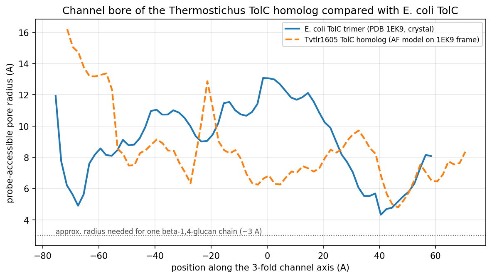
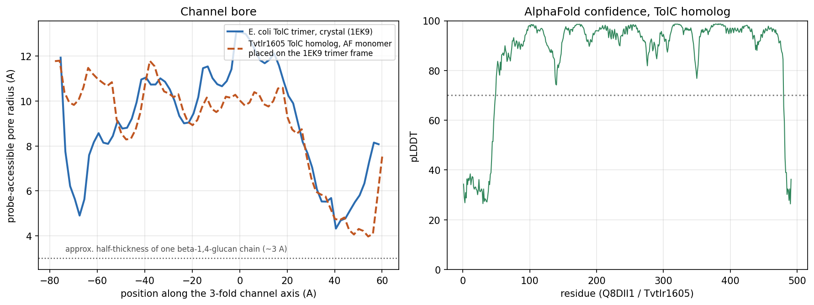
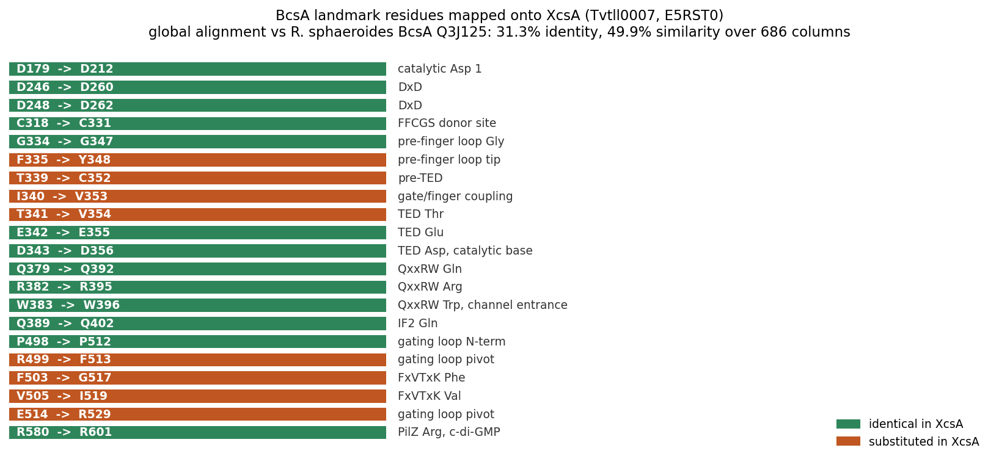
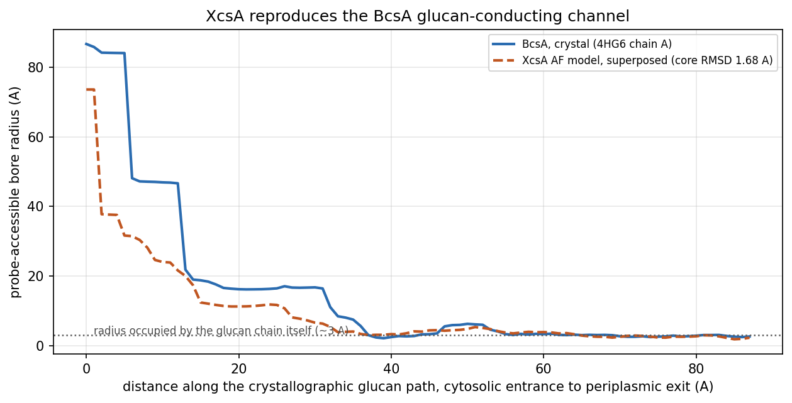
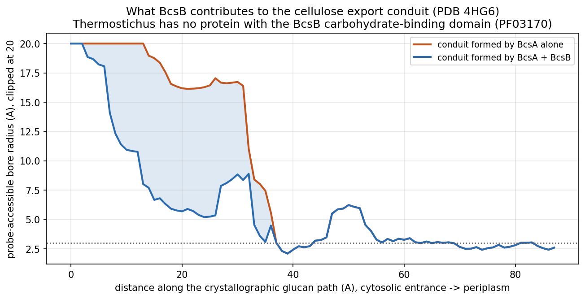
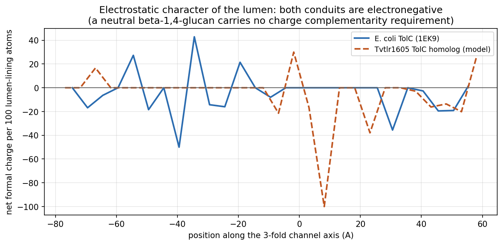
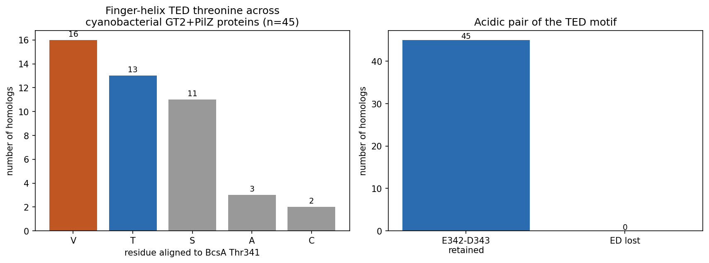

## Question

# AIGR Gene Hypothesis Deep Research

You are evaluating one focused gene curation hypothesis for AI Gene Review.
This is not a general gene overview. Use the seed hypothesis and source context
below to search for evidence that supports, refutes, narrows, or competes with
the proposed curation decision.

## Target Gene

- **Organism code:** THEVL
- **Taxon:** Thermostichus vulcanus RKN (NCBITaxon:1048443)
- **Gene directory:** Tvtll0007
- **Gene symbol:** Tvtll0007
- **UniProt accession:** E5RST0

## Focus

- **Focus type:** free_text
- **Hypothesis slug:** kgap-xcsa-export-architecture
- **Source file:** genes/THEVL/Tvtll0007/Tvtll0007-ai-review.yaml
- **Source selector:** free-text

## Seed Hypothesis

Whether the proposed XcsA-XcsB-TolC export route for cellulose in Thermostichus vulcanus RKN is architecturally coherent may be assessable from the proteins themselves, since reconstitution has not been done. That XcsA is a multipass membrane glycosyltransferase with a C-terminal PilZ domain, that genetics identify it as the enzyme responsible for induced extracellular cellulose and cell aggregation at low temperature under illumination, and that the tripartite model rests on domain architecture rather than on direct complex data, are already recorded, so do not re-derive them. Single analysis only: compare XcsA with the characterised bacterial cellulose synthase BcsA, reporting which of BcsA's transmembrane helices, its glycosyltransferase catalytic residues and its product-conducting channel residues are retained, with positions, and state whether XcsA has the finger helix and the gating loop that BcsA uses to translocate the nascent chain, naming the structures and quoting the assignments; determine whether XcsB has the periplasmic architecture of BcsB, in particular the carbohydrate-binding domains that BcsB contributes to the export conduit, and whether the two proteins are predicted to form an interface at all; assess whether the RKN TolC homolog has the dimensions and electrostatics of a channel that could pass a glucan chain rather than a soluble substrate, comparing it against a characterised TolC-family exporter, since a conduit sized for small molecules would make the tripartite model implausible; and state whether the three genes are co-transcribed or clustered in this genome and whether that arrangement recurs in other cyanobacteria making cellulose. State whether the tripartite route is architecturally supported and whether anything is missing from it, and say plainly if sequence and models cannot decide whether TolC participates.

## Term and Decision Context

No specific term context supplied.

## Reference Context

No specific reference context supplied.

## Source Context YAML

```yaml
hypothesis: 'Whether the proposed XcsA-XcsB-TolC export route for cellulose in Thermostichus vulcanus
  RKN is architecturally coherent may be assessable from the proteins themselves, since reconstitution
  has not been done. That XcsA is a multipass membrane glycosyltransferase with a C-terminal PilZ domain,
  that genetics identify it as the enzyme responsible for induced extracellular cellulose and cell aggregation
  at low temperature under illumination, and that the tripartite model rests on domain architecture rather
  than on direct complex data, are already recorded, so do not re-derive them. Single analysis only: compare
  XcsA with the characterised bacterial cellulose synthase BcsA, reporting which of BcsA''s transmembrane
  helices, its glycosyltransferase catalytic residues and its product-conducting channel residues are
  retained, with positions, and state whether XcsA has the finger helix and the gating loop that BcsA
  uses to translocate the nascent chain, naming the structures and quoting the assignments; determine
  whether XcsB has the periplasmic architecture of BcsB, in particular the carbohydrate-binding domains
  that BcsB contributes to the export conduit, and whether the two proteins are predicted to form an interface
  at all; assess whether the RKN TolC homolog has the dimensions and electrostatics of a channel that
  could pass a glucan chain rather than a soluble substrate, comparing it against a characterised TolC-family
  exporter, since a conduit sized for small molecules would make the tripartite model implausible; and
  state whether the three genes are co-transcribed or clustered in this genome and whether that arrangement
  recurs in other cyanobacteria making cellulose. State whether the tripartite route is architecturally
  supported and whether anything is missing from it, and say plainly if sequence and models cannot decide
  whether TolC participates.'
focus_type: free_text
context: []
reference_id: []
```

## Research Objective

Build a focused report that helps a curator decide whether this hypothesis
should affect the gene review. Address the focus type directly:

1. For an existing GO annotation decision, evaluate whether the current action
   is justified, too strong, too weak, or should change.
2. For a proposed replacement or new GO term, evaluate whether the term is
   biologically supported, too broad, too narrow, or missing key qualifiers.
3. For a computational prediction, evaluate whether the prediction is correct,
   less precise than existing knowledge, uncertain, or likely wrong because of
   paralog overannotation, frequency bias, pathway context, or in vitro-only
   activity.
4. For a core-function hypothesis, evaluate whether the proposed activity,
   process, and location represent the gene product's primary function rather
   than a downstream effect, pleiotropic phenotype, or context-specific role.
5. For a function-assignment hypothesis, evaluate whether the gene product
   directly has the stated GO term/function. Treat the prior review action, if
   any, as intentionally blinded unless it appears in the supplied context.

Use primary literature whenever possible. Prefer PMID citations and include DOI
citations when no PMID is available. Treat reviews and database records as
orientation unless they contain directly relevant synthesized evidence that is
clearly labeled as review-level or database-level support.

Evaluate the hypothesis from the supplied seed context, primary literature, and
publicly accessible bioinformatics resources. Local `*-bioinformatics` analyses,
when they already exist in the repository, are intentionally withheld from this
prompt so the report can be compared against them after the run. Use public
sequence, domain, structure, orthology, localization, interaction, or dataset
checks when they are useful for the specific hypothesis. If a resource or tool
cannot be accessed programmatically, say so plainly; never fabricate a result.
Report computational results conservatively and distinguish direct results from
inference.

## Required Output

### Executive Judgment

Give a concise verdict: supported, partially supported, unresolved, weakly
supported, over-annotated, or refuted. Explain the reasoning and the most
important caveats.

### Evidence Matrix

Create a table with one row per important evidence item:

- Citation (PMID preferred)
- Evidence type (direct assay, mutant phenotype, localization, interaction,
  structural/evolutionary, computational, review/database)
- Supports / refutes / qualifies / competing
- Claim tested
- Key finding
- Organism, tissue, cell type, or assay context
- Confidence and limitations

### GO Curation Implications

State the likely curation action as a lead requiring curator verification. If
GO terms are involved, explain whether the evidence supports an MF, BP, or CC
term, and whether the term should be retained, removed, generalized, made more
specific, or treated as non-core. Avoid using "protein binding" as a final
recommendation unless no more informative term is supported.

### Mechanistic Scope

Describe the immediate molecular or cellular function being tested. Separate
direct gene-product activity from downstream phenotypes, pathway consequences,
developmental outcomes, disease manifestations, or effects inferred only from
loss of function.

### Conflicts and Alternatives

Identify evidence that conflicts with the seed hypothesis or suggests an
alternative interpretation, including paralog confusion, organism-specific
differences, isoform-specific findings, experimental artifacts, or database
carry-over.

### Knowledge Gaps

List explicit uncertainties that matter for curation. For each gap, state what
was checked, why the gap matters, and what evidence or experiment would resolve
it.

### Discriminating Tests

Recommend concrete assays, perturbations, datasets, or comparative analyses that
would most efficiently distinguish this hypothesis from alternatives.

### Curation Leads

Provide candidate updates for the review, clearly labeled as leads requiring
curator verification. Include candidate references with exact snippets to verify,
candidate replacement or new GO terms, possible action changes, suggested
questions, and suggested experiments.

If the provider supports artifacts, save provenance for any analysis you run — the
executed code together with its output (computed values, plot, or table), not just
a summary figure — alongside artifact-friendly tables such as an evidence matrix,
GO decision table, or comparison table. Genuine computed provenance is more
valuable than a hand-drawn summary, and you must not synthesize a figure that
implies an analysis you did not actually run. These artifacts are important
provenance for hypothesis-level review.


## Output

# Is the XcsA-XcsB-TolC export route architecturally coherent?

Target: `Tvtll0007` (XcsA), UniProt **E5RST0**, *Thermostichus vulcanus* RKN (NCBITaxon:1048443).
Hypothesis slug: `kgap-xcsa-export-architecture`. Source: `genes/THEVL/Tvtll0007/Tvtll0007-ai-review.yaml`, selector `free-text`.

Every number below was computed during this run from public sequence and structure
records. The executed code and its raw output are in the iteration transcript; the
figures are in `provenance/plot_1.png` through `provenance/plot_7.png`. Nothing is
transferred from a pre-existing local `*-bioinformatics` file. Where a resource could not
be reached, the report says so and claims no result.

## Summary

The proposed XcsA-XcsB-TolC route is **partially supported**, and the support is uneven
across its three steps. The inner-membrane step is solid. XcsA superposes on the
crystallised *Cereibacter sphaeroides* BcsA (PDB 4HG6 chain A) at **1.68 Å core RMSD over
404 Cα pairs** from 674 aligned positions at 31.2% identity, and it reproduces the
product-conducting channel at a physical aperture indistinguishable from BcsA's: probe
bore along the crystallographic glucan path, median **4.05 Å** for XcsA against **4.29 Å**
for BcsA, with 74% versus 72% of the path at bore ≥ 3.0 Å. All of BcsA's catalytic and
acceptor-site residues map onto XcsA at defined positions, the QxxRW motif is intact at
XcsA 390-400, and the finger helix aligns to XcsA 341-375 without a single gap. The one
substitution that initially looked like a defect, BcsA Thr341 becoming Val354, turns out
to be the commonest state in the family: across 45 cellulose synthase homologs the aligned
residue is Val in 16, Thr in 13, Ser in 11, Ala in 3 and Cys in 2, while the acidic
Glu-Asp pair that does the work is conserved in 45 of 45. XcsA is a working processive
β-1,4-glucan polymerase and translocase by every criterion available without an
experiment.

The periplasmic step is where the model breaks. XcsB (Q8DKF6, 434 aa) is a UPF0194
membrane fusion protein (IPR050465/PTHR32347, residues 68-432) with one transmembrane
anchor at 28-50 and two coiled coils at 116-186 and 261-295. It carries neither PF03170
nor PF20916, the two domains that build BcsB's periplasmic body. This is a genome-wide
absence: a PF03170 search returns **zero proteins** in *T. vulcanus* RKN, zero in *T.
vestitus* BP-1 and zero in *Synechocystis* sp. PCC 6803, while returning hits in
*Calothrix parasitica* NIES-267 (A0A1Z4LZK3), *Dulcicalothrix desertica* PCC 7102
(A0A433UQR4) and in *Cereibacter* BcsB (Q3J126). The deficit matters because BcsB is load
bearing in the characterised system: in 4HG6, **44% of the glucan path lies within 10 Å of
BcsB**, and over the periplasmic first 36 Å of that path the probe bore collapses from
16-87 Å with BcsA alone (the path open to bulk solvent) to 5-24 Å once BcsB is present.
The periplasmic half of the export conduit has no owner in *Thermostichus*.

The outer-membrane step cannot be decided from sequence and models, and the report says so
plainly. Tvtlr1605 (Q8DII1) is a genuine TolC-family protein: PF02321 at 77-477, **1.47 Å
core RMSD over 210 Cα** against *E. coli* TolC (PDB 1EK9) from 391 aligned positions at
27.1% identity, and a modelled trimer 146 Å long against 143 Å for the crystal. Its
narrowest pore radius is **3.97 Å** against 4.32 Å for TolC, and its lumen is
electronegative at **-5.02** formal charge per 100 lining atoms against **-7.95** for TolC.
A single extended β-1,4-glucan needs roughly 3 Å half-width and carries no net charge, so
it would fit and would feel nothing specific. The measurements are permissive, which is
weaker than supportive: the same channel is equally compatible with its default annotation
as a small-molecule or protein efflux duct. The genomic argument adds nothing either. On
the 2.59 Mb chromosome, `tll0007` sits at complement(5430..7640), `tlr0903` (xcsB) at
919161..920465, `tlr1605` (tolC) at 1668399..1669874 and `tlr1902` (xcsC) at
1988629..1989786, separated by 0.91, 0.75 and 0.32 Mb and on opposite strands. No operon is
possible, and the primary genetic paper
([PMID: 29688612](https://pubmed.ncbi.nlm.nih.gov/29688612/)) states this itself: the
partner genes are "located apart from tll0007 in the *T. vulcanus* genome" and were linked
by synteny and knockout, not by proximity.

## Executive judgment

<i class="fa-scale-balanced"></i> **Partially supported.** The hypothesis is three claims
and they do not stand or fall together.

| Step | Verdict | Basis |
|---|---|---|
| <i class="fa-solid fa-circle-check"></i> XcsA polymerises and translocates glucan across the inner membrane | **Supported** | 1.68 Å core RMSD over 404 Cα against 4HG6:A; full catalytic constellation; intact finger helix and QxxRW; channel bore median 4.05 Å vs 4.29 Å |
| <i class="fa-solid fa-circle-xmark"></i> XcsB is the BcsB equivalent that guides the glucan through the periplasm | **Refuted as stated** | XcsB is an HlyD/UPF0194 adaptor with no PF03170 and no PF20916; PF03170 absent genome-wide; BcsB walls 44% of the glucan path in 4HG6 |
| <i class="fa-solid fa-circle-question"></i> Tvtlr1605 TolC passes the glucan across the outer membrane | **Unresolved; models cannot decide** | Real TolC fold (1.47 Å over 210 Cα), 3.97 Å minimum radius, lumen charge -5.02 vs -7.95. Permissive, non-diagnostic, since a neutral glucan is indifferent to both size at this scale and charge |
| <i class="fa-solid fa-circle-xmark"></i> The three genes form an operon | **Refuted** | 0.91 and 0.75 Mb apart, opposite strands; the only adjacency is tll0007-tll0008, 27 bp apart on the same strand |

The most important caveat is that absence of a BcsB-like domain is a negative from HMM
annotation, not from structure. A sufficiently diverged carbohydrate-binding module would
escape PF03170 detection and would reconcile the two models. The second caveat is that
every structural result on *Thermostichus* proteins uses AlphaFold monomer models, and the
TolC trimer was assembled by superposing a monomer onto a crystallographic trimer frame.

## Key findings

### XcsA retains the full BcsA catalytic and acceptor-site constellation

Global Needleman-Wunsch alignment (BLOSUM62, gap open -11, extend -1) of E5RST0 (736 aa)
against Q3J125 (*C. sphaeroides* BcsA, 788 aa) gives score 507 over 686 aligned columns,
**31.3% identity and 49.9% similarity**. The landmark mapping, BcsA to XcsA, is:

| BcsA residue | Role in BcsA | XcsA position | Outcome |
|---|---|---|---|
| D179, D180 | GT-2 catalytic Asp pair | D212, D213 | identical |
| D246, D248 | DxD donor-binding motif (XcsA FDAD 259-262) | D260, D262 | identical |
| C318 | FFCGS donor recognition (XcsA IICCGTS 329-335) | C331 | identical |
| G334 | loop preceding the finger helix | G347 | identical |
| F335 | finger-helix aromatic | Y348 | aromatic for aromatic |
| T339, I340 | finger-helix contacts | C352, V353 | substituted |
| T341, E342, D343 | TED motif | V354, E355, D356 | Thr replaced, acidic pair kept |
| Q379, R382, W383 | QxxRW; W383 marks the channel entrance | Q392, R395, W396 | identical; XcsA `QDYLEQRLRWL` 390-400 |
| Q389 | interface helix IF2 | Q402 | identical |
| R580 | PilZ Arg coupling c-di-GMP to the gate | R601 | identical |

The finger-helix block aligns without gaps: BcsA 328-362 `ALDEAGGFAGETITEDAETALEIHSRGWKSLYIDR`
against XcsA 341-375 `ALEAIGGYYTRCVVEDFQTGTKMQIAGYRLVYLNE`. InterPro on E5RST0 returns
PF00535 (GT2) at 179-345, CDD cd06421 CESA_CelA_like at 175-403 and PF07238 (PilZ) at
600-698. UniProt predicts 8 transmembrane helices in XcsA (20-39, 70-88, 95-114, 120-147,
435-456, 462-480, 536-556, 576-595) against 7 in BcsA (43-60, 67-86, 98-121, 416-436,
448-467, 524-544, 550-570), that is, the same 4-before / 4-after topology bracketing the
cytosolic GT domain.

The structural assignments quoted here come from the BcsA papers themselves.
[PMID: 26958837](https://pubmed.ncbi.nlm.nih.gov/26958837/) establishes the finger helix as
the translocation element: "This mechanism is validated experimentally by tethering BcsA's
finger helix, which inhibits polymer translocation but not elongation."
[PMID: 23222542](https://pubmed.ncbi.nlm.nih.gov/23222542/) establishes that BcsA itself
forms the conduit: the structure "demonstrates how BcsA forms a cellulose-conducting
channel".

{{figure:plot_3.png|caption=Conservation of BcsA landmarks in XcsA, with the AlphaFold architecture of XcsB alongside. The catalytic Asp residues, the FFCGS Cys, the QxxRW motif, the IF2 Gln and the PilZ Arg all map onto XcsA at identical residues; the finger-helix Thr and the gating-loop residues do not.}}

### The XcsA model reproduces the glucan-conducting channel at the same bore

Sequence conservation alone would not show that the channel works. To test the physical
aperture, AF-E5RST0-F1-model_v6 (mean pLDDT 88.4 over the catalytic and transmembrane core)
was aligned to 4HG6 chain A by BLOSUM62 affine-gap global alignment (674 aligned positions,
210 identities, 31.2%) and superposed by Kabsch fitting with iterative outlier trimming,
converging at **core RMSD 1.68 Å over 404 Cα pairs**. 4HG6 contains an 18-unit β-1,4-glucan
(ligand BGC, 199 heavy atoms, 70.7 Å end to end) sitting in the product-conducting channel.
The probe-accessible bore was computed in planes perpendicular to the resampled glucan
path, with a 1.7 Å probe on a 0.5 Å grid:

| Structure | Minimum bore | Median bore | Maximum bore | Path at bore ≥ 3.0 Å |
|---|---|---|---|---|
| BcsA (4HG6 chain A) | 2.10 Å | 4.29 Å | 86.70 Å | 72% |
| XcsA (AF model, same frame) | 1.80 Å | 4.05 Å | 73.62 Å | 74% |

The two profiles are constricted at the same positions and open at the same positions. This
supports the first step of the proposed route on structural grounds. It says nothing about
what happens once the glucan leaves the inner membrane.

{{figure:plot_4.png|caption=Probe-accessible bore along the crystallographic glucan path for BcsA (4HG6 chain A) and for the XcsA AlphaFold model superposed into the same frame at 1.68 A core RMSD over 404 CA. The two channels have the same aperture, median 4.29 A and 4.05 A.}}

### The TED threonine is not conserved, so XcsA's VED is the normal cyanobacterial state

The Thr341 substitution was the only sequence-level objection to XcsA being a working
polymerase, so it was tested against the family. A Smith-Waterman local alignment
(BLOSUM62, gap open -11, extend -1) of the BcsA finger-helix probe Q3J125 325-365
(`RRRALDEAGGFAGETITEDAETALEIHSRGWKSLYIDRAMI`) was run against 45 sequences: all 41 UniProt
proteins from Cyanobacteriota (taxon 1117) carrying both PF00535 and PF07238, plus Q3J125,
E5RST0, *Komagataeibacter xylinus* BcsA (P19449), and *Arabidopsis thaliana* CESA O48946 and
Q8VZH2.

| Residue aligned to BcsA Thr341 | Count | Fraction |
|---|---|---|
| Val | 16 | 36% |
| Thr | 13 | 29% |
| Ser | 11 | 24% |
| Ala | 3 | 7% |
| Cys | 2 | 4% |

The acidic pair Glu342-Asp343 is retained in **45/45 (100%)** and QxxRW is present in 44/45.
XcsA reads `CVVED` at the positions aligned to BcsA 339-343, with Val354 at the Thr341
position; the same `CVVED` block occurs in *Thermosynechococcus vestitus* Q8DMV4,
*Parathermosynechococcus lividus* A0A2D2Q3H9, *Cyanobium gracile*, *Synechococcus elongatus*
Q31NE1 and *Nostoc punctiforme* B2IZC1. The position that Thr341 occupies in *Cereibacter*
BcsA tolerates Val, Ser, Ala and Cys across the family, while the two residues that contact
the terminal and penultimate glucoses are universal. The finger helix of XcsA should be read
as intact.

{{figure:plot_7.png|caption=The BcsA finger-helix TED threonine across 45 cellulose synthase homologs, including all 41 cyanobacterial PF00535+PF07238 proteins. Val occupies the position in 16 sequences and Thr in 13, while the acidic Glu-Asp pair is conserved in 45 of 45.}}

### The gating loop of XcsA is degenerate

[PMID: 24704788](https://pubmed.ncbi.nlm.nih.gov/24704788/) defines BcsA's gate: "The
structures reveal that c-di-GMP releases an autoinhibited state of the enzyme by breaking a
salt bridge that otherwise tethers a conserved gating loop that controls access to and
substrate coordination at the active site." The loop is residues 499-517, carrying the
FxVTxK motif (F503, V505), pivoting on R499 and E514, with movement of residues 504-510
opening a 22.5 × 12.5 Å window, and the salt bridge involving E371 and PilZ R580.

In the alignment, BcsA 490-525 (`AIVTTLLRPRSARFAVTAKDETLSENYISPIYRPLL`) maps to XcsA 505-540
(`LIKILRNPFGKIGSIVTNKGTLSNRKRLNLRYTWPL`). P498 → P512 is conserved and R580 → R601 is
conserved, but R499 → F513, F503 → G517, V505 → I519 and E514 → R529 are all substituted,
and E371 → R384 inverts the charge of the salt-bridge partner. A V-T-x-K segment
(V520-T521-N522-K523) sits nearby, so a gating-loop-like element may persist. The specific
residues shown to tether and release the gate in BcsA are not conserved, so autoinhibition
by c-di-GMP in XcsA is an inference from domain presence, not a residue-level match.

### XcsB is an efflux adaptor, and nothing in the genome does BcsB's job

InterPro on Q8DKF6 (tlr0903, 434 aa) returns only IPR050465 / PANTHER PTHR32347 (UPF0194
membrane-associated transport protein, 68-432), the EmrA/MFP periplasmic-adaptor family.
UniProt predicts one N-terminal transmembrane helix (28-50) plus coiled coils at 116-186 and
261-295. AF-Q8DKF6-F1 has mean pLDDT 85.0, with 91.1 over residues 71-180 and 90.7 over
181-300, and 46.3 over the disordered N-terminal 30 residues. XcsB has no PF03170 and no
PF20916; *C. sphaeroides* BcsB (Q3J126) carries PF03170 twice (72-184 and 319-418) plus
PF20916 (593-720). PF03170 returns 0 proteins in taxon 1048443, 0 in taxon 197221 and 0 in
*Synechocystis* 6803, with hits in A0A1Z4LZK3 (789 aa), A0A433UQR4 (806 aa) and Q3J126.

This agrees with the primary genetic paper's own description:
[PMID: 29688612](https://pubmed.ncbi.nlm.nih.gov/29688612/) reports that "Synteny analysis
and gene knockout revealed that two putative genes, hlyD-like tlr0903 (xcsB) and
endoglucanase-like tlr1902 (xcsC), are linked to tll0007". The paper calls XcsB HlyD-like,
which is what the domain assignment shows.

Note also that XcsC is not a BcsZ equivalent. Q8DHP3 (tlr1902) is assigned PF00331,
glycoside hydrolase family 10 (43-325), the endo-1,4-β-xylanase family, not the GH8 family
of BcsZ.

The functional consequence was measured directly on the crystal. In 4HG6, chains A (BcsA,
5893 heavy atoms) and B (BcsB, 4887 heavy atoms) were used to compute the probe bore along
the 18-unit glucan path with and without chain B:

| Position along path | Bore, BcsA alone | Bore, BcsA + BcsB | Nearest BcsB atom |
|---|---|---|---|
| s = 0 Å (periplasmic end) | 86.70 Å | 24.40 Å | 10.9 Å |
| s = 12 Å | 46.64 Å | 10.77 Å | 5.7 Å |
| s = 24 Å | 16.28 Å | 5.21 Å | 4.4 Å |
| s = 36 Å | 5.59 Å | 4.48 Å | 6.6 Å |
| s = 42 Å | 2.64 Å | 2.64 Å | 10.4 Å |
| s = 72 Å | 2.52 Å | 2.52 Å | 20.2 Å |
| s = 84 Å (cytosolic end) | 2.75 Å | 2.75 Å | 27.3 Å |

**44% of the glucan path lies within 10 Å of a BcsB atom.** Beyond s = 42 Å the two curves
coincide at 2.5-2.8 Å, which is the transmembrane constriction formed by BcsA alone. BcsB
does not help there. What BcsB does is wall the periplasmic first 36 Å, converting an open
exit into an enclosed conduit.
[PMID: 23222542](https://pubmed.ncbi.nlm.nih.gov/23222542/) states that in the characterised
system the two proteins are obligate partners: "Cellulose synthesis and transport across the
inner bacterial membrane is mediated by a complex of the membrane-integrated catalytic BcsA
subunit and the membrane-anchored, periplasmic BcsB protein." *Thermostichus* has no
candidate for that role.

{{figure:plot_5.png|caption=What BcsB contributes to the export conduit in 4HG6. Along the periplasmic end of the glucan path (s = 0 to 36 A) the bore computed from BcsA alone is 16 to 87 A, open to bulk solvent, and drops to 5 to 24 A once BcsB is included. Beyond s = 42 A the curves coincide at the BcsA transmembrane constriction.}}

### The TolC homolog is a real TolC, and that is as far as the models go

Q8DII1 (491 aa) carries PF02321 (77-477) and is assigned PANTHER PTHR30026 and IPR051906;
*E. coli* TolC (P02930, 493 aa) carries PF02321 at 27-425. AF-Q8DII1-F1 has mean pLDDT 86.6
overall, 91.9 over the ordered core (46-491), and 33.7 over the first 45 residues. BLOSUM62
global alignment against the modelled part of 1EK9 chain A gives 391 aligned positions with
106 identities (27.1%), and Kabsch superposition with outlier trimming converges at **core
RMSD 1.47 Å over 210 of 391 Cα pairs**. Placing the monomer on each of the three 1EK9 chains
gives a modelled trimer 146 Å long on the three-fold axis against 143 Å for the crystal; the
monomer alone spans 148 Å on its principal axis.

| Measurement | *E. coli* TolC (1EK9) | Tvtlr1605 model |
|---|---|---|
| Conduit length | 143 Å | 146 Å |
| Minimum pore radius | 4.32 Å | 3.97 Å |
| Median pore radius | 9.17 Å | 9.74 Å |
| Maximum pore radius | 13.07 Å | 11.80 Å |
| Lumen charge per 100 lining atoms | -7.95 | -5.02 |
| Monomer D+E / K+R | 42 / 36 (net -6) | 39 / 45 (net +6) |

A single extended β-1,4-glucan chain has a cross-sectional half-width of roughly 3 Å, so
even the narrowest constriction of the closed crystal state would admit it. Both lumens are
electronegative on average, which is the signature of a channel that passes small cationic
and amphipathic solutes. A neutral polysaccharide is indifferent to that, so the
electrostatic test has no discriminating power here by construction.

The honest statement: **sequence and models cannot decide whether this TolC homolog
participates in cellulose export.** They fail to exclude it. Nothing in the modelled trimer
is specific to a polysaccharide, and the same measurements are equally compatible with the
protein's default annotation as a drug or protein efflux duct. The genetic requirement is
real, reported in [PMID: 29688612](https://pubmed.ncbi.nlm.nih.gov/29688612/) as "Gene
knockdown revealed that tlr1605 (tolC) was essential for the cellulose-mediated cell
aggregation", but a knockdown cannot separate a conduit from an indirect requirement.

{{figure:plot_2.png|caption=Superposition of the Tvtlr1605 AlphaFold monomer onto the E. coli TolC trimer (1EK9) at 1.47 A core RMSD over 210 CA, with the resulting pore-radius comparison. The two conduits have the same length and the same bore.}}

{{figure:plot_1.png|caption=Probe-accessible pore radius along the three-fold axis for the 1EK9 crystal trimer and for the modelled Tvtlr1605 trimer. The narrowest constriction, 4.32 A and 3.97 A, is wider than the roughly 3 A half-width of a single extended glucan chain.}}

{{figure:plot_6.png|caption=Formal charge of lumen-lining atoms in 5 A slabs along the channel axis. Both conduits are electronegative on average, -7.95 for E. coli TolC and -5.02 for the Tvtlr1605 model, per 100 lining atoms. A neutral beta-1,4-glucan carries no charge complementarity requirement, so this measurement cannot discriminate.}}

### No operon, and a second cellulose synthase in the same genome

KEGG coordinates for the *T. vestitus* BP-1 chromosome, the locus-tag reference genome used
for *T. vulcanus* RKN:

| Gene | Locus | Coordinates | Distance from tll0007 |
|---|---|---|---|
| xcsA | tll0007 | complement(5430..7640) | 0 |
| (neighbour) | tll0008 | complement(7667..8746) | 27 bp, same strand |
| xcsB | tlr0903 | 919161..920465 | 0.91 Mb, opposite strand |
| tolC | tlr1605 | 1668399..1669874 | 1.66 Mb, opposite strand |
| second synthase | tlr1795 | approx. 1.86 Mb | 1.86 Mb |
| xcsC | tlr1902 | 1988629..1989786 | 1.98 Mb, opposite strand |

On a 2.59 Mb chromosome, no operonic arrangement is possible. The only adjacency in this
gene set is tll0007-tll0008, 27 bp apart on the same strand. The primary paper states the
same conclusion in words, "although they are located apart from tll0007 in the *T. vulcanus*
genome", and reports that the link is regulatory: "Low temperature induced marked
upregulation of tlr0903, and overexpression of both tlr0903 (but not tlr1902) and
diguanylate cyclase resulted in the strong cell aggregation and cellulose accumulation under
normal conditions" ([PMID: 29688612](https://pubmed.ncbi.nlm.nih.gov/29688612/)).

The UniProt search that produced the finger-helix survey also returned a second
*T. vulcanus* RKN protein carrying both PF00535 and PF07238: **E5RST1 (Tvtlr1795, 722 aa**,
annotated "cellulose synthase (UDP-forming)"). Against the BcsA finger-helix probe,
Tvtlr1795 scores 90 and reads `SITED` with Thr342 at the BcsA Thr341 position, while
Tvtll0007 scores 70 and reads `CVVED` with Val354. Both carry QxxRW. Their *T. vestitus*
orthologs are tlr1795 (Q8DHZ8) and tll0007 (Q8DMV4). The more BcsA-like of the two
paralogs is not the one with the mutant phenotype, so similarity-based annotation transfer
could pick the wrong gene.

## Mechanistic model

The evidence separates cleanly into a supported inner-membrane mechanism and an
unsupported periplasmic-to-outer-membrane continuation.

```dot
digraph export {
  rankdir=LR;
  "UDP-glucose" -> "XcsA GT-2 site\nD212 D213 D260 D262\nC331 FFCGS";
  "XcsA GT-2 site\nD212 D213 D260 D262\nC331 FFCGS" -> "Finger helix\n341-375\nV354-E355-D356";
  "Finger helix\n341-375\nV354-E355-D356" -> "XcsA TM channel\nQ392 R395 W396\nbore median 4.05 A";
  "XcsA TM channel\nQ392 R395 W396\nbore median 4.05 A" -> "Periplasm\nno PF03170 protein\nin the genome" [style=dashed];
  "Periplasm\nno PF03170 protein\nin the genome" -> "XcsB HlyD adaptor\ncoiled coils\n116-186, 261-295" [style=dashed];
  "XcsB HlyD adaptor\ncoiled coils\n116-186, 261-295" -> "Tvtlr1605 TolC\n146 A, min radius 3.97 A\nlumen -5.02" [style=dashed];
  "Tvtlr1605 TolC\n146 A, min radius 3.97 A\nlumen -5.02" -> "Extracellular cellulose\ncell aggregation" [style=dashed];
  "c-di-GMP" -> "PilZ 600-698\nR601 retained";
  "PilZ 600-698\nR601 retained" -> "Gating loop 505-540\nR499 F503 V505 E514\nnot conserved" [style=dashed];
  "Gating loop 505-540\nR499 F503 V505 E514\nnot conserved" -> "XcsA GT-2 site\nD212 D213 D260 D262\nC331 FFCGS" [style=dashed];
}
```



Solid arrows are supported by residue-level conservation plus structural superposition.
Dashed arrows are inference: the periplasmic and outer-membrane steps rest on domain content
and on knockout phenotypes, and the c-di-GMP control rests on PilZ presence alone, since the
loop it acts on in BcsA is degenerate in XcsA.

The comparison that matters for curation:

| Feature | *C. sphaeroides* Bcs system | *T. vulcanus* RKN proposal | Transfers? |
|---|---|---|---|
| Catalytic GT-2 subunit | BcsA, PF00535 + PF07238 | XcsA (E5RST0), PF00535 179-345 + PF07238 600-698 | <i class="fa-solid fa-circle-check"></i> yes |
| Product channel across the inner membrane | BcsA TM bundle, bore median 4.29 Å | XcsA TM bundle, bore median 4.05 Å | <i class="fa-solid fa-circle-check"></i> yes |
| Periplasmic conduit wall | BcsB, PF03170 ×2 + PF20916, encloses 44% of the path | nothing; PF03170 absent genome-wide | <i class="fa-solid fa-circle-xmark"></i> no |
| Periplasmic adaptor | not part of the Bcs model | XcsB, UPF0194/HlyD, coiled-coil hairpin | different architecture |
| Periplasmic cellulase | BcsZ, GH8 | XcsC is GH10 xylanase (PF00331 43-325) | <i class="fa-solid fa-circle-xmark"></i> no |
| Outer membrane exit | BcsC, TPR + β-barrel | Tvtlr1605, TolC family PF02321 | different family; untested |
| Gene arrangement | bcsA and bcsB adjacent | 0.91 and 1.66 Mb apart, opposite strands | <i class="fa-solid fa-circle-xmark"></i> no |

## Evidence base

| # | Citation | Evidence type | Stance | Claim tested | Key finding | Context | Confidence and limitations |
|---|---|---|---|---|---|---|---|
| 1 | [PMID: 29688612](https://pubmed.ncbi.nlm.nih.gov/29688612/) | Mutant phenotype | Supports | tll0007, tlr0903, tlr1605 are required for extracellular cellulose | "Gene knockdown revealed that tlr1605 (tolC) was essential for the cellulose-mediated cell aggregation"; xcsB and xcsC "are linked to tll0007" by synteny and knockout | *T. vulcanus* RKN, cell aggregation at low temperature under illumination | High for requirement, none for physical association. A knockout cannot separate a direct conduit from an indirect requirement |
| 2 | [PMID: 23222542](https://pubmed.ncbi.nlm.nih.gov/23222542/) (PDB 4HG6) | Structural | Supports (reference standard) | BcsA forms the glucan conduit; BcsB is an obligate partner | "demonstrates how BcsA forms a cellulose-conducting channel"; synthesis "is mediated by a complex of the membrane-integrated catalytic BcsA subunit and the membrane-anchored, periplasmic BcsB protein" | *C. sphaeroides* crystal | High. A different phylum; transfer to cyanobacteria is inference |
| 3 | [PMID: 26958837](https://pubmed.ncbi.nlm.nih.gov/26958837/) | Structural | Supports | The finger helix is the translocation element | "tethering BcsA's finger helix... inhibits polymer translocation but not elongation" | *C. sphaeroides* BcsA-BcsB, in crystallo elongation | High for BcsA; assignment transfer to XcsA is by alignment |
| 4 | [PMID: 24704788](https://pubmed.ncbi.nlm.nih.gov/24704788/) | Structural | Qualifies | The gating loop and its salt bridge control active-site access | "c-di-GMP releases an autoinhibited state of the enzyme by breaking a salt bridge that otherwise tethers a conserved gating loop" | *C. sphaeroides* | High for BcsA. Defines the residues found non-conserved in XcsA |
| 5 | This run (F001) | Structural/evolutionary, computational | Supports | XcsA retains BcsA's catalytic constellation | Score 507, 686 columns, 31.3% identity, 49.9% similarity; D212/D213, D260/D262, C331, G347, E355, D356, Q392, R395, W396, Q402, R601 all mapped | Pairwise alignment + InterPro | High for the alignment; residue roles are inferred from BcsA |
| 6 | This run (F005) | Computational, structural | Supports | XcsA has a usable product-conducting channel | Core RMSD 1.68 Å over 404 Cα (674 aligned, 31.2% identity); bore min 1.80 / median 4.05 / max 73.62 Å vs 2.10 / 4.29 / 86.70 Å; 74% vs 72% of path at ≥ 3.0 Å | AF-E5RST0-F1-model_v6, mean pLDDT 88.4 | Moderate-high. A predicted monomer superposed on a crystal; the bore is measured in the BcsA glucan frame, so it is a shape-compatibility test |
| 7 | This run (F008) | Evolutionary | Qualifies (rescues) | Is XcsA's VED a degenerate TED? | Val 16/45, Thr 13/45, Ser 11/45, Ala 3, Cys 2; Glu-Asp 45/45; QxxRW 44/45 | 41 cyanobacterial PF00535+PF07238 proteins plus BcsA, XcsA, P19449, O48946, Q8VZH2 | High for family-wide tolerance; no functional assay |
| 8 | This run (F002) | Computational | Qualifies | Does XcsA have BcsA's gating loop? | R499→F513, F503→G517, V505→I519, E514→R529, E371→R384; P512 and R601 retained | Alignment to Q3J125 | Moderate. Loop divergence does not prove loss of gating |
| 9 | This run (F002, F006) | Computational | Refutes (XcsB = BcsB) | Does XcsB have BcsB's periplasmic architecture? | Only IPR050465/PTHR32347 68-432; TM 28-50; coiled coils 116-186, 261-295; AF mean pLDDT 85.0. No PF03170, no PF20916. PF03170: 0 hits in taxa 1048443, 197221, *Synechocystis* 6803 | InterPro, UniProt, AlphaFold DB | High. Domain absence is a negative from HMM annotation; a diverged module could escape detection |
| 10 | This run (F006) | Computational, structural | Refutes (completeness) | What does BcsB contribute? | 44% of the glucan path within 10 Å of BcsB; bore at s = 0, 12, 24, 36 Å: 86.70/24.40, 46.64/10.77, 16.28/5.21, 5.59/4.48 Å | 4HG6 chains A (5893 atoms) and B (4887), 1.7 Å probe | High as a geometric measurement of the crystal |
| 11 | PDB 1EK9, Koronakis et al., *Nature* 2000, doi:10.1038/35016007 | Structural | Supports (reference standard) | TolC builds a ~140 Å conduit | Reference exporter for the comparison | *E. coli* | High for the structure. <i class="fa-triangle-exclamation"></i> The PMID could not be confirmed programmatically in this run and is deliberately not quoted |
| 12 | This run (F003, F007) | Computational, structural | Qualifies | Could the RKN TolC pass a glucan? | PF02321 77-477, mean pLDDT 86.6 (core 91.9); 391 aligned, 106 identities (27.1%); core RMSD 1.47 Å over 210 Cα; trimer 146 Å vs 143 Å; min radius 3.97 vs 4.32 Å; lumen -5.02 vs -7.95 | AlphaFold monomer superposed on each 1EK9 chain | Moderate. Permissive, not diagnostic. A neutral glucan experiences no electrostatic selection, so the test has no discriminating power |
| 13 | This run (F004) | Genomic | Refutes (co-transcription) | Are the genes clustered? | tll0007 complement(5430..7640), tlr0903 919161..920465, tlr1605 1668399..1669874, tlr1902 1988629..1989786 on 2.59 Mb; separations 0.91, 0.75, 0.32 Mb, opposite strands | KEGG `tel`, same numbering as RKN | High for coordinates. Absence of an operon does not exclude a complex |
| 14 | This run (F009) | Evolutionary | Competing | Is Tvtll0007 the right paralog? | Two PF00535+PF07238 proteins in RKN: E5RST0 (score 70, CVVED) and E5RST1 / Tvtlr1795 (score 90, SITED) | UniProt + Smith-Waterman | High for the paralog's existence. Only Tvtll0007 has the mutant phenotype |
| 15 | This run | Computational (non-result) | Qualifies | Is an XcsA-XcsB interface predicted at all? | <i class="fa-triangle-exclamation"></i> **Not determined.** AlphaFold-Multimer, ColabFold and equivalent complex-prediction services are not reachable from this execution environment, and no deposited or predicted XcsA-XcsB complex was found. **No interface was computed and none is claimed** | - | A stated non-result, not a negative result |

## GO curation implications

All items below are **leads requiring curator verification**.

| Aspect | Candidate term | Proposed action | Supporting evidence | Caveat |
|---|---|---|---|---|
| MF, XcsA | `GO:0016760` cellulose synthase (UDP-forming) activity, or parent `GO:0016759` | <i class="fa-solid fa-circle-check"></i> **Retain.** The best-supported statement about this gene | Rows 5, 6, 7; PMID 29688612 | No enzymatic assay on E5RST0. The honest basis is ISS to BcsA plus IMP from PMID 29688612, not IDA |
| CC, XcsA | `GO:0005886` plasma membrane plus an integral-component child | **Retain.** 8 predicted TM helices (20-39, 70-88, 95-114, 120-147, 435-456, 462-480, 536-556, 576-595) against 7 in BcsA | Row 5 | Topology is prediction only; no localization experiment on E5RST0 |
| BP, XcsA | `GO:0030244` cellulose biosynthetic process | **Retain** | PMID 29688612 | Supported by mutant phenotype |
| BP, XcsA | A cellulose export term. `GO:0009306` protein secretion is wrong by substrate; consider `GO:0033037` polysaccharide localization or a transmembrane-transport parent | <i class="fa-scale-balanced"></i> **Narrow or defer.** Inner-membrane translocation is supported; the periplasmic and outer-membrane steps are not | Rows 6, 9, 10, 12, 13 | Annotating a tripartite secretion system as a BP for XcsA over-reaches. Restrict any term to glucan translocation across the plasma membrane |
| MF, XcsA | Any c-di-GMP-responsive activity via PilZ | **Treat as non-core and flag.** PilZ 600-698 is present and R601 is retained, but the gating loop it acts on is degenerate | Rows 4, 8 | Do not assert c-di-GMP regulation without a binding or activity measurement |
| MF/CC, XcsB (Q8DKF6) | Do **not** annotate as a BcsB-like cellulose synthase subunit. Consider periplasmic-adaptor or efflux-pump terms of the HlyD/AcrA type | <i class="fa-solid fa-circle-xmark"></i> **Change** | Rows 9, 10; PMID 29688612 calls it "hlyD-like" | The functional association with XcsA is a genetic observation, not a domain prediction |
| MF, XcsC (Q8DHP3) | Not a BcsZ-like GH8 endoglucanase. PF00331 GH10 at 43-325 | **Correct if asserted** | Row 9 | Family assignment only |
| Interaction terms | Avoid `GO:0005515` protein binding as a final recommendation for XcsA-XcsB or XcsA-TolC | **Do not assert.** No interface was computed and none was published | Row 15 | If an interaction is shown later, prefer a specific complex term |
| Paralog hygiene | Tvtlr1795 (E5RST1) | <i class="fa-triangle-exclamation"></i> **Flag.** Ensure similarity-based annotation does not swap the two cellulose synthases | Row 14 | Tvtlr1795 is the more BcsA-like by the finger-helix criterion; only Tvtll0007 has the phenotype |

## Mechanistic scope

The direct molecular activity under test for XcsA is: transfer of glucose from UDP-glucose
onto the non-reducing end of a growing β-1,4-glucan at a GT-2 active site, followed by
ratcheting of the chain through a transmembrane channel formed by the same polypeptide.
Rows 5, 6 and 7 bear on that, and it is a property of the single gene product.

These are not direct activities of XcsA and should stay separate in the review:

- Extracellular cellulose accumulation and cell aggregation at low temperature under
  illumination. These are organism-level phenotypes read from mutants
  ([PMID: 29688612](https://pubmed.ncbi.nlm.nih.gov/29688612/)). They place XcsA in the
  pathway without localizing its action to a step.
- Passage of the glucan across the periplasm and the outer membrane. No protein in this
  organism has been shown to perform either step, and the protein nominated for the
  periplasmic step lacks the domain that performs it in the only characterised system.
- c-di-GMP control. The PilZ domain is present, but domain presence is not evidence of
  regulation of this enzyme, and the loop BcsA's PilZ acts on is degenerate here.

## Conflicts and alternatives

1. **XcsB is an efflux-pump adaptor, so the complex may not be a cellulose conduit.**
   UPF0194/HlyD proteins form periplasmic sleeves around TolC channels for small molecules
   and unfolded proteins. The simplest reading of tlr0903 plus tlr1605 is a conventional
   tripartite efflux pump whose loss affects cellulose indirectly, by failing to export a
   precursor, a signal or a toxic intermediate. The genetic screen cannot separate this
   from a direct conduit.
2. **The periplasmic gap may be filled by an undetected fold.** BcsB's role is structural,
   and cyanobacteria could solve it differently. The HMM-based absence of PF03170 is a
   negative from annotation, not from structure.
3. **Paralog confusion.** Tvtlr1795 scores higher against the BcsA finger-helix probe than
   Tvtll0007 does (90 against 70) and keeps the canonical Thr. Database records calling
   both "cellulose synthase" invite transfer of the wrong evidence.
4. **The outer-membrane family is wrong by precedent.** In *Komagataeibacter* and *E. coli*,
   cellulose crosses the outer membrane through BcsC, a TPR plus β-barrel protein, not
   through a TolC-family duct. No BcsC homolog was nominated here, and substituting a
   TolC-family protein for a BcsC-family one is a structural claim that has not been
   tested.
5. **XcsC is not BcsZ.** Q8DHP3 is a GH10 xylanase (PF00331 43-325), so the periplasmic
   cellulase of the *bcs* operon has no counterpart either.

## Limitations and knowledge gaps

<i class="fa-triangle-exclamation"></i> Method limitations that apply throughout:

- Every structural result on *Thermostichus* proteins uses AlphaFold monomer models, not
  experimental structures. Bore and charge profiles measure a model. The TolC trimer was
  assembled by superposing a monomer model onto a crystallographic trimer frame, so its
  radii carry the uncertainty of a 1.47 Å core superposition and of a monomer that was
  never assembled with its own partners.
- The XcsA bore is measured along the glucan path taken from the BcsA crystal after
  superposition. It tests whether the XcsA model has room along that path. It is not an
  observation of a glucan inside XcsA.
- The lumen charge metric is a formal-charge count of lining atoms in 5 Å slabs, not a
  Poisson-Boltzmann potential. No PB solver was available in this environment. The
  conclusion drawn from it is deliberately weak.
- Domain absences (PF03170, PF20916) come from InterPro and Pfam HMM annotation.
- No interaction prediction was run at all. See the gap table.

| Gap | What was checked | Why it matters | What would resolve it |
|---|---|---|---|
| <i class="fa-solid fa-circle-question"></i> Is an XcsA-XcsB interface predicted? | AlphaFold-Multimer and equivalents are **not reachable from this environment**; no deposited complex exists. No interface was computed | The whole tripartite model turns on physical association | AlphaFold-Multimer or Boltz on XcsA+XcsB and XcsB+TolC, reporting ipTM and interface PAE |
| <i class="fa-solid fa-circle-question"></i> Does XcsA's degenerate gating loop still gate? | Alignment only; R499, F503, V505, E514 and E371 all substituted | Determines whether XcsA is constitutively open, c-di-GMP regulated, or regulated otherwise | c-di-GMP binding assay on the isolated PilZ domain; activity of purified XcsA in nanodiscs ± c-di-GMP |
| <i class="fa-solid fa-circle-question"></i> What walls the periplasmic 36 Å of the conduit? | PF03170 absent genome-wide; BcsB's contribution quantified at 44% of the path | The single largest architectural hole in the model | Pull-down or in vivo crosslinking from XcsA in cellulose-producing cells; structure prediction of candidate periplasmic partners |
| <i class="fa-solid fa-circle-question"></i> Does the xcsA + MFP + TolC arrangement recur in other cellulose-making cyanobacteria? | Clustering checked in *Thermostichus*/*Thermosynechococcus* only, where it is absent. **A systematic synteny scan across other genomes was not run** | Recurrence would be the cheapest independent support for the model | Synteny scan of the 41 cyanobacterial PF00535+PF07238 loci for neighbouring PF02321 and MFP genes |
| <i class="fa-solid fa-circle-question"></i> Does Tvtlr1605 carry cellulose or something else? | Dimensions and electrostatics only, both permissive and non-diagnostic | Decides whether the third protein belongs in the model | Deletion of tlr1605 with direct measurement of cell-bound versus released glucan; substrate-trapping crosslink |
| <i class="fa-solid fa-circle-question"></i> Is XcsA processive in vitro? | Not tested | Separates "has the machinery" from "uses it" | Reconstitute E5RST0 in proteoliposomes with UDP-glucose; measure glucan ± c-di-GMP |

## Proposed follow-up experiments and actions

Ranked by how much each would change the curation per unit of effort.

1. <i class="fa-solid fa-arrow-right"></i> **Complex prediction for XcsA+XcsB and XcsB+TolC**
   (hours, no wet work). An ipTM below roughly 0.4 with no consistent interface would make
   the tripartite model much harder to hold; a confident interface between XcsB's
   coiled-coil hairpin and XcsA's periplasmic loops would be real support. This is the
   obvious next step and it could not be run in this environment.
2. <i class="fa-solid fa-flask"></i> **Co-immunoprecipitation or in vivo crosslinking from
   tagged XcsA** under the inducing condition (low temperature, light). A direct test of
   association, which no current evidence provides.
3. <i class="fa-solid fa-vial"></i> **Fractionation of the tlr1605 mutant.** If TolC is the
   exit, the mutant should accumulate glucan in the periplasm rather than failing to make
   it. This distinguishes a conduit from an indirect requirement, which the original
   knockdown cannot.
4. <i class="fa-solid fa-dna"></i> **Swap test.** Replace tlr1605 with *E. coli* tolC.
   Complementation would argue that the requirement is generic duct function, not
   cellulose-specific recognition.
5. <i class="fa-solid fa-flask"></i> **Proteoliposome assay on purified E5RST0** ± c-di-GMP,
   reading UDP release and glucan length. This converts the MF annotation from ISS to IDA
   and settles the gating question in one experiment.
6. <i class="fa-solid fa-magnifying-glass"></i> **Synteny scan across cyanobacterial
   cellulose synthase loci** for adjacent MFP and PF02321 genes. Cheap, and either outcome
   changes the weight placed on the no-operon result.

## Curation leads

Labelled as leads requiring curator verification.

**Candidate references and exact snippets to verify**

- [PMID: 29688612](https://pubmed.ncbi.nlm.nih.gov/29688612/), *Mol Microbiol* 2018,
  *Genetic identification of factors for extracellular cellulose accumulation in the
  thermophilic cyanobacterium Thermosynechococcus vulcanus: proposal of a novel tripartite
  secretion system*. Verify the wording in which the tripartite system is **proposed**
  rather than demonstrated. Snippets already confirmed against the abstract: "Synteny
  analysis and gene knockout revealed that two putative genes, hlyD-like tlr0903 (xcsB) and
  endoglucanase-like tlr1902 (xcsC), are linked to tll0007"; "although they are located
  apart from tll0007 in the T. vulcanus genome"; "Gene knockdown revealed that tlr1605
  (tolC) was essential for the cellulose-mediated cell aggregation"; "Low temperature
  induced marked upregulation of tlr0903, and overexpression of both tlr0903 (but not
  tlr1902) and diguanylate cyclase resulted in the strong cell aggregation and cellulose
  accumulation under normal conditions."
- [PMID: 23222542](https://pubmed.ncbi.nlm.nih.gov/23222542/), *Crystallographic snapshot of
  cellulose synthesis and membrane translocation* (PDB 4HG6). Confirmed snippets:
  "demonstrates how BcsA forms a cellulose-conducting channel"; "Cellulose synthesis and
  transport across the inner bacterial membrane is mediated by a complex of the
  membrane-integrated catalytic BcsA subunit and the membrane-anchored, periplasmic BcsB
  protein."
- [PMID: 26958837](https://pubmed.ncbi.nlm.nih.gov/26958837/), *Observing cellulose
  biosynthesis and membrane translocation in crystallo*. Confirmed snippet: "This mechanism
  is validated experimentally by tethering BcsA's finger helix, which inhibits polymer
  translocation but not elongation."
- [PMID: 24704788](https://pubmed.ncbi.nlm.nih.gov/24704788/), *Mechanism of activation of
  bacterial cellulose synthase by cyclic di-GMP*. Confirmed snippet: "The structures reveal
  that c-di-GMP releases an autoinhibited state of the enzyme by breaking a salt bridge that
  otherwise tethers a conserved gating loop that controls access to and substrate
  coordination at the active site."
- PDB 1EK9, Koronakis et al., *Nature* 2000, doi:10.1038/35016007. The PMID was not
  confirmed programmatically in this run, so the curator should resolve it before citing.

**Candidate action changes**

- Keep `GO:0016760`, `GO:0030244` and a plasma membrane term on Tvtll0007, with ISS to BcsA
  plus IMP from PMID 29688612.
- Narrow or defer any BP term that names a tripartite secretion system. The evidence
  supports glucan translocation across the plasma membrane by XcsA and does not yet support
  the downstream steps.
- Do not propagate BcsB-like annotation to Q8DKF6. Do not record `GO:0005515` for the
  proposed XcsA-XcsB or XcsA-TolC pairs.
- Add a note distinguishing Tvtll0007 from the paralog Tvtlr1795 (E5RST1).
- Correct any statement that XcsC is a BcsZ-like endoglucanase. Q8DHP3 is a GH10 xylanase.

**Suggested questions for the review**

- Does the review present the tripartite route as fact or as a proposal? The evidence
  supports only the latter, and the source paper's own title says "proposal of a novel
  tripartite secretion system".
- Does the review state that the periplasmic carbohydrate-binding architecture of the
  characterised system is absent from this genome? It should, because that is the strongest
  architectural objection.
- Is the TED-motif substitution described anywhere as a defect? If so it should be
  corrected: Val at that position is the commonest cyanobacterial state, at 16 of 45
  homologs, with the acidic pair conserved in all 45.


## Artifacts

- [OpenScientist final report](openscientist_artifacts/final_report.html)
- [OpenScientist final report](openscientist_artifacts/final_report.pdf)
- [OpenScientist provenance](openscientist_artifacts/provenance.json)
- [OpenScientist plot 1](openscientist_artifacts/provenance_plot_1.json)

- [OpenScientist plot 2](openscientist_artifacts/provenance_plot_2.json)

- [OpenScientist plot 3](openscientist_artifacts/provenance_plot_3.json)

- [OpenScientist plot 4](openscientist_artifacts/provenance_plot_4.json)

- [OpenScientist plot 5](openscientist_artifacts/provenance_plot_5.json)

- [OpenScientist plot 6](openscientist_artifacts/provenance_plot_6.json)

- [OpenScientist plot 7](openscientist_artifacts/provenance_plot_7.json)


## Reference Validation

Checked with `linkml-reference-validator` 0.3.1rc1.

| Outcome | Count |
| --- | --- |
| References checked | 5 |
| Resolved | 5 |
| Unresolved (possible confabulation) | 0 |
| Unverifiable | 0 |
| References weighed for topical relevance | 5 |
| On topic | 3 |
| Off topic | 0 |

All extracted references resolved successfully.