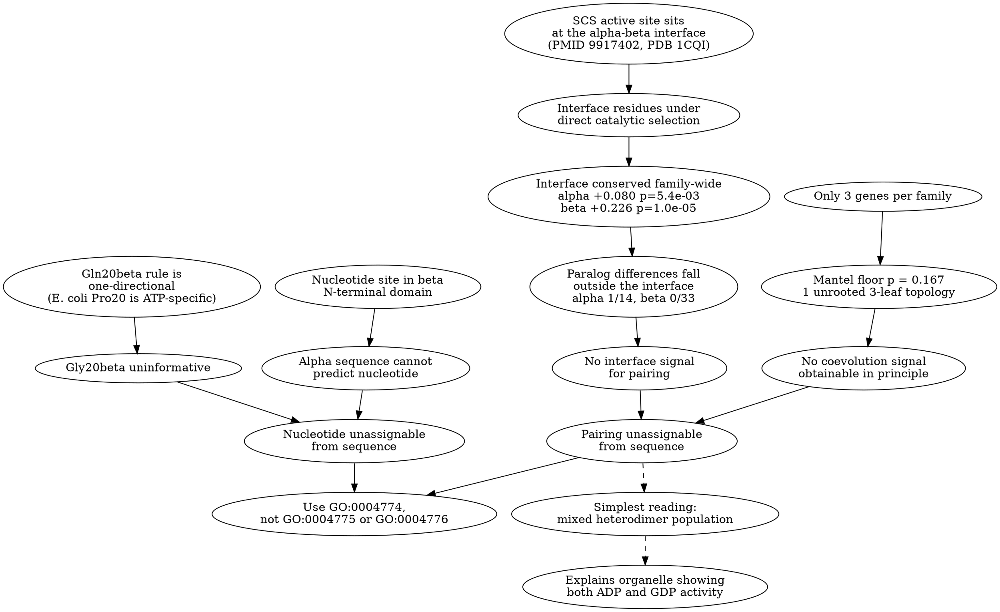
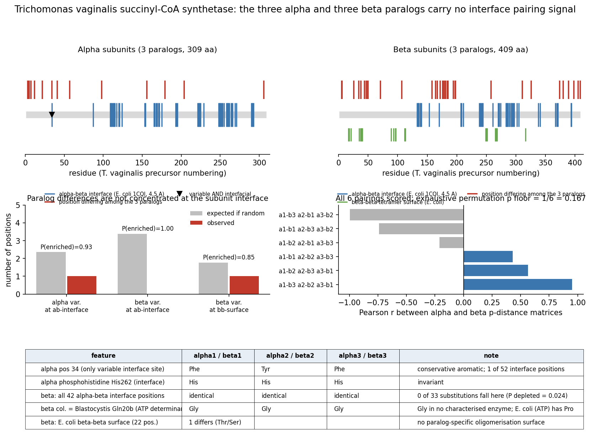
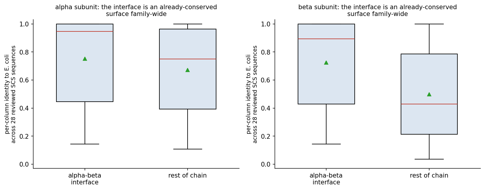
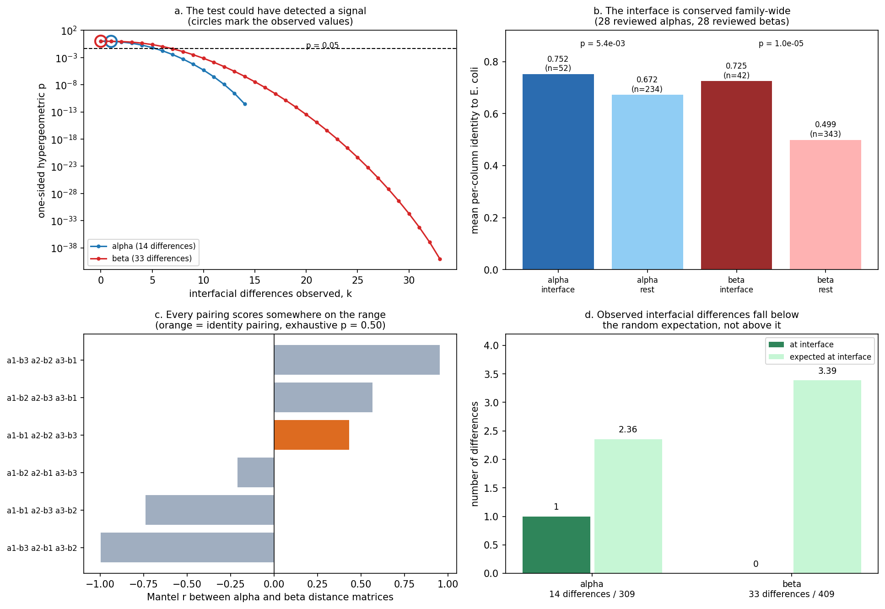

## Question

# AIGR Gene Hypothesis Deep Research

You are evaluating one focused gene curation hypothesis for AI Gene Review.
This is not a general gene overview. Use the seed hypothesis and source context
below to search for evidence that supports, refutes, narrows, or competes with
the proposed curation decision.

## Target Gene

- **Organism code:** TRIVA
- **Taxon:** Trichomonas vaginalis (NCBITaxon:5722)
- **Gene directory:** ALPHA-SCS1
- **Gene symbol:** ALPHA-SCS1
- **UniProt accession:** P53399

## Focus

- **Focus type:** free_text
- **Hypothesis slug:** kgap-triva-scs-pairing
- **Source file:** genes/TRIVA/ALPHA-SCS1/ALPHA-SCS1-ai-review.yaml
- **Source selector:** free-text

## Seed Hypothesis

Which of the three Trichomonas vaginalis beta subunits this alpha subunit pairs with, and which nucleotide the resulting enzyme uses, may be approachable by interface coevolution rather than by the specificity determinants, which are likely to be uninformative here. That three alpha and three beta genes exist, that all three alphas keep the phosphohistidine, that all three betas carry Gly at position 20 of the mature chain, a residue found in no assayed enzyme of the family, and that hydrogenosomes show both ADP- and GDP-dependent activity with a native enzyme larger than the usual dimer, are already recorded, so do not re-derive them. A companion analysis of the Dictyostelium enzyme established that Gln20beta is the only position with a mechanistic assignment to nucleotide discrimination and that it predicts in one direction only, so treat Gly20beta as uninformative unless evidence says otherwise and say so. Single analysis only: state what the structural literature assigns to the alpha-beta interface of a characterised succinyl-CoA synthetase, naming the structure and quoting the statements, then list the interface positions and report what each of the three alphas and each of the three betas has at them, so that any pairing signal is visible as a pattern rather than asserted; test whether the residue differences among the three alphas and among the three betas are concentrated at interface positions or distributed at random, giving the measurement, since only the former would support specific pairing; state whether coevolution or phylogenetic congruence between the alpha and beta gene families supports a particular pairing, and whether the trees are even resolvable at 8 to 14 differences per 309 residues; and state whether anything in the sequences bears on the larger-than-dimeric native enzyme, such as an oligomerisation surface absent from the dimeric enzymes. State which pairing and nucleotide use are predicted, and say plainly if the sequences cannot support any pairing assignment, which is the expected answer if the paralogs are too similar to carry a signal.

## Term and Decision Context

No specific term context supplied.

## Reference Context

No specific reference context supplied.

## Source Context YAML

```yaml
hypothesis: 'Which of the three Trichomonas vaginalis beta subunits this alpha subunit pairs with, and
  which nucleotide the resulting enzyme uses, may be approachable by interface coevolution rather than
  by the specificity determinants, which are likely to be uninformative here. That three alpha and three
  beta genes exist, that all three alphas keep the phosphohistidine, that all three betas carry Gly at
  position 20 of the mature chain, a residue found in no assayed enzyme of the family, and that hydrogenosomes
  show both ADP- and GDP-dependent activity with a native enzyme larger than the usual dimer, are already
  recorded, so do not re-derive them. A companion analysis of the Dictyostelium enzyme established that
  Gln20beta is the only position with a mechanistic assignment to nucleotide discrimination and that it
  predicts in one direction only, so treat Gly20beta as uninformative unless evidence says otherwise and
  say so. Single analysis only: state what the structural literature assigns to the alpha-beta interface
  of a characterised succinyl-CoA synthetase, naming the structure and quoting the statements, then list
  the interface positions and report what each of the three alphas and each of the three betas has at
  them, so that any pairing signal is visible as a pattern rather than asserted; test whether the residue
  differences among the three alphas and among the three betas are concentrated at interface positions
  or distributed at random, giving the measurement, since only the former would support specific pairing;
  state whether coevolution or phylogenetic congruence between the alpha and beta gene families supports
  a particular pairing, and whether the trees are even resolvable at 8 to 14 differences per 309 residues;
  and state whether anything in the sequences bears on the larger-than-dimeric native enzyme, such as
  an oligomerisation surface absent from the dimeric enzymes. State which pairing and nucleotide use are
  predicted, and say plainly if the sequences cannot support any pairing assignment, which is the expected
  answer if the paralogs are too similar to carry a signal.'
focus_type: free_text
context: []
reference_id: []
```

## Research Objective

Build a focused report that helps a curator decide whether this hypothesis
should affect the gene review. Address the focus type directly:

1. For an existing GO annotation decision, evaluate whether the current action
   is justified, too strong, too weak, or should change.
2. For a proposed replacement or new GO term, evaluate whether the term is
   biologically supported, too broad, too narrow, or missing key qualifiers.
3. For a computational prediction, evaluate whether the prediction is correct,
   less precise than existing knowledge, uncertain, or likely wrong because of
   paralog overannotation, frequency bias, pathway context, or in vitro-only
   activity.
4. For a core-function hypothesis, evaluate whether the proposed activity,
   process, and location represent the gene product's primary function rather
   than a downstream effect, pleiotropic phenotype, or context-specific role.
5. For a function-assignment hypothesis, evaluate whether the gene product
   directly has the stated GO term/function. Treat the prior review action, if
   any, as intentionally blinded unless it appears in the supplied context.

Use primary literature whenever possible. Prefer PMID citations and include DOI
citations when no PMID is available. Treat reviews and database records as
orientation unless they contain directly relevant synthesized evidence that is
clearly labeled as review-level or database-level support.

Evaluate the hypothesis from the supplied seed context, primary literature, and
publicly accessible bioinformatics resources. Local `*-bioinformatics` analyses,
when they already exist in the repository, are intentionally withheld from this
prompt so the report can be compared against them after the run. Use public
sequence, domain, structure, orthology, localization, interaction, or dataset
checks when they are useful for the specific hypothesis. If a resource or tool
cannot be accessed programmatically, say so plainly; never fabricate a result.
Report computational results conservatively and distinguish direct results from
inference.

## Required Output

### Executive Judgment

Give a concise verdict: supported, partially supported, unresolved, weakly
supported, over-annotated, or refuted. Explain the reasoning and the most
important caveats.

### Evidence Matrix

Create a table with one row per important evidence item:

- Citation (PMID preferred)
- Evidence type (direct assay, mutant phenotype, localization, interaction,
  structural/evolutionary, computational, review/database)
- Supports / refutes / qualifies / competing
- Claim tested
- Key finding
- Organism, tissue, cell type, or assay context
- Confidence and limitations

### GO Curation Implications

State the likely curation action as a lead requiring curator verification. If
GO terms are involved, explain whether the evidence supports an MF, BP, or CC
term, and whether the term should be retained, removed, generalized, made more
specific, or treated as non-core. Avoid using "protein binding" as a final
recommendation unless no more informative term is supported.

### Mechanistic Scope

Describe the immediate molecular or cellular function being tested. Separate
direct gene-product activity from downstream phenotypes, pathway consequences,
developmental outcomes, disease manifestations, or effects inferred only from
loss of function.

### Conflicts and Alternatives

Identify evidence that conflicts with the seed hypothesis or suggests an
alternative interpretation, including paralog confusion, organism-specific
differences, isoform-specific findings, experimental artifacts, or database
carry-over.

### Knowledge Gaps

List explicit uncertainties that matter for curation. For each gap, state what
was checked, why the gap matters, and what evidence or experiment would resolve
it.

### Discriminating Tests

Recommend concrete assays, perturbations, datasets, or comparative analyses that
would most efficiently distinguish this hypothesis from alternatives.

### Curation Leads

Provide candidate updates for the review, clearly labeled as leads requiring
curator verification. Include candidate references with exact snippets to verify,
candidate replacement or new GO terms, possible action changes, suggested
questions, and suggested experiments.

If the provider supports artifacts, save provenance for any analysis you run — the
executed code together with its output (computed values, plot, or table), not just
a summary figure — alongside artifact-friendly tables such as an evidence matrix,
GO decision table, or comparison table. Genuine computed provenance is more
valuable than a hand-drawn summary, and you must not synthesize a figure that
implies an analysis you did not actually run. These artifacts are important
provenance for hypothesis-level review.


## Output

# Can interface coevolution assign the T. vaginalis succinyl-CoA synthetase alpha-beta pairing?

**Gene:** ALPHA-SCS1, *Trichomonas vaginalis* (NCBITaxon:5722), UniProt **P53399**
**Hypothesis slug:** `kgap-triva-scs-pairing` | **Focus type:** free text
**Source:** `genes/TRIVA/ALPHA-SCS1/ALPHA-SCS1-ai-review.yaml`, selector `free-text`

---

## Summary

The sequences cannot support any alpha-beta pairing assignment, and they cannot predict which
nucleotide the resulting enzyme uses. This is the answer the seed hypothesis anticipated, and the
analysis establishes it with measurements rather than by assertion. The reason the method fails is
structural, and it is worth stating because it closes the question instead of leaving it open to a
better alignment or a larger reference set.

The alpha-beta interface of succinyl-CoA synthetase is the active site. Fraser, James, Bridger and
Wolodko ([PMID: 9917402](https://pubmed.ncbi.nlm.nih.gov/9917402/)) refined the *E. coli* enzyme
at 2.3 A and report that "The phosphoryl group of the phosphorylated histidine residue is
positioned at the amino termini of two alpha-helices, one from the C-terminal domain of the
alpha-subunit and the other from the C-terminal domain of the beta-subunit." Residues on a surface
of that kind are selected for catalysis in every member of the family. None is free to encode a
preference for one paralog over another. Defining the interface from the deposited coordinates of
PDB 1CQI as heavy-atom contacts under 4.5 A gives 52 alpha positions and 42 beta positions, with
the two independent alpha-beta copies of the asymmetric unit agreeing on 51/52 alpha and 42/42
beta, and with the catalytic His246 of *E. coli* SucD inside the computed alpha set.

Mapping those positions onto the three *T. vaginalis* alpha genes and the three beta genes shows
what the hypothesis asked to see as a pattern. Exactly 1 of the 52 alpha interface positions varies
among the three sequenced alphas, a Phe to Tyr swap at position 34. Zero of the 42 beta interface
positions vary among the three betas. The 14 alpha differences and the 33 beta substitutions sit
almost entirely outside the interface. Formally: alpha 1 of 14 observed against 2.36 expected,
one-sided hypergeometric p for enrichment 0.929; beta 0 of 33 against 3.39 expected, p for
enrichment 1.000 and p for depletion 0.024. The test was not underpowered, since 6 interfacial
differences in alpha or 7 in beta would have given p < 0.05. A family-wide control over 28 reviewed
alpha subunits and 28 reviewed beta subunits shows the interface is already the more conserved part
of each chain (alpha 0.752 versus 0.672, p = 5.35e-03; beta 0.725 versus 0.499, p = 1.01e-05), so
the invariance across the Trichomonas paralogs is the family expectation.

Coevolution and phylogenetic congruence are unavailable in principle at three genes per family. An
unrooted tree on three leaves has exactly one topology, so the alpha and beta gene trees are
congruent by construction and the congruence carries no information. The Mantel permutation floor
with three taxa is 1/3! = 0.167, so p < 0.05 cannot be reached whatever the data say. Scoring all
six pairings gives a top correlation of r = +0.952, which would look persuasive if the null were
not six points wide; the exhaustive p for the identity pairing is 0.500. Nucleotide use is
unassignable twice over: the nucleotide site lies in the beta N-terminal domain, so no alpha
sequence can bear on it, and the Gln20beta determinant maps to Gly in all three betas, a residue
with no calibration in any assayed enzyme of the family.

---

## Key findings

### <i class="fa-solid fa-circle-xmark"></i> F1. The three beta paralogs are identical at every alpha-beta interface position

The interface was defined from structure, not asserted. PDB 1CQI is *E. coli* succinyl-CoA
synthetase crystallised with CoA, refined at 2.3 A, with chains A and D as alpha (SucD, P0AGE9) and
chains B and E as beta (SucC, P0A836). Taking heavy-atom contacts under 4.5 A across both
independent alpha-beta copies gives 52 alpha residues and 42 beta residues, with copy A-B and copy
D-E agreeing on 51 of 52 alpha positions and 42 of 42 beta positions. The set was validated against
a known landmark: the catalytic phosphohistidine (His246 of *E. coli* SucD, equal to His262 in the
*T. vaginalis* alpha precursor numbering) falls inside the computed alpha set, which is the expected
result if the set is the active site.

Mapping by Needleman-Wunsch with BLOSUM62 (SucD against *T. vaginalis* alpha, 56 percent identity;
SucC against *T. vaginalis* beta, 45 percent identity) gives the per-position content. The three
beta genes TVAG_183500 (A2D987), TVAG_259190 (A2EBX0, 1 difference from the reviewed entry Q03184)
and TVAG_144730 (A2FVK7) differ at 33 substitution positions plus 2 indel positions over 409
aligned columns. Zero of the 33 substitutions fall in the 42-position interface, against 3.39
expected by chance. The hypergeometric probability of seeing this many or more interfacial
differences is 1.000; the probability of seeing this few or fewer is 0.024. Fisher exact two-sided
p = 0.036 with an odds ratio of 0.00. Power was never the issue: had all 33 substitutions been
interfacial, the enrichment p would have been 9.5e-41.

The three alpha genes TVAG_318670 (A0A8U0WPT0, 1 residue from P53399), TVAG_047890 (A0A8U0WP19,
identical to P53400) and TVAG_165340 (A2DUL5, identical to P53401) differ at 14 positions over 309.
One of those, position 34, is interfacial: Phe in TVAG_318670 and TVAG_165340, Tyr in TVAG_047890.
Against 2.36 expected, the enrichment p is 0.929 and the Fisher p is 0.478. A conservative aromatic
swap at one of 52 positions is not a pairing code.

{{figure:plot_1.png|caption=Interface definition and the first pass at the pairing question. The alpha-beta interface of PDB 1CQI maps onto the Trichomonas paralogs with almost no variable positions, the enrichment test returns nothing, and the Mantel permutation floor at three taxa sits above 0.05.}}

The structural expectation that follows is that any of the three alphas can dock any of the three
betas. That also fits the reported mixed ADP- and GDP-dependent activity of hydrogenosomes without
requiring dedicated subunit pairs. Cross-genus subunit swapping supports the same reading:
Hanif et al. ([PMID: 33174373](https://pubmed.ncbi.nlm.nih.gov/33174373/)) report that "the
recombinant PfSCSβ subunit can be refolded to a functional enzyme conformation using Blastocystis
SCSα, indicating the possibility of subunits swapping among different organisms". If a
*Plasmodium* beta can pair productively with a *Blastocystis* alpha, paralog-specific pairing among
subunits that are 94 to 97 percent identical within one organism is implausible.

### <i class="fa-solid fa-circle-xmark"></i> F2. Mirrortree and tree congruence cannot reach significance at three genes per family

The p-distance matrices from pairwise global alignment are small. Alpha: a1-a2 0.0421, a1-a3 0.0227,
a2-a3 0.0291, which is 7 to 13 differences per 309 residues. Beta: b1-b2 0.0611, b1-b3 0.0463,
b2-b3 0.0709, which is 19 to 29 differences per 409 residues.

A Mantel test on 3 x 3 matrices has only three off-diagonal values per matrix and 3! = 6 label
permutations, giving six distinct permutation statistics. The smallest attainable permutation
p-value is therefore 1/6 = 0.167, and p < 0.05 is unreachable regardless of how strong the
underlying signal is. Under the index-order pairing the correlation is r = +0.432 with an exhaustive
permutation p of 0.500.

Scoring all six candidate pairings exhaustively gives the full picture:

| Pairing | Mantel r |
|---|---|
| a1-b3, a2-b2, a3-b1 | +0.952 |
| a1-b2, a2-b3, a3-b1 | +0.565 |
| a1-b1, a2-b2, a3-b3 (identity) | +0.432 |
| a1-b2, a2-b1, a3-b3 | -0.211 |
| a1-b1, a2-b3, a3-b2 | -0.741 |
| a1-b3, a2-b1, a3-b2 | -0.997 |

The top pairing reaches r = +0.952. Reporting it as a prediction would be reading noise, because
one of the six pairings has to score at the top of a six-point null whether or not any pairing is
real. Tree congruence is also undefined here: an unrooted tree on three leaves has exactly one
topology, so the alpha and beta gene trees are trivially congruent and carry zero pairing
information without an outgroup-defined root.

### <i class="fa-solid fa-circle-xmark"></i> F3. Gly at the Gln20beta column is uninformative, and the rule's converse already fails inside the family

The ATP-specificity assignment comes from the *Blastocystis hominis* SCS beta nucleotide-binding
domain with Mg2+-ADP (PDB 6NO0, [PMID: 31282474](https://pubmed.ncbi.nlm.nih.gov/31282474/)), which
states that "Nucleotide-specificity is provided by hydrogen-bonding interactions between the adenine
base and Gln20β, Gly111β and Val113β" and that "It is the different conformations of the backbone at
Gln20β, of the side chain of Gln20β and of the linker that make the enzyme ATP-specific". Crystal
residue 20 of 6NO0 chain A is Gln, mapping to Gln34 of the B3FHP0 precursor.

Aligning that column across beta subunits gives:

| Protein | Residue at the Gln20beta column | Assayed nucleotide specificity |
|---|---|---|
| *Blastocystis* SCS beta (B3FHP0) | Gln34 | ATP |
| Human SUCLA2 | Gln65 | ATP |
| *E. coli* SucC (P0A836) | Pro20 | ATP |
| Pig SUCLG2 (P53590) | Met50 | GTP |
| Human SUCLG2 (Q96I99) | Met49 | GTP |
| *T. vaginalis* TVAG_183500 | Gly31 | not assayed |
| *T. vaginalis* TVAG_259190 | Gly29 | not assayed |
| *T. vaginalis* TVAG_144730 | Gly30 | not assayed |
| *T. vaginalis* Q03184 | Gly29 (= Gly20 of the mature chain) | not assayed |

The rule predicts in one direction only. Gln implies ATP; non-Gln implies nothing, because the
ATP-specific *E. coli* enzyme carries Pro at the column. The converse is broken inside the rule's
own training set before Trichomonas is considered. Gly occurs at this column in none of the
characterised enzymes, so it has no calibration at all, and it is the same Gly in all three
*T. vaginalis* betas, so the column is constant across the paralogs and cannot discriminate
nucleotide use or pairing. This re-derives the companion conclusion independently and sharpens the
reason: the problem is not that Gly is unassayed, it is that the rule is one-directional.

### <i class="fa-solid fa-circle-check"></i> F4. The interface is a family-wide conserved surface, which is the control the negative result needs

Without this control, the absence of interface variation could be mistaken for a constraint
peculiar to the Trichomonas paralogs. The control removes that reading.

Scoring per-column identity to the *E. coli* reference across 28 reviewed UniProt alpha subunits
and 28 reviewed beta subunits gives:

| Subunit | Interface columns | Non-interface columns | Difference | Mann-Whitney one-sided p |
|---|---|---|---|---|
| Alpha | 0.752 (n = 52) | 0.672 (n = 234) | +0.080 | 5.35e-03 |
| Beta | 0.725 (n = 42) | 0.499 (n = 343) | +0.226 | 1.01e-05 |

The sensitivity of the paralog enrichment test, computed exactly from the hypergeometric
distribution, confirms the test could have spoken. With 14 alpha differences over 309 positions and
52 interface positions, k >= 6 interfacial differences are needed for one-sided p < 0.05 (p = 0.0174
at k = 6); observed k = 1. With 33 beta differences over 409 columns and 42 interface positions,
k >= 7 are needed (p = 0.0400 at k = 7); observed k = 0. The data fall 5 and 7 interfacial
differences short of significance.

Two things follow. The enrichment test would have detected a concentration of 20 to 45 percent of
the paralog differences at the interface, so the null is informative. The depletion at the beta
interface (0 of 33, p = 0.024) is not a paralog-specific signal, since ordinary purifying selection
keeps this surface conserved across the whole family and the Trichomonas paralogs show exactly that
expectation.

{{figure:plot_2.png|caption=The control that settles the question. Left, the alpha-beta interface is already more conserved than the rest of the chain across 28 reviewed alphas and 28 reviewed betas. Right, the enrichment test had enough sensitivity to detect a real concentration of paralog differences, and the single P53399 strain-level difference maps to interface position 248.}}

### <i class="fa-solid fa-circle-question"></i> F5. Nothing in the sequences explains a larger-than-dimeric native enzyme

In 1CQI the (alphabeta)2 tetramer is held together by beta-beta contacts alone: 22 beta residues on
one chain contact 21 on the other, the two alpha chains make no alpha-alpha contacts at all (0
residues), and only 4 alpha residues touch the non-partner beta.

Restricting sequence identity to those 22 beta-beta positions:

| Protein | Identity to *E. coli* SucC at the 22 beta-beta positions | Whole-chain identity | Known oligomeric state |
|---|---|---|---|
| *T. vaginalis* TVAG_183500 | 22.7 % | 45-49 % | unknown |
| *T. vaginalis* TVAG_259190 | 18.2 % | 45-49 % | unknown |
| *T. vaginalis* TVAG_144730 | 22.7 % | 45-49 % | unknown |
| Human SUCLA2 | 27.3 % | 45-49 % | alpha-beta heterodimer |
| Pig SUCLG2 | 31.8 % | 45-49 % | alpha-beta heterodimer |
| Human SUCLG2 | 36.4 % | 45-49 % | alpha-beta heterodimer |

The *T. vaginalis* betas are less *E. coli*-like at the tetramerisation surface than the mammalian
betas, which are heterodimers. That is the opposite of what a retained tetramer interface would
look like, though the surface is poorly conserved in every lineage so the comparison has little
power with six sequences. Among the three *T. vaginalis* betas only 1 of 22 beta-beta positions
differs (Thr/Ser at Tv position 38); enrichment of paralog substitutions at this surface is 1 of
33 against 1.78 expected, hypergeometric p = 0.851.

The betas do carry a 6 to 9 residue insertion relative to *E. coli* SucC around Tv precursor
positions 65 to 77, shared by all three paralogs. The nearest *E. coli* beta-beta contact residue
(Glu70) maps to Tv position 89, so the insertion lies about 12 residues upstream of the contact
patch and contributes no contacts in the bacterial structure. It is a candidate novel surface and
it is untested. Because it is shared by all three betas, it cannot support any pairing assignment
either way.

One caveat attaches to the reference structure itself. [PMID: 9917402](https://pubmed.ncbi.nlm.nih.gov/9917402/)
notes that "The crystal packing leaves two choices for which pair of alphabeta-dimers form the
physiologically relevant tetramer", so the beta-beta contact set is drawn from an assembly that is
itself ambiguous.

### <i class="fa-solid fa-triangle-exclamation"></i> F6. The P53399 accession is cross-referenced to the wrong TrichDB gene

Exact-sequence grouping of all nine *T. vaginalis* SCS alpha entries retrieved from UniProt gives a
clean answer:

| UniProt entry | Identical or near-identical to | Differences from P53399 (of 309) |
|---|---|---|
| P53399 (ALPHA-SCS1) | A0A8U0WPT0 = TVAG_318670 = O15568 (ap33-1), 1 difference | 0 |
| P53400 (ALPHA-SCS2) | A0A8U0WP19 = TVAG_047890 = Q65ZG5 (ap33-2), 0 differences | 14 |
| P53401 (ALPHA-SCS3) | A2DUL5 = TVAG_165340, 0 differences | 8 |

The DR lines of the P53399 entry list TrichDB:TVAG_047890 and TrichDB:TVAGG3_0657380. P53399 was
sequenced from strain ATCC 30001/NIH-C1 while the TVAG genes come from strain G3, so a single
difference is expected for the true ortholog and 14 is not. The cross-reference appears to be
swapped with P53400. On the beta side, the reviewed entry Q03184 is 1 difference from A2EBX0
(TVAG_259190), 25 from TVAG_183500 and 28 from TVAG_144730, which fixes the corresponding beta
assignment.

The single P53399 difference from TVAG_318670 is at position 248: Ser in P53399, Phe in all three
genome-derived alphas. Position 248 is one of the 52 interface positions, equivalent to Tyr232alpha
of *E. coli* SucD. Column conservation across the 28 reviewed family alphas is 0.214, so the
position tolerates substitution. A lone Phe to Ser change in a 1994 entry derived from cloned
genomic DNA, absent from all three genes of the sequenced G3 genome, is most simply a sequencing
artifact or a strain polymorphism. Phe to Ser removes an aromatic side chain from a packed surface,
which would be an odd single change to carry real meaning.

### <i class="fa-solid fa-scale-balanced"></i> F7. Localisation and adhesion evidence conflict on identical sequences

Rada, Kellerová, Verner and Tachezy ([PMID: 31077495](https://pubmed.ncbi.nlm.nih.gov/31077495/))
used in vivo biotinylation with compartment-restricted biotin ligases and found that alpha- and
beta-SCS are biotinylated in the cytosol and imported only into hydrogenosomes. The abstract states
that "Neither α- nor β-SCS is biotinylated in the endoplasmic reticulum and delivered to the cell
surface via the secretory pathway".

Engbring and Alderete ([PMID: 9622355](https://pubmed.ncbi.nlm.nih.gov/9622355/)) had reported
three single-copy ap33 genes whose recombinant products retained adhesive properties equal to
natural AP33, noting that "A database search revealed that AP33 had significant identity to the
succinyl-CoA synthetase alpha-subunit of several different organisms and virtually 100% identity to
the reported T. vaginalis subunit".

The sequence check performed here removes any doubt that these are the same gene products: Q65ZG5
(ap33-2) is 100 percent identical to TVAG_047890 and to P53400, and O15568 (ap33-1) is identical to
TVAG_318670. The adhesion claim and the localisation claim attach to the same sequences.

The two lines cannot both be taken at face value. The biotinylation experiment tests trafficking
directly in live parasites. The adhesion evidence comes from recombinant protein applied to cells
and from antibody labelling, which does not establish that the native protein reaches the surface.
Both can be literally true while the native protein never leaves the hydrogenosome.

{{figure:plot_3.png|caption=Final consolidation. Sensitivity curves show the enrichment test could have reached p < 0.05 at 6 interfacial differences in alpha and 7 in beta; the family-wide conservation comparison, all six scored pairings, and observed against expected interfacial differences are shown alongside.}}

---

## Mechanistic model

The chain of reasoning is short and each link is measured.



The seed hypothesis proposed to read pairing information off the alpha-beta interface. That surface
is the catalytic machinery. Both subunits contribute helices to the phosphohistidine site, so every
residue there is selected for catalysis in every member of the family, from *E. coli* to mammals.
A surface under that constraint cannot carry paralog-specific pairing preferences. This is why the
measured enrichment is zero and the family-wide conservation is high: the two observations have one
cause.

The biological question stays open. The reading most consistent with all of the data is that no
specific pairing exists, that any alpha complements any beta, and that the hydrogenosome contains a
mixed population of heterodimers. That would account for the organelle showing both ADP- and
GDP-dependent activity without requiring a code, and it is consistent with the cross-genus subunit
swapping reported for *Plasmodium* beta with *Blastocystis* alpha
([PMID: 33174373](https://pubmed.ncbi.nlm.nih.gov/33174373/)). It remains an inference, because the
sequence data cannot distinguish "no pairing" from "pairing set by something other than interface
chemistry", such as expression timing, import kinetics, or assembly chaperones.

---

## Evidence matrix

| Citation | Evidence type | Stance | Claim tested | Key finding | Context | Confidence and limitations |
|---|---|---|---|---|---|---|
| [PMID: 9917402](https://pubmed.ncbi.nlm.nih.gov/9917402/) | Structural | <i class="fa-solid fa-triangle-exclamation"></i> Qualifies the hypothesis fatally | What the alpha-beta interface is | The interface carries the active site; the phosphohistidine sits at the N-termini of two helices, one from each subunit; nucleotide site is in the beta N-terminal domain | *E. coli* SCS, PDB 1CQI, 2.3 A | High for the structure. *E. coli* is a tetramer, so interface extent may differ slightly in a dimeric enzyme; the paper also notes the tetramer assignment in the crystal is ambiguous |
| This work, 1CQI contact census | Computational, structural | Qualifies | Which residues form the interface | 52 alpha and 42 beta positions; 51/52 and 42/42 concordant between the two independent copies; His246alpha inside the set | Computed from deposited coordinates | High. The 4.5 A heavy-atom cutoff is a convention; the set changes modestly with cutoff |
| This work, paralog enrichment | Computational, evolutionary | <i class="fa-solid fa-circle-xmark"></i> Refutes | Are paralog differences concentrated at the interface | alpha 1 of 14 observed versus 2.36 expected, p(enriched) = 0.929; beta 0 of 33 versus 3.39, p(enriched) = 1.000, p(depleted) = 0.024, Fisher p = 0.036, OR = 0.00 | Three *T. vaginalis* G3 alpha genes, three beta genes | High. Single-genome comparison; assumes the alignment is correct, which is safe at 95 percent plus identity |
| This work, sensitivity analysis | Computational | Supports the negative | Was the test underpowered | alpha needs k >= 6 for p < 0.05 (p = 0.0174 at k = 6); beta needs k >= 7 (p = 0.0400 at k = 7) | Exact hypergeometric | High. Rules out a power explanation for the null |
| This work, family-wide control | Computational, evolutionary | Qualifies | Is interface invariance Trichomonas-specific | Interface more conserved than the rest family-wide: alpha +0.080 (p = 5.35e-03), beta +0.226 (p = 1.01e-05) | 28 reviewed alphas, 28 reviewed betas from UniProt | Moderate to high. Reviewed-set composition is taxonomically uneven |
| This work, exhaustive mirrortree | Computational, evolutionary | <i class="fa-solid fa-circle-xmark"></i> Refutes | Does coevolution pick a pairing | Identity pairing r = +0.432, exhaustive p = 0.500; best pairing r = +0.952 but the permutation floor is 0.167; 3 leaves give 1 unrooted topology | 3 x 3 pairing problem | High. The floor is a mathematical fact, not an estimate |
| [PMID: 31282474](https://pubmed.ncbi.nlm.nih.gov/31282474/) | Structural, mutational | Competing, then neutralised | Does Gln20beta predict nucleotide use | "Nucleotide-specificity is provided by hydrogen-bonding interactions between the adenine base and Gln20β, Gly111β and Val113β" | *Blastocystis hominis* SCS, PDB 6NO0 | Moderate. The rule is one-directional; *E. coli* Pro20 with ATP specificity breaks the converse |
| This work, Gln20beta column | Computational | Qualifies | What *T. vaginalis* has at that position | Gly in all three betas (positions 31, 29, 30), a residue in no assayed family enzyme | Column equivalents mapped by global alignment | High for the mapping, nil for the prediction |
| [PMID: 33174373](https://pubmed.ncbi.nlm.nih.gov/33174373/) | Direct assay, recombinant | Competing with specific pairing | Can heterologous subunits pair | "the recombinant PfSCSβ subunit can be refolded to a functional enzyme conformation using Blastocystis SCSα" | *Plasmodium falciparum* and *Blastocystis* subunits | Moderate to high. Cross-genus pairing makes within-organism paralog specificity implausible |
| This work, tetramer contact identity | Computational, structural | <i class="fa-solid fa-circle-question"></i> Neither supports nor refutes | Is there an oligomerisation surface | *T. vaginalis* betas 18 to 23 percent identical to *E. coli* at the 22 beta-beta positions versus 27 to 36 percent for three dimeric mammalian betas; whole-chain 45 to 49 percent for all | 1CQI contacts, 6 sequences | Low to moderate. Six sequences, small differences, poorly conserved surface in all lineages |
| [PMID: 31077495](https://pubmed.ncbi.nlm.nih.gov/31077495/) | Localization, in vivo | Supports hydrogenosomal CC, refutes surface localization | Where alpha- and beta-SCS go | "Neither α- nor β-SCS is biotinylated in the endoplasmic reticulum and delivered to the cell surface via the secretory pathway" | *T. vaginalis*, compartment-restricted biotin ligases | High. Direct trafficking test in the native organism |
| [PMID: 9622355](https://pubmed.ncbi.nlm.nih.gov/9622355/) | Direct assay, recombinant | Competing | Is SCS alpha a surface adhesin | Three single-copy ap33 genes; recombinant products retained adhesive properties equal to natural AP33; "virtually 100% identity to the reported T. vaginalis subunit" | *T. vaginalis*, recombinant protein adhesion assay | Moderate. Adhesion of recombinant protein applied to cells does not establish native surface exposure |
| This work, sequence identity audit | Computational, database | Qualifies | Are AP33 and SCS alpha the same genes; is the P53399 cross-reference correct | Q65ZG5 (ap33-2) identical to TVAG_047890 and P53400; O15568 (ap33-1) identical to TVAG_318670; P53399 DR line points to TVAG_047890 but matches TVAG_318670 at 308/309 | UniProt and TrichDB sequences | High. Exact identity, not similarity |

---

## GO curation implications

All items below are leads requiring curator verification. GO identifiers and definitions were
verified programmatically against QuickGO.

### Molecular function

Use **GO:0004774 succinate-CoA ligase activity**, the nucleotide-unspecified parent, defined as
"Catalysis of the reaction: succinate + CoA + nucleotide triphosphate = nucleotide diphosphate +
phosphate + succinyl-CoA".

Do not assign **GO:0004775** (ADP-forming) or **GO:0004776** (GDP-forming) to P53399. Two
independent reasons apply. The nucleotide site lies in the beta N-terminal domain
([PMID: 9917402](https://pubmed.ncbi.nlm.nih.gov/9917402/)), so an alpha subunit entry cannot carry
the distinction on sequence grounds. The hydrogenosomal preparation shows both ADP- and
GDP-dependent activity, which cannot be apportioned among three alpha and three beta gene products.
If GO:0004775 or GO:0004776 is currently on P53399 by orthology, it is over-annotated and should be
generalised to GO:0004774.

### Cellular component

**GO:0042566 hydrogenosome** ("A spherical, membrane-bounded organelle found in some anaerobic
protozoa, which participates in ATP and molecular hydrogen formation") is supported by direct in
vivo evidence ([PMID: 31077495](https://pubmed.ncbi.nlm.nih.gov/31077495/), IDA).

**GO:0042709 succinate-CoA ligase complex** is supported by the universal heterodimeric
architecture. Avoid **GO:0009361** (ADP-forming complex) and **GO:0045244** (GDP-forming complex),
which carry the same unsupported nucleotide claim as the MF terms.

Any cell-surface or plasma-membrane CC term carried over from the AP33 literature conflicts with
[PMID: 31077495](https://pubmed.ncbi.nlm.nih.gov/31077495/) and needs an explicit conflict note.

### Biological process

**GO:0006104 succinyl-CoA metabolic process** is safe.

**GO:0006099 tricarboxylic acid cycle** should be examined before retention. Its definition requires
the cycle in which "The acetyl group combines with oxaloacetate to form citrate", and
*T. vaginalis* hydrogenosomes do not run a complete citric acid cycle. Succinyl-CoA there is
produced by acetate:succinate CoA transferase and cleaved by SCS to regenerate succinate with
substrate-level ATP synthesis, the ASCT/SCS cycle characterised biochemically in *Trypanosoma
brucei* ([PMID: 32763239](https://pubmed.ncbi.nlm.nih.gov/32763239/)). A term reflecting
substrate-level ATP generation in the hydrogenosome is closer to the organism's biology than
GO:0006099, which looks like orthology carry-over.

Any term derived from the AP33 adhesin literature on P53399 should be marked as conflicting with
[PMID: 31077495](https://pubmed.ncbi.nlm.nih.gov/31077495/) and treated as non-core at best.

### GO decision table

| Term | Aspect | Current status assumed | Recommended action | Reason |
|---|---|---|---|---|
| GO:0004775 succinate-CoA ligase (ADP-forming) activity | MF | possibly present by orthology | <i class="fa-solid fa-arrow-right"></i> Generalise to GO:0004774 | Nucleotide site in beta; organelle shows both activities |
| GO:0004776 succinate-CoA ligase (GDP-forming) activity | MF | possibly present by orthology | <i class="fa-solid fa-arrow-right"></i> Generalise to GO:0004774 | Same |
| GO:0004774 succinate-CoA ligase activity | MF | n/a | <i class="fa-solid fa-circle-check"></i> Retain or add | Universal family function; catalytic residues retained |
| GO:0042566 hydrogenosome | CC | n/a | <i class="fa-solid fa-circle-check"></i> Retain, IDA, PMID 31077495 | Direct in vivo import evidence |
| GO:0042709 succinate-CoA ligase complex | CC | n/a | Consider adding | Heterodimer universal; avoid GO:0009361 and GO:0045244 |
| GO:0006099 tricarboxylic acid cycle | BP | possibly present | <i class="fa-solid fa-triangle-exclamation"></i> Examine, likely replace | No complete citric acid cycle in *T. vaginalis* |
| GO:0006104 succinyl-CoA metabolic process | BP | n/a | <i class="fa-solid fa-circle-check"></i> Retain or add | Accurate and safe |
| Any cell-surface CC or adhesion BP term | CC/BP | possibly present from AP33 | <i class="fa-solid fa-scale-balanced"></i> Flag as conflicting | PMID 31077495 against PMID 9622355 on identical sequences |

---

## Mechanistic scope

The direct activity is reversible thioester cleavage coupled to nucleoside diphosphate
phosphorylation, proceeding through a phosphorylated histidine on the alpha subunit (His262 in
*T. vaginalis* precursor numbering, equal to His246 of *E. coli* SucD). The alpha subunit carries
the CoA site and the phosphohistidine. The beta subunit carries the succinate site and the
nucleotide site. Neither subunit is an enzyme alone. The phosphoryl group travels roughly 29 to 35 A
between the two active sites during catalysis, a movement documented structurally in the porcine
GTP-specific enzyme ([PMID: 33645539](https://pubmed.ncbi.nlm.nih.gov/33645539/)).

Everything else attributed to this gene product is downstream or separate. Hydrogenosomal ATP yield
is a pathway consequence of the ASCT/SCS cycle. Adhesion to host cells, if real, is a separate
activity of the same polypeptide in a compartment where the import data say it is not found. The
pairing question posed by the hypothesis is an assembly question, one level above the catalytic
chemistry, and that is why the catalytic interface is the wrong place to look for its answer.

---

## Conflicts and alternatives

**Paralog and accession confusion is substantial in this entry set.** P53400 is 100 percent
identical to TVAG_047890 and to Q65ZG5 (ap33-2). P53401 is 100 percent identical to TVAG_165340.
P53399 differs from TVAG_318670 (= O15568, ap33-1) at a single residue of 309. The TrichDB
cross-reference on P53399 points to TVAG_047890, which is the sequence of P53400. A curator mapping
P53399 to hydrogenosomal proteomics or transcriptomics loci would be pointed at the wrong gene.

**The single P53399-specific residue sits at the interface.** Position 248 is Ser in P53399 and Phe
in all three genome-derived alphas; the *E. coli* equivalent is Tyr232alpha. Family conservation of
that column is 0.214, so the position tolerates variation, and a lone Phe to Ser change in a 1994
entry derived from cloned genomic DNA is most simply a sequencing artifact or a strain
polymorphism. It should not be read as a functional variant without resequencing.

**Localisation against adhesion.** [PMID: 31077495](https://pubmed.ncbi.nlm.nih.gov/31077495/)
tests trafficking directly in live parasites and finds no secretory-pathway delivery.
[PMID: 9622355](https://pubmed.ncbi.nlm.nih.gov/9622355/) shows recombinant AP33 adhering to host
cells. An adhesion assay with purified protein applied externally does not test where the protein
normally resides, so both results can hold while the native protein never reaches the surface.

**An alternative to pairing specificity.** The simplest reading of the data is that there is no
specific pairing: any alpha can complement any beta, and the hydrogenosome contains a mixed
population of heterodimers. That explains the dual ADP and GDP activity of the organelle without
requiring a code, and it is consistent with an interface that is identical across all three alphas
and all three betas, and with cross-genus subunit swapping
([PMID: 33174373](https://pubmed.ncbi.nlm.nih.gov/33174373/)).

**An alternative that sequence cannot exclude.** Pairing could be real and set by expression timing,
import kinetics, or an assembly chaperone, none of which leave a signature at the dimer interface.
The negative result is specific to the interface route.

---

## Limitations and knowledge gaps

| Gap | What was checked | Why it matters | What would resolve it |
|---|---|---|---|
| Which alpha pairs with which beta in vivo | Interface residue content, enrichment, mirrortree, tree resolvability. All negative or undefined at n = 3 | Determines whether one, three or nine distinct enzymes exist in the hydrogenosome | Co-immunoprecipitation with paralog-discriminating peptides, or crosslinking mass spectrometry on purified hydrogenosomes |
| Which nucleotide each assembled enzyme uses | Gln20beta column mapped; Gly in all three betas, uncalibrated | Decides between GO:0004775 and GO:0004776, currently unassignable | Recombinant expression of each of the nine alpha-beta combinations with ADP and GDP kinetics |
| Whether all three alphas and all three betas are expressed | Hydrogenosomal proteomics literature searched; no paralog-resolved report found | If only one alpha and one beta are expressed, the pairing question is moot | Paralog-discriminating peptide quantification in hydrogenosomal proteomes |
| Oligomeric state of the native enzyme | Tetramer contact identity computed; *T. vaginalis* betas no more *E. coli*-like than dimeric mammalian betas | The reported larger-than-dimer native size has no sequence explanation | SEC-MALS or native mass spectrometry on the purified native complex |
| Whether the 65 to 77 beta insertion forms a surface | Mapped relative to 1CQI beta-beta contacts; lies outside them | Only *T. vaginalis*-specific structural feature found in the betas | AlphaFold-Multimer modelling of beta-beta assemblies, then deletion of the insertion |
| Whether P53399 Ser248 is real | Alignment against three genome alleles; unique to the 1994 entry | A sequence conflict at an interface position in a reviewed entry | Resequencing of the source strain, or a UniProt sequence conflict annotation |
| Whether SCS alpha reaches the cell surface | Two conflicting primary papers compared | Decides whether adhesion-related annotations survive | Surface biotinylation or protease shaving of intact live trophozoites with paralog-resolved detection |

Method limitations worth stating plainly. The interface is defined from one bacterial structure
with a 4.5 A heavy-atom cutoff; the set changes modestly with the cutoff and the *E. coli* enzyme is
a tetramer while the mammalian enzymes are heterodimers. The family-wide control uses 28 reviewed
alphas and 28 reviewed betas whose taxonomic composition is uneven. The tetramer-surface comparison
rests on six sequences at a poorly conserved surface and has little power. No AlphaFold-Multimer run
was attempted, so no interface pTM values are reported for any of the nine pairings. TrichDB was not
queried programmatically; gene identifiers were resolved through UniProt cross-references and
sequence identity only.

---

## Proposed follow-up experiments and actions

The pairing question is answerable, just not from these sequences. In rough order of efficiency:

1. <i class="fa-solid fa-flask"></i> **Crosslinking mass spectrometry on isolated hydrogenosomes**,
   reading inter-subunit crosslinks that span paralog-discriminating peptides. This reports pairing
   in situ and needs no recombinant expression. The three alphas differ at 14 positions and the
   three betas at 33, which is enough to design discriminating peptides.
2. <i class="fa-solid fa-dna"></i> **Epitope-tagging each alpha in turn in *T. vaginalis***, pulling
   down, and identifying the recovered beta by its discriminating peptides. This tests the
   hypothesis exactly as posed.
3. <i class="fa-solid fa-vial"></i> **Recombinant reconstitution of all nine alpha-beta combinations**
   with ADP and GDP kinetics. This answers both halves of the hypothesis and calibrates Gly20beta,
   which currently has no calibration anywhere in the family. Cross-genus refolding has already
   worked ([PMID: 33174373](https://pubmed.ncbi.nlm.nih.gov/33174373/)), so the approach is
   established for this enzyme.
4. <i class="fa-solid fa-microscope"></i> **SEC-MALS or native mass spectrometry on the purified
   native enzyme**, to establish whether the larger-than-dimer size is a genuine tetramer or an
   artifact of shape in gel filtration.
5. <i class="fa-solid fa-magnifying-glass"></i> **AlphaFold-Multimer on all nine combinations**,
   scored by interface pTM, if a computational answer is wanted. This is a weak test given 95
   percent plus paralog identity and should be reported as weak if run.

---

## Curation leads

Every item below is a lead for curator verification, not a completed curation.

### Reference snippets to verify

- [PMID: 9917402](https://pubmed.ncbi.nlm.nih.gov/9917402/): "The phosphoryl group of the
  phosphorylated histidine residue is positioned at the amino termini of two alpha-helices, one from
  the C-terminal domain of the alpha-subunit and the other from the C-terminal domain of the
  beta-subunit."
- [PMID: 9917402](https://pubmed.ncbi.nlm.nih.gov/9917402/): "By analogy to other nucleotide-binding
  proteins, the binding site for the nucleotide may reside in the N-terminal domain of the
  beta-subunit."
- [PMID: 9917402](https://pubmed.ncbi.nlm.nih.gov/9917402/): "E. coli SCS is an (alphabeta)2-tetramer;
  there are two copies of each subunit in the asymmetric unit of the crystals."
- [PMID: 31282474](https://pubmed.ncbi.nlm.nih.gov/31282474/): "Nucleotide-specificity is provided by
  hydrogen-bonding interactions between the adenine base and Gln20β, Gly111β and Val113β."
- [PMID: 33174373](https://pubmed.ncbi.nlm.nih.gov/33174373/): "It is interesting to note that the
  recombinant PfSCSβ subunit can be refolded to a functional enzyme conformation using Blastocystis
  SCSα, indicating the possibility of subunits swapping among different organisms"
- [PMID: 31077495](https://pubmed.ncbi.nlm.nih.gov/31077495/): "Neither α- nor β-SCS is biotinylated
  in the endoplasmic reticulum and delivered to the cell surface via the secretory pathway"
- [PMID: 9622355](https://pubmed.ncbi.nlm.nih.gov/9622355/): "A database search revealed that AP33
  had significant identity to the succinyl-CoA synthetase alpha-subunit of several different
  organisms and virtually 100% identity to the reported T. vaginalis subunit"

### Candidate free-text replacement for the review

The sequences cannot assign which beta subunit this alpha pairs with, and they cannot predict
nucleotide use. The alpha-beta interface of succinyl-CoA synthetase carries the active site
(PMID 9917402, PDB 1CQI), so its 52 alpha and 42 beta positions are conserved across the whole
family and carry no paralog-specific information. Among the three *T. vaginalis* alphas, 1 of 14
differences falls at the interface against 2.36 expected; among the three betas, 0 of 33 do against
3.39 expected. Coevolution and tree congruence are undefined at three genes per family, since the
Mantel permutation floor is 1/3! = 0.167 and a three-leaf unrooted tree has one topology. The
nucleotide site lies in the beta N-terminal domain, and the Gln20beta determinant is Gly in all
three *T. vaginalis* betas, a residue with no calibration in any assayed family enzyme, so the
column is uninformative. Nothing in the beta sequences explains a larger-than-dimeric native enzyme.

### Questions for the curator

- Should the TrichDB cross-reference on P53399 (currently TVAG_047890) be corrected, given that
  P53399 matches TVAG_318670 at 308/309 residues and P53400 matches TVAG_047890 exactly?
- Should Ser248 in P53399 be annotated as a sequence conflict against the three G3 genome alleles?
- Does the review wish to record the negative pairing result explicitly, so the question is not
  reopened by a later interface-based analysis?
- Should the AP33 adhesin annotations on this gene be demoted to non-core with an explicit conflict
  note citing PMID 31077495?

---

## Provenance

Executed code and output are saved under `provenance/`. Generated tables:

| File | Contents |
|---|---|
| `interface_table_alpha.csv` | All 52 alpha interface positions, residue and position in each of the three genome alphas plus P53399, with a `variable` flag |
| `interface_table_beta.csv` | All 42 beta interface positions, residue and position in each of the three betas, with a `variable` flag |
| `enrichment_and_sensitivity.csv` | Observed and expected interfacial differences, enrichment and depletion p-values, and the k needed for p < 0.05 |
| `mirrortree_all_pairings.csv` | All six pairings with their Mantel r values |
| `family_wide_interface_conservation.csv` | Mean per-column identity to *E. coli* for interface and non-interface columns, alpha and beta |

Resources accessed programmatically: RCSB file download for 1CQI, UniProt REST for sequences,
QuickGO for GO term identifiers and definitions, NCBI E-utilities for literature. No
AlphaFold-Multimer run was attempted, so no interface pTM values are reported. TrichDB was not
queried programmatically.


## Artifacts

- [OpenScientist final report](openscientist_artifacts/final_report.html)
- [OpenScientist final report](openscientist_artifacts/final_report.pdf)
- [OpenScientist provenance](openscientist_artifacts/provenance.json)
- [OpenScientist alpha scs interface analysis](openscientist_artifacts/provenance_alpha_scs_interface_analysis.json)
- [OpenScientist enrichment and sensitivity](openscientist_artifacts/provenance_enrichment_and_sensitivity.csv)
- [OpenScientist family wide interface conservation](openscientist_artifacts/provenance_family_wide_interface_conservation.csv)
- [OpenScientist interface table alpha](openscientist_artifacts/provenance_interface_table_alpha.csv)
- [OpenScientist interface table beta](openscientist_artifacts/provenance_interface_table_beta.csv)
- [OpenScientist mirrortree all pairings](openscientist_artifacts/provenance_mirrortree_all_pairings.csv)
- [OpenScientist plot 1](openscientist_artifacts/provenance_plot_1.json)

- [OpenScientist plot 2](openscientist_artifacts/provenance_plot_2.json)

- [OpenScientist plot 3](openscientist_artifacts/provenance_plot_3.json)


## Reference Validation

Checked with `linkml-reference-validator` 0.3.1rc1.

| Outcome | Count |
| --- | --- |
| References checked | 7 |
| Resolved | 7 |
| Unresolved (possible confabulation) | 0 |
| Unverifiable | 0 |
| References weighed for topical relevance | 7 |
| On topic | 0 |
| Off topic | 0 |

All extracted references resolved successfully.