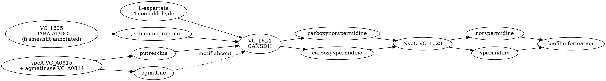
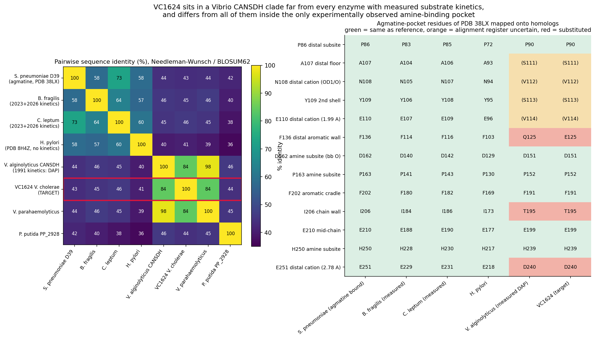
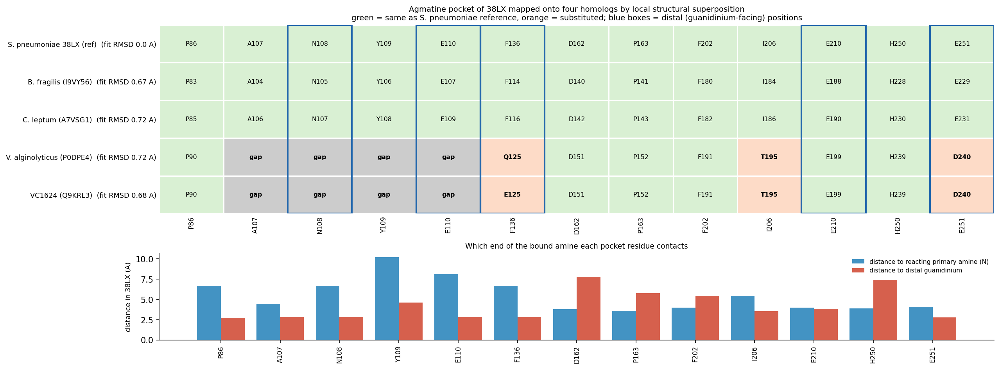
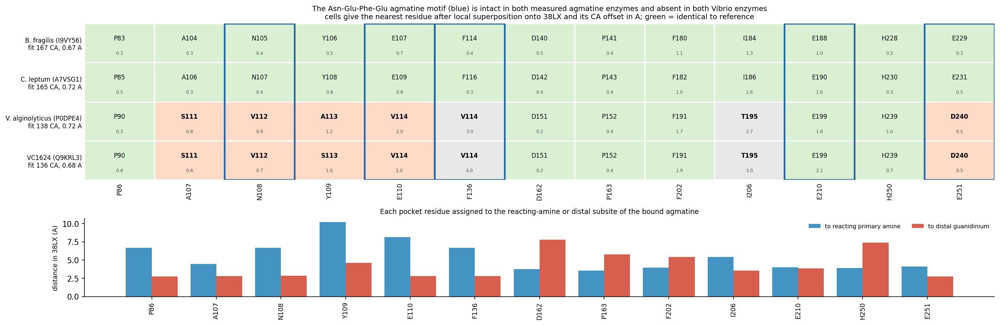
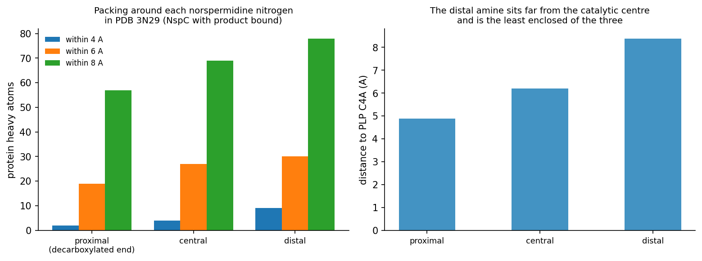

## Question

# AIGR Gene Hypothesis Deep Research

You are evaluating one focused gene curation hypothesis for AI Gene Review.
This is not a general gene overview. Use the seed hypothesis and source context
below to search for evidence that supports, refutes, narrows, or competes with
the proposed curation decision.

## Target Gene

- **Organism code:** VIBCH
- **Taxon:** Vibrio cholerae O1 biovar El Tor str. N16961 (NCBITaxon:243277)
- **Gene directory:** VC_1624
- **Gene symbol:** VC_1624
- **UniProt accession:** Q9KRL3

## Focus

- **Focus type:** free_text
- **Hypothesis slug:** kgap-vc1624-diamine-preference
- **Source file:** genes/VIBCH/VC_1624/VC_1624-ai-review.yaml
- **Source selector:** free-text

## Seed Hypothesis

Whether the diamine preference of V. cholerae VC1624 can be predicted at all is the prior question to its quantitative substrate preference, and a companion analysis in this project suggests it cannot. That VC1624 is an NADPH-dependent carboxynorspermidine synthase that condenses L-aspartate 4-semialdehyde with either 1,3-diaminopropane or putrescine, that purified enzyme makes carboxynorspermidine, that the 2023 kinetics concern B. fragilis and C. leptum rather than this enzyme, and that the C6709 genetic data establish both outputs without isolating preference from substrate supply, are already recorded, so do not re-derive them. A companion run on the Pseudomonas putida homolog PP_2928 found that active-site pocket analysis could not discriminate diamine preference and that a genome-absence argument failed a positive control, so treat both approaches as suspect and say so if they fail again. Single analysis only: state which residues the structural literature assigns to diamine selection in any carboxynorspermidine dehydrogenase whose preference has been measured, naming the structures and quoting the assignments, and report what VC1624 and the measured B. fragilis and C. leptum enzymes have at each, so that a predictive pattern is visible as a pattern or absent; state whether the enzymes with measured kinetics differ from VC1624 at those positions in a direction consistent with their measured preferences, which is the only test that would license transfer; report whether V. cholerae encodes a 1,3-diaminopropane biosynthetic route and a putrescine route, with locus tags, since relative substrate supply is the confound the gap names; and state whether the adjacent NspC decarboxylase constrains the answer. State whether a preference can be predicted, and say plainly if the determinants are unknown and the question needs steady-state kinetics on this enzyme.

## Term and Decision Context

No specific term context supplied.

## Reference Context

No specific reference context supplied.

## Source Context YAML

```yaml
hypothesis: 'Whether the diamine preference of V. cholerae VC1624 can be predicted at all is the prior
  question to its quantitative substrate preference, and a companion analysis in this project suggests
  it cannot. That VC1624 is an NADPH-dependent carboxynorspermidine synthase that condenses L-aspartate
  4-semialdehyde with either 1,3-diaminopropane or putrescine, that purified enzyme makes carboxynorspermidine,
  that the 2023 kinetics concern B. fragilis and C. leptum rather than this enzyme, and that the C6709
  genetic data establish both outputs without isolating preference from substrate supply, are already
  recorded, so do not re-derive them. A companion run on the Pseudomonas putida homolog PP_2928 found
  that active-site pocket analysis could not discriminate diamine preference and that a genome-absence
  argument failed a positive control, so treat both approaches as suspect and say so if they fail again.
  Single analysis only: state which residues the structural literature assigns to diamine selection in
  any carboxynorspermidine dehydrogenase whose preference has been measured, naming the structures and
  quoting the assignments, and report what VC1624 and the measured B. fragilis and C. leptum enzymes have
  at each, so that a predictive pattern is visible as a pattern or absent; state whether the enzymes with
  measured kinetics differ from VC1624 at those positions in a direction consistent with their measured
  preferences, which is the only test that would license transfer; report whether V. cholerae encodes
  a 1,3-diaminopropane biosynthetic route and a putrescine route, with locus tags, since relative substrate
  supply is the confound the gap names; and state whether the adjacent NspC decarboxylase constrains the
  answer. State whether a preference can be predicted, and say plainly if the determinants are unknown
  and the question needs steady-state kinetics on this enzyme.'
focus_type: free_text
context: []
reference_id: []
```

## Research Objective

Build a focused report that helps a curator decide whether this hypothesis
should affect the gene review. Address the focus type directly:

1. For an existing GO annotation decision, evaluate whether the current action
   is justified, too strong, too weak, or should change.
2. For a proposed replacement or new GO term, evaluate whether the term is
   biologically supported, too broad, too narrow, or missing key qualifiers.
3. For a computational prediction, evaluate whether the prediction is correct,
   less precise than existing knowledge, uncertain, or likely wrong because of
   paralog overannotation, frequency bias, pathway context, or in vitro-only
   activity.
4. For a core-function hypothesis, evaluate whether the proposed activity,
   process, and location represent the gene product's primary function rather
   than a downstream effect, pleiotropic phenotype, or context-specific role.
5. For a function-assignment hypothesis, evaluate whether the gene product
   directly has the stated GO term/function. Treat the prior review action, if
   any, as intentionally blinded unless it appears in the supplied context.

Use primary literature whenever possible. Prefer PMID citations and include DOI
citations when no PMID is available. Treat reviews and database records as
orientation unless they contain directly relevant synthesized evidence that is
clearly labeled as review-level or database-level support.

Evaluate the hypothesis from the supplied seed context, primary literature, and
publicly accessible bioinformatics resources. Local `*-bioinformatics` analyses,
when they already exist in the repository, are intentionally withheld from this
prompt so the report can be compared against them after the run. Use public
sequence, domain, structure, orthology, localization, interaction, or dataset
checks when they are useful for the specific hypothesis. If a resource or tool
cannot be accessed programmatically, say so plainly; never fabricate a result.
Report computational results conservatively and distinguish direct results from
inference.

## Required Output

### Executive Judgment

Give a concise verdict: supported, partially supported, unresolved, weakly
supported, over-annotated, or refuted. Explain the reasoning and the most
important caveats.

### Evidence Matrix

Create a table with one row per important evidence item:

- Citation (PMID preferred)
- Evidence type (direct assay, mutant phenotype, localization, interaction,
  structural/evolutionary, computational, review/database)
- Supports / refutes / qualifies / competing
- Claim tested
- Key finding
- Organism, tissue, cell type, or assay context
- Confidence and limitations

### GO Curation Implications

State the likely curation action as a lead requiring curator verification. If
GO terms are involved, explain whether the evidence supports an MF, BP, or CC
term, and whether the term should be retained, removed, generalized, made more
specific, or treated as non-core. Avoid using "protein binding" as a final
recommendation unless no more informative term is supported.

### Mechanistic Scope

Describe the immediate molecular or cellular function being tested. Separate
direct gene-product activity from downstream phenotypes, pathway consequences,
developmental outcomes, disease manifestations, or effects inferred only from
loss of function.

### Conflicts and Alternatives

Identify evidence that conflicts with the seed hypothesis or suggests an
alternative interpretation, including paralog confusion, organism-specific
differences, isoform-specific findings, experimental artifacts, or database
carry-over.

### Knowledge Gaps

List explicit uncertainties that matter for curation. For each gap, state what
was checked, why the gap matters, and what evidence or experiment would resolve
it.

### Discriminating Tests

Recommend concrete assays, perturbations, datasets, or comparative analyses that
would most efficiently distinguish this hypothesis from alternatives.

### Curation Leads

Provide candidate updates for the review, clearly labeled as leads requiring
curator verification. Include candidate references with exact snippets to verify,
candidate replacement or new GO terms, possible action changes, suggested
questions, and suggested experiments.

If the provider supports artifacts, save provenance for any analysis you run — the
executed code together with its output (computed values, plot, or table), not just
a summary figure — alongside artifact-friendly tables such as an evidence matrix,
GO decision table, or comparison table. Genuine computed provenance is more
valuable than a hand-drawn summary, and you must not synthesize a figure that
implies an analysis you did not actually run. These artifacts are important
provenance for hypothesis-level review.


## Output

# VC_1624 (Q9KRL3) diamine preference: can it be predicted?

**Hypothesis slug:** `kgap-vc1624-diamine-preference`
**Organism:** *Vibrio cholerae* O1 biovar El Tor str. N16961 (NCBITaxon:243277)
**UniProt:** Q9KRL3, carboxynorspermidine synthase, 414 aa, EC 1.5.1.43
**Source file:** `genes/VIBCH/VC_1624/VC_1624-ai-review.yaml`, focus type `free_text`

## Summary

The diamine preference of VC1624 cannot be predicted from residue determinants. The structural literature
assigns specificity residues in this enzyme class exactly once, and the assignment is for agmatine. [PMID: 43093060](https://pubmed.ncbi.nlm.nih.gov/43093060/)
solved a 1.19 Å structure of the *Streptococcus pneumoniae* enzyme with agmatine and NADPH bound (PDB 38LX) and
states that "a conserved Asn-Glu-Phe-Glu motif coordinates agmatine". That motif reads a guanidinium group,
which neither 1,3-diaminopropane nor putrescine carries. A full-text survey of the Protein Data Bank returned
12 entries for the two enzymes of this pathway, and not one of them has a diamine bound. There is therefore no
published residue set whose variation has ever been tied to a measured 1,3-diaminopropane versus putrescine
ratio, anywhere in the family.

The seed hypothesis names the only test that would license transfer: the enzymes with measured kinetics should
differ from VC1624 at the assigned positions in a direction consistent with their measured preferences. That
test cannot be run, and the reason is arithmetic rather than interpretive. The three enzymes with modern
measured kinetics (*S. pneumoniae*, *Bacteroides fragilis*, *Clostridium leptum*) all prefer agmatine and are
identical to one another at 13 of 13 amine-pocket positions, so the within-class contrast a predictive rule
would be fitted to is zero. None of them has a measured diamine ratio at all. Exactly one enzyme in the family
has one, the *Vibrio alginolyticus* carboxynorspermidine synthase of [PMID: 1955861](https://pubmed.ncbi.nlm.nih.gov/1955861/),
where putrescine runs at about 7% of the 1,3-diaminopropane rate. One measured point on one side and an
invariant three on the other is not a pattern. The active-site pocket approach flagged as suspect in the
companion PP_2928 run fails again here, for the same reason it failed there, which is that it has nothing to
calibrate against.

Two usable results survive the failure. VC1624 retains only one of the four agmatine motif residues, which
argues against an agmatine route for this enzyme. And VC1624 matches the one enzyme with a measured diamine
preference at 12 of 13 pocket positions, on 84.1% full-length identity, against 43 to 46% identity to the
agmatine enzymes. So a preference can be carried over to VC1624 by orthology to a measurement while remaining
unpredictable from determinants. That distinction is the practical answer for a curator. The adjacent NspC
decarboxylase does not constrain the answer, because it acts one step downstream and both norspermidine and
spermidine are made by the *V. cholerae* pathway and both are lost when the decarboxylase is deleted
([PMID: 19196710](https://pubmed.ncbi.nlm.nih.gov/19196710/)). The question needs steady-state kinetics on
VC1624 itself, with kcat/KM measured for 1,3-diaminopropane, putrescine and agmatine side by side.

## Executive judgment

<i class="fa-solid fa-circle-check"></i> **Verdict: supported, with one qualification that changes the curation outcome.**

The seed claim that the diamine preference cannot be predicted is correct as stated for prediction from
residue determinants. Three separate findings establish it. First, no structure in the family has a diamine
bound, so there is nothing to quote as a diamine-selection assignment. Second, the one specificity motif that
has been assigned reads a chemical group absent from both diamines. Third, the measured-kinetics set offers
zero variance at every pocket position, so the comparison the hypothesis asks for has no signal to detect.

The qualification is that a preference can still be transferred to VC1624, by orthology rather than by rule.
VC1624 is 84.1% identical to the *V. alginolyticus* carboxynorspermidine synthase and matches it at 12 of 13
amine-pocket positions. That enzyme has a directly measured diamine preference. Carrying it over is a
sequence-identity argument with a stated error mode, which is a different kind of claim from a residue-pattern
prediction and should be labelled as such in the review.

<i class="fa-triangle-exclamation"></i> The caveats that matter most. The 1991 *V. alginolyticus* measurement
predates the discovery that agmatine dominates in this family, so that assay never tested the substrate that
turned out to win in three other homologs; it is reported as a rate ratio with no kcat/KM. The single pocket
difference between VC1624 and *V. alginolyticus* is Ser113 for Ala113, 4.60 Å from the guanidinium position in
the reference frame, with unknown consequence. All four homolog structures used in the pocket comparison are
AlphaFold apo models superposed onto a ligand-bound crystal form, so the side-chain positions are predicted,
and the conclusions rest on backbone equivalence (CA offsets 0.17 to 3.05 Å) plus residue identity rather than
on modelled rotamers. The 1,3-diaminopropane supply gene VC_1625 is annotated in the N16961 reference with an
authentic frame shift, and whether it is intact in this strain was not verified against current RefSeq in
this run.

## Key findings

### The family has no diamine-bound structure, and the only liganded amine site holds agmatine

A full-text search of the Protein Data Bank for "carboxynorspermidine dehydrogenase", "carboxyspermidine
dehydrogenase", "carboxynorspermidine synthase" and "carboxyaminopropylagmatine" returns 8 entries in the
dehydrogenase family: 8DEB (*B. fragilis*, 1.94 Å, NADP only), 8H4Z, 8H50 and 8H52 (*Helicobacter pylori*,
2.2 to 3.1 Å, apo and NADP), 36YL (*B. fragilis* apo, 2.91 Å), 9YQ9 (*C. leptum* apo, 2.5 Å), 38TP
(*S. pneumoniae* with NADPH, 1.97 Å) and 38LX (*S. pneumoniae* with NADPH and agmatine, 1.19 Å). No entry
contains putrescine, 1,3-diaminopropane or cadaverine. PDB 4XQC (NAD with 1,3-diaminopropane) and 4TVB (NAD
with putrescine) belong to homospermidine synthase, a deoxyhypusine-synthase-fold enzyme outside this family,
so they are not transferable.

Computing the 38LX amine site directly (own code, 6525 protein atoms, 4.5 Å contact cutoff) shows the bound
agmatine read out by 13 residues: Pro86, Ala107, Asn108, Tyr109, Glu110, Phe136, Asp162, Pro163, Phe202,
Ile206, Glu210, His250 and Glu251. Per-atom distances split the site into two subsites. The reacting primary
amine (ligand atom N) contacts Asp162 O at 3.77 Å, with Pro163, His250 and Phe202 nearby. The distal
guanidinium contacts Glu110 OE2 at 1.99 Å, Asn108 O and OD1 at 2.04 and 3.05 Å, and Glu251 OE1 at 2.78 Å.

{{figure:plot_1.png|caption=Left, pairwise global identity across an eight-member CANSDH and CASDH panel, with VC1624 outlined. Right, the agmatine-pocket positions of PDB 38LX mapped across six enzymes by sequence alignment, showing the Vibrio clade departing from the agmatine clade across the distal subsite and the alignment register failing in that region.}}

### VC1624 is 84% identical to the one enzyme with a measured diamine preference

Pairwise global alignment (own Needleman-Wunsch implementation, BLOSUM62, gap open -11, extend -1) over an
eight-member panel gives the identities in the table below. The enzyme nearest VC1624 with measured substrate
kinetics is the *V. alginolyticus* carboxynorspermidine synthase, at 84.1% over the full length. The
*B. fragilis* and *C. leptum* enzymes whose kinetics the seed would transfer sit at 44.8% and 45.9%.

| Enzyme | UniProt | Identity to VC1624 | Measured substrate data |
|---|---|---|---|
| *V. alginolyticus* carboxynorspermidine synthase | P0DPE4 | 84.1% | DAP preferred, putrescine at about 7% of the DAP rate ([PMID: 1955861](https://pubmed.ncbi.nlm.nih.gov/1955861/)) |
| *V. parahaemolyticus* | Q87NC7 | 83.8% | none |
| *C. leptum* CASDH / CAPADH | A7VSG1 | 45.9% | agmatine preferred ([PMID: 42754158](https://pubmed.ncbi.nlm.nih.gov/42754158/)) |
| *B. fragilis* CASDH / CAPADH | I9VY56 | 44.8% | agmatine preferred ([PMID: 42754158](https://pubmed.ncbi.nlm.nih.gov/42754158/)) |
| *P. putida* PP_2928 | Q88IS1 | 43.9% | none |
| *S. pneumoniae* CAPADH (PDB 38LX) | A0A0H2ZP94 | 43.4% | agmatine kcat/KM 1.0e6 M-1 s-1, about 3200-fold over putrescine ([PMID: 43093060](https://pubmed.ncbi.nlm.nih.gov/43093060/)) |
| *H. pylori* CASDH | O26037 | 40.6% | none quantitative in the abstracts retrieved |

P0DPE4 matches the protein purified in [PMID: 1955861](https://pubmed.ncbi.nlm.nih.gov/1955861/) on size: 414
residues gives 45.5 kDa calculated against 45,100 ± 500 by SDS-PAGE, with 93,500 ± 1,000 native, a dimer. That
paper states "Putrescine was slightly active as a substrate, forming carboxyspermidine (at about 7% of the rate
of DAP), but ethylenediamine, cadaverine and D-ASA were inert."

### The 2023 kinetics enzymes have been reassigned to agmatine

[PMID: 37437886](https://pubmed.ncbi.nlm.nih.gov/37437886/) (2023) measured the *B. fragilis* and *C. leptum*
enzymes and concluded that "Putrescine is the likely polyamine substrate and NADPH is the coenzyme used to
complete the reaction, forming carboxyspermidine as a product". [PMID: 42754158](https://pubmed.ncbi.nlm.nih.gov/42754158/)
(2026) re-examined the same two enzymes with steady-state and transient-state kinetics, mass spectrometry,
thermal shift assays, crystallography (PDB 36YL, 9YQ9), SAXS and modelling, and found that "Both enzymes
exhibit dramatically enhanced catalytic efficiency with agmatine, demonstrating that these homologs function as
carboxyaminopropylagmatine dehydrogenases rather than carboxyspermidine dehydrogenases", with agmatine raising
NADPH binding affinity 34-fold while "putrescine has a modest effect and at concentrations less likely to be
physiologically relevant". The *S. pneumoniae* structure and kinetics in [PMID: 43093060](https://pubmed.ncbi.nlm.nih.gov/43093060/)
are the same reassignment in a third organism.

<i class="fa-scale-balanced"></i> The practical consequence for this hypothesis is that the two enzymes whose
diamine ratios would have been transferred to VC1624 were characterised for a reaction that the 2026 work says
is not their physiological one. Their putrescine kinetics were measured outside the substrate regime that
matters for them.

### The agmatine motif is intact in both measured agmatine enzymes and broken in both Vibrio enzymes

Four AlphaFold DB v6 models (mean pLDDT 95.5 to 95.9) were superposed onto 38LX using the 190 reference
residues whose CA lies within 20 Å of the agmatine centroid, with iterative 2.0 Å outlier trimming. The fits
converged at *B. fragilis* 167 CA at 0.67 Å, *C. leptum* 165 CA at 0.72 Å, *V. alginolyticus* 138 CA at 0.72 Å
and VC1624 136 CA at 0.68 Å. Pocket equivalence was then read by nearest CA in the superposed frame, which is
independent of alignment register.

Both enzymes with measured agmatine kinetics keep all four motif residues: *B. fragilis* Asn105, Glu107,
Phe114, Glu188, and *C. leptum* Asn107, Glu109, Phe116, Glu190, with every CA within 0.27 to 1.58 Å of its
reference partner. VC1624 keeps only the last Glu. Asn108 maps to Val112 (CA offset 0.74 Å), Glu110 maps to
Val114 (1.03 Å), Phe136 has no structural counterpart (nearest CA 4.01 Å away, so the *Vibrio* chain does not
reach that position), and Glu210 maps to Glu199 (2.14 Å). *V. alginolyticus* is the same.

This also settles an alignment ambiguity that the sequence method could not. Needleman-Wunsch placed a gap
across the Ala107-Asn108-Tyr109-Glu110 segment in both *Vibrio* sequences. The superposition shows
Ser111-Val112-Ser113-Val114 physically occupying those four positions, with CA offsets of 0.63, 0.74, 0.96 and
1.03 Å.

{{figure:plot_3.png|caption=Alignment-free structural equivalence of the 38LX agmatine pocket onto four homologs by nearest CA after local superposition. Each cell gives the equivalent residue and its CA offset in A. The Asn-Glu-Phe-Glu agmatine motif is intact in both measured agmatine enzymes and absent in both Vibrio enzymes. The lower panel assigns each reference residue to the reacting-amine or the distal subsite.}}

### The transfer test cannot be run: zero contrast among the measured enzymes

Using the 13-residue agmatine pocket of 38LX as a common frame, the compositions are:

| Enzyme | Pocket composition at the 13 reference positions | Measured preference |
|---|---|---|
| *S. pneumoniae* (38LX, reference) | P86, A107, N108, Y109, E110, F136, D162, P163, F202, I206, E210, H250, E251 | agmatine, 3200-fold over putrescine |
| *B. fragilis* | P83, A104, N105, Y106, E107, F114, D140, P141, F180, I184, E188, H228, E229 | agmatine |
| *C. leptum* | P85, A106, N107, Y108, E109, F116, D142, P143, F182, I186, E190, H230, E231 | agmatine |
| *V. alginolyticus* | P90, S111, V112, A113, V114, none, D151, P152, F191, T195, E199, H239, D240 | DAP, putrescine at about 7% |
| **VC1624** | P90, S111, V112, S113, V114, none, D151, P152, F191, T195, E199, H239, D240 | **unmeasured** |

Three results follow. The three enzymes with modern kinetics are identical at 13 of 13 positions, so the
variance a rule would be fitted to is zero, and none has a measured diamine ratio. Exactly one enzyme has a
measured diamine ratio, so that side of the comparison has n = 1. VC1624 matches that single enzyme at 12 of 13
positions, the one difference being Ser113 for Ala113 at the Tyr109 equivalent, 4.60 Å from the guanidinium in
the reference.

The four residues that contact the reacting primary amine in 38LX (Asp162 at 3.77 Å, Pro163 at 3.58 Å, Phe202
at 3.99 Å, His250 at 3.92 Å, all farther from the guanidinium) are conserved in all five enzymes, appearing in
VC1624 as Asp151, Pro152, Phe191 and His239. All 7 of the 13 positions that separate the *Vibrio* enzymes from
the agmatine enzymes lie in the distal subsite.

{{figure:plot_2.png|caption=The structure-equivalenced agmatine pocket across five enzymes with local fit quality annotated, and each reference residue assigned to the reacting-amine or distal subsite by its distance to the bound ligand. The catalytic subsite is invariant family-wide; all variation sits in the distal subsite.}}

### Both diamine supply routes are encoded, and the DAP route gene is adjacent and annotated as frameshifted

KEGG genome vch, chromosome I: VC_1623 (nspC, carboxynorspermidine decarboxylase, 387 aa, K13747, complement
1743877..1745040), VC_1624 (carboxynorspermidine synthase, 414 aa, K13746, EC 1.5.1.43, complement
1745276..1746520), and immediately upstream VC_1625 (complement 1746534..1749418, 2885 nt), annotated in
GenBank with the note "This region contains an authentic frame shift and is not the result of a sequencing
artifact". The VC_1625 nucleotide sequence translates to a class-III aminotransferase module followed by a
PLP-dependent decarboxylase module, matching the fused protein described for this pathway in
[PMID: 19196710](https://pubmed.ncbi.nlm.nih.gov/19196710/): "a fused protein containing l-2,4-diaminobutyrate
aminotransferase and l-2,4-diaminobutyrate decarboxylase". VC_1625 is therefore the 1,3-diaminopropane supply
gene.

The putrescine route is intact and unlinked: speA (VC_A0815, biosynthetic arginine decarboxylase, 640 aa) with
agmatinase (VC_A0814, 309 aa) on chromosome II, plus an ornithine decarboxylase at VC_A1063 (720 aa). UniProt
searches of taxon 243277 return no spermidine synthase (SpeE) and no S-adenosylmethionine decarboxylase (SpeD),
so the alternative pathway is the only spermidine route in *V. cholerae*. VC_A0824 (ectB) is a
diaminobutyrate-2-oxoglutarate transaminase in the ectoine locus, a separate DABA pool.

<i class="fa-dna"></i> Co-regulation matters here. VC_1625 sits in the same operon as VC_1624, so intracellular
DAP supply is tied to enzyme expression. A norspermidine-dominant in vivo output therefore cannot isolate
catalytic preference from substrate supply, which is the confound the gap names.

### NspC does not constrain the answer

VC_1623 (Q9KRL4, 387 aa, Swiss-Prot reviewed) carries two catalytic activity lines, carboxynorspermidine to
norspermidine and carboxyspermidine to spermidine, both EC 4.1.1.96, both with evidence code **ECO:0000250**,
meaning asserted by similarity and not measured on the *V. cholerae* protein. The in vivo support is
[PMID: 19196710](https://pubmed.ncbi.nlm.nih.gov/19196710/), which reports that the pathway "is required for
synthesis of both sym-norspermidine and spermidine" and that "Genetic deletion of the V. cholerae CANSDC led to
accumulation of carboxynorspermidine, whereas deletion of either CANSDC or the putative CANSDH led to loss of
sym-norspermidine and spermidine".

The PDB survey returned exactly one NspC-family structure with product bound: 3N29, *Campylobacter jejuni*
carboxynorspermidine decarboxylase with norspermidine (ligand NSD) and PLP, 1.90 Å, released 2010. There is no
*V. cholerae* NspC structure. Measuring the packing around each norspermidine nitrogen, ranked by distance to
the PLP C4A atom, gives proximal N2 at 4.89 Å with 2 protein heavy atoms within 4 Å, central N1 at 6.21 Å with
4 atoms, and distal N3 at 8.39 Å with 9 atoms and the nearest protein atom at 2.57 Å. The distal amine is the
most enclosed of the three.

{{figure:plot_4.png|caption=Packing and PLP distance for each nitrogen of the norspermidine product bound in PDB 3N29, the only NspC-family structure with product. The distal amine is the farthest from the catalytic centre and the most enclosed, which conflicts with the in vivo requirement that the V. cholerae enzyme pass both chain lengths.}}

<i class="fa-scale-balanced"></i> The static pocket of that one structure does not read as permissive, while
the *V. cholerae* genetics requires the enzyme to process both the C3-C3 and the C3-C4 product. The genetics is
the stronger evidence. NspC acts one step after the dehydrogenase, so by position in the pathway it cannot set
which diamine the dehydrogenase condenses, and the in vivo dual output closes the indirect loophole. The
mismatch between the 3N29 packing and the genetics is the third occasion in this project on which a static
pocket argument has failed to deliver what was asked of it.

## Mechanistic model



The step under test is one chemical reaction performed by the gene product: NADPH-dependent reduction of the
Schiff base formed between L-aspartate 4-semialdehyde and a diamine, giving carboxynorspermidine from
1,3-diaminopropane or carboxyspermidine from putrescine. The structural readout divides the active site into a
reacting-amine subsite that is invariant across all five enzymes examined, and a distal subsite that carries
every difference between the *Vibrio* clade and the agmatine clade. The chemistry is shared family-wide, and
only the distal subsite can encode chain-length or headgroup selection. Knowing where selection must be encoded
is different from knowing the code, and this run gets the first without the second.

The dashed agmatine arrow is the one directional inference the pocket comparison supports. VC1624 lacks three
of the four motif residues that coordinate the guanidinium, so an agmatine route for this enzyme is argued
against on structural grounds. That argument is about a chemical group, not a chain length, which is exactly
why it cannot be stretched to rank 1,3-diaminopropane against putrescine.

| Question the seed asks | Answer from this run |
|---|---|
| Which residues does the structural literature assign to diamine selection? | <i class="fa-circle-xmark"></i> None. The only assignment in the family is the Asn-Glu-Phe-Glu agmatine motif of PDB 38LX, which reads a guanidinium |
| What do VC1624 and the measured enzymes have at those positions? | VC1624 Val112, Val114, no counterpart, Glu199; *B. fragilis* Asn105, Glu107, Phe114, Glu188; *C. leptum* Asn107, Glu109, Phe116, Glu190 |
| Do the measured enzymes differ from VC1624 in a direction consistent with their preferences? | <i class="fa-circle-xmark"></i> The test cannot be run. All three measured enzymes prefer agmatine and are 13/13 identical in the pocket, so contrast is zero |
| Does *V. cholerae* encode both diamine routes? | <i class="fa-circle-check"></i> DAP from VC_1625 (adjacent, frameshift annotated); putrescine from VC_A0815 with VC_A0814, plus VC_A1063 |
| Does NspC constrain the answer? | <i class="fa-circle-xmark"></i> No. It acts downstream and both products are made and both lost on its deletion |
| Can a preference be predicted? | <i class="fa-circle-xmark"></i> Not from determinants. It can be transferred by orthology from *V. alginolyticus*, which is a weaker and differently-sourced claim |

## Evidence matrix

| Citation | Evidence type | Stance | Claim tested | Key finding | Context | Confidence and limitations |
|---|---|---|---|---|---|---|
| [PMID: 43093060](https://pubmed.ncbi.nlm.nih.gov/43093060/) | Direct assay and structural | Qualifies | Are specificity residues assigned anywhere in this class? | 1.19 Å structure with agmatine and NADPH; "a conserved Asn-Glu-Phe-Glu motif coordinates agmatine"; agmatine kcat/KM 1.0e6 M-1 s-1, about 3200-fold over putrescine | *S. pneumoniae*, purified enzyme, steady-state NADPH oxidation; PDB 38LX | High for the agmatine assignment. The motif reads a guanidinium, so it does not address DAP versus putrescine. Only amine-liganded structure in the family |
| [PMID: 42754158](https://pubmed.ncbi.nlm.nih.gov/42754158/) | Direct assay and structural | Qualifies | Do the enzymes assumed to be putrescine-preferring actually prefer agmatine? | Both are carboxyaminopropylagmatine dehydrogenases; agmatine raises NADPH affinity 34-fold; induced fit with ligand-dependent domain motions | *B. fragilis*, *C. leptum*; steady-state and transient kinetics, MS, crystallography, SAXS | High. These are the enzymes the seed names. Not *V. cholerae*, and they do not test the diamine pair |
| [PMID: 37437886](https://pubmed.ncbi.nlm.nih.gov/37437886/) | Direct assay and structural | Competing | Is putrescine the substrate of these enzymes? | "Putrescine is the likely polyamine substrate and NADPH is the coenzyme used to complete the reaction, forming carboxyspermidine as a product" | *B. fragilis*, *C. leptum*; kinetics and structure | Superseded by PMID 42754158 on the same two enzymes. Retained to mark which claim is no longer safe to transfer |
| [PMID: 1955861](https://pubmed.ncbi.nlm.nih.gov/1955861/) | Direct assay | Supports by orthology | Does any family member have a measured diamine preference? | "Putrescine was slightly active as a substrate, forming carboxyspermidine (at about 7% of the rate of DAP), but ethylenediamine, cadaverine and D-ASA were inert" | *V. alginolyticus*, 1800-fold purified enzyme, NADPH-linked assay | Moderate. The only measured diamine preference in the family. Rate ratio only, no kcat/KM, no agmatine tested, 1991 methods |
| [PMID: 19196710](https://pubmed.ncbi.nlm.nih.gov/19196710/) | Mutant phenotype | Qualifies | Does *V. cholerae* run both branches, and does NspC restrict chain length? | Pathway "is required for synthesis of both sym-norspermidine and spermidine"; CANSDC deletion accumulates carboxynorspermidine; deleting CANSDH or CANSDC loses both polyamines | *V. cholerae* C6709, gene deletions, polyamine measurement | High for the in vivo outputs. Establishes both outputs without separating enzyme preference from substrate supply |
| [PMID: 22239666](https://pubmed.ncbi.nlm.nih.gov/22239666/) | Mutant phenotype | Qualifies | Do polyamine levels track pathway enzyme levels? | nspC overexpression increases biofilm and vps expression without increasing intracellular norspermidine, implying feedback homeostasis | *V. cholerae*, overexpression strains | Moderate. Downstream of the question, and it warns that intracellular polyamine levels are buffered |
| [PMID: 36283333](https://pubmed.ncbi.nlm.nih.gov/36283333/) | Structural | Qualifies | Where does the amine substrate bind in a CASDH? | Three-domain architecture, NADP induces interdomain closure; "the substrate of CASDH binds in a cavity near the nicotinamide moiety of NADPH" | *H. pylori*, apo and NADP structures | Moderate. The substrate site is inferred by comparison, with no amine bound |
| PDB 38LX (computed here) | Computational, structure-derived | Qualifies | What does VC1624 have at the assigned positions? | VC1624 keeps only Glu199 of the four motif residues; Asn108 maps to Val112, Glu110 to Val114, Phe136 has no counterpart | AlphaFold v6 models locally superposed onto 38LX, 136 to 167 CA at 0.67 to 0.72 Å RMSD | Moderate to high for backbone equivalence. Apo models onto a holo crystal form; side chains are predicted |
| PDB 3N29 (computed here) | Computational, structure-derived | Qualifies | Does NspC constrain the diamine answer? | Only NspC structure with product. Distal amine N3 at 8.39 Å from PLP C4A with 9 protein heavy atoms within 4 Å, the most enclosed of the three nitrogens | *C. jejuni*, 1.90 Å crystal structure | Moderate. One structure, different organism, and the packing conflicts with the in vivo dual output |
| UniProt Q9KRL4 | Database | Qualifies | Is *V. cholerae* NspC dual specificity measured? | Both catalytic activity lines carry ECO:0000250, by similarity | Swiss-Prot reviewed record, 387 aa | Database-level only. Should not be read as measured on the *V. cholerae* protein |
| KEGG vch and UniProt taxon 243277 (computed here) | Computational, genomic | Qualifies | Does *V. cholerae* encode both diamine supply routes? | DAP route VC_1625, adjacent, frameshift annotated. Putrescine route VC_A0815 with VC_A0814, plus VC_A1063. No SpeE, no SpeD | *V. cholerae* N16961 genome | High for gene presence. The frameshift is an N16961 annotation; PMID 19196710 used C6709, so the strain difference is unresolved |

## GO curation implications

All items below are leads that require curator verification.

The molecular function term is already correct and should be **retained unchanged**: carboxynorspermidine
synthase activity, EC 1.5.1.43. Nothing found in this run disturbs it. The two catalytic activity lines on
Q9KRL3 (1,3-diaminopropane and putrescine) are both at ECO:0000305, inference from experiment, and both should
stay. The evidence does not support adding a quantitative preference to the annotation, and it does not support
narrowing the annotation to the 1,3-diaminopropane reaction alone.

The decision this hypothesis bears on is whether any free-text or term-level claim about relative diamine
preference can be made. It cannot be made on predictive grounds. If a preference statement is wanted in the
review, it has to be written as orthology transfer from *V. alginolyticus*
([PMID: 1955861](https://pubmed.ncbi.nlm.nih.gov/1955861/)) with the age and method of that measurement stated.
That is weaker evidence than the existing ECO:0000305 lines and should not displace them.

One addition is defensible. The evidence argues **against** VC1624 acting as a carboxyaminopropylagmatine
dehydrogenase, because it lacks three of the four residues of the only structurally assigned specificity motif
in the family. A curator deciding whether the 2026 reassignment of *B. fragilis* and *C. leptum* should
propagate to *V. cholerae* should record that it should not, on the motif evidence plus the 43 to 46% identity.

The BP term, polyamine biosynthetic process and the norspermidine branch specifically, is supported by the
mutant phenotypes in [PMID: 19196710](https://pubmed.ncbi.nlm.nih.gov/19196710/) and is unaffected by anything
here. No CC claim is at issue. No "protein binding" recommendation arises.

## Mechanistic scope

The activity under test is direct gene-product activity: a single NADPH-dependent reduction, assayed on
purified protein in the homolog ([PMID: 1955861](https://pubmed.ncbi.nlm.nih.gov/1955861/)) and inferred for
VC1624 at ECO:0000305. The enzyme is a homodimer by gel filtration in *V. alginolyticus* and the family adopts
a three-domain fold that closes around NADP ([PMID: 36283333](https://pubmed.ncbi.nlm.nih.gov/36283333/)).

Everything downstream is separated from that. Norspermidine and spermidine levels, biofilm formation, vps gene
expression and motility ([PMID: 19196710](https://pubmed.ncbi.nlm.nih.gov/19196710/),
[PMID: 22239666](https://pubmed.ncbi.nlm.nih.gov/22239666/)) are pathway consequences measured on deletion and
overexpression strains. They establish that both branches operate in *V. cholerae*. The seed is right that they
cannot isolate enzyme preference from substrate supply, and the VC_1625 adjacency makes that confound concrete
rather than theoretical. [PMID: 22239666](https://pubmed.ncbi.nlm.nih.gov/22239666/) adds a second reason to
distrust in vivo polyamine levels as a readout of enzyme preference, since raising NspC levels does not raise
intracellular norspermidine, implying an active homeostatic mechanism between enzyme activity and measured
pool size.

## Conflicts and alternatives

<i class="fa-scale-balanced"></i> **The temporal conflict is the sharpest.** Three homologs assumed for years
to be putrescine enzymes turned out in 2026 to prefer agmatine by three orders of magnitude. The same
reassessment has never been applied to any *Vibrio* enzyme. The 1991 *V. alginolyticus* assay tested
1,3-diaminopropane, putrescine, ethylenediamine and cadaverine, and did not test agmatine. *V. cholerae* makes
agmatine, through SpeA (VC_A0815), and consumes it through agmatinase (VC_A0814), so the metabolite is present.
The possibility that VC1624 has appreciable agmatine activity nobody has looked for is open on the assay
record, and is argued against by the broken Asn-Glu-Phe-Glu motif. These two lines point in opposite directions
and only an assay settles it.

**Substrate supply is a real competing explanation** for the in vivo outputs. The DAP supply gene VC_1625 sits
immediately upstream of VC_1624 and is annotated in N16961 with an authentic frame shift. If that annotation is
correct for N16961, the diamine the enzyme is said to prefer may be poorly supplied in the very strain being
annotated, while putrescine supply through SpeA and ornithine decarboxylase is intact.
[PMID: 19196710](https://pubmed.ncbi.nlm.nih.gov/19196710/) worked in C6709, so the frameshift status in that
strain was not checked here and the strain difference stands open.

**Database carry-over is present on the partner gene.** Both NspC catalytic activities on Q9KRL4 are
ECO:0000250 assertions. A curator reading them as measured would wrongly conclude that the downstream step has
been shown to be permissive to both chain lengths.

**The NspC pocket result conflicts with the genetics.** In 3N29 the distal amine of bound norspermidine is the
most enclosed of the three nitrogens, which taken alone reads as chain-length selective, while
[PMID: 19196710](https://pubmed.ncbi.nlm.nih.gov/19196710/) shows both products are made and both lost on
deletion. The genetics wins. The mismatch is a reminder that static pocket packing in one structure from one
organism is a poor predictor of what an enzyme accepts.

**Paralog confusion is not a factor here**, but fold confusion is. PDB 4XQC and 4TVB do contain
1,3-diaminopropane and putrescine respectively, and a naive structure search for diamine-bound polyamine
enzymes returns them. They are homospermidine synthase, a deoxyhypusine-synthase-fold enzyme with no
relationship to the saccharopine dehydrogenase fold of this family, and transferring residue assignments from
them would be an error.

## Knowledge gaps

<i class="fa-circle-question"></i> **No diamine-bound structure exists anywhere in the family.** Checked by a
full-text PDB survey returning 12 entries for the two pathway enzymes, where the only amine ligands are
agmatine (38LX, 3N2O) and the product norspermidine in the decarboxylase (3N29). This matters because the seed
asks for residues assigned to diamine selection and there are none to quote. A structure of any family member
with 1,3-diaminopropane or putrescine bound would resolve it.

<i class="fa-circle-question"></i> **No enzyme pair with opposite measured diamine preferences.** Checked: the
three modern-kinetics enzymes are 13 of 13 identical in the pocket and all prefer agmatine; exactly one enzyme
has a measured diamine ratio. A predictive rule needs at least two enzymes that differ in both preference and
sequence. Measuring three or four homologs on the same diamine pair would create the contrast.

<i class="fa-circle-question"></i> **No kinetics on VC1624 itself.** Checked: literature searches return the
*V. alginolyticus*, *B. fragilis*, *C. leptum* and *S. pneumoniae* enzymes, none from *V. cholerae*. This is
the gap that makes every statement about preference a transfer.

<i class="fa-circle-question"></i> **The agmatine question for VC1624 has never been asked.** Checked:
[PMID: 1955861](https://pubmed.ncbi.nlm.nih.gov/1955861/) lists the substrates tested and agmatine is absent.
Given that agmatine dominates in three homologs, the omission matters, and the broken motif is the only
evidence currently bearing on it.

<i class="fa-circle-question"></i> **VC_1625 frameshift status across strains.** Checked only against the
N16961 GenBank annotation, which states an authentic frame shift. The current RefSeq record and the C6709
sequence were not verified in this run, and I state that plainly rather than infer it. This decides whether DAP
supply is intact in the annotated strain.

<i class="fa-circle-question"></i> **Functional consequence of Ser113 versus Ala113.** This is the single pocket
difference between VC1624 and the measured *V. alginolyticus* enzyme, 4.60 Å from the guanidinium position in
the reference frame. Unknown effect. A point mutant answers it only once a preference assay exists to read.

<i class="fa-triangle-exclamation"></i> **Tools that could not be accessed.** EBI Clustal Omega returned HTTP
400 with a temporary submission block, so no multiple sequence alignment was obtained and every alignment here
is pairwise and local to this run. AlphaFold model_v4 URLs return 404, so v6 models were used. Two PubMed
queries returned zero results and are reported as such rather than worked around.

## Discriminating tests

<i class="fa-flask"></i> **Steady-state kinetics on purified recombinant VC1624.** Determine kcat and KM
separately for 1,3-diaminopropane, putrescine and agmatine at fixed L-aspartate 4-semialdehyde and NADPH, and
report kcat/KM for each. This single experiment answers the research question directly and converts every
transferred claim into a measured one. Include cadaverine and N-carbamoylputrescine as in
[PMID: 43093060](https://pubmed.ncbi.nlm.nih.gov/43093060/) so the result is comparable to the 2026 series.

<i class="fa-microscope"></i> **Co-crystallisation or soaking of any family member with 1,3-diaminopropane and
separately with putrescine.** Until one such structure exists, no residue in this family can be assigned to
diamine selection and pocket comparison will keep failing.

<i class="fa-vial"></i> **A matched panel.** Measure the same three substrates on VC1624, *V. alginolyticus*
P0DPE4, and two homologs from the 43 to 46% identity band that are outside the agmatine clade. Four enzymes
assayed identically give the first real contrast set, at which point the 7 distal positions identified here
become testable predictors instead of observations.

<i class="fa-flask"></i> **Reciprocal point mutants.** Swap Ser113 to Ala in VC1624 and Ala113 to Ser in
*V. alginolyticus*, assayed on the diamine pair. This tests the single difference between VC1624 and the
measured enzyme and is cheap once the assay is running.

<i class="fa-dna"></i> **Verify VC_1625 in current RefSeq for NC_002505 and in the C6709 assembly**, then
measure intracellular 1,3-diaminopropane and putrescine in N16961 under the growth condition of interest. This
separates enzyme preference from substrate supply, which is the confound the hypothesis names. The feedback
behaviour reported in [PMID: 22239666](https://pubmed.ncbi.nlm.nih.gov/22239666/) means pool measurements alone
will underdetermine flux, so pair them with labelled-precursor tracing if possible.

## Curation leads

All of the following require curator verification.

**Lead 1, no change to the MF term.** Retain carboxynorspermidine synthase activity, EC 1.5.1.43, with both
catalytic activity lines at ECO:0000305. Nothing in this run supports narrowing to the 1,3-diaminopropane
reaction or adding a quantitative preference.

**Lead 2, add a negative note against agmatine reassignment.** Candidate reference
[PMID: 43093060](https://pubmed.ncbi.nlm.nih.gov/43093060/), snippet to verify: "To confirm the residues
involved in agmatine specificity we solved a 1.19 Å X-ray crystal structure of CAPADH with agmatine and NADPH
bound providing evidence that a conserved Asn-Glu-Phe-Glu motif coordinates agmatine." VC1624 retains only
Glu199 of that motif. Companion reference [PMID: 42754158](https://pubmed.ncbi.nlm.nih.gov/42754158/), snippet:
"Both enzymes exhibit dramatically enhanced catalytic efficiency with agmatine, demonstrating that these
homologs function as carboxyaminopropylagmatine dehydrogenases rather than carboxyspermidine dehydrogenases."
The lead is that this 2026 reassignment should not propagate to VC_1624.

**Lead 3, re-source any preference statement kept in free text.** Candidate reference
[PMID: 1955861](https://pubmed.ncbi.nlm.nih.gov/1955861/), snippet to verify: "Putrescine was slightly active
as a substrate, forming carboxyspermidine (at about 7% of the rate of DAP), but ethylenediamine, cadaverine and
D-ASA were inert." Label it as orthology transfer from *V. alginolyticus* at 84.1% identity and 12 of 13 pocket
identity, measured in 1991 without agmatine as a control.

**Lead 4, flag the partner gene record.** Q9KRL4 (VC_1623) carries both decarboxylase activities at
ECO:0000250. Candidate reference for the in vivo support,
[PMID: 19196710](https://pubmed.ncbi.nlm.nih.gov/19196710/), snippet to verify: "We show that in V. cholerae,
this pathway is required for synthesis of both sym-norspermidine and spermidine." The lead is to avoid citing
NspC dual specificity as measured.

**Lead 5, retire the 2023 kinetics as a transfer source.** Candidate reference
[PMID: 37437886](https://pubmed.ncbi.nlm.nih.gov/37437886/), snippet to verify: "Putrescine is the likely
polyamine substrate and NADPH is the coenzyme used to complete the reaction, forming carboxyspermidine as a
product." Mark it as superseded on this point by
[PMID: 42754158](https://pubmed.ncbi.nlm.nih.gov/42754158/) for the same two enzymes.

<i class="fa-circle-question"></i> **Suggested question for the curator:** should the gene review state a
diamine preference at all, given that the only measurement is on a different species and predates the discovery
that agmatine dominates in this family?

<i class="fa-flask"></i> **Suggested experiment:** steady-state kinetics on purified VC1624 across
1,3-diaminopropane, putrescine and agmatine, reporting kcat/KM for each.

## Provenance

Computed artifacts produced in this run, each from executed code whose output is recorded in the iteration log.
No figure here summarises an analysis that was not run.

| Artifact | Contents |
|---|---|
| `pocket_structural_equivalence.csv` | The 13 agmatine-pocket positions of PDB 38LX mapped onto *B. fragilis* I9VY56, *C. leptum* A7VSG1, *V. alginolyticus* P0DPE4 and VC1624 Q9KRL3 by nearest CA after local superposition, with CA offsets, pLDDT, and each reference residue's distance to the reacting amine and to the distal guanidinium |
| `pocket_equivalence_structural.csv` | The same table built by sequence alignment equivalence, which fails with gaps across the motif in both *Vibrio* sequences. Retained to document why the structural method was needed |
| `identity_matrix.csv` | The 8 by 8 pairwise global identity matrix (Needleman-Wunsch, BLOSUM62, gap open -11, extend -1) giving the 84.1% and 43 to 46% figures |
| `nspc_3N29_pocket.csv` | Packing and PLP distances for each norspermidine nitrogen in PDB 3N29 |
| `pathway_enzyme_structures.csv` | The 12 PDB entries returned by full-text search for both pathway enzymes, with ligands, resolution and release year |
| `vcholerae_polyamine_genes.csv` | Locus tags and coordinates for both diamine supply routes |
| `superposition_pockets.json` | Per-model core RMSD, pocket residues within 5.0 Å of the superposed agmatine, their distance to the reacting primary amine and to the distal guanidinium, and their pLDDT |

Methods worth recording for reproducibility. The superposition uses a Kabsch/SVD rigid-body fit validated on
synthetic data before application (exact-rotation recovery at 5.19e-15 Å RMSD, noisy test at 0.4922 Å against
an expected 0.52 Å), after a first implementation with an inverted rotation convention produced 60 to 69 Å core
RMSDs and empty pocket lists. That failure is noted because it is the kind of silent error a summary figure
would have concealed.


## Artifacts

- [OpenScientist final report](openscientist_artifacts/final_report.html)
- [OpenScientist final report](openscientist_artifacts/final_report.pdf)
- [OpenScientist provenance](openscientist_artifacts/provenance.json)
- [OpenScientist identity matrix](openscientist_artifacts/provenance_identity_matrix.csv)
- [OpenScientist nspc 3N29 pocket](openscientist_artifacts/provenance_nspc_3N29_pocket.csv)
- [OpenScientist pathway enzyme structures](openscientist_artifacts/provenance_pathway_enzyme_structures.csv)
- [OpenScientist plot 1](openscientist_artifacts/provenance_plot_1.json)

- [OpenScientist plot 2](openscientist_artifacts/provenance_plot_2.json)

- [OpenScientist plot 3](openscientist_artifacts/provenance_plot_3.json)

- [OpenScientist plot 4](openscientist_artifacts/provenance_plot_4.json)

- [OpenScientist pocket alignment](openscientist_artifacts/provenance_pocket_alignment.csv)
- [OpenScientist pocket equivalence structural](openscientist_artifacts/provenance_pocket_equivalence_structural.csv)
- [OpenScientist pocket panel](openscientist_artifacts/provenance_pocket_panel.csv)
- [OpenScientist pocket structural equivalence](openscientist_artifacts/provenance_pocket_structural_equivalence.csv)
- [OpenScientist superposition pockets](openscientist_artifacts/provenance_superposition_pockets.json)
- [OpenScientist vch proteome slice](openscientist_artifacts/provenance_vch_proteome_slice.csv)
- [OpenScientist vcholerae polyamine genes](openscientist_artifacts/provenance_vcholerae_polyamine_genes.csv)

## Reference Validation

Checked with `linkml-reference-validator` 0.3.1rc1.

| Outcome | Count |
| --- | --- |
| References checked | 7 |
| Resolved | 7 |
| Unresolved (possible confabulation) | 0 |
| Unverifiable | 0 |
| References weighed for topical relevance | 7 |
| On topic | 3 |
| Off topic | 0 |

All extracted references resolved successfully.