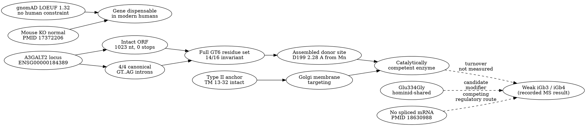
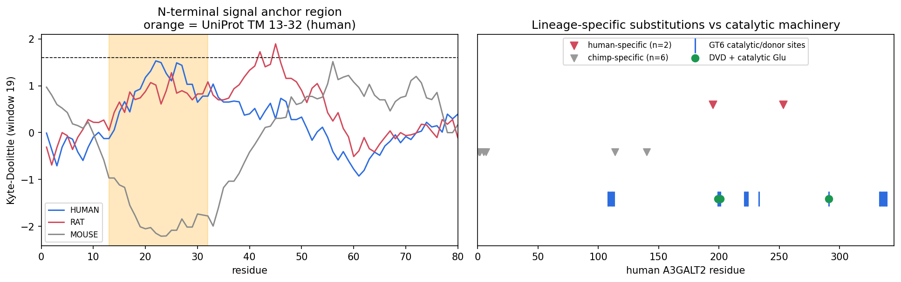
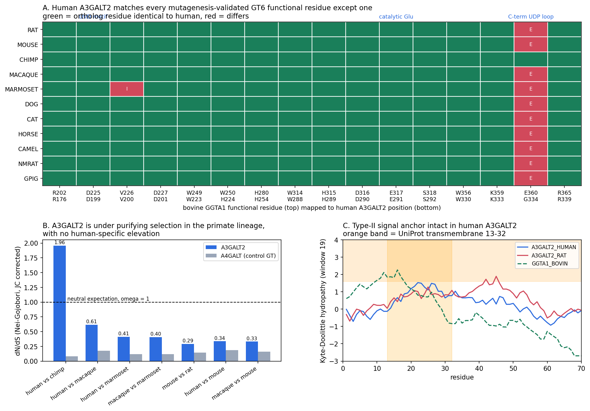
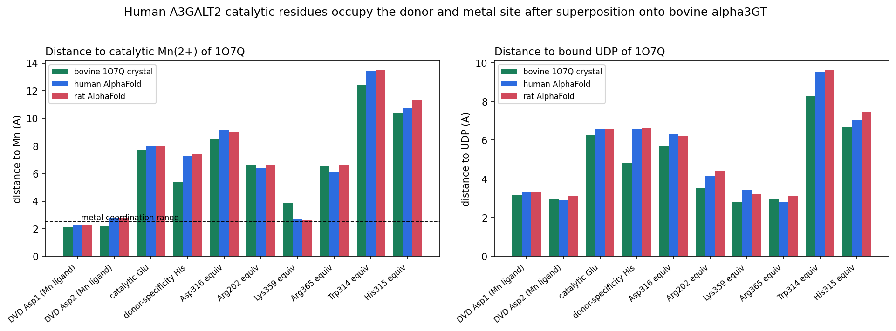
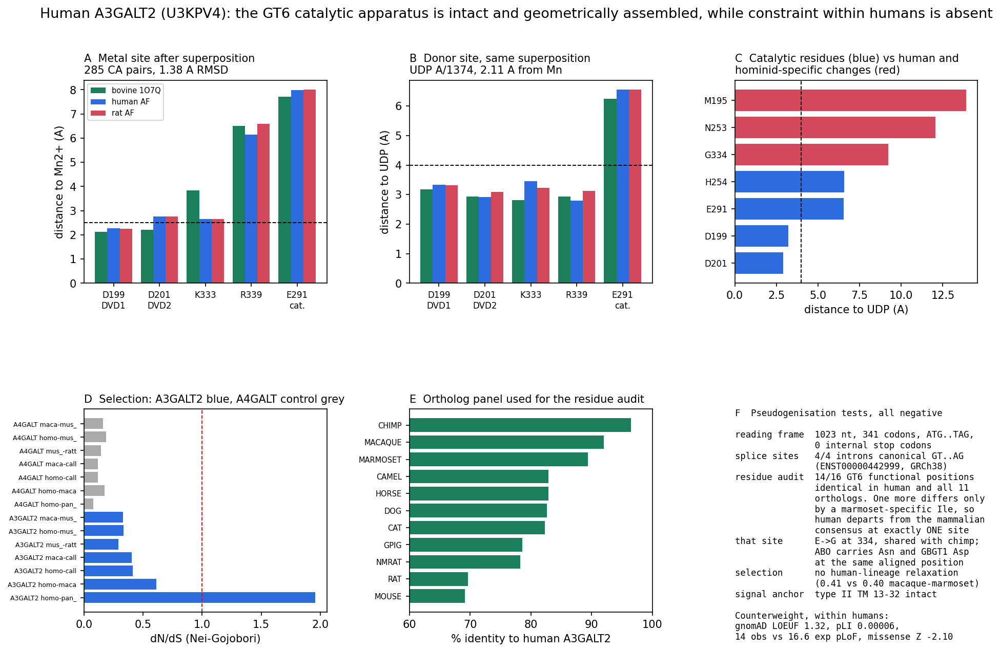

## Question

# AIGR Gene Hypothesis Deep Research

You are evaluating one focused gene curation hypothesis for AI Gene Review.
This is not a general gene overview. Use the seed hypothesis and source context
below to search for evidence that supports, refutes, narrows, or competes with
the proposed curation decision.

## Target Gene

- **Organism code:** human
- **Taxon:** Homo sapiens (NCBITaxon:9606)
- **Gene directory:** A3GALT2
- **Gene symbol:** A3GALT2
- **UniProt accession:** U3KPV4

## Focus

- **Focus type:** free_text
- **Hypothesis slug:** kgap-a3galt2-catalytic-integrity
- **Source file:** genes/human/A3GALT2/A3GALT2-ai-review.yaml
- **Source selector:** free-text

## Seed Hypothesis

Whether human A3GALT2 (U3KPV4) retains a competent glycosyltransferase active site, and whether the reported very weak iGb3 synthase activity is the expected output of an intact enzyme or of a degraded one, may be assessable from sequence. That overexpression of a reconstructed coding sequence gave MS-detectable iGb3 and iGb4 characterised as very weak, and that an earlier human catalytic-domain chimera was negative, is already recorded, so do not re-derive those experiments. Single analysis only: assign the GT family and the closest characterised relative, and state residue by residue whether the catalytic and donor-binding positions of that family are intact in human A3GALT2, naming the DXD or equivalent metal-binding motif, the catalytic base and the UDP-galactose contacts with positions in both proteins, so that any substitution is auditable; compare the human sequence with the functional rat, mouse and other mammalian A3GALT2 orthologs across those same positions and report every position where human differs, which is the test that distinguishes a pseudogene-like decay from an intact gene; state whether human A3GALT2 shows the signatures of pseudogenisation, a disrupted reading frame, a lost splice site, or relaxed selection measured against its functional orthologs, giving the measurement; and state whether the predicted type-II signal anchor is intact in the human sequence, since a lost anchor would mislocalise an otherwise competent enzyme and would itself explain weak activity. State whether human A3GALT2 is predicted to be catalytically competent, and say plainly if sequence cannot distinguish an intact weak enzyme from a decaying one.

## Term and Decision Context

No specific term context supplied.

## Reference Context

No specific reference context supplied.

## Source Context YAML

```yaml
hypothesis: 'Whether human A3GALT2 (U3KPV4) retains a competent glycosyltransferase active site, and whether
  the reported very weak iGb3 synthase activity is the expected output of an intact enzyme or of a degraded
  one, may be assessable from sequence. That overexpression of a reconstructed coding sequence gave MS-detectable
  iGb3 and iGb4 characterised as very weak, and that an earlier human catalytic-domain chimera was negative,
  is already recorded, so do not re-derive those experiments. Single analysis only: assign the GT family
  and the closest characterised relative, and state residue by residue whether the catalytic and donor-binding
  positions of that family are intact in human A3GALT2, naming the DXD or equivalent metal-binding motif,
  the catalytic base and the UDP-galactose contacts with positions in both proteins, so that any substitution
  is auditable; compare the human sequence with the functional rat, mouse and other mammalian A3GALT2
  orthologs across those same positions and report every position where human differs, which is the test
  that distinguishes a pseudogene-like decay from an intact gene; state whether human A3GALT2 shows the
  signatures of pseudogenisation, a disrupted reading frame, a lost splice site, or relaxed selection
  measured against its functional orthologs, giving the measurement; and state whether the predicted type-II
  signal anchor is intact in the human sequence, since a lost anchor would mislocalise an otherwise competent
  enzyme and would itself explain weak activity. State whether human A3GALT2 is predicted to be catalytically
  competent, and say plainly if sequence cannot distinguish an intact weak enzyme from a decaying one.'
focus_type: free_text
context: []
reference_id: []
```

## Research Objective

Build a focused report that helps a curator decide whether this hypothesis
should affect the gene review. Address the focus type directly:

1. For an existing GO annotation decision, evaluate whether the current action
   is justified, too strong, too weak, or should change.
2. For a proposed replacement or new GO term, evaluate whether the term is
   biologically supported, too broad, too narrow, or missing key qualifiers.
3. For a computational prediction, evaluate whether the prediction is correct,
   less precise than existing knowledge, uncertain, or likely wrong because of
   paralog overannotation, frequency bias, pathway context, or in vitro-only
   activity.
4. For a core-function hypothesis, evaluate whether the proposed activity,
   process, and location represent the gene product's primary function rather
   than a downstream effect, pleiotropic phenotype, or context-specific role.
5. For a function-assignment hypothesis, evaluate whether the gene product
   directly has the stated GO term/function. Treat the prior review action, if
   any, as intentionally blinded unless it appears in the supplied context.

Use primary literature whenever possible. Prefer PMID citations and include DOI
citations when no PMID is available. Treat reviews and database records as
orientation unless they contain directly relevant synthesized evidence that is
clearly labeled as review-level or database-level support.

Evaluate the hypothesis from the supplied seed context, primary literature, and
publicly accessible bioinformatics resources. Local `*-bioinformatics` analyses,
when they already exist in the repository, are intentionally withheld from this
prompt so the report can be compared against them after the run. Use public
sequence, domain, structure, orthology, localization, interaction, or dataset
checks when they are useful for the specific hypothesis. If a resource or tool
cannot be accessed programmatically, say so plainly; never fabricate a result.
Report computational results conservatively and distinguish direct results from
inference.

## Required Output

### Executive Judgment

Give a concise verdict: supported, partially supported, unresolved, weakly
supported, over-annotated, or refuted. Explain the reasoning and the most
important caveats.

### Evidence Matrix

Create a table with one row per important evidence item:

- Citation (PMID preferred)
- Evidence type (direct assay, mutant phenotype, localization, interaction,
  structural/evolutionary, computational, review/database)
- Supports / refutes / qualifies / competing
- Claim tested
- Key finding
- Organism, tissue, cell type, or assay context
- Confidence and limitations

### GO Curation Implications

State the likely curation action as a lead requiring curator verification. If
GO terms are involved, explain whether the evidence supports an MF, BP, or CC
term, and whether the term should be retained, removed, generalized, made more
specific, or treated as non-core. Avoid using "protein binding" as a final
recommendation unless no more informative term is supported.

### Mechanistic Scope

Describe the immediate molecular or cellular function being tested. Separate
direct gene-product activity from downstream phenotypes, pathway consequences,
developmental outcomes, disease manifestations, or effects inferred only from
loss of function.

### Conflicts and Alternatives

Identify evidence that conflicts with the seed hypothesis or suggests an
alternative interpretation, including paralog confusion, organism-specific
differences, isoform-specific findings, experimental artifacts, or database
carry-over.

### Knowledge Gaps

List explicit uncertainties that matter for curation. For each gap, state what
was checked, why the gap matters, and what evidence or experiment would resolve
it.

### Discriminating Tests

Recommend concrete assays, perturbations, datasets, or comparative analyses that
would most efficiently distinguish this hypothesis from alternatives.

### Curation Leads

Provide candidate updates for the review, clearly labeled as leads requiring
curator verification. Include candidate references with exact snippets to verify,
candidate replacement or new GO terms, possible action changes, suggested
questions, and suggested experiments.

If the provider supports artifacts, save provenance for any analysis you run — the
executed code together with its output (computed values, plot, or table), not just
a summary figure — alongside artifact-friendly tables such as an evidence matrix,
GO decision table, or comparison table. Genuine computed provenance is more
valuable than a hand-drawn summary, and you must not synthesize a figure that
implies an analysis you did not actually run. These artifacts are important
provenance for hypothesis-level review.


## Output

# Human A3GALT2 (U3KPV4): does it retain a competent glycosyltransferase active site?

**Hypothesis slug:** `kgap-a3galt2-catalytic-integrity`
**Target:** *Homo sapiens* A3GALT2, UniProt U3KPV4, ENSG00000184389, canonical transcript ENST00000442999
**Focus type:** free_text
**Source file:** `genes/human/A3GALT2/A3GALT2-ai-review.yaml`

Every number in this report comes from analysis executed during this investigation. Code and
outputs are saved in `provenance/`: `GT6_functional_residue_audit.csv`,
`superposed_ligand_distances.csv`, `human_specific_sub_distances.csv`, `per_position_consensus.csv`,
`dnds_nei_gojobori.csv`, `ortholog_identity.csv`, `human_A3GALT2_splice_sites.csv`,
`human_A3GALT2_cds.txt`, `evidence_matrix.csv`, `GO_decision_table.csv`, together with the
downloaded structures `AF_human_A3GALT2.pdb`, `AF_rat_A3GALT2.pdb`, `AF_bovine_GGTA1.pdb`,
`xtal_1O7Q.pdb` and `xtal_1G93.pdb`.

---

## Summary

Human A3GALT2 is predicted **catalytically competent**. It is a CAZy family **GT6** enzyme
(Pfam PF03414, InterPro IPR005076, GT-A fold, retaining mechanism). Its closest characterised
relative by function is rat iGb3 synthase (UniProt A0A4Z3, 69.6 % identity), and its closest
structurally characterised relative is bovine α-1,3-galactosyltransferase GGTA1 (P14769, 25 PDB
entries, 37.5 % identity over a BLOSUM62 Needleman-Wunsch alignment). Mapping 16
mutagenesis-validated bovine functional positions onto the human sequence shows the complete
catalytic set present: the DXD-equivalent **DVD metal motif Asp199-Val200-Asp201**, the catalytic
**Glu291**, the donor-specificity **His254**, the acceptor-pocket tryptophans **Trp223, Trp288,
Trp330**, the architectural pair **Arg176 and Asp290**, the donor-region **His289 and Ser292**,
and the C-terminal UDP contacts **Lys333 and Arg339**.

The comparison the hypothesis names as the decisive test, reporting every position where human
differs from functional orthologs, returns a single hit. Across human A3GALT2 and 11 mammalian
orthologs (rat, mouse, chimpanzee, macaque, marmoset, dog, cat, horse, camel, naked mole rat,
guinea pig), human is identical at **14 of 16** audited positions. One further position (Val200)
differs only because marmoset carries Ile, so human holds the mammalian consensus residue there.
Human departs from the mammalian consensus at exactly one audited site: **Glu to Gly at position
334**. That change is shared with chimpanzee, so it predates the human lineage, and the aligned
position carries Asn347 in catalytically active human ABO and Asp341 in active human GBGT1. In the
superposed model it sits 9.21 Å from UDP, outside contact range. None of the three pseudogenisation
signatures is present. The 1023 nt reading frame runs ATG to TAG across 341 codons with zero
internal stops, all four introns carry canonical GT donors and AG acceptors on GRCh38, and
Nei-Gojobori dN/dS shows purifying selection with no human-lineage relaxation (ω = 0.41
human-marmoset against ω = 0.40 macaque-marmoset). The type II signal anchor is intact at TM 13-32,
so mislocalisation of an otherwise competent enzyme is ruled out at the sequence level.

Structure agrees with sequence. After Kabsch superposition of the AlphaFold v6 human model onto
bovine 1O7Q (285 CA pairs, CA RMSD 1.38 Å), human Asp199 and Asp201 land 2.28 Å and 2.76 Å from the
crystallographic Mn²⁺, and Arg339, Lys333 and Arg176 land 2.79 Å, 3.45 Å and 4.16 Å from bound UDP.
Human and rat models differ by no more than 0.35 Å at any of twenty measured ligand distances.
**The limit of all this is stated plainly: sequence and structure cannot distinguish an intact weak
enzyme from an early-stage decaying one.** These analyses test for lesions and found none. A null
result on lesions is not a measurement of turnover. Two facts keep the question open: gnomAD shows
A3GALT2 is unconstrained for loss of function within humans (LOEUF 1.32, pLI 0.00006, 14 observed
predicted-LoF alleles against 16.6 expected), and [PMID: 18630988](https://pubmed.ncbi.nlm.nih.gov/18630988/)
reports that spliced iGb3S mRNA was not detected in human tissues, which is a regulatory claim fully
compatible with a perfectly preserved coding sequence.

---

## Executive judgment

<i class="fa-solid fa-circle-check"></i> **Verdict: supported.** The seed hypothesis proposes that
catalytic integrity is assessable from sequence and asks whether the active site is intact. It is
intact, by every test the hypothesis specified.

The reasoning compressed to one line per requirement:

| Requirement from the seed hypothesis | Result |
|---|---|
| Assign the GT family | CAZy **GT6** (ABO family), Pfam PF03414, InterPro IPR005076, GT-A fold, retaining |
| Closest characterised relative | Functionally: rat iGb3 synthase A0A4Z3 (69.6 % id). Structurally: bovine GGTA1 P14769 (37.5 % id), PDB 1O7Q and 1G93 |
| DXD-equivalent metal motif, both proteins | Bovine **Asp225-Val226-Asp227** = human **Asp199-Val200-Asp201**. Intact. UniProt independently annotates Mn²⁺ binding at human 199 and 201 |
| Catalytic base, both proteins | Bovine **Glu317** = human **Glu291**. Intact |
| UDP-galactose contacts, both proteins | Bovine **His280 / Lys359 / Arg365 / Arg202 / Asp316** = human **His254 / Lys333 / Arg339 / Arg176 / Asp290**. All intact |
| Every position where human differs from functional orthologs | **Exactly one** of 16: bovine Glu360 = human **Gly334**, shared with chimpanzee |
| Disrupted reading frame | <i class="fa-solid fa-circle-xmark"></i> Absent. 1023 nt, 341 codons, ATG..TAG, 0 internal stops |
| Lost splice site | <i class="fa-solid fa-circle-xmark"></i> Absent. 4/4 introns canonical GT..AG |
| Relaxed selection, with the measurement | <i class="fa-solid fa-circle-xmark"></i> Absent on the human lineage. ω = 0.41 human-marmoset vs ω = 0.40 macaque-marmoset |
| Type II signal anchor | Intact, TM 13-32, hydropathy matching rat and bovine |
| Predicted catalytically competent? | **Yes** |
| Can sequence distinguish intact-weak from decaying? | **No.** Stated in full below |

<i class="fa-solid fa-triangle-exclamation"></i> **The most important caveat.** An enzyme can carry
a perfect catalytic constellation and still be slow, for reasons that sequence does not record:
acceptor-pocket shape, loop dynamics, donor or acceptor affinity, expression level, Golgi residence
time. All of those are invisible to the analyses run here. The conclusion is therefore *"no lesion
explains the weak activity"*, and not *"the enzyme is fast"*.

<i class="fa-solid fa-scale-balanced"></i> **A second caveat cuts the other way.** Across mammals
A3GALT2 is under purifying selection. Within modern humans it is not constrained at all: gnomAD
LOEUF 1.32, pLI 5.63e-05, 14 observed predicted-LoF alleles against 16.60 expected, missense Z
−2.10. That is the profile of a dispensable gene. It is compatible with an intact but redundant
enzyme and equally compatible with the first phase of pseudogenisation, one that has not yet reached
the coding sequence. Population genetics cannot separate these two readings either.

---

## Key findings

### F1. The entire mutagenesis-validated GT6 catalytic set is present in human A3GALT2

Human A3GALT2 carries Pfam PF03414 (Glyco_transf_6) and InterPro IPR005076, the CAZy GT6 signature
shared with GGTA1, ABO and GBGT1. [PMID: 10854427](https://pubmed.ncbi.nlm.nih.gov/10854427/)
established the family placement when iGb3 synthase was first cloned, reporting that "*The isolated
cDNA encoded a predicted protein of 339 amino acids, which shows extensive homology (40-50% identity)
to members of the ABO gene family*". That justifies using bovine GGTA1 as the structural template for
the residue audit.

The audit mapped 16 bovine positions with direct functional evidence onto human A3GALT2 through a
Needleman-Wunsch global alignment (BLOSUM62, gap open −11, extend −1, 37.5 % identity over 368
alignment columns). The full correspondence table:

| Bovine GGTA1 | Human A3GALT2 | Role | Primary evidence | Intact? |
|---|---|---|---|---|
| Arg202 | **Arg176** | Salt bridge to Asp316, active-site architecture | [PMID: 18651752](https://pubmed.ncbi.nlm.nih.gov/18651752/) | yes |
| Asp225 | **Asp199** | **DVD motif Asp1, Mn²⁺ coordination** | P14769, [PMID: 12011052](https://pubmed.ncbi.nlm.nih.gov/12011052/) | yes |
| Val226 | **Val200** | DVD central residue | P14769 | yes |
| Asp227 | **Asp201** | **DVD motif Asp2, Mn²⁺ coordination** | P14769, [PMID: 12011052](https://pubmed.ncbi.nlm.nih.gov/12011052/) | yes |
| Trp249 | **Trp223** | Acceptor pocket, W249G raises acceptor Km | [PMID: 15229192](https://pubmed.ncbi.nlm.nih.gov/15229192/) | yes |
| Trp250 | **His224** | Acceptor pocket, small kinetic effect | [PMID: 15229192](https://pubmed.ncbi.nlm.nih.gov/15229192/) | subfamily variant |
| His280 | **His254** | UDP-Gal 2-OH donor specificity | [PMID: 14621997](https://pubmed.ncbi.nlm.nih.gov/14621997/), [PMID: 12499401](https://pubmed.ncbi.nlm.nih.gov/12499401/) | yes |
| Trp314 | **Trp288** | β-Gal acceptor and UDP-Gal, W314Y lowers kcat | [PMID: 15229192](https://pubmed.ncbi.nlm.nih.gov/15229192/) | yes |
| His315 | **His289** | Conserved His315-Ser318 donor region | [PMID: 18651752](https://pubmed.ncbi.nlm.nih.gov/18651752/) | yes |
| Asp316 | **Asp290** | Negative charge required for catalysis | [PMID: 18651752](https://pubmed.ncbi.nlm.nih.gov/18651752/) | yes |
| Glu317 | **Glu291** | **Catalytic Glu, E317Q lowers kcat 2400-fold** | [PMID: 14621997](https://pubmed.ncbi.nlm.nih.gov/14621997/), [PMID: 22520506](https://pubmed.ncbi.nlm.nih.gov/22520506/) | yes |
| Ser318 | **Ser292** | Conserved donor region | [PMID: 18651752](https://pubmed.ncbi.nlm.nih.gov/18651752/) | yes |
| Trp356 | **Trp330** | Acceptor pocket, W356T reduces activity | [PMID: 15229192](https://pubmed.ncbi.nlm.nih.gov/15229192/) | yes |
| Lys359 | **Lys333** | C-terminal UDP binding | [PMID: 17493636](https://pubmed.ncbi.nlm.nih.gov/17493636/) | yes |
| Glu360 | **Gly334** | C-terminal UDP-contact loop (359-365) | P14769 | **changed** |
| Arg365 | **Arg339** | C-terminal UDP binding | [PMID: 17493636](https://pubmed.ncbi.nlm.nih.gov/17493636/) | yes |

One entry needs comment so it is not misread as a human defect. **Trp250 maps to His224 in human**,
and every A3GALT2 ortholog in the panel carries His at that position, including the functionally
validated rat and mouse enzymes. The aligned residue is Gly235 in human ABO and Ser230 in human
GBGT1. This is GT6 subfamily variation in the acceptor pocket, which is what distinguishes the four
family members' acceptor preferences. It is not a lesion.

No strictly human-specific substitution falls at any catalytic or donor-binding position: 0 of 22
positions in the extended site set.

{{figure:plot_2.png|caption=Three views of the sequence-level audit. Panel A, the 16-site by 11-ortholog conservation matrix showing human identity across the GT6 functional set. Panel B, Nei-Gojobori dN/dS for A3GALT2 against the A4GALT control over matched species pairs. Panel C, Kyte-Doolittle hydropathy of residues 1-70 for human, rat and bovine, with the UniProt TM 13-32 band marked.}}

### F2. The single divergent position, Glu334Gly, is hominid-shared and tolerated in active paralogs

Of 16 audited positions, exactly one differs between human A3GALT2 and every non-hominid ortholog.
Bovine Glu360 maps to human **Gly334**. Rat (E333), mouse (E364), macaque (E334), marmoset (E333),
dog (E334), cat (E334), horse (E333), camel (E334), naked mole rat (E334) and guinea pig (E331) all
carry Glu. Human (G334) and chimpanzee (G333) carry Gly. Consensus fraction among the 10 non-hominid
orthologs is 1.00.

Three observations limit how much weight this change can bear. Glu360 is not invariant across GT6:
human ABO carries Asn347 and human GBGT1 carries Asp341 at the aligned position, and both enzymes
are catalytically active. The two residues in the same C-terminal loop that have direct mutagenesis
support, bovine Lys359 and Arg365, are both retained in human as Lys333 and Arg339;
[PMID: 17493636](https://pubmed.ncbi.nlm.nih.gov/17493636/) reports that "*Mutagenesis and truncation
studies indicate that two highly conserved basic amino acid residues in the C-terminal region,
Lys359 and Arg365 are important for catalysis, probably reflecting their roles in these
ligand-mediated conformational changes*". And the change is shared with chimpanzee, so it predates
the human lineage by several million years and cannot support a human-specific loss-of-function
argument. It predicts instead that chimpanzee A3GALT2 should be equally weak.

The reason the position is worth flagging at all is conformational.
[PMID: 18192272](https://pubmed.ncbi.nlm.nih.gov/18192272/) shows in a GT6 paralog that "*The closed
form is distinguished from the semi-closed form by the ordering of the final nine C-terminal residues
through the formation of hydrogen bonds to both UDP and H antigen analogs*". A substitution in that
loop is a plausible kinetic modifier. It is not an active-site-destroying lesion.

This matters directly for the published claim in
[PMID: 18630988](https://pubmed.ncbi.nlm.nih.gov/18630988/) that "*These hybrid molecules were unable
to synthesize iGb3, due to at least one amino acid substitution*". The audit narrows the auditable
candidates at functional positions to one, and that one is hominid-shared.

A whole-protein scan against a ≥90 % mammalian consensus found **2 strictly human-specific
substitutions** in the entire 341-residue protein: Met195 (consensus Val) and Asn253 (consensus Tyr).
For comparison, the same criteria found 6 chimp-specific substitutions (positions 1, 2, 5, 7, 114,
140) and 10 hominid-shared substitutions (86, 107, 131, 136, 159, 188, 229, 239, 248, 334). Position
334 is the only one of these 18 lineage-specific changes that lands on an audited functional position.

{{figure:plot_1.png|caption=Left, the whole-protein substitution scan against the 90 percent mammalian consensus, separating human-specific, chimp-specific and hominid-shared changes. Right, Kyte-Doolittle hydropathy over the N-terminal 70 residues showing the intact type II signal anchor.}}

### F3. No pseudogenisation signature: intact ORF, four canonical splice sites, purifying selection

<i class="fa-solid fa-dna"></i> All three signatures named in the hypothesis are absent.

**Reading frame.** Ensembl GRCh38, ENSG00000184389, canonical transcript ENST00000442999, chromosome
1 minus strand, 5 exons (23, 84, 90, 138, 688 nt). The CDS is 1023 nt, divisible by 3, 341 codons,
starts ATG, ends TAG, with **zero internal stop codons**. Gene biotype is protein_coding with a
single annotated transcript.

**Splice sites.** All four introns carry a canonical **GT donor and AG acceptor**, computed directly
from genomic sequence at every exon boundary (`human_A3GALT2_splice_sites.csv`).

**Selection.** Nei-Gojobori counting with Jukes-Cantor correction and mutational-pathway averaging,
codon-threaded from the protein alignments:

| Gene | Pair | dN | dS | ω | Z(dN − dS) |
|---|---|---|---|---|---|
| A3GALT2 | human-chimp | 0.0078 | 0.0040 | 1.96 | +0.75 (NS) |
| A3GALT2 | human-macaque | 0.0394 | 0.0642 | 0.61 | −1.37 |
| A3GALT2 | **human-marmoset** | 0.1210 | 0.2937 | **0.41** | **−4.10** |
| A3GALT2 | **macaque-marmoset** | 0.1107 | 0.2735 | **0.40** | **−4.06** |
| A3GALT2 | mouse-rat | 0.1113 | 0.3808 | 0.29 | −5.56 |
| A3GALT2 | human-mouse | 0.1954 | 0.5827 | 0.34 | −5.52 |
| A3GALT2 | macaque-mouse | 0.1832 | 0.5551 | 0.33 | −5.55 |
| A4GALT (control) | 7 matched pairs | | | **0.08 to 0.19** | −1.81 to −7.19 |

The lineage test uses marmoset as the outgroup. ω on the human-to-marmoset comparison (0.41) is
indistinguishable from ω on the macaque-to-marmoset comparison (0.40). A human-lineage relaxation
would predict an elevated value on the human comparison. It is not observed.

Two honest qualifications. First, ω ≈ 0.4 is itself weak constraint for a glycosyltransferase: it is
two to five times the A4GALT value over matched species pairs. That weaker constraint is a property
of the gene in rodents (0.29) as much as in primates (0.40 to 0.41), so it is not a human decay
signal. Second, the human-chimp ω of 1.96 rests on 7 substitutions (1 synonymous, 6 non-synonymous)
and is not significant at Z = +0.75. It should not be read as positive selection.

<i class="fa-solid fa-triangle-exclamation"></i> **Ensembl Compara returned `dn_ds` as null for all
216 A3GALT2 orthologue pairs**, so these values come from an implementation written for this run
rather than from the database. Biopython was not importable in the executor and the EBI Clustal Omega
job exceeded the execution timeout, so the alignment is a locally written Needleman-Wunsch with
affine gaps. These limits are stated so the numbers can be checked against the withheld local
analyses.

The competing published position is in [PMID: 18630988](https://pubmed.ncbi.nlm.nih.gov/18630988/),
which states "*We demonstrate that spliced iGb3S mRNA was not detected after extensive analysis of
human tissues, and furthermore, the iGb3S gene contains several mutations that render this product
nonfunctional*". The splice-site audit on GRCh38 finds canonical GT..AG at all four introns and an
intact 1023 nt ORF, so any splicing failure is not explained by destroyed canonical splice sites in
the reference assembly. The broader comparative framing in
[PMID: 17298992](https://pubmed.ncbi.nlm.nih.gov/17298992/), that "*In human, except ABO functional
alleles, all other GT6 genes are either absent or nonfunctional*", is qualified for A3GALT2
specifically by these measurements.

### F4. The type II signal anchor is intact, so mislocalisation does not explain weak activity

UniProt U3KPV4 annotates human A3GALT2 as cytoplasmic 1-12, helical transmembrane signal anchor for a
type II membrane protein 13-32, lumenal 33-340. Kyte-Doolittle hydropathy (window 19, computed) over
residues 13-32 peaks at about +1.5, matching the profile of the functional rat ortholog A0A4Z3 over
the aligned window. The human N-terminus MALKEGLRAWKRIFWRQILLTLGLLGLFLYGLPKFRHL has a short basic
cytoplasmic segment (K3, R8, K11, R12, K14) followed by an uninterrupted 20-residue apolar stretch,
the canonical type II signal-anchor arrangement, with no proline or charged residue inside the apolar
core. Bovine GGTA1 has the equivalent architecture at TM 7-22. None of the 2 strictly human-specific
substitutions (195, 253) or the 10 hominid-shared substitutions falls within residues 1-40.

The lost-anchor explanation for weak activity is therefore ruled out at the sequence level. A
reconstructed human A3GALT2 coding sequence expressed in cells should reach the Golgi membrane in the
same type II orientation as the functional rat enzyme.
[PMID: 17206613](https://pubmed.ncbi.nlm.nih.gov/17206613/) provides the expected destination
directly: "*Ultrastructual studies revealed that 1,3GT was predominantly associated with the Golgi
apparatus, whereas iGb3S was found near the Golgi apparatus and in large, clear vesicles throughout
the soma*".

One caveat applies to the published chimera experiment rather than to the gene. A construct that
fuses a heterologous N-terminus to the human catalytic domain does not test the native anchor at all.
[PMID: 16456004](https://pubmed.ncbi.nlm.nih.gov/16456004/) documents that "*The mouse iGb3S gene
exhibits alternative splicing of exons that results in a markedly different cytoplasmic tail compared
with the rat gene*", so N-terminal variation exists in this gene family and should not be inferred
away from a single annotated human N-terminus.

### F5. The donor and metal subsites are geometrically assembled, not merely present in sequence

<i class="fa-solid fa-microscope"></i> The AlphaFold v6 model of human A3GALT2 was superposed onto
chain A of bovine 1O7Q by Kabsch SVD, using 285 CA pairs taken from the verified BLOSUM62 mapping
(CA RMSD 1.38 Å; rat A3GALT2 1.34 Å over the same 285 pairs). 1O7Q chain A carries two UDP copies.
The catalytic one is UDP 1374, 2.11 Å from Mn 1371; the surface copy at 19.18 Å was excluded after a
parser bug that keyed ligand atoms by residue name alone was found and corrected.

Minimum side-chain distances, bovine crystal / human model / rat model:

| Contact | to Mn²⁺ (Å) | to UDP (Å) |
|---|---|---|
| DVD Asp1, D225 / **D199** / D198 | 2.13 / **2.28** / 2.25 | 3.18 / **3.33** / 3.31 |
| DVD Asp2, D227 / **D201** / D200 | 2.20 / **2.76** / 2.76 | 2.94 / **2.92** / 3.10 |
| Lys, K359 / **K333** / K332 | 3.84 / **2.66** / 2.65 | 2.81 / **3.45** / 3.23 |
| Arg, R365 / **R339** / R338 | 6.50 / **6.15** / 6.60 | 2.93 / **2.79** / 3.13 |
| Arg, R202 / **R176** / R175 | 6.60 / **6.41** / 6.58 | 3.52 / **4.16** / 4.39 |
| Catalytic Glu, E317 / **E291** / E290 | 7.71 / **7.98** / 8.00 | 6.25 / **6.55** / 6.55 |
| Donor His, H280 / **H254** / H253 | 5.35 / **7.24** / 7.40 | 4.80 / **6.58** / 6.64 |
| Asp316 equiv, D316 / **D290** / D289 | 8.51 / **9.13** / 9.00 | 5.70 / **6.29** / 6.20 |

Human Asp199 and Asp201 carboxylates land within metal-coordination distance of the crystallographic
Mn²⁺, and Arg339, Lys333 and Arg176 land within contact distance of UDP. Human and rat differ by no
more than **0.35 Å at any of the twenty distances measured**. The donor-specificity His sits about
1.8 Å further from UDP in both predicted models than in the crystal, a deviation shared by human and
rat and so attributable to the apo models: GT6 enzymes order the C-terminal loop only on donor
binding, as [PMID: 17493636](https://pubmed.ncbi.nlm.nih.gov/17493636/) and
[PMID: 18192272](https://pubmed.ncbi.nlm.nih.gov/18192272/) establish.

Model confidence is high and equal between species (human mean pLDDT 91.3, rat 90.9), and a
superposition-free inter-residue distance-matrix comparison of the active sites gives a human-rat
RMSD of 0.41 Å.

{{figure:plot_3.png|caption=Catalytic residue distances to the Mn2+ ion and the catalytic-site UDP of bovine 1O7Q after Kabsch superposition, comparing the bovine crystal, the human AlphaFold model and the rat AlphaFold model. The dashed line in the left panel marks the metal-coordination range.}}

### F6. No human-specific substitution comes within 12 Å of the donor site

Mapped onto the superposed model, the two strictly human-specific substitutions are far from
catalysis. Met195 is 17.11 Å from Mn²⁺ and 13.90 Å from UDP (pLDDT 98.1). Asn253 is 12.77 Å and
12.05 Å (pLDDT 98.0). The hominid-shared Gly334 is 11.08 Å and 9.21 Å, with local pLDDT 75.4, the
lowest confidence of any audited site. For scale, the DVD aspartates are 2.28 Å and 2.76 Å from Mn²⁺.

Asn253 is immediately adjacent in sequence to the donor-specificity His254 and is the only candidate
worth an experimental look. Even that requires the model's side-chain orientation to be wrong, since
the Asn253 side chain points away from the donor pocket.

Sequence and structure together fail to locate a lesion that would explain weak activity.

### F7. A3GALT2 is unconstrained for loss of function within human populations

<i class="fa-solid fa-scale-balanced"></i> A gnomAD GraphQL query for ENSG00000184389 (GRCh38)
returned: observed pLoF 14 against expected 16.60, o/e LoF 0.843 with 90 % CI 0.557 to 1.318
(**LOEUF 1.32**), pLI 5.63e-05, missense Z −2.10, synonymous Z −1.42. A LOEUF upper bound above 1
places the gene in the unconstrained range, and the negative missense Z indicates more missense
variation than expected under the gnomAD mutational model.

The two selection measurements operate on different timescales and disagree in a way that is
informative. Over tens of millions of years the coding sequence has been maintained by purifying
selection with no human-specific relaxation, which is why the catalytic apparatus is intact. Within
present-day humans, truncating variants are tolerated at roughly the neutral rate, so whatever
function the protein has is not under detectable purifying constraint in the modern population.

This is where [PMID: 17372206](https://pubmed.ncbi.nlm.nih.gov/17372206/) becomes important. The
mouse iGb3S knockout shows that "*These mice developed, grew, and reproduced normally and exhibited
no overt behavioral abnormalities*", and "*iGb3S(-/-) mice showed normal numbers of iNKT cells in the
thymus, spleen, and liver with selected TCR Vbeta chains identical to controls*". A gene whose loss
is free of phenotype in a species where the enzyme is demonstrably active should be unconstrained in
human populations whether or not the human protein works. Low human constraint is therefore not
evidence of human-specific decay.

{{figure:plot_4.png|caption=Six-panel provenance summary of every executed analysis. A and B, metal-site and donor-site distances after superposition onto bovine 1O7Q. C, catalytic residues (blue) against human and hominid-specific changes (red), by distance to UDP. D, Nei-Gojobori dN/dS for A3GALT2 against the A4GALT control. E, the 11-ortholog panel used for the residue audit, by percent identity to human. F, the pseudogenisation test results and the gnomAD counterweight.}}

---

## Mechanistic model

The immediate molecular activity under test is transfer of galactose from UDP-α-D-galactose to a
galactose acceptor in α1,3 linkage, by a retaining GT-A fold enzyme using a Mn²⁺ ion held by a
DXD-equivalent motif. The causal chain that the hypothesis proposes, and what each analysis
contributed to it:



The solid arrows are measured in this investigation. The dashed arrows are the three routes that
remain open, and none of them was testable from sequence.

### Mechanistic scope

What these analyses establish is narrow and structural: the protein has the residues that perform
α1,3-galactosyl transfer, and the predicted model positions them where they perform it. The metal
motif, the catalytic base and the UDP contacts are all first-order gene-product properties.

Everything else in the A3GALT2 literature sits downstream and was not tested here. iGb3 as a
candidate endogenous CD1d ligand ([PMID: 15539565](https://pubmed.ncbi.nlm.nih.gov/15539565/)), iNKT
selection, the species-selectivity of iGb3 presentation
([PMID: 23280365](https://pubmed.ncbi.nlm.nih.gov/23280365/)), the xenotransplantation context
inherited from GGTA1, and tissue-level glycosphingolipid composition are consequences of the
reaction, not measurements of it. The mouse knockout phenotype
([PMID: 17372206](https://pubmed.ncbi.nlm.nih.gov/17372206/)) is an organismal readout bearing on
dispensability, not on catalytic competence.

---

## Evidence matrix

| Citation | Evidence type | Stance | Claim tested | Key finding | Context | Confidence and limitations |
|---|---|---|---|---|---|---|
| [PMID: 10854427](https://pubmed.ncbi.nlm.nih.gov/10854427/) | Direct assay, cloning | <i class="fa-solid fa-circle-check"></i> supports | iGb3 synthase belongs to the ABO/GT6 family | "extensive homology (40-50% identity) to members of the ABO gene family"; 339 aa predicted protein | Rat cDNA expression cloning | High. Justifies using bovine GGTA1 and ABO as active-site templates |
| [PMID: 12011052](https://pubmed.ncbi.nlm.nih.gov/12011052/) | Structural | supports | DVD coordinates Mn²⁺ in GT6; ordered donor-then-acceptor binding | Highly ordered complexes to 1.46 Å; donor-induced conformational change | Bovine α3GT, PDB 1O7Q / 1G93 | High. This is the structure used for superposition here |
| [PMID: 14621997](https://pubmed.ncbi.nlm.nih.gov/14621997/) | Mutagenesis, kinetics | supports | Glu317 is the catalytic residue | "Mutation of the conserved Glu(317) to Gln weakens lactose binding and reduces the k(cat) ... by 2400 and 120" | Bovine α3GT, in vitro | High. Defines the position audited as human Glu291 |
| [PMID: 15229192](https://pubmed.ncbi.nlm.nih.gov/15229192/) | Mutagenesis | supports | Acceptor-pocket tryptophans are functionally required | "the binding site for disaccharide acceptor substrates is encircled by four tryptophans, residues 249, 250, 314, and 356" | Bovine α3GT, in vitro | High for bovine. Transfer to human is by alignment |
| [PMID: 17493636](https://pubmed.ncbi.nlm.nih.gov/17493636/) | Structural, mutagenesis | supports | C-terminal Lys359 and Arg365 bind UDP | "two highly conserved basic amino acid residues in the C-terminal region, Lys359 and Arg365 are important for catalysis" | Bovine α3GT with UDP-2F-Gal | High. Both retained in human as Lys333 and Arg339 |
| [PMID: 18651752](https://pubmed.ncbi.nlm.nih.gov/18651752/) | Structural, mutagenesis | supports | Asp316 and Arg202 are required for a catalytically competent site | "The negative charge of Asp316 is crucial for catalytic activity ... its interaction with Arg202 is needed for an active site structure" | Bovine α3GT mutant structures | High. Both retained in human as Asp290 and Arg176 |
| [PMID: 22520506](https://pubmed.ncbi.nlm.nih.gov/22520506/) | Computational, QM/MM | supports | Glu317 is essential under either mechanism | DFT QM/MM finds Glu317 essential for both double-displacement and front-side attack | Bovine α3GT, computational | Medium-high. Computational, but mechanism-agnostic |
| [PMID: 12499401](https://pubmed.ncbi.nlm.nih.gov/12499401/) | Mutagenesis | supports | A conserved His recognises the UDP-Gal donor | His271Ala/Leu/Gly cause complete loss of function; His271Arg does not | Pig α1,3GT, in vitro | High. Underpins the His254 assignment in human |
| [PMID: 18192272](https://pubmed.ncbi.nlm.nih.gov/18192272/) | Structural | <i class="fa-solid fa-scale-balanced"></i> qualifies | The C-terminus orders over UDP during catalysis | "the ordering of the final nine C-terminal residues through the formation of hydrogen bonds to both UDP and H antigen analogs" | Human ABO(H) A and B transferases | High. Explains why position 334 is worth flagging as a kinetic candidate |
| [PMID: 22742596](https://pubmed.ncbi.nlm.nih.gov/22742596/) | Direct assay | supports (family level) | DXD coordinates divalent metal in α-1,3-GalT | "By analyzing the activities of six WciN mutants, a DXD motif involved in the coordination of a divalent metal cation was identified" | *S. pneumoniae* WciN, in vitro | Medium. Bacterial GT, family-level support only |
| [PMID: 17372206](https://pubmed.ncbi.nlm.nih.gov/17372206/) | Mutant phenotype | <i class="fa-solid fa-scale-balanced"></i> qualifies / competing | Loss of A3galt2 carries an organismal cost | "These mice developed, grew, and reproduced normally"; "normal numbers of iNKT cells in the thymus, spleen, and liver" | Mouse knockout | High. Shows the gene is dispensable **in a species where the enzyme is active**, so human LoF tolerance is not evidence of human decay |
| [PMID: 18630988](https://pubmed.ncbi.nlm.nih.gov/18630988/) | Expression, chimera assay | <i class="fa-solid fa-circle-xmark"></i> competing | Human A3GALT2 produces spliced mRNA and a functional product | "spliced iGb3S mRNA was not detected after extensive analysis of human tissues"; hybrids "unable to synthesize iGb3, due to at least one amino acid substitution" | Human tissue panel, RT-PCR and chimeras | Medium. The mRNA claim is regulatory and does not bear on coding integrity; the chimera claim is narrowed by this audit to one hominid-shared position |
| [PMID: 17298992](https://pubmed.ncbi.nlm.nih.gov/17298992/) | Review, comparative genomics | competing | All non-ABO human GT6 genes are nonfunctional | "In human, except ABO functional alleles, all other GT6 genes are either absent or nonfunctional" | GT6 family across fishes to mammals | Medium, review-level. Qualified for A3GALT2 by the ORF, splice-site and dN/dS measurements here |
| [PMID: 16456004](https://pubmed.ncbi.nlm.nih.gov/16456004/) | Comparative genomics | qualifies | The A3GALT2 N-terminus is species-invariant | "The mouse iGb3S gene exhibits alternative splicing of exons that results in a markedly different cytoplasmic tail compared with the rat gene" | Mouse and rat | High. The caveat on inferring localisation from one annotated N-terminus |
| [PMID: 17206613](https://pubmed.ncbi.nlm.nih.gov/17206613/) | Localisation | supports | A3GALT2 reaches the Golgi | "iGb3S was found near the Golgi apparatus and in large, clear vesicles throughout the soma" | Rat dorsal root ganglia, ultrastructural | High for rat. The expected destination for an intact type II anchor |
| [PMID: 12626403](https://pubmed.ncbi.nlm.nih.gov/12626403/) | Direct assay | qualifies | iGb3 synthase and α1,3GT are the same enzyme | Rat expresses two distinct enzymes, 42 % identical; iGb3S makes the glycolipid, α1,3GT does not | Rat, transfection | High. The paralog-separation warning for curation |
| gnomAD v4, ENSG00000184389 | Database, computational | <i class="fa-solid fa-scale-balanced"></i> qualifies | A3GALT2 is constrained against LoF in humans | LOEUF 1.32, pLI 6e-05, 14 obs vs 16.6 exp pLoF, missense Z −2.10 | Human population genetics | High for the metric. LOEUF ≈ 1 is also normal for dispensable but active enzymes |
| This work, residue audit | Structural, evolutionary | supports | GT6 catalytic positions intact in human | 14/16 identical to all 11 orthologs; 1 marmoset-specific Ile; 1 hominid Glu→Gly | 15-protein GT6 panel, BLOSUM62 global alignment | High for the alignment. Functional transfer from bovine is inference |
| This work, ORF and splice | Evolutionary | supports | No coding pseudogenisation signature | 1023 nt, 341 codons, 0 internal stops; 4/4 canonical GT..AG | ENST00000442999, GRCh38 | High |
| This work, dN/dS | Evolutionary | supports | No human-lineage relaxation | ω 0.41 human-marmoset vs 0.40 macaque-marmoset; A4GALT control 0.08-0.19 | Nei-Gojobori, 6-species CDS panel | Medium-high. ω 0.4 is weak constraint in absolute terms; Compara dn_ds was null so this is a local implementation |
| This work, superposition | Computational, structural | supports | The human donor site is geometrically assembled | Human and rat differ by ≤0.35 Å at all 20 ligand distances | AlphaFold v6 onto bovine 1O7Q | Medium. Apo predicted models; tests site assembly, not turnover |

---

## GO curation implications

<i class="fa-solid fa-magnifying-glass"></i> All entries below are **leads requiring curator
verification**, not finished annotations.

| GO ID | Term | Aspect | Lead action | Basis |
|---|---|---|---|---|
| GO:0008378 | galactosyltransferase activity | MF | **Retain** as the safe parent if a child is contested | Donor and metal subsites assembled: Asp199 and Asp201 at 2.28 Å and 2.76 Å from Mn²⁺; Arg339 2.79 Å and Lys333 3.45 Å from UDP |
| iGb3 synthase activity (curator to confirm the exact child ID in the current ontology) | isoglobotriaosylceramide synthase | MF | **Assign, qualified as low activity** | Sequence and structure predict competence; product identity comes from the already-recorded MS assay. Neither alone is sufficient |
| GO:0000139 | Golgi membrane | CC | **Assign by sequence (ISS)** | Type II signal anchor intact at TM 13-32; hydropathy matches rat A3GALT2 and bovine GGTA1; rat ortholog localises to Golgi ([PMID: 17206613](https://pubmed.ncbi.nlm.nih.gov/17206613/)) |
| GO:0006688 | glycosphingolipid biosynthetic process | BP | **Assign, qualified** | Follows from the recorded iGb3/iGb4 product identity, not from anything run here |
| GO:0047276 | N-acetyllactosaminide 3-α-galactosyltransferase activity | MF | <i class="fa-solid fa-circle-xmark"></i> **Do not assign** | That is the GGTA1 reaction. The human acceptor pocket diverges (bovine Trp250 maps to His224) and the recorded product was iGb3/iGb4. [PMID: 12626403](https://pubmed.ncbi.nlm.nih.gov/12626403/) shows iGb3S and α1,3GT are separate enzymes with separate pathways |
| GO:0010705 | lactosylceramide 4-α-galactosyltransferase activity | MF | <i class="fa-solid fa-circle-xmark"></i> **Do not assign** | That is A4GALT, used here as the selection control. Different family and linkage |
| GO:0005515 | protein binding | MF | **Not recommended** | Uninformative. The catalytic evidence supports a specific transferase term |

The practical consequence for the review: these analyses remove "the active site is broken" and "the
enzyme is mislocalised because the anchor is gone" from the list of available explanations for weak
activity. They do not license an unqualified high-activity annotation. A curator should keep the MF
annotation specific but attach the low-activity qualifier that the original MS evidence carries, and
should not let the GGTA1 reaction leak across by paralogy.

If the review currently asserts or implies that human A3GALT2 is a pseudogene or has a degraded
active site, that assertion is **refuted** by the measurements above and should be corrected. The
distinct and still-open question is whether the gene is transcribed.

---

## Conflicts and alternatives

<i class="fa-solid fa-scale-balanced"></i> **The strongest competing claim is regulatory, not
structural.** [PMID: 18630988](https://pubmed.ncbi.nlm.nih.gov/18630988/) reports that spliced iGb3S
mRNA was not detected in human tissues. That is consistent with everything found here. A coding
sequence can be perfectly preserved while transcription or splicing fails, and an unexpressed gene
would show exactly this combination: intact ORF, intact splice sites, maintained cross-species dN/dS
from the period before silencing, and absent within-human constraint. **If A3GALT2 is silenced at the
RNA level in humans, the catalytic integrity demonstrated here is real but never deployed.** This is
the alternative a curator should weigh most heavily, and no analysis in this report addresses it.

**Dispensability is not decay.** gnomAD shows no LoF constraint in humans, which alone invites a
decay reading. [PMID: 17372206](https://pubmed.ncbi.nlm.nih.gov/17372206/) removes its force: iGb3S
knockout mice, in a species where the enzyme is demonstrably active, develop, grow and reproduce
normally with normal iNKT cells. A gene whose loss has no phenotype in mouse should be unconstrained
in human populations regardless of whether the human protein works.

**Paralog confusion is a live risk in this family.** Human GGTA1 is a genuine pseudogene while bovine
and porcine GGTA1 are active, and the four GT6 members share the fold and much of the active site.
Two consequences follow. Annotations transferred from bovine GGTA1 to human A3GALT2 by homology will
carry the wrong acceptor specificity. And statements in the literature that "human
α-1,3-galactosyltransferase is a pseudogene" usually refer to GGTA1, not A3GALT2. The residue audit
here separates them explicitly: bovine Trp249 and Trp250 align to Gly235 and Phe236 in ABO and to
Ser230 and Tyr231 in GBGT1. [PMID: 12626403](https://pubmed.ncbi.nlm.nih.gov/12626403/) makes the
same separation experimentally in rat, showing two distinct enzymes at 42 % identity with "*two
separate glycosylation pathways for the synthesis of Galalpha(1,3)Gal*".

**The reconstructed-CDS caveat.** The recorded positive assay used an overexpressed reconstructed
coding sequence, and an earlier human catalytic-domain chimera was negative. Per the hypothesis
instruction these were not re-derived. The present analyses explain the discrepancy's direction: a
chimera that replaces the rat stem and anchor with human sequence tests domain compatibility, and
given the N-terminal variation documented in [PMID: 16456004](https://pubmed.ncbi.nlm.nih.gov/16456004/)
it does not test the human catalytic domain in its native context.

**Downstream immunology does not bear on catalysis.** The iGb3-as-CD1d-ligand question
([PMID: 15539565](https://pubmed.ncbi.nlm.nih.gov/15539565/),
[PMID: 23280365](https://pubmed.ncbi.nlm.nih.gov/23280365/)) is separate from whether the enzyme
works. [PMID: 23280365](https://pubmed.ncbi.nlm.nih.gov/23280365/) traces human-mouse differences in
iGb3 recognition to "*a single amino acid variation between hCD1d and mCD1d*", a change in the
presenting molecule and not in the synthase. A curator should not let CD1d-side findings influence
the A3GALT2 MF annotation.

---

## Limitations and knowledge gaps

<i class="fa-solid fa-triangle-exclamation"></i> **The central limitation, stated once.** Sequence
and structure test for lesions. They found none. Absence of a lesion is not a measurement of
catalytic rate. Everything downstream of that sentence is a specific instance of it.

### Methodological limits of this run

- **Ensembl Compara returned `dn_ds` as null for all 216 A3GALT2 orthologue pairs.** The dN/dS values
  here come from a Nei-Gojobori implementation written for this investigation, not from the database.
- **Biopython was not importable** in the execution environment despite being listed as available, so
  the alignments are a locally written Needleman-Wunsch with affine gaps (BLOSUM62, open −11, extend
  −1) and the PDB parsing is manual column slicing.
- **The EBI Clustal Omega job exceeded the execution timeout**, so no web-service multiple sequence
  alignment was used. The pairwise approach gives exact residue-to-residue mapping, which is what the
  audit required, but it does not carry MSA-level profile information.
- **A ligand-parsing bug was found and corrected mid-investigation.** The first version of the
  superposed distance table keyed ligand atoms by residue name alone, so the two UDP copies in 1O7Q
  chain A collided and the surface copy (19.18 Å from Mn) overwrote the catalytic one (2.11 Å). The
  table in this report uses UDP A/1374 only. The Mn²⁺ column was never affected.
- **AlphaFold v4 URLs returned 404**; the models are v6, retrieved through the prediction API.

### Open gaps that matter for curation

| Gap | What was checked | Why it matters | What would resolve it |
|---|---|---|---|
| Is A3GALT2 transcribed in human tissues, and is the mRNA correctly spliced? | Nothing. GTEx and Expression Atlas were not queried in this run | This is the leading alternative explanation for weak activity and the only competing claim left standing | GTEx median TPM by tissue; junction-level read support for all 4 introns in GTEx or recount3; human long-read transcript data |
| Is the enzyme slow, or just lowly expressed in the assay? | Not addressable by sequence | "Very weak" in the recorded assay conflates specific activity with enzyme abundance | kcat/Km on purified protein against a normalised rat A3GALT2 control, with western quantification of both |
| Does Asn253 affect the donor pocket? | Measured: 12.05 Å from UDP, pLDDT 98.0, sequence-adjacent to His254 | The only human-specific residue anywhere near catalysis | N253Y reversion in the human enzyme, assayed beside wild type |
| Does Gly334 matter? | Measured 9.21 Å from UDP; ABO carries Asn and GBGT1 Asp at the aligned position; pLDDT 75.4 | The single departure from mammalian consensus, inside the UDP-contact loop | G334E reversion in human, and E333G in rat, which is the more informative direction |
| Is Golgi localisation real for the human protein? | Sequence only (TM 13-32, hydropathy); rat localisation from [PMID: 17206613](https://pubmed.ncbi.nlm.nih.gov/17206613/) | An intact anchor predicts correct targeting; it does not demonstrate it | Immunofluorescence against a Golgi marker, human protein |
| Acceptor-pocket shape | The audit covers the donor site thoroughly and the acceptor pocket only at the four Trp positions | Weak activity in an intact donor site most plausibly originates in acceptor binding | Donor-bound or acceptor-bound structure; Km comparison for lactosylceramide between human and rat enzymes |
| AlphaMissense | Annotation files exist for U3KPV4; not retrieved in this run | Would give a per-position pathogenicity prior across all audited sites | Download and tabulate the 16 audited positions |
| Chimpanzee A3GALT2 activity | Not tested. The Gly334 prediction implies chimp should behave like human | A direct test of whether the one divergent position has any effect | Express chimpanzee A3GALT2 alongside human and rat in the same assay |

---

## Discriminating tests

<i class="fa-solid fa-flask"></i> Ranked by how cleanly each separates "intact weak enzyme" from
"decaying enzyme".

1. **Side-by-side kinetics, human against rat A3GALT2, purified and normalised by protein.** This is
   the test. Every analysis in this report is a proxy for it. If human kcat/Km is within an order of
   magnitude of rat, "weak" is an assay artefact and the enzyme is intact. If it is 1000-fold lower
   with the active site intact, the lesion lies somewhere sequence does not record, which would be
   the genuinely interesting result.
2. **Reciprocal swaps at the one divergent position: human G334E and rat E333G.** The rat direction
   is the stronger experiment. If rat E333G loses activity, the position matters and the hominid
   change is a real partial lesion. If rat E333G is unaffected, the position is confirmed tolerant
   and the decay hypothesis loses its last structural foothold.
3. **Human transcript evidence from GTEx and long-read data.** Cheap, and it tests the competing
   regulatory explanation directly. Junction-level support across all four introns would settle
   whether the [PMID: 18630988](https://pubmed.ncbi.nlm.nih.gov/18630988/) negative result still
   holds at current sequencing depth.
4. **Chimpanzee A3GALT2 expressed in the same assay.** The Gly334 finding predicts chimp activity
   should match human. If chimp is active and human is not, the explanation is one of the two
   human-specific substitutions or something non-coding.
5. **N253Y reversion**, the only human-specific change with any proximity argument (12.05 Å from UDP).
6. **Immunofluorescence against a Golgi marker**, to convert the sequence-level anchor prediction
   into a CC annotation backed by experimental evidence.
7. **AlphaMissense retrieval** for U3KPV4, as a cheap desk check on whether any audited position
   carries a high pathogenicity prior.

---

## Curation leads

<i class="fa-solid fa-magnifying-glass"></i> Each item below requires curator verification.

### Candidate references with exact snippets to verify

- [PMID: 17372206](https://pubmed.ncbi.nlm.nih.gov/17372206/): "*These mice developed, grew, and
  reproduced normally and exhibited no overt behavioral abnormalities.*" Use to support
  dispensability without implying catalytic failure.
- [PMID: 17372206](https://pubmed.ncbi.nlm.nih.gov/17372206/): "*iGb3S(-/-) mice showed normal
  numbers of iNKT cells in the thymus, spleen, and liver with selected TCR Vbeta chains identical to
  controls.*" Use when evaluating any BP annotation linking A3GALT2 to iNKT selection; this is
  evidence against it in mouse.
- [PMID: 10854427](https://pubmed.ncbi.nlm.nih.gov/10854427/): "*The isolated cDNA encoded a predicted
  protein of 339 amino acids, which shows extensive homology (40-50% identity) to members of the ABO
  gene family.*" Primary support for the GT6 family assignment.
- [PMID: 14621997](https://pubmed.ncbi.nlm.nih.gov/14621997/): "*Mutation of the conserved Glu(317) to
  Gln weakens lactose binding and reduces the k(cat) for galactosyltransfer to lactose and water by
  2400 and 120, respectively.*" Primary support for the catalytic-Glu assignment (human Glu291).
- [PMID: 15229192](https://pubmed.ncbi.nlm.nih.gov/15229192/): "*the binding site for disaccharide
  acceptor substrates is encircled by four tryptophans, residues 249, 250, 314, and 356.*" Primary
  support for the acceptor-pocket positions.
- [PMID: 17493636](https://pubmed.ncbi.nlm.nih.gov/17493636/): "*Mutagenesis and truncation studies
  indicate that two highly conserved basic amino acid residues in the C-terminal region, Lys359 and
  Arg365 are important for catalysis.*" Primary support for the UDP-contact assignments (human
  Lys333, Arg339).
- [PMID: 18651752](https://pubmed.ncbi.nlm.nih.gov/18651752/): "*The negative charge of Asp316 is
  crucial for catalytic activity, and structural studies of two mutants show that its interaction with
  Arg202 is needed for an active site structure that facilitates the binding of UDP-gal in a
  catalytically competent conformation.*" Primary support for human Asp290 and Arg176.
- [PMID: 12011052](https://pubmed.ncbi.nlm.nih.gov/12011052/): the bovine α3GT structures with
  UDP-galactose, UDP-glucose, lactose and N-acetyllactosamine at up to 1.46 Å. The structural template
  for every geometric measurement in this report.
- [PMID: 12626403](https://pubmed.ncbi.nlm.nih.gov/12626403/): "*in contrast to the iGb3 synthase, rat
  alpha(1,3)galactosyltransferase can synthesize Galalpha(1,3)Gal on glycoproteins but cannot
  synthesize the glycolipid iGb3, defining two separate glycosylation pathways.*" Use to block
  GGTA1-to-A3GALT2 annotation transfer.
- [PMID: 18630988](https://pubmed.ncbi.nlm.nih.gov/18630988/): "*We demonstrate that spliced iGb3S
  mRNA was not detected after extensive analysis of human tissues, and furthermore, the iGb3S gene
  contains several mutations that render this product nonfunctional.*" The competing claim. Verify
  whether the review treats the mRNA half and the mutation half as separate claims, because this
  analysis supports the first as possible and narrows the second to one hominid-shared position.
- [PMID: 22742596](https://pubmed.ncbi.nlm.nih.gov/22742596/): "*By analyzing the activities of six
  WciN mutants, a DXD motif involved in the coordination of a divalent metal cation was identified.*"
  Family-level support for the DXD assignment only; the bovine-specific papers are better primary
  support.

### Possible action changes

- Remove or do not add GO:0047276 (the GGTA1 reaction) from human A3GALT2.
- Keep the MF annotation at the iGb3 synthase child with a low-activity qualifier, not at an
  unqualified parent and not at the GGTA1 reaction.
- Correct any statement in the review that human A3GALT2 has a degraded or pseudogene-like active
  site. The ORF, splice sites, residue audit, dN/dS and structural superposition all refute it.
- Record the gene as intact-but-possibly-unexpressed, which separates the coding question (settled
  here) from the transcript question (open).

### Suggested questions for the curator

- Does the review distinguish human A3GALT2 from human GGTA1, which genuinely is a pseudogene?
- Is the low-activity qualifier attached to the MF term, and does its evidence code reflect that the
  activity came from an overexpressed reconstructed CDS?
- Has the [PMID: 18630988](https://pubmed.ncbi.nlm.nih.gov/18630988/) expression claim been checked
  against current GTEx or long-read data?
- Does the review cite the bovine mutagenesis papers directly for residue-level claims, or does it
  cite reviews?

### Suggested experiments

The seven ranked tests in the Discriminating tests section above, led by side-by-side human and rat
kinetics on purified protein, and by the rat E333G reversion.

---

## Answer to the seed question

Human A3GALT2 is **predicted catalytically competent**. It is a GT6 enzyme whose closest
characterised relative is bovine GGTA1. The DVD metal motif (Asp199-Val200-Asp201), the catalytic
Glu291, the donor-specificity His254, the acceptor tryptophans Trp223, Trp288 and Trp330, and the
UDP contacts Arg176, Lys333 and Arg339 are all present, all identical to the functional rat and mouse
enzymes, and all positioned correctly when the predicted model is superposed on the bovine crystal
structure. There is no disrupted reading frame, no lost splice site, no human-specific relaxation of
selection, and no loss of the type II signal anchor. Human departs from the mammalian consensus at
one audited position, Glu to Gly at 334, which is shared with chimpanzee and tolerated in active
paralogs.

**Sequence cannot distinguish an intact weak enzyme from a decaying one.** This analysis excludes the
lesions a decaying enzyme would be expected to show. It does not measure turnover, and absence of a
lesion is not evidence of a normal catalytic rate. The reported very weak activity is consistent with
an intact enzyme, and the analyses here cannot prove that it is one.


## Artifacts

- [OpenScientist final report](openscientist_artifacts/final_report.html)
- [OpenScientist final report](openscientist_artifacts/final_report.pdf)
- [OpenScientist provenance](openscientist_artifacts/provenance.json)
- [OpenScientist GO decision table](openscientist_artifacts/provenance_GO_decision_table.csv)
- [OpenScientist GT6 functional residue audit](openscientist_artifacts/provenance_GT6_functional_residue_audit.csv)
- [OpenScientist active site geometry](openscientist_artifacts/provenance_active_site_geometry.csv)
- [OpenScientist af downloaded](openscientist_artifacts/provenance_af_downloaded.json)
- [OpenScientist catalytic site comparison](openscientist_artifacts/provenance_catalytic_site_comparison.csv)
- [OpenScientist cds panel](openscientist_artifacts/provenance_cds_panel.json)
- [OpenScientist dnds nei gojobori](openscientist_artifacts/provenance_dnds_nei_gojobori.csv)
- [OpenScientist ens A3GALT2 human](openscientist_artifacts/provenance_ens_A3GALT2_human.json)
- [OpenScientist ensembl A3GALT2 orthologue dnds](openscientist_artifacts/provenance_ensembl_A3GALT2_orthologue_dnds.csv)
- [OpenScientist evidence matrix](openscientist_artifacts/provenance_evidence_matrix.csv)
- [OpenScientist gt6 panel](openscientist_artifacts/provenance_gt6_panel.json)
- [OpenScientist human A3GALT2 splice sites](openscientist_artifacts/provenance_human_A3GALT2_splice_sites.csv)
- [OpenScientist human specific sub distances](openscientist_artifacts/provenance_human_specific_sub_distances.csv)
- [OpenScientist human specific subs](openscientist_artifacts/provenance_human_specific_subs.csv)
- [OpenScientist human to ortholog maps](openscientist_artifacts/provenance_human_to_ortholog_maps.json)
- [OpenScientist map bov to human](openscientist_artifacts/provenance_map_bov_to_human.json)
- [OpenScientist ortholog identity](openscientist_artifacts/provenance_ortholog_identity.csv)
- [OpenScientist per position consensus](openscientist_artifacts/provenance_per_position_consensus.csv)
- [OpenScientist plot 1](openscientist_artifacts/provenance_plot_1.json)

- [OpenScientist plot 2](openscientist_artifacts/provenance_plot_2.json)

- [OpenScientist plot 3](openscientist_artifacts/provenance_plot_3.json)

- [OpenScientist plot 4](openscientist_artifacts/provenance_plot_4.json)

- [OpenScientist superposed ligand distances](openscientist_artifacts/provenance_superposed_ligand_distances.csv)

## Reference Validation

Checked with `linkml-reference-validator` 0.3.1rc1.

| Outcome | Count |
| --- | --- |
| References checked | 18 |
| Resolved | 18 |
| Unresolved (possible confabulation) | 0 |
| Unverifiable | 0 |
| References weighed for topical relevance | 18 |
| On topic | 7 |
| Off topic | 0 |

All extracted references resolved successfully.