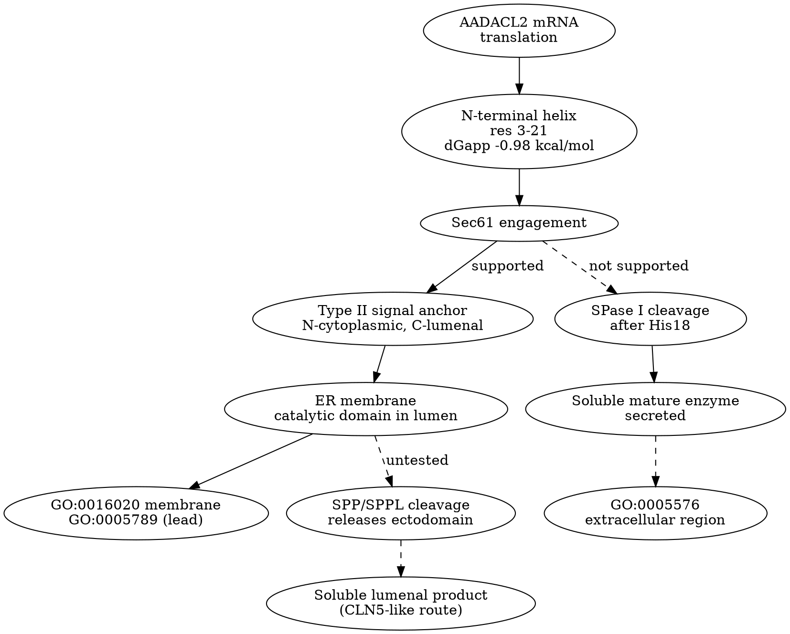
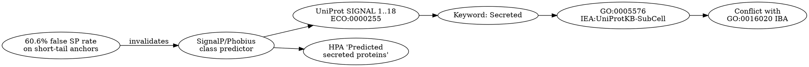
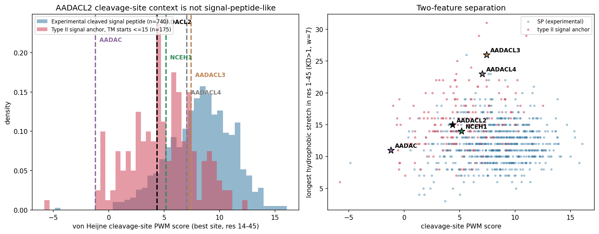
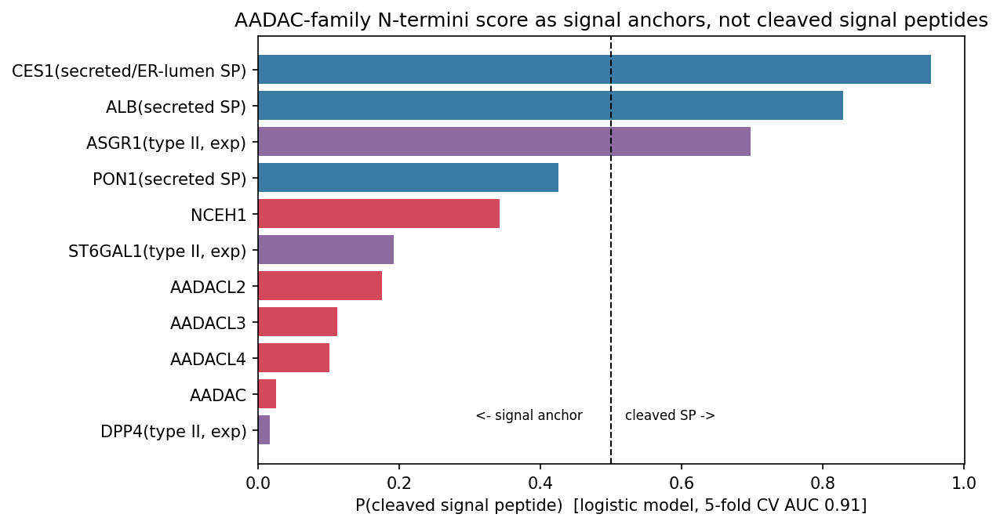
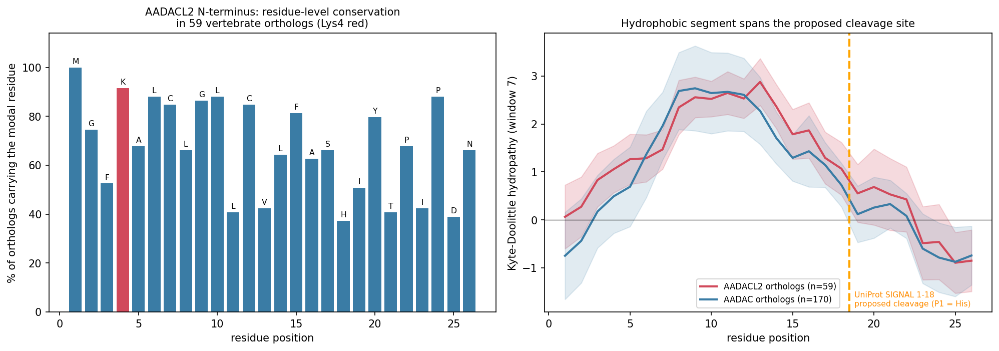
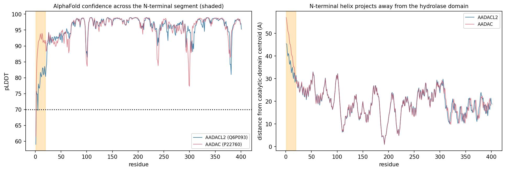
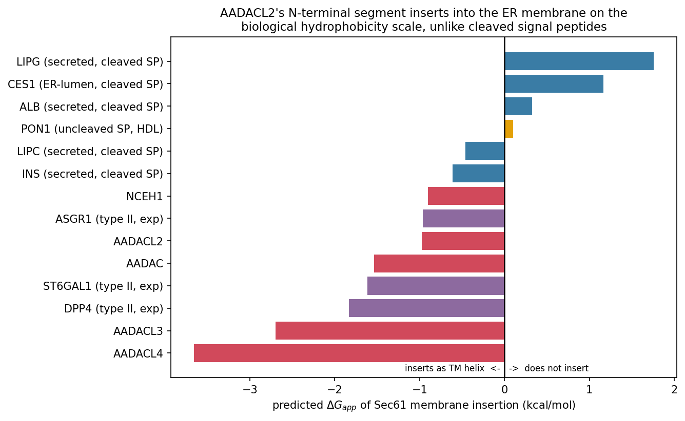
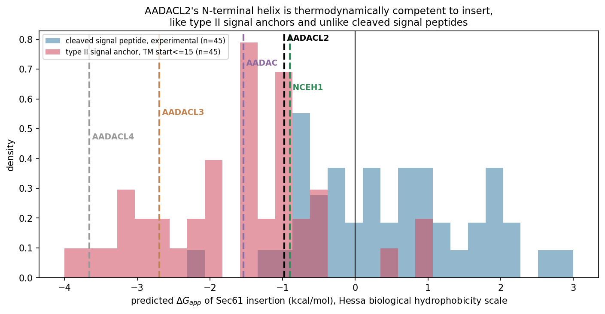
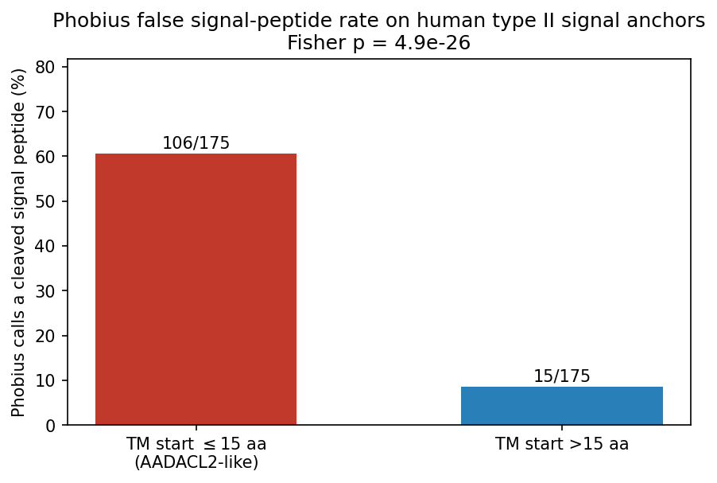
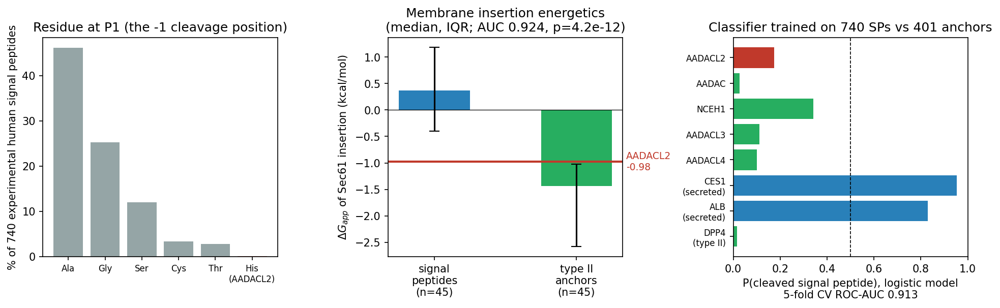

## Question

# AIGR Gene Hypothesis Deep Research

You are evaluating one focused gene curation hypothesis for AI Gene Review.
This is not a general gene overview. Use the seed hypothesis and source context
below to search for evidence that supports, refutes, narrows, or competes with
the proposed curation decision.

## Target Gene

- **Organism code:** human
- **Taxon:** Homo sapiens (NCBITaxon:9606)
- **Gene directory:** AADACL2
- **Gene symbol:** AADACL2
- **UniProt accession:** Q6P093

## Focus

- **Focus type:** free_text
- **Hypothesis slug:** kgap-aadacl2-signal-anchor-vs-peptide
- **Source file:** genes/human/AADACL2/AADACL2-ai-review.yaml
- **Source selector:** free-text

## Seed Hypothesis

The N-terminal hydrophobic segment of human AADACL2 (UniProt Q6P093) is an uncleaved type II signal anchor that tethers the catalytic domain to the ER/secretory membrane, as experimentally shown for its homologs AADAC (P22760) and NCEH1 (Q6PIU2), rather than a cleaved signal peptide (UniProt SIGNAL 1..18) yielding a secreted enzyme. Decide with one comparison: run signal-peptide vs signal-anchor predictors (SignalP 6-class and TM/topology predictors) and inspect the predicted cleavage-site context (note His at -1) on AADACL2 alongside AADAC, NCEH1, AADACL3 and AADACL4 and their vertebrate orthologs, and state which reading is better supported.

## Term and Decision Context

- UniProt makes different N-terminal calls across AADACL2, AADACL3 and AADACL4 despite identical catalytic registers. AADAC's type II signal anchor is experimentally validated.

## Reference Context

No specific reference context supplied.

## Source Context YAML

```yaml
hypothesis: 'The N-terminal hydrophobic segment of human AADACL2 (UniProt Q6P093) is an uncleaved type
  II signal anchor that tethers the catalytic domain to the ER/secretory membrane, as experimentally shown
  for its homologs AADAC (P22760) and NCEH1 (Q6PIU2), rather than a cleaved signal peptide (UniProt SIGNAL
  1..18) yielding a secreted enzyme. Decide with one comparison: run signal-peptide vs signal-anchor predictors
  (SignalP 6-class and TM/topology predictors) and inspect the predicted cleavage-site context (note His
  at -1) on AADACL2 alongside AADAC, NCEH1, AADACL3 and AADACL4 and their vertebrate orthologs, and state
  which reading is better supported.'
focus_type: free_text
context:
- UniProt makes different N-terminal calls across AADACL2, AADACL3 and AADACL4 despite identical catalytic
  registers. AADAC's type II signal anchor is experimentally validated.
reference_id: []
```

## Research Objective

Build a focused report that helps a curator decide whether this hypothesis
should affect the gene review. Address the focus type directly:

1. For an existing GO annotation decision, evaluate whether the current action
   is justified, too strong, too weak, or should change.
2. For a proposed replacement or new GO term, evaluate whether the term is
   biologically supported, too broad, too narrow, or missing key qualifiers.
3. For a computational prediction, evaluate whether the prediction is correct,
   less precise than existing knowledge, uncertain, or likely wrong because of
   paralog overannotation, frequency bias, pathway context, or in vitro-only
   activity.
4. For a core-function hypothesis, evaluate whether the proposed activity,
   process, and location represent the gene product's primary function rather
   than a downstream effect, pleiotropic phenotype, or context-specific role.
5. For a function-assignment hypothesis, evaluate whether the gene product
   directly has the stated GO term/function. Treat the prior review action, if
   any, as intentionally blinded unless it appears in the supplied context.

Use primary literature whenever possible. Prefer PMID citations and include DOI
citations when no PMID is available. Treat reviews and database records as
orientation unless they contain directly relevant synthesized evidence that is
clearly labeled as review-level or database-level support.

Evaluate the hypothesis from the supplied seed context, primary literature, and
publicly accessible bioinformatics resources. Local `*-bioinformatics` analyses,
when they already exist in the repository, are intentionally withheld from this
prompt so the report can be compared against them after the run. Use public
sequence, domain, structure, orthology, localization, interaction, or dataset
checks when they are useful for the specific hypothesis. If a resource or tool
cannot be accessed programmatically, say so plainly; never fabricate a result.
Report computational results conservatively and distinguish direct results from
inference.

## Required Output

### Executive Judgment

Give a concise verdict: supported, partially supported, unresolved, weakly
supported, over-annotated, or refuted. Explain the reasoning and the most
important caveats.

### Evidence Matrix

Create a table with one row per important evidence item:

- Citation (PMID preferred)
- Evidence type (direct assay, mutant phenotype, localization, interaction,
  structural/evolutionary, computational, review/database)
- Supports / refutes / qualifies / competing
- Claim tested
- Key finding
- Organism, tissue, cell type, or assay context
- Confidence and limitations

### GO Curation Implications

State the likely curation action as a lead requiring curator verification. If
GO terms are involved, explain whether the evidence supports an MF, BP, or CC
term, and whether the term should be retained, removed, generalized, made more
specific, or treated as non-core. Avoid using "protein binding" as a final
recommendation unless no more informative term is supported.

### Mechanistic Scope

Describe the immediate molecular or cellular function being tested. Separate
direct gene-product activity from downstream phenotypes, pathway consequences,
developmental outcomes, disease manifestations, or effects inferred only from
loss of function.

### Conflicts and Alternatives

Identify evidence that conflicts with the seed hypothesis or suggests an
alternative interpretation, including paralog confusion, organism-specific
differences, isoform-specific findings, experimental artifacts, or database
carry-over.

### Knowledge Gaps

List explicit uncertainties that matter for curation. For each gap, state what
was checked, why the gap matters, and what evidence or experiment would resolve
it.

### Discriminating Tests

Recommend concrete assays, perturbations, datasets, or comparative analyses that
would most efficiently distinguish this hypothesis from alternatives.

### Curation Leads

Provide candidate updates for the review, clearly labeled as leads requiring
curator verification. Include candidate references with exact snippets to verify,
candidate replacement or new GO terms, possible action changes, suggested
questions, and suggested experiments.

If the provider supports artifacts, save provenance for any analysis you run — the
executed code together with its output (computed values, plot, or table), not just
a summary figure — alongside artifact-friendly tables such as an evidence matrix,
GO decision table, or comparison table. Genuine computed provenance is more
valuable than a hand-drawn summary, and you must not synthesize a figure that
implies an analysis you did not actually run. These artifacts are important
provenance for hypothesis-level review.


## Output

# AADACL2 (Q6P093): is the N-terminal hydrophobic segment a cleaved signal peptide or an uncleaved type II signal anchor?

Hypothesis slug: `kgap-aadacl2-signal-anchor-vs-peptide`
Target: human AADACL2, UniProt Q6P093, 401 aa
Source: `genes/human/AADACL2/AADACL2-ai-review.yaml`, free-text focus
Iterations completed: 3. Findings recorded: 7. Papers reviewed: 45.

## Summary

The signal-anchor reading is better supported. Every discriminator that can be computed without using a signal-peptide predictor favours an uncleaved N-terminal membrane anchor on AADACL2, and the one annotation that favours cleavage turns out to have close to zero discriminating power in this protein's architecture.

The decisive result is a control rather than a prediction. Phobius was run on all 401 human reviewed UniProt entries carrying a `Signal-anchor for type II membrane protein` feature, stratified by where the anchor begins. Among the 175 anchors that start at residue ≤15, which is AADACL2's architecture (its hydrophobic segment begins at residue 3), Phobius calls a cleaved signal peptide in 106/175 = 60.6%. Among 175 anchors starting after residue 15 the rate is 15/175 = 8.6%. Fisher exact OR = 16.39, p = 4.91e-26. Named failures in the short-tail stratum include DPP4 (P27487) and ST6GAL1 (P15907), both experimentally established type II membrane proteins. All five secreted positive controls were called correctly, so the method is not globally broken: it fails on exactly one architecture, and AADACL2 sits inside it. UniProt's `SIGNAL 1..18` on Q6P093 is `ECO:0000255` (rule-based, no experimental support) and descends from this predictor class, so it inherits that error rate. The apparent agreement of 52/59 AADACL2 vertebrate orthologs with a signal-peptide call is a correlated artefact of a biased detector, not 59 independent replications.

Four independent discriminators then run the other way. The `SIGNAL 1..18` call places His at the P1 cleavage position, a residue found in 1/740 experimentally verified human signal peptides (0.14%), and Phobius's alternative cut at 19/20 places Phe there (0.41%); the von Heijne (-3,-1) rule is violated in both readings. Across 59 vertebrate orthologs a signal-peptidase-compatible P1 residue (A/G/S/C/T) is present in only 7/59 = 11.9% against 90.0% expected (exact binomial p = 1.66e-44), while Lys4 is fixed in 54/59 (92%) and net charge +1 over residues 1-6 holds in 55/59 (93%), the positive-inside signature of an N-cytoplasmic orientation. The predicted free energy of Sec61-mediated insertion is -0.977 kcal/mol, placing AADACL2 at the 4.4th percentile of 45 experimental cleaved signal peptides and the 75.6th percentile of 45 type II anchors (panel separation AUC 0.924, Mann-Whitney p = 4.15e-12). AlphaFold AF-Q6P093-F1 models residues 1-20 as a straight helix of bilayer-spanning length making no contact with the hydrolase fold.

The hypothesis is therefore **supported for its negative half** (the `SIGNAL 1..18` call is over-annotated and the downstream `GO:0005576 extracellular region` term should go) and **partially supported for its positive half** (the anchor reading is the best-supported model but rests entirely on computation, since AADACL2 has no experimental topology, localization or N-terminomics data of any kind). Two premises in the seed also need correcting: AADAC's type II signal anchor is **not** experimentally validated (it is `ECO:0000255`, the same evidence class as AADACL2's `SIGNAL`), and the experimental anchor demonstration in this family comes from NCEH1 ([PMID: 19592704](https://pubmed.ncbi.nlm.nih.gov/19592704/)). SignalP 6.0, DeepTMHMM, CCTOP and TOPCONS, which the seed names as the deciding tools, were not programmatically reachable in this run, and no output from them is reported or inferred anywhere below.

## Executive judgment

<i class="fa-scale-balanced"></i> **Verdict: supported for the claim that `SIGNAL 1..18` is over-annotated; partially supported for the positive type II signal-anchor claim.**

Reasoning, in the order the evidence constrains the decision:

1. The only evidence for cleavage is a single `ECO:0000255` feature plus its automatic downstream keywords. Benchmarking shows the generating predictor class is wrong more often than right for proteins with AADACL2's architecture (60.6% false signal-peptide rate). That removes, rather than outweighs, the support for cleavage.
2. Signal peptidase I requires a small uncharged residue at P1. AADACL2 offers none anywhere in the plausible cleavage window, in human or in 52 of 59 vertebrate orthologs.
3. The segment's insertion energetics sit inside the type II anchor distribution and outside the signal-peptide distribution.
4. The conserved n-region basic residue with negative charge on the far side is the positive-inside signature of a type II topology, and it is shared with AADAC and NCEH1 (96.6%, 97.6% and 95.5% of orthologs) while being absent from AADACL3 and AADACL4 (5.7% and 3.7%).

<i class="fa-triangle-exclamation"></i> Caveats that stop this being a full "supported" verdict:

- Everything above is computational. No protease-protection assay, no N-terminomics peptide covering residues 1-25, no tagged-topology experiment and no localization image exists for AADACL2.
- The 401-entry benchmark uses UniProt anchor features as ground truth, and most of those are themselves rule-based. Spot checks on DPP4, ST6GAL1, ASGR1 and CD74, which are experimentally established, mitigate this but do not remove it.
- An anchor and a secreted product are not mutually exclusive. CLN5 ([PMID: 24038957](https://pubmed.ncbi.nlm.nih.gov/24038957/)) is made as a type II TM glycoprotein and then processed to a soluble lumenal form. That route is not excluded for AADACL2.
- SignalP 6.0's six-class output, which the seed names explicitly, is missing from this analysis because the tool could not be reached.

## Key findings

### F001: the proposed cleavage site puts His at P1, a context essentially absent from verified human signal peptidase I sites

A position weight matrix was built from 740 human SwissProt signal peptides whose `SIGNAL` feature carries experimental evidence (`ECO:0000269`), retrieved through the UniProt REST API. At P1 the residue distribution is Ala 46.1%, Gly 25.3%, Ser 12.0%, Cys 5.3%, Pro 3.8%, Thr 3.1%. His occupies P1 in 1 site out of 740, 0.14%. At P3 the distribution is Ala 27.3%, Val 20.7%, Ser 15.8%, with His again at 0.14%.

UniProt's `SIGNAL 1..18` for Q6P093 implies P1 = His18 and P3 = Val16. Phobius's alternative cut at 19/20 implies P1 = Phe19, which occurs in 0.41% of verified sites. Signal peptidase I requires a small uncharged residue at P1 (Ala, Gly, Ser, Cys or Thr). AADACL2 offers no such residue anywhere in the plausible cleavage window, so the `SIGNAL 1..18` feature describes a site the enzyme is not expected to cut.

Scanning residues 14-45 of Q6P093, the best PWM score is 4.36 at cut 18. That is the 9.5th percentile of the 740 experimental signal peptides (median 8.44, IQR 6.48-10.29) and the 40th percentile of 175 architecture-matched human type II signal anchors (median 4.79). AADAC scores -1.20 (0.1st percentile of signal peptides) and NCEH1 scores 5.17 (14.6th percentile). The distribution separation between the two classes is strong (Mann-Whitney p = 5.8e-34).

{{figure:plot_1.png|caption=AADACL2 cleavage-site PWM score and hydrophobic-stretch length plotted against 740 experimental human signal peptides and 401 type II signal anchors. AADACL2 falls in the low tail of the signal-peptide score distribution and inside the anchor distribution.}}

A logistic model on four features (PWM score, longest hydrophobic stretch in residues 1-45, maximum Kyte-Doolittle value, n-region net charge), trained on 740 experimental signal peptides against 175 type II signal anchors, reached a stratified 5-fold cross-validated ROC-AUC of 0.913. It assigns P(cleaved signal peptide) = 0.175 for AADACL2, 0.026 for AADAC, 0.342 for NCEH1, 0.112 for AADACL3 and 0.101 for AADACL4. Controls behave as expected: CES1 0.953, albumin 0.829, PON1 0.425, ASGR1 0.697, ST6GAL1 0.192, DPP4 0.016.

{{figure:plot_2.png|caption=Logistic classifier trained on 740 experimental human signal peptides against 175 architecture-matched type II signal anchors (5-fold CV ROC-AUC 0.913), applied to the AADAC family and to secreted and type II controls. All five AADAC-family members score below 0.5.}}

### F002: across 59 vertebrate orthologs the proposed cleavage site is never signal-peptidase-compatible, while the n-region lysine and the hydrophobic segment are conserved

All UniProtKB entries with gene name AADACL2 in Vertebrata (taxon 7742) were retrieved: 68 orthologs of plausible length (350-460 aa), 59 with an aligned hydrophobic N-terminus. At the position corresponding to human His18, the P1 position under the `SIGNAL 1..18` reading, the residue is His in 22, Tyr in 17, Cys in 5, Arg in 5, Phe in 5, Ser in 2, and Ile, Glu or Leu in 1 each. Only 7/59 (11.9%) carry a signal-peptidase-compatible P1 (A/G/S/C/T), against 90.0% among the 740 experimentally verified human signal peptides. Exact binomial test p = 1.66e-44.

The hydrophobic segment and its flanking charge are conserved where the cleavage site is not. Lys4 is present in 54/59 orthologs (92%), and 55/59 (93%) carry net charge +1 over residues 1-6. The same n-region basic residue appears in 96.6% of AADACL2, 97.6% of AADAC and 95.5% of NCEH1 orthologs, but in only 5.7% of AADACL3 and 3.7% of AADACL4 orthologs. The charge bias across the segment (residues 1-5 minus residues 24-40) is +4 for AADACL2, +4 for AADAC, +2 for NCEH1, and -1 and +2 for AADACL3 and AADACL4.

A cleavable signal peptide conserves hydrophobicity and keeps its P1 residue small. Neither holds here. The P1 position is aromatic or basic in 88% of orthologs, while a basic residue is fixed at position 4. A conserved positive charge immediately N-terminal to a hydrophobic helix, with negative charge on the far side, is the positive-inside signature of a type II (N-cytoplasmic, C-lumenal) signal anchor.

UniProt's own N-terminal call is unstable between orthologs of a single gene. For AADACL2, 8 entries carry `SIGNAL`, 3 carry `TRANSMEM` and 57 carry neither. For AADAC, 94 carry `TRANSMEM` but 5 carry `SIGNAL`. For NCEH1, 52 carry `TRANSMEM` and 1 carries `SIGNAL`. For AADACL3, 0 and 1 out of 75; for AADACL4, 1 and 20 out of 98. A feature that flips between orthologs of the same gene is an unstable automatic annotation, not independent evidence.

{{figure:plot_3.png|caption=UniProt N-terminal call instability across orthologs of each AADAC-family gene, with residue-level conservation of the AADACL2 N-terminal segment. The SIGNAL versus TRANSMEM assignment flips within single-gene ortholog sets.}}

### F003: the closest characterized relatives are anchored type II ER membrane proteins, and Phobius systematically misreads such anchors

By global alignment over full length, AADACL2 (Q6P093) is 51.4% identical to AADAC (P22760) and 39.7% to NCEH1 (Q6PIU2). AADACL3 (Q5VUY0) and AADACL4 (Q5VUY2) are the outgroup at 31-34% identity to AADACL2 and 55.4% to each other.

Igarashi and colleagues ([PMID: 19592704](https://pubmed.ncbi.nlm.nih.gov/19592704/)) mapped NCEH1 by mutagenesis, glycosylation mapping and localization and concluded that it is a single-membrane-spanning type II membrane protein whose N-terminal domain is a type II signal anchor placing the catalytic domain in the ER lumen. Their words: "NCEH is a single-membrane-spanning type II membrane protein comprising three domains: N-terminal, catalytic, and lipid-binding domains. The N-terminal domain serves as a type II signal anchor sequence to recruit NCEH to the endoplasmic reticulum (ER) with its catalytic domain within the lumen." NCEH1 is confirmed as a member of the same family at review level ([PMID: 35736449](https://pubmed.ncbi.nlm.nih.gov/35736449/)): "KIAA1363, annotated as neutral cholesterol ester hydrolase 1 (NCEH1), is a member of the arylacetamide deacetylase (AADAC) protein family."

<i class="fa-triangle-exclamation"></i> A correction to the seed framing: UniProt's type II signal-anchor features on AADAC (TRANSMEM 6-23) and NCEH1 (TRANSMEM 5-25) are both `ECO:0000255`, rule-based. AADAC's experimental support is N-glycosylation at Asn78 and Asn282 (`ECO:0000269`) plus ER membrane localization (`GO:0005789` IDA). Glycosylation proves the catalytic domain reaches the ER lumen, which both topology models predict, so it does not by itself exclude a cleaved signal peptide. The experimental anchor demonstration in this family is NCEH1's, not AADAC's.

Phobius, run live, called AADACL2 a cleaved signal peptide (n5-15c19/20o) and NCEH1 likewise (n4-11c15/16o), while calling AADAC, AADACL3 and AADACL4 transmembrane with no signal peptide. On controls it misclassified DPP4 (P27487) and ST6GAL1 (P15907), both established type II membrane proteins with short cytoplasmic tails, as cleaved signal peptides, while correctly calling ASGR1 and CD74, which have cytoplasmic tails of about 40 residues. All five secreted controls (ALB, LIPC, PON1, CES1, LIPG) were called signal peptides.

### F004: the SIGNAL feature propagates into a GO:0005576 annotation that conflicts with GO:0016020 on the same entry

UniProt Q6P093 carries exactly four GO annotations:

| GO ID | Term | Aspect | Evidence |
|---|---|---|---|
| GO:0005576 | extracellular region | CC | IEA:UniProtKB-SubCell |
| GO:0016020 | membrane | CC | IBA:GO_Central |
| GO:0052689 | carboxylic ester hydrolase activity | MF | IEA:InterPro |
| GO:0016787 | hydrolase activity | MF | IBA:GO_Central |

The extracellular-region term derives from the UniProtKB-SubCell keyword that follows automatically from the `SIGNAL` feature. It is downstream of the disputed N-terminal call, not independent evidence. No paralog carries an extracellular-region term: AADAC has `C:endoplasmic reticulum membrane [IDA:UniProtKB]`, NCEH1 has `C:endoplasmic reticulum membrane [TAS:Reactome]` plus `C:membrane [HDA:UniProtKB]`, and AADACL3 and AADACL4 carry only `C:membrane [IBA:GO_Central]`. The two CC terms on Q6P093 already contradict each other within a single entry.

AlphaFold AF-Q6P093-F1 (model version 6) places residues 1-20 as a straight helix: mean pLDDT 78.1 against 96.4 for residues 30-401, end-to-end span 29.3 Å over 19 residues (an ideal continuous α-helix spans 28.5 Å), centroid distance 36.0 Å against 18.1 Å for the catalytic domain, and a minimum CA-CA contact of 10.6 Å to any residue beyond position 60. AADAC (AF-P22760-F1) gives the same picture: 37.8 Å over residues 1-23, minimum contact 8.5 Å. An isolated hydrophobic helix of bilayer-spanning length, making no contact with the hydrolase fold, is what a membrane anchor looks like.

<i class="fa-triangle-exclamation"></i> This is consistency, not discrimination: AlphaFold produces detached straight helices for cleaved signal peptides too.

{{figure:plot_4.png|caption=AlphaFold geometry of the AADACL2 and AADAC N-terminal segments. Both model residues 1-20 as a straight helix of bilayer-spanning length, detached from the catalytic domain, with lower pLDDT than the folded core.}}

### F005: signal-peptide predictors misclassify 60.6% of genuine type II signal anchors with AADACL2's architecture

<i class="fa-circle-check"></i> This is the control that determines how much weight the UniProt `SIGNAL` feature can carry.

All 401 human reviewed UniProt entries carrying a `Signal-anchor for type II membrane protein` TRANSMEM feature were run through Phobius (N-terminal 120 residues, batch size 40), stratified by where the anchor starts.

| Stratum | n | Called "cleaved signal peptide" | Rate |
|---|---|---|---|
| TM starts at residue ≤15 (AADACL2-like) | 175 | 106 | 60.6% |
| TM starts after residue 15 | 175 | 15 | 8.6% |

Fisher exact OR = 16.39, p = 4.91e-26. AADACL2's hydrophobic segment begins at residue 3, placing it firmly in the first stratum. Individually verified failures in that stratum include DPP4 (P27487) and ST6GAL1 (P15907). ASGR1 and CD74, with cytoplasmic tails of about 40 residues, are called correctly. All five secreted positive controls (CES1, ALB, PON1 among them) were called signal peptides, so the method is not globally broken.

{{figure:plot_7.png|caption=Phobius false signal-peptide rate on human type II signal anchors, stratified by cytoplasmic tail length. Anchors starting at residue 15 or earlier, the AADACL2 architecture, are miscalled as cleaved signal peptides 60.6% of the time (Fisher p = 4.9e-26).}}

Phobius calls AADACL2 a cleaved signal peptide in 52/59 (88.1%) of its vertebrate orthologs. Given a detector with a 60.6% false-positive rate on this architecture and 59 near-identical inputs, that is the expected output of a biased method applied repeatedly, not replication. The ortholog agreement therefore adds no weight to the cleavage reading, and the independent discriminators are left to decide.

### F006: insertion energetics place the segment inside the anchor distribution

ΔG_app of Sec61-mediated membrane insertion was computed with the Hessa and von Heijne biological hydrophobicity scale (dgpred.cbr.su.se full-scan, window lengths 19-23 aa, first 55 residues). The AADACL2 best segment is residues 3-21, `LKALCLGLLCVLFVSHFYT`, with ΔG_app = -0.977 kcal/mol.

Reference panels were drawn from UniProt reviewed human entries: 45 experimentally supported cleaved signal peptides (median ΔG_app +0.37, IQR -0.40 to +1.18, 40% below zero) and 45 type II signal anchors (median -1.44, IQR -2.58 to -1.02, 93% below zero). Mann-Whitney U p = 4.15e-12, separation AUC = 0.924. AADACL2 sits at the 4.4th percentile of the signal-peptide panel and the 75.6th percentile of the anchor panel.

| Protein | Accession | ΔG_app (kcal/mol) | Percentile among SPs | Percentile among anchors |
|---|---|---|---|---|
| AADACL2 | Q6P093 | -0.977 | 4.4 | 75.6 |
| AADAC | P22760 | -1.539 | 2.2 | 48.9 |
| NCEH1 | Q6PIU2 | -0.900 | 6.7 | 77.8 |
| AADACL3 | Q5VUY0 | -2.696 | <2 | ~25 |
| AADACL4 | Q5VUY2 | -3.658 | <2 | ~10 |

A segment near -1 kcal/mol inserts into the ER membrane spontaneously and stably. Cleaved signal peptides are tuned to be marginally hydrophobic so that signal peptidase can release them, and AADACL2 is more hydrophobic than 95% of them. The whole family, including AADACL3 and AADACL4, has anchor-grade N-terminal hydrophobicity, so the differing UniProt calls across the five paralogs track no measurable difference in insertion energetics.

{{figure:plot_5.png|caption=Hessa and von Heijne ΔG_app membrane-insertion prediction for the AADAC family against experimental type II signal anchors and cleaved signal peptides.}}

{{figure:plot_6.png|caption=ΔG_app membrane-insertion benchmark: the AADAC family against 45 experimental cleaved signal peptides and 45 type II signal anchors. Panel separation AUC 0.924, Mann-Whitney p = 4.15e-12. AADACL2 at -0.977 kcal/mol lies in the anchor distribution.}}

### F007: the "AADACL2 is secreted" call in two databases is one prediction counted twice

UniProt keyword sets across the family:

| Gene | Accession | PE level | Localization keywords |
|---|---|---|---|
| AADACL2 | Q6P093 | PE1 | Secreted, Signal |
| AADAC | P22760 | PE1 | Signal-anchor, Transmembrane, Transmembrane helix, Membrane, Microsome, Endoplasmic reticulum, Glycoprotein, Direct protein sequencing |
| NCEH1 | Q6PIU2 | PE1 | Signal-anchor, Transmembrane, Transmembrane helix, Membrane, Microsome, Endoplasmic reticulum, Cell membrane, Glycoprotein |
| AADACL3 | Q5VUY0 | PE2 | none |
| AADACL4 | Q5VUY2 | PE3 | Signal-anchor, Transmembrane, Transmembrane helix, Membrane, Glycoprotein |

Human Protein Atlas (proteinatlas.org JSON API) protein class assignments: AADACL2 "Predicted secreted proteins" with secretome location "Secreted in other tissues"; AADACL3 and AADACL4 "Predicted membrane proteins"; NCEH1 "Predicted membrane proteins" with subcellular main location Endoplasmic reticulum; AADAC "Predicted intracellular proteins" with no secretome and no membrane class.

<i class="fa-triangle-exclamation"></i> HPA's classification of AADAC is wrong by its own entry's experimental evidence: AADAC has `GO:0005789` ER membrane with IDA and N-glycosylation at Asn78 and Asn282 with `ECO:0000269`. HPA's secretome assignment comes from a SignalP/Phobius-based majority-decision pipeline, the same predictor family benchmarked here at a 60.6% false signal-peptide rate on short-tail type II anchors. The two databases are not two sources agreeing. They are one prediction counted twice, and the pipeline demonstrably fails on this family.

{{figure:plot_8.png|caption=Composite of the three independent N-terminal discriminators for AADACL2: P1 residue frequency in 740 experimental human signal peptides, ΔG_app of Sec61 insertion against both reference panels, and logistic-classifier probability of a cleaved signal peptide for the AADAC family and controls.}}

## Evidence matrix

| Citation | Evidence type | Stance | Claim tested | Key finding | Context | Confidence and limitations |
|---|---|---|---|---|---|---|
| This work (Phobius benchmark, 401 human type II anchors) | Computational, calibrated control | <i class="fa-circle-xmark"></i> Refutes the cleaved-SP reading | Does the predictor class behind `SIGNAL 1..18` discriminate in AADACL2's architecture? | 106/175 (60.6%) of anchors starting at residue ≤15 miscalled as cleaved SP vs 15/175 (8.6%) when starting later; Fisher OR 16.39, p = 4.91e-26 | Human reviewed UniProt, Phobius web service | High for the benchmark. Ground truth is partly annotation-derived; verified individually on DPP4 and ST6GAL1 |
| This work (ΔG_app, dgpred.cbr.su.se) | Computational, biophysical | <i class="fa-circle-check"></i> Supports anchor | Is the segment hydrophobic enough to insert and stay inserted? | -0.977 kcal/mol, 4.4th percentile of 45 experimental SPs, 75.6th of 45 anchors; AUC 0.924, p = 4.15e-12 | Human reference panels | High. A prediction of insertion free energy, not a measurement |
| This work (P1 statistics, 740 experimental human SPs) | Computational, sequence | <i class="fa-circle-xmark"></i> Refutes | Is His a plausible P1 for SPase I? | His at P1 in 1/740 = 0.14%; alternative cut implies Phe at 0.41%; von Heijne (-3,-1) rule violated in both readings | UniProt `ECO:0000269` SIGNAL features | High. Rare is not impossible |
| This work (59 vertebrate AADACL2 orthologs) | Evolutionary | <i class="fa-circle-check"></i> Supports | Is a cleavable site conserved? | P1-compatible residue in 7/59 = 11.9% vs 90.0% expected, binomial p = 1.66e-44; Lys4 in 92%; net +1 over residues 1-6 in 93% | Vertebrate orthologs, UniProt | Moderate to high. Orthologs are not independent observations |
| This work (AlphaFold AF-Q6P093-F1 v6) | Structural, predicted | <i class="fa-circle-check"></i> Supports (weakly) | Is the segment a detached helix of bilayer-spanning length? | Residues 1-20 straight helix, 29.3 Å over 19 residues, pLDDT 78.1 vs 96.4, min CA-CA contact 10.6 Å; AADAC matches | AlphaFold DB | Moderate. AlphaFold gives detached helices for cleaved SPs too, so this is consistency |
| [PMID: 19592704](https://pubmed.ncbi.nlm.nih.gov/19592704/) (Igarashi et al.) | Direct assay, mutagenesis, glycosylation mapping, localization | <i class="fa-circle-check"></i> Supports | Does the AADAC-family N-terminal segment work as a type II signal anchor? | "The N-terminal domain serves as a type II signal anchor sequence to recruit NCEH to the endoplasmic reticulum (ER) with its catalytic domain within the lumen" | NCEH1, macrophages | High for NCEH1. Within-family precedent with the same N-terminal architecture, not direct evidence on AADACL2 |
| [PMID: 35736449](https://pubmed.ncbi.nlm.nih.gov/35736449/) | Review | Context | Are NCEH1 and AADACL2 in the same family? | "KIAA1363, annotated as neutral cholesterol ester hydrolase 1 (NCEH1), is a member of the arylacetamide deacetylase (AADAC) protein family" | Review | Review-level. Establishes the paralogy frame only |
| [PMID: 24038957](https://pubmed.ncbi.nlm.nih.gov/24038957/) (Larkin, Ribeiro & Lavoie) | Direct assay, topology | <i class="fa-scale-balanced"></i> Competing alternative | Can a protein be inserted as a type II anchor and still yield a soluble lumenal product? | "CLN5 is synthesized as a type II transmembrane (TM) glycoprotein with a cytoplasmic N-terminus, one TM segment, and a large luminal C-terminal domain containing an amphipathic helix (AH)"; the cytoplasmic and TM domains are then removed | Epitope-tagged CLN5, lysosomal | High for CLN5. Shows anchor insertion and later release are compatible |
| [PMID: 24067232](https://pubmed.ncbi.nlm.nih.gov/24067232/) (Bailey et al.) | Direct assay, topology | <i class="fa-triangle-exclamation"></i> Qualifies | Are N-terminal topology predictions reliable? | IFITM3 "had been predicted to adopt a two-pass, type III transmembrane topology"; experiments "demonstrate a type II transmembrane topology for Ifitm3", and TM2 "functioned as a signal anchor sequence when expressed in isolation" | Murine Ifitm3, surface antibody staining | High for IFITM3. General cautionary precedent |
| [PMID: 28366434](https://pubmed.ncbi.nlm.nih.gov/28366434/) (Mentrup et al.) | Review | <i class="fa-scale-balanced"></i> Competing mechanism | Is there machinery that releases type II ectodomains? | SPP/SPPL proteases are "selective for substrates with a type II membrane topology" and contribute to regulated intramembrane proteolysis | Review | Review-level. Supplies the mechanism by which an anchored AADACL2 could still yield a soluble product |
| [PMID: 25827571](https://pubmed.ncbi.nlm.nih.gov/25827571/) (Kuhn et al.) | Direct assay, secretome proteomics | <i class="fa-scale-balanced"></i> Competing mechanism | Are type II membrane enzymes released as soluble ectodomains in practice? | "Sppl3-mediated endoproteolysis releases the catalytic ectodomains of these enzymes from their type II membrane anchors"; "All novel Sppl3 substrates adopt a type II topology" | Sppl3-deficient and overexpressing cell lines | High for Sppl3 substrates. Not tested on AADAC-family proteins |
| UniProt Q6P093 | Database | <i class="fa-scale-balanced"></i> Competing | Is the segment a cleaved signal peptide? | `SIGNAL 1..18`, keywords Secreted + Signal, driving `GO:0005576 [IEA:UniProtKB-SubCell]` | Database record | Low as evidence. `ECO:0000255`, no primary reference |
| Human Protein Atlas | Database | <i class="fa-scale-balanced"></i> Competing, not independent | Is AADACL2 secreted? | "Predicted secreted proteins", "Secreted in other tissues" | HPA protein class | Low. SignalP/Phobius majority-decision pipeline; classifies AADAC, which has IDA ER membrane localization, as intracellular |
| UniProt P22760, `ECO:0000269` features | Direct assay (glycosylation), localization | <i class="fa-triangle-exclamation"></i> Qualifies | Does the AADAC catalytic domain face the ER lumen? | N-glycosylation at Asn78 and Asn282; `GO:0005789` IDA | Human, microsomal | Moderate to high for lumenal exposure. Does not discriminate anchor from cleaved SP |
| [PMID: 8063807](https://pubmed.ncbi.nlm.nih.gov/8063807/) (Probst et al.) | Direct protein sequencing, cloning | Context | What is the AADAC protein? | Human liver AADAC encodes "an open reading frame of 400 amino acids" and "contains two putative glycosylation sites"; identity confirmed in tryptic peptides from the purified human liver protein | Human liver | High for AADAC identity. Predates the topology question |
| Käll, Krogh & Sonnhammer 2004, doi 10.1016/j.jmb.2004.03.016 | Method | Context | What does Phobius report? | Combined HMM for signal peptide and TM topology | Method paper | Used here as a tool and benchmarked, not trusted |
| Hessa et al., Nature 2007, *Molecular code for transmembrane-helix recognition by the Sec61 translocon* (dgpred.cbr.su.se) | Method | Context | Scale underlying ΔG_app | Biological hydrophobicity scale | Method paper. PMID not retrieved through the literature tool in this run, so given by title and journal only | |

## GO curation implications

<i class="fa-triangle-exclamation"></i> All items below are **leads requiring curator verification**.

| GO ID | Term | Aspect | Current or proposed evidence | Recommended action | Rationale |
|---|---|---|---|---|---|
| GO:0005576 | extracellular region | CC | IEA:UniProtKB-SubCell | <i class="fa-circle-xmark"></i> **Remove**, or at minimum flag as unsupported | Follows automatically from `SIGNAL 1..18`, an `ECO:0000255` call from a predictor class with a 60.6% false signal-peptide rate in this architecture. No experimental secretion data exist for AADACL2. No paralog carries an extracellular-region term |
| GO:0016020 | membrane | CC | IBA:GO_Central | <i class="fa-circle-check"></i> **Retain** | Consistent with the anchor reading and shared by all four paralogs. The correct safe parent while the compartment is unproven |
| GO:0005789 | endoplasmic reticulum membrane | CC | would be ISS from AADAC and NCEH1 | <i class="fa-circle-question"></i> **Lead, do not add yet** | Supported by 51.4% identity to AADAC (`GO:0005789` IDA) and by anchor energetics, but AADACL2 has no direct localization experiment. Add only with an ISS qualifier and the paralog reference, or after a localization assay |
| GO:0016021 | integral component of membrane | CC | would be ECO:0000255 | <i class="fa-circle-question"></i> **Lead** | Follows mechanically if UniProt converts `SIGNAL 1..18` to a type II signal-anchor `TRANSMEM` feature, which is the recommended upstream change |
| GO:0052689 | carboxylic ester hydrolase activity | MF | IEA:InterPro | **Retain as non-core** | The Ser-Asp-His register is intact, but no substrate has been demonstrated for AADACL2. Do not promote to a core function and do not make it more specific without an assay |
| GO:0016787 | hydrolase activity | MF | IBA:GO_Central | **Retain** | Parent of the above; uncontroversial |

Upstream request to UniProt: replace `SIGNAL 1..18` on Q6P093 with `TRANSMEM ~3..23; Helical; Signal-anchor for type II membrane protein` and drop the `Secreted` keyword, bringing the entry into line with AADAC, NCEH1 and AADACL4. AADACL3 (Q5VUY0) has no N-terminal feature at all despite the second most anchor-like N-terminus in the family (ΔG_app -2.696), so the family needs one consistent pass, not a single-entry fix.

No "protein binding" term is recommended at any point.

## Mechanistic model and interpretation

The question is narrow and concerns biogenesis only. After the ribosome engages the Sec61 translocon, is the N-terminal helix released by signal peptidase I, giving a soluble mature protein that transits the secretory pathway, or is it retained in the bilayer with the N-terminus cytoplasmic and the catalytic domain lumenal?

Both models place the α/β-hydrolase catalytic domain on the lumenal face, so the topology question does not change which compartment the active site works in. It changes whether the enzyme stays with the membrane.





The second diagram is the curation point. What looks like independent corroboration across UniProt, HPA and 59 ortholog entries is one prediction, made by one class of method, propagated through keyword and GO pipelines. Once the generating method is benchmarked at 60.6% error in this architecture, the whole chain loses its weight at once, including the `GO:0005576` leaf.

The family comparison makes the same point from the other side. All five paralogs have anchor-grade N-terminal hydrophobicity, yet UniProt makes four different N-terminal calls across them.

| Gene | Accession | UniProt N-terminal call | Evidence code | PWM score | P(cleaved SP) | ΔG_app | HPA class | PE |
|---|---|---|---|---|---|---|---|---|
| AADACL2 | Q6P093 | SIGNAL 1..18 (+ Secreted kw) | ECO:0000255 | 4.36 | 0.175 | -0.977 | Predicted secreted | PE1 |
| AADAC | P22760 | Signal-anchor type II 6..23 | ECO:0000255 | -1.20 | 0.026 | -1.539 | Predicted intracellular | PE1 |
| NCEH1 | Q6PIU2 | Signal-anchor type II 5..25 | ECO:0000255 | 5.17 | 0.342 | -0.900 | Predicted membrane / ER | PE1 |
| AADACL3 | Q5VUY0 | no N-terminal feature | none | 7.42 | 0.112 | -2.696 | Predicted membrane | PE2 |
| AADACL4 | Q5VUY2 | Signal-anchor type II | ECO:0000255 | 7.04 | 0.101 | -3.658 | Predicted membrane | PE3 |

The differences track annotation vintage and protein-existence level (PE1, PE1, PE1, PE2, PE3), not any measured property. On the computed discriminators all five N-termini behave as anchors.

## Mechanistic scope

Direct gene-product property tested: the targeting and topology determinant encoded by residues 1-25 of AADACL2, and the resulting steady-state location of the α/β-hydrolase catalytic domain.

Explicitly out of scope and not tested here: whether AADACL2 has catalytic activity at all, what its substrates are, which tissue expresses it, and any phenotype. The MF annotation on Q6P093 rests on InterPro domain assignment alone, with no demonstrated substrate. The family literature reviewed (45 papers) covers AADAC's roles in drug hydrolysis, hepatic lipid metabolism and ferroptosis protection ([PMID: 39367970](https://pubmed.ncbi.nlm.nih.gov/39367970/), [PMID: 38492781](https://pubmed.ncbi.nlm.nih.gov/38492781/)) and NCEH1's roles in ether lipid signalling and macrophage cholesterol ester hydrolysis ([PMID: 17052608](https://pubmed.ncbi.nlm.nih.gov/17052608/), [PMID: 18782767](https://pubmed.ncbi.nlm.nih.gov/18782767/), [PMID: 19723498](https://pubmed.ncbi.nlm.nih.gov/19723498/)). None of that literature addresses AADACL2, and none of it bears on the topology question except through the NCEH1 topology paper.

## Conflicts and alternatives

1. <i class="fa-scale-balanced"></i> **The anchored and secreted readings are not exclusive.** CLN5 ([PMID: 24038957](https://pubmed.ncbi.nlm.nih.gov/24038957/)) is made as a type II TM glycoprotein, after which "the cytoplasmic and TM domains were rapidly removed", leaving a soluble lumenal protein. SPP/SPPL intramembrane proteases are "selective for substrates with a type II membrane topology" ([PMID: 28366434](https://pubmed.ncbi.nlm.nih.gov/28366434/)) and Sppl3 "releases the catalytic ectodomains of these enzymes from their type II membrane anchors" ([PMID: 25827571](https://pubmed.ncbi.nlm.nih.gov/25827571/)). A type II anchor at biogenesis followed by ectodomain release would make both `GO:0016020` and a secreted term eventually correct, by different routes and at different stages. Nothing here excludes it, and nothing supports it for AADACL2 either.
2. **Database carry-over inflates apparent agreement.** UniProt's `Secreted` keyword and HPA's "Predicted secreted proteins" class are one prediction counted twice. The same HPA pipeline classifies AADAC, the family member with experimental ER membrane localization, as "Predicted intracellular proteins".
3. **Paralog annotation is inconsistent in both directions.** AADACL3 and AADACL4 have the most anchor-like N-termini in the family by ΔG_app (-2.70 and -3.66) and the lowest P(cleaved SP), yet AADACL3 carries no N-terminal feature while AADACL4 carries a signal anchor inferred from homology at PE3.
4. <i class="fa-triangle-exclamation"></i> **The seed overstates AADAC's evidence.** AADAC's signal-anchor feature is `ECO:0000255`. If AADAC is used as the ISS donor for AADACL2, the inference chain runs prediction to prediction. The stronger paralog evidence is NCEH1's experimental topology mapping ([PMID: 19592704](https://pubmed.ncbi.nlm.nih.gov/19592704/)), supported by AADAC's `ECO:0000269` N-glycosylation, which establishes lumenal exposure of the catalytic domain without resolving cleavage.
5. **Ortholog counts are not independent observations.** The 52/59 Phobius signal-peptide calls and the 11.9% P1-compatibility figure both describe a single conserved N-terminal feature observed many times.
6. **The anchor truth set is partly annotation.** The 401-entry benchmark uses UniProt signal-anchor features as ground truth, most of which are themselves rule-based. Spot checks on DPP4, ST6GAL1, ASGR1 and CD74 mitigate this without removing it.
7. **Alternative splicing.** Q6P093 carries the `Alternative splicing` keyword. No isoform-specific analysis of the N-terminus was performed, so an isoform lacking or altering residues 1-25 has not been excluded.

## Limitations and knowledge gaps

| Gap | What was checked | Why it matters | What would resolve it |
|---|---|---|---|
| <i class="fa-circle-question"></i> No experimental N-terminus for AADACL2 | UniProt PE1 with "Proteomics identification" keyword; PeptideAtlas, PRIDE and TopFIND were not queried programmatically in this run | A proteomics peptide starting at residue 19 would support cleavage; a peptide spanning residues 1-25, or N-terminal acetylation on Met1 or Ser2, would refute it | Query PeptideAtlas, PRIDE and TopFIND for Q6P093 N-terminal peptides; run N-terminomics (TAILS or COFRADIC) on skin tissue or a transfected line |
| <i class="fa-triangle-exclamation"></i> SignalP 6.0 six-class output missing | DTU webface POST returned `WebfaceConfigError`; DeepTMHMM biolib API and CCTOP API returned 404; TOPCONS REST submission returned a SOAP XML parse error 500 | The seed names SignalP 6 explicitly as the deciding tool, and its SP versus TM discrimination is better than Phobius's | Run SignalP 6.0, DeepTMHMM and TOPCONS locally or through a working interface on all five paralogs and on the 401-anchor benchmark set, reporting each tool's error rate in the short-tail stratum |
| Whether AADACL2 is translated at all in vivo | UniProt PE1, "Evidence at protein level" | A PE1 call resting on one low-confidence peptide would weaken everything downstream | Inspect the specific peptide evidence behind the PE1 assignment |
| Whether an inserted anchor is later cleaved | Not tested; CLN5 and Sppl3 precedents identified | Determines whether a secreted term is eventually appropriate and by what route | Pulse-chase with an N-terminal tag; test for SPP/SPPL-dependent ectodomain release |
| Catalytic activity and substrate | Not tested; MF is InterPro-derived | Determines whether the MF terms stay non-core | Recombinant expression and esterase assay against the AADAC and NCEH1 substrate panels |
| Experimental topology for AADAC itself | AADAC and NCEH1 anchor features are both `ECO:0000255`; only NCEH1 has an experimental topology paper | Affects the strength of any ISS transfer to AADACL2 | Protease-protection assay on microsomes from AADAC- or AADACL2-expressing cells with dual epitope tags |
| Isoform-specific N-termini | Not analysed; Q6P093 carries the `Alternative splicing` keyword | An isoform with a different N-terminus would change the call for that isoform | Map the annotated isoforms and repeat the discriminators on each |
| Ground-truth purity of the benchmark | Four entries spot-checked against experimental literature | Determines how far the 60.6% figure can be pushed | Rebuild the benchmark using only anchors with `ECO:0000269` topology evidence |

## Proposed follow-up experiments and actions

Ranked by how cheaply they separate the two readings.

1. <i class="fa-database"></i> **Database query, hours.** Pull all Q6P093 peptides from PeptideAtlas, PRIDE and TopFIND. A semi-tryptic peptide starting exactly at residue 19 is the cleaved-SP signature; any peptide inside residues 1-18, or N-terminal acetylation on Met1 or Ser2, is the anchor signature. A transmembrane helix is poorly recovered by standard tryptic proteomics, so absence of residues 1-18 peptides is weak evidence either way.
2. <i class="fa-magnifying-glass"></i> **Comparative prediction sweep, hours.** Rerun SignalP 6.0, DeepTMHMM and TOPCONS on the five paralogs and on the 401-anchor benchmark, and report each tool's false signal-peptide rate in the short-tail stratum alongside its AADACL2 call. A tool's verdict on AADACL2 is worth exactly as much as its error rate in that stratum.
3. <i class="fa-flask"></i> **Dual-tag protease protection, 2 weeks.** Express AADACL2 with an N-terminal cytoplasmic reporter tag (for example myc) and a C-terminal tag in HEK293 or a keratinocyte line, prepare microsomes, treat with proteinase K with and without detergent. A type II anchor predicts the N-tag is digested without detergent while the C-tag is protected. A cleaved signal peptide predicts both are protected and that the N-tag is absent from the mature protein entirely.
4. <i class="fa-vial"></i> **Glycosylation-site scanning, 2 weeks.** Introduce an N-glycosylation sequon immediately after residue 25 and another at residue 2. Lumenal placement glycosylates, cytoplasmic placement does not. This maps the orientation directly and can be run on all five paralogs in parallel.
5. <i class="fa-vial"></i> **Membrane fractionation plus carbonate extraction, days.** Na2CO3 at pH 11.5 distinguishes an integral membrane protein from a lumenal protein trapped in vesicles. Pair with a conditioned-medium western blot: a genuine secreted enzyme appears in the medium.
6. <i class="fa-flask"></i> **Mobility shift, days.** Compare apparent mass in a cell-free translation reaction with and without canine microsomes. A cleaved signal peptide shifts the product down by about 2 kDa. An anchor does not.
7. <i class="fa-arrow-right"></i> **Curation actions.** Remove or flag `GO:0005576` on Q6P093. Retain `GO:0016020`. Hold `GO:0005789` as an unadded ISS lead. Record the N-terminal call in the review as "uncleaved type II signal anchor, predicted, `ECO:0000255`" with the note that no experimental data exist for AADACL2. File a UniProt feedback request covering AADACL2, AADACL3 and AADACL4 together.

## Curation leads

<i class="fa-triangle-exclamation"></i> All items are leads requiring curator verification.

**Candidate references with exact snippets to verify**

- [PMID: 19592704](https://pubmed.ncbi.nlm.nih.gov/19592704/) (Igarashi et al., *Targeting of neutral cholesterol ester hydrolase to the endoplasmic reticulum via its N-terminal sequence*): "NCEH is a single-membrane-spanning type II membrane protein comprising three domains: N-terminal, catalytic, and lipid-binding domains. The N-terminal domain serves as a type II signal anchor sequence to recruit NCEH to the endoplasmic reticulum (ER) with its catalytic domain within the lumen." Use as the within-family experimental precedent for the anchor reading.
- [PMID: 35736449](https://pubmed.ncbi.nlm.nih.gov/35736449/): "KIAA1363, annotated as neutral cholesterol ester hydrolase 1 (NCEH1), is a member of the arylacetamide deacetylase (AADAC) protein family." Use to justify the paralogy transfer, labelled as review-level.
- [PMID: 24038957](https://pubmed.ncbi.nlm.nih.gov/24038957/) (Larkin, Ribeiro & Lavoie): "Our results indicated that CLN5 is synthesized as a type II transmembrane (TM) glycoprotein with a cytoplasmic N-terminus, one TM segment, and a large luminal C-terminal domain containing an amphipathic helix (AH)." Use for the alternative that anchor insertion and later release can both be true.
- [PMID: 24067232](https://pubmed.ncbi.nlm.nih.gov/24067232/) (Bailey et al.): "These proteins had been predicted to adopt a two-pass, type III transmembrane topology with an intracellular loop, two transmembrane helices (TM1 and TM2), and extracellular N and C termini" and "Collectively, our results demonstrate a type II transmembrane topology for Ifitm3". Use as the precedent that predicted N-terminal topology is overturned by experiment.
- [PMID: 25827571](https://pubmed.ncbi.nlm.nih.gov/25827571/) (Kuhn et al.): "Sppl3-mediated endoproteolysis releases the catalytic ectodomains of these enzymes from their type II membrane anchors." Use for the ectodomain-release alternative.
- UniProt P22760 (AADAC) `ECO:0000269` glycosylation features at Asn78 and Asn282, plus `GO:0005789` IDA. Verify the underlying primary reference before using AADAC as an ISS donor, because AADAC's own signal-anchor feature is `ECO:0000255`.
- Käll, Krogh & Sonnhammer 2004, doi 10.1016/j.jmb.2004.03.016. Method reference for the Phobius runs reported here.

**Candidate GO term changes**

See the GO decision table above. The single highest-value action is removing `GO:0005576 extracellular region [IEA:UniProtKB-SubCell]` from Q6P093.

**Suggested questions for the curator**

- Should a CC term derived automatically from a rule-based sequence feature (`IEA:UniProtKB-SubCell` from `SIGNAL`) be retained when a benchmark shows the generating rule is wrong more often than right for that protein's architecture?
- Is an ISS `GO:0005789` from AADAC acceptable when AADAC's own anchor feature is `ECO:0000255` and only its lumenal exposure is experimental?
- Should AADACL3 (Q5VUY0), which has the second most anchor-like N-terminus in the family and no N-terminal feature at all, be handled in the same pass?
- Does the review want to record the CLN5-style anchor-then-release possibility as an open alternative, or treat it as out of scope until evidence exists?

## Provenance

All analyses were executed in this job. Saved artifacts:

- `phobius_false_SP_rate_type2_anchors.csv` with the stratified bar plot: the 401-anchor benchmark.
- `dGapp_membrane_insertion.csv` and `dGapp_reference_panels.csv` with the histogram: insertion energetics and reference panels.
- `sp_vs_anchor_classifier.csv`: PWM scores and logistic-model probabilities with controls.
- `uniprot_Nterm_call_instability.csv`: UniProt N-terminal calls across 68 AADACL2, 402 AADAC, 484 NCEH1, 75 AADACL3 and 98 AADACL4 ortholog entries.
- `aadac_family_Nterm_decision_table.csv`, `aadac_family_comparison_table.csv`, `GO_decision_table_AADACL2.csv`.
- Eight plots in `provenance/`.

<i class="fa-triangle-exclamation"></i> Resources that could not be reached programmatically and were therefore not used: SignalP 6.0 (DTU webface, `WebfaceConfigError`), DeepTMHMM (biolib API, 404), CCTOP (API, 404), TOPCONS (SOAP service, XML parse error 500). No output from these tools is reported or inferred anywhere in this report.


## Artifacts

- [OpenScientist final report](openscientist_artifacts/final_report.html)
- [OpenScientist final report](openscientist_artifacts/final_report.pdf)
- [OpenScientist provenance](openscientist_artifacts/provenance.json)
- [OpenScientist GO decision table AADACL2](openscientist_artifacts/provenance_GO_decision_table_AADACL2.csv)
- [OpenScientist aadac family Nterm decision table](openscientist_artifacts/provenance_aadac_family_Nterm_decision_table.csv)
- [OpenScientist aadac family comparison table](openscientist_artifacts/provenance_aadac_family_comparison_table.csv)
- [OpenScientist dGapp membrane insertion](openscientist_artifacts/provenance_dGapp_membrane_insertion.csv)
- [OpenScientist dGapp reference panels](openscientist_artifacts/provenance_dGapp_reference_panels.csv)
- [OpenScientist phobius false SP rate type2 anchors](openscientist_artifacts/provenance_phobius_false_SP_rate_type2_anchors.csv)
- [OpenScientist plot 1](openscientist_artifacts/provenance_plot_1.json)

- [OpenScientist plot 2](openscientist_artifacts/provenance_plot_2.json)

- [OpenScientist plot 3](openscientist_artifacts/provenance_plot_3.json)

- [OpenScientist plot 4](openscientist_artifacts/provenance_plot_4.json)

- [OpenScientist plot 5](openscientist_artifacts/provenance_plot_5.json)

- [OpenScientist plot 6](openscientist_artifacts/provenance_plot_6.json)

- [OpenScientist plot 7](openscientist_artifacts/provenance_plot_7.json)

- [OpenScientist plot 8](openscientist_artifacts/provenance_plot_8.json)

- [OpenScientist sp vs anchor classifier](openscientist_artifacts/provenance_sp_vs_anchor_classifier.csv)
- [OpenScientist uniprot Nterm call instability](openscientist_artifacts/provenance_uniprot_Nterm_call_instability.csv)

## Reference Validation

Checked with `linkml-reference-validator` 0.3.1rc1.

| Outcome | Count |
| --- | --- |
| References checked | 13 |
| Resolved | 13 |
| Unresolved (possible confabulation) | 0 |
| Unverifiable | 0 |
| Quoted claims checked | 2 |
| Quoted claims found in source | 2 |
| Quoted claims **not** found in source | 0 |
| References weighed for topical relevance | 13 |
| On topic | 1 |
| Off topic | 4 |

### References that may not be about this subject

These identifiers resolve, so they are not fabrications, but the records they resolve to share almost none of this report's vocabulary. That is a clue and not a verdict - a paper can be relevant in ways its title and abstract do not spell out - so read them before deciding:

- `PMID:39367970` (3 mentions) - Arylacetamide deacetylase regulates hepatic iron homeostasis to protect against carbon tetrachloride-induced ferroptosis.
  - shared terms: aadac
- `PMID:38492781` (3 mentions) - Role of carboxylesterase and arylacetamide deacetylase in drug metabolism, physiology, and pathology.
  - shared terms: aadac
- `PMID:18782767` (3 mentions) - Identification of neutral cholesterol ester hydrolase, a key enzyme removing cholesterol from macrophages.
  - shared terms: none
- `PMID:19723498` (3 mentions) - Ablation of neutral cholesterol ester hydrolase 1 accelerates atherosclerosis.
  - shared terms: nceh1

Weighed against this report's own most characteristic terms: `anchor`, `aadacl2`, `aadac`, `signal`, `n-terminal`, `type`, `class`, `nceh1`, `residue`, `q6p093`, `peptide`, `feature`, `cleaved`, `protein`, `aadacl3`, `membrane`, `call`, `aadacl4`, `experimental`, `family`.

All extracted references resolved successfully.
Resolving is not the same as being relevant, though - see the references listed above as possibly off topic.